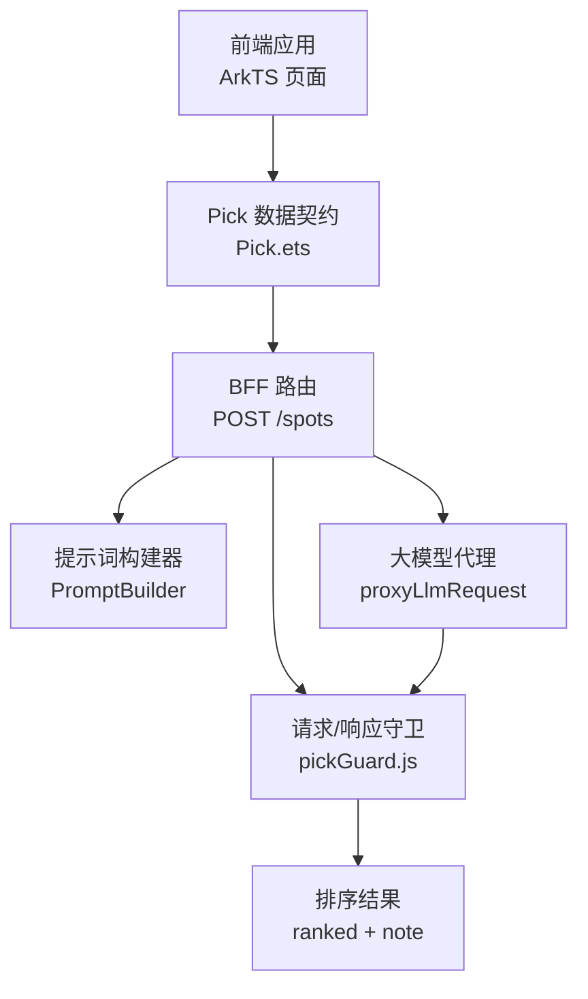
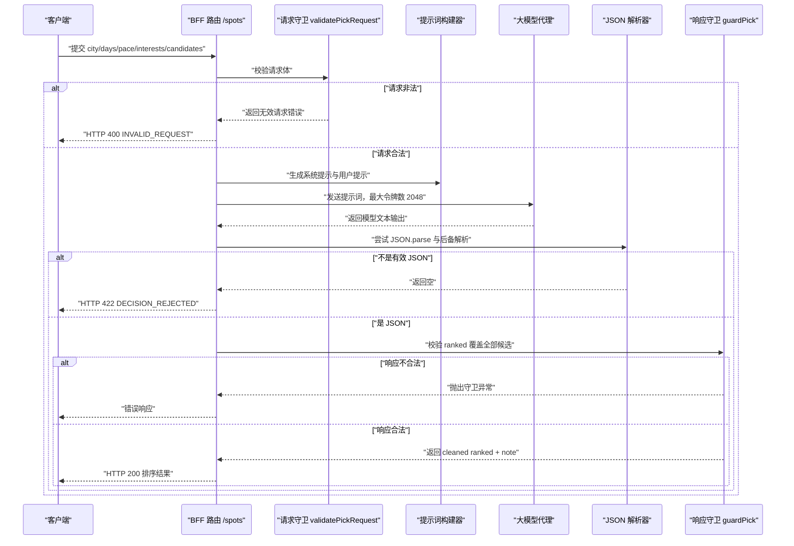
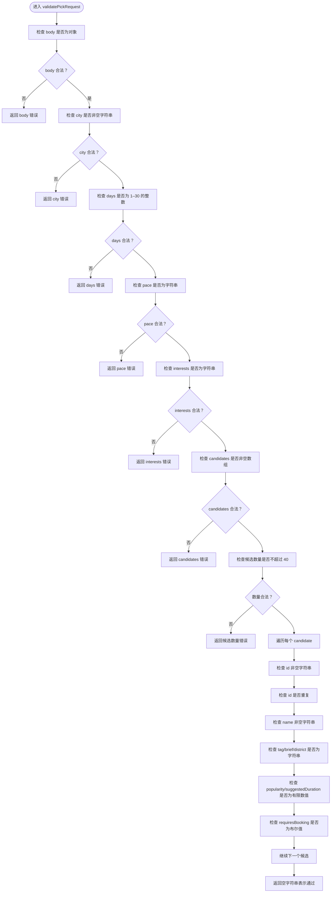
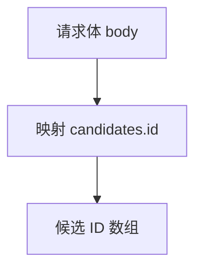
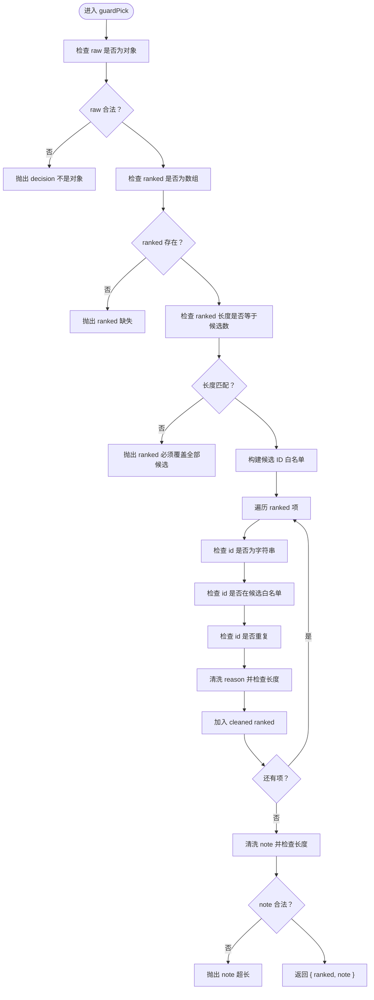
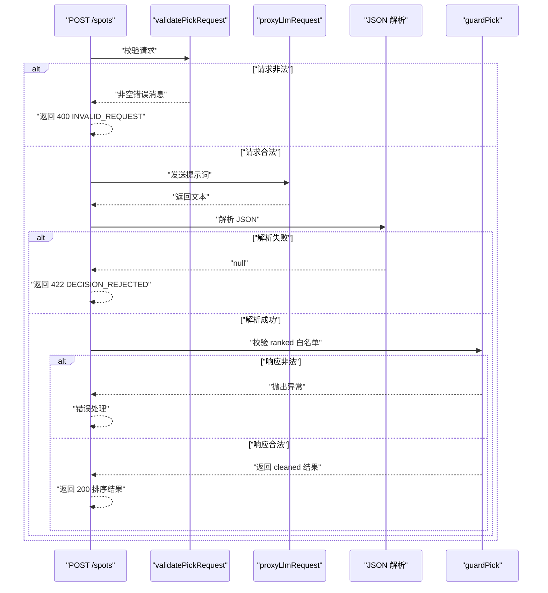
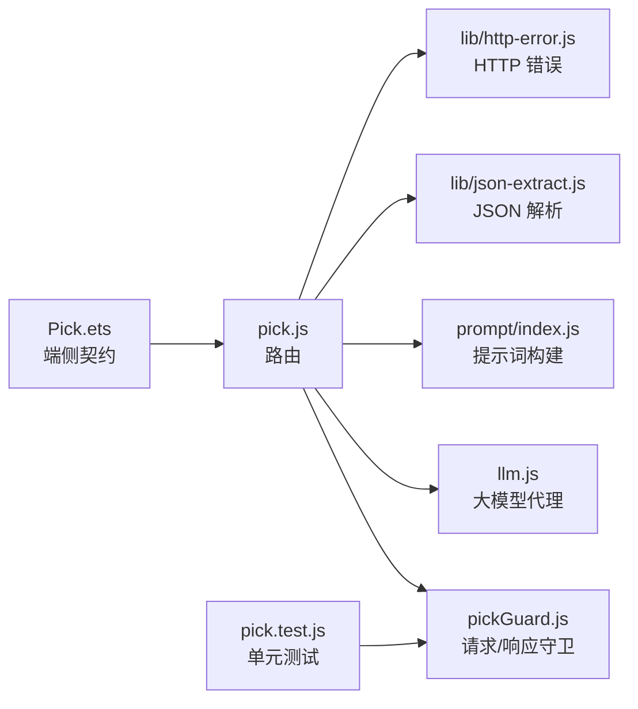

# 景点选择守卫

<cite>
**本文引用的文件**
- [pickGuard.js](file://bff/src/services/pickGuard.js)
- [pick.js](file://bff/src/routes/pick.js)
- [Pick.ets](file://entry/src/main/ets/model/Pick.ets)
- [pick.test.js](file://bff/test/pick.test.js)
</cite>

## 目录
1. [引言](#引言)
2. [项目结构定位](#项目结构定位)
3. [核心组件](#核心组件)
4. [架构总览](#架构总览)
5. [详细组件分析](#详细组件分析)
6. [依赖关系分析](#依赖关系分析)
7. [性能与复杂度](#性能与复杂度)
8. [错误消息清单](#错误消息清单)
9. [输入输出示例](#输入输出示例)
10. [故障排查指南](#故障排查指南)
11. [结论](#结论)

## 引言
本文件围绕“景点选择守卫”展开，聚焦后端 BFF 层中负责校验景点选择请求、约束大语言模型响应并防止 AI 编造景点的安全边界。其核心目标是：
- 严格校验客户端提交的候选景点集合；
- 限制候选数量、重复 ID、字段类型和文本长度；
- 要求 LLM 仅对候选池进行排序，不得新增、替换或遗漏景点；
- 提供可离线断言的纯函数接口，便于单元测试和契约测试；
- 将端侧数据契约与 BFF 守卫逻辑对齐，形成端到端安全链。

该能力对应产品中的“P1 AI 精选”流程：用户输入城市、天数、节奏、兴趣标签，并附带候选景点列表；服务端调用统一提示词构建器与大模型代理，返回按推荐顺序排列的景点及一句理由。

## 项目结构定位
景点选择守卫位于 Node.js 后端（BFF）服务中，由路由层调度、守卫函数执行校验、LLM 代理完成推理。端侧通过 TypeScript/ArkTS 契约定义数据结构，保证前后端字段一致。



**图示来源**
- [pick.js:12-43](file://bff/src/routes/pick.js#L12-L43)
- [pickGuard.js:1-97](file://bff/src/services/pickGuard.js#L1-L97)
- [Pick.ets:1-25](file://entry/src/main/ets/model/Pick.ets#L1-L25)

**章节来源**
- [pick.js:1-45](file://bff/src/routes/pick.js#L1-L45)
- [pickGuard.js:1-97](file://bff/src/services/pickGuard.js#L1-L97)
- [Pick.ets:1-25](file://entry/src/main/ets/model/Pick.ets#L1-L25)

## 核心组件
景点选择守卫由以下关键部分组成：

| 组件 | 职责 | 位置 |
|---|---|---|
| `validatePickRequest` | 校验请求体字段类型、取值范围、候选数量与候选对象结构 | [pickGuard.js](file://bff/src/services/pickGuard.js) |
| `candidateIdsOf` | 从请求体中提取候选 ID 列表，供响应守卫使用 | [pickGuard.js](file://bff/src/services/pickGuard.js) |
| `guardPick` | 校验并清洗 LLM 返回的排序结果，禁止新增景点、重复 ID、超长文本 | [pickGuard.js](file://bff/src/services/pickGuard.js) |
| `/spots` 路由 | 串联请求校验、提示词构造、LLM 调用、响应守卫 | [pick.js](file://bff/src/routes/pick.js) |
| `PickCandidate` / `PickRankItem` / `PickResult` | 端侧契约，描述候选、排序项和最终返回结构 | [Pick.ets](file://entry/src/main/ets/model/Pick.ets) |

**章节来源**
- [pickGuard.js:1-97](file://bff/src/services/pickGuard.js#L1-L97)
- [pick.js:1-45](file://bff/src/routes/pick.js#L1-L45)
- [Pick.ets:1-25](file://entry/src/main/ets/model/Pick.ets#L1-L25)

## 架构总览
下图展示一次完整的景点选择请求从客户端到 LLM 再到守卫校验的数据流。



**图示来源**
- [pick.js:12-43](file://bff/src/routes/pick.js#L12-L43)
- [pickGuard.js:10-97](file://bff/src/services/pickGuard.js#L10-L97)

**章节来源**
- [pick.js:12-43](file://bff/src/routes/pick.js#L12-L43)

## 详细组件分析

### 请求验证：`validatePickRequest`
该函数负责在 LLM 被调用之前拦截非法请求，避免浪费模型资源，同时确保候选池具备足够语义信息。

#### 参数校验规则

| 参数 | 校验条件 | 失败行为 |
|---|---|---|
| `body` | 必须是普通对象，不能是数组或 null | 返回“body 必须是对象” |
| `city` | 字符串且去除空白后非空 | 返回“city 必须是非空字符串” |
| `days` | 整数且在 1 到 30 之间 | 返回“days 必须是 1–30 的整数” |
| `pace` | 字符串 | 返回“pace 必须是字符串” |
| `interests` | 字符串 | 返回“interests 必须是字符串” |
| `candidates` | 非空数组 | 返回“candidates 不能为空” |
| `candidates.length` | 不超过 40 | 返回“candidates 最多 40 个” |

每个候选项 `c` 的校验如下：

| 字段 | 校验条件 | 失败行为 |
|---|---|---|
| `c` | 必须是对象 | 返回“candidate 必须是对象” |
| `c.id` | 非空字符串 | 返回“candidate.id 非法” |
| `c.id` 唯一性 | 候选池中不能有重复 ID | 返回“candidate.id 重复” |
| `c.name` | 非空字符串 | 返回“candidate.name 非法” |
| `c.tag` | 字符串 | 返回“candidate 文本字段非法” |
| `c.brief` | 字符串 | 返回“candidate 文本字段非法” |
| `c.district` | 字符串 | 返回“candidate 文本字段非法” |
| `c.popularity` | 有限数值 | 返回“candidate 数值字段非法” |
| `c.suggestedDuration` | 有限数值 | 返回“candidate 数值字段非法” |
| `c.requiresBooking` | 布尔值 | 返回“candidate.requiresBooking 非法” |

注意：
- 数值字段使用有限数值判断，因此 `NaN`、`Infinity`、`-Infinity` 均视为非法。
- 当前实现没有显式限定 `popularity` 与 `suggestedDuration` 的具体上下界；只要求为有限数值。
- `MAX_CANDIDATES = 40` 是硬编码上限，用于防御超大候选集。



**图示来源**
- [pickGuard.js:10-58](file://bff/src/services/pickGuard.js#L10-L58)

**章节来源**
- [pickGuard.js:10-58](file://bff/src/services/pickGuard.js#L10-L58)

### 候选 ID 提取：`candidateIdsOf`
该纯函数仅做数据投影，不修改原对象，也不访问外部状态。

- 输入：带 `candidates` 字段的请求体。
- 输出：按传入顺序排列的候选 ID 数组。
- 用途：作为 `guardPick` 的白名单来源。



**图示来源**
- [pickGuard.js:60-62](file://bff/src/services/pickGuard.js#L60-L62)

**章节来源**
- [pickGuard.js:60-62](file://bff/src/services/pickGuard.js#L60-L62)

### 响应守卫：`guardPick`
`guardPick` 是防止 AI 编造景点的核心安全边界。它接收 LLM 原始输出和候选 ID 白名单，输出清洗后的结构化结果。

#### 校验与清理规则

| 检查项 | 规则 | 失败行为 |
|---|---|---|
| `raw` | 必须是对象 | 抛出“decision 不是对象” |
| `raw.ranked` | 必须是数组 | 抛出“ranked 缺失” |
| `ranked.length` | 必须等于候选 ID 数量 | 抛出“ranked 必须覆盖全部候选” |
| `item.id` | 必须是字符串 | 抛出“ranked.id 不在候选内” |
| `item.id` | 必须在候选白名单中 | 抛出“ranked.id 不在候选内” |
| `item.id` 唯一性 | ranked 中不能有重复 ID | 抛出“ranked.id 重复” |
| `item.reason` | 若为字符串则去空白 | 超过 80 字符时抛出“reason 超长” |
| `note` | 若为字符串则去空白 | 超过 200 字符时抛出“note 超长” |

输出结构固定为：

| 字段 | 类型 | 说明 |
|---|---|---|
| `ranked` | 对象数组 | 每项包含 `id` 与清洗后的 `reason` |
| `note` | 字符串 | 全局备注，已去空白并按长度限制裁剪 |



**图示来源**
- [pickGuard.js:64-97](file://bff/src/services/pickGuard.js#L64-L97)

**章节来源**
- [pickGuard.js:64-97](file://bff/src/services/pickGuard.js#L64-L97)

### 路由集成：`POST /spots`
路由层把守卫函数嵌入完整业务流程：

1. 读取请求体。
2. 调用 `validatePickRequest`。
3. 若失败，直接返回 HTTP 400 与 `INVALID_REQUEST`。
4. 调用提示词构建器生成 system 与 user 提示。
5. 调用 LLM 代理，最大令牌数为 2048。
6. 先尝试标准 JSON 解析，再回退到后备解析器。
7. 若无法解析出 JSON，返回 HTTP 422 与 `DECISION_REJECTED`。
8. 调用 `guardPick` 进行响应级校验。
9. 记录日志后返回清洗后的决策结果。



**图示来源**
- [pick.js:12-43](file://bff/src/routes/pick.js#L12-L43)

**章节来源**
- [pick.js:12-43](file://bff/src/routes/pick.js#L12-L43)

### 端侧契约：`Pick.ets`
端侧定义了与 BFF 交换的数据结构，强调“只交换候选 ID 与一句理由”，避免搬运完整景点详情，从而减少 token 消耗并降低幻觉风险。

| 类型 | 字段 | 含义 |
|---|---|---|
| `PickCandidate` | `id` | 景点唯一标识 |
| `PickCandidate` | `name` | 景点名称 |
| `PickCandidate` | `tag` | 分类标签 |
| `PickCandidate` | `brief` | 简要介绍 |
| `PickCandidate` | `district` | 所属区域 |
| `PickCandidate` | `popularity` | 热度数值 |
| `PickCandidate` | `suggestedDuration` | 建议停留时长 |
| `PickCandidate` | `requiresBooking` | 是否需要预约 |
| `PickRankItem` | `id` | 被排序的景点 ID |
| `PickRankItem` | `reason` | 一句推荐理由 |
| `PickResult` | `ranked` | 排序后的景点列表 |
| `PickResult` | `note` | 全局备注 |

**章节来源**
- [Pick.ets:1-25](file://entry/src/main/ets/model/Pick.ets#L1-L25)

## 依赖关系分析



**图示来源**
- [pick.js:1-45](file://bff/src/routes/pick.js#L1-L45)
- [pickGuard.js:1-97](file://bff/src/services/pickGuard.js#L1-L97)
- [pick.test.js:1-55](file://bff/test/pick.test.js#L1-L55)

**章节来源**
- [pick.js:1-45](file://bff/src/routes/pick.js#L1-L45)
- [pickGuard.js:1-97](file://bff/src/services/pickGuard.js#L1-L97)
- [pick.test.js:1-55](file://bff/test/pick.test.js#L1-L55)

## 性能与复杂度
- `validatePickRequest`：时间复杂度为 O(n)，其中 n 是候选数量；空间复杂度为 O(n)，主要用于存储候选 ID 的集合。
- `candidateIdsOf`：时间复杂度为 O(n)，空间复杂度为 O(n)。
- `guardPick`：时间复杂度为 O(m)，其中 m 是 `ranked` 长度；空间复杂度为 O(n + m)，分别用于白名单集合与去重集合。
- 候选数量上限为 40，响应排序长度必须与候选数量相等，因此整体输入规模较小，适合高频短请求场景。
- 守卫函数为纯函数，无副作用，可独立缓存测试结果，也适合在 CI 中进行契约回归。

[本节为通用性能讨论，不直接分析具体代码行]

## 错误消息清单
以下为守卫层可能产生的错误消息汇总：

| 阶段 | 错误消息 | 触发条件 |
|---|---|---|
| 请求体 | “body 必须是对象” | body 不是普通对象 |
| 城市 | “city 必须是非空字符串” | city 不是字符串或为空 |
| 天数 | “days 必须是 1–30 的整数” | days 不是整数或超出范围 |
| 节奏 | “pace 必须是字符串” | pace 不是字符串 |
| 兴趣 | “interests 必须是字符串” | interests 不是字符串 |
| 候选数组 | “candidates 不能为空” | candidates 不是数组或长度为 0 |
| 候选数量 | “candidates 最多 40 个” | candidates 长度大于 40 |
| 候选对象 | “candidate 必须是对象” | 候选元素不是对象 |
| 候选 ID | “candidate.id 非法” | id 不是非空字符串 |
| 候选 ID 重复 | “candidate.id 重复” | 候选池中存在重复 id |
| 候选名称 | “candidate.name 非法” | name 不是非空字符串 |
| 候选文本字段 | “candidate 文本字段非法” | tag、brief 或 district 不是字符串 |
| 候选数值字段 | “candidate 数值字段非法” | popularity 或 suggestedDuration 不是有限数值 |
| 候选预约字段 | “candidate.requiresBooking 非法” | requiresBooking 不是布尔值 |
| 决策对象 | “decision 不是对象” | LLM 原始输出不是对象 |
| 排序数组 | “ranked 缺失” | ranked 不是数组 |
| 排序长度 | “ranked 必须覆盖全部候选” | ranked 长度不等于候选数量 |
| 排序 ID | “ranked.id 不在候选内” | id 不是字符串或不在候选白名单 |
| 排序 ID 重复 | “ranked.id 重复” | ranked 中出现重复 id |
| 理由长度 | “reason 超长” | 清洗后的 reason 超过 80 字符 |
| 备注长度 | “note 超长” | 清洗后的 note 超过 200 字符 |

此外，路由层还会产生两类协议级错误：
- HTTP 400：请求校验失败，错误码 `INVALID_REQUEST`。
- HTTP 422：LLM 输出无法解析为 JSON，错误码 `DECISION_REJECTED`。

**章节来源**
- [pickGuard.js:10-97](file://bff/src/services/pickGuard.js#L10-L97)
- [pick.js:18-43](file://bff/src/routes/pick.js#L18-L43)

## 输入输出示例

### 合法请求示例
```json
{
  "city": "杨凌",
  "days": 1,
  "pace": "standard",
  "interests": "文化/休闲",
  "candidates": [
    {
      "id": "s1",
      "name": "教稼园",
      "tag": "经典",
      "brief": "农业始祖后稷教民稼穑之地",
      "district": "杨陵区",
      "popularity": 70,
      "suggestedDuration": 60,
      "requiresBooking": false
    },
    {
      "id": "s2",
      "name": "农高会会址",
      "tag": "经典",
      "brief": "农业高新科技成果博览会会址",
      "district": "杨陵区",
      "popularity": 80,
      "suggestedDuration": 90,
      "requiresBooking": true
    }
  ]
}
```

该请求应通过 `validatePickRequest`，并通过 `candidateIdsOf` 得到 `["s1", "s2"]`。

### 合法响应示例
```json
{
  "ranked": [
    {
      "id": "s2",
      "reason": "会址适合先看"
    },
    {
      "id": "s1",
      "reason": "园子小而安静"
    }
  ],
  "note": "一天先看会址再看教稼园"
}
```

该响应应通过 `guardPick`，并被清洗为去空白后的 `reason` 与 `note`。

### 非法请求示例
- 候选为空数组：
  ```json
  {
    "city": "杨凌",
    "days": 1,
    "pace": "standard",
    "interests": "文化/休闲",
    "candidates": []
  }
  ```
  预期：返回“candidates 不能为空”。

- 候选 ID 重复：
  ```json
  {
    "city": "杨凌",
    "days": 1,
    "pace": "standard",
    "interests": "文化/休闲",
    "candidates": [
      {
        "id": "s1",
        "name": "教稼园",
        "tag": "经典",
        "brief": "农业始祖后稷教民稼穑之地",
        "district": "杨陵区",
        "popularity": 70,
        "suggestedDuration": 60,
        "requiresBooking": false
      },
      {
        "id": "s1",
        "name": "重复景点",
        "tag": "其他",
        "brief": "重复 id",
        "district": "杨陵区",
        "popularity": 60,
        "suggestedDuration": 40,
        "requiresBooking": false
      }
    ]
  }
  ```
  预期：返回“candidate.id 重复”。

### 非法响应示例
- 遗漏候选：
  ```json
  {
    "ranked": [
      {
        "id": "s1",
        "reason": "顺路"
      }
    ]
  }
  ```
  预期：抛出“ranked 必须覆盖全部候选”。

- 引入候选外 ID：
  ```json
  {
    "ranked": [
      {
        "id": "sx",
        "reason": "AI 编造景点"
      },
      {
        "id": "s1",
        "reason": "园子小而安静"
      }
    ]
  }
  ```
  预期：抛出“ranked.id 不在候选内”。

- 排序重复：
  ```json
  {
    "ranked": [
      {
        "id": "s1",
        "reason": ""
      },
      {
        "id": "s1",
        "reason": ""
      }
    ]
  }
  ```
  预期：抛出“ranked.id 重复”。

- 理由过长：
  ```json
  {
    "ranked": [
      {
        "id": "s1",
        "reason": "x".repeat(81)
      },
      {
        "id": "s2",
        "reason": ""
      }
    ]
  }
  ```
  预期：抛出“reason 超长”。

**章节来源**
- [pickGuard.js:10-97](file://bff/src/services/pickGuard.js#L10-L97)
- [pick.test.js:1-55](file://bff/test/pick.test.js#L1-L55)

## 故障排查指南

### 常见错误定位
| 现象 | 可能原因 | 排查步骤 |
|---|---|---|
| 客户端收到 400 INVALID_REQUEST | 请求字段类型错误或候选数量超限 | 检查 city、days、pace、interests、candidates 结构与长度 |
| 客户端收到 422 DECISION_REJECTED | LLM 未返回合法 JSON | 查看 LLM 原始输出，确认是否可被 JSON.parse 或后备解析器处理 |
| ranked 覆盖不全 | LLM 漏排景点 | 检查 `ranked.length` 是否等于候选数量 |
| ranked 出现未知 ID | LLM 编造景点 | 检查 `item.id` 是否在候选白名单中 |
| ranked 重复 ID | LLM 重复输出同一景点 | 检查 ranked 中是否存在重复 id |
| reason 超长 | LLM 输出理由过长 | 检查清洗前 reason 长度是否超过 80 |
| note 超长 | LLM 输出备注过长 | 检查清洗前 note 长度是否超过 200 |

### 调试建议
1. 优先打印请求体中的 `candidates` 列表，确认 ID 唯一性与字段完整性。
2. 打印 LLM 原始输出，区分“解析失败”与“守卫失败”。
3. 使用单元测试覆盖典型非法路径：空候选、重复 ID、未知 ID、遗漏排序、超长文本。
4. 若怀疑 AI 编造景点，重点检查 `guardPick` 的白名单过滤逻辑。
5. 若怀疑端侧与后端契约不一致，对照 `Pick.ets` 与 `pickGuard.js` 的字段命名与类型。

**章节来源**
- [pick.js:18-43](file://bff/src/routes/pick.js#L18-L43)
- [pickGuard.js:10-97](file://bff/src/services/pickGuard.js#L10-L97)
- [pick.test.js:1-55](file://bff/test/pick.test.js#L1-L55)

## 结论
景点选择守卫通过两层纯函数完成端到端安全控制：`validatePickRequest` 在前端请求侧建立强契约，`guardPick` 在后端响应侧锁定候选白名单。其设计要点包括：
- 明确拒绝非法类型、越界数值、空文本与重复 ID；
- 强制 LLM 仅对候选池排序，不允许新增、删除或替换景点；
- 对 reason 与 note 做去空白与长度限制；
- 提供可离线断言的纯函数接口，便于单元测试与契约回归；
- 与端侧 `Pick.ets` 契约保持一致，形成清晰的数据边界。

这套机制有效降低了大模型幻觉带来的安全风险，同时保持流程简洁、可测试、可维护。

[本节为总结性内容，不直接分析具体代码行]