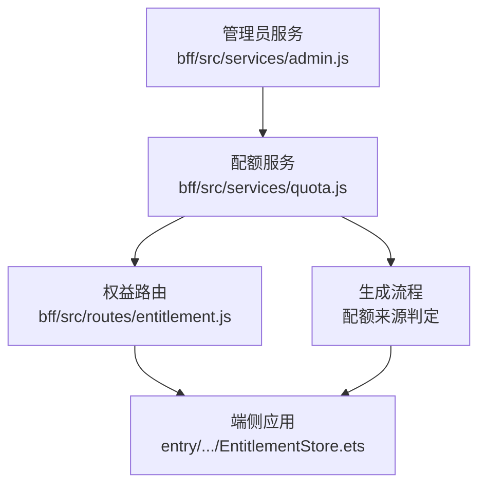
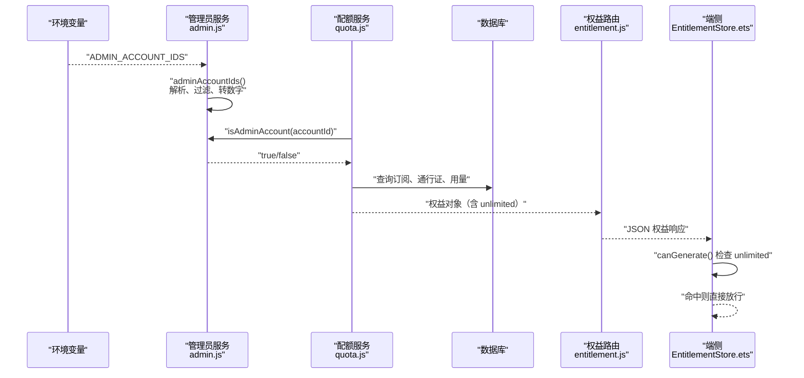
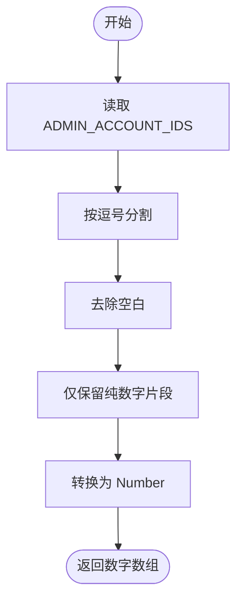
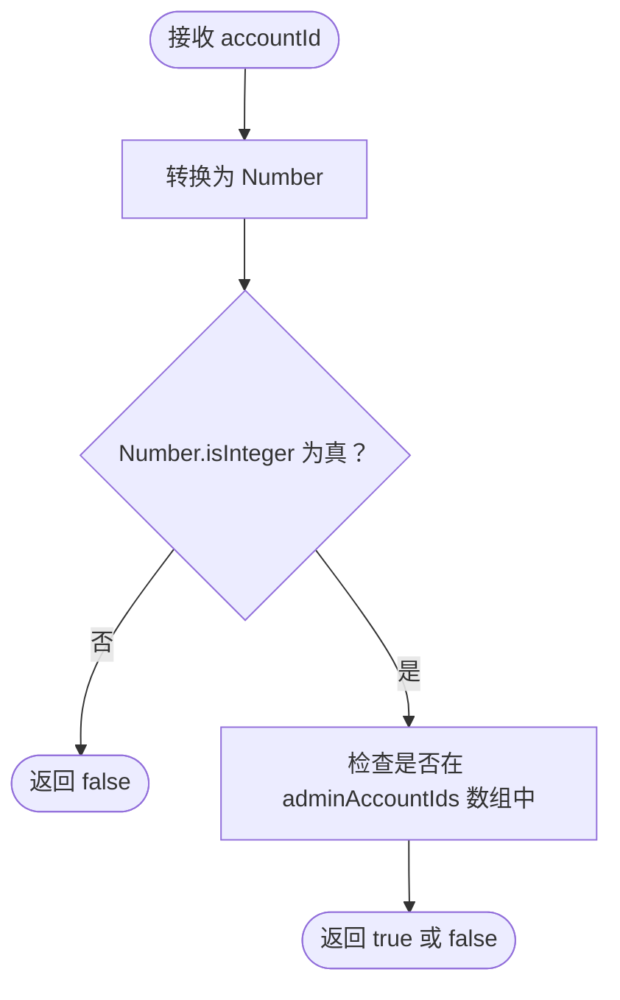
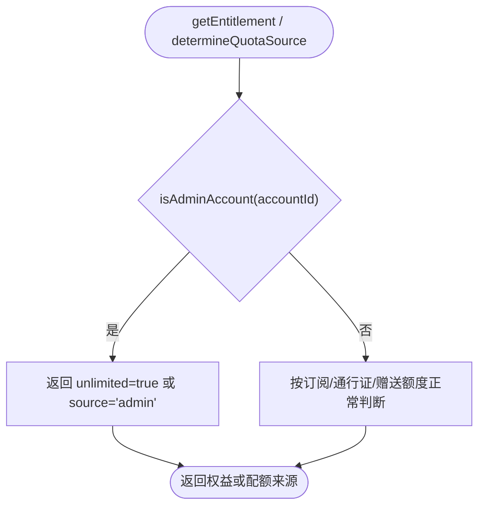
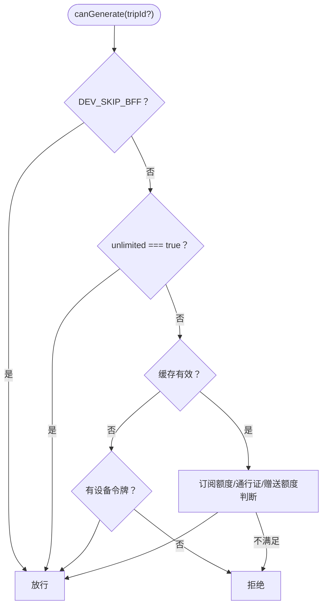
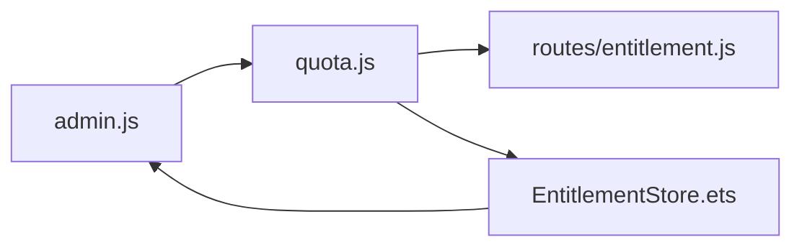

# 管理员服务

<cite>
**本文引用的文件**   
- [bff/src/services/admin.js](file://bff/src/services/admin.js)
- [bff/src/services/quota.js](file://bff/src/services/quota.js)
- [bff/src/routes/entitlement.js](file://bff/src/routes/entitlement.js)
- [entry/src/main/ets/data/EntitlementStore.ets](file://entry/src/main/ets/data/EntitlementStore.ets)
</cite>

## 目录
1. [引言](#引言)
2. [项目结构定位](#项目结构定位)
3. [核心组件](#核心组件)
4. [架构总览](#架构总览)
5. [详细组件分析](#详细组件分析)
6. [依赖关系分析](#依赖关系分析)
7. [性能与行为特征](#性能与行为特征)
8. [配置示例](#配置示例)
9. [测试用例设计](#测试用例设计)
10. [故障排查](#故障排查)
11. [安全注意事项](#安全注意事项)
12. [结论](#结论)

## 引言
本文件聚焦后端“管理员服务”及其在配额、权益、端侧生成流程中的集成。管理员白名单由环境变量 `ADMIN_ACCOUNT_IDS` 提供，通过 `adminAccountIds()` 解析为数字数组；`isAdminAccount(accountId)` 负责把传入值转成整数后做白名单匹配。该机制仅用于本机联调测试：不写数据库、不下发服务端配置、未设置变量时功能完全关闭。其影响范围包括：
- 配额来源判断中管理员优先；
- 权益响应中透传 `unlimited: true`；
- 端侧 `EntitlementStore.canGenerate()` 对 `unlimited === true` 直接放行。

## 项目结构定位
管理员能力位于 BFF（业务前端）的 `services/admin.js`，并被配额服务 `services/quota.js` 引用；配额服务同时暴露给 `/v1/entitlement` 路由和行程生成相关逻辑。端侧鸿蒙应用在 `EntitlementStore.ets` 消费服务端返回的 `unlimited` 字段，决定是否跳过额度门禁。

**图表来源**
- [bff/src/services/admin.js:1-24](file://bff/src/services/admin.js#L1-L24)
- [bff/src/services/quota.js:1-113](file://bff/src/services/quota.js#L1-L113)
- [bff/src/routes/entitlement.js:1-15](file://bff/src/routes/entitlement.js#L1-L15)
- [entry/src/main/ets/data/EntitlementStore.ets:1-200](file://entry/src/main/ets/data/EntitlementStore.ets#L1-L200)

**章节来源**
- [bff/src/services/admin.js:1-24](file://bff/src/services/admin.js#L1-L24)
- [bff/src/services/quota.js:1-113](file://bff/src/services/quota.js#L1-L113)
- [bff/src/routes/entitlement.js:1-15](file://bff/src/routes/entitlement.js#L1-L15)
- [entry/src/main/ets/data/EntitlementStore.ets:1-200](file://entry/src/main/ets/data/EntitlementStore.ets#L1-L200)

## 核心组件
- **管理员白名单解析器**：从 `process.env.ADMIN_ACCOUNT_IDS` 读取逗号分隔字符串，过滤非纯数字项并转为 `Number` 数组。
- **管理员身份判定函数**：将任意 `accountId` 转为 `Number`，使用 `Number.isInteger` 校验是否为整数，再用 `Array.includes` 检查是否在白名单中。
- **配额服务集成点**：在获取权益时添加 `unlimited` 字段；在确定配额来源时让管理员优先。
- **端侧权限消费点**：`EntitlementStore.canGenerate()` 对 `unlimited === true` 直接放行，绕过订阅额度、通行证和赠送额度的常规判断。

**章节来源**
- [bff/src/services/admin.js:1-24](file://bff/src/services/admin.js#L1-L24)
- [bff/src/services/quota.js:1-113](file://bff/src/services/quota.js#L1-L113)
- [entry/src/main/ets/data/EntitlementStore.ets:1-200](file://entry/src/main/ets/data/EntitlementStore.ets#L1-L200)

## 架构总览
管理员机制是 BFF 层的一个轻量决策点，围绕环境变量运行，不参与持久化。其数据流如下：

**图表来源**
- [bff/src/services/admin.js:1-24](file://bff/src/services/admin.js#L1-L24)
- [bff/src/services/quota.js:1-113](file://bff/src/services/quota.js#L1-L113)
- [bff/src/routes/entitlement.js:1-15](file://bff/src/routes/entitlement.js#L1-L15)
- [entry/src/main/ets/data/EntitlementStore.ets:1-200](file://entry/src/main/ets/data/EntitlementStore.ets#L1-L200)

## 详细组件分析

### 管理员白名单解析器
- 输入来源：`process.env.ADMIN_ACCOUNT_IDS`。
- 解析步骤：
  1. 若环境变量不存在或为空，使用空字符串。
  2. 按逗号分割成片段。
  3. 去除每个片段首尾空白。
  4. 只保留纯数字片段。
  5. 全部转换为 JavaScript 数字。
- 输出：一个正整数字符串经清洗后的数字数组；无效项会被丢弃，不会抛错。
- 复杂度：时间复杂度 O(n)，空间复杂度 O(n)，n 为逗号分隔片段数量。

**图表来源**
- [bff/src/services/admin.js:1-24](file://bff/src/services/admin.js#L1-L24)

**章节来源**
- [bff/src/services/admin.js:1-24](file://bff/src/services/admin.js#L1-L24)

### 管理员身份判定函数 `isAdminAccount`
- 参数：`accountId`，类型不限。
- 处理逻辑：
  1. 调用 `Number(accountId)` 进行类型转换。
  2. 使用 `Number.isInteger` 判断结果是否为整数。
  3. 若非整数，直接返回 `false`。
  4. 若是整数，再调用 `adminAccountIds().includes(id)` 检查是否命中白名单。
- 边界行为：
  - `null`、`undefined`、空字符串、小数、负数、科学计数法字符串等最终要么不是整数，要么不在白名单中，均返回 `false`。
  - 白名单为空时永远返回 `false`。
- 复杂度：每次调用包含一次数组查找，平均时间复杂度 O(n)。

**图表来源**
- [bff/src/services/admin.js:1-24](file://bff/src/services/admin.js#L1-L24)

**章节来源**
- [bff/src/services/admin.js:1-24](file://bff/src/services/admin.js#L1-L24)

### 配额服务中的管理员集成
配额服务承担两个关键职责：
1. **返回权益信息**：查询订阅、通行证、赠送额度余额和本月用量，并在末尾加入 `unlimited: isAdminAccount(accountId)`。
2. **确定配额来源**：管理员优先于订阅、通行证、赠送额度，返回 `'admin'` 作为来源，但仍会写入配额账本，便于统计真实调用量。

**图表来源**
- [bff/src/services/quota.js:1-113](file://bff/src/services/quota.js#L1-L113)

**章节来源**
- [bff/src/services/quota.js:1-113](file://bff/src/services/quota.js#L1-L113)

### 端侧 `canGenerate` 的直接放行
端侧 `EntitlementStore.canGenerate()` 的消费顺序如下：
1. 若开发旁路开启，直接放行。
2. 若缓存中 `unlimited === true`，直接放行。
3. 若缓存过期，退化为依赖本地票据状态，避免误判长期付费用户。
4. 否则按订阅额度、通行证、赠送额度做常规判断。

**图表来源**
- [entry/src/main/ets/data/EntitlementStore.ets:1-200](file://entry/src/main/ets/data/EntitlementStore.ets#L1-L200)

**章节来源**
- [entry/src/main/ets/data/EntitlementStore.ets:1-200](file://entry/src/main/ets/data/EntitlementStore.ets#L1-L200)

## 依赖关系分析
- `services/quota.js` 显式导入 `services/admin.js`。
- `routes/entitlement.js` 调用 `services/quota.js` 的 `getEntitlement`。
- 端侧 `EntitlementStore.ets` 不直接依赖 `admin.js`，而是消费 BFF 返回的 `unlimited` 字段。
- 管理员逻辑本身不依赖数据库、认证中间件或 IAP 验证，因此耦合面很小。

**图表来源**
- [bff/src/services/admin.js:1-24](file://bff/src/services/admin.js#L1-L24)
- [bff/src/services/quota.js:1-113](file://bff/src/services/quota.js#L1-L113)
- [bff/src/routes/entitlement.js:1-15](file://bff/src/routes/entitlement.js#L1-L15)
- [entry/src/main/ets/data/EntitlementStore.ets:1-200](file://entry/src/main/ets/data/EntitlementStore.ets#L1-L200)

**章节来源**
- [bff/src/services/admin.js:1-24](file://bff/src/services/admin.js#L1-L24)
- [bff/src/services/quota.js:1-113](file://bff/src/services/quota.js#L1-L113)
- [bff/src/routes/entitlement.js:1-15](file://bff/src/routes/entitlement.js#L1-L15)
- [entry/src/main/ets/data/EntitlementStore.ets:1-200](file://entry/src/main/ets/data/EntitlementStore.ets#L1-L200)

## 性能与行为特征
- **解析成本极低**：环境变量只在需要时拆分、过滤、转数字，无外部 IO。
- **判定成本低**：每次 `isAdminAccount` 最多做一次数组查找，白名单规模通常很小。
- **无持久化副作用**：管理员判断不写入数据库，也不修改配置表；只有配额来源为 `'admin'` 时会在配额账本记录一行，用于统计而非授权。
- **降级安全**：未设置 `ADMIN_ACCOUNT_IDS` 时，白名单为空，所有判定返回 `false`，管理员功能完全关闭。

[本节为通用行为说明，不直接分析具体代码行]

## 配置示例
- 环境变量名：`ADMIN_ACCOUNT_IDS`
- 格式：逗号分隔的数字字符串，例如 `1,2,100`。
- 建议：
  - 仅填写本机联调账号 ID。
  - 不要在生产环境部署时保留该变量。
  - 不要在字符串中加入空格以外的无关字符，因为解析后会按空白清理并过滤非数字项。

| 配置值 | 解析结果 | 行为 |
|---|---|---|
| 空或未设置 | 空数组 | 管理员功能关闭 |
| `1,2` | `[1, 2]` | 账号 `1` 和 `2` 被识别为管理员 |
| `1, a, 2` | `[1, 2]` | `a` 被过滤掉 |
| `1.5, 3` | `[3]` | `1.5` 不是整数，被过滤 |
| `,` | 空数组 | 没有有效 ID |

**章节来源**
- [bff/src/services/admin.js:1-24](file://bff/src/services/admin.js#L1-L24)

## 测试用例设计
建议覆盖以下场景：

| 类别 | 输入 | 期望 |
|---|---|---|
| 基础白名单 | `ADMIN_ACCOUNT_IDS="1,2"`，`accountId=1` | `isAdminAccount` 返回 `true` |
| 非白名单 | `ADMIN_ACCOUNT_IDS="1,2"`，`accountId=3` | `isAdminAccount` 返回 `false` |
| 空配置 | 未设置 `ADMIN_ACCOUNT_IDS` | 所有账号返回 `false` |
| 非整数 | `accountId=1.5` | 返回 `false` |
| 字符串数字但带小数 | `accountId="1.5"` | 返回 `false` |
| 空字符串 | `accountId=""` | 返回 `false` |
| null | `accountId=null` | 返回 `false` |
| undefined | `accountId=undefined` | 返回 `false` |
| 负数 | `accountId=-1` | 返回 `false`（除非白名单明确包含负数） |
| 科学计数法 | `accountId="1e2"` | 返回 `false`（不是整数） |
| 配额来源 | 管理员账号 | `determineQuotaSource` 返回 `'admin'` |
| 权益透传 | 管理员账号 | `getEntitlement` 返回 `unlimited: true` |
| 端侧放行 | 缓存中 `unlimited === true` | `canGenerate()` 返回 `true` |
| 用量统计 | 管理员账号 | 仍产生配额记录，可用于观察真实调用量 |

**章节来源**
- [bff/src/services/admin.js:1-24](file://bff/src/services/admin.js#L1-L24)
- [bff/src/services/quota.js:1-113](file://bff/src/services/quota.js#L1-L113)
- [entry/src/main/ets/data/EntitlementStore.ets:1-200](file://entry/src/main/ets/data/EntitlementStore.ets#L1-L200)

## 故障排查
- **管理员始终不生效**
  - 检查是否设置了 `ADMIN_ACCOUNT_IDS`。
  - 检查账号 ID 是否为纯数字且与白名单一致。
  - 确认部署环境未意外清除环境变量。
- **端侧仍显示付费墙**
  - 检查 BFF 是否返回 `unlimited: true`。
  - 检查端侧缓存是否已更新到最新权益快照。
  - 检查是否存在 `ApiConfig.DEV_SKIP_BFF` 开发旁路干扰。
- **配额记录异常增多**
  - 管理员模式下配额来源为 `'admin'`，但仍会落库统计；这是预期行为，用于观察真实调用量。
- **白名单中包含非法项**
  - 非数字项会被自动过滤，不会报错；请修正环境变量值，避免混淆。

**章节来源**
- [bff/src/services/admin.js:1-24](file://bff/src/services/admin.js#L1-L24)
- [bff/src/services/quota.js:1-113](file://bff/src/services/quota.js#L1-L113)
- [entry/src/main/ets/data/EntitlementStore.ets:1-200](file://entry/src/main/ets/data/EntitlementStore.ets#L1-L200)

## 安全注意事项
- **仅限本机联调测试用途**：管理员白名单不是生产级权限控制方案。
- **不写数据库**：管理员判定本身不写入任何表。
- **不下发配置**：不通过接口向端侧下发管理员配置；端侧只消费服务端返回的 `unlimited`。
- **未设置即关闭**：未设置 `ADMIN_ACCOUNT_IDS` 时，白名单为空，管理员功能完全不可用。
- **不替代订阅和 IAP 校验**：配额生成、IAP、限流等其他付费墙逻辑仍按原规则执行。
- **环境变量需保密**：不应提交到版本库，不应出现在日志、错误消息或公共配置中。
- **谨慎扩大白名单**：新增管理员账号应走变更评审，避免误放权。

**章节来源**
- [bff/src/services/admin.js:1-24](file://bff/src/services/admin.js#L1-L24)
- [bff/src/services/quota.js:1-113](file://bff/src/services/quota.js#L1-L113)
- [entry/src/main/ets/data/EntitlementStore.ets:1-200](file://entry/src/main/ets/data/EntitlementStore.ets#L1-L200)

## 结论
管理员服务是一个最小化的联调辅助机制：通过环境变量提供白名单，解析后在配额生成链路中给予管理员优先路径，并以 `unlimited` 字段透传到端侧，使 `EntitlementStore.canGenerate()` 直接放行。它不写数据库、不下发配置，未启用时完全关闭，从而把安全风险限制在本机联调范围内。使用时应严格管理环境变量、仅在测试环境启用，并配合配额记录观察真实调用情况。