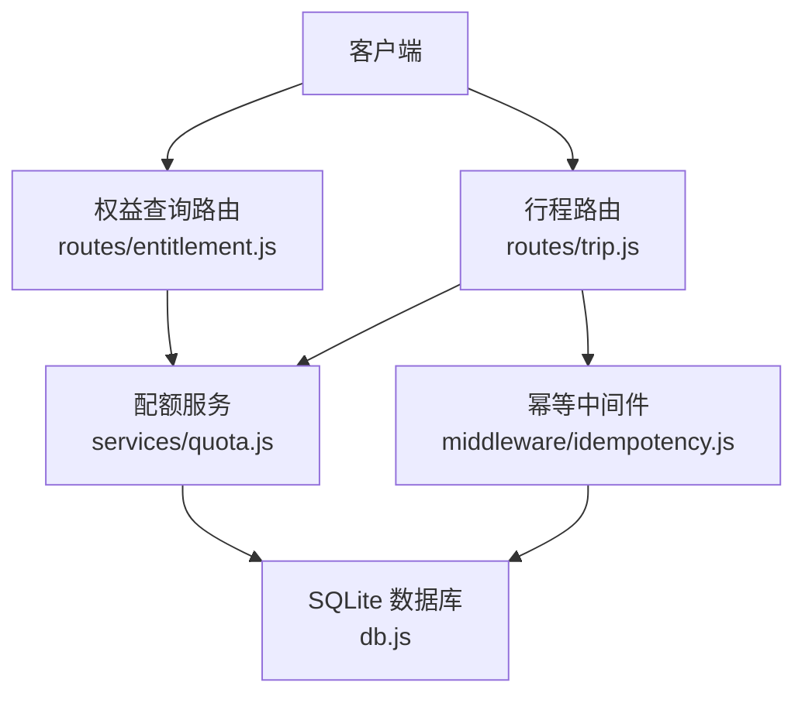
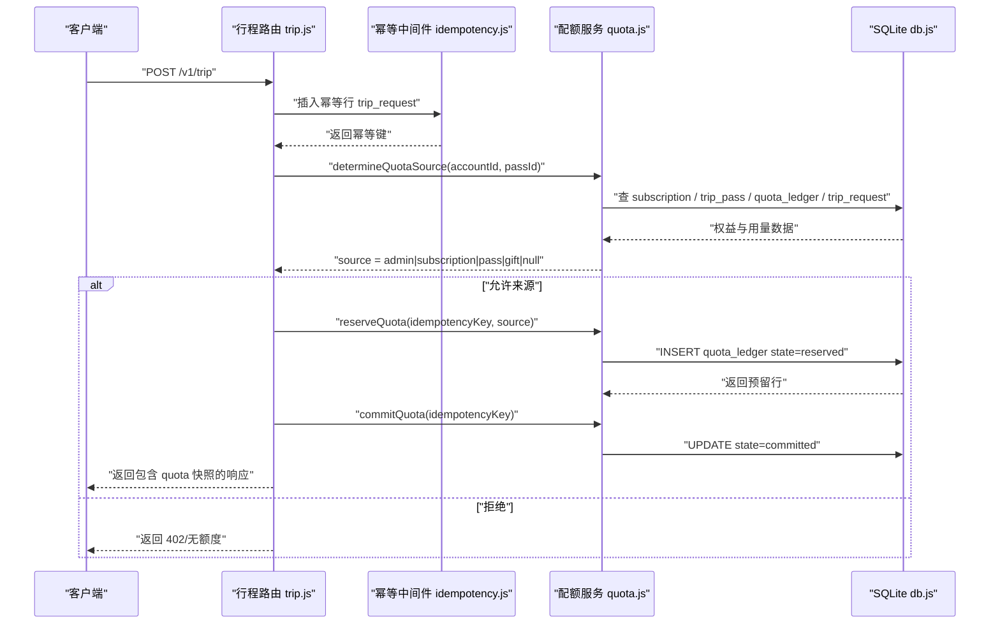
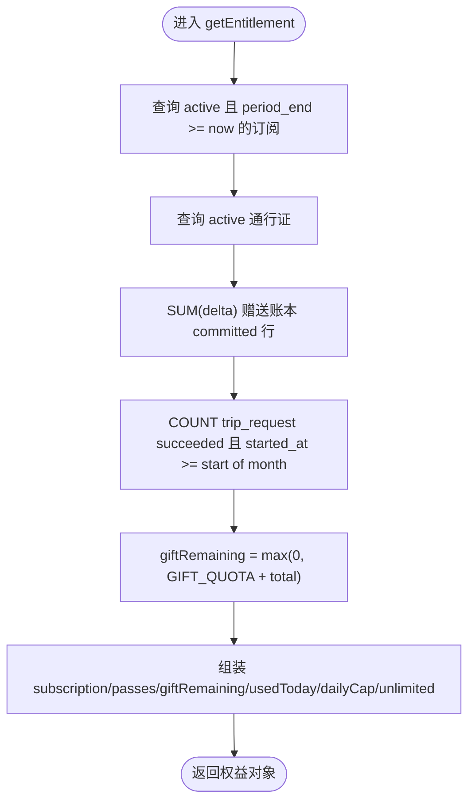
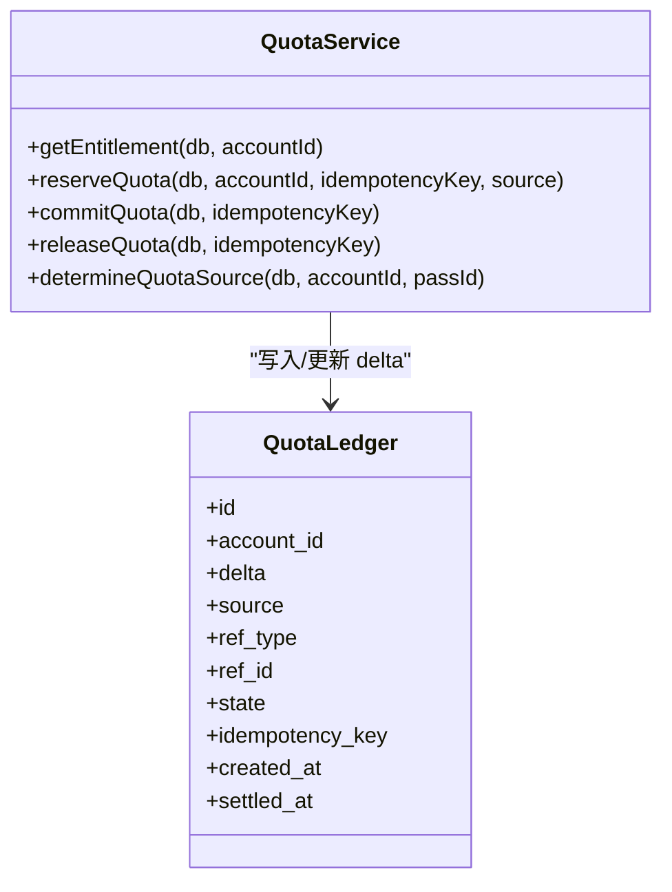
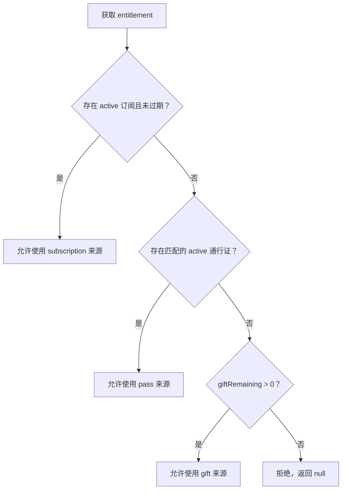
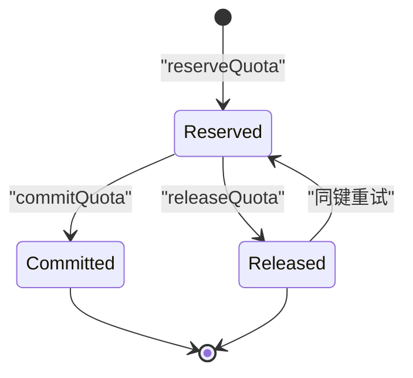
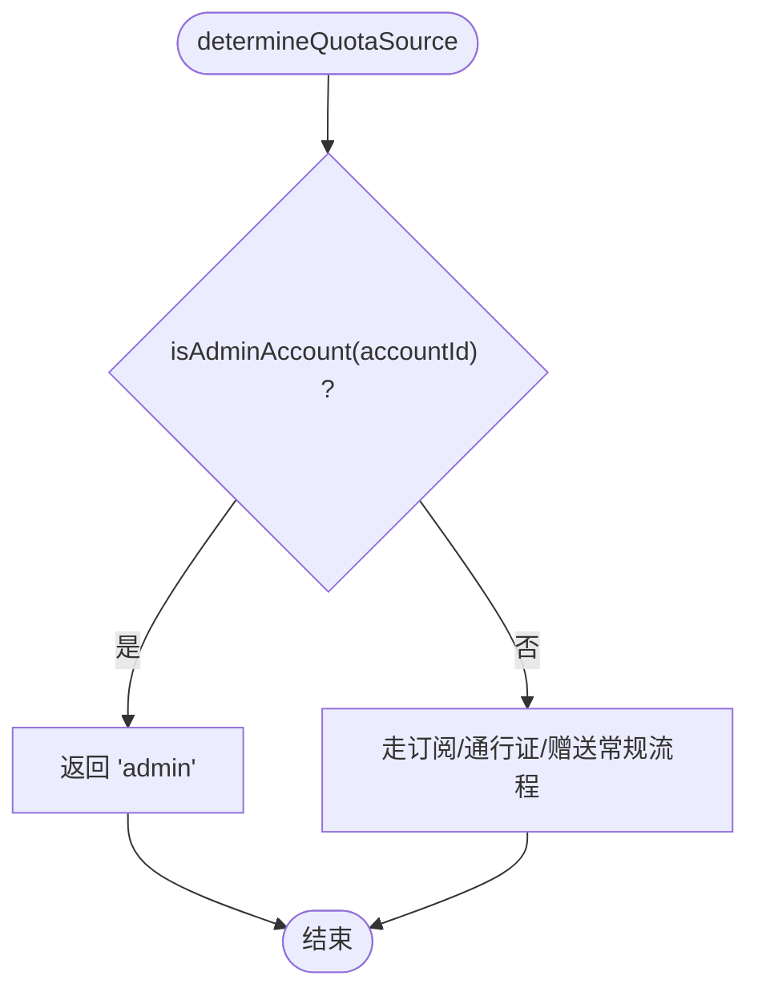
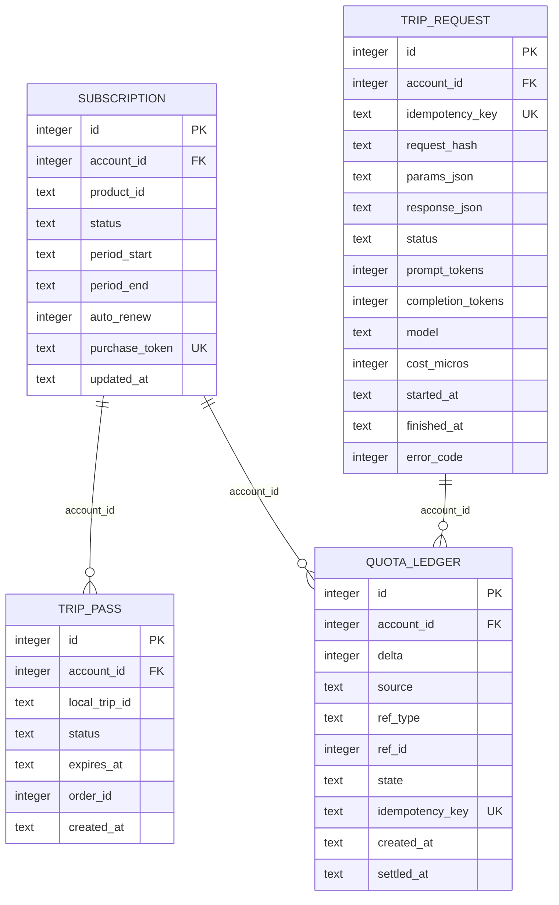
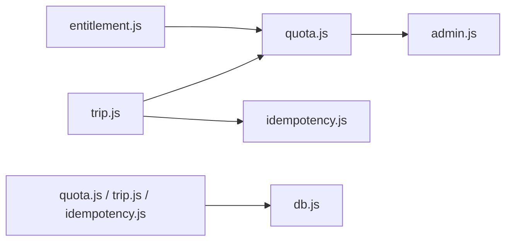

# 配额管理服务

<cite>
**本文引用的文件**   
- [bff/src/services/quota.js](file://bff/src/services/quota.js)
- [bff/src/db.js](file://bff/src/db.js)
- [bff/src/routes/entitlement.js](file://bff/src/routes/entitlement.js)
- [bff/src/routes/trip.js](file://bff/src/routes/trip.js)
- [bff/scripts/reset-dev-quota.mjs](file://bff/scripts/reset-dev-quota.mjs)
- [bff/src/middleware/idempotency.js](file://bff/src/middleware/idempotency.js)
- [bff/test/quota-window.test.js](file://bff/test/quota-window.test.js)
</cite>

## 目录
1. [简介](#简介)
2. [项目结构](#项目结构)
3. [核心组件](#核心组件)
4. [架构总览](#架构总览)
5. [详细组件分析](#详细组件分析)
6. [依赖关系分析](#依赖关系分析)
7. [性能与并发](#性能与并发)
8. [故障排查](#故障排查)
9. [结论](#结论)

## 简介
本文件面向配额管理服务的后端实现，聚焦 BFF（业务前端网关）中的额度计算、赠送额度账本、订阅与通行证权益校验、预占事务流程，以及管理员豁免机制。文档同时给出数据表结构、关键 SQL 查询语义、并发安全策略和运维建议，帮助开发者理解月度限制、delta 增减、幂等键控制和 reserved→committed/released 状态机。

## 项目结构
配额相关逻辑集中在 `bff` 子工程：
- 服务层：`bff/src/services/quota.js` 暴露额度查询、预占、提交、释放及来源判定。
- 路由层：`bff/src/routes/entitlement.js` 提供 `/v1/entitlement` 查询接口；`bff/src/routes/trip.js` 在行程生成链路中调用配额与回传额度快照。
- 数据层：`bff/src/db.js` 定义 SQLite DDL，包括订阅、通行证、额度账本、行程请求等表。
- 中间件：`bff/src/middleware/idempotency.js` 通过 `trip_request` 表实现请求级幂等。
- 工具脚本：`bff/scripts/reset-dev-quota.mjs` 用于开发环境重置赠送额度。

**图表来源**
- [bff/src/routes/entitlement.js:1-15](file://bff/src/routes/entitlement.js#L1-L15)
- [bff/src/routes/trip.js:90-224](file://bff/src/routes/trip.js#L90-L224)
- [bff/src/services/quota.js:1-113](file://bff/src/services/quota.js#L1-L113)
- [bff/src/middleware/idempotency.js:79-80](file://bff/src/middleware/idempotency.js#L79-L80)
- [bff/src/db.js:21-68](file://bff/src/db.js#L21-L68)

**章节来源**
- [bff/src/services/quota.js:1-113](file://bff/src/services/quota.js#L1-L113)
- [bff/src/db.js:21-68](file://bff/src/db.js#L21-L68)

## 核心组件
- 月度额度计算：按月统计成功行程数，并与常量上限比较。
- 赠送额度机制：基础赠送值加账本累计 delta，保留非负剩余。
- 订阅与通行证检查：active 且未过期才生效；通行证按 active 列表返回。
- 额度预占三阶段：reserved→committed 或 released，配合 idempotency_key 控制重试。
- 管理员豁免：从环境变量读取白名单，命中则 bypass 额度窗口并透传 unlimited。

**章节来源**
- [bff/src/services/quota.js:11-49](file://bff/src/services/quota.js#L11-L49)
- [bff/src/services/quota.js:51-91](file://bff/src/services/quota.js#L51-L91)
- [bff/src/services/quota.js:93-113](file://bff/src/services/quota.js#L93-L113)

## 架构总览
配额服务处于 BFF 的核心决策位置：上游路由负责鉴权、幂等与计费上下文，下游 SQLite 承载所有持久化。

**图表来源**
- [bff/src/routes/trip.js:90-224](file://bff/src/routes/trip.js#L90-L224)
- [bff/src/middleware/idempotency.js:79-80](file://bff/src/middleware/idempotency.js#L79-L80)
- [bff/src/services/quota.js:51-91](file://bff/src/services/quota.js#L51-L91)
- [bff/src/db.js:21-68](file://bff/src/db.js#L21-L68)

## 详细组件分析

### 月度额度计算
- 月度上限常量：MONTHLY_CAP=20。
- usedThisMonth 统计口径：对 account_id 在当月且 status=succeeded 的 trip_request 计数，使用 `date('now','start of month')` 作为时间窗起点。
- 字段命名兼容：虽然变量名为 usedToday，但实际语义已改为“本月已用”，以匹配付费页文案和商业方案。
- 返回结构：`usedToday` 表示本月已用次数，`dailyCap` 表示月度上限；两者供端侧 `EntitlementStore.canGenerate()` 判断。

**图表来源**
- [bff/src/services/quota.js:15-49](file://bff/src/services/quota.js#L15-L49)

**章节来源**
- [bff/src/services/quota.js:11-13](file://bff/src/services/quota.js#L11-L13)
- [bff/src/services/quota.js:15-49](file://bff/src/services/quota.js#L15-L49)

### 赠送额度机制
- 基础赠送：GIFT_QUOTA=3。
- 账本模型：quota_ledger 中 source='gift' 的行记录 delta，state='committed' 时才计入累计。
- 剩余计算：`giftRemaining = max(0, GIFT_QUOTA + SUM(delta))`，delta 为负数表示扣减。
- 开发重置：reset-dev-quota 工具把 gift 且 committed 的行批量改回 released，从而恢复 giftRemaining=3，不改动 trip_request 历史。

**图表来源**
- [bff/src/services/quota.js:51-91](file://bff/src/services/quota.js#L51-L91)
- [bff/src/db.js:46-58](file://bff/src/db.js#L46-L58)

**章节来源**
- [bff/src/services/quota.js:11-12](file://bff/src/services/quota.js#L11-L12)
- [bff/src/services/quota.js:27-39](file://bff/src/services/quota.js#L27-L39)
- [bff/scripts/reset-dev-quota.mjs:1-41](file://bff/scripts/reset-dev-quota.mjs#L1-L41)

### 订阅与通行证权益检查
- 订阅有效性：必须满足 status='active' 且 period_end >= now；只查 status 不足以防御延迟通知导致的过期继续生效。
- 通行证校验：trip_pass 表中按 account_id 拉取 status='active' 的记录，并在 determineQuotaSource 中根据传入 passId 匹配。
- 返回结构：subscription 可能为 null（无有效订阅），passes 为空数组或通行证列表。

**图表来源**
- [bff/src/services/quota.js:15-26](file://bff/src/services/quota.js#L15-L26)
- [bff/src/services/quota.js:93-113](file://bff/src/services/quota.js#L93-L113)

**章节来源**
- [bff/src/services/quota.js:15-26](file://bff/src/services/quota.js#L15-L26)
- [bff/src/services/quota.js:93-113](file://bff/src/services/quota.js#L93-L113)

### 额度预占流程与幂等控制
- 三阶段状态机：
  - reserveQuota：先查 idempotency_key；若已存在且 state=released，则重新设为 reserved；否则 INSERT 一行 state=reserved 的 delta=-1 记录。
  - commitQuota：将 state=reserved 的行改为 committed，并写 settled_at。
  - releaseQuota：将 state=reserved 的行改为 released，并写 settled_at。
- 幂等性：
  - 同一 idempotency_key 多次 reserve 不会重复扣减；released 后重试可恢复预留。
  - trip_request 层的 idempotency_key 保证请求重放只落盘一次，避免重复触发配额逻辑。
- 状态约束：commit/release 仅允许从 reserved 变更，防止非法状态跳转。

**图表来源**
- [bff/src/services/quota.js:51-91](file://bff/src/services/quota.js#L51-L91)
- [bff/src/middleware/idempotency.js:79-80](file://bff/src/middleware/idempotency.js#L79-L80)

**章节来源**
- [bff/src/services/quota.js:51-91](file://bff/src/services/quota.js#L51-L91)
- [bff/src/middleware/idempotency.js:79-80](file://bff/src/middleware/idempotency.js#L79-L80)

### 管理员豁免机制
- 配置来源：ADMIN_ACCOUNT_IDS 环境变量，逗号分隔账号 ID，默认空。
- 白名单检查：isAdminAccount 从环境变量解析，命中则 bypass 额度窗口。
- 行为差异：
  - determineQuotaSource 优先返回 'admin'。
  - getEntitlement 返回 unlimited=true，端侧直接放行。
  - 仍会正常记录 quota_ledger（source='admin'），便于观测真实调用量。

**图表来源**
- [bff/src/services/quota.js:93-101](file://bff/src/services/quota.js#L93-L101)

**章节来源**
- [bff/src/services/quota.js:46-49](file://bff/src/services/quota.js#L46-L49)
- [bff/src/services/quota.js:93-101](file://bff/src/services/quota.js#L93-L101)

### 数据表结构
- subscription：订阅生命周期与到期时间，含 purchase_token 唯一约束。
- trip_pass：通行证绑定 account_id 与 local_trip_id，有唯一索引。
- quota_ledger：额度账本，state 枚举 reserved/committed/released，idempotency_key 唯一。
- trip_request：行程请求幂等记录，status、started_at 用于月度统计。

**图表来源**
- [bff/src/db.js:21-68](file://bff/src/db.js#L21-L68)

**章节来源**
- [bff/src/db.js:21-68](file://bff/src/db.js#L21-L68)

## 依赖关系分析
- 路由依赖：
  - entitlement 路由直接调用 getEntitlement。
  - trip 路由调用 determineQuotaSource、reserveQuota、commitQuota/releaseQuota，并在成功后读回 entitlement 快照。
- 服务依赖：
  - quota.js 依赖 admin.js 做管理员白名单判断。
  - 所有 SQL 通过 db.js 提供的 Database 实例执行。
- 中间件依赖：
  - idempotency.js 基于 trip_request 表实现幂等，避免重复计费与重复额度扣减。

**图表来源**
- [bff/src/routes/entitlement.js:1-15](file://bff/src/routes/entitlement.js#L1-L15)
- [bff/src/routes/trip.js:90-224](file://bff/src/routes/trip.js#L90-L224)
- [bff/src/services/quota.js:1-113](file://bff/src/services/quota.js#L1-L113)
- [bff/src/middleware/idempotency.js:79-80](file://bff/src/middleware/idempotency.js#L79-L80)
- [bff/src/db.js:121-136](file://bff/src/db.js#L121-L136)

**章节来源**
- [bff/src/routes/entitlement.js:1-15](file://bff/src/routes/entitlement.js#L1-L15)
- [bff/src/routes/trip.js:90-224](file://bff/src/routes/trip.js#L90-L224)
- [bff/src/services/quota.js:1-113](file://bff/src/services/quota.js#L1-L113)
- [bff/src/middleware/idempotency.js:79-80](file://bff/src/middleware/idempotency.js#L79-L80)
- [bff/src/db.js:121-136](file://bff/src/db.js#L121-L136)

## 性能与并发
- 查询优化建议：
  - trip_request 已按 account_id 建索引；月度 COUNT 应能命中 idx_req_account。
  - 建议在 started_at 上建立复合索引 (account_id, started_at)，以加速 `started_at >= start of month` 过滤。
  - quota_ledger 已按 account_id 建索引；SUM(delta) 可按需增加 (account_id, source, state) 复合索引以优化赠送余额聚合。
  - subscription 已有 idx_sub_account，且 purchase_token 唯一约束，利于幂等写入。
- 并发安全考虑：
  - SQLite WAL 模式开启，提高并发读性能。
  - idempotency_key 唯一约束确保同一请求只产生一条 trip_request 与一条 quota_ledger。
  - reserved→committed/released 的状态转移使用 WHERE state='reserved' 条件，天然具备乐观锁效果，防止重复提交或错误释放。
  - 开发工具 reset-dev-quota 批量改 released，注意不要在高峰期运行，避免影响正在处理的事务。

**章节来源**
- [bff/src/db.js:21-68](file://bff/src/db.js#L21-L68)
- [bff/src/db.js:121-136](file://bff/src/db.js#L121-L136)
- [bff/scripts/reset-dev-quota.mjs:1-41](file://bff/scripts/reset-dev-quota.mjs#L1-L41)

## 故障排查
- 月度额度异常：
  - 检查 trip_request.started_at 时区与设备时间是否一致，确保 `date('now','start of month')` 符合预期。
  - 确认 only status='succeeded' 的请求被统计，避免失败重试被误计。
- 赠送额度无法恢复：
  - 使用 reset-dev-quota.mjs 查看可重置行数；dry 模式仅打印，非 dry 模式批量改 released。
  - 确认 quota_ledger.source='gift' 且 state='committed'。
- 权限绕过：
  - 检查 ADMIN_ACCOUNT_IDS 环境变量是否误配，导致 isAdminAccount 命中。
  - 管理员账号仍会落账，可通过 quota_ledger.source='admin' 审计。
- 幂等问题：
  - 核查 trip_request.idempotency_key 是否全局唯一，避免重复请求覆盖旧结果。
  - 若出现 quota_ledger 残留 reserved 行，说明 release 分支未执行，应补偿 releaseQuota。

**章节来源**
- [bff/scripts/reset-dev-quota.mjs:1-41](file://bff/scripts/reset-dev-quota.mjs#L1-L41)
- [bff/test/quota-window.test.js:77-109](file://bff/test/quota-window.test.js#L77-L109)

## 结论
配额管理服务以 SQLite 为中心，围绕 trip_request 月度统计、quota_ledger delta 账本、subscription/trip_pass 权益校验与管理员豁免，构建了清晰的额度控制闭环。通过 idempotency_key 与 reserved→committed/released 状态机，系统在重试与异常场景下保持幂等与一致性。建议在生产部署中完善 started_at 复合索引、监控赠送额度重置操作，并持续对齐月度上限与前端展示文案。