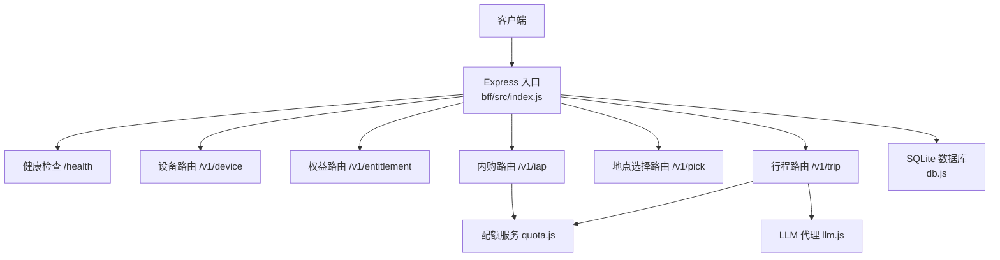
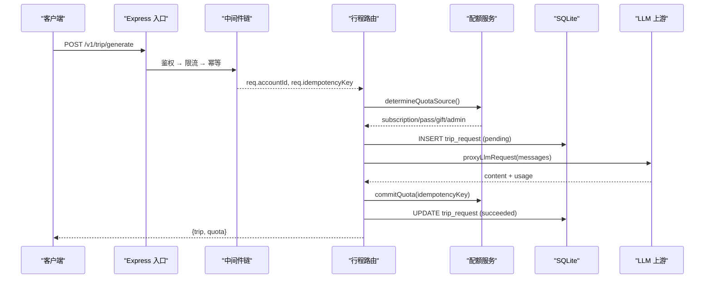
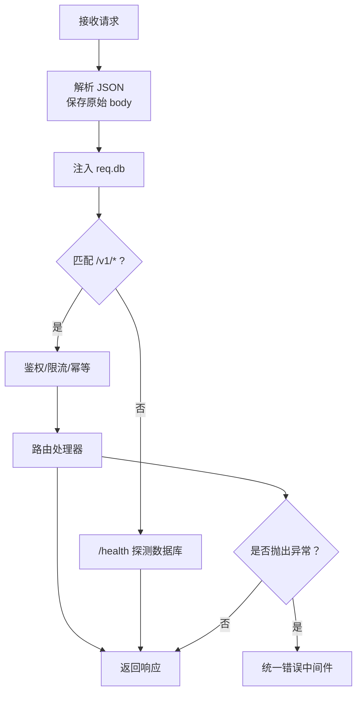
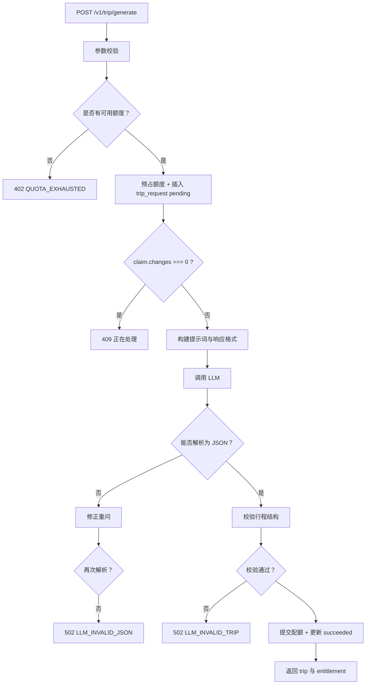
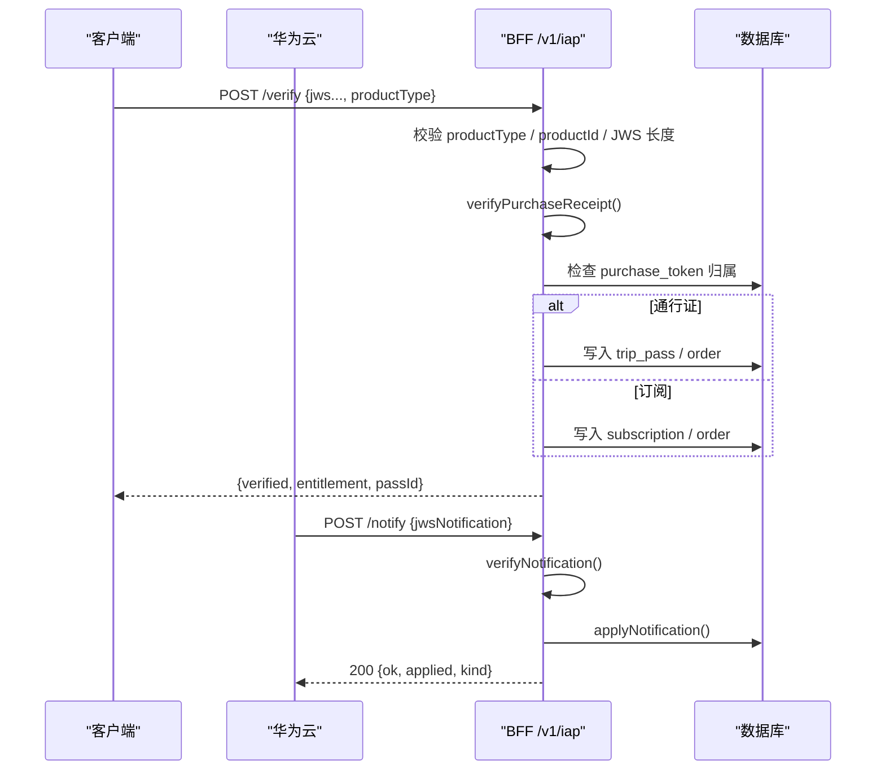
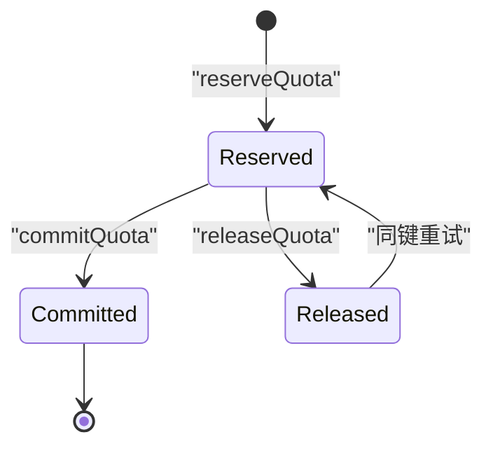
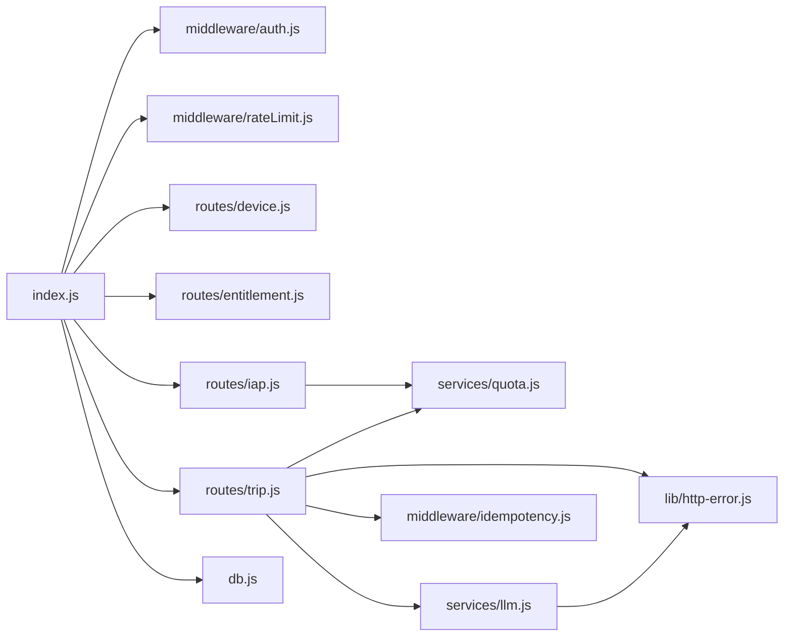

# 后端服务

<cite>
**本文引用的文件**   
- [bff/src/index.js](file://bff/src/index.js)
- [bff/package.json](file://bff/package.json)
- [bff/.env.example](file://bff/.env.example)
- [bff/src/db.js](file://bff/src/db.js)
- [bff/src/middleware/auth.js](file://bff/src/middleware/auth.js)
- [bff/src/middleware/rateLimit.js](file://bff/src/middleware/rateLimit.js)
- [bff/src/middleware/idempotency.js](file://bff/src/middleware/idempotency.js)
- [bff/src/routes/device.js](file://bff/src/routes/device.js)
- [bff/src/routes/entitlement.js](file://bff/src/routes/entitlement.js)
- [bff/src/routes/trip.js](file://bff/src/routes/trip.js)
- [bff/src/routes/iap.js](file://bff/src/routes/iap.js)
- [bff/src/services/quota.js](file://bff/src/services/quota.js)
- [bff/src/services/llm.js](file://bff/src/services/llm.js)
- [bff/src/lib/http-error.js](file://bff/src/lib/http-error.js)
</cite>

## 目录
1. [引言](#引言)
2. [项目结构](#项目结构)
3. [核心组件](#核心组件)
4. [架构总览](#架构总览)
5. [详细组件分析](#详细组件分析)
6. [依赖关系分析](#依赖关系分析)
7. [性能与扩展性](#性能与扩展性)
8. [故障排查指南](#故障排查指南)
9. [结论](#结论)
10. [附录：部署与环境配置](#附录部署与环境配置)

## 引言
本文件面向有径项目的后端 BFF（Backend For Frontend）服务，聚焦 Node.js Express 实现。文档从应用初始化、中间件链、路由组织、安全机制、配额管理、第三方集成、API 契约到部署配置进行系统化说明，既适合后端工程师深入阅读，也便于产品、测试和运维同学理解整体行为。

## 项目结构
BFF 采用“入口 + 中间件 + 路由 + 服务 + 数据库”的分层结构：
- 入口 `bff/src/index.js` 负责加载环境变量、创建 Express 实例、注册全局中间件与健康检查、挂载各业务路由并安装统一错误处理。
- 中间件位于 `bff/src/middleware`，包括鉴权、限流、幂等。
- 路由按领域划分在 `bff/src/routes`：设备、权益、行程、内购、地点选择。
- 领域服务集中在 `bff/src/services`：配额、LLM 代理、华为 IAP/JWS、管理员账号等。
- 数据层通过 `better-sqlite3` 直接操作 SQLite，DDL 与迁移逻辑集中在 `bff/src/db.js`。

**图示来源**
- [bff/src/index.js:1-55](file://bff/src/index.js#L1-L55)
- [bff/src/db.js:1-136](file://bff/src/db.js#L1-L136)

**章节来源**
- [bff/src/index.js:1-55](file://bff/src/index.js#L1-L55)
- [bff/package.json:1-22](file://bff/package.json#L1-L22)

## 核心组件
- **Express 应用初始化**：加载 `.env`，使用 `express.json({ limit: '2mb', verify })` 解析 JSON，并把原始请求体保存到 `req.rawBody`；将数据库连接注入到 `req.db`；注册 `/health` 健康检查；挂载 `/v1/*` 路由；最后注册统一错误处理中间件。
- **中间件链**：设备路由无需鉴权；权益、行程、地点选择路由先鉴权再限流；内购路由独立鉴权逻辑。
- **数据库层**：基于 `better-sqlite3`，启用 WAL 模式与外键约束，自动建表与列升级。
- **配额服务**：维护订阅、通行证、赠送额度与月度生成次数上限，并提供预占、提交、释放的原子状态机。
- **LLM 代理**：封装 DeepSeek 兼容接口，支持超时、响应格式、用量统计与上游限流透传。
- **IAP 集成**：校验华为 JWS 收据与通知，完成订单、订阅、通行证写入及幂等保护。

**章节来源**
- [bff/src/index.js:1-55](file://bff/src/index.js#L1-L55)
- [bff/src/db.js:1-136](file://bff/src/db.js#L1-L136)
- [bff/src/services/quota.js:1-113](file://bff/src/services/quota.js#L1-L113)
- [bff/src/services/llm.js:1-98](file://bff/src/services/llm.js#L1-L98)
- [bff/src/routes/iap.js:1-192](file://bff/src/routes/iap.js#L1-L192)

## 架构总览
下图展示一次行程生成的端到端流程：客户端携带 JWT 与幂等头访问 `/v1/trip/generate`，中间件完成鉴权与幂等检查；路由校验参数、确定配额来源并预占额度；服务构建提示词后调用 LLM；成功后结算配额、更新幂等行，返回行程与权益快照。

**图示来源**
- [bff/src/routes/trip.js:1-234](file://bff/src/routes/trip.js#L1-L234)
- [bff/src/services/quota.js:1-113](file://bff/src/services/quota.js#L1-L113)
- [bff/src/services/llm.js:1-98](file://bff/src/services/llm.js#L1-L98)

## 详细组件分析

### Express 应用初始化与请求生命周期
- **中间件注册顺序**：
  1. `express.json`：解析 JSON，保存原始字节到 `req.rawBody`，用于 IAP RSA 验签。
  2. 注入 `req.db`：所有路由共享同一个数据库句柄。
  3. `/health`：执行 `SELECT 1` 判断数据库可用性，返回 `status.ok` 或 `degraded`。
  4. 路由挂载：`/v1/device` 无鉴权；`/v1/entitlement`、`/v1/trip`、`/v1/pick` 依次挂载鉴权与限流；`/v1/iap` 独立鉴权。
  5. 错误处理中间件：捕获 `HttpError` 与普通异常，输出 `error`、`message`。
- **请求生命周期**：
  - 普通请求：解析 → 注入 DB → 路由匹配 → 中间件执行 → 处理器返回。
  - 异常请求：由最后一个错误中间件统一格式化。
  - 健康检查：不经过业务中间件，直接探测数据库。

**图示来源**
- [bff/src/index.js:1-55](file://bff/src/index.js#L1-L55)

**章节来源**
- [bff/src/index.js:1-55](file://bff/src/index.js#L1-L55)

### 路由组织与设计原则

#### 设备管理 `/v1/device`
- **设计原则**：
  - 不强制 JWT，但强烈建议携带华为 `idToken`。
  - 信任 `idToken.sub`，拒绝客户端自报 `unionId` 作为身份来源。
  - 匿名激活以 `anon-<deviceId>` 隔离，避免游客被误关联到真实账号。
  - 并发激活使用 `INSERT OR IGNORE` 与二次查询，避免唯一约束导致 500。
- **关键行为**：
  - 输入校验 `deviceId`、可选 `unionId`、可选 `idToken`。
  - 华为身份验签失败返回 401。
  - 返回 `deviceToken` 与 `entitlement`。

**章节来源**
- [bff/src/routes/device.js:1-84](file://bff/src/routes/device.js#L1-L84)
- [bff/src/middleware/auth.js:1-25](file://bff/src/middleware/auth.js#L1-L25)

#### 权益管理 `/v1/entitlement`
- **设计原则**：
  - 仅读取当前账户的权益视图，不参与写操作。
  - 权益计算委托配额服务，保证与生成、购买路径一致。
- **关键行为**：
  - 需要有效 JWT。
  - 返回订阅、通行证、赠送剩余、月度用量与是否无限。

**章节来源**
- [bff/src/routes/entitlement.js:1-15](file://bff/src/routes/entitlement.js#L1-L15)
- [bff/src/services/quota.js:1-113](file://bff/src/services/quota.js#L1-L113)

#### 行程生成 `/v1/trip`
- **设计原则**：
  - 严格参数校验：日期范围、天数、人数、预算。
  - 幂等优先：同一 `Idempotency-Key` + 相同请求体可重放成功结果；不同请求体重复 key 返回 422。
  - 配额先行：未付费或未剩赠送额度则返回 402。
  - 模型容错：JSON 解析失败时发起一次修正调用，仍只扣一次额度。
  - 事务结算：提交配额、更新幂等行、重新读取权益快照放在同一事务中。
- **关键行为**：
  - 免费档限制最大 token 与精简提示词；付费档更高上限。
  - 返回行程对象与配额快照，包含来源、当日用量、赠送剩余、通行证与订阅信息。

**图示来源**
- [bff/src/routes/trip.js:1-234](file://bff/src/routes/trip.js#L1-L234)
- [bff/src/services/quota.js:1-113](file://bff/src/services/quota.js#L1-L113)
- [bff/src/services/llm.js:1-98](file://bff/src/services/llm.js#L1-L98)

**章节来源**
- [bff/src/routes/trip.js:1-234](file://bff/src/routes/trip.js#L1-L234)

#### 内购处理 `/v1/iap`
- **设计原则**：
  - 严格校验 `productType` 与 `productId`，防止低买高报。
  - 收据必须来自华为 JWS，未配置证书或 APP ID 时 fail-closed。
  - 收据只能绑定一个账号，跨账号复用返回 409。
  - 已退款收据拒绝兑换，但返回 200 语义表示“无需重复兑换”。
  - 通知回调使用官方 v3 签名验证，非 200 会触发重试。
- **关键行为**：
  - `/verify`：校验收据、写入 `subscription`/`trip_pass`/`order`，返回 `verified` 与最新权益。
  - `/notify`：校验通知 JWS，应用事件并记录 `iap_notify_event`。

**图示来源**
- [bff/src/routes/iap.js:1-192](file://bff/src/routes/iap.js#L1-L192)

**章节来源**
- [bff/src/routes/iap.js:1-192](file://bff/src/routes/iap.js#L1-L192)

### 安全机制

#### JWT 鉴权
- 所有受保护路由要求 `Authorization: Bearer <token>`。
- 令牌载荷包含 `accountId` 与 `deviceId`。
- 令牌过期或非法返回 401，错误码 `TOKEN_INVALID`。
- 设备激活时会签发新令牌。

**章节来源**
- [bff/src/middleware/auth.js:1-25](file://bff/src/middleware/auth.js#L1-L25)
- [bff/src/routes/device.js:1-84](file://bff/src/routes/device.js#L1-L84)

#### API 限流
- 按账号固定窗口限流，默认每分钟 10 次。
- 多进程部署时每个进程各自计数，不具备跨实例一致性。
- 超出限流返回 429，错误码 `RATE_LIMITED`。
- 提供测试方法清空内存计数。

**章节来源**
- [bff/src/middleware/rateLimit.js:1-47](file://bff/src/middleware/rateLimit.js#L1-L47)

#### 幂等性保护
- 客户端需在头部提供 `Idempotency-Key`。
- 服务端按 `accountId` + `clientKey` 生成作用域键，避免跨用户撞键。
- 对请求体做规范化 JSON 后再哈希，键顺序不同但语义相同的请求视为相同。
- 幂等状态包括：成功重放、进行中冲突、失败重试、未知状态。
- 行程生成路由同时用数据库 `trip_request` 表保证并发下只有一个 claim 成功。

**章节来源**
- [bff/src/middleware/idempotency.js:1-122](file://bff/src/middleware/idempotency.js#L1-L122)
- [bff/src/routes/trip.js:1-234](file://bff/src/routes/trip.js#L1-L234)

#### IP 白名单与外部访问控制
- 当前代码未实现 IP 白名单中间件。
- 文档注释明确 IP 级限流属于反代或网关职责，BFF 仅提供账号级限流。
- 若需部署级 IP 白名单，建议在反向代理层接入。

[本节为概念性补充，不涉及具体代码实现]

### 配额管理系统

#### 额度来源优先级
1. 管理员账户：绕过付费墙，但仍落账。
2. 有效订阅且未达月度上限。
3. 有效通行证。
4. 赠送额度。
5. 否则返回 402。

#### 月度窗口算法
- 字段名保留历史兼容的 `usedToday` / `dailyCap`，实际口径为“当月已成功的行程数不超过 20”。
- 订阅有效期同时检查 `status = 'active'` 与 `period_end >= now`，避免过期订阅继续送额度。

#### 预占与结算
- `reserveQuota`：插入 `quota_ledger` 行，状态为 `reserved`。
- `commitQuota`：将状态改为 `committed` 并记录结算时间。
- `releaseQuota`：失败路径释放预占额度。
- 幂等键可重用失败行，避免重复扣费。

**图示来源**
- [bff/src/services/quota.js:1-113](file://bff/src/services/quota.js#L1-L113)

**章节来源**
- [bff/src/services/quota.js:1-113](file://bff/src/services/quota.js#L1-L113)

### 第三方服务集成

#### LLM 转发
- 默认上游为 DeepSeek 兼容 `/chat/completions`。
- 支持配置模型、基础 URL、API Key 与单次超时。
- 超时抛 504；上游 429 原样透出 429；其他上游错误转 502。
- 支持关闭 thinking 模式与结构化输出。

**章节来源**
- [bff/src/services/llm.js:1-98](file://bff/src/services/llm.js#L1-L98)

#### 支付回调与收据校验
- 收据校验依赖华为根证书与 APP ID。
- 未配置证书或 APP ID 返回 503，表示部署态问题。
- 通知回调使用官方 v3 JWS 验证，非 200 会触发重试。
- 收据幂等：同一 `purchase_token` 不会重复记账。

**章节来源**
- [bff/src/routes/iap.js:1-192](file://bff/src/routes/iap.js#L1-L192)

#### 短信服务
- 当前仓库未发现短信服务相关路由或服务实现。
- 如需接入，建议新增 `services/sms.js` 并在用户设置或通知流程中调用。

[本节为现状说明与扩展建议，不涉及现有代码]

### API 文档摘要

#### 通用响应结构
- 成功响应：`{ ... }`，具体字段随路由而定。
- 错误响应：`{ error, message }`。
- 统一错误中间件根据 `HttpError.status` 与 `HttpError.code` 输出。

**章节来源**
- [bff/src/lib/http-error.js:1-8](file://bff/src/lib/http-error.js#L1-L8)
- [bff/src/index.js:1-55](file://bff/src/index.js#L1-L55)

#### 设备激活
- 路径：`POST /v1/device/activate`
- 请求体：
  - `deviceId`：必填字符串，长度不超过 128。
  - `unionId`：可选，忽略客户端自报，以 `idToken.sub` 为准。
  - `idToken`：可选，华为身份票据，最长 4096。
- 成功响应：`{ deviceToken, entitlement }`
- 常见错误：
  - `MISSING_DEVICE_ID`：缺少或非法 deviceId。
  - `INVALID_UNION_ID`：非法 unionId。
  - `INVALID_ID_TOKEN`：idToken 类型或长度非法。
  - `ID_TOKEN_INVALID`：华为身份票据验签失败。

**章节来源**
- [bff/src/routes/device.js:1-84](file://bff/src/routes/device.js#L1-L84)

#### 权益查询
- 路径：`GET /v1/entitlement`
- 认证：Bearer JWT。
- 成功响应：
  - `subscription`：订阅状态与到期时间。
  - `passes`：通行证列表。
  - `giftRemaining`：赠送剩余。
  - `usedToday`：当月已用次数。
  - `dailyCap`：月度上限。
  - `unlimited`：管理员标志。

**章节来源**
- [bff/src/routes/entitlement.js:1-15](file://bff/src/routes/entitlement.js#L1-L15)
- [bff/src/services/quota.js:1-113](file://bff/src/services/quota.js#L1-L113)

#### 行程生成
- 路径：`POST /v1/trip/generate`
- 认证：Bearer JWT。
- 限流：按账号每分钟固定窗口。
- 幂等：请求头 `Idempotency-Key` 必填。
- 请求体关键字段：
  - `destination`：目的地字符串。
  - `startDate`、`endDate`：YYYY-MM-DD。
  - `people`：1–30 整数。
  - `budget`：非负整数。
- 成功响应：
  - `trip`：行程对象。
  - `quota`：来源、当月用量、赠送剩余、通行证与订阅快照。
- 常见错误：
  - `INVALID_REQUEST`：参数校验失败。
  - `QUOTA_EXHAUSTED`：额度不足。
  - `MISSING_IDEMPOTENCY_KEY`：缺少幂等头。
  - `IDEMPOTENCY_KEY_REUSED`：幂等键对应不同请求体。
  - `IDEMPOTENCY_IN_PROGRESS`：同一幂等键正在处理。
  - `LLM_INVALID_JSON`：模型输出无法解析。
  - `LLM_INVALID_TRIP`：行程结构校验失败。

**章节来源**
- [bff/src/routes/trip.js:1-234](file://bff/src/routes/trip.js#L1-L234)
- [bff/src/middleware/idempotency.js:1-122](file://bff/src/middleware/idempotency.js#L1-L122)
- [bff/src/middleware/rateLimit.js:1-47](file://bff/src/middleware/rateLimit.js#L1-L47)

#### 内购校验
- 路径：`POST /v1/iap/verify`
- 认证：Bearer JWT；若未带，路由内部尝试解析。
- 请求体：
  - `productType`：`pass` 或 `subscription`。
  - `jwsPurchaseOrder`、`jwsSubscriptionStatus`：华为 JWS。
  - `productId`：订阅商品标识。
  - `localTripId`：通行证场景必填。
- 成功响应：`{ verified, entitlement, passId }`
- 常见错误：
  - `MISSING_PARAMS`：缺少 productType。
  - `UNSUPPORTED_PRODUCT_TYPE`：不支持的商品类型。
  - `UNKNOWN_PRODUCT_ID`：未知订阅商品。
  - `INVALID_JWS`：JWS 非法。
  - `MISSING_JWS`：缺少必要 JWS。
  - `RECEIPT_ALREADY_USED`：收据已绑定其他账号。
  - `IAP_NOT_CONFIGURED`：部署未配置 IAP。

**章节来源**
- [bff/src/routes/iap.js:1-192](file://bff/src/routes/iap.js#L1-L192)

#### 内购通知
- 路径：`POST /v1/iap/notify`
- 认证：华为官方签名，非 Bearer JWT。
- 请求体：`{ jwsNotification }`
- 成功响应：`{ ok, applied, kind }`
- 常见错误：
  - `NOTIFY_BAD_FORMAT`：通知格式非法。
  - `NOTIFY_NOT_CONFIGURED`：未配置根证书。
  - `NOTIFY_*`：其他通知验签失败原因。

**章节来源**
- [bff/src/routes/iap.js:1-192](file://bff/src/routes/iap.js#L1-L192)

## 依赖关系分析

**图示来源**
- [bff/src/index.js:1-55](file://bff/src/index.js#L1-L55)
- [bff/src/routes/trip.js:1-234](file://bff/src/routes/trip.js#L1-L234)
- [bff/src/routes/iap.js:1-192](file://bff/src/routes/iap.js#L1-L192)
- [bff/src/services/quota.js:1-113](file://bff/src/services/quota.js#L1-L113)
- [bff/src/services/llm.js:1-98](file://bff/src/services/llm.js#L1-L98)

**章节来源**
- [bff/src/index.js:1-55](file://bff/src/index.js#L1-L55)
- [bff/src/routes/trip.js:1-234](file://bff/src/routes/trip.js#L1-L234)
- [bff/src/routes/iap.js:1-192](file://bff/src/routes/iap.js#L1-L192)

## 性能与扩展性
- **数据库**：WAL 模式提升并发读性能；索引覆盖高频查询如账户、订单、配额账本。
- **限流**：进程内存 Bucket 简单高效，但不支持分布式一致性；横向扩容需引入 Redis 或网关限流。
- **LLM 超时**：默认 45 秒，避免长尾阻塞幂等行；端侧读超时更大，留出修正重问空间。
- **扩展建议**：
  - 将配额与限流迁移至 Redis，支持多实例一致性。
  - 增加异步任务队列处理耗时较长的 IAP 通知。
  - 引入结构化日志与链路追踪，便于定位上游 LLM 与华为 IAP 问题。

[本节为通用优化建议，不直接分析特定代码片段]

## 故障排查指南

- **健康检查失败**：
  - 观察 `/health` 返回 `db: error`，检查 SQLite 文件权限、挂载卷与 WAL 模式。
  - 确认 `DB_PATH` 指向可写路径。
- **JWT 鉴权失败**：
  - 检查 `Authorization` 头格式是否为 `Bearer <token>`。
  - 核对 `JWT_SECRET` 是否与签发方一致。
- **限流频繁**：
  - 检查是否循环调用 `/v1/trip/generate`。
  - 调整 `RATE_LIMIT_PER_MINUTE` 与 `RATE_LIMIT_WINDOW_MS`。
- **幂等冲突**：
  - 409 表示同一幂等键仍在处理，客户端应等待后轮询。
  - 422 表示幂等键被重复使用但请求体不同，客户端应更换新 key。
- **LLM 超时或限流**：
  - 504 表示上游超时，检查 `LLM_TIMEOUT_MS` 与网络连通性。
  - 429 表示上游限流，客户端应按文案等待。
- **IAP 校验失败**：
  - 503 表示未配置根证书或 APP ID。
  - 401 表示通知签名无效。
  - 409 表示收据已绑定其他账号。

**章节来源**
- [bff/src/index.js:1-55](file://bff/src/index.js#L1-L55)
- [bff/src/middleware/rateLimit.js:1-47](file://bff/src/middleware/rateLimit.js#L1-L47)
- [bff/src/middleware/idempotency.js:1-122](file://bff/src/middleware/idempotency.js#L1-L122)
- [bff/src/services/llm.js:1-98](file://bff/src/services/llm.js#L1-L98)
- [bff/src/routes/iap.js:1-192](file://bff/src/routes/iap.js#L1-L192)

## 结论
该 BFF 以简洁的 Express 架构承载设备激活、权益查询、行程生成与内购校验四大核心能力。其重点在于：
- 通过中间件链实现鉴权、限流与幂等。
- 通过配额服务实现订阅、通行证与赠送额度的统一计费口径。
- 通过 LLM 代理与 IAP 集成串联 AI 生成与商业化闭环。
- 通过 SQLite 与事务保障基本一致性与幂等。
未来可在分布式限流、异步通知、日志观测与灰度发布方面进一步演进。

[本节为总结性内容，不直接分析具体文件]

## 附录：部署与环境配置

### 环境变量
- 必需：
  - `DEEPSEEK_API_KEY`：LLM 上游密钥。
  - `JWT_SECRET`：JWT 签发与校验密钥。
  - `PORT`：服务监听端口。
- 可选：
  - `LLM_MODEL`、`LLM_BASE_URL`、`LLM_RESPONSE_FORMAT`、`LLM_TIMEOUT_MS`。
  - `DB_PATH`：SQLite 数据库路径。
  - `IAP_APP_ID`、`IAP_ROOT_CERT_PATH`、`IAP_ALLOW_SANDBOX`。
  - `HUAWEI_CLIENT_ID`、`HUAWEI_JWKS_URL`、`HUAWEI_ISSUER`。
  - `RATE_LIMIT_PER_MINUTE`、`RATE_LIMIT_WINDOW_MS`。
  - `ADMIN_ACCOUNT_IDS`：本机联调管理员账号 ID 列表。

**章节来源**
- [bff/.env.example:1-41](file://bff/.env.example#L1-L41)

### 数据库初始化
- 启动命令：`npm run migrate`。
- 自动建表：`account`、`subscription`、`trip_pass`、`quota_ledger`、`trip_request`、`order`、`iap_notify_event`。
- 迁移策略：使用 `ensureColumn` 动态添加缺失列，避免破坏已有库。
- 运行模式：WAL、外键开启，容器环境需挂载可写卷。

**章节来源**
- [bff/src/db.js:1-136](file://bff/src/db.js#L1-L136)
- [bff/package.json:1-22](file://bff/package.json#L1-L22)

### 日志收集
- 标准输出日志包含：
  - 健康检查失败、错误中间件、设备激活、行程生成、LLM 调用、IAP 校验与通知。
- 建议对接集中式日志系统，按模块与错误码过滤。
- 生产环境建议开启请求 ID 与链路追踪，便于跨中间件与下游服务定位问题。

[本节为通用运维建议，不直接分析特定代码片段]