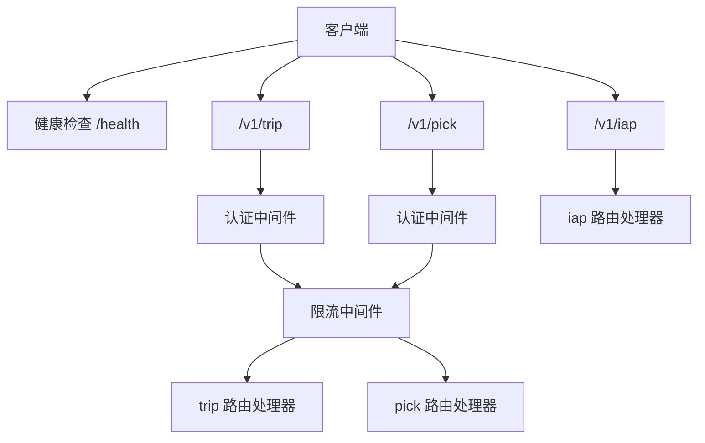
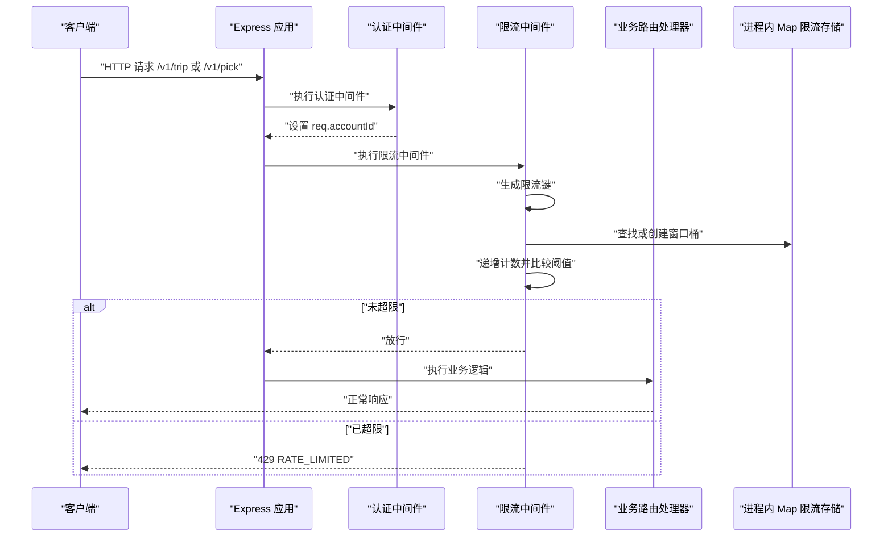
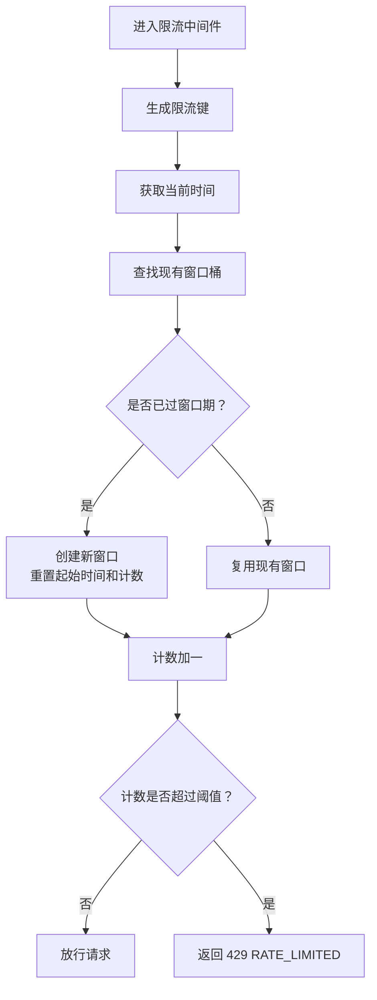
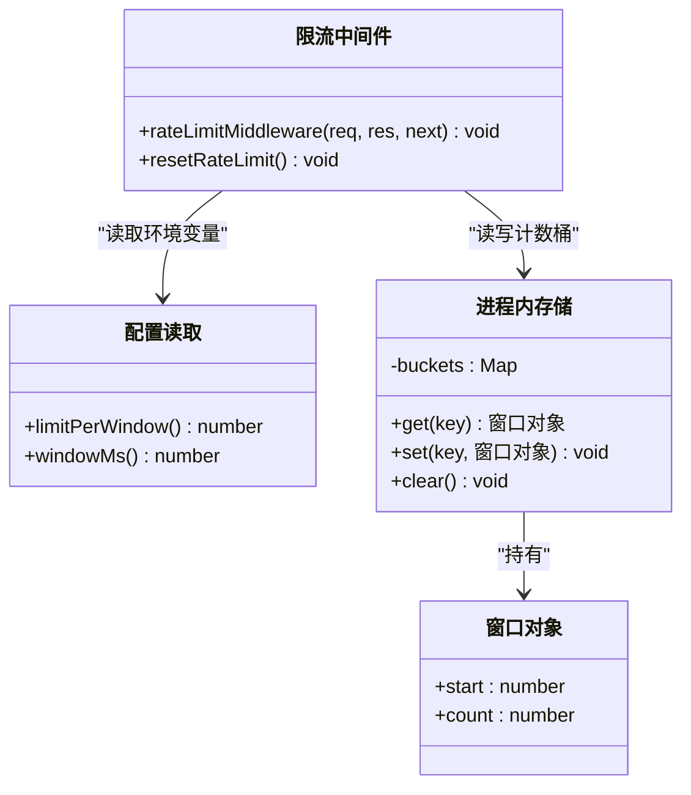
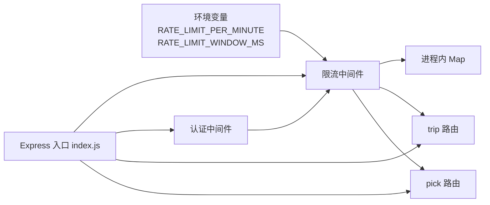
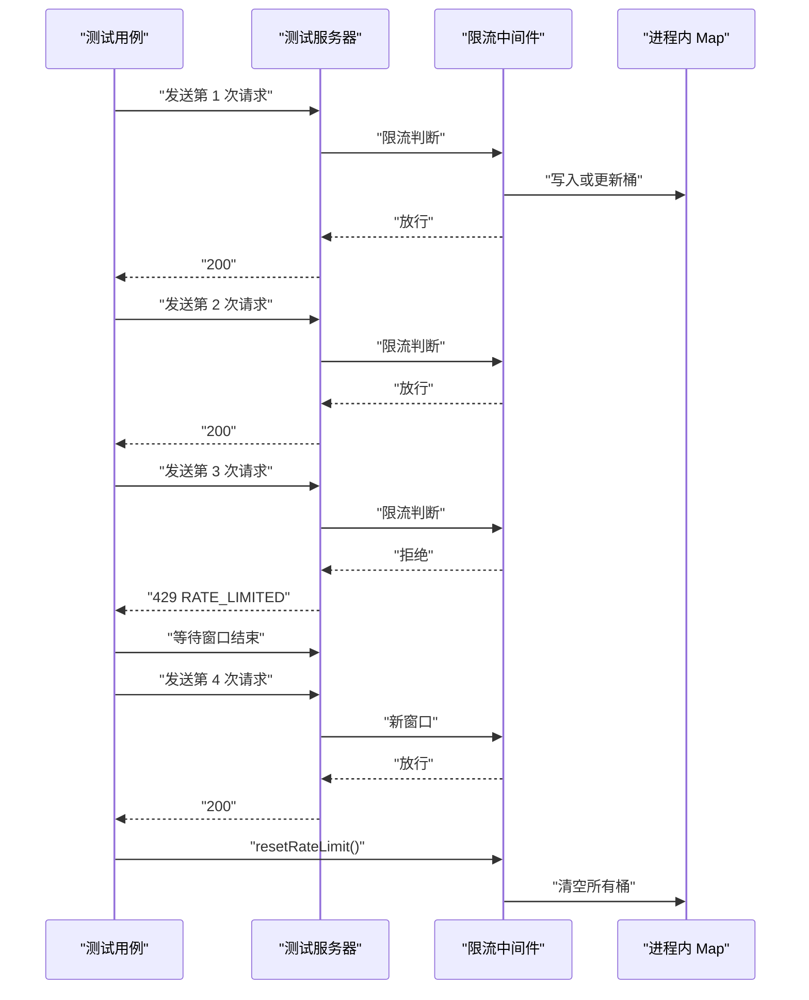

# API 限流机制

<cite>
**本文引用的文件**   
- [bff/src/middleware/rateLimit.js](file://bff/src/middleware/rateLimit.js)
- [bff/test/rate-limit.test.js](file://bff/test/rate-limit.test.js)
- [bff/src/index.js](file://bff/src/index.js)
- [bff/.env.example](file://bff/.env.example)
</cite>

## 目录
1. [简介](#简介)
2. [项目结构中的限流位置](#项目结构中的限流位置)
3. [核心组件](#核心组件)
4. [架构总览](#架构总览)
5. [详细组件分析](#详细组件分析)
6. [依赖关系分析](#依赖关系分析)
7. [性能与容量特性](#性能与容量特性)
8. [配置最佳实践](#配置最佳实践)
9. [多实例部署限制与 Redis 扩展方案](#多实例部署限制与-redis-扩展方案)
10. [测试方法](#测试方法)
11. [监控指标建议](#监控指标建议)
12. [常见限流场景处理方案](#常见限流场景处理方案)
13. [故障排查](#故障排查)
14. [结论](#结论)

## 简介
本文件面向 BFF（Backend For Frontend）聚合服务中的 API 限流机制，围绕以下目标展开：
- 解释基于固定窗口的限流算法实现。
- 说明窗口大小 `RATE_LIMIT_WINDOW_MS`、每分钟请求次数 `RATE_LIMIT_PER_MINUTE` 的配置方式。
- 分析进程内内存存储的数据结构与优化点。
- 解释按 `accountId` 区分用户配额、匿名请求按 IP 限制的键生成策略。
- 对比滑动窗口与固定窗口，并说明当前选择原因和性能取舍。
- 给出配置最佳实践、多实例部署的局限性、Redis 扩展思路。
- 提供测试方法与监控指标建议，以及常见限流问题的处理方案。

该限流是“部署前的成本防护”：一次行程生成会调用上游模型，若没有限流，脚本循环调用可能快速打满额度或账单。因此它在认证中间件之后、业务路由之前生效。

**章节来源**
- [bff/src/middleware/rateLimit.js:1-47](file://bff/src/middleware/rateLimit.js#L1-L47)
- [bff/src/index.js:1-55](file://bff/src/index.js#L1-L55)

## 项目结构中的限流位置
在 Express 应用中，限流中间件挂载在两条高成本路由前：
- `/v1/trip`
- `/v1/pick`

这两条路由都先经过鉴权中间件，再进入限流中间件，最后到达具体路由处理器。

**图表来源**
- [bff/src/index.js:1-55](file://bff/src/index.js#L1-L55)

**章节来源**
- [bff/src/index.js:1-55](file://bff/src/index.js#L1-L55)

## 核心组件
BFF 的限流由一个中间件模块提供，核心职责包括：
- 从环境变量读取每次窗口允许的最大请求数。
- 从环境变量读取窗口时长。
- 根据请求身份生成限流键。
- 维护进程内 Map 桶，统计每个键在当前窗口内的计数。
- 超出阈值时返回 429 状态码及限流错误体。
- 导出测试专用重置函数，用于清空所有计数桶。

关键概念如下：
| 名称 | 含义 | 默认值或行为 |
|---|---|---|
| `RATE_LIMIT_PER_MINUTE` | 每个限流键在每个窗口内允许的请求数 | 未配置或非法时回退到 10 |
| `RATE_LIMIT_WINDOW_MS` | 固定窗口长度，单位毫秒 | 未配置或非法时回退到 60000 |
| 限流键 | 按账号或 IP 区分配额 | 已登录用 `accountId`，匿名用 `req.ip` 或 `anon` |
| 桶 | 进程内 `Map` 中按限流键存储的窗口对象 | 包含窗口起始时间与计数 |
| 429 响应 | 超过阈值的统一响应体 | 错误码为 `RATE_LIMITED` |

**章节来源**
- [bff/src/middleware/rateLimit.js:1-47](file://bff/src/middleware/rateLimit.js#L1-L47)

## 架构总览
下面的架构图展示一次请求从进入 Express 到被限流判断的整体流程。

**图表来源**
- [bff/src/index.js:1-55](file://bff/src/index.js#L1-L55)
- [bff/src/middleware/rateLimit.js:1-47](file://bff/src/middleware/rateLimit.js#L1-L47)

**章节来源**
- [bff/src/index.js:1-55](file://bff/src/index.js#L1-L55)
- [bff/src/middleware/rateLimit.js:1-47](file://bff/src/middleware/rateLimit.js#L1-L47)

## 详细组件分析

### 固定窗口限流算法
该实现使用固定窗口计数器：
- 每个限流键对应一个窗口对象，包含窗口开始时间和当前计数。
- 当新请求到来时，如果当前时间减去窗口开始时间大于等于窗口长度，则新建窗口。
- 随后将计数加一，并与每窗口最大请求数比较；超过则拒绝。

**图表来源**
- [bff/src/middleware/rateLimit.js:1-47](file://bff/src/middleware/rateLimit.js#L1-L47)

**章节来源**
- [bff/src/middleware/rateLimit.js:1-47](file://bff/src/middleware/rateLimit.js#L1-L47)

### 限流键生成策略
限流键决定“谁受配额限制”。规则如下：
- 如果请求对象中存在 `accountId`，则以 `accountId` 作为键，实现按用户配额隔离。
- 如果不存在 `accountId`，则优先使用 `req.ip`。
- 如果也没有 `req.ip`，则使用固定字符串 `anon`，使所有匿名请求共享同一个配额。

这种设计适合 BFF 的前置防护：
- 对已登录用户，避免单个账号滥用模型调用。
- 对匿名流量，防止同一网络出口或代理池短时间刷爆。
- 同时保持实现简单，不引入外部依赖。

需要注意：`req.ip` 是否正确解析，取决于前置代理、反向网关或 Express 的 trust proxy 配置。若部署侧没有正确设置，匿名 IP 可能不准确，从而影响限流效果。

**章节来源**
- [bff/src/middleware/rateLimit.js:1-47](file://bff/src/middleware/rateLimit.js#L1-L47)

### 配置项与环境变量
限流相关配置通过环境变量覆盖：

| 环境变量 | 作用 | 默认行为 |
|---|---|---|
| `RATE_LIMIT_PER_MINUTE` | 每个窗口允许的最大请求数 | 非正数或非数字时回退到 10 |
| `RATE_LIMIT_WINDOW_MS` | 固定窗口长度，单位毫秒 | 非正数或非数字时回退到 60000 |
| `PORT` | BFF 监听端口 | 未配置时为 3000 |
| `JWT_SECRET` | JWT 相关密钥 | 参考仓库文档，默认回退值见仓库说明 |

配置文件示例路径位于 `.env.example`，便于本地开发复制和启用注释掉的环境变量。

**章节来源**
- [bff/src/middleware/rateLimit.js:1-47](file://bff/src/middleware/rateLimit.js#L1-L47)
- [bff/.env.example:34-35](file://bff/.env.example#L34-L35)
- [bff/src/index.js:1-55](file://bff/src/index.js#L1-L55)

### 数据结构与复杂度
限流存储是一个进程内 `Map`：
- 键：限流键，例如 `accountId`、IP 或 `anon`。
- 值：窗口对象，包含窗口起始时间和计数。

典型操作复杂度：
- 查找桶：平均 O(1)。
- 新增桶：平均 O(1)。
- 更新计数：O(1)。
- 重置所有桶：O(n)，n 为活跃限流键数量。

空间复杂度为 O(k)，k 为不同限流键的数量。由于只保留当前窗口内的计数，单进程内存占用通常较低；但在高并发、大量不同账号或 IP 的场景下，仍需关注键数量增长。

**图表来源**
- [bff/src/middleware/rateLimit.js:1-47](file://bff/src/middleware/rateLimit.js#L1-L47)

**章节来源**
- [bff/src/middleware/rateLimit.js:1-47](file://bff/src/middleware/rateLimit.js#L1-L47)

## 依赖关系分析
限流模块被 Express 应用在两条路由上引用，并通过环境变量完成运行时配置。

**图表来源**
- [bff/src/index.js:1-55](file://bff/src/index.js#L1-L55)
- [bff/src/middleware/rateLimit.js:1-47](file://bff/src/middleware/rateLimit.js#L1-L47)

**章节来源**
- [bff/src/index.js:1-55](file://bff/src/index.js#L1-L55)
- [bff/src/middleware/rateLimit.js:1-47](file://bff/src/middleware/rateLimit.js#L1-L47)

## 性能与容量特性
- CPU 消耗极低：主要操作是哈希查找、数值比较和属性赋值。
- 无网络 I/O：不依赖 Redis、数据库或其他外部服务。
- 低延迟：单次限流判断通常在微秒级完成。
- 内存占用随限流键数量线性增长。
- 进程重启后计数丢失，但这也符合“部署前成本防护”的定位。

优点：
- 实现简单，容易理解和维护。
- 对高频短路径开销小。
- 适合单机或小规模集群的快速防护。

局限：
- 多实例之间各自计数，无法直接跨实例限流。
- 进程崩溃或重启后，历史计数不可恢复。
- 不适合需要精确分布式一致性的高强度限流场景。

**章节来源**
- [bff/src/middleware/rateLimit.js:1-47](file://bff/src/middleware/rateLimit.js#L1-L47)

## 配置最佳实践
建议按照以下原则调整限流参数：

1. **以成本为中心设定上限**
   - 将 `RATE_LIMIT_PER_MINUTE` 设置为上游模型调用可承受的单账号每分钟请求数。
   - 初始建议使用较小值，例如 10，再通过压测逐步上调。

2. **以稳定性为中心设定窗口**
   - `RATE_LIMIT_WINDOW_MS` 一般设为 60000，匹配“每分钟”语义。
   - 若希望更平滑地抑制突发流量，可结合网关层滑动窗口或令牌桶。

3. **区分环境与部署规模**
   - 开发环境：可以缩小窗口和上限，便于快速验证限流逻辑。
   - 生产环境：应结合业务峰值、账号分布和上游限额综合评估。

4. **配合其他中间件使用**
   - 限流放在认证之后，确保按真实用户配额限制。
   - 幂等中间件负责重复提交保护，限流中间件负责整体速率控制，二者互补。

5. **保留默认回退值**
   - 环境变量缺失或非法时，系统会自动回退到默认值，避免启动失败。

**章节来源**
- [bff/src/middleware/rateLimit.js:1-47](file://bff/src/middleware/rateLimit.js#L1-L47)
- [bff/.env.example:34-35](file://bff/.env.example#L34-L35)

## 多实例部署限制与 Redis 扩展方案

### 多实例部署的局限性
当前实现使用进程内 `Map`，因此：
- 每个 BFF 实例独立维护自己的计数桶。
- 两个实例不会互相感知对方的请求量。
- 负载均衡可能把大量请求分发到不同实例，导致整体限流比预期宽松。
- 单个实例崩溃不会影响其他实例，但也不会恢复全局计数。

这属于代码注释中明确指出的边界：它不是分布式限流。

### Redis 扩展方案
如果需要跨实例一致限流，可将进程内 `Map` 替换为 Redis：

- **键设计**
  - 使用限流键作为主维度，例如 `rl:{accountId}` 或 `rl:ip:{ip}`。
  - 可选加入业务维度，如 `rl:trip:{accountId}`，针对特定接口单独限流。

- **窗口实现**
  - 使用 Redis 原子操作 `INCR` 配合过期时间 `EXPIRE`。
  - 首次写入时设置 TTL 为窗口长度，后续递增计数。
  - 读取当前计数和剩余 TTL，判断是否超过阈值。

- **事务与一致性**
  - 使用 Lua 脚本或 Redis 事务保证计数与过期设置的原子性。
  - 注意时钟漂移和边界情况：窗口刚结束时旧计数可能被清理。

- **降级与容错**
  - Redis 不可用时可选择放宽限流或记录告警。
  - 可保留进程内缓存作为快速路径，定期同步到 Redis。

- **监控与运维**
  - 监控 Redis 中限流键数量、命中率、超时删除情况。
  - 监控限流拒绝率、429 比例、账号维度限流分布。

该方案更适合需要严格跨实例一致性的生产环境，但会增加网络 I/O 和运维复杂度。

**章节来源**
- [bff/src/middleware/rateLimit.js:1-47](file://bff/src/middleware/rateLimit.js#L1-L47)

## 测试方法
测试文件提供了端到端验证方式，核心要点如下：

- 设置环境变量 `RATE_LIMIT_PER_MINUTE=2`、`RATE_LIMIT_WINDOW_MS=120`，使测试更快收敛。
- 启动临时 Express 服务，挂载限流中间件。
- 第一个和第二个请求成功，第三个请求应返回 429。
- 等待窗口结束后，再次请求应恢复为成功。
- 使用 `resetRateLimit()` 清空所有计数桶，确保测试用例之间互不干扰。

**图表来源**
- [bff/test/rate-limit.test.js:1-44](file://bff/test/rate-limit.test.js#L1-L44)
- [bff/src/middleware/rateLimit.js:1-47](file://bff/src/middleware/rateLimit.js#L1-L47)

**章节来源**
- [bff/test/rate-limit.test.js:1-44](file://bff/test/rate-limit.test.js#L1-L44)
- [bff/src/middleware/rateLimit.js:1-47](file://bff/src/middleware/rateLimit.js#L1-L47)

## 监控指标建议
建议在 BFF 层暴露或采集以下指标，以便观察限流效果：

| 指标类别 | 推荐指标 | 用途 |
|---|---|---|
| 总体吞吐 | 每秒请求数 | 观察整体负载趋势 |
| 限流拒绝 | 429 请求数、429 比例 | 判断是否频繁触发限流 |
| 账号维度 | 按 `accountId` 分组的 429 数 | 定位高频用户或异常账号 |
| IP 维度 | 按 IP 分组的 429 数 | 发现代理池、爬虫或恶意扫描 |
| 配置维度 | 当前窗口长度、每窗口上限 | 确认运行配置是否符合预期 |
| 资源维度 | 进程内存、Map 键数量 | 检测内存泄漏或键膨胀 |
| 下游影响 | 上游模型调用成功率、耗时 | 关联限流与上游成本 |

对于 429 响应，建议至少记录：
- 是否命中限流。
- 限流键类型（账号或 IP）。
- 当前计数与阈值。
- 窗口剩余时间。
- 客户端标识，例如脱敏后的账号或 IP 段。

这些日志可用于审计、容量规划和误拦截排查。

[本节为通用监控建议，不直接分析具体源码]

## 常见限流场景处理方案

| 场景 | 现象 | 建议处理方式 |
|---|---|---|
| 单个账号短时间内多次点击生成行程 | 很快出现 429 | 前端增加按钮防抖与禁用态；提示“请求太频繁，请稍后再试” |
| 多个账号共用同一 IP | 匿名 IP 配额被提前耗尽 | 确保登录后使用 `accountId` 限流；检查代理层是否隐藏真实 IP |
| 爬虫或脚本批量请求 | 大量 IP 或少数 IP 持续 429 | 结合网关层 IP 限流、验证码、黑名单；后端继续保留账号级限流 |
| 多实例部署后限流变松 | 单实例计数分散 | 升级到 Redis 分布式限流，或在网关层集中限流 |
| 窗口刚好切换时被误判 | 固定窗口边界可能出现瞬间突增 | 接受固定窗口近似性；如需更精细，改用滑动窗口或令牌桶 |
| 测试环境限流不生效 | 环境变量未加载或默认值过大 | 检查 `.env`、容器环境变量注入和测试用例中的 `resetRateLimit` |
| 匿名请求全部共享配额 | `anon` 键被占满 | 检查认证链路是否正确设置 `accountId`；修复 IP 解析问题 |

**章节来源**
- [bff/src/middleware/rateLimit.js:1-47](file://bff/src/middleware/rateLimit.js#L1-L47)
- [bff/test/rate-limit.test.js:1-44](file://bff/test/rate-limit.test.js#L1-L44)

## 故障排查
遇到限流问题时，可按以下顺序排查：

1. **确认限流是否生效**
   - 检查请求是否经过 `/v1/trip` 或 `/v1/pick`。
   - 确认响应是否为 429，且错误体中包含限流相关字段。

2. **确认限流键是否正确**
   - 已登录请求应使用 `accountId`。
   - 匿名请求应能正确解析 `req.ip`。
   - 若两者均缺失，则会落到 `anon`，所有匿名请求共享配额。

3. **检查环境变量**
   - 确认 `RATE_LIMIT_PER_MINUTE` 和 `RATE_LIMIT_WINDOW_MS` 是否按预期注入。
   - 确认测试环境中是否故意设置了更小的窗口和上限。

4. **检查多实例行为**
   - 如果部署了多个 BFF 实例，确认是否需要跨实例限流。
   - 若需要，考虑 Redis 扩展或网关层限流。

5. **检查测试状态**
   - 若测试用例相互干扰，确认是否调用了 `resetRateLimit()`。
   - 若测试通过后生产仍异常，重点比对环境变量和部署配置。

6. **查看日志与指标**
   - 观察 429 比例是否突然升高。
   - 查看账号维度或 IP 维度的限流分布。
   - 检查是否有上游调用失败导致的重试风暴。

**章节来源**
- [bff/src/middleware/rateLimit.js:1-47](file://bff/src/middleware/rateLimit.js#L1-L47)
- [bff/test/rate-limit.test.js:1-44](file://bff/test/rate-limit.test.js#L1-L44)
- [bff/src/index.js:1-55](file://bff/src/index.js#L1-L55)

## 结论
当前 BFF 限流采用简单高效的固定窗口实现，使用进程内 `Map` 维护按账号或 IP 区分的计数桶。其优点是成本低、延迟小、易于理解；缺点是仅对单进程有效，不适合直接做分布式一致限流。

在生产环境中，建议：
- 先用固定窗口限流保护上游模型调用，避免账单和额度风险。
- 结合网关层 IP 限流、认证校验和幂等机制形成多层防护。
- 在多实例部署且需要严格限流时，逐步迁移到 Redis 分布式限流。
- 完善监控与日志，持续观察 429 比例、账号分布和上游成本。

这样可以在性能、成本和可运维性之间取得平衡。