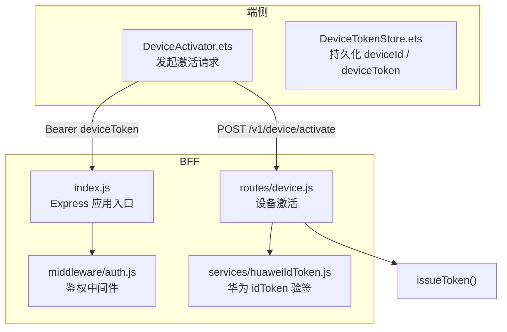
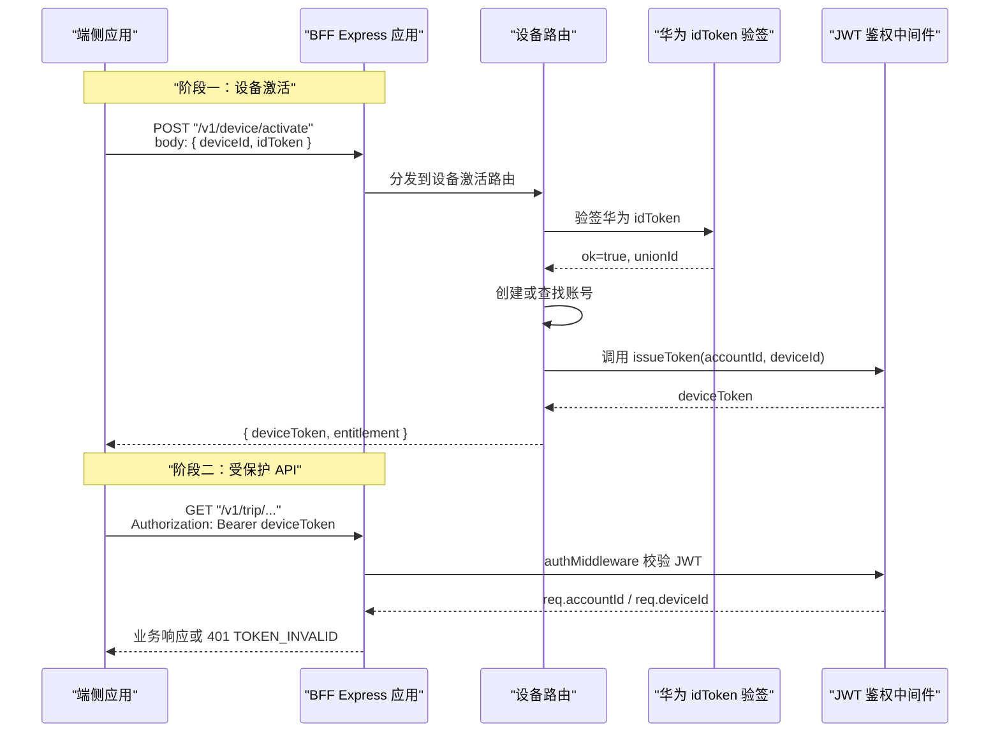
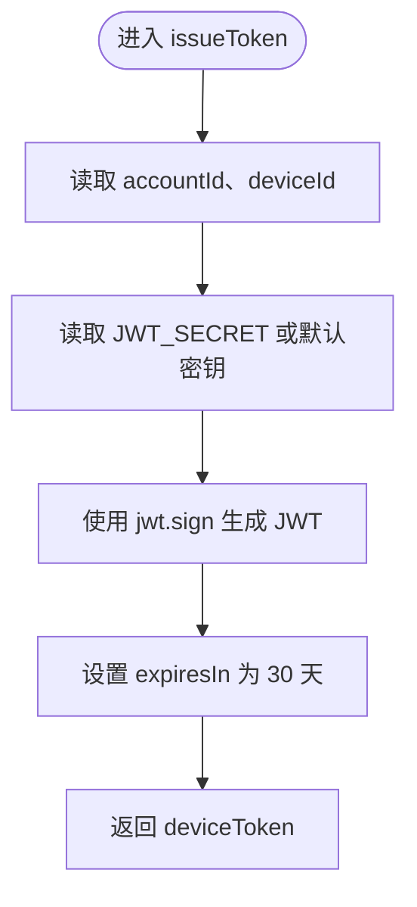
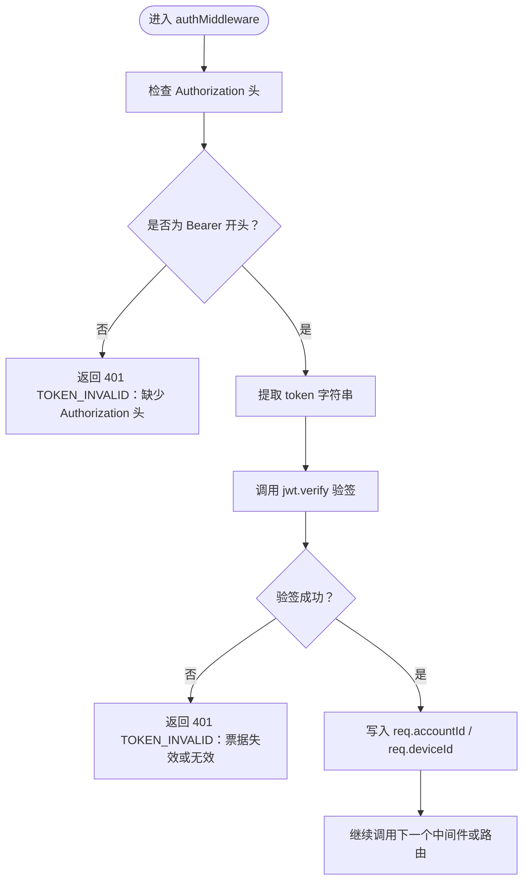
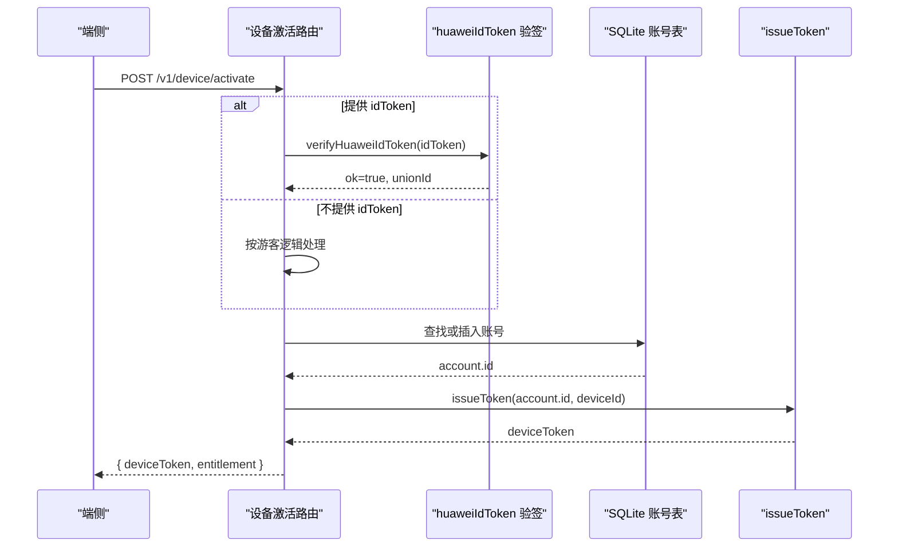
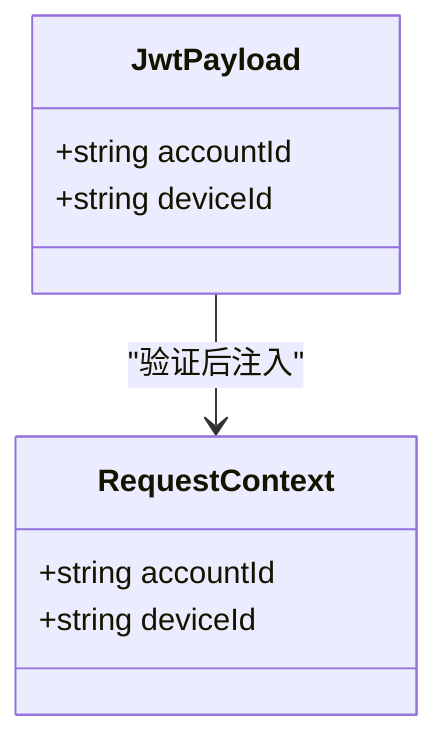
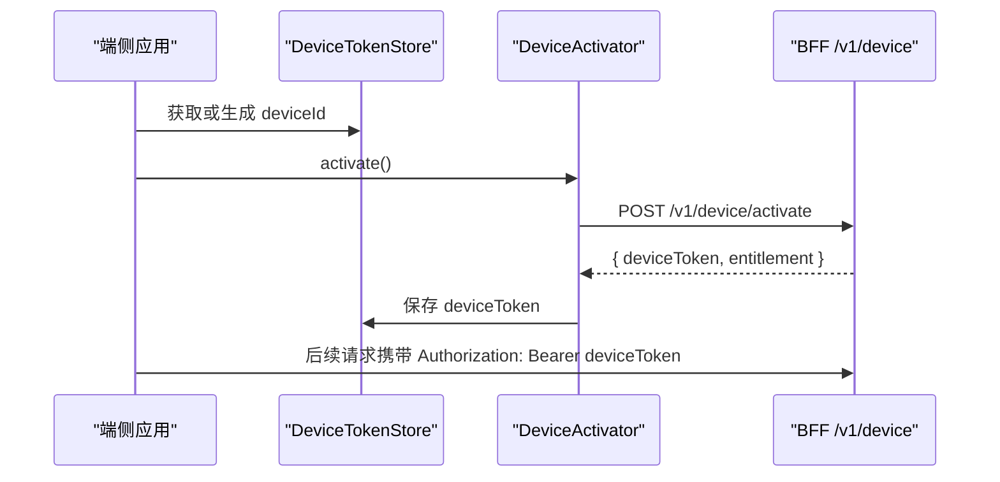
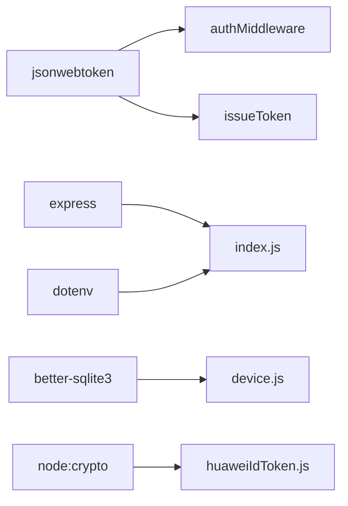

# JWT 鉴权机制

<cite>
**本文引用的文件**   
- [bff/src/middleware/auth.js](file://bff/src/middleware/auth.js)
- [bff/src/index.js](file://bff/src/index.js)
- [bff/src/routes/device.js](file://bff/src/routes/device.js)
- [bff/src/services/huaweiIdToken.js](file://bff/src/services/huaweiIdToken.js)
- [bff/package.json](file://bff/package.json)
- [bff/README.md](file://bff/README.md)
- [entry/src/main/ets/data/DeviceTokenStore.ets](file://entry/src/main/ets/data/DeviceTokenStore.ets)
- [entry/src/main/ets/data/DeviceActivator.ets](file://entry/src/main/ets/data/DeviceActivator.ets)
</cite>

## 目录
1. [简介](#简介)
2. [项目结构定位](#项目结构定位)
3. [核心组件](#核心组件)
4. [架构总览](#架构总览)
5. [详细组件分析](#详细组件分析)
6. [依赖关系分析](#依赖关系分析)
7. [性能与可扩展性](#性能与可扩展性)
8. [故障排查指南](#故障排查指南)
9. [结论](#结论)
10. [附录：安全配置清单](#附录安全配置清单)

## 简介
本文面向 BFF（Backend For Frontend）服务中的 JWT 鉴权机制，覆盖以下主题：
- Token 生成流程：`issueToken` 函数如何签发设备票据。
- 请求验证流程：`authMiddleware` 如何校验 `Authorization: Bearer <token>`。
- Payload 结构：`accountId`、`deviceId` 的作用与边界。
- 密钥管理：环境变量 `JWT_SECRET`、开发默认值、生产环境要求。
- 生命周期：30 天过期时间、刷新策略与安全建议。
- 客户端集成：端侧如何激活设备、保存 token、在后续请求中携带。
- 错误处理：`401 TOKEN_INVALID`、`ID_TOKEN_INVALID` 等状态语义。
- 华为账号对接：通过 idToken + JWKS 本地验签完成身份接入。

## 项目结构定位
JWT 鉴权能力集中在 BFF 模块中，由 Express 应用启动入口挂载到受保护路由前；设备激活接口负责签发 token；端侧使用 `DeviceTokenStore` 持久化并复用 token。

**图表来源**
- [bff/src/index.js:41-43](file://bff/src/index.js#L41-L43)
- [bff/src/middleware/auth.js:7-24](file://bff/src/middleware/auth.js#L7-L24)
- [bff/src/routes/device.js:1-84](file://bff/src/routes/device.js#L1-L84)
- [bff/src/services/huaweiIdToken.js:1-161](file://bff/src/services/huaweiIdToken.js#L1-L161)
- [entry/src/main/ets/data/DeviceActivator.ets:49-122](file://entry/src/main/ets/data/DeviceActivator.ets#L49-L122)
- [entry/src/main/ets/data/DeviceTokenStore.ets:22-90](file://entry/src/main/ets/data/DeviceTokenStore.ets#L22-L90)

**章节来源**
- [bff/src/index.js:1-55](file://bff/src/index.js#L1-L55)
- [bff/src/middleware/auth.js:1-25](file://bff/src/middleware/auth.js#L1-L25)
- [bff/src/routes/device.js:1-84](file://bff/src/routes/device.js#L1-L84)

## 核心组件
- **鉴权中间件**：解析 `Authorization`、校验 JWT、把 `accountId` 和 `deviceId` 注入请求上下文。
- **令牌签发器**：使用 `jwt.sign` 生成包含 `accountId`、`deviceId` 的 JWT，有效期 30 天。
- **设备激活路由**：校验华为 idToken，建立或查找账号，返回 `deviceToken` 与权益信息。
- **华为身份服务**：从 JWKS 获取公钥，对 RS256/PS256 算法进行本地验签，输出 unionId。
- **端侧存储**：保存 `deviceId` 与 `deviceToken`，并在后续 API 调用中自动附加 `Authorization`。

**章节来源**
- [bff/src/middleware/auth.js:1-25](file://bff/src/middleware/auth.js#L1-L25)
- [bff/src/routes/device.js:1-84](file://bff/src/routes/device.js#L1-L84)
- [bff/src/services/huaweiIdToken.js:1-161](file://bff/src/services/huaweiIdToken.js#L1-L161)
- [entry/src/main/ets/data/DeviceTokenStore.ets:1-90](file://entry/src/main/ets/data/DeviceTokenStore.ets#L1-L90)

## 架构总览
JWT 鉴权在 BFF 中采用“中间件 + 路由”的组合模式：所有需要鉴权的 `/v1/entitlement`、`/v1/trip`、`/v1/pick` 路由都先经过 `authMiddleware`；只有 `/v1/device` 不需要该中间件，因为它本身就是签发 token 的入口。

**图表来源**
- [bff/src/routes/device.js:1-84](file://bff/src/routes/device.js#L1-L84)
- [bff/src/services/huaweiIdToken.js:1-161](file://bff/src/services/huaweiIdToken.js#L1-L161)
- [bff/src/middleware/auth.js:7-24](file://bff/src/middleware/auth.js#L7-L24)
- [bff/src/index.js:41-43](file://bff/src/index.js#L41-L43)

## 详细组件分析

### 令牌签发：`issueToken`
`issueToken` 是 BFF 签发设备票据的核心函数。它接收两个参数：
- `accountId`：服务端账号主键，用于标识用户会话所属账号。
- `deviceId`：端侧设备标识，用于区分同一账号下的不同设备。

生成的 JWT payload 只包含这两个字段，不暴露敏感业务数据；有效期固定为 30 天。密钥来源是 `jwtSecret()`，优先取环境变量 `JWT_SECRET`，未配置时回退到开发默认值。

**图表来源**
- [bff/src/middleware/auth.js:3-4](file://bff/src/middleware/auth.js#L3-L4)
- [bff/src/middleware/auth.js:23-24](file://bff/src/middleware/auth.js#L23-L24)

关键实现要点：
- 使用第三方库 `jsonwebtoken` 进行签名。
- 不在 payload 中写入 `exp` 手动计算值，而是让库根据 `expiresIn` 填充。
- 密钥必须通过环境变量配置，否则开发默认密钥会导致安全风险。

**章节来源**
- [bff/src/middleware/auth.js:3-4](file://bff/src/middleware/auth.js#L3-L4)
- [bff/src/middleware/auth.js:23-24](file://bff/src/middleware/auth.js#L23-L24)
- [bff/package.json:15-20](file://bff/package.json#L15-L20)

### 请求验证：`authMiddleware`
`authMiddleware` 是所有受保护路由的统一入口。它的职责是：
1. 检查请求头是否包含 `Authorization`。
2. 检查值是否以 `Bearer ` 开头。
3. 截取 `Bearer ` 后的 token 字符串。
4. 使用当前 `JWT_SECRET` 调用 `jwt.verify` 校验签名。
5. 校验成功后把 `payload.accountId`、`payload.deviceId` 挂到 `req` 上。
6. 失败时统一返回 `401 TOKEN_INVALID`。

**图表来源**
- [bff/src/middleware/auth.js:7-21](file://bff/src/middleware/auth.js#L7-L21)

安全行为说明：
- 没有 `Authorization` 头直接拒绝。
- 非 `Bearer` 格式直接拒绝。
- 签名无效、密钥不一致、过期等异常统一归入 `TOKEN_INVALID`。
- 成功路径仅透传 `accountId`、`deviceId`，不暴露完整 JWT。

**章节来源**
- [bff/src/middleware/auth.js:7-21](file://bff/src/middleware/auth.js#L7-L21)
- [bff/src/index.js:41-43](file://bff/src/index.js#L41-L43)

### 设备激活与华为账号对接
设备激活接口 `/v1/device/activate` 是签发 JWT 的前置流程。它接受：
- `deviceId`：端侧生成的设备标识。
- `idToken`：可选的华为 Account Kit idToken。
- `unionId`：可选的客户端自报 unionId，但不会作为可信身份来源。

当提供 `idToken` 时，BFF 调用 `verifyHuaweiIdToken` 进行本地验签，只有验签通过后才会把 `sub` 当作可信 unionId。之后在数据库查找或创建账号，最后调用 `issueToken` 返回 `deviceToken`。

**图表来源**
- [bff/src/routes/device.js:1-84](file://bff/src/routes/device.js#L1-L84)
- [bff/src/services/huaweiIdToken.js:1-161](file://bff/src/services/huaweiIdToken.js#L1-L161)

华为 idToken 验签关键点：
- 支持 RS256 与 PS256。
- 从官方 JWKS 地址拉取公钥，带缓存与强制刷新逻辑。
- 校验 issuer、audience、expiration、signature、sub。
- 未配置 `HUAWEI_CLIENT_ID` 时，带身份的激活会返回 401。

**章节来源**
- [bff/src/routes/device.js:1-84](file://bff/src/routes/device.js#L1-L84)
- [bff/src/services/huaweiIdToken.js:1-161](file://bff/src/services/huaweiIdToken.js#L1-L161)
- [bff/README.md:135-157](file://bff/README.md#L135-L157)

### Payload 结构：`accountId`、`deviceId`
JWT payload 目前只包含两个字段：
- `accountId`：服务端账号标识，通常对应数据库 `account` 表的主键。
- `deviceId`：端侧设备标识，首次激活时由端侧生成并传给 BFF。

**图表来源**
- [bff/src/middleware/auth.js:14-17](file://bff/src/middleware/auth.js#L14-L17)
- [bff/src/middleware/auth.js:23-24](file://bff/src/middleware/auth.js#L23-L24)

设计评价：
- 优点：payload 最小化，避免泄露业务敏感数据。
- 风险：当前没有显式 `exp` 校验分支，依赖 `jsonwebtoken` 默认行为；若未来扩展 payload，应明确哪些字段可信、哪些不可信。
- 建议：如需增强可审计性，可在 payload 中加入 `iat`、`jti`，并结合日志脱敏策略记录必要 trace 信息。

**章节来源**
- [bff/src/middleware/auth.js:14-17](file://bff/src/middleware/auth.js#L14-L17)
- [bff/src/middleware/auth.js:23-24](file://bff/src/middleware/auth.js#L23-L24)

### 客户端集成示例
端侧集成围绕三个步骤：
1. 确保存在 `deviceId`，不存在则生成并持久化。
2. 调用 BFF `/v1/device/activate`，传入 `deviceId` 与可选的华为 idToken。
3. 将返回的 `deviceToken` 存入本地，并在后续请求中添加 `Authorization: Bearer <deviceToken>`。

**图表来源**
- [entry/src/main/ets/data/DeviceTokenStore.ets:22-90](file://entry/src/main/ets/data/DeviceTokenStore.ets#L22-L90)
- [entry/src/main/ets/data/DeviceActivator.ets:49-122](file://entry/src/main/ets/data/DeviceActivator.ets#L49-L122)
- [bff/src/routes/device.js:60-84](file://bff/src/routes/device.js#L60-L84)

最佳实践：
- `deviceId` 持久化，避免重装后丢失设备身份。
- `deviceToken` 与 `activatedAt` 一起管理，便于前端判断是否需要重新激活。
- 每次请求失败返回 `TOKEN_INVALID` 时，应清理本地 token 并触发重新激活。

**章节来源**
- [entry/src/main/ets/data/DeviceTokenStore.ets:1-90](file://entry/src/main/ets/data/DeviceTokenStore.ets#L1-L90)
- [entry/src/main/ets/data/DeviceActivator.ets:1-122](file://entry/src/main/ets/data/DeviceActivator.ets#L1-L122)

## 依赖关系分析
JWT 鉴权依赖以下外部包与内部模块：
- `jsonwebtoken`：用于签发和验证 JWT。
- `express`：作为 HTTP 框架挂载中间件与路由。
- `dotenv`：加载环境变量。
- `better-sqlite3`：设备激活时落库账号信息。
- Node 内置 `crypto`：华为 idToken 本地验签。

**图表来源**
- [bff/package.json:15-20](file://bff/package.json#L15-L20)
- [bff/src/index.js:1-12](file://bff/src/index.js#L1-L12)
- [bff/src/services/huaweiIdToken.js:1-12](file://bff/src/services/huaweiIdToken.js#L1-L12)

**章节来源**
- [bff/package.json:1-22](file://bff/package.json#L1-L22)
- [bff/src/index.js:1-12](file://bff/src/index.js#L1-L12)
- [bff/src/services/huaweiIdToken.js:1-12](file://bff/src/services/huaweiIdToken.js#L1-L12)

## 性能与可扩展性
- JWT 验签是轻量 CPU 操作，主要成本在 RSA 验签；但 RSA 验签发生在华为 idToken 验签路径，而非普通设备 JWT 验证路径。
- 普通设备 JWT 使用对称密钥 `JWT_SECRET`，验签更快。
- 华为 JWKS 拉取有 10 分钟缓存，避免每次请求都访问远端。
- 若未来并发增长，可考虑：
  - 引入 Redis 做 token 黑名单或短时效 refresh token。
  - 将 JWT 改为更短生命周期配合 refresh token。
  - 增加 token 版本字段，支持灰度轮换密钥。

[本节为通用性能讨论，不直接分析具体代码行]

## 故障排查指南

### 常见错误码与含义
| 错误 | 状态码 | 典型原因 | 处理建议 |
|---|---:|---|---|
| `TOKEN_INVALID` | 401 | 缺少 `Authorization`、非 `Bearer`、签名无效、密钥不一致、token 被篡改 | 检查客户端是否正确携带 token；检查 `JWT_SECRET` 是否一致 |
| `ID_TOKEN_INVALID` | 401 | 华为 idToken 验签失败 | 检查 `HUAWEI_CLIENT_ID`、JWKS、issuer、audience、签名 |
| 其他 401 | 401 | 幂等中间件或 IAP 路由也使用 `TOKEN_INVALID` | 结合路由上下文判断具体失败点 |

**章节来源**
- [bff/src/middleware/auth.js:10-19](file://bff/src/middleware/auth.js#L10-L19)
- [bff/src/routes/device.js:25-31](file://bff/src/routes/device.js#L25-L31)

### 密钥不一致问题
如果客户端使用的 token 是在旧密钥下签发的，而服务器已切换 `JWT_SECRET`，所有请求都会返回 `TOKEN_INVALID`。
- 排查方式：确认部署环境中 `JWT_SECRET` 是否与签发 token 的环境一致。
- 修复方式：让客户端重新激活设备，获得新密钥签发的 token。

**章节来源**
- [bff/src/middleware/auth.js:3-4](file://bff/src/middleware/auth.js#L3-L4)
- [bff/README.md:135-145](file://bff/README.md#L135-L145)

### 华为 idToken 验签失败
可能原因包括：
- 未配置 `HUAWEI_CLIENT_ID`。
- JWKS 网络不可用。
- kid 不匹配且强制刷新仍失败。
- 算法不是 RS256/PS256。
- audience 不匹配。
- issuer 不匹配。
- token 过期。

**章节来源**
- [bff/src/services/huaweiIdToken.js:14-161](file://bff/src/services/huaweiIdToken.js#L14-L161)
- [bff/README.md:135-157](file://bff/README.md#L135-L157)

### 客户端 token 未携带
如果日志中出现 `缺少 Authorization 头`，优先检查：
- 端侧是否在请求头中设置 `Authorization: Bearer <deviceToken>`。
- 是否已经成功调用 `/v1/device/activate`。
- 本地 `DeviceTokenStore` 是否已保存 `deviceToken`。

**章节来源**
- [bff/src/middleware/auth.js:8-11](file://bff/src/middleware/auth.js#L8-L11)
- [entry/src/main/ets/data/DeviceTokenStore.ets:42-90](file://entry/src/main/ets/data/DeviceTokenStore.ets#L42-L90)

## 结论
BFF 的 JWT 鉴权机制采用简洁明确的“设备票据”模型：
- 通过 `/v1/device/activate` 完成设备激活与 token 签发。
- 通过 `authMiddleware` 对所有受保护 API 进行统一鉴权。
- 通过 `JWT_SECRET` 控制签名密钥，并通过环境变量隔离开发与生产。
- 通过华为 idToken + JWKS 本地验签完成可信账号接入。

当前实现适合中小型 BFF 场景，但在生产环境需要重点关注密钥轮换、token 刷新策略、日志脱敏、TLS 终止和 IP 级限流等安全加固项。

[本节为总结性内容，不直接分析具体代码行]

## 附录：安全配置清单

### 必须配置的环境变量
| 变量名 | 用途 | 开发建议 | 生产要求 |
|---|---|---|---|
| `JWT_SECRET` | JWT 签名密钥 | 可使用任意强随机值，但不应使用默认值 | 必须替换默认值，并使用密钥管理服务 |
| `HUAWEI_CLIENT_ID` | 华为 idToken 的 audience 校验 | 测试时可配置 AGC 应用 Client ID | 必须配置，否则带身份激活一律 401 |
| `HUAWEI_JWKS_URL` | 华为公钥集合地址 | 一般使用默认值 | 建议固定为企业可控域名或内网代理 |
| `HUAWEI_ISSUER` | 华为 idToken issuer 校验 | 一般使用默认值 | 必须与华为发行者一致 |
| `PORT` | BFF 监听端口 | 默认 3000 | 由部署平台决定，不要硬编码 |
| `DB_PATH` | SQLite 数据库路径 | 默认开发路径 | 建议挂载卷路径，避免容器重建丢库 |

**章节来源**
- [bff/src/middleware/auth.js:3-4](file://bff/src/middleware/auth.js#L3-L4)
- [bff/src/services/huaweiIdToken.js:14-25](file://bff/src/services/huaweiIdToken.js#L14-L25)
- [bff/src/index.js:10-12](file://bff/src/index.js#L10-L12)
- [bff/README.md:135-157](file://bff/README.md#L135-L157)

### Token 生命周期与刷新策略
当前实现：
- JWT 有效期为 30 天。
- 没有独立的 refresh token 机制。
- 过期后客户端应重新调用 `/v1/device/activate` 获取新 token。

建议改进：
- 引入短期 access token 和长期 refresh token。
- refresh token 单独落库并与 `accountId`、`deviceId` 绑定。
- refresh token 支持一次性使用、吊销、滚动更新。
- 新增 token 版本字段，便于密钥轮换时使旧 token 失效。

[本节为概念性建议，不直接分析具体代码行]

### 安全最佳实践
- 永远不要在生产环境使用默认 `JWT_SECRET`。
- 不要在日志中输出 `Authorization` 头和完整请求体。
- 启用 TLS 终止，禁止明文传输 token。
- 对 `/v1/iap/notify` 这类回调接口做 IP 白名单或来源校验。
- 对 `/v1/trip`、`/v1/pick` 等高频接口保留速率限制。
- 对华为 idToken 保持 fail-closed：任何验签失败一律拒绝。
- 定期轮换密钥，并制定 token 失效迁移方案。

**章节来源**
- [bff/README.md:145-157](file://bff/README.md#L145-L157)
- [bff/src/services/huaweiIdToken.js:1-161](file://bff/src/services/huaweiIdToken.js#L1-L161)