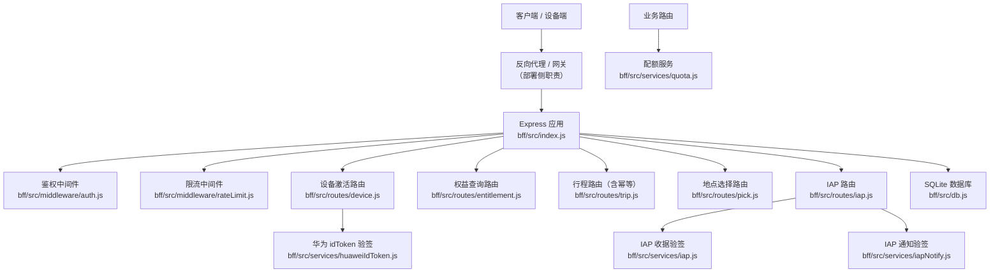
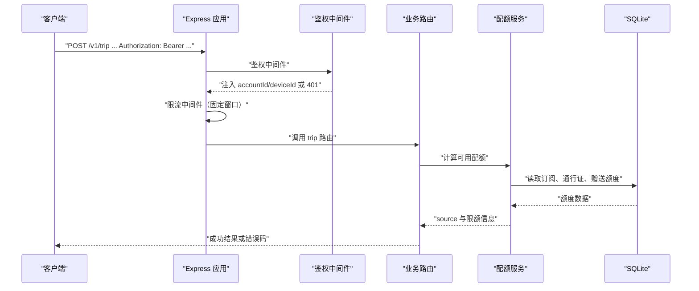
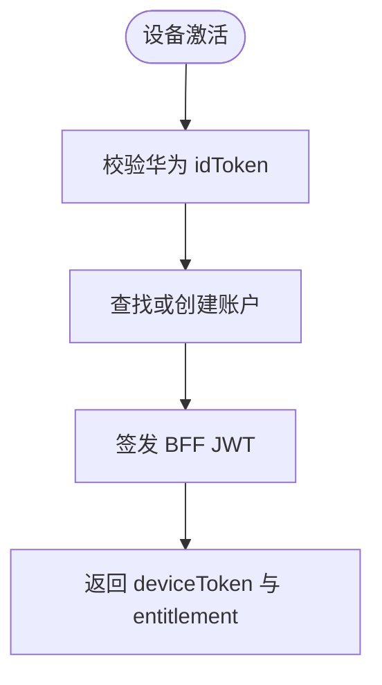
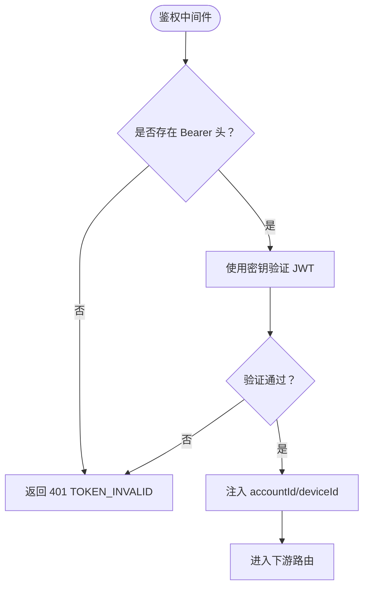
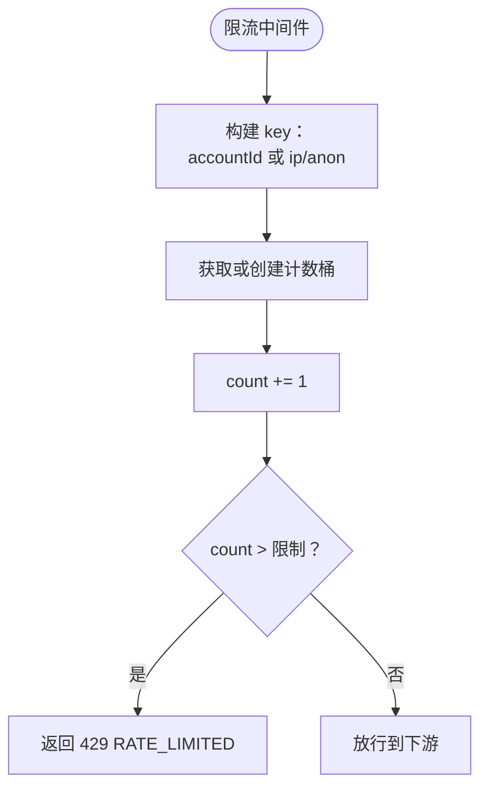
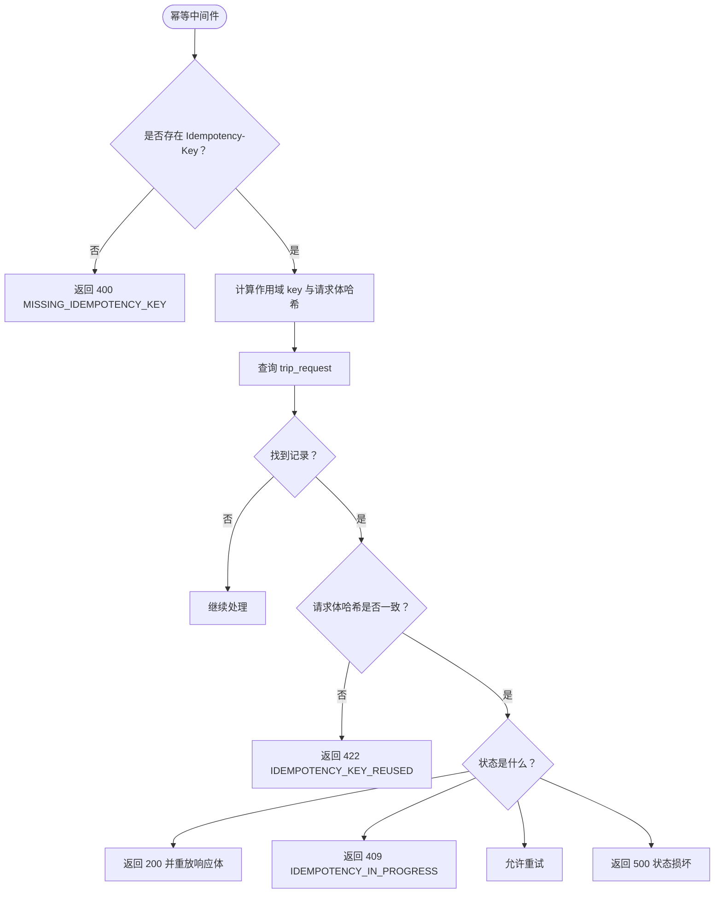
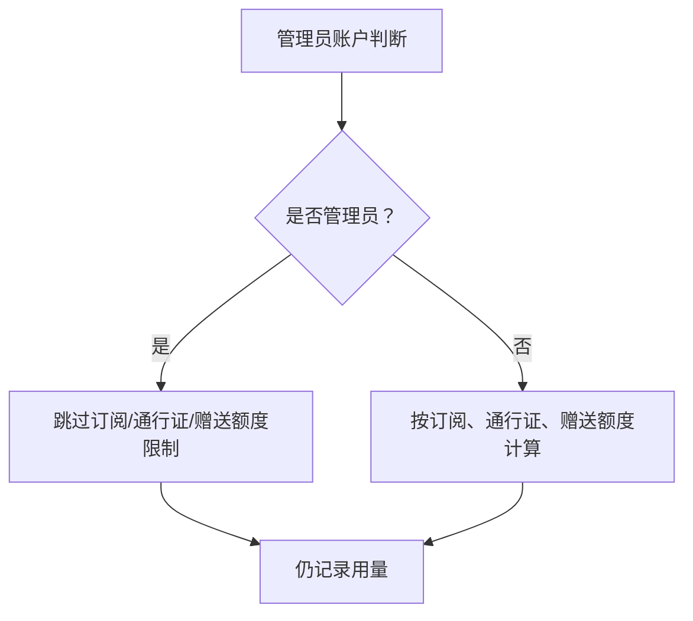
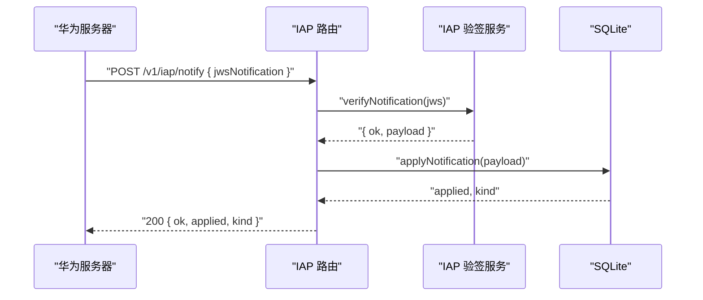
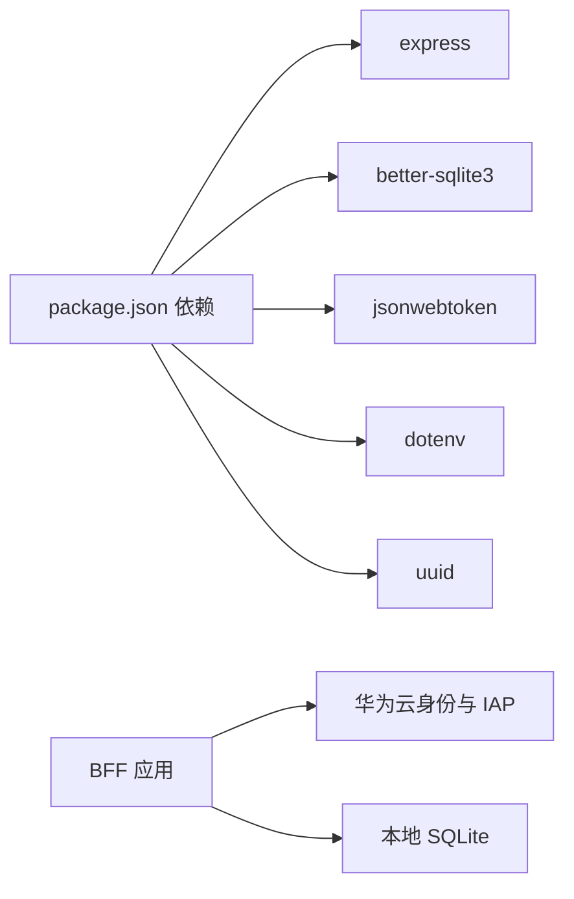

# 安全机制

<cite>
**本文引用的文件**   
- [bff/src/index.js](file://bff/src/index.js)
- [bff/src/middleware/auth.js](file://bff/src/middleware/auth.js)
- [bff/src/middleware/rateLimit.js](file://bff/src/middleware/rateLimit.js)
- [bff/src/middleware/idempotency.js](file://bff/src/middleware/idempotency.js)
- [bff/src/services/huaweiIdToken.js](file://bff/src/services/huaweiIdToken.js)
- [bff/src/routes/device.js](file://bff/src/routes/device.js)
- [bff/src/routes/entitlement.js](file://bff/src/routes/entitlement.js)
- [bff/src/routes/iap.js](file://bff/src/routes/iap.js)
- [bff/src/services/quota.js](file://bff/src/services/quota.js)
- [bff/src/db.js](file://bff/src/db.js)
- [bff/package.json](file://bff/package.json)
- [bff/scripts/preflight.mjs](file://bff/scripts/preflight.mjs)
</cite>

## 目录
1. [引言](#引言)
2. [项目结构与安全边界](#项目结构与安全边界)
3. [核心安全组件](#核心安全组件)
4. [架构总览](#架构总览)
5. [详细组件分析](#详细组件分析)
6. [依赖关系与外部集成点](#依赖关系与外部集成点)
7. [性能与可扩展性](#性能与可扩展性)
8. [故障排查](#故障排查)
9. [结论与安全加固建议](#结论与安全加固建议)

## 引言
本文面向 BFF（Backend for Frontend）服务，系统性说明其安全防护机制，包括：
- JWT 鉴权：令牌签发、校验、过期处理、密钥管理。
- API 限流：固定窗口实现、账号级配额、进程内缓存特性及扩展方向。
- 幂等保护：幂等键生成、重复请求检测、状态一致性与重放策略。
- IP 白名单与管理员控制：当前代码中的管理员豁免逻辑与部署侧职责。
- 安全配置最佳实践、常见攻击防护与安全审计建议。

本说明严格基于仓库中 BFF 服务的实际实现，不臆造不存在的能力；对尚未实现的机制（如 Redis 滑动窗口、IP 白名单）以“现状 + 改进建议”的方式给出。

## 项目结构与安全边界
BFF 使用 Express 作为 HTTP 框架，通过中间件链组合鉴权、限流和路由；SQLite 用于持久化账户、订阅、订单、配额账本与幂等记录；华为 Account Kit idToken 与 IAP JWS 由独立服务模块验证。

**图表来源**
- [bff/src/index.js:1-55](file://bff/src/index.js#L1-L55)
- [bff/src/middleware/auth.js:1-25](file://bff/src/middleware/auth.js#L1-L25)
- [bff/src/middleware/rateLimit.js:1-47](file://bff/src/middleware/rateLimit.js#L1-L47)
- [bff/src/routes/device.js:1-84](file://bff/src/routes/device.js#L1-L84)
- [bff/src/routes/entitlement.js:1-15](file://bff/src/routes/entitlement.js#L1-L15)
- [bff/src/routes/iap.js:1-192](file://bff/src/routes/iap.js#L1-L192)
- [bff/src/services/huaweiIdToken.js:1-161](file://bff/src/services/huaweiIdToken.js#L1-L161)
- [bff/src/services/quota.js:1-113](file://bff/src/services/quota.js#L1-L113)
- [bff/src/db.js:1-136](file://bff/src/db.js#L1-L136)

**章节来源**
- [bff/src/index.js:1-55](file://bff/src/index.js#L1-L55)
- [bff/package.json:1-22](file://bff/package.json#L1-L22)

## 核心安全组件
| 组件 | 职责 | 关键行为 | 主要文件 |
|---|---|---|---|
| 鉴权中间件 | 校验 Bearer JWT，注入 `accountId`、`deviceId` | 缺失头或签名失败返回 401；默认使用环境变量密钥，未配置时回退到硬编码开发密钥 | [bff/src/middleware/auth.js](file://bff/src/middleware/auth.js) |
| 限流中间件 | 按账号或匿名 IP 做固定窗口限流 | 默认每分钟 10 次；超限时返回 429；状态在进程内存 Map 中 | [bff/src/middleware/rateLimit.js](file://bff/src/middleware/rateLimit.js) |
| 幂等中间件 | 基于 `Idempotency-Key` 与请求体哈希去重 | 缺失 key 返回 400；同键不同体返回 422；进行中返回 409；成功重放响应体 | [bff/src/middleware/idempotency.js](file://bff/src/middleware/idempotency.js) |
| 华为身份验签 | 本地 RS256/PS256 验签、JWKS 缓存、aud/iss/exp/sub 校验 | fail-closed；未配置或公钥不可用时拒绝 | [bff/src/services/huaweiIdToken.js](file://bff/src/services/huaweiIdToken.js) |
| 设备激活路由 | 根据 idToken 或游客模式创建账户并签发 BFF JWT | 忽略客户端自报 unionId；并发 INSERT OR IGNORE 防唯一冲突 | [bff/src/routes/device.js](file://bff/src/routes/device.js) |
| IAP 路由 | 校验购买收据与退款通知 | 校验 JWS 长度、productType；收据绑定账号；通知走独立验签流程 | [bff/src/routes/iap.js](file://bff/src/routes/iap.js) |
| 配额服务 | 订阅、通行证、赠送额度与月度用量统计 | 按月统计；管理员豁免；预留/提交/释放三态账本 | [bff/src/services/quota.js](file://bff/src/services/quota.js) |
| 数据库初始化 | SQLite DDL、索引、列升级 | WAL、外键开启；为幂等与审计保留必要字段 | [bff/src/db.js](file://bff/src/db.js) |

**章节来源**
- [bff/src/middleware/auth.js:1-25](file://bff/src/middleware/auth.js#L1-L25)
- [bff/src/middleware/rateLimit.js:1-47](file://bff/src/middleware/rateLimit.js#L1-L47)
- [bff/src/middleware/idempotency.js:1-122](file://bff/src/middleware/idempotency.js#L1-L122)
- [bff/src/services/huaweiIdToken.js:1-161](file://bff/src/services/huaweiIdToken.js#L1-L161)
- [bff/src/routes/device.js:1-84](file://bff/src/routes/device.js#L1-L84)
- [bff/src/routes/iap.js:1-192](file://bff/src/routes/iap.js#L1-L192)
- [bff/src/services/quota.js:1-113](file://bff/src/services/quota.js#L1-L113)
- [bff/src/db.js:1-136](file://bff/src/db.js#L1-L136)

## 架构总览
BFF 的安全入口是 Express 应用启动阶段：加载环境变量、初始化 SQLite、注册 JSON 解析器与健康检查、挂载路由与全局错误处理器。敏感路由统一挂接鉴权中间件；需要成本保护的生成类路由再挂接限流中间件。

**图表来源**
- [bff/src/index.js:1-55](file://bff/src/index.js#L1-L55)
- [bff/src/middleware/auth.js:1-25](file://bff/src/middleware/auth.js#L1-L25)
- [bff/src/middleware/rateLimit.js:1-47](file://bff/src/middleware/rateLimit.js#L1-L47)
- [bff/src/services/quota.js:1-113](file://bff/src/services/quota.js#L1-L113)
- [bff/src/db.js:1-136](file://bff/src/db.js#L1-L136)

## 详细组件分析

### JWT 鉴权机制
#### 令牌生成
设备激活接口 `/v1/device/activate` 在完成华为 idToken 验签或游客激活后，调用 `issueToken(accountId, deviceId)` 签发有效期 30 天的 BFF JWT。该 JWT 包含 `accountId` 与 `deviceId`，由后续受保护路由使用。

**图表来源**
- [bff/src/routes/device.js:1-84](file://bff/src/routes/device.js#L1-L84)
- [bff/src/middleware/auth.js:1-25](file://bff/src/middleware/auth.js#L1-L25)

#### 令牌验证流程
鉴权中间件从 `Authorization` 头提取 Bearer token，使用 `jwtSecret()` 提供的密钥执行 `jwt.verify`。校验成功时将 `accountId`、`deviceId` 写入请求对象；失败则返回 401。

**图表来源**
- [bff/src/middleware/auth.js:1-25](file://bff/src/middleware/auth.js#L1-L25)

#### 过期处理
JWT 签发时设置 30 天过期时间。过期或签名无效都会落入捕获分支，返回 401 与统一错误码。客户端应据此刷新会话或重新激活。

#### 密钥管理与安全建议
- 当前实现优先使用 `JWT_SECRET` 环境变量；若未配置，回退到硬编码开发密钥。
- 预检脚本会检查密钥是否配置、是否为示例值，并提示长度不足风险。
- IAP 路由中也存在一次直接读取 `JWT_SECRET` 的鉴权路径，需确保生产环境统一配置。

建议：
- 生产环境必须设置强随机 `JWT_SECRET`，且不与示例值相同。
- 密钥不应入库、不出日志、不进入公开仓库。
- 考虑引入密钥轮换与多版本密钥支持，避免单点失效。

**章节来源**
- [bff/src/middleware/auth.js:1-25](file://bff/src/middleware/auth.js#L1-L25)
- [bff/src/routes/device.js:1-84](file://bff/src/routes/device.js#L1-L84)
- [bff/src/routes/iap.js:60-80](file://bff/src/routes/iap.js#L60-L80)
- [bff/scripts/preflight.mjs:35-43](file://bff/scripts/preflight.mjs#L35-L43)

### API 限流策略
#### 当前实现：固定窗口
限流中间件使用进程内 `Map` 维护每个 key 的计数桶。key 默认为 `accountId`，未登录时为 `req.ip` 或 `anon`。窗口大小和上限可通过环境变量调整，默认每分钟 10 次。超出时返回 429。

**图表来源**
- [bff/src/middleware/rateLimit.js:1-47](file://bff/src/middleware/rateLimit.js#L1-L47)

#### IP 级别限制
当前实现并非标准 IP 限流：当用户已认证时，key 使用 `accountId`；未认证时才用 `req.ip`。因此，真正的 IP 级限流应由反代或网关承担，代码注释也明确说明这是部署侧职责。

#### 用户级别配额
用户级别的用量与配额由配额服务负责，它与限流中间件是不同层次的保护：
- 限流中间件：短期防滥用，防止短时间内大量请求打满上游模型。
- 配额服务：长期商业化配额，按月统计成功生成的行程次数，结合订阅、通行证、赠送额度与管理员豁免。

#### Redis 优化与滑动窗口建议
当前实现是进程内固定窗口，不具备分布式一致性。若扩展到多实例部署，建议：
- 将计数桶迁移至 Redis，使用原子操作保证跨实例一致性。
- 采用滑动窗口或令牌桶算法替代固定窗口，减少窗口边界突发。
- 对匿名用户暂不启用严格 IP 限流，避免误伤共享出口 IP。
- 增加限流指标上报与告警，区分 429 来源（认证用户、匿名用户、特定路由）。

**章节来源**
- [bff/src/middleware/rateLimit.js:1-47](file://bff/src/middleware/rateLimit.js#L1-L47)
- [bff/src/services/quota.js:1-113](file://bff/src/services/quota.js#L1-L113)

### 幂等性保护
#### Idempotency-Key 生成与规范化
幂等中间件要求客户端提供 `Idempotency-Key` 请求头。服务端对请求体进行规范化 JSON 序列化并按 SHA-256 求哈希，同时基于 `accountId` 与 `clientKey` 生成作用域主键，避免跨用户撞键。

#### 重复请求检测与状态机
幂等记录表 `trip_request` 维护以下状态：
- 无记录：首次请求，继续处理。
- succeeded：重放已成功的响应体，并设置 `Idempotency-Replayed` 响应头。
- pending：同一 key 正在处理，返回 409。
- failed：允许重试；同体同键可复用该行，不同体返回 422。
- 未知状态：视为状态损坏，返回 500。

**图表来源**
- [bff/src/middleware/idempotency.js:1-122](file://bff/src/middleware/idempotency.js#L1-L122)
- [bff/src/db.js:52-100](file://bff/src/db.js#L52-L100)

#### 状态一致性保证
- 幂等 key 与 `account_id` 共同构成唯一约束，避免跨用户覆盖。
- `request_hash` 用于判断同键是否被用于不同请求体。
- `response_json` 保存首次成功响应，供重放使用。
- 若首次响应体缺失或损坏，服务端拒绝重放，防止用请求参数冒充真实业务结果。

**章节来源**
- [bff/src/middleware/idempotency.js:1-122](file://bff/src/middleware/idempotency.js#L1-L122)
- [bff/src/db.js:52-100](file://bff/src/db.js#L52-L100)

### IP 白名单机制与管理员访问控制
#### 当前实现现状
代码库中没有通用的 IP 白名单中间件。管理员豁免主要通过 `isAdminAccount` 影响配额决策，而不是直接放行任意 IP 访问。这意味着：
- 生产环境的 IP 白名单应由反向代理、API 网关或网络防火墙实现。
- BFF 内部的管理员逻辑主要用于豁免月度生成配额，便于本机测试观察真实调用量。

#### 管理员豁免与开发调试
配额服务中，管理员账户可直接获得 unlimited 权限，但仍会正常记录用量。该设计避免端侧绕过额度门禁，同时便于审计真实调用情况。

**图表来源**
- [bff/src/services/quota.js:1-113](file://bff/src/services/quota.js#L1-L113)

#### 生产环境防护建议
- 在网关层对管理接口、IAP 回调、健康检查等敏感路径配置 IP 白名单。
- 对设备激活等对外接口仅做输入校验与速率限制，不暴露内部管理面。
- 对 IAP 回调使用厂商官方回调地址校验与证书校验，不依赖 IP 白名单作为唯一防线。

**章节来源**
- [bff/src/services/quota.js:1-113](file://bff/src/services/quota.js#L1-L113)
- [bff/src/routes/iap.js:1-192](file://bff/src/routes/iap.js#L1-L192)

### 华为身份票据与 IAP 安全校验
#### 华为 idToken 验签
- 仅接受 RS256 与 PS256，拒绝 none 与对称算法，防止算法混淆。
- 从 JWKS 动态拉取公钥，带 TTL 缓存与强制刷新兜底，应对公钥轮换。
- 校验 issuer、audience、expiration、subject；任一失败均返回 fail-closed。
- 设备激活时忽略客户端自报 unionId，只信任验签后的 payload.sub。

#### IAP 收据与通知
- 购买校验前做 productType、productId、JWS 长度等边界校验。
- 收据只能绑定一个账号，已退款收据不可再次兑换。
- 通知接口独立验签，NOT_CONFIGURED 返回 503，其余失败返回 401。
- 官方约定非 200 即触发重推，服务按 200 确认消费。

**图表来源**
- [bff/src/routes/iap.js:140-192](file://bff/src/routes/iap.js#L140-L192)
- [bff/src/services/huaweiIdToken.js:1-161](file://bff/src/services/huaweiIdToken.js#L1-L161)

**章节来源**
- [bff/src/services/huaweiIdToken.js:1-161](file://bff/src/services/huaweiIdToken.js#L1-L161)
- [bff/src/routes/device.js:1-84](file://bff/src/routes/device.js#L1-L84)
- [bff/src/routes/iap.js:1-192](file://bff/src/routes/iap.js#L1-L192)

## 依赖关系与外部集成点
- Express：HTTP 服务与中间件管线。
- better-sqlite3：同步 SQLite 驱动，开启 WAL 与外键约束。
- jsonwebtoken：JWT 签发与校验。
- dotenv：环境变量加载。
- uuid：第三方依赖声明，但当前安全相关代码未直接依赖。
- 华为云：idToken JWKS、IAP 收据与通知。

**图表来源**
- [bff/package.json:1-22](file://bff/package.json#L1-L22)
- [bff/src/index.js:1-55](file://bff/src/index.js#L1-L55)
- [bff/src/db.js:1-136](file://bff/src/db.js#L1-L136)
- [bff/src/services/huaweiIdToken.js:1-161](file://bff/src/services/huaweiIdToken.js#L1-L161)

**章节来源**
- [bff/package.json:1-22](file://bff/package.json#L1-L22)
- [bff/src/index.js:1-55](file://bff/src/index.js#L1-L55)

## 性能与可扩展性
- 限流中间件使用进程内 Map，单次 O(1) 查询；但在多实例下不具备一致性，不适合生产分布式场景。
- 幂等查询依赖 SQLite 唯一索引，查询复杂度取决于索引命中；随着 `trip_request` 表增长，应考虑归档历史成功记录。
- 华为 JWKS 拉取有 10 分钟 TTL 与 5 秒超时，避免频繁网络 IO；但服务重启会清空缓存，需注意冷启动抖动。
- IAP 验签涉及 RSA 验证与 JSON 解析，应在网关层做请求大小限制与超时控制，避免后端被恶意大包拖垮。

[本节为通用性能讨论，不直接分析具体代码行]

## 故障排查
| 现象 | 可能原因 | 定位线索 | 处理建议 |
|---|---|---|---|
| 所有受保护路由返回 401 | JWT_SECRET 未配置或错误 | 鉴权中间件与 IAP 路由中直接使用 `JWT_SECRET` | 检查环境变量；运行预检脚本 |
| 设备激活成功但后续请求 401 | 客户端使用旧 token 或密钥变更 | 检查 token 有效期与密钥轮换 | 客户端重新激活；必要时双密钥兼容 |
| 生成接口频繁 429 | 触发自定义限流或上游 LLM 限流 | 限流中间件与 LLM 服务日志 | 调整 `RATE_LIMIT_PER_MINUTE`；检查上游限流 |
| 幂等请求返回 422 | 同一 `Idempotency-Key` 对应不同请求体 | 幂等中间件比较 `request_hash` | 客户端更换新 key |
| 幂等请求返回 409 | 同一 key 的请求仍在处理 | 幂等状态为 pending | 客户端轮询或等待 |
| IAP 回调返回 503 | 根证书或未配置 | notify 验签 reason 为 NOT_CONFIGURED | 部署时配置 IAP 根证书与 APP_ID |
| 健康检查返回 degraded | SQLite 损坏或只读 | health 路由主动查库 | 检查 DB_PATH、文件系统权限与 WAL 文件 |

**章节来源**
- [bff/src/middleware/auth.js:1-25](file://bff/src/middleware/auth.js#L1-L25)
- [bff/src/middleware/rateLimit.js:1-47](file://bff/src/middleware/rateLimit.js#L1-L47)
- [bff/src/middleware/idempotency.js:1-122](file://bff/src/middleware/idempotency.js#L1-L122)
- [bff/src/routes/iap.js:140-192](file://bff/src/routes/iap.js#L140-L192)
- [bff/src/index.js:1-55](file://bff/src/index.js#L1-L55)

## 结论与安全加固建议
当前 BFF 已具备较完整的基础安全能力：JWT 鉴权、固定窗口限流、SQLite 幂等保护、华为 idToken 与 IAP 验签、配额与管理员豁免。但仍需在生产环境中补齐部署侧防护，并强化密钥管理与可观测性。

建议优先级如下：
1. **强制生产密钥**：禁止使用示例或硬编码 `JWT_SECRET`；启用预检阻断。
2. **部署侧限流与 IP 白名单**：在网关层实现 IP 白名单、IP 级限流与请求大小限制。
3. **分布式限流**：将固定窗口迁移到 Redis，支持滑动窗口或令牌桶。
4. **幂等表归档**：定期归档历史成功记录，避免 `trip_request` 无限增长。
5. **密钥轮换**：支持多版本 JWT 密钥与华为 JWKS 更稳健的容错策略。
6. **安全审计**：记录鉴权失败、限流命中、幂等冲突、IAP 异常，接入集中日志与告警。
7. **最小权限原则**：对外接口仅暴露必要能力，管理接口与回调路径严格隔离。

[本节为总结与建议，不直接分析具体代码行]