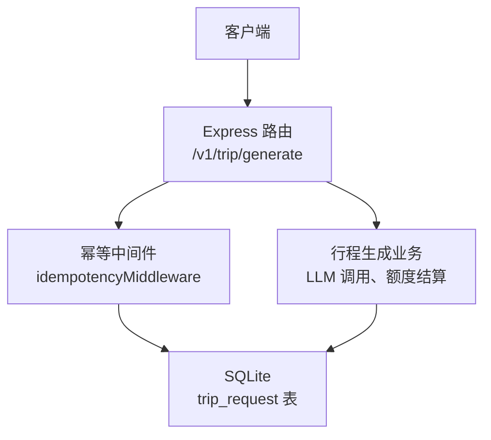
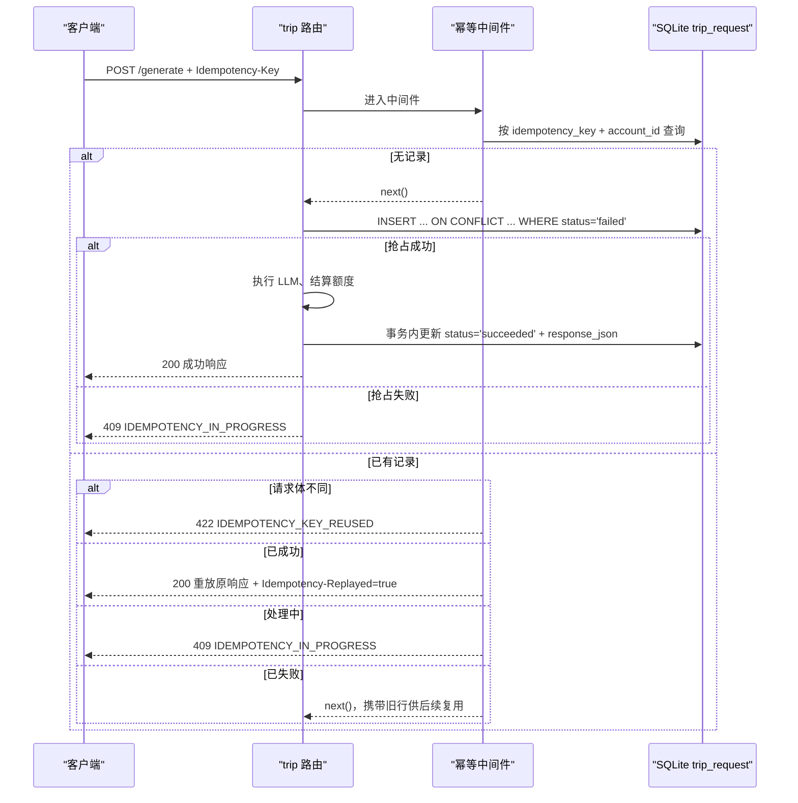
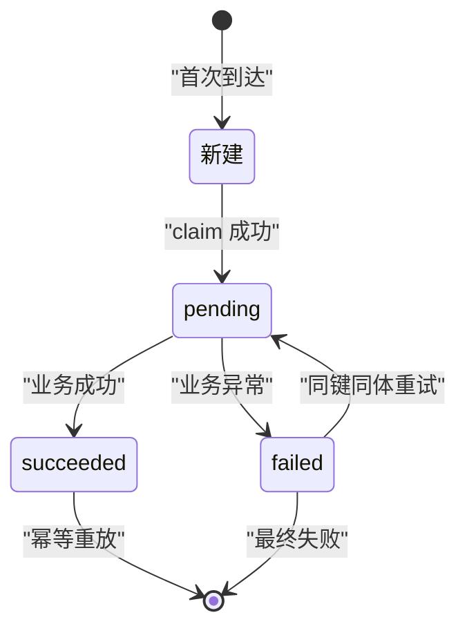
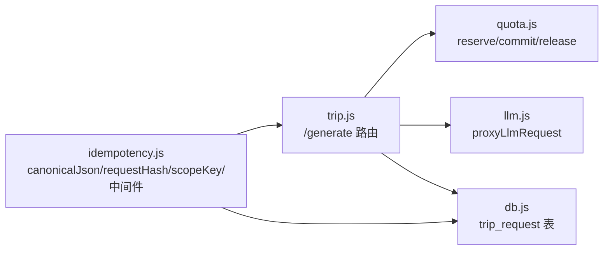

# 幂等性保护机制

<cite>
**本文引用的文件**   
- [bff/src/middleware/idempotency.js](file://bff/src/middleware/idempotency.js)
- [bff/src/routes/trip.js](file://bff/src/routes/trip.js)
- [bff/src/db.js](file://bff/src/db.js)
- [bff/test/idempotency.test.js](file://bff/test/idempotency.test.js)
- [bff/test/iap-idempotency.test.js](file://bff/test/iap-idempotency.test.js)
</cite>

## 目录
1. [引言](#引言)
2. [项目结构中的幂等位置](#项目结构中的幂等位置)
3. [核心组件](#核心组件)
4. [架构总览](#架构总览)
5. [详细组件分析](#详细组件分析)
6. [依赖关系分析](#依赖关系分析)
7. [性能与并发特性](#性能与并发特性)
8. [客户端集成指南](#客户端集成指南)
9. [错误响应格式](#错误响应格式)
10. [故障排查](#故障排查)
11. [结论](#结论)

## 引言
本文件面向实现者和使用者，系统说明 BFF 层中“行程生成”接口的幂等性保护机制。内容覆盖请求去重算法、Idempotency-Key 作用域设计、trip_request 表结构、幂等状态机（pending / succeeded / failed）、并发抢占策略、数据库一致性保证，以及客户端重试与错误处理建议。

## 项目结构中的幂等位置
幂等性能力集中在 BFF（后端服务）侧：
- 中间件负责解析 Idempotency-Key、计算请求哈希与作用域键、读取已有幂等记录并决定放行或拦截。
- 路由在中间件之后执行实际业务逻辑，并通过 INSERT ... ON CONFLICT + WHERE status='failed' 完成“失败重试认领”。
- 数据库定义 trip_request 表，作为幂等记录的主存储。

**图表来源**
- [bff/src/routes/trip.js:67-100](file://bff/src/routes/trip.js#L67-L100)
- [bff/src/middleware/idempotency.js:54-122](file://bff/src/middleware/idempotency.js#L54-L122)
- [bff/src/db.js:60-76](file://bff/src/db.js#L60-L76)

**章节来源**
- [bff/src/routes/trip.js:67-100](file://bff/src/routes/trip.js#L67-L100)
- [bff/src/middleware/idempotency.js:54-122](file://bff/src/middleware/idempotency.js#L54-L122)
- [bff/src/db.js:60-76](file://bff/src/db.js#L60-L76)

## 核心组件
- canonicalJson：将请求体规范化为稳定字符串，用于比较语义等价请求。
- requestHash：对规范化后的请求体做 SHA256 哈希。
- scopeKey：用 accountId 和客户端 Idempotency-Key 生成跨用户隔离的幂等主键。
- idempotencyMiddleware：根据已有行状态返回重放结果、进行中拒绝、失败允许重跑。
- trip 路由：负责 claim 幂等行、执行 LLM 调用、事务内写回成功状态和响应体。
- trip_request 表：持久化幂等记录、请求摘要、响应快照、耗时与模型信息。

**章节来源**
- [bff/src/middleware/idempotency.js:1-122](file://bff/src/middleware/idempotency.js#L1-L122)
- [bff/src/routes/trip.js:67-234](file://bff/src/routes/trip.js#L67-L234)
- [bff/src/db.js:60-76](file://bff/src/db.js#L60-L76)

## 架构总览
幂等流程分为两个阶段：
1. 中间件阶段：校验头、构造 key/hash、查询 trip_request。
   - 无记录 → 放行给下游。
   - 已存在且同体 → 按状态返回重放、进行中或失败重跑。
   - 已存在但不同体 → 返回 422。
2. 路由阶段：尝试把一行幂等记录从 failed 升级为 pending；成功后执行业务，再事务内写回 succeeded 或 failed。

**图表来源**
- [bff/src/middleware/idempotency.js:54-122](file://bff/src/middleware/idempotency.js#L54-L122)
- [bff/src/routes/trip.js:67-234](file://bff/src/routes/trip.js#L67-L234)

## 详细组件分析

### 请求去重算法

#### canonicalJson 规范化函数
canonicalJson 的目标是让“语义相同但键顺序不同”的请求体产生一致字符串，从而被识别为同一请求。其规则包括：
- undefined 值序列化为 null 字符串。
- null、number、boolean、string 直接序列化。
- 数组保持顺序，递归规范化每个元素。
- 对象键先过滤 undefined 值，再按字典序排序后拼接。

该函数的关键性质由测试覆盖：
- 键序不影响结果。
- undefined 字段被忽略。
- 数组顺序敏感。
- 数值变化会改变哈希。

**复杂度分析**
- 时间复杂度 O(N log N)，其中 N 为对象键数，主要消耗在按键排序。
- 空间复杂度 O(D)，D 为规范化后字符串长度，等于请求体规模线性级别。

**优化建议**
- 对于超大请求体，可考虑流式哈希或分块规范化，避免一次性构建完整字符串。
- 若对象层级很深，应关注栈深度上限，必要时增加递归保护。

**章节来源**
- [bff/src/middleware/idempotency.js:1-27](file://bff/src/middleware/idempotency.js#L1-L27)
- [bff/test/idempotency.test.js:119-129](file://bff/test/idempotency.test.js#L119-L129)

#### SHA256 哈希计算
requestHash 使用 Node.js crypto 模块对 canonicalJson 的输出做 SHA256 十六进制摘要。它不直接比较 JSON 文本，而是比较哈希值，降低长请求体的比较成本。

注意：
- 哈希碰撞概率极低，但仍以 canonicalJson 稳定性为前提。
- 当请求体很大时，update 操作本身是增量写入，整体仍接近线性开销。

**章节来源**
- [bff/src/middleware/idempotency.js:29-31](file://bff/src/middleware/idempotency.js#L29-L31)
- [bff/test/idempotency.test.js:119-129](file://bff/test/idempotency.test.js#L119-L129)

#### scopeKey 作用域生成
scopeKey 将 accountId 与客户端提供的 Idempotency-Key 组合后再做 SHA256，形成数据库唯一键。这样即使不同用户使用了相同的客户端 key，也不会互相影响，实现“跨用户隔离”。

测试验证：
- 不同 accountId 下相同 clientKey 得到不同 scopeKey。
- 相同 accountId 下不同 clientKey 得到不同 scopeKey。

**章节来源**
- [bff/src/middleware/idempotency.js:33-35](file://bff/src/middleware/idempotency.js#L33-L35)
- [bff/test/idempotency.test.js:131-134](file://bff/test/idempotency.test.js#L131-L134)

### 幂等状态机

#### 状态定义
trip_request 表维护三种状态：
- pending：请求正在处理中。
- succeeded：请求已成功，响应体已落盘。
- failed：请求失败，额度已释放，允许同键同体重跑。

**图表来源**
- [bff/src/middleware/idempotency.js:95-122](file://bff/src/middleware/idempotency.js#L95-L122)
- [bff/src/routes/trip.js:86-100](file://bff/src/routes/trip.js#L86-L100)
- [bff/src/routes/trip.js:177-234](file://bff/src/routes/trip.js#L177-L234)

#### 状态转换逻辑

##### 中间件阶段的状态判断
- 无记录：放行。
- 已存在且 request_hash 不同：返回 422，禁止重用旧 key。
- 已存在且 request_hash 相同：
  - succeeded：解析 response_json，返回 200 并重放原响应，同时设置 Idempotency-Replayed=true。
  - pending：返回 409，提示正在处理中。
  - failed：允许继续，并在 req 上挂旧行，便于下游复用。
  - 其他未知状态：返回 500 状态损坏错误。

##### 路由阶段的 claim 逻辑
路由通过 SQL 插入幂等行，并使用 ON CONFLICT(idempotency_key) DO UPDATE ... WHERE trip_request.status = 'failed'。这意味着：
- 新请求可以抢占失败行。
- 并发请求中只有一个能把行变成 pending；另一个因 changes=0 被拒绝。
- 已存在的 pending 或 succeeded 行不会被覆盖，从而防止重复执行。

##### 成功路径的事务写回
成功后在一个数据库事务内：
1. commitQuota 结算额度。
2. 更新 trip_request 为 succeeded，并写入 prompt_tokens、completion_tokens、model、finished_at。
3. 读取当前 entitlement，组装包含 trip 和 quota 的响应体。
4. 再将 response_json 写回同一行，以便下次幂等重放。

如果更新行数不为 1，则抛出异常，阻止返回未持久化的响应。

##### 失败路径
发生异常时，路由将 trip_request 标记为 failed，并写入 error_code 和 finished_at。失败后，中间件允许同键同体重试。

**章节来源**
- [bff/src/middleware/idempotency.js:54-122](file://bff/src/middleware/idempotency.js#L54-L122)
- [bff/src/routes/trip.js:86-100](file://bff/src/routes/trip.js#L86-L100)
- [bff/src/routes/trip.js:172-234](file://bff/src/routes/trip.js#L172-L234)

### Idempotency-Key 头的作用

#### 客户端生成策略
- 应在每次发起“可能产生副作用”的请求前生成一个全局唯一标识。
- 推荐基于 UUID v4 或单调递增序号加设备/会话上下文生成。
- 不要复用上一次请求的 key，除非你希望服务端重放上次结果。
- 客户端必须把 Idempotency-Key 放在请求头中，字段名为 idempotency-key。

#### 跨用户隔离
服务器端会把 accountId 与客户端 key 组合成 scopeKey，再存入 trip_request.idempotency_key。因此：
- 用户 A 和用户 B 可以使用相同字符串作为 key，互不影响。
- 同一用户多次使用相同 key 且请求体不变，会被视为幂等重放。

#### 请求体变更检测
服务器端对请求体执行 canonicalJson 后求 SHA256，并与已有记录的 request_hash 比较：
- 同 key + 同 body：允许幂等行为。
- 同 key + 不同 body：返回 422，要求客户端换新的 key。

这避免了“同一个幂等 key 被用来重新提交不同意图”的安全风险。

**章节来源**
- [bff/src/middleware/idempotency.js:33-35](file://bff/src/middleware/idempotency.js#L33-L35)
- [bff/src/middleware/idempotency.js:82-93](file://bff/src/middleware/idempotency.js#L82-L93)
- [bff/test/idempotency.test.js:119-134](file://bff/test/idempotency.test.js#L119-L134)

### 数据库表结构设计

trip_request 表用于记录一次幂等请求的生命周期：

| 字段 | 类型 | 约束 | 说明 |
|---|---|---|---|
| id | INTEGER | PRIMARY KEY AUTOINCREMENT | 自增主键 |
| account_id | INTEGER | NOT NULL | 所属账户 |
| idempotency_key | TEXT | UNIQUE NOT NULL | 跨用户隔离的幂等主键 |
| request_hash | TEXT | NOT NULL DEFAULT '' | 规范化请求体的 SHA256 |
| params_json | TEXT | | 原始请求体快照 |
| response_json | TEXT | | 成功时的响应体快照，用于幂等重放 |
| status | TEXT | NOT NULL | pending / succeeded / failed |
| prompt_tokens | INTEGER | | 提示词 token 用量 |
| completion_tokens | INTEGER | | 补全 token 用量 |
| model | TEXT | | 使用的模型名称 |
| cost_micros | INTEGER | | 耗时微秒 |
| started_at | TEXT | NOT NULL | 开始时间 |
| finished_at | TEXT | | 结束时间 |
| error_code | INTEGER | | 失败错误码 |

索引：
- idx_req_account：按 account_id 索引，加速按用户查询。
- idempotency_key：UNIQUE，保证幂等主键唯一。

迁移与兼容：
- initDb 会确保 trip_request 表存在。
- ensureColumn 会为旧库追加 request_hash 和 response_json 列，使历史数据也能参与幂等重放。

**章节来源**
- [bff/src/db.js:60-76](file://bff/src/db.js#L60-L76)
- [bff/src/db.js:119-121](file://bff/src/db.js#L119-L121)

### 状态一致性保证

#### 乐观抢占
- 中间件阶段只做 SELECT，不写锁。
- 路由阶段通过 INSERT ... ON CONFLICT ... WHERE status='failed' 进行“失败重试认领”，并发下只有第一个能成功把行改为 pending。
- changes=0 表示已被其他请求抢占，直接返回 409。

#### 事务写回
成功路径使用 db.transaction(() => {...})，在事务内：
- 提交额度。
- 更新 trip_request 为 succeeded。
- 检查 updated.changes === 1。
- 组装响应体并再次写回 response_json。

若任一步骤失败，整个事务回滚，不会出现“已扣额度但未标记成功”或“已标记成功但无响应体”的不一致状态。

#### 失败重试安全
- 失败行保留 request_hash。
- 中间件只允许“同键同体”走失败行重试。
- 不同体直接返回 422，不会覆盖失败记录。

**章节来源**
- [bff/src/routes/trip.js:86-100](file://bff/src/routes/trip.js#L86-L100)
- [bff/src/routes/trip.js:172-190](file://bff/src/routes/trip.js#L172-L190)
- [bff/src/routes/trip.js:209-234](file://bff/src/routes/trip.js#L209-L234)
- [bff/src/middleware/idempotency.js:95-122](file://bff/src/middleware/idempotency.js#L95-L122)

### 并发处理机制

#### 并发幂等
- 同一 Idempotency-Key 在同一时刻只能有一个请求真正执行。
- 其余并发请求会看到 pending 状态，返回 409。
- 当原请求失败后，下一个同键同体请求可以抢占失败行并重新执行。

#### 与 IAP 幂等的对比
IAP 相关测试也强调收据幂等：同一 purchaseToken 不能重复记账，并发提交也只落一条订阅或订单。这与 trip_request 的幂等思想一致——以唯一凭据保护副作用操作。

**章节来源**
- [bff/test/iap-idempotency.test.js:1-212](file://bff/test/iap-idempotency.test.js#L1-L212)

## 依赖关系分析

**图表来源**
- [bff/src/middleware/idempotency.js:1-122](file://bff/src/middleware/idempotency.js#L1-L122)
- [bff/src/routes/trip.js:1-234](file://bff/src/routes/trip.js#L1-L234)
- [bff/src/db.js:60-76](file://bff/src/db.js#L60-L76)

**章节来源**
- [bff/src/middleware/idempotency.js:1-122](file://bff/src/middleware/idempotency.js#L1-L122)
- [bff/src/routes/trip.js:1-234](file://bff/src/routes/trip.js#L1-L234)
- [bff/src/db.js:1-136](file://bff/src/db.js#L1-L136)

## 性能与并发特性

- 请求哈希计算：canonicalJson 对对象键排序带来 O(N log N) 开销；SHA256 是线性扫描。对大多数 API 请求体而言可接受。
- 数据库查询：中间件只查一次 trip_request，命中率高时可显著减少下游 LLM 调用。
- 并发控制：通过 SQLite 的唯一约束和 ON CONFLICT 实现轻量级分布式锁语义；适合单机或少量实例部署。
- 大响应体重放：response_json 会持久化，需注意数据库体积增长；可按业务需求设定清理策略或归档。

[本节为通用性能讨论，不直接分析具体代码片段]

## 客户端集成指南

### 基本流程
1. 生成唯一 Idempotency-Key。
2. 带上 Authorization 认证头和 Idempotency-Key 请求头。
3. 发送 POST /v1/trip/generate。
4. 处理以下响应：
   - 200：正常成功，可直接渲染行程。
   - 400：缺少 Idempotency-Key。
   - 401：缺少账号/设备标识。
   - 409：请求处理中，应退避重试。
   - 422：同 key 对应不同请求体，应生成新 key 后重试。
   - 500：幂等状态损坏或内部错误，应谨慎重试。

### 重试策略建议
- 遇到 409 IDEMPOTENCY_IN_PROGRESS：
  - 使用指数退避 + 抖动重试。
  - 最大重试次数建议不超过 3～5 次。
  - 不要立即轮询，避免放大并发压力。
- 遇到 422 IDEMPOTENCY_KEY_REUSED：
  - 更换新的 Idempotency-Key。
  - 不要沿用旧 key 修改请求体。
- 遇到 500：
  - 区分 IDEMPOTENCY_STATE_CORRUPT 与一般内部错误。
  - 前者不应盲目重试，应先检查服务端健康或上报日志。
- 网络超时场景：
  - 若不确定服务端是否成功，应携带与原请求相同的 Idempotency-Key 重试。
  - 服务端会根据状态返回 200 重放或 409 告知仍在处理。

### 客户端 Key 生成最佳实践
- 使用不可预测的全局唯一值，如 UUID v4。
- 结合设备指纹或会话标识，降低多进程/多线程冲突概率。
- 不要在 UI 层缓存可复用的 key，除非你明确知道上次请求已成功。

**章节来源**
- [bff/src/middleware/idempotency.js:54-80](file://bff/src/middleware/idempotency.js#L54-L80)
- [bff/test/idempotency.test.js:41-134](file://bff/test/idempotency.test.js#L41-L134)

## 错误响应格式

| HTTP 状态码 | error | 含义 | 客户端动作 |
|---|---|---|---|
| 400 | MISSING_IDEMPOTENCY_KEY | 缺少 Idempotency-Key | 补充请求头后重试 |
| 401 | TOKEN_INVALID | 缺少账号/设备标识 | 检查认证流程 |
| 409 | IDEMPOTENCY_IN_PROGRESS | 同 key 请求正在处理 | 指数退避重试 |
| 422 | IDEMPOTENCY_KEY_REUSED | 同 key 对应不同请求体 | 生成新 key 后重试 |
| 500 | IDEMPOTENCY_STATE_CORRUPT | 幂等状态损坏或响应体无法解析 | 停止重试，上报错误 |

成功重放响应还会携带响应头：
- Idempotency-Replayed: true

**章节来源**
- [bff/src/middleware/idempotency.js:54-122](file://bff/src/middleware/idempotency.js#L54-L122)
- [bff/test/idempotency.test.js:71-118](file://bff/test/idempotency.test.js#L71-L118)

## 故障排查

### 常见问题
- 客户端频繁收到 409：
  - 检查是否存在短间隔轮询。
  - 确认没有多个线程使用相同 Idempotency-Key 同时发起请求。
- 客户端频繁收到 422：
  - 检查是否在重试时修改了请求体却复用旧 key。
  - 检查客户端是否缓存了 key 并跨请求复用。
- 成功重放返回 500：
  - 可能是数据库中 response_json 缺失或损坏。
  - 应检查写入成功路径是否始终写入 response_json。
- 幂等记录长期处于 pending：
  - 可能是上游 LLM 调用阻塞或连接泄漏。
  - 应检查 LLM 超时、连接池和中间件日志。

### 定位建议
- 查看 trip_request 表中对应 idempotency_key 的记录：
  - status 是否为 pending。
  - request_hash 是否与客户端期望一致。
  - response_json 是否存在且为合法 JSON。
- 核对中间件日志中 canonicalJson 与 requestHash 的行为是否符合预期。
- 若涉及 IAP 幂等，可参考 iap-idempotency.test 中关于 purchaseToken 重复提交的断言。

**章节来源**
- [bff/src/middleware/idempotency.js:95-122](file://bff/src/middleware/idempotency.js#L95-L122)
- [bff/test/idempotency.test.js:119-134](file://bff/test/idempotency.test.js#L119-L134)
- [bff/test/iap-idempotency.test.js:1-212](file://bff/test/iap-idempotency.test.js#L1-L212)

## 结论
该幂等性机制通过 canonicalJson 规范化、SHA256 哈希比对、scopeKey 跨用户隔离，配合 trip_request 表的三态机与 SQL 级抢占，实现了“同请求体幂等、不同请求体重用 key 被拒、并发请求串行化”的目标。客户端应严格遵循 Idempotency-Key 生成规范，并结合 409、422、500 等错误码设计稳健的重试策略。对于需要强一致性的支付类操作，还可参考 IAP 幂等测试中对 purchaseToken 的唯一性约束思路，进一步降低重复记账风险。