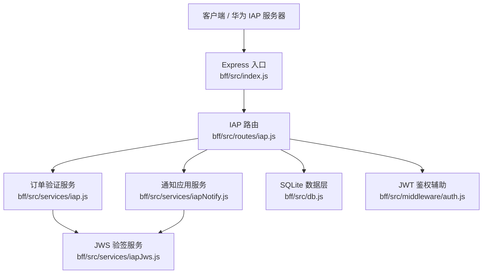
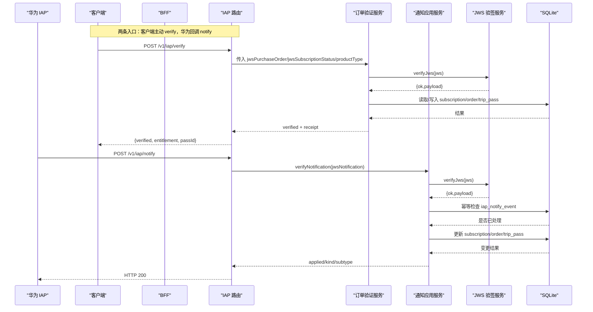
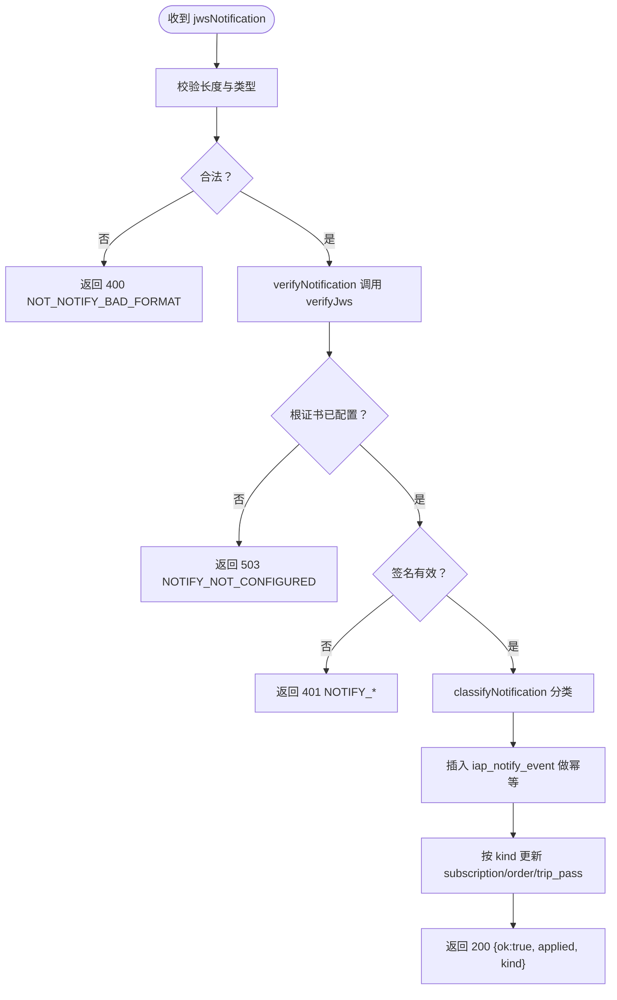
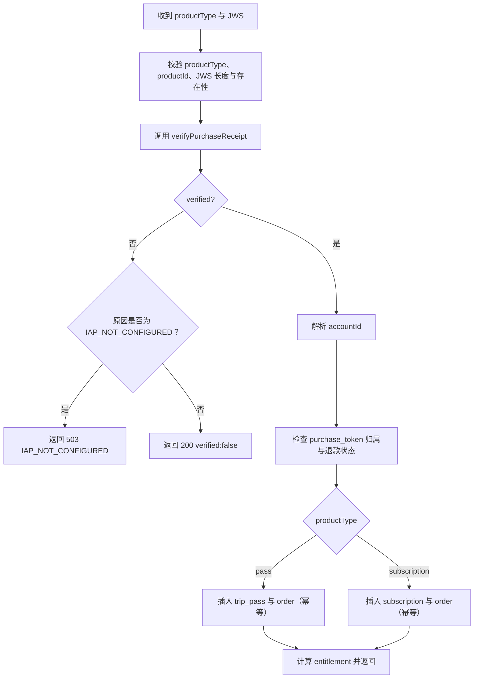
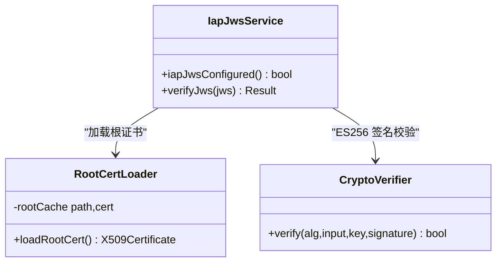
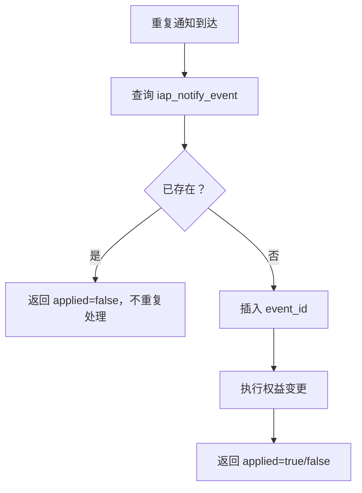
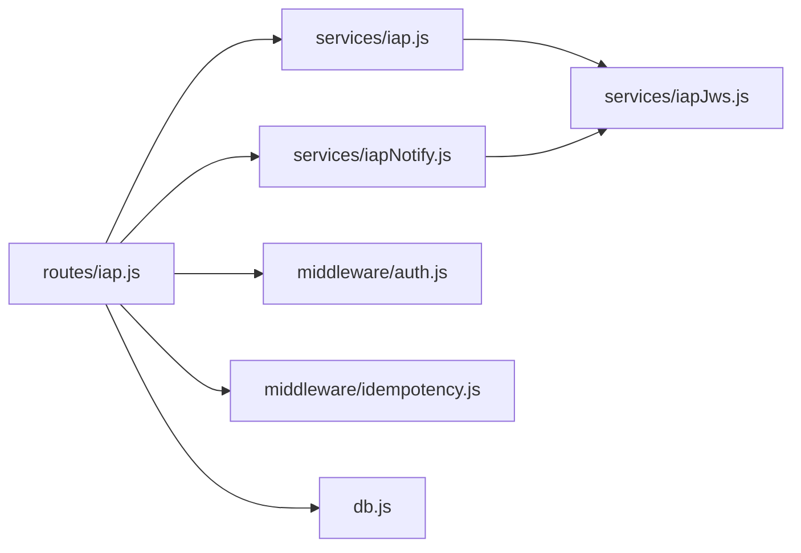

# 内购处理路由

<cite>
**本文引用的文件**   
- [bff/src/routes/iap.js](file://bff/src/routes/iap.js)
- [bff/src/services/iap.js](file://bff/src/services/iap.js)
- [bff/src/services/iapNotify.js](file://bff/src/services/iapNotify.js)
- [bff/src/services/iapJws.js](file://bff/src/services/iapJws.js)
- [bff/src/middleware/auth.js](file://bff/src/middleware/auth.js)
- [bff/src/middleware/idempotency.js](file://bff/src/middleware/idempotency.js)
- [bff/src/db.js](file://bff/src/db.js)
- [bff/src/index.js](file://bff/src/index.js)
- [bff/test/fixtures/jws.js](file://bff/test/fixtures/jws.js)
- [bff/test/iap-notify.test.js](file://bff/test/iap-notify.test.js)
- [bff/test/iap-verify.test.js](file://bff/test/iap-verify.test.js)
- [bff/test/iap-idempotency.test.js](file://bff/test/iap-idempotency.test.js)
- [Docs/商业化方案.md](file://Docs/商业化方案.md)
</cite>

## 目录
1. [简介](#简介)
2. [项目结构](#项目结构)
3. [核心组件](#核心组件)
4. [架构总览](#架构总览)
5. [详细组件分析](#详细组件分析)
6. [依赖关系分析](#依赖关系分析)
7. [性能与可扩展性](#性能与可扩展性)
8. [故障排查指南](#故障排查指南)
9. [安全最佳实践](#安全最佳实践)
10. [监控与告警建议](#监控与告警建议)
11. [集成示例与测试环境配置](#集成示例与测试环境配置)
12. [结论](#结论)

## 简介
本文件面向华为 IAP 内购处理路由，覆盖以下目标：
- 支付回调接口 `POST /v1/iap/notify`：JWS 签名验证、通知载荷校验、幂等去重、权益变更。
- 订单验证接口 `POST /v1/iap/verify`：购买凭证校验、订阅状态查询、重复支付检测、账号绑定校验。
- 华为 IAP 系统集成：JWS 证书链信任、根证书管理、密钥轮换方式、回调重试语义。
- 幂等性保证：基于数据库唯一约束的通知事件表与收据幂等键；通用请求级幂等中间件作为补充。
- 错误处理：签名失败、配置缺失、网络异常、数据不一致的恢复策略。
- 集成示例：测试 JWS 构造、本地服务启动、健康检查、错误场景。
- 安全与监控：最小权限、fail-closed、可观测指标与告警阈值。

## 项目结构
BFF 使用 Express 提供 `/v1/iap` 路由，核心由“路由层 + 业务服务层 + JWS 验签层 + SQLite 数据层”组成。

**图示来源**
- [bff/src/index.js:1-55](file://bff/src/index.js#L1-L55)
- [bff/src/routes/iap.js:1-192](file://bff/src/routes/iap.js#L1-L192)
- [bff/src/services/iap.js:1-133](file://bff/src/services/iap.js#L1-L133)
- [bff/src/services/iapNotify.js:1-167](file://bff/src/services/iapNotify.js#L1-L167)
- [bff/src/services/iapJws.js:1-148](file://bff/src/services/iapJws.js#L1-L148)
- [bff/src/db.js:1-136](file://bff/src/db.js#L1-L136)
- [bff/src/middleware/auth.js:1-25](file://bff/src/middleware/auth.js#L1-L25)

**章节来源**
- [bff/src/index.js:1-55](file://bff/src/index.js#L1-L55)
- [Docs/商业化方案.md:1-200](file://Docs/商业化方案.md#L1-L200)

## 核心组件
- IAP 路由：定义 `/verify` 与 `/notify`，负责参数校验、鉴权、调用服务、写入订单/订阅/通行证、返回统一结果。
- 订单验证服务：对 `jwsPurchaseOrder` 或 `jwsSubscriptionStatus` 做 JWS 验签与业务校验（应用 ID、商品类型、撤销状态、订阅状态）。
- 通知应用服务：对华为 IAP v3 关键事件通知分类、幂等落库、执行续订、到期、退款、自动续费开关变更。
- JWS 验签服务：本地 ES256 验签，校验 x5c 证书链、根证书匹配、有效期、叶子 OID、签名。
- 鉴权辅助：解析 `Authorization: Bearer <JWT>`，提取 `accountId`。
- 幂等中间件：针对普通 API 的请求级幂等；IAP 自身通过 `purchase_token` 与 `notificationRequestId` 实现领域幂等。
- 数据模型：`subscription`、`trip_pass`、`order`、`iap_notify_event`、`trip_request`。

**章节来源**
- [bff/src/routes/iap.js:1-192](file://bff/src/routes/iap.js#L1-L192)
- [bff/src/services/iap.js:1-133](file://bff/src/services/iap.js#L1-L133)
- [bff/src/services/iapNotify.js:1-167](file://bff/src/services/iapNotify.js#L1-L167)
- [bff/src/services/iapJws.js:1-148](file://bff/src/services/iapJws.js#L1-L148)
- [bff/src/middleware/auth.js:1-25](file://bff/src/middleware/auth.js#L1-L25)
- [bff/src/middleware/idempotency.js:1-122](file://bff/src/middleware/idempotency.js#L1-L122)
- [bff/src/db.js:1-136](file://bff/src/db.js#L1-L136)

## 架构总览
IAP 处理采用“先验签、再幂等、后改权益”的分层设计，避免直接信任端侧输入，并通过数据库唯一索引实现分布式友好的幂等。

**图示来源**
- [bff/src/routes/iap.js:1-192](file://bff/src/routes/iap.js#L1-L192)
- [bff/src/services/iap.js:1-133](file://bff/src/services/iap.js#L1-L133)
- [bff/src/services/iapNotify.js:1-167](file://bff/src/services/iapNotify.js#L1-L167)
- [bff/src/services/iapJws.js:1-148](file://bff/src/services/iapJws.js#L1-L148)
- [bff/src/db.js:1-136](file://bff/src/db.js#L1-L136)

## 详细组件分析

### 支付回调接口：POST /v1/iap/notify
该接口接收华为 IAP v3 服务端关键事件通知，完成签名验证、载荷校验、事件幂等与权益变更。

#### 请求规范
- URL：`POST /v1/iap/notify`
- Content-Type：`application/json`
- 请求体：`{ jwsNotification: string }`
- jwsNotification：对 `NotificationPayload` 签名的 JWS，字段包括 `notificationType`、`notificationSubtype`、`notificationRequestId`、`notificationMetaData.purchaseToken`、`notificationVersion`、`signedTime` 等。

#### 响应规范
- 成功：HTTP 200，返回 `{ ok: true, applied: boolean, kind: string }`。
- 格式错误：HTTP 400，错误码包含 `NOTIFY_BAD_FORMAT`。
- 验签失败：HTTP 401，错误码形如 `NOTIFY_*`。
- 部署态未配置根证书：HTTP 503，错误码 `NOTIFY_NOT_CONFIGURED`。

#### 处理流程

**图示来源**
- [bff/src/routes/iap.js:128-170](file://bff/src/routes/iap.js#L128-L170)
- [bff/src/services/iapNotify.js:1-167](file://bff/src/services/iapNotify.js#L1-L167)
- [bff/src/services/iapJws.js:1-148](file://bff/src/services/iapJws.js#L1-L148)

#### 事件分类与行为
- `DID_NEW_TRANSACTION`：归类为 `renew`，用于订阅续期、首次生效、恢复、升级等。
- `EXPIRE`：归类为 `expire`，将活跃订阅置为 `expired`，关闭自动续费。
- `REVOKE`：归类为 `refund`，订单置 `refunded`，订阅置 `refunded`，通行证按绑定的 `order_id` 撤销。
- `DID_CHANGE_RENEWAL_STATUS`：归类为 `renew_status`，仅更新 `auto_renew`。
- `RENEWAL_TIME_MODIFIED`：归类为 `renew_time`，信息类，不改权益。
- `TEST`：信息类，不改权益。
- 未知类型：记录但不改权益，避免无限重推。

#### 幂等机制
- 幂等键：`notificationRequestId`。
- 幂等表：`iap_notify_event`，主键为 `event_id`。
- 重复通知：第二次返回 `applied=false`，不重复续期或复活退款后的订阅。

**章节来源**
- [bff/src/routes/iap.js:128-170](file://bff/src/routes/iap.js#L128-L170)
- [bff/src/services/iapNotify.js:1-167](file://bff/src/services/iapNotify.js#L1-L167)
- [bff/src/services/iapJws.js:1-148](file://bff/src/services/iapJws.js#L1-L148)
- [bff/test/iap-notify.test.js:1-200](file://bff/test/iap-notify.test.js#L1-L200)

### 订单验证接口：POST /v1/iap/verify
该接口用于客户端提交购买凭证，服务端完成 JWS 验签、业务校验、重复支付检测与权益发放。

#### 请求规范
- URL：`POST /v1/iap/verify`
- Content-Type：`application/json`
- 可选鉴权头：`Authorization: Bearer <JWT>`，若缺少则路由内部尝试解析 JWT 获取 `accountId`。
- 请求体字段：
  - `productType`：`pass` 或 `subscription`。
  - `jwsPurchaseOrder`：通行证或订阅订单 JWS。
  - `jwsSubscriptionStatus`：订阅状态 JWS（推荐）。
  - `productId`：可选，默认 `youjing_sub_monthly`，仅订阅时校验。
  - `localTripId`：通行证购买必填。

#### 响应规范
- 配置缺失：HTTP 503，`{ verified: false, error: 'IAP_NOT_CONFIGURED' }`。
- 验签失败：HTTP 200，`{ verified: false, message: 'IAP 校验未通过' }`。
- 成功：HTTP 200，`{ verified: true, entitlement, passId|null }`。

#### 处理流程

**图示来源**
- [bff/src/routes/iap.js:6-127](file://bff/src/routes/iap.js#L6-L127)
- [bff/src/services/iap.js:1-133](file://bff/src/services/iap.js#L1-L133)
- [bff/src/services/iapJws.js:1-148](file://bff/src/services/iapJws.js#L1-L148)
- [bff/src/middleware/auth.js:1-25](file://bff/src/middleware/auth.js#L1-L25)

#### 重复支付检测与幂等
- 幂等键：`receipt.purchaseToken`（来自 JWS，非客户端裸传值）。
- 订阅：`subscription.purchase_token` 有 UNIQUE 约束；插入前检查是否存在。
- 通行证：`order.purchase_token` 唯一检查；同时通过 `INSERT OR IGNORE` 防止 UNIQUE 异常。
- 退款收据再次提交：返回 `verified=false`，不复活权益。
- 跨账号复用：同一收据绑定另一个账号返回 409 `RECEIPT_ALREADY_USED`。

**章节来源**
- [bff/src/routes/iap.js:6-127](file://bff/src/routes/iap.js#L6-L127)
- [bff/test/iap-verify.test.js:1-200](file://bff/test/iap-verify.test.js#L1-L200)
- [bff/test/iap-idempotency.test.js:1-200](file://bff/test/iap-idempotency.test.js#L1-L200)
- [bff/src/db.js:1-136](file://bff/src/db.js#L1-L136)

### 华为 IAP 系统集成：JWS 证书管理与密钥轮换
- 验签算法：ES256，Header 固定 `alg=ES256`、`typ=JWT`。
- 证书链：x5c 含三张 X.509 证书（叶子、中间、根），顺序为官方约定。
- 信任锚：从 `process.env.IAP_ROOT_CERT_PATH` 加载根证书，默认路径在 `bff/certs/RootCaG2Ecdsa.cer`。
- 叶子校验：必须包含华为 IAP 专用 OID，否则拒绝。
- 签名校验：使用叶子公钥对 `header.payload` 做 ES256 校验，Node 原生 `crypto.verify` 使用 `dsaEncoding:'ieee-p1363'`。
- 根证书轮换：
  - 通过环境变量 `IAP_ROOT_CERT_PATH` 切换根证书路径。
  - 服务进程重启后加载新证书；当前实现缓存根证书，需重启以刷新。
- 沙盒与环境闸门：
  - 默认只接受 `environment=Production`。
  - 可通过 `IAP_ALLOW_SANDBOX=1` 允许沙盒环境用于测试。
  - 未配置 `IAP_APP_ID` 时，所有校验 fail-closed。

**图示来源**
- [bff/src/services/iapJws.js:1-148](file://bff/src/services/iapJws.js#L1-L148)

**章节来源**
- [bff/src/services/iapJws.js:1-148](file://bff/src/services/iapJws.js#L1-L148)
- [bff/test/fixtures/jws.js:1-143](file://bff/test/fixtures/jws.js#L1-L143)

### 幂等性保证
- 通知幂等：`iap_notify_event.event_id` 唯一，使用 `notificationRequestId` 作为幂等键。
- 订单幂等：`subscription.purchase_token` 与 `order.purchase_token` 唯一，避免重复记账与重复订阅行。
- 通行证幂等：通过 `INSERT OR IGNORE` 与 `purchase_token` 查重，避免 UNIQUE 异常暴露为 500。
- 通用请求幂等：`trip_request.idempotency_key` 配合 `request_hash`，适用于其他 BFF 接口。
- 并发安全：依赖数据库事务与唯一约束；当前实现无分布式锁，但 SQLite WAL 模式与唯一索引能避免同收据重复写入。

**图示来源**
- [bff/src/services/iapNotify.js:71-167](file://bff/src/services/iapNotify.js#L71-L167)
- [bff/src/middleware/idempotency.js:1-122](file://bff/src/middleware/idempotency.js#L1-L122)
- [bff/src/db.js:1-136](file://bff/src/db.js#L1-L136)

**章节来源**
- [bff/src/services/iapNotify.js:1-167](file://bff/src/services/iapNotify.js#L1-L167)
- [bff/src/middleware/idempotency.js:1-122](file://bff/src/middleware/idempotency.js#L1-L122)
- [bff/test/iap-idempotency.test.js:1-200](file://bff/test/iap-idempotency.test.js#L1-L200)

### 错误处理与恢复策略
- 签名验证失败：
  - `/v1/iap/notify`：返回 401，错误码 `NOTIFY_*`。
  - `/v1/iap/verify`：返回 200 `verified=false`，不落库。
- 根证书未配置：
  - 两个接口均 fail-closed：verify 返回 503 `IAP_NOT_CONFIGURED`；notify 返回 503 `NOTIFY_NOT_CONFIGURED`。
- 数据不一致：
  - 未知通知类型：记录日志并返回 200，避免无限重推。
  - 退款后续费通知：忽略，不复活订阅。
  - 退款收据再次兑换：返回 `verified=false`。
- 网络异常与外部依赖：
  - 当前实现为本地验签，无云侧 IAP 校验 API 依赖，降低网络异常风险。
  - 健康检查 `/health` 会查询数据库，异常时返回 503。

**章节来源**
- [bff/src/routes/iap.js:6-192](file://bff/src/routes/iap.js#L6-L192)
- [bff/src/services/iapNotify.js:1-167](file://bff/src/services/iapNotify.js#L1-L167)
- [bff/src/services/iap.js:1-133](file://bff/src/services/iap.js#L1-L133)
- [bff/src/index.js:1-55](file://bff/src/index.js#L1-L55)

## 依赖关系分析
- 路由依赖：
  - `/verify`：依赖 `services/iap.js`、`services/quota.js`、`middleware/auth.js`。
  - `/notify`：依赖 `services/iapNotify.js`、`services/iapJws.js`。
- 数据依赖：
  - `subscription`、`trip_pass`、`order`、`iap_notify_event`、`trip_request`。
- 外部依赖：
  - Node.js `crypto`、`X509Certificate`。
  - `better-sqlite3`。
  - `jsonwebtoken`。
  - `dotenv`。

**图示来源**
- [bff/src/routes/iap.js:1-192](file://bff/src/routes/iap.js#L1-L192)
- [bff/src/services/iap.js:1-133](file://bff/src/services/iap.js#L1-L133)
- [bff/src/services/iapNotify.js:1-167](file://bff/src/services/iapNotify.js#L1-L167)
- [bff/src/services/iapJws.js:1-148](file://bff/src/services/iapJws.js#L1-L148)
- [bff/src/middleware/auth.js:1-25](file://bff/src/middleware/auth.js#L1-L25)
- [bff/src/middleware/idempotency.js:1-122](file://bff/src/middleware/idempotency.js#L1-L122)
- [bff/src/db.js:1-136](file://bff/src/db.js#L1-L136)

**章节来源**
- [bff/src/routes/iap.js:1-192](file://bff/src/routes/iap.js#L1-L192)
- [bff/src/services/iap.js:1-133](file://bff/src/services/iap.js#L1-L133)
- [bff/src/services/iapNotify.js:1-167](file://bff/src/services/iapNotify.js#L1-L167)
- [bff/src/services/iapJws.js:1-148](file://bff/src/services/iapJws.js#L1-L148)
- [bff/src/db.js:1-136](file://bff/src/db.js#L1-L136)

## 性能与可扩展性
- 本地验签：避免云侧 IAP 校验 API 的网络延迟与密钥管理复杂度，适合高吞吐。
- SQLite WAL：提升并发读写能力，但仍建议单写多读部署；如需水平扩展，应迁移到支持事务与分布式锁的数据库。
- 内存限制：Express JSON body 限制为 2MB，JWS 最大 8192 字节，避免超大负载攻击。
- 可扩展点：
  - 引入 Redis 或数据库级分布式锁以实现强一致性幂等。
  - 接入外部 PKI 服务进行 CRL 吊销检查。
  - 将通知队列化（消息队列）以削峰填谷。

[本节为通用指导，不涉及具体文件分析]

## 故障排查指南
- 503 根证书未配置：
  - 检查 `IAP_ROOT_CERT_PATH` 是否存在、可读。
  - 确认根证书为 `RootCaG2Ecdsa.cer`。
- 401 签名失败：
  - 检查 `jwsNotification` 或 `jwsPurchaseOrder` 是否由正确私钥签名。
  - 检查 x5c 证书链顺序与 OID。
- 409 收据已绑定其他账号：
  - 确认客户端提交的 `purchaseToken` 属于当前账号。
- 200 verified=false：
  - 检查 `IAP_APP_ID`、`environment`、`productId`、`status`。
- 通知重复处理：
  - 查看 `iap_notify_event` 中 `event_id` 是否已存在。
- 退款后仍显示权益：
  - 检查 `order.status` 与 `subscription.status` 是否为 `refunded`。
  - 检查通行证是否通过 `order_id` 关联并撤销。

**章节来源**
- [bff/src/routes/iap.js:6-192](file://bff/src/routes/iap.js#L6-L192)
- [bff/src/services/iapNotify.js:1-167](file://bff/src/services/iapNotify.js#L1-L167)
- [bff/src/services/iap.js:1-133](file://bff/src/services/iap.js#L1-L133)
- [bff/src/services/iapJws.js:1-148](file://bff/src/services/iapJws.js#L1-L148)

## 安全最佳实践
- Fail-closed：任何验签失败或配置缺失都拒绝放行。
- 最小权限：仅信任华为 CBG Root CA G2 根证书，校验叶子 OID。
- 环境闸门：默认仅生产环境，沙盒需显式开启。
- 防低买高报：校验 `productId` 与 `productType`，金额以业务逻辑为准，不信任客户端报价。
- 防跨应用复用：校验 `applicationId`。
- 防伪造通知：强制验签，未知事件只记录不改权益。
- 防重复支付：基于 `purchase_token` 与 `notificationRequestId` 的唯一约束。
- 限流与鉴权：其他接口使用鉴权与速率限制中间件，IAP 回调由华为平台保护。

**章节来源**
- [bff/src/services/iap.js:1-133](file://bff/src/services/iap.js#L1-L133)
- [bff/src/services/iapJws.js:1-148](file://bff/src/services/iapJws.js#L1-L148)
- [bff/src/routes/iap.js:6-192](file://bff/src/routes/iap.js#L6-L192)

## 监控与告警建议
- 关键指标：
  - `/v1/iap/verify` 的 503 比例（根证书未配置）。
  - `/v1/iap/notify` 的 401 比例（签名失败）。
  - 通知分类分布：`renew`、`expire`、`refund`、`renew_status`、`unknown`。
  - 重复通知率：`iap_notify_event.applied=false` 的比例。
  - 退款成功率：`order.status=refunded` 与 `subscription.status=refunded` 的一致性。
- 告警阈值：
  - 503 比例超过 1%：根证书配置异常。
  - 401 比例超过 5%：客户端或华为证书链异常。
  - 未知通知类型持续增长：华为协议变更或恶意流量。
  - 退款后订阅仍 active：数据一致性问题。
- 日志建议：
  - 记录 `kind`、`subtype`、`applied`、`reason`。
  - 记录验签失败的具体 reason。
  - 记录 `purchaseToken` 与 `notificationRequestId` 脱敏后的追踪键。

[本节为通用指导，不涉及具体文件分析]

## 集成示例与测试环境配置
- 测试证书生成：
  - 使用 `bff/test/fixtures/gen-test-certs.sh` 生成三级测试证书链。
  - 测试根证书路径由 `TEST_ROOT_CERT_PATH` 提供。
- 构造 JWS：
  - 使用 `makeJws(payload, opts)` 构造订单、订阅状态、通知 JWS。
  - 支持注入不同私钥或无 OID 证书链以测负例。
- 启动服务：
  - 设置环境变量：`IAP_ROOT_CERT_PATH`、`IAP_APP_ID`、`JWT_SECRET`。
  - 运行 `node src/index.js`。
  - 健康检查：GET `/health`。
- 调用示例：
  - 客户端调用 `/v1/iap/verify` 携带 JWS 与 `productType`。
  - 华为回调 `/v1/iap/notify` 携带 `{ jwsNotification }`。
- 典型测试场景：
  - 根证书未配置返回 503。
  - 坏签名返回 401。
  - EXPIRE 使订阅失效。
  - 重复通知不重复续期。
  - REVOKE 退款并撤销通行证。
  - AUTO_RENEW_DISABLED 仅关闭续订开关。

**章节来源**
- [bff/test/fixtures/jws.js:1-143](file://bff/test/fixtures/jws.js#L1-L143)
- [bff/test/iap-notify.test.js:1-200](file://bff/test/iap-notify.test.js#L1-L200)
- [bff/test/iap-verify.test.js:1-200](file://bff/test/iap-verify.test.js#L1-L200)
- [bff/test/iap-idempotency.test.js:1-200](file://bff/test/iap-idempotency.test.js#L1-L200)
- [bff/src/index.js:1-55](file://bff/src/index.js#L1-L55)

## 结论
本内购处理路由以本地 JWS 验签为核心，结合数据库唯一约束实现幂等，形成“验签严格、幂等可靠、事件可观测”的闭环。通过 fail-closed 的设计原则，系统在配置缺失、签名失败、数据不一致等场景下均保持安全拒收。未来可引入分布式锁、消息队列与外部 PKI 服务以提升扩展性与安全性。

[本节为总结，不涉及具体文件分析]