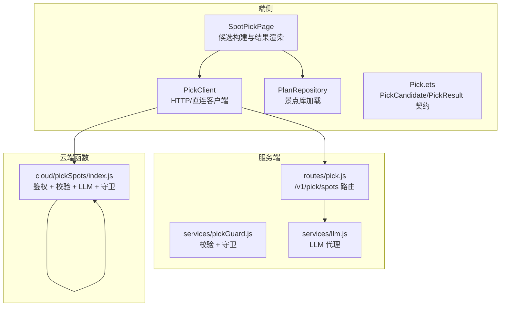
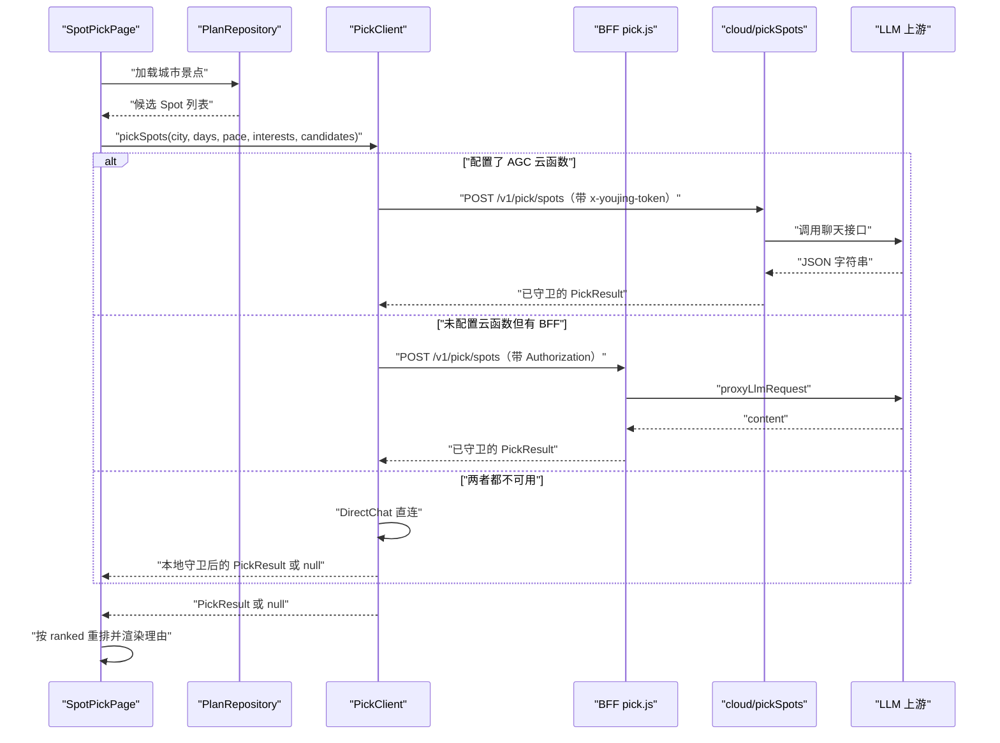
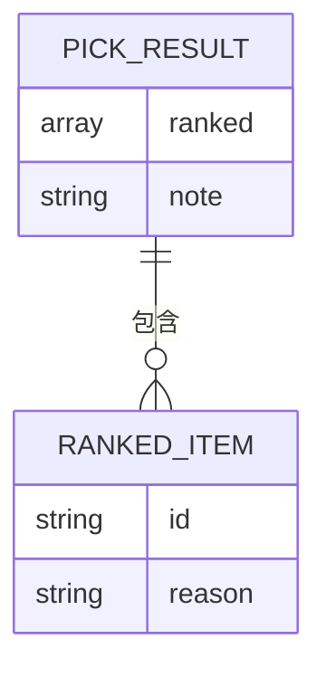
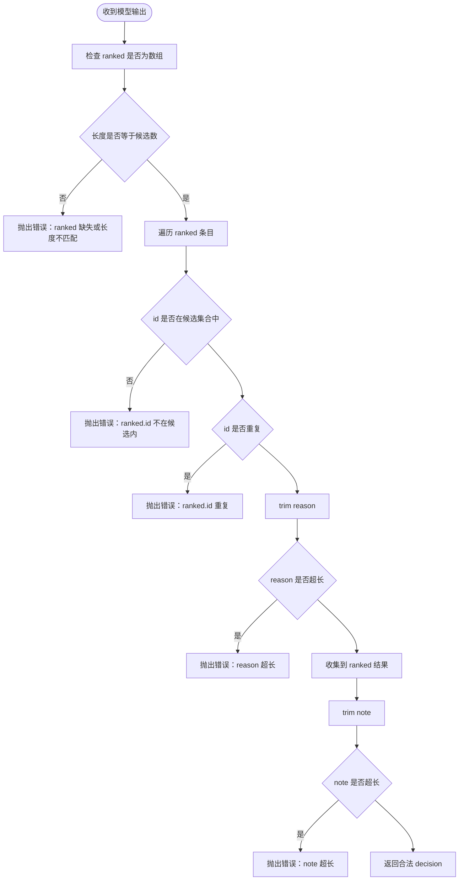
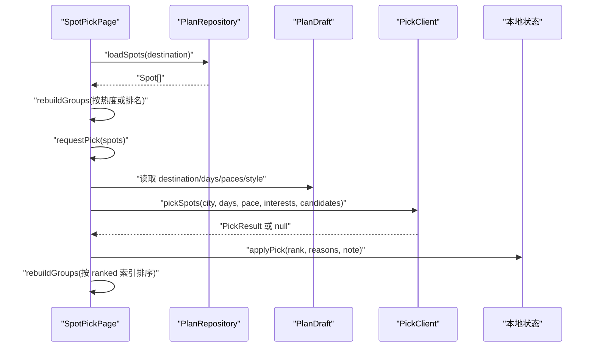
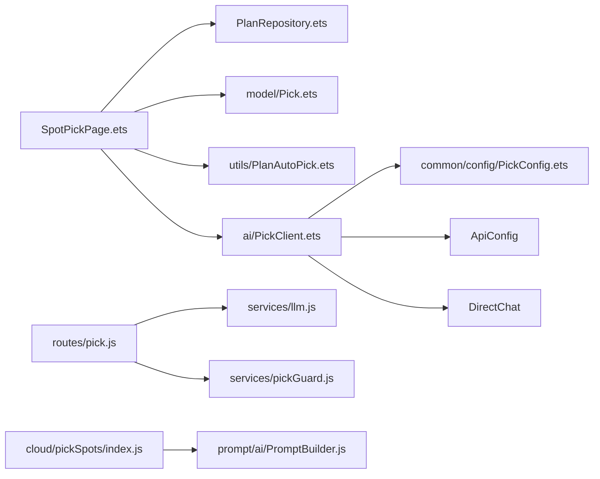

# 景点选择路由

<cite>
**本文引用的文件**   
- [bff/src/routes/pick.js](file://bff/src/routes/pick.js)
- [bff/src/services/pickGuard.js](file://bff/src/services/pickGuard.js)
- [bff/src/services/llm.js](file://bff/src/services/llm.js)
- [entry/src/main/ets/pages/SpotPickPage.ets](file://entry/src/main/ets/pages/SpotPickPage.ets)
- [entry/src/main/ets/ai/PickClient.ets](file://entry/src/main/ets/ai/PickClient.ets)
- [entry/src/main/ets/common/config/PickConfig.ets](file://entry/src/main/ets/common/config/PickConfig.ets)
- [entry/src/main/ets/model/Pick.ets](file://entry/src/main/ets/model/Pick.ets)
- [entry/src/main/ets/model/Spot.ets](file://entry/src/main/ets/model/Spot.ets)
- [entry/src/main/ets/data/PlanRepository.ets](file://entry/src/main/ets/data/PlanRepository.ets)
- [entry/src/main/ets/utils/PlanAutoPick.ets](file://entry/src/main/ets/utils/PlanAutoPick.ets)
- [cloud/pickSpots/index.js](file://cloud/pickSpots/index.js)
- [bff/test/pick.test.js](file://bff/test/pick.test.js)
</cite>

## 目录
1. [引言](#引言)
2. [项目结构中的选点位置](#项目结构中的选点位置)
3. [核心组件](#核心组件)
4. [架构总览](#架构总览)
5. [接口规范：POST /v1/pick/spots](#接口规范post-v1pickspots)
6. [请求参数说明](#请求参数说明)
7. [响应数据结构](#响应数据结构)
8. [智能选点算法与保护机制](#智能选点算法与保护机制)
9. [端侧调用流程](#端侧调用流程)
10. [地图服务集成与地理信息边界](#地图服务集成与地理信息边界)
11. [API 调用示例与场景对照](#api-调用示例与场景对照)
12. [依赖关系分析](#依赖关系分析)
13. [性能与容量特征](#性能与容量特征)
14. [故障排查指南](#故障排查指南)
15. [扩展与优化建议](#扩展与优化建议)
16. [结论](#结论)

## 引言
本文件聚焦“景点选择路由”，也就是端侧进入第四屏后，把候选景点交给后端或云函数进行排序、给出推荐理由和总体建议的完整链路。需要特别强调：**该接口的职责是“对已有候选池做排序和解释”，而不是从地图或 POI 源中检索新景点。** 真正的目的地筛选、兴趣标签过滤、热度排序和候选池构造发生在端侧；后端只做基于 LLM 的语义排序与输出保护。

## 项目结构中的选点位置
选点能力横跨端侧页面、AI 客户端、BFF 路由、云端函数以及数据仓储：

**图表来源**
- [entry/src/main/ets/pages/SpotPickPage.ets:1-200](file://entry/src/main/ets/pages/SpotPickPage.ets#L1-L200)
- [entry/src/main/ets/ai/PickClient.ets:1-154](file://entry/src/main/ets/ai/PickClient.ets#L1-L154)
- [bff/src/routes/pick.js:1-45](file://bff/src/routes/pick.js#L1-L45)
- [cloud/pickSpots/index.js:201-241](file://cloud/pickSpots/index.js#L201-L241)

**章节来源**
- [entry/src/main/ets/pages/SpotPickPage.ets:1-200](file://entry/src/main/ets/pages/SpotPickPage.ets#L1-L200)
- [entry/src/main/ets/data/PlanRepository.ets:1-55](file://entry/src/main/ets/data/PlanRepository.ets#L1-L55)

## 核心组件
| 组件 | 职责 | 关键行为 |
|---|---|---|
| `SpotPickPage` | 第四屏景点挑选界面 | 加载景点、分组、点击标记优先级、异步请求 AI 精选、按排名重新渲染列表 |
| `PickClient` | 端侧选点 HTTP/直连客户端 | 选择 AGC 云函数或 BFF 通路；失败回退到 DirectChat；对响应做本地守卫 |
| `pick.js` | BFF `/v1/pick/spots` 路由 | 校验请求、组装 Prompt、调用 LLM、解析 JSON、执行 `guardPick` |
| `pickGuard.js` | 请求/响应纯函数守卫 | 校验候选字段、去重、限制长度；保证 ranked 覆盖全部候选且无重复 id |
| `cloud/pickSpots/index.js` | AGC 零依赖云函数 | 校验 token、校验 body、调 LLM、提取 JSON、守卫决策 |
| `Pick.ets` | 端侧选点契约 | 定义 `PickCandidate`、`PickRankItem`、`PickResult` |
| `PlanRepository` | 景点数据仓库 | mock 城市、种子库、MapKit 回退三类数据路径 |
| `PlanAutoPick` | 自动预选规则 | 节奏上限、单日窗口、住宿区距离等规则（选点增强参考） |

**章节来源**
- [entry/src/main/ets/model/Pick.ets:1-25](file://entry/src/main/ets/model/Pick.ets#L1-L25)
- [bff/src/services/pickGuard.js:1-97](file://bff/src/services/pickGuard.js#L1-L97)
- [entry/src/main/ets/ai/PickClient.ets:1-154](file://entry/src/main/ets/ai/PickClient.ets#L1-L154)

## 架构总览
选点链路采用“端侧主导、多通路降级”的架构：

**图表来源**
- [entry/src/main/ets/pages/SpotPickPage.ets:120-200](file://entry/src/main/ets/pages/SpotPickPage.ets#L120-L200)
- [entry/src/main/ets/ai/PickClient.ets:25-154](file://entry/src/main/ets/ai/PickClient.ets#L25-L154)
- [bff/src/routes/pick.js:18-45](file://bff/src/routes/pick.js#L18-L45)
- [cloud/pickSpots/index.js:201-241](file://cloud/pickSpots/index.js#L201-L241)
- [bff/src/services/llm.js:1-98](file://bff/src/services/llm.js#L1-L98)

## 接口规范：POST /v1/pick/spots
| 项目 | 说明 |
|---|---|
| 方法 | POST |
| 路径 | `/v1/pick/spots` |
| 内容类型 | `application/json` |
| 认证方式 | BFF 使用 `Authorization: Bearer <token>`；AGC 云函数使用 `x-youjing-token` |
| 成功状态码 | `200`，返回 `PickResult` |
| 常见错误 | `400` 非法请求体、`401` 未授权、`422` 模型输出被拒绝、`502` 上游失败、`504` LLM 超时 |
| 主要消费方 | 端侧 `PickClient`；AGC 云函数部署在独立 URL，BFF 走 Express 路由 |

**章节来源**
- [bff/src/routes/pick.js:1-45](file://bff/src/routes/pick.js#L1-L45)
- [entry/src/main/ets/ai/PickClient.ets:25-110](file://entry/src/main/ets/ai/PickClient.ets#L25-L110)
- [cloud/pickSpots/index.js:201-241](file://cloud/pickSpots/index.js#L201-L241)

## 请求参数说明
请求体是对象，字段由端侧 `PickClient` 直接序列化，并由 BFF 和云函数分别校验。

| 字段 | 类型 | 必填 | 含义 | 约束 |
|---|---|---:|---|---|
| `city` | 字符串 | 是 | 目的地名称，例如北京、上海、杨凌等 | 非空字符串 |
| `days` | 整数 | 是 | 计划天数 | 1–30 |
| `pace` | 字符串 | 是 | 节奏描述，如轻松、标准、紧凑 | 字符串 |
| `interests` | 字符串 | 是 | 用户兴趣组合，由风格与节奏拼接而成 | 字符串 |
| `candidates` | 对象数组 | 是 | 当前城市已筛选出的候选景点 | 非空，最多 40 个 |
| `candidates[].id` | 字符串 | 是 | 景点唯一标识 | 非空，数组内不能重复 |
| `candidates[].name` | 字符串 | 是 | 景点名称 | 非空 |
| `candidates[].tag` | 字符串 | 是 | 标签文本，用于提示词匹配 | 字符串 |
| `candidates[].brief` | 字符串 | 是 | 一句话简介 | 字符串 |
| `candidates[].district` | 字符串 | 是 | 所在区域 | 字符串 |
| `candidates[].popularity` | 数字 | 是 | 热度指数 | 有限数值 |
| `candidates[].suggestedDuration` | 数字 | 是 | 建议游玩时长，单位分钟 | 有限数值 |
| `candidates[].requiresBooking` | 布尔值 | 是 | 是否需要预约 | 布尔值 |

注意：
- **接口不接收目的地坐标、经纬度、距离限制等地理围栏参数。**
- 地理位置过滤、兴趣标签映射、热度排序、候选池大小控制都在端侧完成。
- `interests` 是由端侧将风格与节奏拼接成的字符串，不是结构化标签数组。

**章节来源**
- [bff/src/services/pickGuard.js:12-60](file://bff/src/services/pickGuard.js#L12-L60)
- [cloud/pickSpots/index.js:76-134](file://cloud/pickSpots/index.js#L76-L134)
- [entry/src/main/ets/ai/PickClient.ets:55-75](file://entry/src/main/ets/ai/PickClient.ets#L55-L75)
- [entry/src/main/ets/model/Pick.ets:10-25](file://entry/src/main/ets/model/Pick.ets#L10-L25)

## 响应数据结构
成功响应是一个 `PickResult`，不包含完整景点详情，只包含排序结果和解释。

| 字段 | 类型 | 含义 | 约束 |
|---|---|---|---|
| `ranked` | 对象数组 | 按推荐顺序排列的景点条目 | 必须覆盖所有候选 id，不能新增、遗漏或重复 |
| `ranked[].id` | 字符串 | 候选景点 id | 必须在请求 `candidates` 中出现一次 |
| `ranked[].reason` | 字符串 | 针对该景点的一句话推荐理由 | 不超过 80 字符，会被 trim |
| `note` | 字符串 | 总体建议或全局备注 | 不超过 200 字符，会被 trim |

**图表来源**
- [entry/src/main/ets/model/Pick.ets:10-25](file://entry/src/main/ets/model/Pick.ets#L10-L25)
- [bff/src/services/pickGuard.js:62-97](file://bff/src/services/pickGuard.js#L62-L97)

**章节来源**
- [entry/src/main/ets/model/Pick.ets:1-25](file://entry/src/main/ets/model/Pick.ets#L1-L25)
- [bff/src/routes/pick.js:30-45](file://bff/src/routes/pick.js#L30-L45)
- [cloud/pickSpots/index.js:201-241](file://cloud/pickSpots/index.js#L201-L241)

## 智能选点算法与保护机制

### 候选池构造：端侧负责真实筛选
智能选点的输入不是原始 POI 数据库，而是端侧已经筛选过的候选列表。`SpotPickPage` 会把每个 `Spot` 转换为 `PickCandidate`，包括 id、名称、标签、简介、区县、热度、建议时长和是否需预约。

端侧的关键规则包括：
- 按标签分组：必去、经典、小众、亲子、其他。
- 每组默认展示前 8 个，点击“推荐更多”逐步放宽。
- 当没有 AI 排名时，按热度降序作为确定性回退。
- `interests` 由草稿中的风格和节奏拼接，传递给模型。

这意味着：**“基于目的地和偏好的景点推荐算法”在代码层面主要由端侧规则实现，后端只负责“根据这些候选做语义排序”。**

**章节来源**
- [entry/src/main/ets/pages/SpotPickPage.ets:55-120](file://entry/src/main/ets/pages/SpotPickPage.ets#L55-L120)
- [entry/src/main/ets/pages/SpotPickPage.ets:120-170](file://entry/src/main/ets/pages/SpotPickPage.ets#L120-L170)

### 地理位置过滤：不在接口层处理
当前接口不接收经纬度、半径、地理围栏等参数。地理相关逻辑位于：
- `PlanRepository.loadSpots`：先查种子库，再回退 MapKit。
- `PlanAutoPick`：计算单日窗口、住宿区距离、通勤预算。
- `Spot` 模型：包含经度、纬度、最近地铁站、入口提示等元数据，但这些字段不会透传到 `/v1/pick/spots`。

因此，“地理位置过滤”在本路由的实现中应理解为：**端侧先把候选限制在当前城市、当前标签组、当前展示范围，再把 id 和轻量元数据传给后端排序。**

**章节来源**
- [entry/src/main/ets/data/PlanRepository.ets:16-45](file://entry/src/main/ets/data/PlanRepository.ets#L16-L45)
- [entry/src/main/ets/model/Spot.ets:33-69](file://entry/src/main/ets/model/Spot.ets#L33-L69)
- [entry/src/main/ets/utils/PlanAutoPick.ets:1-120](file://entry/src/main/ets/utils/PlanAutoPick.ets#L1-L120)

### 评分排序逻辑：热度优先 + LLM 语义排序
端侧有两层排序：
1. 初始确定性排序：按 `popularity` 降序。
2. AI 排序：如果 `PickResult.ranked` 成功返回，则按索引建立排名 map，再重建分组。

后端并不实现显式打分公式，而是把候选信息注入 prompt，让 LLM 依据“兴趣匹配、天数节奏、同类去重”生成有序列表。因此，这里的“评分排序逻辑”更接近**“端侧热度 + 后端语义排序”**的组合。

**章节来源**
- [entry/src/main/ets/pages/SpotPickPage.ets:85-115](file://entry/src/main/ets/pages/SpotPickPage.ets#L85-L115)
- [entry/src/main/ets/pages/SpotPickPage.ets:150-170](file://entry/src/main/ets/pages/SpotPickPage.ets#L150-L170)
- [entry/src/main/ets/ai/PromptBuilder.ets:150-187](file://entry/src/main/ets/ai/PromptBuilder.ets#L150-L187)

### 选点保护机制：PickGuard
`PickGuard` 的核心目标是防止 LLM 输出伪造景点、遗漏候选或超长文案。它分三层：

**图表来源**
- [bff/src/services/pickGuard.js:62-97](file://bff/src/services/pickGuard.js#L62-L97)
- [cloud/pickSpots/index.js:136-199](file://cloud/pickSpots/index.js#L136-L199)

保护要点：
- 候选 id 去重：请求阶段禁止重复 candidate。
- 输出 id 白名单：ranked 只能出现请求中的 id。
- 全覆盖要求：ranked 必须覆盖全部候选，避免 LLM “悄悄删掉冷门景点”。
- 文案长度限制：reason 最大 80，note 最大 200。
- 端侧也有等价守卫：`PickClient.guardPick` 与 cloud 函数保持一致。

**章节来源**
- [bff/src/services/pickGuard.js:1-97](file://bff/src/services/pickGuard.js#L1-L97)
- [entry/src/main/ets/ai/PickClient.ets:115-154](file://entry/src/main/ets/ai/PickClient.ets#L115-L154)
- [cloud/pickSpots/index.js:136-199](file://cloud/pickSpots/index.js#L136-L199)
- [bff/test/pick.test.js:1-55](file://bff/test/pick.test.js#L1-L55)

### 区域覆盖度优化：当前未实现显式策略
代码中没有“区域覆盖度优化器”或“区县覆盖率”指标。现有实现更偏向：
- 端侧按标签分组和热度截断。
- 单日起选通过 `PlanAutoPick.pickSpotsForSingleDay` 尝试装下多个景点，但这是自动预选逻辑，不是 `/v1/pick/spots` 的后端排序逻辑。
- LLM 的 system prompt 提到“同类景点去重”，但没有明确的区域覆盖度目标函数。

因此，若产品要求“避免集中在一个区”，应在后续扩展中增加显式维度，而不是假设现有 guard 已经做了空间均衡。

**章节来源**
- [entry/src/main/ets/pages/SpotPickPage.ets:85-115](file://entry/src/main/ets/pages/SpotPickPage.ets#L85-L115)
- [entry/src/main/ets/utils/PlanAutoPick.ets:120-200](file://entry/src/main/ets/utils/PlanAutoPick.ets#L120-L200)
- [entry/src/main/ets/ai/PromptBuilder.ets:150-187](file://entry/src/main/ets/ai/PromptBuilder.ets#L150-L187)

## 端侧调用流程
`SpotPickPage` 的流程如下：

**图表来源**
- [entry/src/main/ets/pages/SpotPickPage.ets:55-170](file://entry/src/main/ets/pages/SpotPickPage.ets#L55-L170)
- [entry/src/main/ets/ai/PickClient.ets:25-110](file://entry/src/main/ets/ai/PickClient.ets#L25-L110)

**章节来源**
- [entry/src/main/ets/pages/SpotPickPage.ets:55-200](file://entry/src/main/ets/pages/SpotPickPage.ets#L55-L200)
- [entry/src/main/ets/ai/PickClient.ets:25-154](file://entry/src/main/ets/ai/PickClient.ets#L25-L154)

## 地图服务集成与地理信息边界
地图服务与选点路由的关系需要明确区分：

| 层级 | 数据来源 | 是否参与 `/v1/pick/spots` |
|---|---|---:|
| 内置种子库 | `rawfile/areas_*.jsonl`、`spots_*.jsonl` | 间接参与：提供候选 Spot |
| MapKit 城市 | `MapKitCityStore` | 间接参与：为不支持的城市回退景点数据 |
| 实时 POI 搜索 | 未在选点链路中看到 | 否 |
| 地理围栏 | 未在该接口实现 | 否 |
| 导航信息 | 未出现在 `PickResult` | 否 |

`PlanRepository.loadSpots` 的逻辑是：
1. 如果是京都且启用 mock，返回演示景点。
2. 否则查数据库中的城市景点。
3. 如果结果为空且是 MapKit 支持城市，回退到 `MapKitCityStore`。
4. 最终返回 `Spot[]`。

`Spot` 模型虽然包含经纬度、最近地铁站、入口提示等地理字段，但这些字段**不会全部进入 `/v1/pick/spots`**。接口只传 `id/name/tag/brief/district/popularity/suggestedDuration/requiresBooking`。

**章节来源**
- [entry/src/main/ets/data/PlanRepository.ets:16-45](file://entry/src/main/ets/data/PlanRepository.ets#L16-L45)
- [entry/src/main/ets/model/Spot.ets:33-69](file://entry/src/main/ets/model/Spot.ets#L33-L69)
- [entry/src/main/ets/model/Pick.ets:10-25](file://entry/src/main/ets/model/Pick.ets#L10-L25)

## API 调用示例与场景对照
以下示例仅展示请求结构和预期行为，不复制具体业务数据。

### 基础场景：三日游，标准节奏
- 目的地：某个城市
- 天数：3
- 节奏：标准
- 兴趣：风格/节奏拼接串
- 候选：10–30 个已筛选景点
- 期望结果：`ranked` 长度为候选数，每个景点有简短理由，`note` 给总体建议

### 短途场景：一日游，紧凑节奏
- 天数：1
- 节奏：紧凑
- 候选：可能来自 MapKit 或种子库
- 期望结果：模型仍必须返回全部候选，即使某些景点不适合紧凑节奏；端侧可通过 UI 展示和容量提示辅助判断

### 弱信号场景：兴趣不明确
- 兴趣字符串较短或较泛
- 候选以热度为主
- 期望结果：LLM 尽量依据 tag、brief、district、是否需要预约等轻量信息排序；失败时端侧保留热度排序

### 异常场景：候选过多
- 候选超过 40 个
- 期望结果：BFF 返回 `INVALID_REQUEST`，云函数返回 `422 INVALID_REQUEST`

### 异常场景：模型输出伪造 id
- 模型返回不在候选集合中的 id
- 期望结果：BFF 抛出 `DECISION_REJECTED`，云函数返回 `422 DECISION_REJECTED`

**章节来源**
- [bff/src/routes/pick.js:18-45](file://bff/src/routes/pick.js#L18-L45)
- [cloud/pickSpots/index.js:201-241](file://cloud/pickSpots/index.js#L201-L241)
- [bff/test/pick.test.js:1-55](file://bff/test/pick.test.js#L1-L55)

## 依赖关系分析

**图表来源**
- [entry/src/main/ets/pages/SpotPickPage.ets:1-200](file://entry/src/main/ets/pages/SpotPickPage.ets#L1-L200)
- [entry/src/main/ets/ai/PickClient.ets:1-154](file://entry/src/main/ets/ai/PickClient.ets#L1-L154)
- [bff/src/routes/pick.js:1-45](file://bff/src/routes/pick.js#L1-L45)
- [cloud/pickSpots/index.js:1-200](file://cloud/pickSpots/index.js#L1-L200)

**章节来源**
- [entry/src/main/ets/pages/SpotPickPage.ets:1-200](file://entry/src/main/ets/pages/SpotPickPage.ets#L1-L200)
- [entry/src/main/ets/ai/PickClient.ets:1-154](file://entry/src/main/ets/ai/PickClient.ets#L1-L154)
- [bff/src/routes/pick.js:1-45](file://bff/src/routes/pick.js#L1-L45)

## 性能与容量特征
| 维度 | 行为 | 影响 |
|---|---|---|
| 候选数量上限 | 40 | 防止 prompt 过大、LLM 超时和成本飙升 |
| 单次 LLM 最大 token | 端侧直连使用 2048；BFF 默认 8192 | 控制输出体积，避免超长 JSON |
| 读超时 | 端侧 20 秒 | 网络或 LLM 慢时快速失败，保留确定性规则 |
| LLM 超时 | BFF 默认 45 秒 | 避免连接长期挂起 |
| 云函数上游超时 | 5 秒 | 云函数侧快速释放资源 |
| 失败策略 | 任何非 2xx、结构不合法、解析失败均返回 null | 端侧不退化到空白页，保持热度排序 |

**章节来源**
- [entry/src/main/ets/ai/PickClient.ets:25-110](file://entry/src/main/ets/ai/PickClient.ets#L25-L110)
- [bff/src/services/llm.js:1-30](file://bff/src/services/llm.js#L1-L30)
- [cloud/pickSpots/index.js:14-20](file://cloud/pickSpots/index.js#L14-L20)

## 故障排查指南
| 现象 | 可能原因 | 排查步骤 |
|---|---|---|
| 返回 `INVALID_REQUEST` | 缺少 city、days 超范围、candidates 为空或重复、字段类型错误 | 检查请求体结构与长度；参考测试用例 |
| 返回 `UNAUTHORIZED` | AGC 云函数 token 不匹配 | 核对 `x-youjing-token` 与 `YOUJING_PICK_TOKEN` |
| 返回 `DECISION_REJECTED` | ranked 长度不对、id 不在候选、重复 id、reason/note 超长 | 检查模型输出；确认 guard 长度限制 |
| 返回 `UPSTREAM_FAILED` | LLM 上游不可用或响应异常 | 检查环境变量 `LLM_CHAT_URL`、`LLM_API_KEY`、`LLM_MODEL` |
| 返回 `LLM_TIMEOUT` | LLM 上游响应过慢 | 调整 `LLM_TIMEOUT_MS` 或检查网络 |
| 端侧始终使用热度排序 | 云函数/BFF/DirectChat 任一环节失败 | 查看日志 `Ai.Pick`、`Ui.SpotPick`；确认 HTTP 状态码 |
| 列表空屏 | 候选为空或 loadSpots 失败 | 检查 `PlanRepository.loadSpots` 返回值 |

**章节来源**
- [bff/src/routes/pick.js:18-45](file://bff/src/routes/pick.js#L18-L45)
- [cloud/pickSpots/index.js:201-241](file://cloud/pickSpots/index.js#L201-L241)
- [bff/src/services/llm.js:30-98](file://bff/src/services/llm.js#L30-L98)
- [entry/src/main/ets/ai/PickClient.ets:40-154](file://entry/src/main/ets/ai/PickClient.ets#L40-L154)
- [entry/src/main/ets/data/PlanRepository.ets:16-45](file://entry/src/main/ets/data/PlanRepository.ets#L16-L45)
- [bff/test/pick.test.js:1-55](file://bff/test/pick.test.js#L1-L55)

## 扩展与优化建议

### 增加真实地理围栏
当前接口不支持经纬度和半径。若需要“围绕酒店或当前位置推荐附近景点”，可考虑：
- 新增请求字段：`latitude`、`longitude`、`radiusKm`。
- 在服务端对候选按直线距离过滤。
- 在 ranking 中引入距离衰减权重。
- 注意：这会改变“只在候选内排序”的简化契约，需要同时更新 guard 和 prompt。

### 显式区域覆盖度优化
为避免推荐集中在同一区，可在 scoring 中加入：
- 区县覆盖度目标：每区至少一个热门。
- 分区多样性惩罚：同区重复景点得分下降。
- 与 LLM 提示词配合：鼓励跨区布局。

### 更细粒度的时间约束
当前只有 `days` 和 `pace`。可扩展：
- 每日可用时间段，如上午、下午、全天。
- 闭馆日、开放时间。
- 是否需提前预约。
这些字段目前部分存在于 `Spot` 模型中，但未透传至 `/v1/pick/spots`。

### 强化响应可观测性
建议在 `PickResult` 中增加可选诊断字段：
- `score`：内部打分（仅调试）。
- `filters`：应用过的过滤条件。
- `modelVersion`：prompt 或模型版本。
这些字段不应影响核心契约，可作为扩展位。

### 降级策略改进
当前失败统一返回 null，端侧保留热度排序，这很稳健。未来可区分：
- 网络失败：提示重试。
- 配额不足：引导等待或降级。
- 模型拒绝：显示“规则排序”并允许手动调整。

**章节来源**
- [entry/src/main/ets/model/Spot.ets:33-69](file://entry/src/main/ets/model/Spot.ets#L33-L69)
- [entry/src/main/ets/ai/PromptBuilder.ets:150-187](file://entry/src/main/ets/ai/PromptBuilder.ets#L150-L187)
- [entry/src/main/ets/ai/PickClient.ets:115-154](file://entry/src/main/ets/ai/PickClient.ets#L115-L154)

## 结论
景点选择路由是一个“轻接口、重保护”的设计：端侧承担候选池构建、兴趣映射、热度排序和地理筛选；后端和云函数只负责用 LLM 做语义排序，并通过 `PickGuard` 严格限制输出范围、长度和完整性。这种分工降低了幻觉风险，也保证了失败时可回退到确定性规则。

如果要进一步增强体验，应优先补充地理围栏、区域覆盖度、时间约束等显式维度，而不是继续依赖 LLM 隐式理解。同时应保持当前“候选白名单 + 全覆盖 + 长度限制”的保护体系，因为它是防编造、防退化、可测试的核心防线。