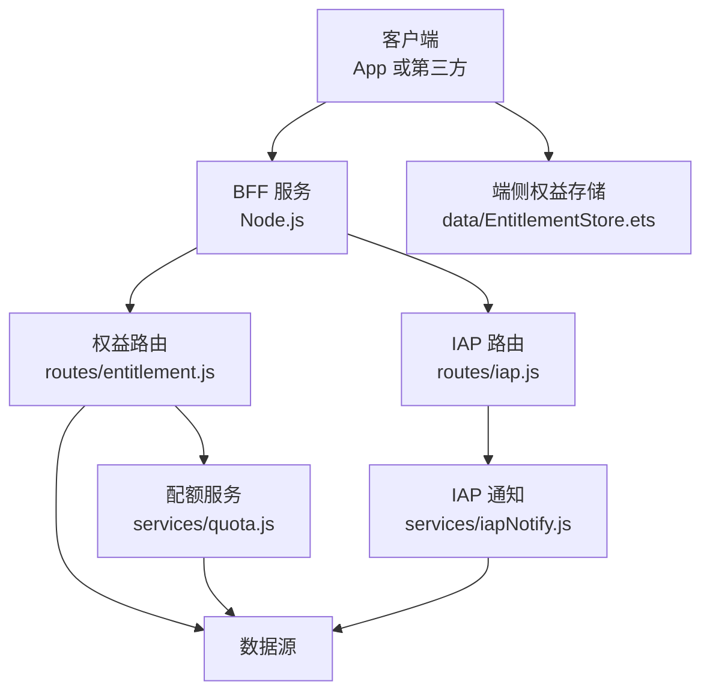
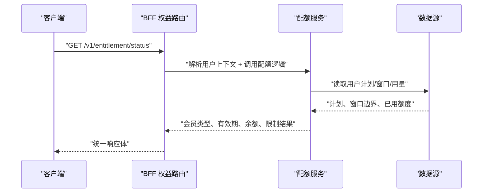
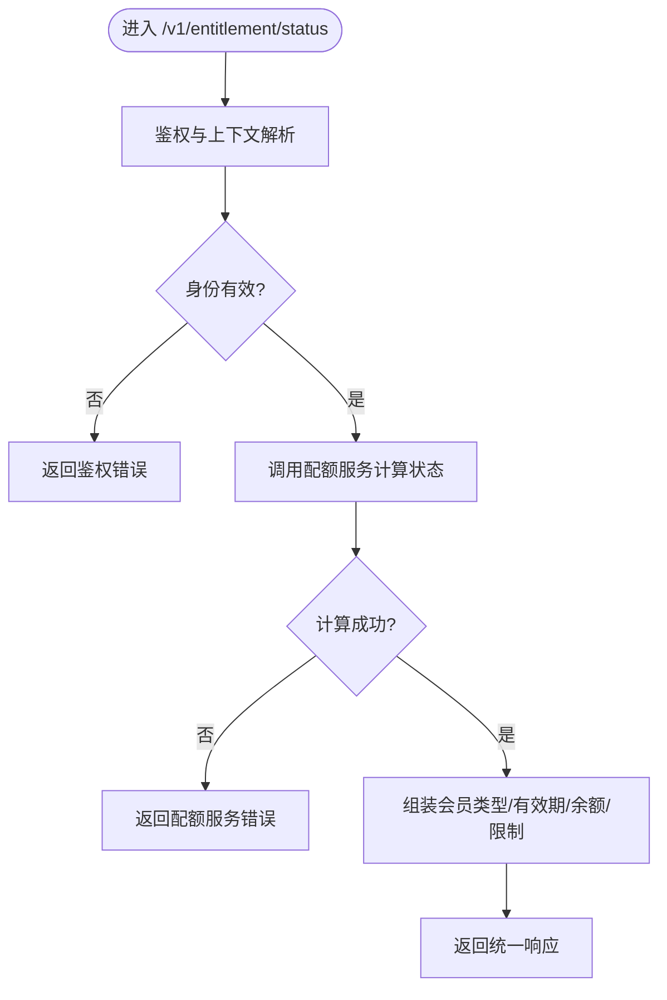
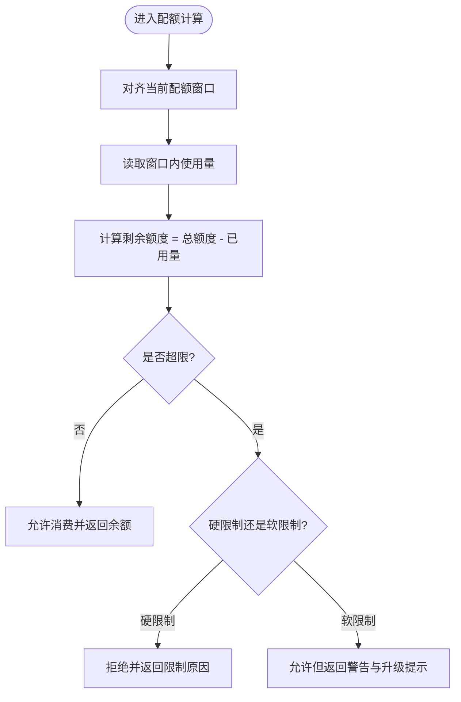
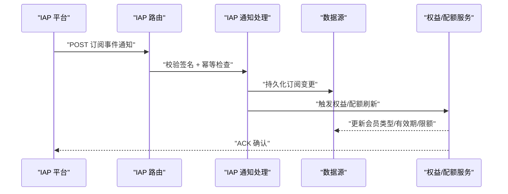
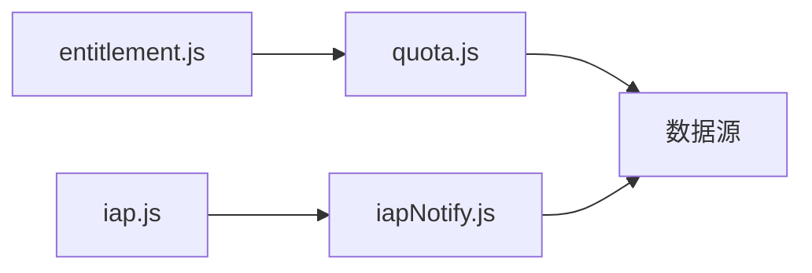

# 权益管理路由

<cite>
**本文引用的文件**   
- [bff/src/routes/entitlement.js](file://bff/src/routes/entitlement.js)
- [bff/src/services/quota.js](file://bff/src/services/quota.js)
- [bff/src/routes/iap.js](file://bff/src/routes/iap.js)
- [bff/src/services/iapNotify.js](file://bff/src/services/iapNotify.js)
- [bff/test/quota-window.test.js](file://bff/test/quota-window.test.js)
- [entry/src/main/ets/data/EntitlementStore.ets](file://entry/src/main/ets/data/EntitlementStore.ets)
</cite>

## 目录
1. [简介](#简介)
2. [项目结构](#项目结构)
3. [核心组件](#核心组件)
4. [架构总览](#架构总览)
5. [详细组件分析](#详细组件分析)
6. [依赖关系分析](#依赖关系分析)
7. [性能考虑](#性能考虑)
8. [故障排查指南](#故障排查指南)
9. [结论](#结论)

## 简介
本文件围绕“权益管理”相关后端能力，对以下范围进行系统化说明：
- 会员状态查询接口：GET /v1/entitlement/status
- 订阅信息获取接口：GET /v1/entitlement/subscription
- 额度管理系统：配额窗口、使用量统计与限制策略
- 与 IAP（应用内购买）系统的集成：订阅状态同步流程
- API 调用示例：不同会员等级的响应差异
- 额度控制最佳实践与性能优化建议

该文档以 bff 层的实现为依据，结合端侧 EntitlementStore 的使用方式，给出从请求入口到业务处理、再到 IAP 集成的完整链路说明。

## 项目结构
与权益管理直接相关的代码集中在 bff 后端与 entry 端侧：
- bff 层
  - routes/entitlement.js：提供 /v1/entitlement/* 路由
  - services/quota.js：配额窗口计算、使用量统计与限制判断
  - routes/iap.js：IAP 回调、订阅验证等路由
  - services/iapNotify.js：IAP 通知处理与订阅状态同步
- entry 层
  - data/EntitlementStore.ets：端侧权益状态缓存与刷新逻辑

图表来源
- [bff/src/routes/entitlement.js](file://bff/src/routes/entitlement.js)
- [bff/src/services/quota.js](file://bff/src/services/quota.js)
- [bff/src/routes/iap.js](file://bff/src/routes/iap.js)
- [bff/src/services/iapNotify.js](file://bff/src/services/iapNotify.js)
- [entry/src/main/ets/data/EntitlementStore.ets](file://entry/src/main/ets/data/EntitlementStore.ets)

章节来源
- [bff/src/routes/entitlement.js](file://bff/src/routes/entitlement.js)
- [bff/src/services/quota.js](file://bff/src/services/quota.js)
- [bff/src/routes/iap.js](file://bff/src/routes/iap.js)
- [bff/src/services/iapNotify.js](file://bff/src/services/iapNotify.js)
- [entry/src/main/ets/data/EntitlementStore.ets](file://entry/src/main/ets/data/EntitlementStore.ets)

## 核心组件
- 权益路由
  - 职责：对外暴露 /v1/entitlement/status 和 /v1/entitlement/subscription；鉴权后转发给配额服务，并返回统一格式。
  - 关键点：参数校验、用户上下文注入、错误映射、限流/幂等由中间件承担。
- 配额服务
  - 职责：计算当前配额窗口、累计使用量、剩余额度，并依据计划与策略判断是否允许继续消费。
  - 关键点：时间窗口对齐、用量聚合、限额与软/硬限制、降级与缓存策略。
- IAP 路由与通知
  - 职责：接收平台 IAP 回调，校验签名/幂等，更新订阅状态，触发权益同步。
  - 关键点：JWS/JWK 校验、事件去重、幂等写入、异常重试。
- 端侧权益存储
  - 职责：本地缓存会员类型、有效期、额度余额等；在页面或动作前发起刷新，降低重复网络开销。
  - 关键点：缓存失效时机、并发刷新保护、失败回退。

章节来源
- [bff/src/routes/entitlement.js](file://bff/src/routes/entitlement.js)
- [bff/src/services/quota.js](file://bff/src/services/quota.js)
- [bff/src/routes/iap.js](file://bff/src/routes/iap.js)
- [bff/src/services/iapNotify.js](file://bff/src/services/iapNotify.js)
- [entry/src/main/ets/data/EntitlementStore.ets](file://entry/src/main/ets/data/EntitlementStore.ets)

## 架构总览
下图展示一次 GET /v1/entitlement/status 的端到端交互：客户端通过 BFF 权益路由进入配额服务，配额服务读取用户计划、窗口与用量，返回会员类型、有效期、额度余额等信息。

图表来源
- [bff/src/routes/entitlement.js](file://bff/src/routes/entitlement.js)
- [bff/src/services/quota.js](file://bff/src/services/quota.js)

章节来源
- [bff/src/routes/entitlement.js](file://bff/src/routes/entitlement.js)
- [bff/src/services/quota.js](file://bff/src/services/quota.js)

## 详细组件分析

### 权益路由：GET /v1/entitlement/status
- 功能要点
  - 基于当前登录用户，计算并返回：
    - 会员类型：如免费、基础、专业、企业等（具体枚举以配额服务定义为准）
    - 有效期：当前订阅起止时间或永久标识
    - 额度余额：当前配额窗口内的剩余次数/容量
    - 限制策略：是否可继续消费、拒绝原因、升级提示
- 输入
  - 请求头：认证令牌、设备标识等（由鉴权中间件处理）
  - 路径参数：无
  - 查询参数：通常无需额外参数，必要时可支持 region/currency 等扩展
- 输出
  - 成功：包含会员类型、有效期、余额、限制结果的结构化对象
  - 失败：鉴权失败、系统异常、配额服务不可用等错误码与消息
- 行为说明
  - 若用户未登录或令牌无效，应返回鉴权错误
  - 若配额服务不可用，应返回降级响应或明确错误码
  - 响应体需稳定兼容，新增字段应向后兼容

图表来源
- [bff/src/routes/entitlement.js](file://bff/src/routes/entitlement.js)
- [bff/src/services/quota.js](file://bff/src/services/quota.js)

章节来源
- [bff/src/routes/entitlement.js](file://bff/src/routes/entitlement.js)
- [bff/src/services/quota.js](file://bff/src/services/quota.js)

### 权益路由：GET /v1/entitlement/subscription
- 功能要点
  - 返回订阅计划详情与续费状态，并附带支付历史摘要
  - 用于定价页、账户页、续费提醒等场景
- 输入
  - 请求头：认证令牌
  - 查询参数：可按需提供 currency、region 等
- 输出
  - 订阅计划：名称、周期、价格、币种、生效期、到期日
  - 续费状态：自动续费开关、下次扣费时间、最近一次支付结果
  - 支付历史：最近若干条交易记录（订单号、时间、金额、状态）
- 行为说明
  - 若无活跃订阅，返回空订阅与免费计划信息
  - 若 IAP 数据缺失或校验失败，返回明确的错误码，便于前端降级

章节来源
- [bff/src/routes/entitlement.js](file://bff/src/routes/entitlement.js)

### 额度管理系统：配额窗口、使用量与限制策略
- 配额窗口
  - 按自然日/周/月或自定义周期对齐，确定当前窗口起止时间
  - 窗口切换时重置使用量统计，避免跨期污染
- 使用量统计
  - 统计当前窗口内各资源类型的消耗
  - 支持增量计数与批量合并写入，减少写放大
- 限制策略
  - 硬限制：达到上限后直接拒绝
  - 软限制：超过阈值但允许有限次超额，配合警告与升级引导
  - 分级策略：不同会员等级拥有不同总量、速率与优先级
- 典型流程

图表来源
- [bff/src/services/quota.js](file://bff/src/services/quota.js)
- [bff/test/quota-window.test.js](file://bff/test/quota-window.test.js)

章节来源
- [bff/src/services/quota.js](file://bff/src/services/quota.js)
- [bff/test/quota-window.test.js](file://bff/test/quota-window.test.js)

### 与 IAP 系统集成：订阅状态同步
- 集成点
  - IAP 回调路由负责接收平台通知，完成签名校验、幂等处理与状态落库
  - 权益路由与配额服务通过订阅状态决定会员类型、有效期与限额
- 关键流程

图表来源
- [bff/src/routes/iap.js](file://bff/src/routes/iap.js)
- [bff/src/services/iapNotify.js](file://bff/src/services/iapNotify.js)
- [bff/src/services/quota.js](file://bff/src/services/quota.js)

章节来源
- [bff/src/routes/iap.js](file://bff/src/routes/iap.js)
- [bff/src/services/iapNotify.js](file://bff/src/services/iapNotify.js)
- [bff/src/services/quota.js](file://bff/src/services/quota.js)

### 端侧权益存储：EntitlementStore
- 职责
  - 缓存会员类型、有效期、余额等关键权益信息
  - 提供刷新方法，在页面加载或关键动作前拉取最新状态
  - 处理网络失败时的降级与重试
- 设计要点
  - 单例模式保证全局一致
  - 防抖/锁机制避免重复请求
  - 与路由层返回结构保持一致，便于 UI 渲染

章节来源
- [entry/src/main/ets/data/EntitlementStore.ets](file://entry/src/main/ets/data/EntitlementStore.ets)

## 依赖关系分析
- 路由层依赖
  - entitlement.js 依赖 quota.js 计算配额，依赖鉴权中间件与错误映射工具
  - iap.js 依赖 iapNotify.js 处理平台回调，依赖 JWS 校验与幂等中间件
- 服务层依赖
  - quota.js 依赖数据访问层，可能依赖缓存/计数器
  - iapNotify.js 依赖数据访问层与幂等表
- 外部依赖
  - IAP 平台回调
  - 数据库与可能的缓存

图表来源
- [bff/src/routes/entitlement.js](file://bff/src/routes/entitlement.js)
- [bff/src/services/quota.js](file://bff/src/services/quota.js)
- [bff/src/routes/iap.js](file://bff/src/routes/iap.js)
- [bff/src/services/iapNotify.js](file://bff/src/services/iapNotify.js)

章节来源
- [bff/src/routes/entitlement.js](file://bff/src/routes/entitlement.js)
- [bff/src/services/quota.js](file://bff/src/services/quota.js)
- [bff/src/routes/iap.js](file://bff/src/routes/iap.js)
- [bff/src/services/iapNotify.js](file://bff/src/services/iapNotify.js)

## 性能考虑
- 配额计算
  - 将窗口对齐与用量聚合放入高频路径时，尽量使用内存缓存或热点键缓存
  - 对写操作采用批量化与延迟提交，降低写放大
- 接口响应
  - 对 GET /v1/entitlement/status 增加短期缓存，避免频繁刷新
  - 对 GET /v1/entitlement/subscription 增加订阅变更事件驱动的缓存失效
- IAP 回调
  - 幂等表与去重索引保障高吞吐下的正确性
  - 签名校验失败快速失败，避免深链路处理
- 端侧缓存
  - EntitlementStore 合理设置过期时间与刷新策略，避免冷启动风暴
  - 对失败请求进行指数退避重试，避免雪崩

[本节为通用性能建议，不直接分析具体文件]

## 故障排查指南
- 常见错误
  - 鉴权失败：检查令牌有效性、用户上下文注入是否正确
  - 配额服务超时：检查数据源连接、缓存命中率、窗口计算复杂度
  - IAP 回调失败：检查签名校验、幂等键生成、回调重试配置
- 定位步骤
  - 查看路由层日志，确认请求参数与用户上下文
  - 检查配额服务的窗口对齐与用量统计逻辑
  - 核对 IAP 回调签名与幂等表状态
- 恢复策略
  - 对配额计算增加降级返回默认值
  - 对 IAP 回调增加重试与死信队列
  - 对端侧缓存增加过期与强制刷新入口

章节来源
- [bff/src/routes/entitlement.js](file://bff/src/routes/entitlement.js)
- [bff/src/services/quota.js](file://bff/src/services/quota.js)
- [bff/src/routes/iap.js](file://bff/src/routes/iap.js)
- [bff/src/services/iapNotify.js](file://bff/src/services/iapNotify.js)

## 结论
- GET /v1/entitlement/status 是权益状态的权威入口，核心在于准确的配额窗口、用量统计与限制策略
- GET /v1/entitlement/subscription 聚焦订阅生命周期与支付历史，支撑续费与账单场景
- IAP 集成需要严格的签名校验与幂等处理，确保订阅状态一致性
- 端侧 EntitlementStore 通过缓存与刷新策略提升体验并降低服务端压力
- 建议在配额计算与 IAP 回调两条主线上分别做缓存、幂等与监控埋点，以提升稳定性与可观测性

[本节为总结性内容，不直接分析具体文件]