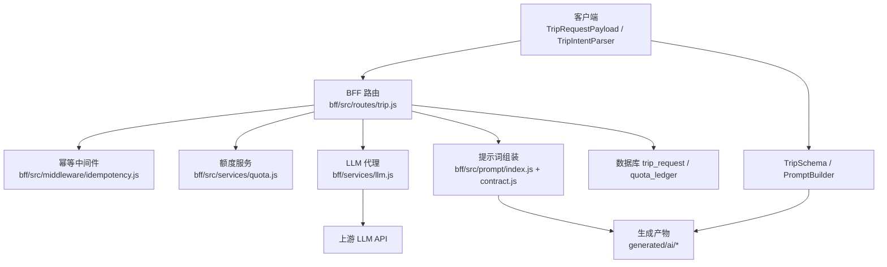
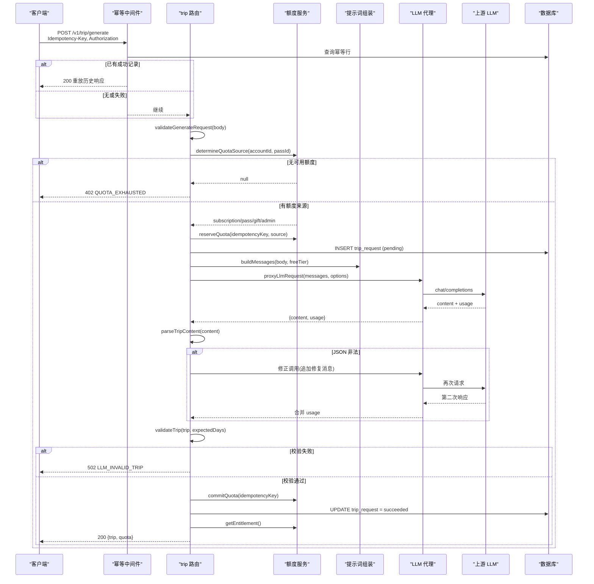
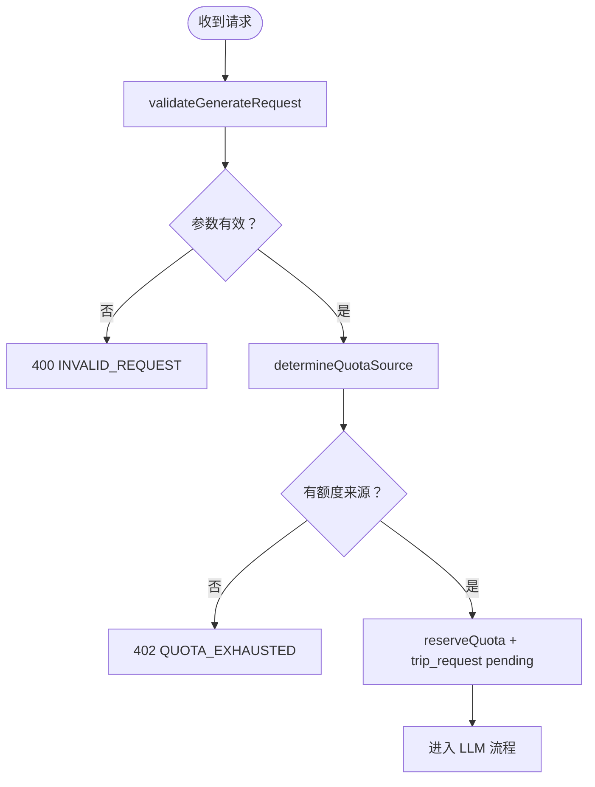
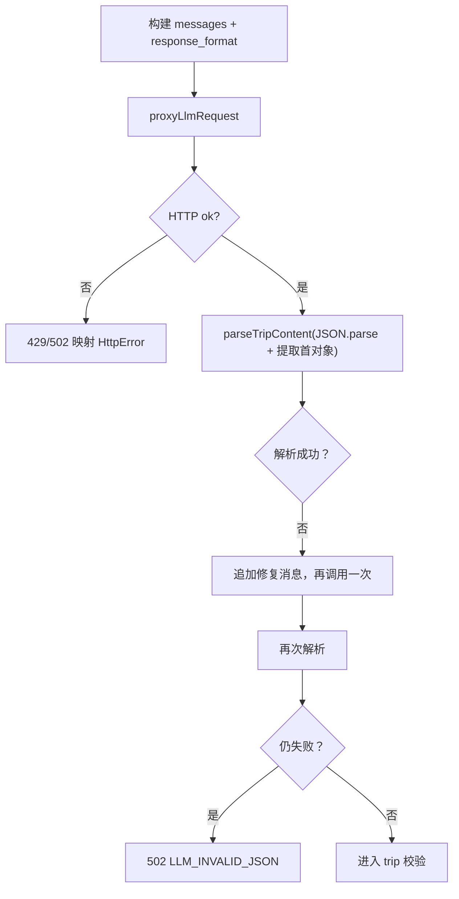
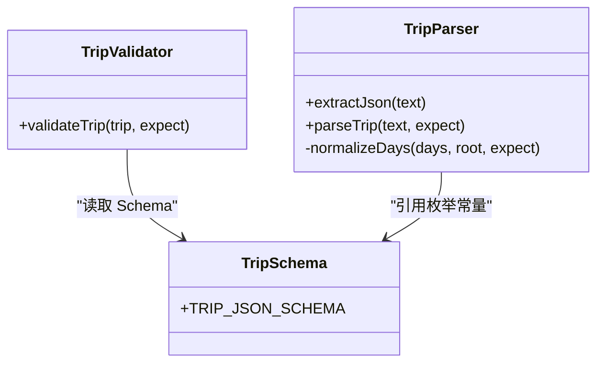
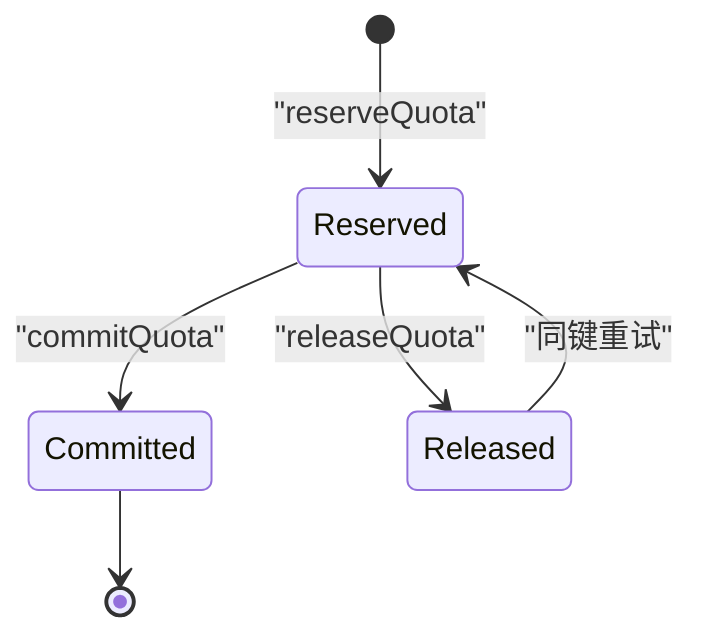
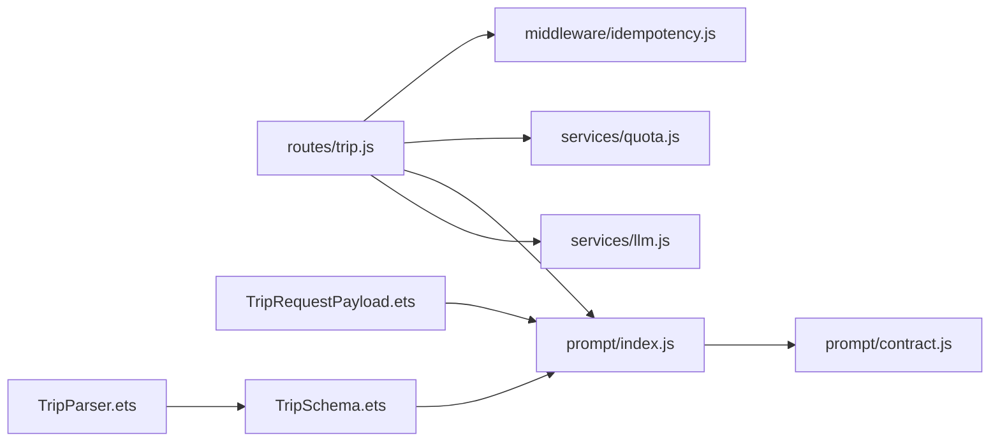

# 行程生成路由

<cite>
**本文引用的文件**   
- [bff/src/routes/trip.js](file://bff/src/routes/trip.js)
- [bff/src/services/quota.js](file://bff/src/services/quota.js)
- [bff/src/services/llm.js](file://bff/src/services/llm.js)
- [bff/src/prompt/index.js](file://bff/src/prompt/index.js)
- [bff/src/prompt/contract.js](file://bff/src/prompt/contract.js)
- [bff/src/prompt/trip-validator.js](file://bff/src/prompt/trip-validator.js)
- [bff/src/middleware/idempotency.js](file://bff/src/middleware/idempotency.js)
- [entry/src/main/ets/ai/TripRequestPayload.ets](file://entry/src/main/ets/ai/TripRequestPayload.ets)
- [entry/src/main/ets/ai/PromptBuilder.ets](file://entry/src/main/ets/ai/PromptBuilder.ets)
- [entry/src/main/ets/ai/TripSchema.ets](file://entry/src/main/ets/ai/TripSchema.ets)
- [entry/src/main/ets/ai/TripParser.ets](file://entry/src/main/ets/ai/TripParser.ets)
- [entry/src/main/ets/utils/TripIntentParser.ets](file://entry/src/main/ets/utils/TripIntentParser.ets)
- [bff/test/trip-route.integration.test.js](file://bff/test/trip-route.integration.test.js)
</cite>

## 目录
1. [引言](#引言)
2. [项目结构](#项目结构)
3. [核心组件](#核心组件)
4. [架构总览](#架构总览)
5. [详细组件分析](#详细组件分析)
6. [依赖关系分析](#依赖关系分析)
7. [性能与调优建议](#性能与调优建议)
8. [故障排查指南](#故障排查指南)
9. [结论](#结论)
10. [附录：请求与响应示例](#附录请求与响应示例)

## 引言
本文面向 BFF（后端前端）中的“行程生成”能力，聚焦 `POST /v1/trip/generate` 接口的完整处理链路。内容覆盖请求参数规范、意图识别入口、自动选点保护、LLM 调用编排、JSON Schema 约束、结果解析验证、额度预扣与结算、幂等与并发安全、错误分类与回滚策略，并给出复杂行程场景下的请求与响应参考。

## 项目结构
该功能横跨客户端（ArkTS）、BFF（Node.js/Express）与上游 LLM 服务：
- 客户端负责意图解析、富请求载荷构造、端侧 Trip 解析与校验。
- BFF 负责参数守卫、额度判断与预扣、Prompt 组装、上游 LLM 代理、结果二次校验、幂等落库与配额结算。
- Prompt 契约由客户端 SOT（TripSchema、PromptBuilder）通过同步脚本生成到 BFF 的 generated 目录，确保两端 Schema 同源。

**图表来源**
- [bff/src/routes/trip.js:1-200](file://bff/src/routes/trip.js#L1-L200)
- [bff/src/middleware/idempotency.js:1-122](file://bff/src/middleware/idempotency.js#L1-L122)
- [bff/src/services/quota.js:1-113](file://bff/src/services/quota.js#L1-L113)
- [bff/src/prompt/index.js:1-200](file://bff/src/prompt/index.js#L1-L200)
- [bff/src/prompt/contract.js:1-57](file://bff/src/prompt/contract.js#L1-L57)
- [bff/src/services/llm.js:1-98](file://bff/src/services/llm.js#L1-L98)
- [entry/src/main/ets/ai/TripRequestPayload.ets:1-75](file://entry/src/main/ets/ai/TripRequestPayload.ets#L1-L75)
- [entry/src/main/ets/ai/PromptBuilder.ets:1-187](file://entry/src/main/ets/ai/PromptBuilder.ets#L1-L187)

**章节来源**
- [bff/src/routes/trip.js:1-200](file://bff/src/routes/trip.js#L1-L200)
- [bff/src/services/quota.js:1-113](file://bff/src/services/quota.js#L1-L113)
- [bff/src/services/llm.js:1-98](file://bff/src/services/llm.js#L1-L98)
- [bff/src/prompt/index.js:1-200](file://bff/src/prompt/index.js#L1-L200)
- [bff/src/prompt/contract.js:1-57](file://bff/src/prompt/contract.js#L1-L57)
- [bff/src/middleware/idempotency.js:1-122](file://bff/src/middleware/idempotency.js#L1-L122)
- [entry/src/main/ets/ai/TripRequestPayload.ets:1-75](file://entry/src/main/ets/ai/TripRequestPayload.ets#L1-L75)
- [entry/src/main/ets/ai/PromptBuilder.ets:1-187](file://entry/src/main/ets/ai/PromptBuilder.ets#L1-L187)

## 核心组件
- 路由层：接收 `/generate` 请求，执行参数守卫、额度判定、幂等行写入、LLM 调用、结果解析与校验、事务性结算与响应体返回。
- 额度服务：计算订阅/通行证/赠送额度来源，支持预扣、提交、释放三态账本。
- LLM 代理：构建请求体、设置超时、透传 response_format、统一异常映射。
- Prompt 组装：rich/sparse 双路径，基于 TripSchema 生成结构化输出配置。
- 幂等中间件：基于账号+Idempotency-Key 作用域，规范化请求体哈希，防止重放与并发冲突。
- 客户端载荷与 Schema：定义 rich payload、LLM JSON Schema、端侧解析器。

**章节来源**
- [bff/src/routes/trip.js:1-200](file://bff/src/routes/trip.js#L1-L200)
- [bff/src/services/quota.js:1-113](file://bff/src/services/quota.js#L1-L113)
- [bff/src/services/llm.js:1-98](file://bff/src/services/llm.js#L1-L98)
- [bff/src/prompt/index.js:1-200](file://bff/src/prompt/index.js#L1-L200)
- [bff/src/middleware/idempotency.js:1-122](file://bff/src/middleware/idempotency.js#L1-L122)
- [entry/src/main/ets/ai/TripRequestPayload.ets:1-75](file://entry/src/main/ets/ai/TripRequestPayload.ets#L1-L75)
- [entry/src/main/ets/ai/TripSchema.ets:1-151](file://entry/src/main/ets/ai/TripSchema.ets#L1-L151)

## 架构总览
以下序列图展示一次成功生成的关键步骤，包括幂等拦截、额度预扣、Prompt 构建、LLM 调用、结果修复与二次校验、事务性提交与响应。

**图表来源**
- [bff/src/middleware/idempotency.js:40-122](file://bff/src/middleware/idempotency.js#L40-L122)
- [bff/src/routes/trip.js:1-200](file://bff/src/routes/trip.js#L1-L200)
- [bff/src/services/quota.js:1-113](file://bff/src/services/quota.js#L1-L113)
- [bff/src/prompt/index.js:1-200](file://bff/src/prompt/index.js#L1-L200)
- [bff/src/services/llm.js:1-98](file://bff/src/services/llm.js#L1-L98)

## 详细组件分析

### 接口契约与参数验证
- 路由入口：`POST /v1/trip/generate`。
- 头部要求：
  - `Authorization`：由认证中间件注入 `accountId`。
  - `Idempotency-Key`：幂等键，缺失直接 400。
- 请求体主体字段：
  - 基础字段：`destination`(字符串)、`startDate`(YYYY-MM-DD)、`endDate`(YYYY-MM-DD)、`people`(整数 1–30)、`budget`(非负整数)。
  - 风格与偏好：`style`、`stayTier`、`transit`、`paces`。
  - 选点信息：`selectedArea`、`selectedSpots`；富模式需提供 `spots[]` 与 `area`。
  - 可选：`passId`（用于选择通行证额度来源）。
- 服务端守卫逻辑：
  - 日期格式与范围：2020-01-01 至 2100-12-31，且 `endDate >= startDate`。
  - 天数边界：根据起止日计算期望天数，限制 1–30。
  - 人数与预算：人数 1–30 整数，预算为非负整数。
  - 任一不合法即返回 400 `INVALID_REQUEST`。

**图表来源**
- [bff/src/routes/trip.js:20-65](file://bff/src/routes/trip.js#L20-L65)
- [bff/src/services/quota.js:86-113](file://bff/src/services/quota.js#L86-L113)

**章节来源**
- [bff/src/routes/trip.js:20-65](file://bff/src/routes/trip.js#L20-L65)
- [entry/src/main/ets/ai/TripRequestPayload.ets:1-75](file://entry/src/main/ets/ai/TripRequestPayload.ets#L1-L75)

### 意图识别与自动选点保护
- 意图识别发生在客户端侧，由 `TripIntentParser` 从自然语言中抽取目的地、日期、天数、人数、预算、风格、住宿档位、交通偏好、节奏、兴趣标签等。
- 自动选点保护体现在 BFF 的 rich 分支：只有当 `spots[]`、`area`、`selectedSpots[]` 满足富字段条件时，才走富提示词路径；否则走 sparse 路径，明确告知模型存在信息缺口，避免伪造停留时长、坐标、预约信息等。
- 富字段校验：
  - `area` 需包含名称、价格档位、地铁线路、锚定站、机场/火车站通勤分钟数等。
  - `spots[]` 每个选中项需含名称、建议停留时长、经纬度、预约信息等。
- 这层保护确保 LLM 不被喂入不完整或不一致数据，降低幻觉与后续解析失败概率。

**章节来源**
- [entry/src/main/ets/utils/TripIntentParser.ets:1-200](file://entry/src/main/ets/utils/TripIntentParser.ets#L1-L200)
- [bff/src/prompt/index.js:1-120](file://bff/src/prompt/index.js#L1-L120)

### LLM 调用编排
- Prompt 构建：
  - 系统指令与 JSON Schema 来自客户端 SOT，经同步脚本生成至 BFF 的 `generated/ai/PromptBuilder.js` 与 `TripSchema.js`。
  - 免费档（gift）使用精简提示词与更短 maxTokens；付费档使用更高上限。
  - `buildResponseFormat` 默认启用 `json_schema`（strict=true），可通过环境变量降级为 `json_object`。
- 模型选择与超时：
  - 模型名、Base URL、API Key 均通过环境变量注入；默认 DeepSeek flash 模型。
  - 默认超时 45s，为修正重问留余量（两次顺序调用不超过客户端读超时）。
- 流式响应处理：
  - 当前实现为一次性完成响应，并非流式；但已暴露 `finishReason` 以辅助判断是否被截断。
  - 若首次 JSON 解析失败，会拼接原输出片段与修复指令发起一次修正调用，合并 prompt/completion token 计数。

**图表来源**
- [bff/src/prompt/contract.js:20-57](file://bff/src/prompt/contract.js#L20-L57)
- [bff/src/services/llm.js:1-98](file://bff/src/services/llm.js#L1-L98)
- [bff/src/routes/trip.js:66-160](file://bff/src/routes/trip.js#L66-L160)

**章节来源**
- [bff/src/prompt/index.js:1-200](file://bff/src/prompt/index.js#L1-L200)
- [bff/src/prompt/contract.js:1-57](file://bff/src/prompt/contract.js#L1-L57)
- [bff/src/services/llm.js:1-98](file://bff/src/services/llm.js#L1-L98)
- [bff/src/routes/trip.js:66-160](file://bff/src/routes/trip.js#L66-L160)

### 结果解析与 Trip 校验
- 第一层（BFF 侧）：先尝试 `JSON.parse`，失败则提取首个完整 JSON 对象；仍失败则视为模型输出非法。
- 第二层（BFF 侧）：调用 `validateTrip`，依据合同中的 JSON Schema 与业务规则校验：
  - 必填字段、枚举值、时间格式、日期区间。
  - 每天至少午餐与晚餐各一条。
  - 活动与餐次子结构完整性、时间先后关系。
- 第三层（客户端侧）：`TripParser` 再次做 ArkTS 类型守卫与窗口归一化，将 days 按用户期望天数截断并重新编号。

**图表来源**
- [bff/src/prompt/trip-validator.js:1-200](file://bff/src/prompt/trip-validator.js#L1-L200)
- [entry/src/main/ets/ai/TripParser.ets:1-200](file://entry/src/main/ets/ai/TripParser.ets#L1-L200)
- [entry/src/main/ets/ai/TripSchema.ets:1-151](file://entry/src/main/ets/ai/TripSchema.ets#L1-L151)

**章节来源**
- [bff/src/routes/trip.js:66-160](file://bff/src/routes/trip.js#L66-L160)
- [bff/src/prompt/trip-validator.js:1-200](file://bff/src/prompt/trip-validator.js#L1-L200)
- [entry/src/main/ets/ai/TripParser.ets:1-200](file://entry/src/main/ets/ai/TripParser.ets#L1-L200)

### 额度扣减机制：预扣费、执行扣费、失败回滚
- 额度来源判定：
  - 管理员优先，其次订阅（按月次数上限）、通行证、赠送额度。
  - 若均不可用返回 402 `QUOTA_EXHAUSTED`。
- 预扣费：
  - `reserveQuota` 在 `quota_ledger` 插入 delta=-1 的 reserved 行，同 key 可重复预占。
- 执行扣费：
  - 成功后 `commitQuota` 将状态改为 committed，同时更新 trip_request 为 succeeded。
- 失败回滚：
  - 任何失败（网络、上游 4xx、BFF 校验失败）触发 `releaseQuota`，将 reserved 置 released，不消费额度。
- 幂等行：
  - trip_request 表记录请求体哈希、状态、token 用量、模型名；重试旧失败行可复用同一主键。

**图表来源**
- [bff/src/services/quota.js:45-113](file://bff/src/services/quota.js#L45-L113)
- [bff/src/routes/trip.js:66-200](file://bff/src/routes/trip.js#L66-L200)

**章节来源**
- [bff/src/services/quota.js:1-113](file://bff/src/services/quota.js#L1-L113)
- [bff/src/routes/trip.js:66-200](file://bff/src/routes/trip.js#L66-L200)

### 幂等与并发控制
- 中间件：
  - 校验 `Idempotency-Key` 与账号标识。
  - 规范化请求体后计算哈希，相同 key 不同 body 拒绝（422）。
  - 已有成功记录直接重放历史响应。
  - pending 并发返回 409。
- 路由：
  - 通过 UPSERT trip_request 锁定“仅一个请求认领”，其他并发直接 409。
  - 失败行允许重用同一 idempotency_key 重跑。

**章节来源**
- [bff/src/middleware/idempotency.js:1-122](file://bff/src/middleware/idempotency.js#L1-L122)
- [bff/src/routes/trip.js:66-110](file://bff/src/routes/trip.js#L66-L110)

### 错误处理策略
- 客户端参数错误：400 `INVALID_REQUEST`。
- 缺少幂等键：400 `MISSING_IDEMPOTENCY_KEY`。
- 账号标识缺失：401 `TOKEN_INVALID`。
- 幂等键冲突：409 `IDEMPOTENCY_IN_PROGRESS`。
- 额度耗尽：402 `QUOTA_EXHAUSTED`。
- LLM 上游限流：429 `LLM_RATE_LIMITED`（透传 429，供端侧文案处理）。
- LLM 上游异常：502 `LLM_UPSTREAM_ERROR`。
- LLM 超时：504 `LLM_TIMEOUT`。
- 模型输出非法 JSON：502 `LLM_INVALID_JSON`。
- 行程结构校验失败：502 `LLM_INVALID_TRIP`。
- 幂等状态损坏：500 `IDEMPOTENCY_STATE_CORRUPT`。

**章节来源**
- [bff/src/middleware/idempotency.js:40-122](file://bff/src/middleware/idempotency.js#L40-L122)
- [bff/src/services/llm.js:1-98](file://bff/src/services/llm.js#L1-L98)
- [bff/src/routes/trip.js:20-200](file://bff/src/routes/trip.js#L20-L200)

## 依赖关系分析
- 路由依赖：
  - 幂等中间件：保证请求体与 key 一致性。
  - 额度服务：决定额度来源与扣减状态机。
  - Prompt 模块：根据 rich/sparse 输入组装 messages 与 response_format。
  - LLM 服务：统一封装网络、超时、异常映射。
  - 数据库：trip_request 与 quota_ledger 两个关键表。
- 客户端依赖：
  - TripRequestPayload：定义 rich payload。
  - PromptBuilder/TripSchema：生成 system/user 指令与 JSON Schema。
  - TripParser：端侧最终类型守卫与窗口归一化。

**图表来源**
- [bff/src/routes/trip.js:1-200](file://bff/src/routes/trip.js#L1-L200)
- [bff/src/middleware/idempotency.js:1-122](file://bff/src/middleware/idempotency.js#L1-L122)
- [bff/src/services/quota.js:1-113](file://bff/src/services/quota.js#L1-L113)
- [bff/src/prompt/index.js:1-200](file://bff/src/prompt/index.js#L1-L200)
- [bff/src/prompt/contract.js:1-57](file://bff/src/prompt/contract.js#L1-L57)
- [bff/src/services/llm.js:1-98](file://bff/src/services/llm.js#L1-L98)
- [entry/src/main/ets/ai/TripRequestPayload.ets:1-75](file://entry/src/main/ets/ai/TripRequestPayload.ets#L1-L75)
- [entry/src/main/ets/ai/TripSchema.ets:1-151](file://entry/src/main/ets/ai/TripSchema.ets#L1-L151)
- [entry/src/main/ets/ai/TripParser.ets:1-200](file://entry/src/main/ets/ai/TripParser.ets#L1-L200)

**章节来源**
- [bff/src/routes/trip.js:1-200](file://bff/src/routes/trip.js#L1-L200)
- [bff/src/prompt/index.js:1-200](file://bff/src/prompt/index.js#L1-L200)
- [entry/src/main/ets/ai/TripRequestPayload.ets:1-75](file://entry/src/main/ets/ai/TripRequestPayload.ets#L1-L75)
- [entry/src/main/ets/ai/TripSchema.ets:1-151](file://entry/src/main/ets/ai/TripSchema.ets#L1-L151)
- [entry/src/main/ets/ai/TripParser.ets:1-200](file://entry/src/main/ets/ai/TripParser.ets#L1-L200)

## 性能与调优建议
- 减少无效上游调用：
  - 严格前置参数守卫，避免坏请求烧一次模型调用。
  - 幂等中间件尽早拦截重复 key 与冲突 body。
- 优化提示词成本：
  - 免费档使用精简提示词与较低 maxTokens；长行程谨慎避免重复信息。
  - 富模式下尽量提供完整景点与区域信息，减少模型猜测。
- 降低 JSON 解析失败率：
  - 使用 strict json_schema 强制结构化输出。
  - 对长行程开启一次修正调用，合并 token 统计，避免重复扣费。
- 控制超时与重试：
  - 上游超时阈值设为 45s，避免幂等行长期 pending。
  - 避免指数退避导致多次重发同一 key。
- 数据库与事务：
  - 结算与 trip_request 更新在同一事务内，保证一致性。
  - 合理使用索引（idempotency_key、account_id、status、started_at）。
- 监控与观测：
  - 记录 account、promptMode、source、freeTier、response_format、model、prompt/completion tokens。
  - 区分 429 与 5xx，便于客户端差异化文案与重试策略。

[本节为通用指导，不直接分析具体代码文件]

## 故障排查指南
- 400 INVALID_REQUEST：检查 destination、startDate、endDate、people、budget 是否符合边界。
- 402 QUOTA_EXHAUSTED：确认订阅是否有效、通行证是否匹配、赠送额度是否为正。
- 409 IDEMPOTENCY_IN_PROGRESS：等待并发请求完成或更换新 key。
- 422 IDEMPOTENCY_KEY_REUSED：同一 key 对应不同请求体，请换 key。
- 502 LLM_INVALID_JSON：查看日志中 finish_reason 与原始输出片段；必要时调整 maxTokens 或 schema 严格度。
- 502 LLM_INVALID_TRIP：对照 TripSchema 与业务规则，检查 days/meals/activities 结构。
- 504 LLM_TIMEOUT：检查上游可用性、网络延迟与超时配置。
- 429 LLM_RATE_LIMITED：按端侧文案提示等待后再试，不会重复扣额度。
- 500 IDEMPOTENCY_STATE_CORRUPT：检查 trip_request/response_json 是否损坏。

**章节来源**
- [bff/src/routes/trip.js:20-200](file://bff/src/routes/trip.js#L20-L200)
- [bff/src/middleware/idempotency.js:40-122](file://bff/src/middleware/idempotency.js#L40-L122)
- [bff/src/services/llm.js:1-98](file://bff/src/services/llm.js#L1-L98)

## 结论
`POST /v1/trip/generate` 采用多层防线与严格的状态机管理：客户端 Schema 与提示词同源、BFF 二次校验、端侧最终守卫；额度预扣/提交/释放形成闭环；幂等中间件与 trip_request 状态共同保障并发安全与费用正确性。通过富请求载荷与自动选点保护，显著降低模型幻觉与解析失败风险；统一的错误映射与观测指标有助于快速定位问题。

[本节为总结性内容，不直接分析具体代码文件]

## 附录：请求与响应示例

### 请求示例（复杂行程）
以下为富请求载荷结构示例（省略实际值）：
- `destination`：目的地城市。
- `startDate`/`endDate`：行程起止 ISO 日期。
- `people`：同行人数（1–30）。
- `budget`：人均预算（元，非负整数）。
- `style`：旅行风格（如休闲、紧凑等）。
- `stayTier`：住宿档位。
- `transit`：交通偏好（公共交通、自驾等）。
- `paces`：节奏数组（轻松、标准、紧凑）。
- `selectedArea`：住宿区域引用（areaId/name）。
- `selectedSpots`：选中景点列表（spotId/name + priority + userNote）。
- `spots`：完整景点池（含 booking/provenance/坐标/停留时长/开放时间/周边）。
- `area`：完整区域信息（anchorStations/metroLines/airportMinutes/trainStationMinutes 等）。
- `passId`：可选，用于选择通行证额度来源。

该结构与客户端 `TripRequestPayload` 定义一致，并由 BFF 的 rich 分支校验与标准化。

**章节来源**
- [entry/src/main/ets/ai/TripRequestPayload.ets:1-75](file://entry/src/main/ets/ai/TripRequestPayload.ets#L1-L75)
- [bff/src/prompt/index.js:1-120](file://bff/src/prompt/index.js#L1-L120)

### 响应示例（成功）
成功响应包含行程对象与额度快照：
- `trip`：符合 TripSchema 的结构化行程，包含 id、destination、日期、风格、overview、days、tips。
- `quota`：
  - `source`：额度来源（subscription/pass/gift/admin）。
  - `remainingToday`：当月已使用次数（字段名兼容历史命名）。
  - `giftRemaining`：赠送额度剩余。
  - `passes`：通行证清单。
  - `subscription`：订阅状态与到期时间（可能为空）。

集成测试中验证了：
- 首次成功返回 gift 剩余与 usedToday。
- 重放不调上游且响应体完全一致。
- 并发下仅一次上游调用，另一请求 409。

**章节来源**
- [bff/test/trip-route.integration.test.js:1-200](file://bff/test/trip-route.integration.test.js#L1-L200)
- [bff/src/routes/trip.js:160-200](file://bff/src/routes/trip.js#L160-L200)