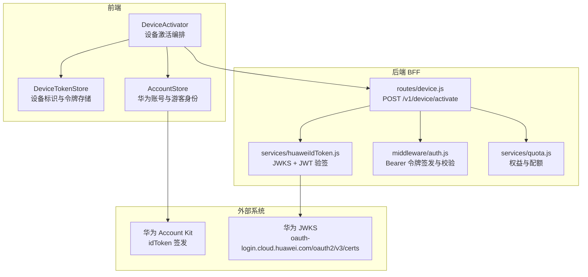
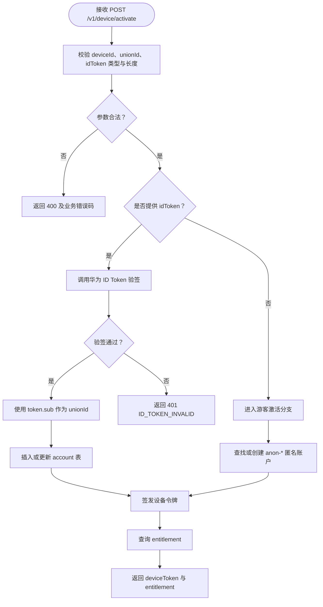
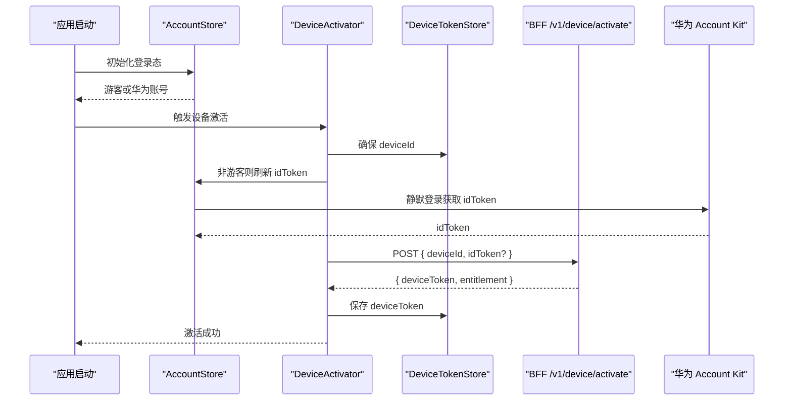
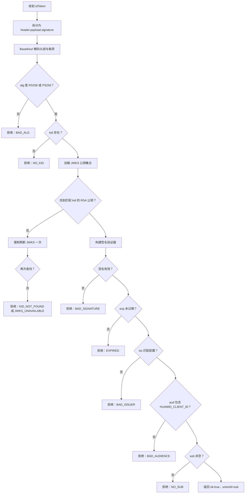
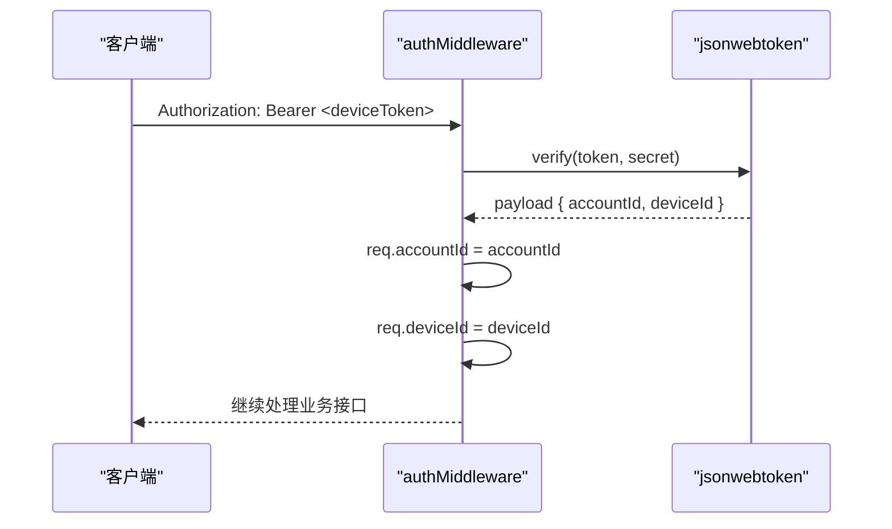

# 设备管理路由

<cite>
**本文引用的文件**   
- [bff/src/routes/device.js](file://bff/src/routes/device.js)
- [bff/src/services/huaweiIdToken.js](file://bff/src/services/huaweiIdToken.js)
- [bff/src/middleware/auth.js](file://bff/src/middleware/auth.js)
- [bff/src/services/quota.js](file://bff/src/services/quota.js)
- [bff/test/device-idtoken.test.js](file://bff/test/device-idtoken.test.js)
- [bff/test/device-validate.test.js](file://bff/test/device-validate.test.js)
- [entry/src/main/ets/data/DeviceActivator.ets](file://entry/src/main/ets/data/DeviceActivator.ets)
- [entry/src/main/ets/data/DeviceTokenStore.ets](file://entry/src/main/ets/data/DeviceTokenStore.ets)
- [entry/src/main/ets/data/AccountStore.ets](file://entry/src/main/ets/data/AccountStore.ets)
- [entry/src/main/ets/common/config/ApiConfig.ets](file://entry/src/main/ets/common/config/ApiConfig.ets)
- [entry/src/main/ets/common/error/ErrorCode.ets](file://entry/src/main/ets/common/error/ErrorCode.ets)
</cite>

## 目录

1. [引言](#引言)
2. [项目结构与职责边界](#项目结构与职责边界)
3. [核心接口总览](#核心接口总览)
4. [设备激活接口 POST /v1/device/activate](#设备激活接口-post-v1deviceactivate)
5. [华为账号与 ID Token 集成流程](#华为账号与-id-token-集成流程)
6. [设备令牌生成与校验机制](#设备令牌生成与校验机制)
7. [请求与响应示例](#请求与响应示例)
8. [安全机制说明](#安全机制说明)
9. [错误码定义](#错误码定义)
10. [故障排查指南](#故障排查指南)
11. [性能与并发特性](#性能与并发特性)
12. [结论](#结论)

## 引言

本文件从后端 BFF（Backend For Frontend）和前端 HarmonyOS 应用两个视角，完整记录设备管理路由。重点覆盖：

- 设备激活接口 `POST /v1/device/activate`：输入校验、华为 ID Token 验签、账户映射、匿名游客账户处理、设备令牌签发、权益查询。
- 设备验证接口 `GET /v1/device/validate`：当前仓库未实现该端点；设备凭证校验由通用鉴权中间件通过 `Authorization: Bearer <deviceToken>` 完成。
- 华为账号集成：端侧通过 Account Kit 静默登录获取 idToken，服务端用本地 JWKS 验签 RS256/PS256 JWT，并把 `sub` 作为 unionId。
- 安全机制：JWKS 公钥验签、算法白名单、发行方和受众校验、过期时间检查、防重放依赖客户端幂等键、令牌有效期与刷新策略。
- 错误码：激活层 400/401 业务错误、通用票据无效错误、端侧 6001 票据失效语义。

需要特别说明的是：当前仓库没有 `/v1/device/validate` 路由。设备验证的实际入口是通用鉴权中间件，它负责解析 Bearer 设备令牌并填充 `req.accountId`、`req.deviceId`。

**章节来源**
- [bff/src/routes/device.js:1-84](file://bff/src/routes/device.js#L1-L84)
- [bff/src/middleware/auth.js:1-25](file://bff/src/middleware/auth.js#L1-L25)
- [entry/src/main/ets/common/error/ErrorCode.ets:42-42](file://entry/src/main/ets/common/error/ErrorCode.ets#L42-L42)

## 项目结构与职责边界

设备管理相关代码横跨后端 Node.js BFF 和前端 ArkTS 模块，职责划分如下：

| 层级 | 模块 | 主要职责 |
|---|---|---|
| 前端设备层 | `DeviceTokenStore` | 持久化设备标识 `deviceId`、设备令牌 `deviceToken`、激活时间戳 |
| 前端激活编排 | `DeviceActivator` | 冷启或票据失效时调用 BFF 激活接口，保存令牌与权益，支持重新激活 |
| 前端账号层 | `AccountStore` | 维护华为账号或游客身份，提供静默刷新 idToken |
| 后端路由层 | `routes/device.js` | 处理 `/v1/device/activate`，做参数校验、华为身份识别、账户写入、令牌签发 |
| 后端身份服务 | `services/huaweiIdToken.js` | 拉取并缓存华为 JWKS，完成 RS256/PS256 JWT 签名、issuer、audience、exp、sub 校验 |
| 后端鉴权中间件 | `middleware/auth.js` | 签发设备令牌，验证后续请求的 `Authorization: Bearer` 头 |
| 后端权益服务 | `services/quota.js` | 根据订阅、通行证、赠送额度计算设备 entitlement |



**图表来源**
- [entry/src/main/ets/data/DeviceActivator.ets:1-159](file://entry/src/main/ets/data/DeviceActivator.ets#L1-L159)
- [entry/src/main/ets/data/DeviceTokenStore.ets:1-142](file://entry/src/main/ets/data/DeviceTokenStore.ets#L1-L142)
- [entry/src/main/ets/data/AccountStore.ets:1-200](file://entry/src/main/ets/data/AccountStore.ets#L1-L200)
- [bff/src/routes/device.js:1-84](file://bff/src/routes/device.js#L1-L84)
- [bff/src/services/huaweiIdToken.js:1-161](file://bff/src/services/huaweiIdToken.js#L1-L161)
- [bff/src/middleware/auth.js:1-25](file://bff/src/middleware/auth.js#L1-L25)
- [bff/src/services/quota.js:1-113](file://bff/src/services/quota.js#L1-L113)

**章节来源**
- [entry/src/main/ets/data/DeviceActivator.ets:1-159](file://entry/src/main/ets/data/DeviceActivator.ets#L1-L159)
- [bff/src/routes/device.js:1-84](file://bff/src/routes/device.js#L1-L84)

## 核心接口总览

### 已实现接口

| 方法 | 路径 | 用途 | 认证要求 | 返回主体关键字段 |
|---|---|---|---|---|
| `POST` | `/v1/device/activate` | 设备激活：绑定 deviceId，关联华为账号或创建匿名用户，签发 deviceToken，返回 entitlement | 无（激活前无票据） | `deviceToken`、`entitlement` |
| 通用鉴权 | 其他受保护接口 | 校验 `Authorization: Bearer <deviceToken>`，解析出 `accountId`、`deviceId` | 有效设备令牌 | 鉴权通过后注入请求上下文 |

### 未实现接口

| 方法 | 路径 | 状态 | 说明 |
|---|---|---|---|
| `GET` | `/v1/device/validate` | 当前仓库未实现 | 文档中常用来“校验令牌有效性”；当前实现中，设备令牌校验由通用鉴权中间件完成，而不是独立设备验证接口 |

如果未来需要显式设备验证接口，可参考现有鉴权中间件的逻辑：从 `Authorization` 头取出 Bearer 令牌，使用相同密钥解码并校验有效期。但当前仓库中，设备激活成功后，所有业务接口统一走 `authMiddleware`。

**章节来源**
- [bff/src/routes/device.js:1-84](file://bff/src/routes/device.js#L1-L84)
- [bff/src/middleware/auth.js:1-25](file://bff/src/middleware/auth.js#L1-L25)

## 设备激活接口 POST /v1/device/activate

### 接口契约

| 项目 | 值 |
|---|---|
| HTTP 方法 | `POST` |
| URL | `/v1/device/activate` |
| Content-Type | `application/json` |
| 认证 | 无；这是设备首次建立信任关系的接口 |
| 成功状态码 | `200` |
| 失败状态码 | `400`（参数非法）、`401`（华为 ID Token 验签失败） |

### 请求体字段

| 字段 | 类型 | 必填 | 约束 | 行为 |
|---|---|---:|---|---|
| `deviceId` | 字符串 | 是 | 非空、去除空白后长度大于 0、长度不超过 128 | 设备唯一标识；未登录时为游客分区键 |
| `idToken` | 字符串 | 否 | 若提供则必须是字符串且长度不超过 4096 | 华为 Account Kit 签发的 JWT；验签通过后以 `sub` 作为 unionId |
| `unionId` | 字符串 | 否 | 若提供则必须是字符串且长度不超过 128 | **不会被信任**；未提供 idToken 时忽略，按游客处理 |

### 请求处理主流程



**图表来源**
- [bff/src/routes/device.js:1-84](file://bff/src/routes/device.js#L1-L84)
- [bff/src/services/huaweiIdToken.js:1-161](file://bff/src/services/huaweiIdToken.js#L1-L161)
- [bff/src/middleware/auth.js:1-25](file://bff/src/middleware/auth.js#L1-L25)
- [bff/src/services/quota.js:1-113](file://bff/src/services/quota.js#L1-L113)

### 关键处理规则

1. **deviceId 强制校验**  
   - 非字符串、空串、纯空白、超过 128 字符都会返回 `MISSING_DEVICE_ID`。
   - 该校验防止数据库异常把错误直接暴露为 500，也防止恶意超长字段污染账户表。

2. **unionId 不被信任**  
   - 即使请求体包含 `unionId`，只要未提供有效的 `idToken`，就不会使用该值建立华为账号。
   - 这避免攻击者仅凭猜测 unionId 冒用他人身份。

3. **华为账号激活路径**  
   - 验签成功后，使用 `sub` 作为 unionId。
   - 如果 account 不存在，使用 `INSERT OR IGNORE` 建账，再重查，避免并发重复建账。
   - 如果 account 已存在，更新 `device_id` 和 `last_seen_at`。

4. **游客激活路径**  
   - 未提供 idToken 时，按设备标识查找 `union_id LIKE 'anon-%'` 的账户。
   - 找不到则创建 `anon-${deviceId}`。
   - 同一设备上的游客不会拿到已绑定的华为账号票据。

5. **并发安全**  
   - 华为账号激活使用 `INSERT OR IGNORE` 加二次查询，避免 UNIQUE 约束导致 500。
   - 测试覆盖了并发激活只创建一个账号的行为。

6. **返回结果**  
   - 成功返回 `deviceToken` 和 `entitlement`。
   - `deviceToken` 是有效期 30 天的 JWT，携带 `accountId` 和 `deviceId`。
   - `entitlement` 包含订阅信息、通行证、赠送剩余次数、用量统计和管理员权限标志。

**章节来源**
- [bff/src/routes/device.js:1-84](file://bff/src/routes/device.js#L1-L84)
- [bff/test/device-validate.test.js:1-86](file://bff/test/device-validate.test.js#L1-L86)
- [bff/test/device-idtoken.test.js:1-184](file://bff/test/device-idtoken.test.js#L1-L184)

## 华为账号与 ID Token 集成流程

### 端侧流程

1. 应用启动时初始化 `AccountStore`，尝试静默登录。
2. 如果是华为账号，不降级为游客；如果取不到 unionId，则保持本机游客分区。
3. 设备激活时，`DeviceActivator` 判断是否为游客：
   - 游客：不请求 idToken，直接传 `deviceId`。
   - 已登录：调用 `AccountStore.refreshIdToken` 获取华为 idToken。
   - 已登录但取不到 idToken：**不降级为游客**，放弃本次激活，等待下次重试。
4. 构造请求体：始终包含 `deviceId`，仅在获取到 idToken 时包含 `idToken`。
5. 将返回的 `deviceToken` 存入 `DeviceTokenStore`，`entitlement` 存入 `EntitlementStore`。



**图表来源**
- [entry/src/main/ets/data/DeviceActivator.ets:1-159](file://entry/src/main/ets/data/DeviceActivator.ets#L1-L159)
- [entry/src/main/ets/data/AccountStore.ets:1-200](file://entry/src/main/ets/data/AccountStore.ets#L1-L200)
- [entry/src/main/ets/data/DeviceTokenStore.ets:1-142](file://entry/src/main/ets/data/DeviceTokenStore.ets#L1-L142)

### 服务端 ID Token 验签流程



**图表来源**
- [bff/src/services/huaweiIdToken.js:1-161](file://bff/src/services/huaweiIdToken.js#L1-L161)

### 关键设计要点

- **只信任验签后的 sub**：请求体中的 unionId 不用于身份映射。
- **算法白名单**：只接受 RS256 和 PS256，拒绝 `none` 和对称算法。
- **JWKS 缓存**：默认缓存 10 分钟，超时 5 秒；新 kid 未命中时会强制刷新一次。
- **fail-closed**：缺少 Client ID、JWKS 不可用、kid 缺失、签名失败、aud/iss/exp 不符，都返回验签失败。
- **子用户标识**：官方约定 `sub` 即 unionId，服务端直接将其作为账户关联键。

**章节来源**
- [bff/src/services/huaweiIdToken.js:1-161](file://bff/src/services/huaweiIdToken.js#L1-L161)
- [bff/test/device-idtoken.test.js:1-184](file://bff/test/device-idtoken.test.js#L1-L184)
- [entry/src/main/ets/data/AccountStore.ets:1-200](file://entry/src/main/ets/data/AccountStore.ets#L1-L200)

## 设备令牌生成与校验机制

### 令牌结构

设备令牌是由 `issueToken` 签发的 JWT，负载包含：

| 字段 | 含义 |
|---|---|
| `accountId` | 后端 account 表主键 |
| `deviceId` | 设备标识 |
| `exp` | 过期时间（30 天） |

令牌密钥来自环境变量 `JWT_SECRET`，默认开发值为 `youjing-bff-dev-secret`。

### 令牌签发

设备激活成功时调用：

```javascript
const token = issueToken(account.id, deviceId);
```

实际签发逻辑位于鉴权中间件模块中：

```javascript
export function issueToken(accountId, deviceId) {
  return jwt.sign({ accountId, deviceId }, jwtSecret(), { expiresIn: '30d' });
}
```

### 令牌校验

其他受保护接口通过 `authMiddleware` 校验：

1. 检查 `Authorization` 头是否存在并以 `Bearer ` 开头。
2. 提取 Bearer 令牌。
3. 使用相同 `JWT_SECRET` 解码并校验过期时间。
4. 成功时注入 `req.accountId` 和 `req.deviceId`。
5. 失败时返回 `TOKEN_INVALID`。



**图表来源**
- [bff/src/middleware/auth.js:1-25](file://bff/src/middleware/auth.js#L1-L25)

**章节来源**
- [bff/src/middleware/auth.js:1-25](file://bff/src/middleware/auth.js#L1-L25)
- [bff/src/routes/device.js:1-84](file://bff/src/routes/device.js#L1-L84)

## 请求与响应示例

以下示例描述接口语义和字段结构，不代表仓库中某个具体测试用例的原始报文。

### 成功示例：华为账号激活

**请求**

| 字段 | 示例值 |
|---|---|
| `deviceId` | `a1b2c3d4-e5f6-4a7b-8c9d-0e1f2a3b4c5d` |
| `idToken` | `<华为 Account Kit 签发的 RS256 或 PS256 JWT>` |

**成功响应**

| 字段 | 类型 | 说明 |
|---|---|---|
| `deviceToken` | 字符串 | 30 天有效的 Bearer 令牌 |
| `entitlement.subscription` | 对象或 null | 活跃订阅信息，包含 `status`、`periodEnd` |
| `entitlement.passes` | 数组 | 通行证列表，包含 `localTripId`、`status`、`expiresAt` |
| `entitlement.giftRemaining` | 数字 | 赠送剩余次数 |
| `entitlement.usedToday` | 数字 | 当月已用次数（字段名保留历史兼容） |
| `entitlement.dailyCap` | 数字 | 月度上限，当前为 20 |
| `entitlement.unlimited` | 布尔值 | 管理员账户是否免限额 |

### 成功示例：游客激活

**请求**

| 字段 | 示例值 |
|---|---|
| `deviceId` | `guest-device-uuid` |

**成功响应**

返回结构与华为账号一致，但账户关联为匿名账户，unionId 形如 `anon-${deviceId}`。

### 失败示例：缺少 deviceId

**请求**

```json
{}
```

**响应**

| 字段 | 值 |
|---|---|
| `error` | `MISSING_DEVICE_ID` |
| `message` | 中文提示，表示缺少或非法 deviceId |

### 失败示例：非法 unionId

**请求**

```json
{
  "deviceId": "dev-ok",
  "unionId": 123
}
```

**响应**

| 字段 | 值 |
|---|---|
| `error` | `INVALID_UNION_ID` |
| `message` | 中文提示，表示 unionId 非法 |

### 失败示例：华为 ID Token 验签失败

**请求**

```json
{
  "deviceId": "dev-invalid",
  "idToken": "<被篡改或过期的 JWT>"
}
```

**响应**

| 字段 | 值 |
|---|---|
| `error` | `ID_TOKEN_INVALID` |
| `message` | 中文提示，表示华为身份票据无效 |

### 失败示例：idToken 类型错误

**请求**

```json
{
  "deviceId": "dev-bad-token-type",
  "idToken": { "evil": true }
}
```

**响应**

| 字段 | 值 |
|---|---|
| `error` | `INVALID_ID_TOKEN` |
| `message` | 中文提示，表示 idToken 非法 |

**章节来源**
- [bff/src/routes/device.js:1-84](file://bff/src/routes/device.js#L1-L84)
- [bff/test/device-validate.test.js:1-86](file://bff/test/device-validate.test.js#L1-L86)
- [bff/test/device-idtoken.test.js:1-184](file://bff/test/device-idtoken.test.js#L1-L184)

## 安全机制说明

### 1. 华为 ID Token 签名验证

- 使用 Node.js `crypto` 模块进行本地验签。
- 支持 RS256 和 PS256。
- 从华为 JWKS 端点拉取公钥，并按 `kid` 选择对应公钥。
- 拒绝 `alg=none`、对称算法、缺失 kid、签名无效等场景。

### 2. 发行方与受众校验

- `iss` 必须匹配配置的发行方，默认 `https://accounts.huawei.com`。
- `aud` 必须包含环境变量 `HUAWEI_CLIENT_ID`。
- 未配置 `HUAWEI_CLIENT_ID` 时，验签直接失败。

### 3. 过期时间校验

- 比较 `payload.exp` 与服务器当前时间。
- 过期 token 一律拒绝。

### 4. 防重放攻击

- 设备激活接口本身没有独立的 nonce、timestamp、replayId 防重放字段。
- 真正的幂等与防重放应放在业务接口层，例如行程生成接口使用去重键（idempotency key）。
- 对设备激活而言，风险主要是同一设备重复激活，但后端已通过账户表唯一约束和 `INSERT OR IGNORE` 保证幂等。

### 5. 设备令牌安全

- 设备令牌是短期 JWT，有效期 30 天。
- 所有后续请求需携带 `Authorization: Bearer <deviceToken>`。
- 令牌失效或无效时，通用鉴权中间件返回 `TOKEN_INVALID`。
- 端侧遇到 401 或 6001 会清除旧令牌并重新激活。

### 6. 游客与华为账号隔离

- 游客激活只能匹配 `union_id LIKE 'anon-%'`。
- 同一 deviceId 上已有华为账号时，游客不会拿到该账号票据。
- 华为账号激活会写 `device_id`，但游客路径明确限定匿名账户。

**章节来源**
- [bff/src/services/huaweiIdToken.js:1-161](file://bff/src/services/huaweiIdToken.js#L1-L161)
- [bff/src/middleware/auth.js:1-25](file://bff/src/middleware/auth.js#L1-L25)
- [bff/src/routes/device.js:1-84](file://bff/src/routes/device.js#L1-L84)
- [bff/test/device-idtoken.test.js:1-184](file://bff/test/device-idtoken.test.js#L1-L184)

## 错误码定义

### 激活接口错误码

| 错误码 | 状态码 | 含义 | 常见原因 |
|---|---:|---|---|
| `MISSING_DEVICE_ID` | 400 | deviceId 缺失或非法 | 未传 deviceId、非字符串、空串、超长 |
| `INVALID_UNION_ID` | 400 | unionId 类型或长度非法 | 传入对象、数字、空串以外的非法值、超长 |
| `INVALID_ID_TOKEN` | 400 | idToken 类型或长度非法 | 传入非字符串、超长 |
| `ID_TOKEN_INVALID` | 401 | 华为身份票据无效 | 签名失败、过期、aud/iss/sub 不符、JWKS 不可用 |

### 通用鉴权错误码

| 错误码 | 状态码 | 含义 | 常见原因 |
|---|---:|---|---|
| `TOKEN_INVALID` | 401 | 缺少 Authorization 头或令牌无效 | 未带 Bearer、令牌过期、密钥不一致、令牌损坏 |

### 端侧错误码

| 错误码 | 数值 | 含义 | 处理方式 |
|---|---:|---|---|
| `CLOUD_TOKEN_INVALID` | 6001 | 票据失效或未激活，需重新调 `/v1/device/activate` | 清除本地设备令牌，触发重新激活 |

**章节来源**
- [bff/src/routes/device.js:1-84](file://bff/src/routes/device.js#L1-L84)
- [bff/src/middleware/auth.js:1-25](file://bff/src/middleware/auth.js#L1-L25)
- [entry/src/main/ets/common/error/ErrorCode.ets:42-42](file://entry/src/main/ets/common/error/ErrorCode.ets#L42-L42)
- [entry/src/main/ets/data/DeviceActivator.ets:1-159](file://entry/src/main/ets/data/DeviceActivator.ets#L1-L159)

## 故障排查指南

### 现象：设备激活返回 400 MISSING_DEVICE_ID

**可能原因**

- 客户端未传 `deviceId`。
- `deviceId` 是数字、对象或空字符串。
- `deviceId` 去除空白后为空。
- `deviceId` 长度超过 128。

**排查步骤**

1. 检查前端是否正确调用 `DeviceTokenStore.ensureDeviceId()`。
2. 检查请求体 JSON 是否包含 `deviceId`。
3. 确认 deviceId 不是空字符串或纯空白。
4. 确认长度限制合理，不要一次性拼接过长标识。

**章节来源**
- [bff/test/device-validate.test.js:1-86](file://bff/test/device-validate.test.js#L1-L86)

### 现象：设备激活返回 401 ID_TOKEN_INVALID

**可能原因**

- `HUAWEI_CLIENT_ID` 未配置。
- JWKS 端点不可访问。
- JWKS 中没有匹配的 `kid`。
- JWT 算法不是 RS256 或 PS256。
- 签名无效或被篡改。
- `exp` 已过期。
- `iss` 不匹配。
- `aud` 不包含 `HUAWEI_CLIENT_ID`。
- `sub` 缺失。

**排查步骤**

1. 检查部署环境是否设置 `HUAWEI_CLIENT_ID`。
2. 检查网络是否能访问 `HUAWEI_JWKS_URL` 或默认华为 JWKS。
3. 检查 JWT header 中的 `alg` 和 `kid`。
4. 使用测试工具校验 JWT 是否由华为签发。
5. 检查日志中的 `reason`，定位是 `NOT_CONFIGURED`、`JWKS_UNAVAILABLE`、`KID_NOT_FOUND`、`BAD_SIGNATURE`、`EXPIRED`、`BAD_ISSUER`、`BAD_AUDIENCE`、`NO_SUB` 还是 `MALFORMED`。

**章节来源**
- [bff/src/services/huaweiIdToken.js:1-161](file://bff/src/services/huaweiIdToken.js#L1-L161)
- [bff/test/device-idtoken.test.js:1-184](file://bff/test/device-idtoken.test.js#L1-L184)

### 现象：游客激活拿到了华为账号的票据

**当前仓库已修复该问题**。游客激活路径限定 `union_id LIKE 'anon-%'`，因此同一 deviceId 上的游客不会命中华为账号。

如果自定义扩展了账户表或改动了 SQL，请确认：

- 游客激活仍限定匿名账户。
- 华为账号激活不会覆盖匿名账户。
- 并发激活不会绕过 `INSERT OR IGNORE`。

**章节来源**
- [bff/src/routes/device.js:1-84](file://bff/src/routes/device.js#L1-L84)
- [bff/test/device-idtoken.test.js:1-184](file://bff/test/device-idtoken.test.js#L1-L184)

### 现象：业务接口返回 TOKEN_INVALID

**可能原因**

- 请求未携带 `Authorization` 头。
- `Authorization` 不是 `Bearer <token>` 格式。
- 设备令牌已过期。
- 前后端 `JWT_SECRET` 不一致。
- 设备令牌被篡改。

**排查步骤**

1. 检查客户端是否在业务请求中带上 `Authorization: Bearer <deviceToken>`。
2. 检查 `DeviceTokenStore.getToken()` 是否返回有效令牌。
3. 检查 BFF 部署环境变量 `JWT_SECRET`。
4. 确认设备令牌是在激活接口返回后生成的，不是伪造或复制旧令牌。

**章节来源**
- [bff/src/middleware/auth.js:1-25](file://bff/src/middleware/auth.js#L1-L25)
- [entry/src/main/ets/data/DeviceActivator.ets:1-159](file://entry/src/main/ets/data/DeviceActivator.ets#L1-L159)

### 现象：端侧报 6001 票据失效

**可能原因**

- BFF 返回 401。
- 设备令牌过期。
- 服务端密钥变更。
- 设备已更换但仍复用旧令牌。

**处理方式**

1. 捕获 6001 错误。
2. 调用 `DeviceActivator.reactivate(context)`。
3. 清除本地旧令牌。
4. 重新发起原业务请求。

**章节来源**
- [entry/src/main/ets/common/error/ErrorCode.ets:42-42](file://entry/src/main/ets/common/error/ErrorCode.ets#L42-L42)
- [entry/src/main/ets/data/DeviceActivator.ets:1-159](file://entry/src/main/ets/data/DeviceActivator.ets#L1-L159)

## 性能与并发特性

### JWKS 缓存

- JWKS 默认缓存 10 分钟。
- 单次 JWKS 请求超时 5 秒。
- 新 kid 未命中时强制刷新一次，减少公钥轮换期间的误判窗口。

### 并发激活

- 华为账号并发激活使用 `INSERT OR IGNORE` 加二次查询，避免 UNIQUE 约束产生 500。
- 游客并发激活同样只创建一个匿名账户。
- 测试断言并发激活全部返回 200，且账户数量不变。

### 令牌有效期

- 设备令牌有效期 30 天。
- 端侧在 401 或 6001 时主动清理并重新激活。
- 权益刷新失败不影响设备令牌，但会影响功能门禁；`DeviceActivator.refreshEntitlement` 会区分 401 与其他错误。

### 容量与边界

- `deviceId` 最大 128 字符。
- `unionId` 最大 128 字符。
- `idToken` 最大 4096 字符。
- 请求体大小受 Express JSON body parser 限制，测试中使用 `1mb`。

**章节来源**
- [bff/src/services/huaweiIdToken.js:1-161](file://bff/src/services/huaweiIdToken.js#L1-L161)
- [bff/src/routes/device.js:1-84](file://bff/src/routes/device.js#L1-L84)
- [bff/test/device-validate.test.js:1-86](file://bff/test/device-validate.test.js#L1-L86)
- [bff/test/device-idtoken.test.js:1-184](file://bff/test/device-idtoken.test.js#L1-L184)

## 结论

设备管理路由的核心目标是：在不泄露客户端自报 unionId 的前提下，把设备标识与华为账号或匿名账户绑定，并签发可复用的 Bearer 设备令牌。

关键结论如下：

- `/v1/device/activate` 是唯一设备信任建立入口。
- 华为身份只信任服务端验签后的 JWT `sub`，请求体 unionId 不作为身份来源。
- 游客和华为账号通过账户表约束和 SQL 条件隔离，避免同设备冒领。
- 设备令牌由通用鉴权中间件签发和校验，有效期 30 天。
- 当前仓库没有 `/v1/device/validate` 路由；设备验证由业务接口的 `authMiddleware` 承担。
- 安全方面依赖 JWKS 本地验签、算法白名单、issuer/audience/exp 校验、防重放依赖上层幂等键。
- 错误码清晰分层：激活层 400/401、通用票据无效、端侧 6001 票据失效。