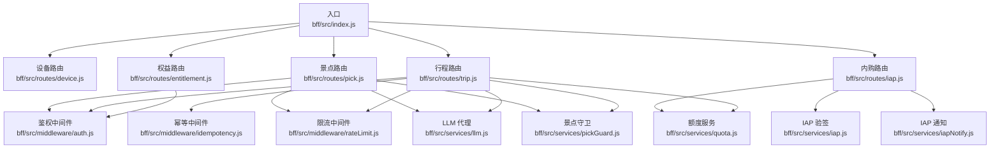
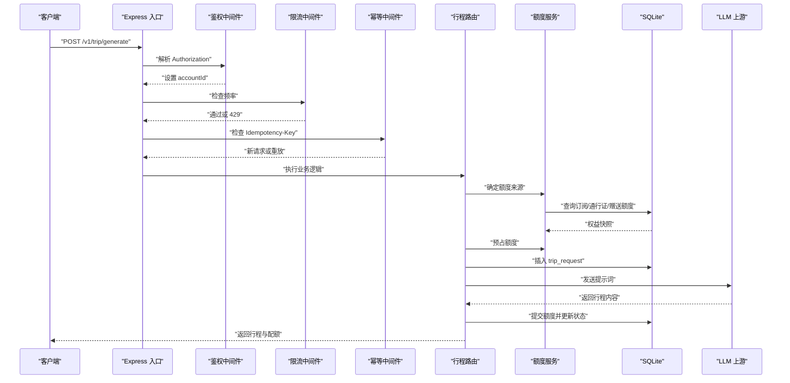
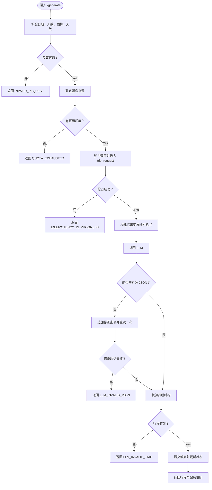
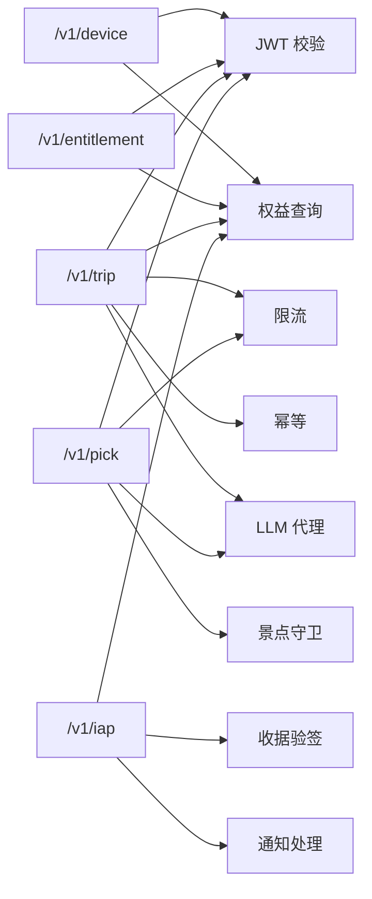

# 路由系统

<cite>
**本文引用的文件**   
- [bff/src/index.js](file://bff/src/index.js)
- [bff/src/routes/device.js](file://bff/src/routes/device.js)
- [bff/src/routes/entitlement.js](file://bff/src/routes/entitlement.js)
- [bff/src/routes/trip.js](file://bff/src/routes/trip.js)
- [bff/src/routes/pick.js](file://bff/src/routes/pick.js)
- [bff/src/routes/iap.js](file://bff/src/routes/iap.js)
- [bff/src/middleware/auth.js](file://bff/src/middleware/auth.js)
- [bff/src/middleware/idempotency.js](file://bff/src/middleware/idempotency.js)
- [bff/src/middleware/rateLimit.js](file://bff/src/middleware/rateLimit.js)
- [bff/src/services/quota.js](file://bff/src/services/quota.js)
- [bff/src/services/pickGuard.js](file://bff/src/services/pickGuard.js)
- [bff/src/services/llm.js](file://bff/src/services/llm.js)
- [bff/src/services/iap.js](file://bff/src/services/iap.js)
- [bff/src/services/iapNotify.js](file://bff/src/services/iapNotify.js)
- [bff/src/lib/http-error.js](file://bff/src/lib/http-error.js)
</cite>

## 目录

1. [引言](#引言)
2. [项目结构](#项目结构)
3. [核心组件](#核心组件)
4. [架构总览](#架构总览)
5. [详细路由说明](#详细路由说明)
6. [依赖关系分析](#依赖关系分析)
7. [性能与成本特性](#性能与成本特性)
8. [故障排查指南](#故障排查指南)
9. [结论](#结论)

## 引言

本文面向接入方和二次开发者，系统化梳理有径后端（BFF）的对外 API 路由体系。服务基于 Express，在 `/v1` 前缀下暴露设备管理、权益查询、行程生成、景点选择、内购处理五类业务接口。每个路由都包含鉴权、限流、幂等、额度控制、外部 LLM 或 IAP 调用等横切能力，并在统一错误中间件中输出结构化错误响应。

本文重点覆盖以下五个路由组：

| 路由组 | 职责 | 主要端点 |
|---|---|---|
| 设备管理 | 设备激活、返回设备令牌与初始权益 | `POST /v1/device/activate` |
| 权益管理 | 查询当前账号的订阅、通行证、赠送额度与用量 | `GET /v1/entitlement` |
| 行程生成 | 校验参数、扣减额度、调用 LLM、落库并返回行程 | `POST /v1/trip/generate` |
| 景点选择 | 对候选景点进行智能排序并返回理由 | `POST /v1/pick/spots` |
| 内购处理 | 收据验证、订单持久化、支付回调与退款处理 | `POST /v1/iap/verify`、`POST /v1/iap/notify` |

## 项目结构

BFF 是一个 Node.js ES Module 应用，入口为 `bff/src/index.js`。它初始化 Express、加载 `.env`、初始化 SQLite 数据库、挂载全局中间件，并按路径注册五个业务路由器。

**图表来源**
- [bff/src/index.js:1-55](file://bff/src/index.js#L1-L55)
- [bff/src/routes/device.js:1-84](file://bff/src/routes/device.js#L1-L84)
- [bff/src/routes/entitlement.js:1-15](file://bff/src/routes/entitlement.js#L1-L15)
- [bff/src/routes/trip.js:1-200](file://bff/src/routes/trip.js#L1-L200)
- [bff/src/routes/pick.js:1-45](file://bff/src/routes/pick.js#L1-L45)
- [bff/src/routes/iap.js:1-192](file://bff/src/routes/iap.js#L1-L192)

**章节来源**
- [bff/src/index.js:1-55](file://bff/src/index.js#L1-L55)
- [bff/package.json:1-22](file://bff/package.json#L1-L22)

## 核心组件

### 通用错误格式

所有非成功响应采用统一 JSON 结构：

| 字段 | 类型 | 含义 |
|---|---|---|
| `error` | 字符串 | 机器可读的错误码 |
| `message` | 字符串 | 面向用户或开发者的错误说明 |

部分内部异常通过 `HttpError` 携带 HTTP 状态码和业务代码，由全局错误中间件转换为上述结构。未捕获异常默认使用 `INTERNAL_ERROR`。

**章节来源**
- [bff/src/lib/http-error.js:1-8](file://bff/src/lib/http-error.js#L1-L8)
- [bff/src/index.js:44-55](file://bff/src/index.js#L44-L55)

### 鉴权中间件

`/v1/entitlement`、`/v1/trip`、`/v1/pick` 要求携带 `Authorization: Bearer <jwt>`。中间件从 JWT payload 中取出 `accountId` 和 `deviceId`，写入请求上下文。令牌缺失、格式错误或签名无效时返回 `TOKEN_INVALID`。

设备激活接口不强制要求 JWT，因为它本身就是用来换取设备令牌的入口；但已登录账号仍可通过该接口刷新关联信息。

**章节来源**
- [bff/src/middleware/auth.js:1-25](file://bff/src/middleware/auth.js#L1-L25)
- [bff/src/index.js:38-43](file://bff/src/index.js#L38-L43)

### 限流中间件

`/v1/trip` 和 `/v1/pick` 在鉴权后进入固定窗口限流。默认限制为每分钟 10 次，按 `accountId` 分组；匿名访问使用远端 IP。超出限制返回 `RATE_LIMITED`。

注意：该限流使用进程内存实现，多实例部署时不会跨实例共享计数。

**章节来源**
- [bff/src/middleware/rateLimit.js:1-47](file://bff/src/middleware/rateLimit.js#L1-L47)
- [bff/src/index.js:40-43](file://bff/src/index.js#L40-L43)

### 幂等中间件

`/v1/trip/generate` 使用 `Idempotency-Key` 请求头防止重复提交。中间件会：

1. 校验请求头是否存在。
2. 将客户端 key 与账号标识组合成作用域键。
3. 规范化请求体并计算哈希。
4. 查询历史行：成功结果直接重放；进行中返回冲突；失败行允许同体重试；不同请求体重复使用同一 key 返回 `IDEMPOTENCY_KEY_REUSED`。

**章节来源**
- [bff/src/middleware/idempotency.js:1-122](file://bff/src/middleware/idempotency.js#L1-L122)

## 架构总览

下图展示一次典型的“行程生成”请求在 BFF 中的完整链路：

**图表来源**
- [bff/src/index.js:38-43](file://bff/src/index.js#L38-L43)
- [bff/src/routes/trip.js:1-200](file://bff/src/routes/trip.js#L1-L200)
- [bff/src/services/quota.js:1-113](file://bff/src/services/quota.js#L1-L113)
- [bff/src/services/llm.js:1-98](file://bff/src/services/llm.js#L1-L98)

## 详细路由说明

### 设备管理路由

#### `POST /v1/device/activate`

用于设备首次激活或重新激活。支持两种身份模式：

| 模式 | 输入 | 行为 |
|---|---|---|
| 华为账号激活 | 提供 `idToken` | 服务端验签后以 `sub` 作为账号身份 |
| 游客激活 | 不提供 `idToken` | 以 `device_id` 创建匿名账号 |

##### 请求参数

| 字段 | 类型 | 必填 | 约束 |
|---|---|---:|---|
| `deviceId` | 字符串 | 是 | 非空且长度不超过 128 |
| `idToken` | 字符串 | 否 | 可选；若提供则必须为合法字符串且长度不超过 4096 |
| `unionId` | 字符串 | 否 | 仅客户端自报值；无 `idToken` 时被忽略 |

##### 响应格式

成功时返回：

| 字段 | 类型 | 含义 |
|---|---|---|
| `deviceToken` | 字符串 | 有效期约 30 天的 JWT，供后续接口鉴权 |
| `entitlement` | 对象 | 初始权益快照，含订阅、通行证、赠送额度、用量上限等 |

##### 错误码

| 错误码 | HTTP 状态 | 含义 |
|---|---:|---|
| `MISSING_DEVICE_ID` | 400 | 缺少或非法 `deviceId` |
| `INVALID_UNION_ID` | 400 | 客户端自报 `unionId` 非法 |
| `INVALID_ID_TOKEN` | 400 | 提供的 `idToken` 不是合法字符串 |
| `ID_TOKEN_INVALID` | 401 | 华为身份票据验签失败 |

##### 集成要点

- 客户端应保存返回的 `deviceToken`，并在后续需要鉴权的接口中放入 `Authorization: Bearer <token>`。
- 同一 `unionId` 多次激活会更新最近设备；匿名账号不会跨设备共享。
- 该接口不要求 `Authorization` 头。

**章节来源**
- [bff/src/routes/device.js:1-84](file://bff/src/routes/device.js#L1-L84)
- [bff/src/middleware/auth.js:18-25](file://bff/src/middleware/auth.js#L18-L25)

---

### 权益管理路由

#### `GET /v1/entitlement`

查询当前已认证账号的权益状态，包括订阅、通行证、赠送剩余额度、月度用量和设备是否被识别为管理员账号。

##### 请求头

| 名称 | 必填 | 示例 |
|---|---:|---|
| `Authorization` | 是 | `Bearer eyJhbGciOi...` |

##### 响应字段

| 字段 | 类型 | 含义 |
|---|---|---|
| `subscription` | 对象或空 | 活跃订阅信息，含状态与到期时间 |
| `passes` | 数组 | 活跃通行证列表，含本地行程 ID、状态和过期时间 |
| `giftRemaining` | 数字 | 赠送额度剩余次数 |
| `usedToday` | 数字 | 当月已成功生成的次数（字段名保留历史兼容） |
| `dailyCap` | 数字 | 月度额度上限 |
| `unlimited` | 布尔 | 是否为不受额度限制的账号 |

##### 错误码

| 错误码 | HTTP 状态 | 含义 |
|---|---:|---|
| `TOKEN_INVALID` | 401 | 缺少或缺失有效的 `Authorization` 头 |

##### 集成要点

- 客户端不应自行判断“是否有会员”，而应读取 `subscription` 和 `passes` 等字段。
- `usedToday` 实际表示当月用量，命名与源码注释一致，避免误以为它是“每日限额”。

**章节来源**
- [bff/src/routes/entitlement.js:1-15](file://bff/src/routes/entitlement.js#L1-L15)
- [bff/src/services/quota.js:1-113](file://bff/src/services/quota.js#L1-L113)
- [bff/src/middleware/auth.js:1-25](file://bff/src/middleware/auth.js#L1-L25)

---

### 行程生成路由

#### `POST /v1/trip/generate`

这是 BFF 最核心的计费与 LLM 聚合接口。流程包括参数校验、额度来源判定、预占额度、幂等记录、提示词构建、LLM 调用、JSON 解析、行程校验、额度提交、状态落库和响应组装。

##### 请求头

| 名称 | 必填 | 说明 |
|---|---:|---|
| `Authorization` | 是 | 鉴权令牌 |
| `Idempotency-Key` | 是 | 客户端生成的唯一幂等键，建议结合请求体指纹 |

##### 请求体字段

| 字段 | 类型 | 必填 | 约束 |
|---|---:|---:|---|
| `destination` | 字符串 | 是 | 非空目的地 |
| `startDate` | 字符串 | 是 | `YYYY-MM-DD`，范围 2020-01-01 至 2100-12-31 |
| `endDate` | 字符串 | 是 | `YYYY-MM-DD`，不早于 `startDate` |
| `people` | 整数 | 是 | 1–30 |
| `budget` | 整数 | 是 | 非负整数 |
| `passId` | 字符串 | 否 | 指定通行证 ID，影响额度来源判定 |

##### 处理流程

**图表来源**
- [bff/src/routes/trip.js:1-200](file://bff/src/routes/trip.js#L1-L200)
- [bff/src/routes/trip.js:201-234](file://bff/src/routes/trip.js#L201-L234)
- [bff/src/services/quota.js:1-113](file://bff/src/services/quota.js#L1-L113)
- [bff/src/services/llm.js:1-98](file://bff/src/services/llm.js#L1-L98)

##### 响应字段

| 字段 | 类型 | 含义 |
|---|---|---|
| `trip` | 对象 | 经校验后的行程数据 |
| `quota.source` | 字符串 | 实际使用的额度来源，如 `subscription`、`pass`、`gift`、`admin` |
| `quota.remainingToday` | 数字 | 当月剩余次数 |
| `quota.giftRemaining` | 数字 | 赠送额度剩余次数 |
| `quota.passes` | 数组 | 当前账号的通行证快照 |
| `quota.subscription` | 对象或空 | 订阅快照 |
| `quota.dailyCap` | 数字 | 月度上限 |
| `quota.unlimited` | 布尔 | 是否绕过额度门禁 |

##### 错误码

| 错误码 | HTTP 状态 | 含义 |
|---|---:|---|
| `INVALID_REQUEST` | 400 | 参数校验失败 |
| `QUOTA_EXHAUSTED` | 402 | 没有可用额度 |
| `IDEMPOTENCY_IN_PROGRESS` | 409 | 同一幂等键正在处理 |
| `LLM_INVALID_JSON` | 502 | LLM 输出无法解析为合法 JSON |
| `LLM_INVALID_TRIP` | 502 | LLM 返回的行程不符合结构约束 |
| `LLM_TIMEOUT` | 504 | LLM 上游超时 |
| `LLM_RATE_LIMITED` | 429 | LLM 上游限流 |
| `LLM_UPSTREAM_ERROR` | 502 | LLM 上游非 200 响应 |
| `RATE_LIMITED` | 429 | BFF 自身限流 |
| `TOKEN_INVALID` | 401 | 鉴权失败 |
| `MISSING_IDEMPOTENCY_KEY` | 400 | 缺少幂等键 |
| `IDEMPOTENCY_KEY_REUSED` | 422 | 同一幂等键对应不同请求体 |

##### 集成要点

- 客户端每次发起生成请求都必须生成新的 `Idempotency-Key`。
- 遇到 `LLM_RATE_LIMITED` 时应等待后再试，而不是立即重试。
- 如果收到 `IDEMPOTENCY_IN_PROGRESS`，应轮询而非并发重试。
- 免费档最大输出 token 较低；长行程可能触发一次自动修正调用，但仍只扣一次额度。
- 响应中的 `quota` 是结算后的快照，可用于刷新 UI 上的次数显示。

**章节来源**
- [bff/src/routes/trip.js:1-200](file://bff/src/routes/trip.js#L1-L200)
- [bff/src/routes/trip.js:201-234](file://bff/src/routes/trip.js#L201-L234)
- [bff/src/middleware/idempotency.js:1-122](file://bff/src/middleware/idempotency.js#L1-L122)
- [bff/src/services/quota.js:1-113](file://bff/src/services/quota.js#L1-L113)
- [bff/src/services/llm.js:1-98](file://bff/src/services/llm.js#L1-L98)

---

### 景点选择路由

#### `POST /v1/pick/spots`

提供“智能选点”能力：服务端根据城市、天数、节奏、兴趣和候选景点列表，调用 LLM 对候选景点排序，并为每站生成简短理由。

该接口不扣除行程生成额度，但仍受鉴权和限流保护。

##### 请求体字段

| 字段 | 类型 | 必填 | 约束 |
|---|---:|---:|---|
| `city` | 字符串 | 是 | 非空城市名 |
| `days` | 整数 | 是 | 1–30 |
| `pace` | 字符串 | 是 | 游览节奏描述 |
| `interests` | 字符串 | 是 | 兴趣偏好描述 |
| `candidates` | 数组 | 是 | 最多 40 个候选景点 |

每个候选景点至少包含：

| 字段 | 类型 | 必填 | 约束 |
|---|---:|---:|---|
| `id` | 字符串 | 是 | 非空且不重复 |
| `name` | 字符串 | 是 | 非空 |
| `tag` | 字符串 | 是 | 分类标签 |
| `brief` | 字符串 | 是 | 简介 |
| `district` | 字符串 | 是 | 区域 |
| `popularity` | 数值 | 是 | 热度 |
| `suggestedDuration` | 数值 | 是 | 建议时长 |
| `requiresBooking` | 布尔 | 是 | 是否需要预约 |

##### 响应格式

| 字段 | 类型 | 含义 |
|---|---|---|
| `ranked` | 数组 | 与候选数量一致的排序结果，每项含 `id` 和 `reason` |
| `note` | 字符串 | 模型给出的补充说明 |

##### 错误码

| 错误码 | HTTP 状态 | 含义 |
|---|---:|---|
| `INVALID_REQUEST` | 400 | 请求体或候选景点字段校验失败 |
| `DECISION_REJECTED` | 422 | 模型输出不是合法 JSON |
| `RATE_LIMITED` | 429 | 请求过于频繁 |
| `TOKEN_INVALID` | 401 | 鉴权失败 |

##### 安全边界

服务端会严格校验模型输出：

- `ranked` 必须覆盖全部候选景点。
- 不能新增候选列表中不存在的 `id`。
- 不能出现重复景点。
- `reason` 和 `note` 有长度上限。

**章节来源**
- [bff/src/routes/pick.js:1-45](file://bff/src/routes/pick.js#L1-L45)
- [bff/src/services/pickGuard.js:1-97](file://bff/src/services/pickGuard.js#L1-L97)
- [bff/src/services/llm.js:1-98](file://bff/src/services/llm.js#L1-L98)

---

### 内购处理路由

#### `POST /v1/iap/verify`

用于客户端上报购买收据，服务端完成 JWS 验签、商品校验、订单持久化和权益发放。

##### 请求体字段

| 字段 | 类型 | 必填 | 约束 |
|---|---:|---:|---|
| `productType` | 字符串 | 是 | 只能是 `pass` 或 `subscription` |
| `jwsPurchaseOrder` | 字符串 | 条件必填 | 订单 JWS，最长 8192 |
| `jwsSubscriptionStatus` | 字符串 | 条件必填 | 订阅状态 JWS，最长 8192 |
| `productId` | 字符串 | 订阅时可选 | 默认 `youjing_sub_monthly` |
| `localTripId` | 字符串 | 通行证时必填 | 非空且长度不超过 128 |

##### 响应字段

| 字段 | 类型 | 含义 |
|---|---|---|
| `verified` | 布尔 | 是否通过收据校验 |
| `entitlement` | 对象 | 权益快照，仅在成功时返回完整信息 |
| `passId` | 字符串或空 | 通行证购买时返回本地行程 ID |
| `error` | 字符串 | 错误码 |
| `message` | 字符串 | 错误说明 |

##### 错误码

| 错误码 | HTTP 状态 | 含义 |
|---|---:|---|
| `MISSING_PARAMS` | 400 | 缺少 `productType` |
| `UNSUPPORTED_PRODUCT_TYPE` | 400 | 不支持的商品类型 |
| `UNKNOWN_PRODUCT_ID` | 400 | 未知订阅商品 ID |
| `INVALID_JWS` | 400 | JWS 字段类型或长度非法 |
| `MISSING_JWS` | 400 | 缺少必需的 JWS |
| `MISSING_TRIP_ID` | 400 | 通行证购买缺少合法 `localTripId` |
| `TOKEN_INVALID` | 401 | 缺少有效账号票据 |
| `RECEIPT_ALREADY_USED` | 409 | 收据已绑定其他账号 |
| `IAP_NOT_CONFIGURED` | 503 | 未配置根证书或 APP_ID |
| 其他 `verified=false` 响应 | 200 | 收据本身无效或未通过校验 |

##### 集成要点

- 客户端不应把裸 `purchaseToken` 当作幂等键；服务端以 JWS 内的权威值为准。
- 同一收据只能绑定一个账号。
- 已退款收据再次兑换会返回 `verified=false`。
- 订阅优先使用 `jwsSubscriptionStatus`，其次回退到 `jwsPurchaseOrder`。

#### `POST /v1/iap/notify`

用于接收华为 IAP 官方 v3 支付事件通知，包括续费、到期、退款、续订状态变更等。

##### 请求体

| 字段 | 类型 | 必填 | 约束 |
|---|---:|---:|---|
| `jwsNotification` | 字符串 | 是 | 对 `NotificationPayload` 签名的 JWS，最长 8192 |

##### 响应字段

| 字段 | 类型 | 含义 |
|---|---:|---|
| `ok` | 布尔 | 是否确认接收 |
| `applied` | 布尔 | 是否实际改变了权益 |
| `kind` | 字符串 | 通知类别，如 `renew`、`expire`、`refund` |

##### 错误码

| 错误码 | HTTP 状态 | 含义 |
|---|---:|---|
| `NOTIFY_BAD_FORMAT` | 400 | 缺少或非法 `jwsNotification` |
| `NOTIFY_NOT_CONFIGURED` | 503 | 未配置 IAP JWS 验签环境 |
| 其他 `NOTIFY_*` | 401 | 通知验签失败或不被信任 |

##### 事件处理规则

| 事件类别 | 行为 |
|---|---|
| `DID_NEW_TRANSACTION` | 视为续费或生效，延长订阅周期 |
| `EXPIRE` | 将活跃订阅置为已到期 |
| `REVOKE` | 将订单置退款；订阅置退款；通行证撤销 |
| `DID_CHANGE_RENEWAL_STATUS` | 仅更新自动续订开关 |
| `RENEWAL_TIME_MODIFIED` | 仅记录，不改变权益 |
| `TEST` | 仅记录，不改变权益 |
| 未知事件 | 记录日志并返回成功，避免无限重试 |

**章节来源**
- [bff/src/routes/iap.js:1-192](file://bff/src/routes/iap.js#L1-L192)
- [bff/src/services/iap.js:1-133](file://bff/src/services/iap.js#L1-L133)
- [bff/src/services/iapNotify.js:1-167](file://bff/src/services/iapNotify.js#L1-L167)

## 依赖关系分析

### 路由与服务依赖

**图表来源**
- [bff/src/index.js:38-43](file://bff/src/index.js#L38-L43)
- [bff/src/routes/device.js:1-84](file://bff/src/routes/device.js#L1-L84)
- [bff/src/routes/entitlement.js:1-15](file://bff/src/routes/entitlement.js#L1-L15)
- [bff/src/routes/trip.js:1-200](file://bff/src/routes/trip.js#L1-L200)
- [bff/src/routes/pick.js:1-45](file://bff/src/routes/pick.js#L1-L45)
- [bff/src/routes/iap.js:1-192](file://bff/src/routes/iap.js#L1-L192)

### 关键设计约束

| 设计点 | 原因 |
|---|---|
| 设备激活不信任客户端 `unionId` | 防止通过猜测 unionId 劫持他人账户 |
| 行程生成使用幂等键 + 请求哈希 | 防止网络抖动导致重复扣费和重复写库 |
| 额度先预占、成功后提交 | 保证失败时释放额度，避免泄漏 |
| 管理员账号不走额度门 | 便于本机测试，同时仍统计真实用量 |
| 景点选择禁止新增 id | 防止模型伪造景点 |
| IAP 收据走本地 JWS 验签 | 避免任何伪造 purchaseToken 获得权益 |
| 通知只改已知事件 | 未知事件不落权益，避免无限重试黑洞 |

**章节来源**
- [bff/src/routes/device.js:10-45](file://bff/src/routes/device.js#L10-L45)
- [bff/src/middleware/idempotency.js:1-122](file://bff/src/middleware/idempotency.js#L1-L122)
- [bff/src/services/quota.js:1-113](file://bff/src/services/quota.js#L1-L113)
- [bff/src/services/pickGuard.js:1-97](file://bff/src/services/pickGuard.js#L1-L97)
- [bff/src/services/iap.js:1-133](file://bff/src/services/iap.js#L1-L133)
- [bff/src/services/iapNotify.js:1-167](file://bff/src/services/iapNotify.js#L1-L167)

## 性能与成本特性

| 维度 | 行为 | 影响 |
|---|---|---|
| LLM 超时 | 默认 45 秒 | 单次失败最多两次顺序调用，总耗时低于客户端读超时 |
| 免费档输出上限 | 8192 token | 长行程可能被截断，随后自动修正重试 |
| 付费档输出上限 | 16384 token | 降低长行程解析失败概率 |
| 行程生成额度上限 | 每月 20 次 | 与商业化方案及付费页文案对齐 |
| 赠送额度 | 基础 3 次 | 可被账本增加或减少 |
| BFF 限流 | 默认 10 次/分钟 | 防止脚本循环消耗额度 |
| IAP 验签 | 本地 JWS + 根证书链 | 避免依赖不存在的外部验签服务 |

优化建议：

- 客户端应在 UI 层缓存 `Idempotency-Key` 与请求体，避免重复生成。
- 对 429 响应做指数退避，不要立即高频重试。
- 长行程生成前可在端侧估算天数，避免频繁失败。
- 多实例部署时如需严格限流，应替换为分布式限流方案。

[本节为通用性能讨论，不直接分析具体代码片段]

## 故障排查指南

### 常见错误定位

| 现象 | 检查项 | 处理建议 |
|---|---|---|
| 设备激活返回 `ID_TOKEN_INVALID` | 检查 `idToken` 是否来自华为账号登录流程 | 重新获取 token 后重试 |
| 行程生成返回 `QUOTA_EXHAUSTED` | 查看 `/v1/entitlement` 的 `subscription`、`passes`、`giftRemaining` | 升级订阅或等待下个自然月 |
| 行程生成返回 `IDEMPOTENCY_IN_PROGRESS` | 检查是否并发重试同一 `Idempotency-Key` | 等待或更换新 key |
| 行程生成返回 `LLM_RATE_LIMITED` | 检查 LLM 上游限流 | 等待后重试，避免立即重发 |
| 行程生成返回 `LLM_INVALID_JSON` | 检查 LLM 输出质量 | 减少行程复杂度或缩短天数 |
| 景点选择返回 `DECISION_REJECTED` | 检查候选景点数量和字段 | 确保候选数量 ≤ 40 且字段完整 |
| IAP 验签返回 `IAP_NOT_CONFIGURED` | 检查根证书和 `APP_ID` 环境变量 | 部署时配置 IAP 验签环境 |
| IAP 通知返回 `NOTIFY_NOT_CONFIGURED` | 检查 IAP JWS 验签配置 | 配置 Huawei CBG Root CA G2 |

### 排错步骤

1. 先调用 `/health` 确认服务和数据库健康。
2. 调用 `/v1/entitlement` 确认账号权益状态。
3. 对生成失败请求，保留 `Idempotency-Key`、请求体和响应体。
4. 对 LLM 相关错误，区分 BFF 限流、上游限流和上游不可用。
5. 对内购问题，区分收据无效、收据复用、退款和部署配置问题。

**章节来源**
- [bff/src/index.js:24-43](file://bff/src/index.js#L24-L43)
- [bff/src/routes/trip.js:1-200](file://bff/src/routes/trip.js#L1-L200)
- [bff/src/services/llm.js:1-98](file://bff/src/services/llm.js#L1-L98)
- [bff/src/routes/iap.js:1-192](file://bff/src/routes/iap.js#L1-L192)

## 结论

本项目的路由系统围绕“设备身份 → 权益校验 → 额度控制 → 外部服务调用 → 幂等落库”这条主线展开。设备管理负责建立可信设备与账号映射；权益管理提供统一的消费视图；行程生成是核心计费与 LLM 聚合点；景点选择提供轻量 AI 决策；内购处理则把支付凭证转化为长期权益。

对于集成方而言，最重要的实践是：

- 始终携带正确的 `Authorization` 头。
- 对行程生成使用稳定且唯一的 `Idempotency-Key`。
- 以 `/v1/entitlement` 的结果作为权限判断依据。
- 正确处理 402、429、502、504 等业务语义错误。
- 不在客户端信任 `unionId`、`purchaseToken` 或 LLM 原始输出。