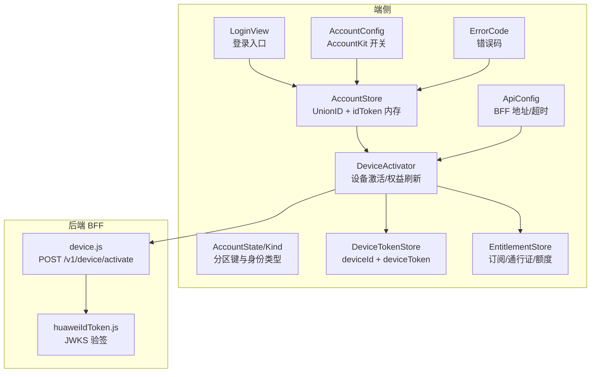
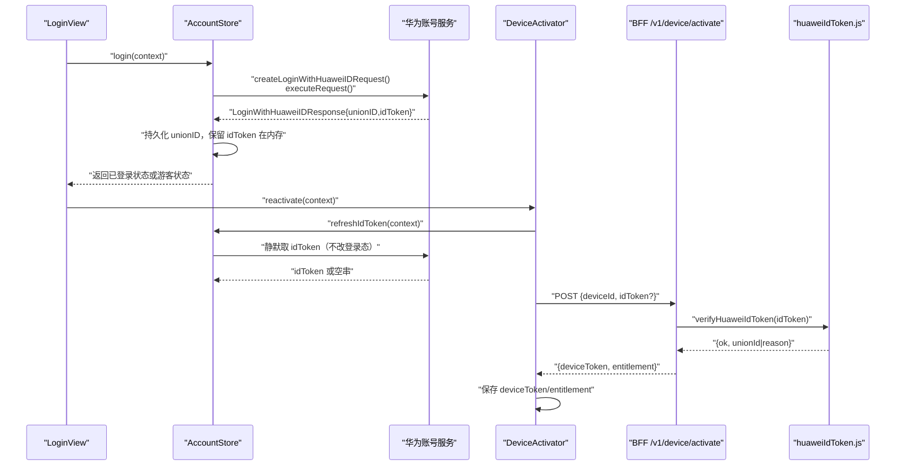
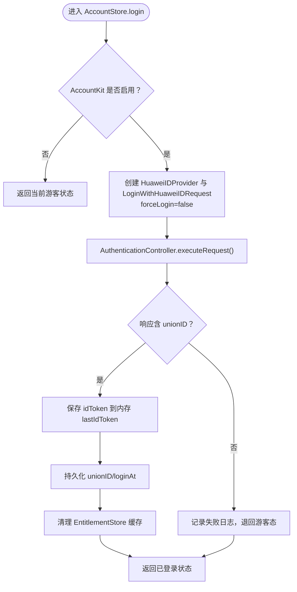
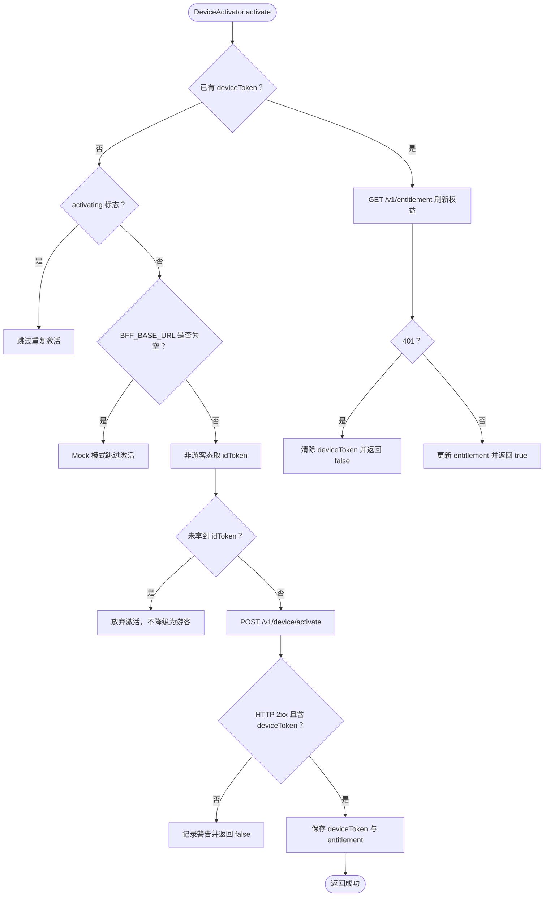
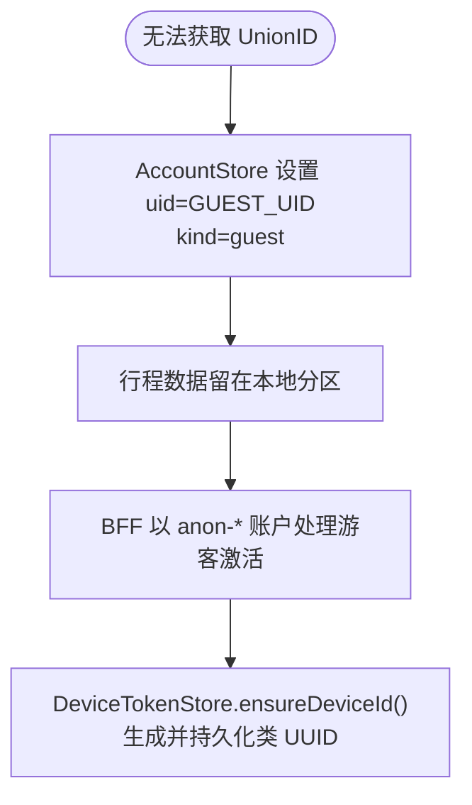
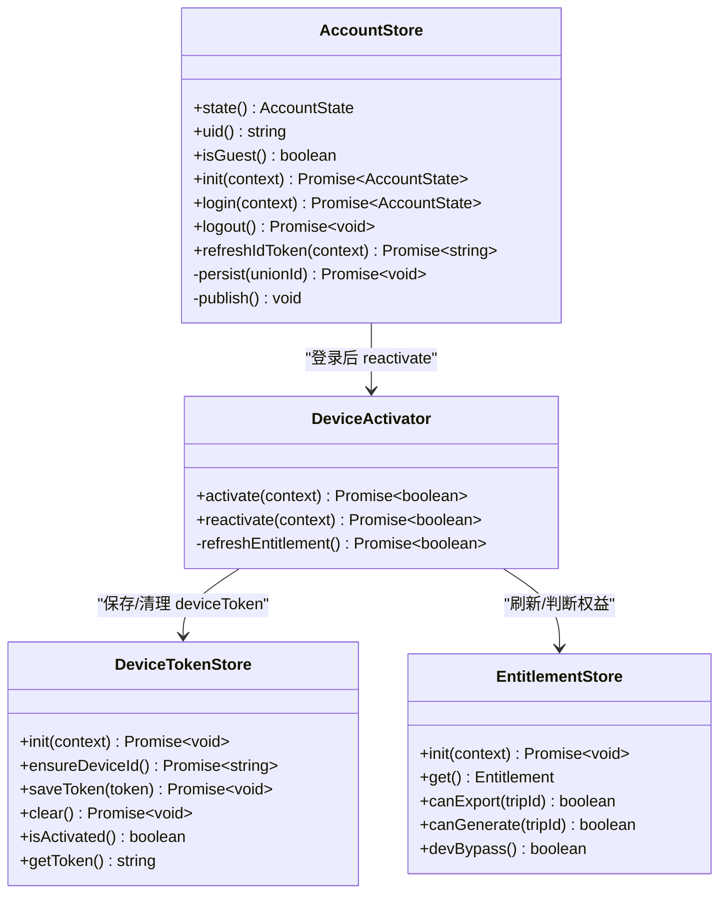
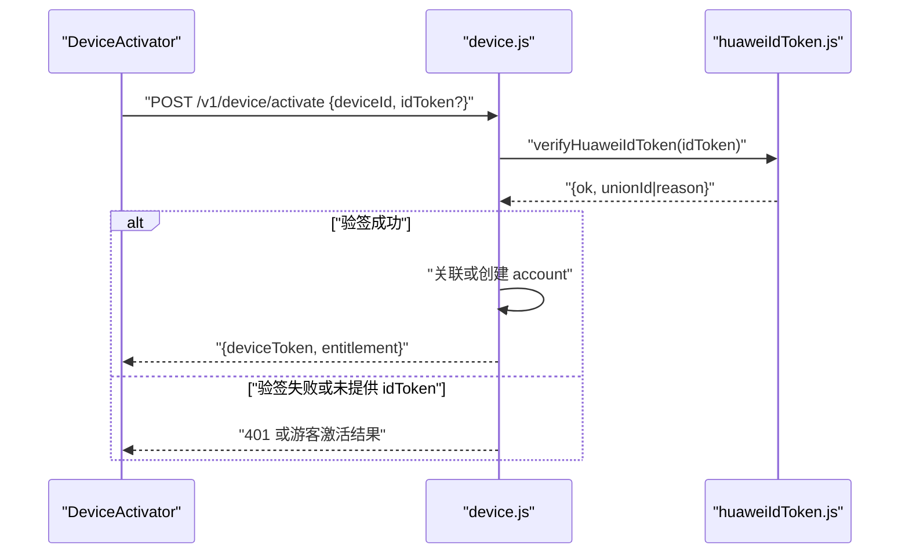
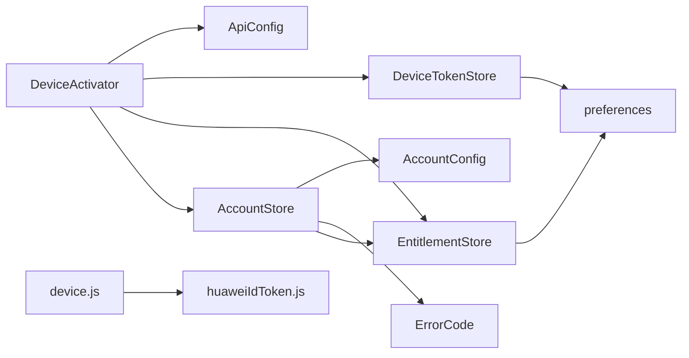

# Account Kit 账号登录

<cite>
**本文引用的文件**   
- [AccountConfig.ets](file://entry/src/main/ets/common/config/AccountConfig.ets)
- [ApiConfig.ets](file://entry/src/main/ets/common/config/ApiConfig.ets)
- [ErrorCode.ets](file://entry/src/main/ets/common/error/ErrorCode.ets)
- [Account.ets](file://entry/src/main/ets/model/Account.ets)
- [AccountStore.ets](file://entry/src/main/ets/data/AccountStore.ets)
- [LoginView.ets](file://entry/src/main/ets/pages/LoginView.ets)
- [DeviceActivator.ets](file://entry/src/main/ets/data/DeviceActivator.ets)
- [DeviceTokenStore.ets](file://entry/src/main/ets/data/DeviceTokenStore.ets)
- [EntitlementStore.ets](file://entry/src/main/ets/data/EntitlementStore.ets)
- [device.js](file://bff/src/routes/device.js)
- [huaweiIdToken.js](file://bff/src/services/huaweiIdToken.js)
</cite>

## 目录
1. [简介](#简介)
2. [项目结构](#项目结构)
3. [核心组件](#核心组件)
4. [架构总览](#架构总览)
5. [详细组件分析](#详细组件分析)
6. [依赖关系分析](#依赖关系分析)
7. [性能考虑](#性能考虑)
8. [故障排查指南](#故障排查指南)
9. [结论](#结论)
10. [附录：配置与安全清单](#附录配置与安全清单)

## 简介
本文面向有径应用与华为账号服务的集成实现，重点说明以下能力：
- UnionID 静默登录流程：从 HuaweiIDProvider 初始化到 LoginWithHuaweiIDRequest 配置、AuthenticationController.executeRequest 调用、UnionID 提取与会话状态管理。
- 设备激活流程：idToken 获取、BFF /v1/device/activate 接口调用、deviceToken 与 entitlement 存储、权限校验失败处理。
- 游客模式降级机制：无法获取 UnionID 时自动切换到本地游客分区、数据隔离策略、UID 生成规则。
- Token 生命周期管理：idToken 刷新策略、会话过期检测、多设备冲突处理。
- 错误处理方案：网络异常、用户拒绝授权、服务不可用时的降级逻辑。
- 安全考虑：敏感数据处理、idToken 不落盘、隐私合规要求。
- 配置指南：AccountKit 开关、开发环境 Mock 模式、生产环境证书与 BFF 配置。

该文档不直接粘贴源码，关键实现位置通过文件路径和行号标注。

## 项目结构
Account Kit 相关代码集中在端侧 entry 模块与后端 bff 模块中：
- 端侧配置层：AccountConfig、ApiConfig、ErrorCode。
- 端侧模型层：AccountState、AccountKind。
- 端侧账号与会话层：AccountStore（UnionID 登录态、idToken 内存持有）。
- 端侧 UI 入口：LoginView（冷启登录页、游客出口）。
- 端侧设备与权益层：DeviceActivator、DeviceTokenStore、EntitlementStore。
- 后端鉴权路由：device.js（/v1/device/activate）、huaweiIdToken.js（idToken 验签）。

**图表来源** 
- [LoginView.ets:1-237](file://entry/src/main/ets/pages/LoginView.ets#L1-L237)
- [AccountConfig.ets:1-29](file://entry/src/main/ets/common/config/AccountConfig.ets#L1-L29)
- [ApiConfig.ets:1-66](file://entry/src/main/ets/common/config/ApiConfig.ets#L1-L66)
- [ErrorCode.ets:1-48](file://entry/src/main/ets/common/error/ErrorCode.ets#L1-L48)
- [Account.ets:1-20](file://entry/src/main/ets/model/Account.ets#L1-L20)
- [AccountStore.ets:1-213](file://entry/src/main/ets/data/AccountStore.ets#L1-L213)
- [DeviceActivator.ets:1-159](file://entry/src/main/ets/data/DeviceActivator.ets#L1-L159)
- [DeviceTokenStore.ets:1-142](file://entry/src/main/ets/data/DeviceTokenStore.ets#L1-L142)
- [EntitlementStore.ets:1-235](file://entry/src/main/ets/data/EntitlementStore.ets#L1-L235)
- [device.js:1-84](file://bff/src/routes/device.js#L1-L84)
- [huaweiIdToken.js:1-161](file://bff/src/services/huaweiIdToken.js#L1-L161)

**章节来源**
- [AccountConfig.ets:1-29](file://entry/src/main/ets/common/config/AccountConfig.ets#L1-L29)
- [ApiConfig.ets:1-66](file://entry/src/main/ets/common/config/ApiConfig.ets#L1-L66)
- [ErrorCode.ets:1-48](file://entry/src/main/ets/common/error/ErrorCode.ets#L1-L48)
- [Account.ets:1-20](file://entry/src/main/ets/model/Account.ets#L1-L20)
- [AccountStore.ets:1-213](file://entry/src/main/ets/data/AccountStore.ets#L1-L213)
- [LoginView.ets:1-237](file://entry/src/main/ets/pages/LoginView.ets#L1-L237)
- [DeviceActivator.ets:1-159](file://entry/src/main/ets/data/DeviceActivator.ets#L1-L159)
- [DeviceTokenStore.ets:1-142](file://entry/src/main/ets/data/DeviceTokenStore.ets#L1-L142)
- [EntitlementStore.ets:1-235](file://entry/src/main/ets/data/EntitlementStore.ets#L1-L235)
- [device.js:1-84](file://bff/src/routes/device.js#L1-L84)
- [huaweiIdToken.js:1-161](file://bff/src/services/huaweiIdToken.js#L1-L161)

## 核心组件
- AccountConfig：集中定义 AccountKit 开关、偏好分片名、UnionID 持久化 Key、游客 UID。
- AccountStore：登录态单点，负责静默登录、idToken 内存持有、UID 恢复、登出、AppStorage 闸门广播。
- LoginView：冷启登录页，提供华为账号一键登录与「本机游客空间」降级入口。
- DeviceActivator：设备激活与权益刷新；当票据失效时触发重新激活。
- DeviceTokenStore：设备标识 deviceId 与设备票据 deviceToken 的持久化与清理。
- EntitlementStore：订阅、通行证、赠送额度的缓存、TTL 控制与门禁判定。
- BFF device.js：接收 deviceId/idToken，验签后签发 deviceToken 并返回 entitlement。
- BFF huaweiIdToken.js：基于 JWKS 对华为 idToken 进行本地验签，sub 即 unionId。

**章节来源**
- [AccountConfig.ets:1-29](file://entry/src/main/ets/common/config/AccountConfig.ets#L1-L29)
- [AccountStore.ets:1-213](file://entry/src/main/ets/data/AccountStore.ets#L1-L213)
- [LoginView.ets:1-237](file://entry/src/main/ets/pages/LoginView.ets#L1-L237)
- [DeviceActivator.ets:1-159](file://entry/src/main/ets/data/DeviceActivator.ets#L1-L159)
- [DeviceTokenStore.ets:1-142](file://entry/src/main/ets/data/DeviceTokenStore.ets#L1-L142)
- [EntitlementStore.ets:1-235](file://entry/src/main/ets/data/EntitlementStore.ets#L1-L235)
- [device.js:1-84](file://bff/src/routes/device.js#L1-L84)
- [huaweiIdToken.js:1-161](file://bff/src/services/huaweiIdToken.js#L1-L161)

## 架构总览
端到端主要包含两条链路：
1. 账号静默登录链路：UI → AccountStore.login → 华为账号服务 → UnionID 提取 → 持久化 → 设备激活。
2. 设备激活与权益链路：DeviceActivator → BFF /v1/device/activate → JWKS 验签 → 签发 deviceToken → 返回 entitlement → 本地缓存。

**图表来源**
- [LoginView.ets:1-237](file://entry/src/main/ets/pages/LoginView.ets#L1-L237)
- [AccountStore.ets:1-213](file://entry/src/main/ets/data/AccountStore.ets#L1-L213)
- [DeviceActivator.ets:1-159](file://entry/src/main/ets/data/DeviceActivator.ets#L1-L159)
- [device.js:1-84](file://bff/src/routes/device.js#L1-L84)
- [huaweiIdToken.js:1-161](file://bff/src/services/huaweiIdToken.js#L1-L161)

## 详细组件分析

### 组件一：UnionID 静默登录与会话管理
- HuaweiIDProvider 初始化：AccountStore 在 login() 与 refreshIdToken() 中分别创建 HuaweiIDProvider。
- LoginWithHuaweiIDRequest 配置：设置 forceLogin=false，确保不拉起账号界面。
- AuthenticationController.executeRequest 调用：封装于 AccountStore 内部，统一捕获异常并记录日志。
- UnionID 提取：从响应 data.unionID 取值；若为空则视为静默登录失败。
- 会话状态管理：
  - init() 从 preferences 恢复 unionID/loginAt，写入 current state 并广播 AUTH_STATE_KEY。
  - persist() 将 unionID 与 loginAt 落盘。
  - logout() 回到游客态，清空 lastIdToken 与偏好中的 unionID/loginAt。
  - uid()/isGuest()/state() 供 DAO 与其他模块读取当前分区。

**图表来源**
- [AccountStore.ets:1-213](file://entry/src/main/ets/data/AccountStore.ets#L1-L213)

**章节来源**
- [AccountStore.ets:1-213](file://entry/src/main/ets/data/AccountStore.ets#L1-L213)
- [AccountConfig.ets:1-29](file://entry/src/main/ets/common/config/AccountConfig.ets#L1-L29)
- [ErrorCode.ets:1-48](file://entry/src/main/ets/common/error/ErrorCode.ets#L1-L48)

### 组件二：设备激活流程与 BFF 对接
- idToken 获取：
  - 非游客态下调用 AccountStore.refreshIdToken(context)，不修改登录态，仅刷新内存中的 lastIdToken。
  - 若取不到 idToken，不降级为游客，直接放弃本次激活。
- BFF 调用：
  - POST /v1/device/activate，请求体包含 deviceId 与可选 idToken。
  - 成功后保存 deviceToken 与 entitlement。
- 权限校验失败处理：
  - HTTP 非 2xx 或字段缺失时记录警告并返回 false，不阻断主流程。
  - 权益刷新遇 401 时清除 deviceToken，等待下一次完整激活。
  - reactivate() 先清旧 token 再走 activate()。

**图表来源**
- [DeviceActivator.ets:1-159](file://entry/src/main/ets/data/DeviceActivator.ets#L1-L159)
- [DeviceTokenStore.ets:1-142](file://entry/src/main/ets/data/DeviceTokenStore.ets#L1-L142)
- [EntitlementStore.ets:1-235](file://entry/src/main/ets/data/EntitlementStore.ets#L1-L235)
- [ApiConfig.ets:1-66](file://entry/src/main/ets/common/config/ApiConfig.ets#L1-L66)

**章节来源**
- [DeviceActivator.ets:1-159](file://entry/src/main/ets/data/DeviceActivator.ets#L1-L159)
- [DeviceTokenStore.ets:1-142](file://entry/src/main/ets/data/DeviceTokenStore.ets#L1-L142)
- [EntitlementStore.ets:1-235](file://entry/src/main/ets/data/EntitlementStore.ets#L1-L235)
- [ApiConfig.ets:1-66](file://entry/src/main/ets/common/config/ApiConfig.ets#L1-L66)

### 组件三：游客模式降级与数据隔离
- 无法获取 UnionID 时：
  - AccountStore.login 捕获异常并退回游客态，uid 固定为 AccountConfig.GUEST_UID。
  - LoginView 提示“华为账号登录未完成”，并提供「暂不登录，使用本机游客空间」按钮。
- 数据隔离策略：
  - uid 作为 RDB 分区键，游客态与已登录态完全隔离。
  - 游客态不上传服务器，设备激活以匿名账户处理；BFF 对无 idToken 的请求按游客处理。
- UID 生成规则：
  - 游客态使用固定字符串 GUEST_UID。
  - 设备标识 deviceId 由 DeviceTokenStore.generateUuid() 生成类 UUID 字符串，首次持久化，之后不变。

**图表来源**
- [AccountStore.ets:1-213](file://entry/src/main/ets/data/AccountStore.ets#L1-L213)
- [AccountConfig.ets:1-29](file://entry/src/main/ets/common/config/AccountConfig.ets#L1-L29)
- [DeviceTokenStore.ets:1-142](file://entry/src/main/ets/data/DeviceTokenStore.ets#L1-L142)
- [device.js:1-84](file://bff/src/routes/device.js#L1-L84)

**章节来源**
- [AccountStore.ets:1-213](file://entry/src/main/ets/data/AccountStore.ets#L1-L213)
- [AccountConfig.ets:1-29](file://entry/src/main/ets/common/config/AccountConfig.ets#L1-L29)
- [DeviceTokenStore.ets:1-142](file://entry/src/main/ets/data/DeviceTokenStore.ets#L1-L142)
- [device.js:1-84](file://bff/src/routes/device.js#L1-L84)

### 组件四：Token 生命周期管理
- idToken 刷新策略：
  - refreshIdToken() 每次调用都会尝试静默取 idToken，但不会改变当前登录态或清理权益缓存。
  - 如果返回的 unionID 与当前分区不一致，会丢弃该 idToken，避免身份漂移。
- 会话过期检测：
  - AccountStore 不依赖 idToken 过期做会话判断；会话有效性由 BFF 的 deviceToken 与 entitlement 控制。
  - EntitlementStore 对 entitlement 设置 5 分钟 TTL；过期时不再硬拦截，而是带票去服务端判定。
- 多设备冲突处理：
  - BFF 在 activate 中对同一 unionId 的设备进行 UPDATE last_seen_at，避免并发 INSERT UNIQUE 冲突。
  - 设备票据失效（401/6001）时，DeviceActivator.reactivate() 清除旧 token 并重新激活。

**图表来源**
- [AccountStore.ets:1-213](file://entry/src/main/ets/data/AccountStore.ets#L1-L213)
- [DeviceActivator.ets:1-159](file://entry/src/main/ets/data/DeviceActivator.ets#L1-L159)
- [DeviceTokenStore.ets:1-142](file://entry/src/main/ets/data/DeviceTokenStore.ets#L1-L142)
- [EntitlementStore.ets:1-235](file://entry/src/main/ets/data/EntitlementStore.ets#L1-L235)

**章节来源**
- [AccountStore.ets:1-213](file://entry/src/main/ets/data/AccountStore.ets#L1-L213)
- [DeviceActivator.ets:1-159](file://entry/src/main/ets/data/DeviceActivator.ets#L1-L159)
- [DeviceTokenStore..ts:1-142](file://entry/src/main/ets/data/DeviceTokenStore.ets#L1-L142)
- [EntitlementStore.ets:1-235](file://entry/src/main/ets/data/EntitlementStore.ets#L1-L235)
- [device.js:1-84](file://bff/src/routes/device.js#L1-L84)

### 组件五：BFF 端 idToken 验签与设备激活
- verifyHuaweiIdToken：
  - 从环境变量读取 HUAWEI_CLIENT_ID、HUAWEI_ISSUER、HUAWEI_JWKS_URL。
  - 解析 JWT header/payload，限制算法为 RS256/PS256，强制检查 kid、iss、aud、exp、sub。
  - 通过 JWKS 公钥完成签名验证；sub 作为 unionId 返回。
- /v1/device/activate：
  - 校验 deviceId 长度与类型，忽略客户端自报 unionId，只信任验签后的 unionId。
  - 已登录用户按 unionId 关联 account；游客按 anon-* 分配匿名账户。
  - 签发 deviceToken 并返回 entitlement。

**图表来源**
- [device.js:1-84](file://bff/src/routes/device.js#L1-L84)
- [huaweiIdToken.js:1-161](file://bff/src/services/huaweiIdToken.js#L1-L161)

**章节来源**
- [device.js:1-84](file://bff/src/routes/device.js#L1-L84)
- [huaweiIdToken.js:1-161](file://bff/src/services/huaweiIdToken.js#L1-L161)

## 依赖关系分析
- AccountStore 依赖 AccountConfig、AccountState、preferences、@kit.AccountKit.authentication、Logger、AppError、ErrorCode、EntitlementStore。
- DeviceActivator 依赖 ApiConfig、DeviceTokenStore、EntitlementStore、AccountStore、Logger、@kit.NetworkKit.http。
- DeviceTokenStore 依赖 preferences、Logger。
- EntitlementStore 依赖 preferences、Logger、ApiConfig、AccountStore、DeviceTokenStore。
- BFF device.js 依赖 express Router、auth middleware、quota service、huaweiIdToken service。
- BFF huaweiIdToken.js 依赖 Node crypto、process.env。

**图表来源**
- [AccountStore.ets:1-213](file://entry/src/main/ets/data/AccountStore.ets#L1-L213)
- [DeviceActivator.ets:1-159](file://entry/src/main/ets/data/DeviceActivator.ets#L1-L159)
- [DeviceTokenStore.ets:1-142](file://entry/src/main/ets/data/DeviceTokenStore.ets#L1-L142)
- [EntitlementStore.ets:1-235](file://entry/src/main/ets/data/EntitlementStore.ets#L1-L235)
- [device.js:1-84](file://bff/src/routes/device.js#L1-L84)
- [huaweiIdToken.js:1-161](file://bff/src/services/huaweiIdToken.js#L1-L161)

**章节来源**
- [AccountStore.ets:1-213](file://entry/src/main/ets/data/AccountStore.ets#L1-L213)
- [DeviceActivator.ets:1-159](file://entry/src/main/ets/data/DeviceActivator.ets#L1-L159)
- [DeviceTokenStore.ets:1-142](file://entry/src/main/ets/data/DeviceTokenStore.ets#L1-L142)
- [EntitlementStore.ets:1-235](file://entry/src/main/ets/data/EntitlementStore.ets#L1-L235)
- [device.js:1-84](file://bff/src/routes/device.js#L1-L84)
- [huaweiIdToken.js:1-161](file://bff/src/services/huaweiIdToken.js#L1-L161)

## 性能考虑
- 登录态恢复与发布：AccountStore.init() 同步恢复偏好值，并通过 AppStorage.publish() 通知 UI，避免冷启闪烁。
- 权益缓存 TTL：EntitlementStore 使用 5 分钟 TTL，减少频繁 BFF 调用；过期时仍允许带票继续尝试。
- 重复激活保护：DeviceActivator.activating 标志防止并发重复激活。
- 网络连接超时：ApiConfig.CONNECT_TIMEOUT_MS 与 READ_TIMEOUT_MS 用于网络请求限流。
- 日志脱敏：AccountStore.masked()、DeviceTokenStore.maskedId()/maskedToken() 避免完整标识落 hilog。

[本节为通用性能建议，不直接分析具体文件]

## 故障排查指南
- 网络异常：
  - DeviceActivator 记录 HTTP 状态码与响应前 160 字符；连接/读超时由 ApiConfig 控制。
  - 可检查 ApiConfig.BFF_BASE_URL、CONNECT_TIMEOUT_MS、READ_TIMEOUT_MS。
- 用户拒绝授权：
  - AccountStore.login 捕获异常后退回游客态，LoginView 显示提示信息并提供「本机游客空间」。
  - 可引导用户重试或选择游客模式。
- 服务不可用：
  - AccountKit 未启用（ACCOUNT_KIT_ENABLED=false）直接走游客分区。
  - BFF 未配置（BFF_BASE_URL 为空）跳过设备激活，走 Mock 模式。
- 票据失效：
  - 权益刷新返回 401 时 DeviceActivator 清除 deviceToken，下次请求触发 reactivate()。
  - BFF 返回 6001 等云端错误码时，应触发重新激活。
- 登录态读写失败：
  - AccountStore.init() 抛出 ACCOUNT_PREFERENCES_FAILED；需检查偏好分区名称与权限。

**章节来源**
- [ApiConfig.ets:1-66](file://entry/src/main/ets/common/config/ApiConfig.ets#L1-L66)
- [AccountStore.ets:1-213](file://entry/src/main/ets/data/AccountStore.ets#L1-L213)
- [LoginView.ets:1-237](file://entry/src/main/ets/pages/LoginView.ets#L1-L237)
- [DeviceActivator.ets:1-159](file://entry/src/main/ets/data/DeviceActivator.ets#L1-L159)
- [ErrorCode.ets:1-48](file://entry/src/main/ets/common/error/ErrorCode.ets#L1-L48)

## 结论
本仓库采用端侧 UnionID 静默登录与 BFF 设备激活的组合方案：
- 端侧通过 AccountKit 获取 UnionID 并维护游客/已登录分区，所有行程数据默认本地隔离。
- BFF 通过 JWKS 验签华为 idToken，签发 deviceToken 并下发 entitlement，形成商业化门禁。
- 多组件协作保证登录失败、网络异常、票据失效时均有明确降级路径，主流程不被阻断。
- 敏感信息最小化：UnionID 落盘但不传手机号/邮箱；idToken 仅内存持有，不落盘；日志脱敏。

[本节为总结性内容，不直接分析具体文件]

## 附录：配置与安全清单

### 配置指南
- AccountKit 开关：
  - AccountConfig.ACCOUNT_KIT_ENABLED=true 启用真实静默登录；false 直接走游客分区。
  - PREFERENCES_NAME、KEY_UNION_ID、KEY_LOGIN_AT 定义偏好分片与键名。
  - GUEST_UID 为游客分区标识。
- 开发环境 Mock 模式：
  - ApiConfig.BFF_BASE_URL 为空时跳过设备激活；DEV_SKIP_BFF=true 放开权益门禁与 LLM Mock。
  - 仓库默认 BFF_BASE_URL 指向本地测试地址，DEV_SKIP_BFF=true 便于联调。
- 生产环境证书配置：
  - AGC 侧 APP ID 与 Client ID 一致，调试签名 SHA256 指纹需登记；Profile 的 appIdentifier 必须等于 APP ID。
  - BFF 部署需设置 HUAWEI_CLIENT_ID、可选 HUAWEI_ISSUER、HUAWEI_JWKS_URL。

**章节来源**
- [AccountConfig.ets:1-29](file://entry/src/main/ets/common/config/AccountConfig.ets#L1-L29)
- [ApiConfig.ets:1-66](file://entry/src/main/ets/common/config/ApiConfig.ets#L1-L66)
- [huaweiIdToken.js:1-161](file://bff/src/services/huaweiIdToken.js#L1-L161)

### 安全考虑
- 敏感数据处理：
  - AccountStore 只持久化 UnionID，不落手机号/邮箱；日志使用 masked() 脱敏。
  - idToken 仅在内存 lastIdToken 持有，不写入偏好或文件。
- 隐私合规：
  - 产品定位强调“行程数据默认只保存在本机，不上传服务器”。
  - 登录行为需要明示同意；未勾选时禁用登录入口。
- Token 安全：
  - BFF 仅信任验签通过的 idToken，忽略客户端自报 unionId。
  - JWKS 支持 RS256/PS256，严格校验 iss、aud、exp、kid、sub。

**章节来源**
- [AccountStore.ets:1-213](file://entry/src/main/ets/data/AccountStore.ets#L1-L213)
- [LoginView.ets:1-237](file://entry/src/main/ets/pages/LoginView.ets#L1-L237)
- [device.js:1-84](file://bff/src/routes/device.js#L1-L84)
- [huaweiIdToken.js:1-161](file://bff/src/services/huaweiIdToken.js#L1-L161)