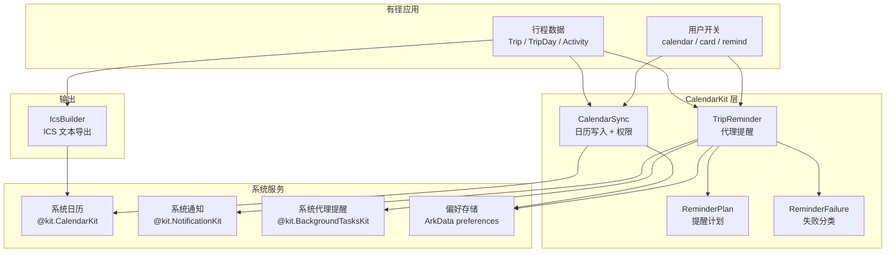
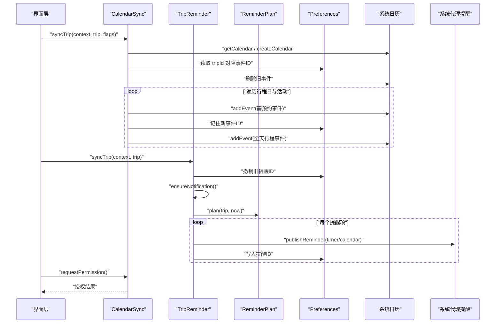
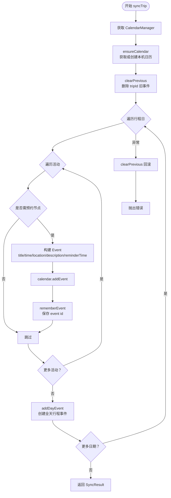
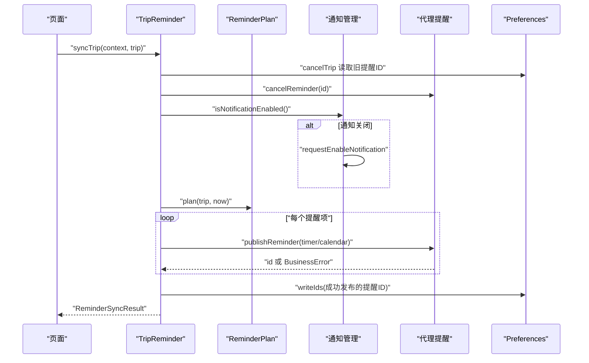
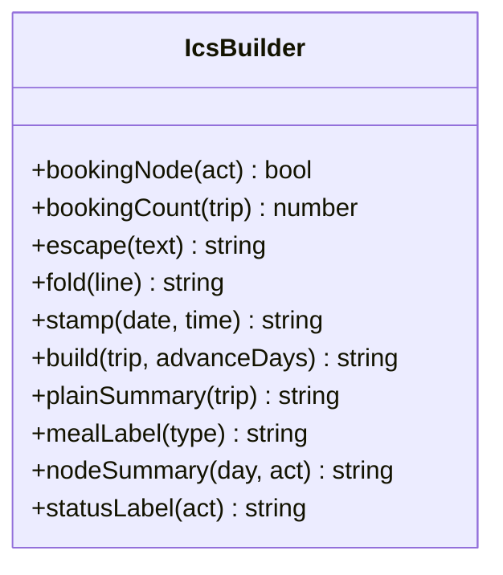
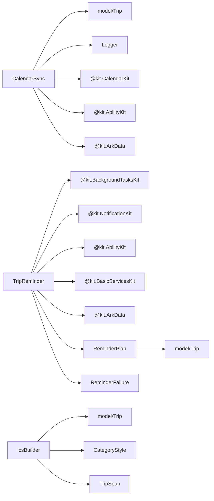

# Calendar Kit 日程同步

<cite>
**本文引用的文件 **
- [CalendarSync.ets](file://entry/src/main/ets/data/CalendarSync.ets)
- [IcsBuilder.ets](file://entry/src/main/ets/utils/IcsBuilder.ets)
- [TripReminder.ets](file://entry/src/main/ets/data/TripReminder.ets)
- [ReminderPlan.ets](file://entry/src/main/ets/utils/ReminderPlan.ets)
- [ReminderFailure.ets](file://entry/src/main/ets/utils/ReminderFailure.ets)
</cite>

## 目录
1. [引言](#引言)
2. [项目结构](#项目结构)
3. [核心组件](#核心组件)
4. [架构总览](#架构总览)
5. [详细组件分析](#详细组件分析)
6. [依赖关系分析](#依赖关系分析)
7. [性能与一致性](#性能与一致性)
8. [故障排查指南](#故障排查指南)
9. [配置指南](#配置指南)
10. [结论](#结论)

## 引言
Calendar Kit 日程同步是有径应用在系统日历、系统提醒与本地行程数据之间建立的一致性通道。它承担三类职责：
- 将「需预约」节点写入系统日历，并为每日生成全天行程摘要；
- 通过系统代理提醒在关键时间点触发通知；
- 以 ICS 文本导出行程，供外部日历导入或分享。

其设计目标是幂等、可回滚、可观测：每次写入前清理本应用此前创建的事件 ID，使用 preferences 分片持久化映射；权限拒绝时不写任何数据；异常时回滚已写入事件；提醒与日历是两条独立通路，避免互相污染。

## 项目结构
Calendar Kit 相关代码集中在 entry 模块的 data 与 utils 两个包中：
- `data/CalendarSync.ets`：系统日历写入、权限申请、事件 ID 映射与开关持久化；
- `data/TripReminder.ets`：系统代理提醒发布、撤销、通知开关检查与失败分类；
- `utils/ReminderPlan.ets`：纯函数式提醒计划（出发前、晨间播报、预约提前）；
- `utils/ReminderFailure.ets`：代理提醒错误码到业务语义的分类器；
- `utils/IcsBuilder.ets`：RFC 5545 兼容的 ICS 文本生成器。

**图表来源**
- [CalendarSync.ets:1-259](file://entry/src/main/ets/data/CalendarSync.ets#L1-L259)
- [TripReminder.ets:1-273](file://entry/src/main/ets/data/TripReminder.ets#L1-L273)
- [ReminderPlan.ets:1-120](file://entry/src/main/ets/utils/ReminderPlan.ets#L1-L120)
- [ReminderFailure.ets:1-32](file://entry/src/main/ets/utils/ReminderFailure.ets#L1-L32)
- [IcsBuilder.ets:1-255](file://entry/src/main/ets/utils/IcsBuilder.ets#L1-L255)

**章节来源**
- [CalendarSync.ets:1-259](file://entry/src/main/ets/data/CalendarSync.ets#L1-L259)
- [TripReminder.ets:1-273](file://entry/src/main/ets/data/TripReminder.ets#L1-L273)
- [IcsBuilder.ets:1-255](file://entry/src/main/ets/utils/IcsBuilder.ets#L1-L255)

## 核心组件
- `CalendarSync`：负责日历账户管理、事件创建、旧事件清理、事件 ID 持久化、权限申请与三态开关（日历、卡片、提醒）。
- `TripReminder`：负责撤销上一批提醒、生成提醒计划、发布定时/日历提醒、处理通知开关与能力管控失败。
- `ReminderPlan`：纯函数提醒计划，计算出发前、晨间播报、预约提前的触发时间，只产出未来窗口。
- `ReminderFailure`：根据错误码和现有提醒数量判断“能力未开通”还是“数量超限”。
- `IcsBuilder`：按 RFC 5545 生成 VCALENDAR、VEVENT、VALARM 与折行转义，同时提供纯文本摘要与状态标签。

**章节来源**
- [CalendarSync.ets:1-259](file://entry/src/main/ets/data/CalendarSync.ets#L1-L259)
- [TripReminder.ets:1-273](file://entry/src/main/ets/data/TripReminder.ets#L1-L273)
- [ReminderPlan.ets:1-120](file://entry/src/main/ets/utils/ReminderPlan.ets#L1-L120)
- [ReminderFailure.ets:1-32](file://entry/src/main/ets/utils/ReminderFailure.ets#L1-L32)
- [IcsBuilder.ets:1-255](file://entry/src/main/ets/utils/IcsBuilder.ets#L1-L255)

## 架构总览
Calendar Kit 的整体调用路径分为三条：
1. 日历写入：页面收集 trip 与 flags → 请求权限 → 确保本机日历 → 删除旧事件 → 逐活动创建需预约事件 → 为每一天创建全天行程事件 → 记录事件 ID。
2. 提醒发布：页面发起 sync → 撤销旧提醒 → 检查通知开关 → 用 ReminderPlan 生成提醒项 → 逐个 publish → 保存 reminderId。
3. ICS 导出：直接由 IcsBuilder 基于 Trip 生成 RFC 5545 文本，不经过系统服务。

**图表来源**
- [CalendarSync.ets:43-188](file://entry/src/main/ets/data/CalendarSync.ets#L43-L188)
- [TripReminder.ets:67-151](file://entry/src/main/ets/data/TripReminder.ets#L67-L151)
- [ReminderPlan.ets:43-120](file://entry/src/main/ets/utils/ReminderPlan.ets#L43-L120)

## 详细组件分析

### 日历写入流程与幂等性
`CalendarSync.syncTrip` 是唯一受控写入入口。其核心步骤如下：
1. 获取 `CalendarManager`；
2. 通过 `ensureCalendar` 获取或创建本地日历账户 `com.youjing.app`；
3. 通过 `clearPrevious` 删除该 tripId 之前在本机创建的所有事件；
4. 遍历每一天的活动，筛选出“需预约”节点；
5. 构造 `calendarManager.Event`，包含标题、起止时间、地点、描述与可选提醒提前量；
6. 调用 `calendar.addEvent` 并记录返回的 event id；
7. 为每一天追加一条全天行程事件，首末站信息放入 description；
8. 如果循环内发生异常，再次调用 `clearPrevious` 做回滚，再抛出错误。

幂等性依赖 `youjing_access` 分片中的 `cal_events_{tripId}`：
- `readEvents` 从 JSON 字符串恢复数字数组；
- `rememberEvent` 追加新 id；
- `writeEvents` 序列化并 flush；
- `clearPrevious` 先读后删，最后清空列表，防止残留脏 id。

权限方面，`requestPermission` 使用 `abilityAccessCtrl` 请求 `READ_CALENDAR` 与 `WRITE_CALENDAR`，任一权限失败都返回 false，调用方不得写入。

**图表来源**
- [CalendarSync.ets:43-188](file://entry/src/main/ets/data/CalendarSync.ets#L43-L188)

**章节来源**
- [CalendarSync.ets:1-188](file://entry/src/main/ets/data/CalendarSync.ets#L1-L188)

### 事件幂等性、增量更新与冲突解决
- **幂等键**：tripId 作为 preferences 分片 key 的前缀，不同行程互不影响。
- **增量更新策略**：每次同步前先删除旧事件，再重新创建新事件。这不是严格意义上的增量 diff，而是“先清后写”的重放模式，保证最终状态与本应用当前 trip 一致。
- **冲突解决机制**：
  - 对系统日历中非本应用创建的事件：不会删除，因为只按 stored event id 删除；
  - 对同一 tripId 多次同步：旧 id 被清空并重建，避免重复事件堆积；
  - 对异常场景：try/catch 捕获后再次清理，确保不留下半写状态。

需要注意：当前实现没有显式比较系统日历已有事件与本地 trip 的差异，因此“增量”体现在“只重建本应用拥有的事件”，而不是“仅修改变更字段”。

**章节来源**
- [CalendarSync.ets:105-188](file://entry/src/main/ets/data/CalendarSync.ets#L105-L188)
- [CalendarSync.ets:201-259](file://entry/src/main/ets/data/CalendarSync.ets#L201-L259)

### 提醒系统实现
提醒系统与日历写入是两条独立通路：
- `TripReminder.syncTrip` 先撤销旧提醒，再检查通知开关，再用 `ReminderPlan.plan` 生成提醒项，逐个 publish，并写入 reminderId。
- 三类提醒：
  1. 出发前 TIMER：出发前一天 20:00；
  2. 预约提前 CALENDAR：游玩日 09:00 往前推 `advanceDays` 天；
  3. 当日晨间播报 CALENDAR：每天 07:30，报告首末站。

`advanceDays` 的计算规则：
- `ReminderPlan.advanceOf` 取 `Activity.advanceDays`，兜底为 1；
- `CalendarSync` 中日历提醒也采用相同规则：若 `act.advanceDays > 0` 则使用该值，否则默认 1 天；
- 分钟数换算为 `advanceDays × 1440`，作为 `reminderTime` 传入系统日历。

通知开关通过 `notificationManager.isNotificationEnabled` 与 `requestEnableNotification` 处理；若不可用，返回 false，页面据此告知用户。

**图表来源**
- [TripReminder.ets:67-151](file://entry/src/main/ets/data/TripReminder.ets#L67-L151)
- [ReminderPlan.ets:43-120](file://entry/src/main/ets/utils/ReminderPlan.ets#L43-L120)

**章节来源**
- [TripReminder.ets:1-151](file://entry/src/main/ets/data/TripReminder.ets#L1-L151)
- [ReminderPlan.ets:1-120](file://entry/src/main/ets/utils/ReminderPlan.ets#L1-L120)

### ICS 文件生成
`IcsBuilder` 是纯函数工具类，不依赖 `@kit`，可用于离线断言与分享导出。主要特性：
- 使用 CRLF 行结束符；
- UTF-8 字节长度超过 74 字节时按 RFC 5545 折行，续行以空格开头；
- 对 `\`、`;`、`,`、`\n` 进行转义；
- 时间使用本地浮动时间格式，不强制 UTC，符合“09:00 出发”的本地语义；
- 每个活动生成一个 VEVENT；
- 需预约节点额外挂 VALARM，提前 `advanceDays` 天；
- 餐次不进入 .ics，因为 Meal 没有时刻字段，避免伪造 DTSTART；
- 同时提供 `plainSummary` 与 `nodeSummary`，用于分享面板与详情面板。

**图表来源**
- [IcsBuilder.ets:1-255](file://entry/src/main/ets/utils/IcsBuilder.ets#L1-L255)

**章节来源**
- [IcsBuilder.ets:1-255](file://entry/src/main/ets/utils/IcsBuilder.ets#L1-L255)

### 权限管理机制
日历权限由 `CalendarSync.requestPermission` 统一申请：
- 使用 `abilityAccessCtrl.createAtManager()`；
- 请求 `ohos.permission.READ_CALENDAR` 与 `ohos.permission.WRITE_CALENDAR`；
- 只要任一权限码不为 0，就视为拒绝；
- 异常路径返回 false，避免静默成功。

提醒侧不直接申请日历权限，而是检查通知开关并通过 `notificationManager.requestEnableNotification` 引导用户开启；同时通过 `ReminderFailure.classify` 区分“能力未开通”与“数量超限”。

**章节来源**
- [CalendarSync.ets:214-237](file://entry/src/main/ets/data/CalendarSync.ets#L214-L237)
- [TripReminder.ets:221-273](file://entry/src/main/ets/data/TripReminder.ets#L221-L273)
- [ReminderFailure.ets:1-32](file://entry/src/main/ets/utils/ReminderFailure.ets#L1-L32)

### 错误处理与回滚逻辑
- 日历写入失败：`syncTrip` 的 try/catch 会调用 `clearPrevious` 删除已写入事件，再抛出错误；
- 删除旧事件失败：`clearPrevious` 中对单个 `deleteEvent` 捕获异常并记录 warn，不中断整体清理；
- 权限申请异常：`requestPermission` 捕获异常返回 false；
- 提醒发布失败：`TripReminder.publish` 捕获 `BusinessError`，通过 `ReminderFailure.classify` 分类为能力未开通、数量超限或其他错误；
- 通知开关不可用：`ensureNotification` 捕获异常并返回 false；
- 探针清理提醒：`clearAllForProbe` 用于调试，正常用户路径不调用。

**章节来源**
- [CalendarSync.ets:75-121](file://entry/src/main/ets/data/CalendarSync.ets#L75-L121)
- [CalendarSync.ets:148-188](file://entry/src/main/ets/data/CalendarSync.ets#L148-L188)
- [TripReminder.ets:67-151](file://entry/src/main/ets/data/TripReminder.ets#L67-L151)
- [TripReminder.ets:201-273](file://entry/src/main/ets/data/TripReminder.ets#L201-L273)
- [ReminderFailure.ets:1-32](file://entry/src/main/ets/utils/ReminderFailure.ets#L1-L32)

## 依赖关系分析
CalendarKit 各组件之间的耦合如下：
- `CalendarSync` 依赖 `@kit.CalendarKit`、`@kit.AbilityKit`、`@kit.ArkData`、`model/Trip`、`common/logger/Logger`；
- `TripReminder` 依赖 `@kit.BackgroundTasksKit`、`@kit.NotificationKit`、`@kit.AbilityKit`、`@kit.BasicServicesKit`、`@kit.ArkData`、`model/Trip`、`utils/ReminderPlan`、`utils/ReminderFailure`、`common/logger/Logger`；
- `ReminderPlan` 仅依赖 `model/Trip`，无系统库耦合，适合单元测试；
- `ReminderFailure` 仅依赖枚举与数值，完全纯函数；
- `IcsBuilder` 依赖 `model/Trip`、`utils/CategoryStyle`、`utils/TripSpan`，但不依赖运行时系统服务。

**图表来源**
- [CalendarSync.ets:1-259](file://entry/src/main/ets/data/CalendarSync.ets#L1-L259)
- [TripReminder.ets:1-273](file://entry/src/main/ets/data/TripReminder.ets#L1-L273)
- [ReminderPlan.ets:1-120](file://entry/src/main/ets/utils/ReminderPlan.ets#L1-L120)
- [IcsBuilder.ets:1-255](file://entry/src/main/ets/utils/IcsBuilder.ets#L1-L255)

**章节来源**
- [CalendarSync.ets:1-259](file://entry/src/main/ets/data/CalendarSync.ets#L1-L259)
- [TripReminder.ets:1-273](file://entry/src/main/ets/data/TripReminder.ets#L1-L273)
- [ReminderPlan.ets:1-120](file://entry/src/main/ets/utils/ReminderPlan.ets#L1-L120)
- [IcsBuilder.ets:1-255](file://entry/src/main/ets/utils/IcsBuilder.ets#L1-L255)

## 性能与一致性
- **时间复杂度**：
  - 日历写入与 ICS 生成都按 `Σ activities per day` 线性扫描；
  - 旧事件清理与提醒撤销也是线性遍历 stored ids；
- **空间复杂度**：
  - preferences 中每个 tripId 对应一个 JSON 字符串数组，空间与事件/提醒数量线性增长；
- **性能优化机会**：
  - 当前是“先清后写”，不是 diff 更新；当行程很长、事件很多时，频繁删除重建会增加系统日历开销；
  - 可考虑在内存中缓存 tripId→eventIds 映射，减少 JSON 解析次数；
  - 批量删除系统事件时，可在单条失败时继续尝试其他事件，当前实现已经如此；
  - ICS 折行按字符逐点计算 UTF-8 字节长度，对小文本开销低，但对超大行程可考虑预分配缓冲。

- **一致性边界**：
  - 本地事件与系统日历通过 event id 映射对齐；
  - 删除操作先读 id 列表再逐一 cancel/delete，最后清空列表；
  - 时间冲突检测未显式实现：应用层需要保证 trip 本身不产生重叠时间段；
  - 删除同步：当前只删除本应用创建的事件，不会误删用户自建日程。

[本节为通用性能讨论，不直接分析具体代码行]

## 故障排查指南
常见故障与定位方式：

| 现象 | 可能原因 | 排查建议 |
|---|---|---|
| 日历中没有事件 | 权限被拒绝 | 检查 `CalendarSync.requestPermission` 返回值；确认 `READ_CALENDAR` 与 `WRITE_CALENDAR` 均授权 |
| 写入中途失败但仍有残留事件 | 异常发生在部分事件写入之后 | 查看日志中 `日历写入中途失败`，确认 `clearPrevious` 是否执行；检查 preferences 中 `cal_events_{tripId}` |
| 提醒不响 | 通知开关关闭或 AGC 能力未开通 | 查看 `TripReminder.ensureNotification` 与 `ReminderFailure.classify`；检查 `blockedByCapability` |
| 提醒报 1700002 | 设备限制或能力未开通 | 区分 existingCount：0 条时报 1700002 通常为能力未开通 |
| ICS 导入后时间错乱 | 客户端把浮动时间解释为 UTC | 确认导入端支持本地浮动时间；必要时在消费方加时区转换 |
| 分享文本缺少餐次或住宿 | 分享文本与 .ics 口径不同 | 餐次只进 plainSummary，不进 .ics；住宿在分享文本中拼接 |

**章节来源**
- [CalendarSync.ets:75-121](file://entry/src/main/ets/data/CalendarSync.ets#L75-L121)
- [CalendarSync.ets:214-237](file://entry/src/main/ets/data/CalendarSync.ets#L214-L237)
- [TripReminder.ets:67-151](file://entry/src/main/ets/data/TripReminder.ets#L67-L151)
- [TripReminder.ets:221-273](file://entry/src/main/ets/data/TripReminder.ets#L221-L273)
- [IcsBuilder.ets:187-255](file://entry/src/main/ets/utils/IcsBuilder.ets#L187-L255)

## 配置指南
- **日历账户配置**：
  - 账户名称：`com.youjing.app`；
  - 类型：本地日历；
  - 显示名称：`有径行程`；
  - 若不存在则自动创建。
- **提醒默认值**：
  - 出发前：出发前一天 20:00；
  - 预约提前：`Activity.advanceDays`，缺省为 1 天；
  - 晨间播报：每天 07:30；
  - 日历提醒时间：`advanceDays × 1440` 分钟。
- **调试日志输出**：
  - 所有关键路径均通过 `Logger.info`、`Logger.warn`、`Logger.error` 输出；
  - 日志包含 tripId、事件数量、失败原因、权限结果、提醒计数；
  - 提醒探针可通过 `TripReminder.publishProbe` 在 debug 环境下验证锁屏提醒。
- **偏好分片**：
  - 日历事件映射：`youjing_access`，key 前缀 `cal_events_`；
  - 提醒映射：`youjing_reminder`，key 前缀 `reminder_ids_`；
  - 用户开关：`flag_calendar`、`flag_card`、`flag_remind`。

**章节来源**
- [CalendarSync.ets:1-259](file://entry/src/main/ets/data/CalendarSync.ets#L1-L259)
- [TripReminder.ets:1-273](file://entry/src/main/ets/data/TripReminder.ets#L1-L273)
- [ReminderPlan.ets:1-120](file://entry/src/main/ets/utils/ReminderPlan.ets#L1-L120)

## 结论
Calendar Kit 在 has-jing 应用中实现了“本地行程 → 系统日历 + 系统提醒 + ICS 导出”的完整闭环。其关键设计在于：
- 以 tripId 为幂等键，preferences 分片维护事件与提醒映射；
- 写入前清理旧事件，异常时回滚，避免脏数据；
- 权限拒绝与通知开关关闭时不写数据；
- 提醒与日历解耦，分别对接系统代理提醒与系统日历；
- ICS 生成遵循 RFC 5545，便于外部日历导入。

在实际使用中，应优先关注权限状态、AGC 代理提醒能力开通情况、以及 trip 自身时间冲突问题。对于大规模行程，后续可考虑引入 diff 更新以减少系统日历重建开销。