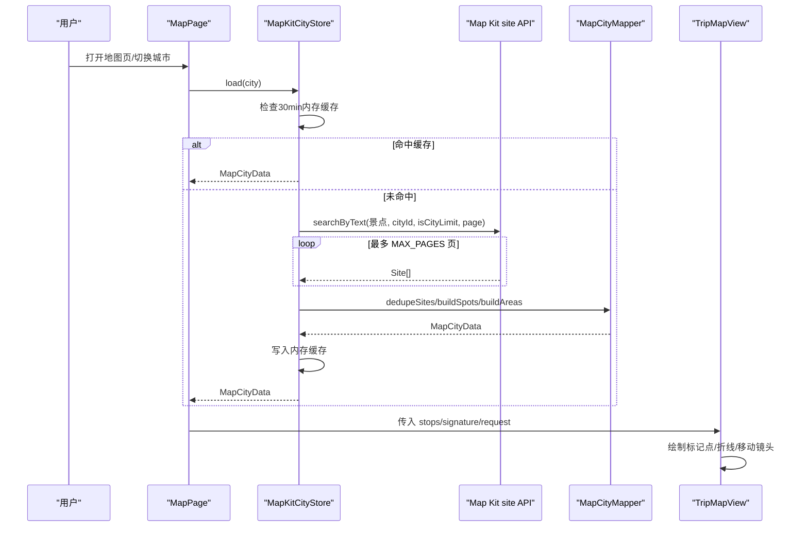
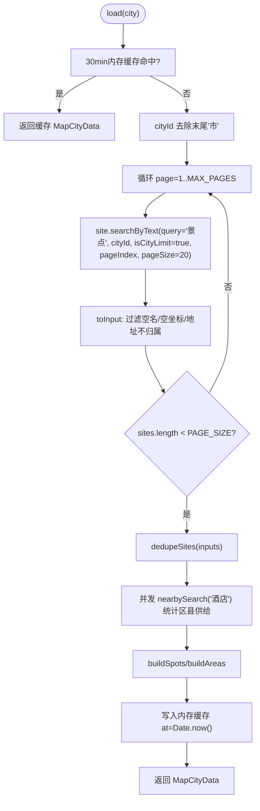
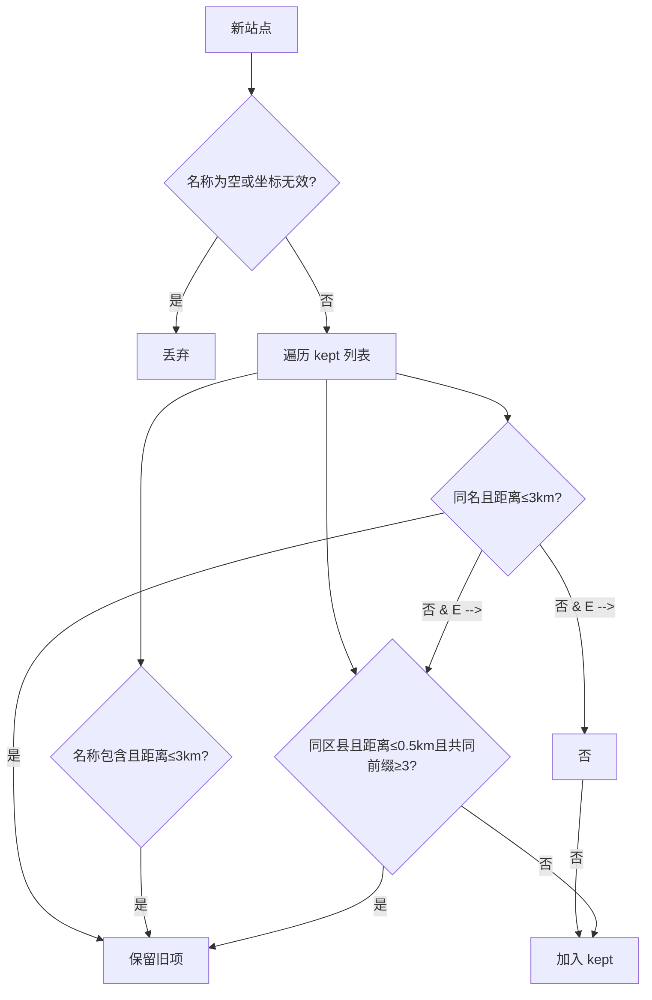
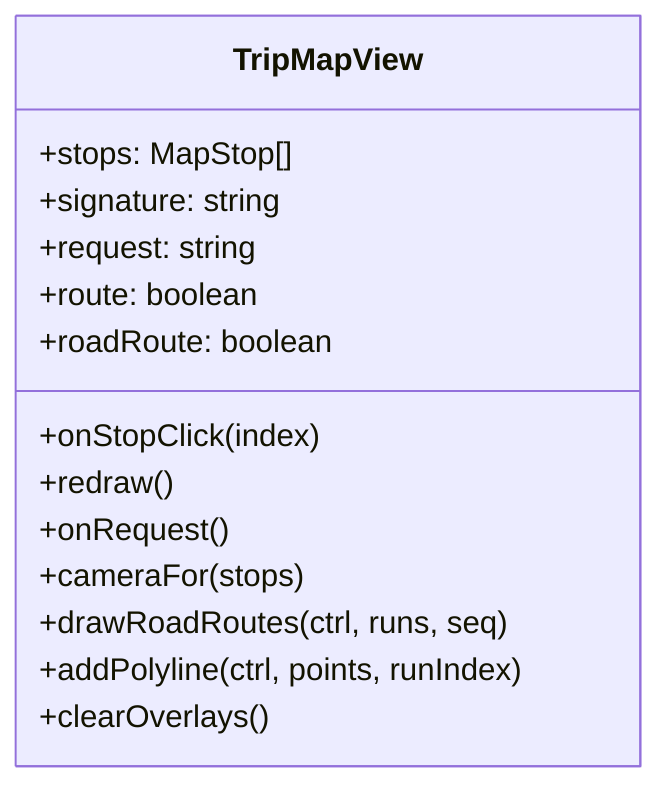
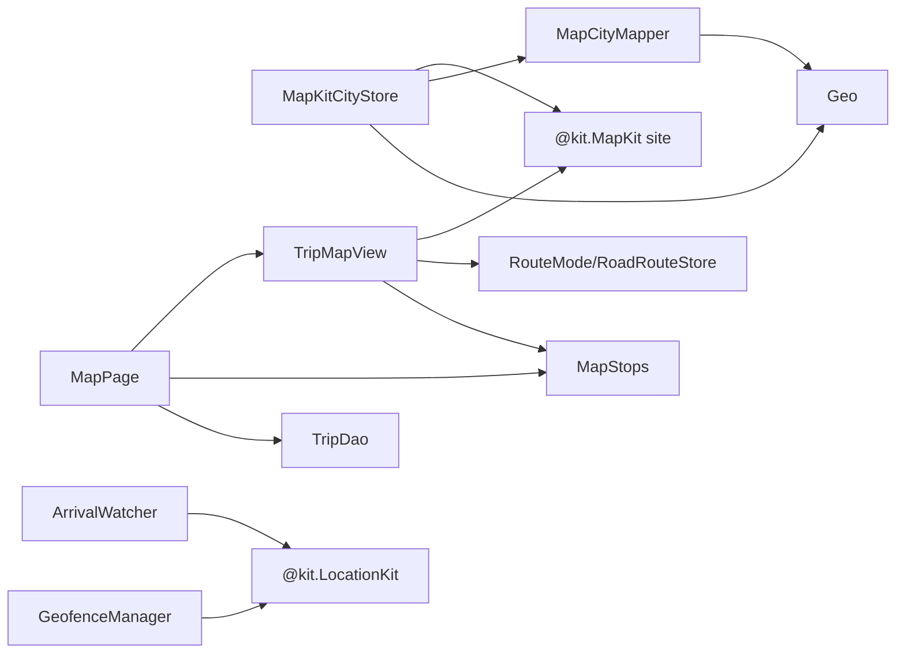

# Map Kit 地图服务

<cite>
**本文引用的文件 **
- [MapKit地点检索探针-2026-10-31.md](file://Docs/MapKit地点检索探针-2026-10-31.md)
- [MapKitCityStore.ets](file://entry/src/main/ets/data/MapKitCityStore.ets)
- [MapCityMapper.ets](file://entry/src/main/ets/utils/MapCityMapper.ets)
- [TripMapView.ets](file://entry/src/main/ets/components/TripMapView.ets)
- [MapPage.ets](file://entry/src/main/ets/pages/MapPage.ets)
- [Geo.ets](file://entry/src/main/ets/utils/Geo.ets)
- [GeofenceManager.ets](file://entry/src/main/ets/common/location/GeofenceManager.ets)
- [ArrivalWatcher.ets](file://entry/src/main/ets/common/location/ArrivalWatcher.ets)
</cite>

## 目录
1. [引言](#引言)
2. [项目结构](#项目结构)
3. [核心组件](#核心组件)
4. [架构总览](#架构总览)
5. [详细组件分析](#详细组件分析)
6. [依赖关系分析](#依赖关系分析)
7. [性能与优化](#性能与优化)
8. [故障排查指南](#故障排查指南)
9. [结论](#结论)
10. [附录：配置与接入清单](#附录配置与接入清单)

## 引言
本文面向有径应用与华为 Map Kit 的深度集成，聚焦以下主题：
- 地点检索服务：site.search、cityId 约束、isCityLimit 限制、分页策略。
- 城市数据缓存：内存缓存设计、30 分钟 TTL、去重与失效处理。
- 地图渲染：TripMapView 的落点、路线、镜头控制与错误兜底。
- 位置权限：动态申请、状态监听、拒绝降级、GPS 精度使用方式。
- 地理计算：坐标有效性判断、距离与平均距离、到站判定半径。
- 错误处理：API 失败、网络异常、定位不可用时的降级路径。
- 性能优化：批量请求合并、结果缓存、竞态控制、内存清理。
- 配置与接入：Map Kit 能力、API Key、调试日志与开关建议。

本说明严格基于仓库现有实现与真机探针记录，不虚构 Map Kit 未返回的能力（如评分、预约字段）。

## 项目结构
与 Map Kit 直接相关的代码集中在四个层次：
- 数据层：`MapKitCityStore` 负责调用 site API、分页加载、TTL 缓存、去重与区县聚合。
- 映射层：`MapCityMapper` 把 Map Kit 站点转为 Spot/Area，承担去重、标签映射、停留时间估算等纯逻辑。
- 展示层：`TripMapView` 负责 Map Component 生命周期、标记点、折线动线与镜头控制；`MapPage` 是地图 Tab 容器。
- 位置层：`ArrivalWatcher` 提供前台定位订阅，`GeofenceManager` 提供围栏到站检测；`Geo` 提供距离与可用性工具。

```mermaid
graph TB
  subgraph "数据层"
    Store["MapKitCityStore<br/>分页检索+30min缓存"]
    Mapper["MapCityMapper<br/>去重/标签/区县聚合"]
  end

  subgraph "展示层"
    Page["MapPage<br/>行程选择/分日切换"]
    View["TripMapView<br/>标记点/折线/镜头"]
  end

  subgraph "位置层"
    Watcher["ArrivalWatcher<br/>前台定位订阅"]
    Fence["GeofenceManager<br/>围栏到站"]
    Geo["Geo<br/>距离/可用性/到站判定"]
  end

  Store --> Mapper
  Page --> View
  View -->|"RoadRouteStore 算路"| Page
  Page -->|"行程数据"| View
  Watcher -->|"定位事件"| Page
  Fence -->|"围栏事件"| Page
  Mapper --> Geo
  Store --> Geo
```

图示来源
- [MapKitCityStore.ets:1-179](file://entry/src/main/ets/data/MapKitCityStore.ets#L1-L179)
- [MapCityMapper.ets:1-200](file://entry/src/main/ets/utils/MapCityMapper.ets#L1-L200)
- [TripMapView.ets:1-200](file://entry/src/main/ets/components/TripMapView.ets#L1-L200)
- [MapPage.ets:1-200](file://entry/src/main/ets/pages/MapPage.ets#L1-L200)
- [ArrivalWatcher.ets:1-135](file://entry/src/main/ets/common/location/ArrivalWatcher.ets#L1-L135)
- [GeofenceManager.ets:1-174](file://entry/src/main/ets/common/location/GeofenceManager.ets#L1-L174)
- [Geo.ets:1-99](file://entry/src/main/ets/utils/Geo.ets#L1-L99)

章节来源
- [MapKitCityStore.ets:1-179](file://entry/src/main/ets/data/MapKitCityStore.ets#L1-L179)
- [TripMapView.ets:1-200](file://entry/src/main/ets/components/TripMapView.ets#L1-L200)
- [MapPage.ets:1-200](file://entry/src/main/ets/pages/MapPage.ets#L1-L200)

## 核心组件
- 地点检索缓存服务 `MapKitCityStore`
  - 分页参数：PAGE_SIZE=20、MAX_PAGES=3，最多抓取 60 条候选。
  - 强制 cityId + isCityLimit=true，避免全球检索。
  - 内存缓存 TTL=30 分钟，命中则跳过网络。
  - 通过 MapCityMapper 完成去重、Spot/Area 构建、区县酒店供给评估。
- 地图渲染组件 `TripMapView`
  - 使用 MapComponent 创建底图，支持白天/夜间模式。
  - 为每个可用落点绘制编号图钉，点击回调通知父组件高亮。
  - 按天分段绘制直线或道路折线；roadRoute=false 时退化为直线。
  - 首帧自动收敛镜头；fit/focus 指令驱动相机移动。
  - 鉴权失败或初始化失败时显示“地图加载失败”提示，不影响行程内容。
- 页面容器 `MapPage`
  - 根模式下优先匹配今天进行中的行程；没有则回退最近历史行程。
  - 支持“全程 / Day N”切换，底部站点条与地图气泡双向联动。
  - 开启 roadRoute=true，复用 RoadRouteStore 的路段缓存。
- 位置服务
  - ArrivalWatcher：仅前台订阅 locationChange，间隔 10s/距离 20m，精度用于展示，不参与判定。
  - GeofenceManager：注册到站围栏，权限或服务不可用时静默降级到前台定位。
- 地理工具 `Geo`
  - usable 校验坐标非 NaN、非原点。
  - distanceKm/distanceM 大圆距离，meanDistanceKm 平均距离。
  - arrived(distanceM) 使用 300m 到站阈值。

章节来源
- [MapKitCityStore.ets:1-179](file://entry/src/main/ets/data/MapKitCityStore.ets#L1-L179)
- [TripMapView.ets:1-385](file://entry/src/main/ets/components/TripMapView.ets#L1-L385)
- [MapPage.ets:1-649](file://entry/src/main/ets/pages/MapPage.ets#L1-L649)
- [ArrivalWatcher.ets:1-135](file://entry/src/main/ets/common/location/ArrivalWatcher.ets#L1-L135)
- [GeofenceManager.ets:1-174](file://entry/src/main/ets/common/location/GeofenceManager.ets#L1-L174)
- [Geo.ets:1-99](file://entry/src/main/ets/utils/Geo.ets#L1-L99)

## 架构总览
从用户操作到地图呈现的数据流如下：

图示来源
- [MapKitCityStore.ets:31-130](file://entry/src/main/ets/data/MapKitCityStore.ets#L31-L130)
- [MapCityMapper.ets:1-120](file://entry/src/main/ets/utils/MapCityMapper.ets#L1-L120)
- [TripMapView.ets:201-385](file://entry/src/main/ets/components/TripMapView.ets#L201-L385)
- [MapPage.ets:201-350](file://entry/src/main/ets/pages/MapPage.ets#L201-L350)

## 详细组件分析

### 地点检索服务：site.search、cityId、isCityLimit 与分页
- 查询入口
  - `MapKitCityStore.load` 在内存中按城市名查找缓存；若未命中则进入 fetch。
  - fetch 内部先对输入做简单归一：去掉末尾“市”，再作为 cityId 传给 site.search。
- 分页策略
  - PAGE_SIZE=20，MAX_PAGES=3，逐页调用 site.searchByText，直到某页不足 20 条或达到上限。
  - 每页站点经 toInput 过滤后累积，保留 rank 序号以表示检索顺序热度。
- 城市限制
  - 每次搜索强制设置 cityId 与 isCityLimit=true，避免 Map Kit 返回全球结果。
  - 探针记录证实：不带 cityId 时会出现海外博物馆等非本地结果。
- 地址归属校验
  - toInput 会读取 locality/adminLevel2/adminLevel3，并调用 addressMatchesCity 校验归属，防止无效 cityId 静默拉全国结果。
- 住宿供给辅助
  - 对前 MAX_DISTRICTS=10 个区县分别发起 nearbySearch('酒店', radius=3000)，并发统计 totalCount，用于 Area 排序。
- 错误处理
  - AppError(MAP_CITY_DATA_FAILED) 表达“地图服务没有返回景点”。
  - 其他 BusinessError 被包装后抛出，便于上层统一提示与重试。

图示来源
- [MapKitCityStore.ets:31-179](file://entry/src/main/ets/data/MapKitCityStore.ets#L31-L179)
- [MapKit地点检索探针-2026-10-31.md:1-151](file://Docs/MapKit地点检索探针-2026-10-31.md#L1-L151)

章节来源
- [MapKitCityStore.ets:31-179](file://entry/src/main/ets/data/MapKitCityStore.ets#L31-L179)
- [MapKit地点检索探针-2026-10-31.md:1-151](file://Docs/MapKit地点检索探针-2026-10-31.md#L1-L151)

### 城市数据缓存机制：内存缓存、TTL、失效与去重
- 内存缓存
  - 类静态字段 `cache: Map<string, CachedCity>`，键为城市名。
  - TTL_MS=30*60*1000，即 30 分钟；超过则视为过期。
- 缓存写入时机
  - 成功 fetch 完成后立即 set，包含 data 与 at 时间戳。
- 缓存失效
  - 当前实现只依赖时间比较；不存在显式清除接口。
  - 建议在外部触发城市变更时扩展 clear(city) 或 clearAll()，并在频繁切换城市场景下主动清理。
- 去重算法
  - `dedupeSites` 维护 kept 列表，对新站点执行三类判断：
    1) 同名且距离 ≤3km；
    2) 一个名称包含另一个且距离 ≤3km；
    3) 同区县、距离 ≤0.5km、共同前缀 ≥3 字。
  - 去重保留先出现的条目，保持检索顺序热度。
- 复杂度
  - 去重为 O(n·k)，k 为已保留站点数；实际 n≤60，开销很小。

图示来源
- [MapCityMapper.ets:60-120](file://entry/src/main/ets/utils/MapCityMapper.ets#L60-L120)
- [MapKitCityStore.ets:31-80](file://entry/src/main/ets/data/MapKitCityStore.ets#L31-L80)

章节来源
- [MapKitCityStore.ets:31-80](file://entry/src/main/ets/data/MapKitCityStore.ets#L31-L80)
- [MapCityMapper.ets:60-120](file://entry/src/main/ets/utils/MapCityMapper.ets#L60-L120)

### 地图渲染组件：TripMapView
- 生命周期
  - aboutToAppear：根据首个 stop 设置初始中心点；保证 MapComponent 建图时有合法坐标。
  - onCreated：保存 controller/events，注册 markerClick；首次 ready 后按 stops 收敛镜头。
  - aboutToDisappear：注销事件、移除覆盖物、清空控制器引用，防止异步回调崩溃进程。
- 标记点
  - 每个可用 stop 生成 MarkerOptions，title/snippet 来自 MapStop；NumberedPin.of 可绘制品牌色序号。
  - 点击回调通过 marker.getTag() 取 index，再由父组件同步高亮。
- 路线规划
  - route=false：不连线。
  - route=true 且 roadRoute=false：按 run 内相邻点画直线 Polyline。
  - roadRoute=true：对相邻点调用 RoadRouteStore.segment 获取道路折线；任一段失败退回直线，整条动线不断。
  - 所有折线共享 addPolyline，颜色按深浅档选择。
- 镜头控制
  - request 支持 'fit' 和 'focus:<index>:<seq>'。
  - cameraFor：单点缩放 SINGLE_ZOOM；多点使用 bounds + padding 全览；无有效坐标回退北京默认坐标。
  - fitTopPx/fitBottomPx 由宿主传入，适配面板浮层遮挡。
- 错误与降级
  - MapComponent 初始化失败：mapError 置位，UI 显示“地图加载失败”，但行程时间线仍可继续。
  - 鉴权失败（如 1002600003）不会抛错，因此必须自行兜底 UI。
  - 异步回调回来时若 controller=null，丢弃结果并 warn，避免进程崩溃。

图示来源
- [TripMapView.ets:1-200](file://entry/src/main/ets/components/TripMapView.ets#L1-L200)
- [TripMapView.ets:201-385](file://entry/src/main/ets/components/TripMapView.ets#L201-L385)

章节来源
- [TripMapView.ets:1-385](file://entry/src/main/ets/components/TripMapView.ets#L1-L385)

### 页面容器：MapPage 与地图交互
- 行程解析
  - rootMode 且传 tripId 为空时，读取本机行程：优先匹配今天进行中的行程；若无则选最近一条历史行程。
  - 如果数据库查询失败，仍显示空态而不是空白地图。
- 分日视图
  - daySel=-1 表示全程；否则按 days[daySel] 取当天站点。
  - signature 包含 MapStops.signature 与 transport.mode，确保出行方式变化也能重新算路。
- 交互联动
  - focusStop：设置 selectedStop、发送 request='focus:index:seq'，并把站点条滚动到对应卡片。
  - 顶部“全览”按钮触发 fitAll。
- 视觉遮罩
  - dock 透明材质上叠加渐变遮罩，保证玻璃珠与站点卡的可读性，同时避让地图 SDK 归属水印。

章节来源
- [MapPage.ets:1-200](file://entry/src/main/ets/pages/MapPage.ets#L1-L200)
- [MapPage.ets:201-512](file://entry/src/main/ets/pages/MapPage.ets#L201-L512)

### 位置权限管理与降级策略
- 动态权限申请
  - ArrivalWatcher.ensurePermission：申请 APPROXIMATELY_LOCATION 与 LOCATION；任一拒绝返回 false。
  - GeofenceManager.ensurePermission：同样申请两个权限，拒绝则降级到前台到站检测。
- 权限状态监听
  - ArrivalWatcher.start：先检查 canIUse(Location.Core)、系统定位总开关；成功后订阅 locationChange。
  - 权限弹窗期间使用 token 作废旧请求，避免回调打到已销毁页面。
- 拒绝处理策略
  - 定位权限被拒：不二次劝说，直接降级为手动打卡。
  - 系统定位关闭：到站检测不启动。
  - 围栏服务不可用或未开通：start 返回 0，页面继续使用 ArrivalWatcher 前台定位。
- GPS 精度控制
  - LocationRequestPriority.ACCURACY + DAILY_LIFE_SERVICE + timeInterval=10s + distanceInterval=20m。
  - accuracyM 仅用于界面展示，不参与到站判定；到站半径固定 300m，避免室内漂移误判。

章节来源
- [ArrivalWatcher.ets:1-135](file://entry/src/main/ets/common/location/ArrivalWatcher.ets#L1-L135)
- [GeofenceManager.ets:1-174](file://entry/src/main/ets/common/location/GeofenceManager.ets#L1-L174)

### 地理坐标转换与距离计算
- 坐标有效性
  - Geo.usable：排除 NaN、原点附近坐标；与 MapStops.usable 不同，后者还考虑国内瓦片覆盖范围。
- 距离计算
  - distanceKm：Haversine 大圆距离。
  - distanceM：转换为米，不可用返回 -1。
  - meanDistanceKm：计算从一点到一组目标点的平均距离，供区县选择。
- 到站判定
  - ARRIVAL_RADIUS_M=300m；arrived 要求距离有限且非负且小于等于 300m。
- 距离文案
  - distanceText：<1km 取整到米；≥1km 保留一位小数 km。
- 方位角
  - 当前仓库未实现方位角计算；如需航向或方向指示，应新增 bearingBetween 方法，注意与 GCJ02/WGS84 坐标系差异。

章节来源
- [Geo.ets:1-99](file://entry/src/main/ets/utils/Geo.ets#L1-L99)

### 错误处理方案：API 失败、超时与定位不可用
- 地点检索失败
  - 无结果：抛出 MAP_CITY_DATA_FAILED，携带城市名，提示“地图服务没有返回景点”。
  - 业务异常：包装 BusinessError.code/msg 后抛出，便于统一错误页展示。
  - 单个区县酒店供给失败：不影响整城数据，计数记为 0。
- 地图渲染失败
  - MapComponent 初始化失败：mapError 显示“地图加载失败”，底层日志记录 code。
  - 异步回调时控制器已销毁：warn 并丢弃结果，不抛错。
- 定位服务不可用
  - 设备无 Location.Core：到站检测不启动。
  - 系统定位关闭：不启动。
  - 权限拒绝：降级手动打卡。
  - 围栏注册失败：逐个 warn，最终 active=false，继续前台定位。

章节来源
- [MapKitCityStore.ets:81-179](file://entry/src/main/ets/data/MapKitCityStore.ets#L81-L179)
- [TripMapView.ets:1-200](file://entry/src/main/ets/components/TripMapView.ets#L1-L200)
- [TripMapView.ets:201-385](file://entry/src/main/ets/components/TripMapView.ets#L201-L385)
- [ArrivalWatcher.ets:1-135](file://entry/src/main/ets/common/location/ArrivalWatcher.ets#L1-L135)
- [GeofenceManager.ets:1-174](file://entry/src/main/ets/common/location/GeofenceManager.ets#L1-L174)

## 依赖关系分析
- MapKitCityStore 依赖 @kit.MapKit 的 site API，并通过 DateUtils 与 Logger 输出。
- MapCityMapper 是纯逻辑模块，不依赖 @kit，可离线编译验证。
- TripMapView 依赖 @kit.MapKit 的 map/mapCommon，以及 RouteMode/RoadRouteStore/MapStops。
- MapPage 依赖 TripDao、MapStops、TripWindow、Logger、Design Tokens。
- 位置模块依赖 AbilityKit 权限与 LocationKit 定位/围栏。
- Geo 是独立工具库，被 Mapper、Store、位置层共同使用。

图示来源
- [MapKitCityStore.ets:1-179](file://entry/src/main/ets/data/MapKitCityStore.ets#L1-L179)
- [MapCityMapper.ets:1-200](file://entry/src/main/ets/utils/MapCityMapper.ets#L1-L200)
- [TripMapView.ets:1-200](file://entry/src/main/ets/components/TripMapView.ets#L1-L200)
- [MapPage.ets:1-200](file://entry/src/main/ets/pages/MapPage.ets#L1-L200)
- [ArrivalWatcher.ets:1-135](file://entry/src/main/ets/common/location/ArrivalWatcher.ets#L1-L135)
- [GeofenceManager.ets:1-174](file://entry/src/main/ets/common/location/GeofenceManager.ets#L1-L174)
- [Geo.ets:1-99](file://entry/src/main/ets/utils/Geo.ets#L1-L99)

章节来源
- [MapKitCityStore.ets:1-179](file://entry/src/main/ets/data/MapKitCityStore.ets#L1-L179)
- [TripMapView.ets:1-200](file://entry/src/main/ets/components/TripMapView.ets#L1-L200)
- [MapPage.ets:1-200](file://entry/src/main/ets/pages/MapPage.ets#L1-L200)

## 性能与优化
- 批量请求合并
  - 区县酒店供给查询使用 Promise.all 并发 10 次 nearbySearch，整体耗时取决于最慢一条，避免串行等待。
  - 地图标记点添加也使用 Promise.all，减少多次 UI 更新。
- 结果缓存
  - 地点检索：30 分钟内存缓存，重复城市访问零网络。
  - 道路路线：RoadRouteStore 提供 30 分钟路段缓存，跨页复用。
- 内存管理
  - TripMapView.aboutToDisappear 主动 off 事件、remove 覆盖物、清空 controller。
  - 异步回调增加 controller/null 与 routeSeq 竞态守卫，避免旧结果覆盖新状态。
- 渲染优化
  - redraw 使用 signature 指纹，相同 stops 与 mode 不再重复绘制。
  - 仅过滤 usable 坐标的站点参与绘制。
- 潜在优化点
  - 为 MapKitCityStore.cache 增加 size 上限与 LRU 淘汰，避免长期运行后内存增长。
  - 暴露 clear(city)/clearAll() 以便用户切换城市或退出流程时释放缓存。
  - 对 GEO 计算可考虑缓存常用点对的平均距离，减少重复 Haversine 计算。

章节来源
- [MapKitCityStore.ets:31-130](file://entry/src/main/ets/data/MapKitCityStore.ets#L31-L130)
- [TripMapView.ets:1-200](file://entry/src/main/ets/components/TripMapView.ets#L1-L200)
- [TripMapView.ets:201-385](file://entry/src/main/ets/components/TripMapView.ets#L201-L385)

## 故障排查指南
- 地图白屏或无标记点
  - 检查 MapComponent 初始化是否报错；查看 mapError 与 Logger.error。
  - 确认 stops 是否含可用坐标；log 中“无可用落点”说明坐标全部无效。
  - 鉴权失败不会抛错，需依赖 UI 提示与日志 code。
- 地点检索无结果
  - 确认 cityId 是否真实存在且带 isCityLimit=true。
  - 检查 addressMatchesCity 是否把结果过滤掉；探针记录强调 admin2/admin3 归属校验必要。
  - 查看 ErrorCode.MAP_CITY_DATA_FAILED 的原始 BusinessError code/msg。
- 定位到站不触发
  - 检查系统定位开关是否关闭。
  - 检查 PERMISSION_DENIED：ARRIVAL_WATCHER 与 GEO_FENCE_MANAGER 都会降级。
  - 围栏未开通时，确认前台 ArrivalWatcher 仍在运行。
- 性能卡顿
  - 大量城市切换时考虑增加缓存清理。
  - 避免频繁改变 signature；出行方式稳定后再刷新地图。
  - 观察 Promise.all 并发量，必要时限制 nearbySearch 并发数。

章节来源
- [TripMapView.ets:1-200](file://entry/src/main/ets/components/TripMapView.ets#L1-L200)
- [TripMapView.ets:201-385](file://entry/src/main/ets/components/TripMapView.ets#L201-L385)
- [MapKitCityStore.ets:81-179](file://entry/src/main/ets/data/MapKitCityStore.ets#L81-L179)
- [ArrivalWatcher.ets:1-135](file://entry/src/main/ets/common/location/ArrivalWatcher.ets#L1-L135)
- [GeofenceManager.ets:1-174](file://entry/src/main/ets/common/location/GeofenceManager.ets#L1-L174)

## 结论
本项目围绕 Map Kit 构建了“检索—映射—缓存—渲染—定位”的完整链路：
- 地点检索严格遵循 cityId+isCityLimit，并以 20×3 分页限制结果规模。
- 30 分钟内存缓存显著降低重复访问成本；去重算法兼顾同名与近距近似。
- TripMapView 将地图鉴权失败与异步回调风险封装在组件内，保障主流程稳定。
- 定位与围栏双通道互补，权限或系统能力缺失时均有清晰降级路径。
- 后续可在缓存淘汰、方位角计算、更多错误码语义化方面继续增强。

## 附录：配置与接入清单
- Map Kit 能力
  - 应用签名需启用 Map Kit；探针报告在 Pocket 2 HarmonyOS 7.0.0.109 上 zero error。
  - 中国大陆底图使用 GCJ02，WGS84 坐标需要转换后再落库或展示。
- API Key 管理
  - 仓库未发现硬编码 API Key；应按应用签名与平台配置注入密钥。
  - 建议将 Key 与调试开关放入配置模块，便于多环境切换。
- 调试模式
  - Logger 已在关键路径输出 code/msg/costMs/detail；建议增加 DEBUG_MAP_CITY 开关控制详细日志。
- 行为开关建议
  - 分页上限：MAX_PAGES 可按业务调整，但应保持 ≤3 以避免长时请求。
  - 缓存 TTL：30 分钟适合离线/弱网；在线强一致场景可缩短或提供强制刷新。
  - 到站半径：300m 适合室内/室外混合；高精度 GPS 场景可动态调小。

章节来源
- [MapKit地点检索探针-2026-10-31.md:1-151](file://Docs/MapKit地点检索探针-2026-10-31.md#L1-L151)
- [MapKitCityStore.ets:1-179](file://entry/src/main/ets/data/MapKitCityStore.ets#L1-L179)
- [TripMapView.ets:1-200](file://entry/src/main/ets/components/TripMapView.ets#L1-L200)