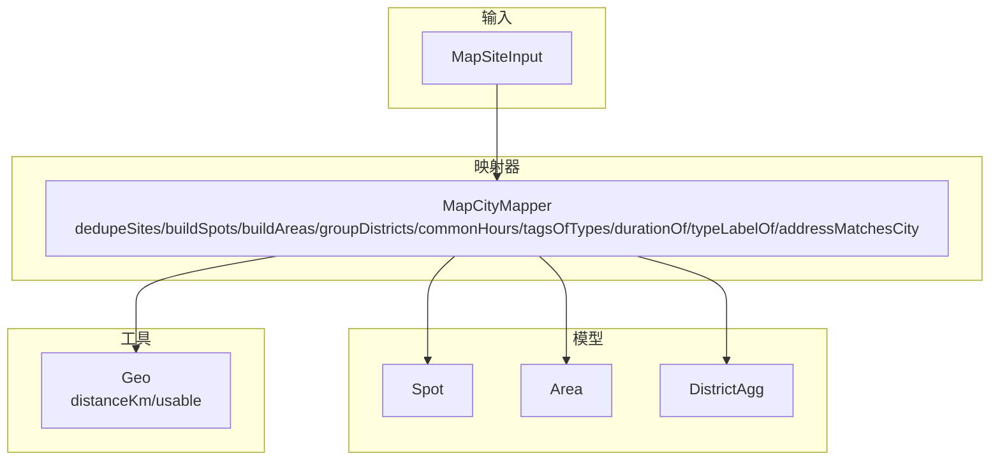
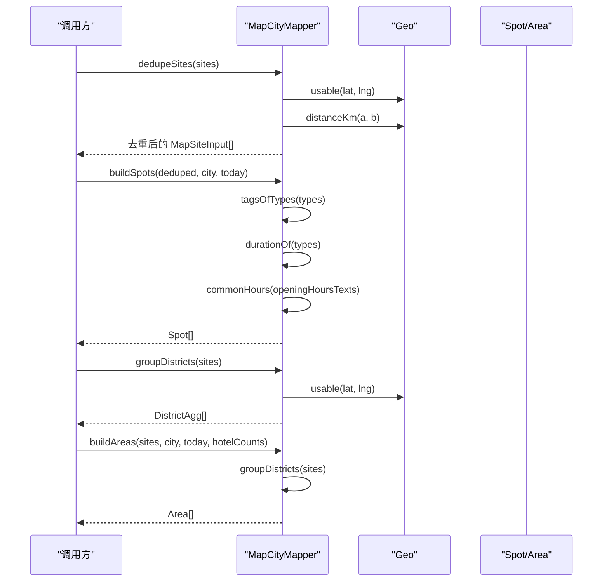
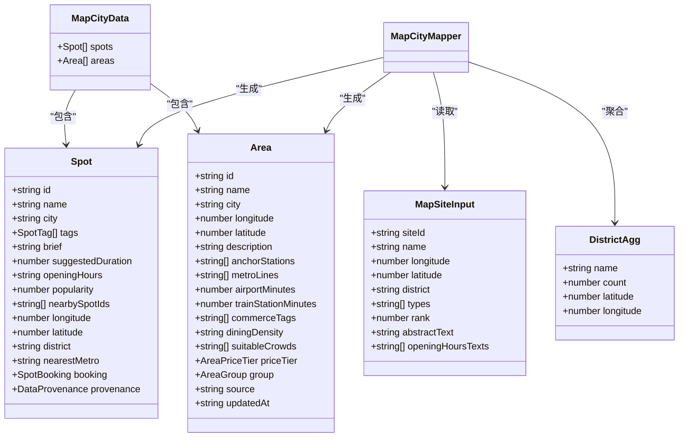
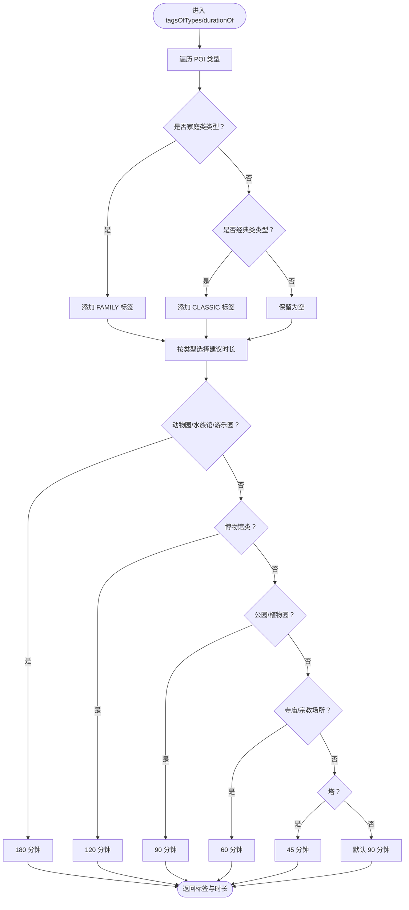
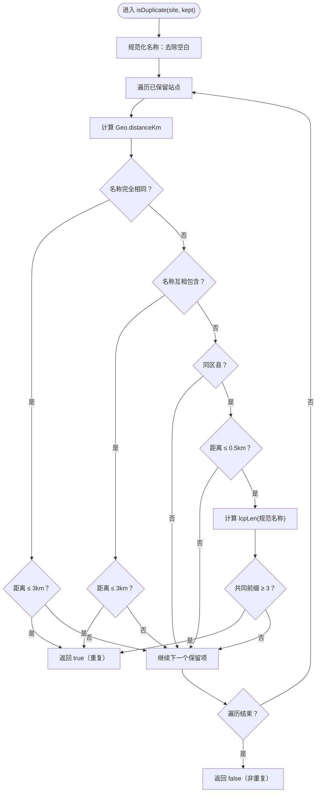
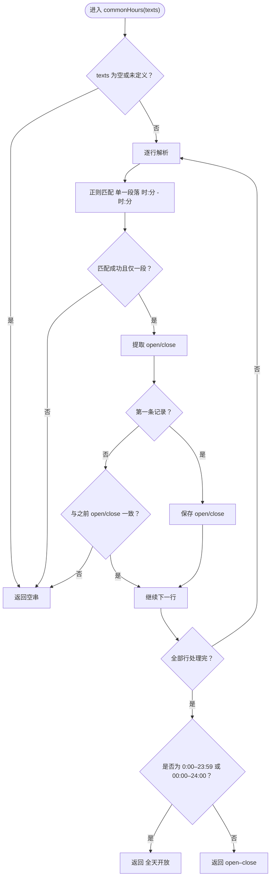
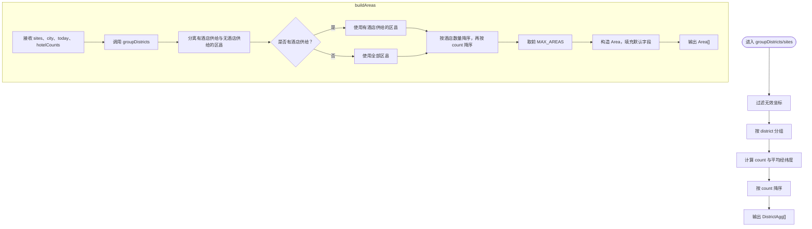
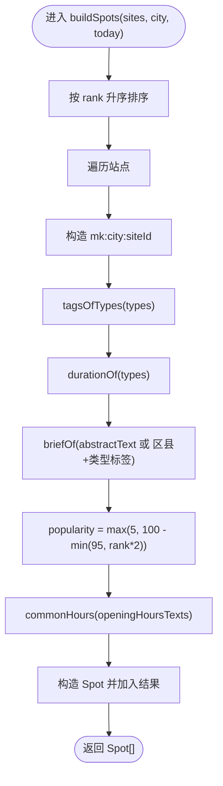
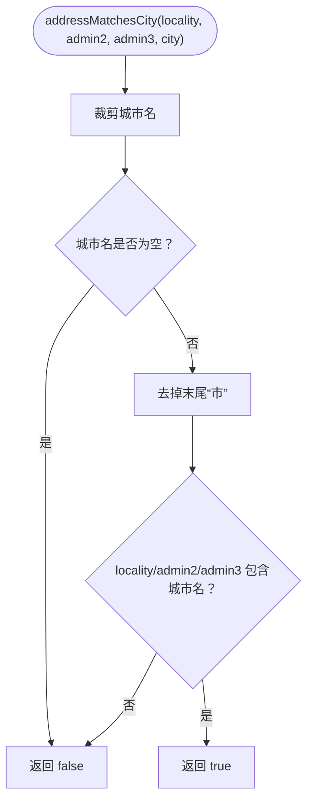
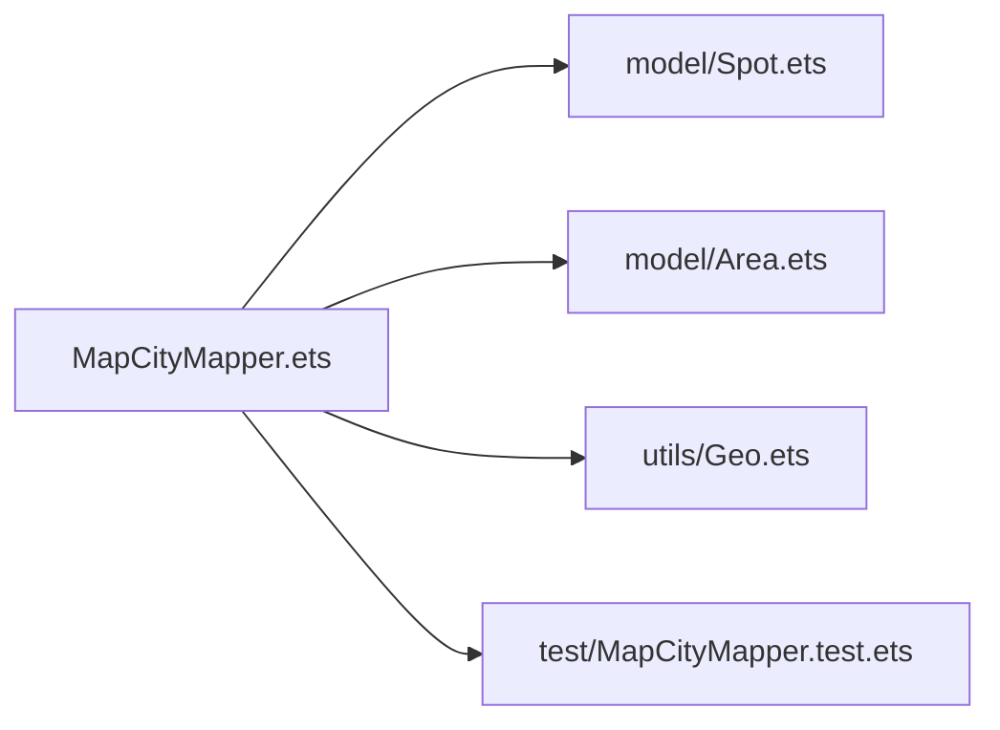

# 地图数据映射器

<cite>
**本文引用的文件**   
- [MapCityMapper.ets](file://entry/src/main/ets/utils/MapCityMapper.ets)
- [Spot.ets](file://entry/src/main/ets/model/Spot.ets)
- [Area.ets](file://entry/src/main/ets/model/Area.ets)
- [Geo.ets](file://entry/src/main/ets/utils/Geo.ets)
- [MapCityMapper.test.ets](file://entry/src/ohosTest/ets/test/MapCityMapper.test.ets)
</cite>

## 目录
1. [引言](#引言)
2. [项目结构](#项目结构)
3. [核心组件](#核心组件)
4. [架构总览](#架构总览)
5. [详细组件分析](#详细组件分析)
6. [依赖关系分析](#依赖关系分析)
7. [性能与复杂度](#性能与复杂度)
8. [边界处理与兜底策略](#边界处理与兜底策略)
9. [测试方法](#测试方法)
10. [结论](#结论)

## 引言
本文件聚焦 `MapCityMapper` 地图数据映射器的纯逻辑实现，说明如何将 Map Kit 检索结果中的 `MapSiteInput` 映射为应用内部的 `Spot` 和 `Area` 对象。文档覆盖以下关键能力：
- 类型标签映射：`FAMILY_TYPES`、`CLASSIC_TYPES` 到 `SpotTag`。
- 热度计算：基于检索顺序的秩转数值热度。
- 停留时长估算：按 POI 类型给出保守分钟数。
- 去重算法：`isDuplicate` 三重判定、`lcpLen` 最长公共前缀、`Geo.distanceKm` 距离阈值。
- 营业时段解析：`commonHours` 正则匹配、多时段合并、全天开放识别、不一致数据过滤。
- 区县聚合：`groupDistricts` 统计、`HotelCount` 注入、排序逻辑。
- 数据结构定义：`MapSiteInput`、`MapCityData`、`DistrictAgg`。
- 边界处理：空值检查、无效坐标过滤、缺失字段兜底。
- 测试方法：离线 tsc 编译验证、断言用例设计。

## 项目结构
`MapCityMapper` 是位于工具层的纯函数模块，不依赖平台 SDK，只依赖内部模型与地理工具：
- 输入：`MapSiteInput`（来自 data/MapKitCityStore 抽取的最小字段）。
- 输出：`Spot[]`、`Area[]`，以及中间聚合模型 `DistrictAgg[]`。
- 外部依赖：`Spot`、`Area` 数据模型；`Geo` 坐标与距离工具。

**图表来源**
- [MapCityMapper.ets:1-368](file://entry/src/main/ets/utils/MapCityMapper.ets#L1-L368)
- [Spot.ets:1-69](file://entry/src/main/ets/model/Spot.ets#L1-L69)
- [Area.ets:1-51](file://entry/src/main/ets/model/Area.ets#L1-L51)
- [Geo.ets:1-99](file://entry/src/main/ets/utils/Geo.ets#L1-L99)

**章节来源**
- [MapCityMapper.ets:1-40](file://entry/src/main/ets/utils/MapCityMapper.ets#L1-L40)

## 核心组件
`MapCityMapper` 暴露一组无副作用的纯函数，承担从原始 POI 到业务对象的转换职责：
- 去重：`dedupeSites`、`isDuplicate`、`lcpLen`。
- 标签与时长：`tagsOfTypes`、`durationOf`、`typeLabelOf`。
- 时段解析：`commonHours`。
- 景点构建：`buildSpots`。
- 区县聚合与区域构建：`groupDistricts`、`buildAreas`。
- 城市归属校验：`addressMatchesCity`。
- 常量：`MAP_SOURCE`、`MAP_SPOT_SOURCE`、`FAMILY_TYPES`、`CLASSIC_TYPES`、`MAX_AREAS`。

这些函数组合起来完成“原始检索结果 → 干净 Spot 列表 → 区县 Area 列表”的数据管线。

**章节来源**
- [MapCityMapper.ets:41-120](file://entry/src/main/ets/utils/MapCityMapper.ets#L41-L120)
- [MapCityMapper.ets:121-200](file://entry/src/main/ets/utils/MapCityMapper.ets#L121-L200)
- [MapCityMapper.ets:201-368](file://entry/src/main/ets/utils/MapCityMapper.ets#L201-L368)

## 架构总览
下图展示一次典型调用链：原始站点数组先经过去重，再转为 Spot；同时按区县聚合得到 Area。

**图表来源**
- [MapCityMapper.ets:121-200](file://entry/src/main/ets/utils/MapCityMapper.ets#L121-L200)
- [MapCityMapper.ets:201-368](file://entry/src/main/ets/utils/MapCityMapper.ets#L201-L368)
- [Geo.ets:21-99](file://entry/src/main/ets/utils/Geo.ets#L21-L99)

## 详细组件分析

### 数据结构定义
- `MapSiteInput`：最小化 Map Kit 站点字段，包含唯一标识、名称、经纬度、区县、POI 类型、检索秩、摘要文本、逐周营业时间字符串数组。
- `MapCityData`：映射输出容器，包含 `spots` 与 `areas`。
- `DistrictAgg`：区县聚合模型，包含区县名、景点数量、质心经纬度。
- `Spot`、`Area`：应用内数据模型，分别表示景点与住宿区域。

**图表来源**
- [MapCityMapper.ets:21-65](file://entry/src/main/ets/utils/MapCityMapper.ets#L21-L65)
- [Spot.ets:1-69](file://entry/src/main/ets/model/Spot.ets#L1-L69)
- [Area.ets:1-51](file://entry/src/main/ets/model/Area.ets#L1-L51)

**章节来源**
- [MapCityMapper.ets:21-65](file://entry/src/main/ets/utils/MapCityMapper.ets#L21-L65)
- [Spot.ets:1-69](file://entry/src/main/ets/model/Spot.ets#L1-L69)
- [Area.ets:1-51](file://entry/src/main/ets/model/Area.ets#L1-L51)

### 类型标签映射与停留时长估算
- 类型标签：
  - `FAMILY_TYPES`：动物园、水族馆、公园、植物园、游乐园，映射为 `SpotTag.FAMILY`。
  - `CLASSIC_TYPES`：博物馆、艺术博物馆、科学博物馆、旅游景点、寺庙、宗教场所、塔、纪念馆、地标，映射为 `SpotTag.CLASSIC`。
  - 未知类型不赋予标签，留给界面“其他”分组。
- 停留时长：
  - 动物园/水族馆/游乐园：180 分钟。
  - 博物馆类：120 分钟。
  - 公园/植物园：90 分钟。
  - 寺庙/宗教场所：60 分钟。
  - 塔：45 分钟。
  - 默认：90 分钟。
- 类型中文标签用于简介兜底显示。

**图表来源**
- [MapCityMapper.ets:121-160](file://entry/src/main/ets/utils/MapCityMapper.ets#L121-L160)

**章节来源**
- [MapCityMapper.ets:66-120](file://entry/src/main/ets/utils/MapCityMapper.ets#L66-L120)
- [MapCityMapper.ets:121-160](file://entry/src/main/ets/utils/MapCityMapper.ets#L121-L160)

### 去重算法：isDuplicate、lcpLen、Geo.distanceKm
去重目标是消除 Map Kit 返回的同义或近邻重复条目，例如“西安城墙”与“西安城墙·碑林历史文化景区”。

三重判定：
1. 同名且距离 ≤ 3km：直接视为重复。
2. 一个名称包含另一个且距离 ≤ 3km：视为重复。
3. 同区县、距离 ≤ 500m、共同前缀 ≥ 3 字：视为重复。

`lcpLen` 通过逐字符比较计算最长公共前缀长度；`Geo.distanceKm` 使用大圆距离公式计算公里数。

**图表来源**
- [MapCityMapper.ets:41-85](file://entry/src/main/ets/utils/MapCityMapper.ets#L41-L85)
- [Geo.ets:21-45](file://entry/src/main/ets/utils/Geo.ets#L21-L45)

`dedupeSites` 在去重前先过滤：
- 名称为空。
- 坐标不可用（NaN、接近 0 等）。

最终保留检索顺序中先出现的站点。

**章节来源**
- [MapCityMapper.ets:41-120](file://entry/src/main/ets/utils/MapCityMapper.ets#L41-L120)
- [Geo.ets:21-45](file://entry/src/main/ets/utils/Geo.ets#L21-L45)

### 营业时段解析：commonHours
`commonHours` 将逐周营业时间字符串归并为“每日一致”的时段：
- 若没有文本或文本为空，返回空串。
- 对每一行使用正则提取单个时间段：`时:分 - 时:分`。
- 如果某行没有匹配或匹配出多个时间段，返回空串。
- 所有行的起止时间必须完全一致，否则返回空串。
- 若时间为 `0:00–23:59` 或 `00:00–24:00`，返回“全天开放”。
- 否则返回统一格式 `open–close`。

该设计保证界面只展示能确认的每日时段；其余一律“以官方为准”，不猜测闭馆日或多时段。

**图表来源**
- [MapCityMapper.ets:161-200](file://entry/src/main/ets/utils/MapCityMapper.ets#L161-L200)

**章节来源**
- [MapCityMapper.ets:161-200](file://entry/src/main/ets/utils/MapCityMapper.ets#L161-L200)

### 区县聚合：groupDistricts 与 buildAreas
`groupDistricts` 负责按区县聚合：
- 过滤无效坐标。
- 以区县名为键收集站点。
- 计算每个区县的景点数量与经纬度均值作为质心。
- 按景点数量降序排序。

`buildAreas` 负责把区县转换为 Area：
- 优先选取有酒店供给数据的区县；若无酒店数据则退回按景点数量排序。
- 最多取 8 个区县（`MAX_AREAS`）。
- 对缺失酒店供给的区县，价格档、通勤、餐饮等字段留空，描述中标注“未校准”。
- 区县名为“地图服务”时，显示为 `${city}市区`。

**图表来源**
- [MapCityMapper.ets:241-368](file://entry/src/main/ets/utils/MapCityMapper.ets#L241-L368)

**章节来源**
- [MapCityMapper.ets:241-368](file://entry/src/main/ets/utils/MapCityMapper.ets#L241-L368)

### 热点与 Spot 构建：buildSpots
`buildSpots` 将去重后的 `MapSiteInput` 转换为 `Spot[]`：
- 按 `rank` 升序排序，保持检索顺序。
- ID 采用 `mk:${city}:${siteId}`。
- 热度 `popularity` 由秩换算：第 1 名最高，越后越低；最低不低于 5。
- 预约字段固定为 `requiresBooking=false`，界面标注“以官方为准”。
- 简介优先使用 `abstractText` 前 80 字；否则回退为“区县 · 类型中文标签”。
- 建议时长由 `durationOf` 决定。
- 若 `commonHours` 解析成功，写入 `openingHours`。
- 溯源信息标记数据来源、更新时间与可信度。

**图表来源**
- [MapCityMapper.ets:201-240](file://entry/src/main/ets/utils/MapCityMapper.ets#L201-L240)

**章节来源**
- [MapCityMapper.ets:201-240](file://entry/src/main/ets/utils/MapCityMapper.ets#L201-L240)

### 城市归属校验：addressMatchesCity
真机实测发现，无效 `cityId` 可能返回全国结果；因此必须用地址字段做归属校验：
- 校验 `locality`、`adminLevel2`、`adminLevel3` 是否包含请求城市名。
- 城市名末尾“市”会被去掉后再匹配。
- 若三者均不含城市名，则丢弃该地点。

**图表来源**
- [MapCityMapper.ets:321-368](file://entry/src/main/ets/utils/MapCityMapper.ets#L321-L368)

**章节来源**
- [MapCityMapper.ets:321-368](file://entry/src/main/ets/utils/MapCityMapper.ets#L321-L368)

## 依赖关系分析
`MapCityMapper` 对外暴露纯函数，对内依赖：
- `Spot`、`Area`：业务数据模型。
- `Geo`：坐标可用性与距离计算。
- 常量：`MAP_SOURCE`、`MAP_SPOT_SOURCE`、`FAMILY_TYPES`、`CLASSIC_TYPES`、`MAX_AREAS`。

**图表来源**
- [MapCityMapper.ets:1-368](file://entry/src/main/ets/utils/MapCityMapper.ets#L1-L368)
- [Spot.ets:1-69](file://entry/src/main/ets/model/Spot.ets#L1-L69)
- [Area.ets:1-51](file://entry/src/main/ets/model/Area.ets#L1-L51)
- [Geo.ets:1-99](file://entry/src/main/ets/utils/Geo.ets#L1-L99)
- [MapCityMapper.test.ets:1-150](file://entry/src/ohosTest/ets/test/MapCityMapper.test.ets#L1-L150)

**章节来源**
- [MapCityMapper.ets:1-368](file://entry/src/main/ets/utils/MapCityMapper.ets#L1-L368)

## 性能与复杂度
- 去重 `dedupeSites`：
  - 时间复杂度近似 O(n²)，因为每条新站点会与已保留站点逐个比较。
  - 空间复杂度 O(n)，存储去重结果。
- 区县聚合 `groupDistricts`：
  - 时间复杂度 O(n)，单次遍历分组与均值计算。
  - 空间复杂度 O(k)，k 为不同区县数。
- 区域构建 `buildAreas`：
  - 主要开销在排序，时间复杂度 O(k log k)。
  - 最大面积数限制为 8，避免过大输出。
- 标签与时长：
  - 线性扫描类型数组，常数级判断。
- 营业时段解析：
  - 逐行正则匹配，时间复杂度 O(m)，m 为行数。

优化建议：
- 若站点规模显著增长，可对 `isDuplicate` 引入空间索引（如按区县分桶、按名称哈希），降低二次比较成本。
- `lcpLen` 可缓存常见前缀或使用更高效的字符串匹配，但在当前规模下影响有限。
- 正则表达式可在预处理阶段预编译，减少重复开销。

[本节为通用性能讨论，不直接分析具体代码行]

## 边界处理与兜底策略
- 空值检查：
  - `commonHours` 对 undefined、空数组返回空串。
  - `addressMatchesCity` 对空城市名返回 false。
- 无效坐标过滤：
  - `dedupeSites` 与 `groupDistricts` 使用 `Geo.usable` 排除 NaN 与接近 0 的坐标。
- 缺失字段兜底：
  - Spot 简介优先使用摘要文本，否则使用“区县 · 类型中文标签”。
  - 区县名为空时使用“地图服务”。
  - 无酒店供给数据时，Area 的价格档、通勤、餐饮字段留空，描述中标注“未校准”。
  - 预约字段固定为不需要预约，并由界面标注“以官方为准”。
- 不一致数据过滤：
  - `commonHours` 遇到多时段、闭馆日、各天不一致时返回空串，不伪造营业时间。
- 城市归属校验：
  - 通过 locality/admin2/admin3 三字段匹配，防止全国结果误入。

**章节来源**
- [MapCityMapper.ets:41-120](file://entry/src/main/ets/utils/MapCityMapper.ets#L41-L120)
- [MapCityMapper.ets:161-200](file://entry/src/main/ets/utils/MapCityMapper.ets#L161-L200)
- [MapCityMapper.ets:201-240](file://entry/src/main/ets/utils/MapCityMapper.ets#L201-L240)
- [MapCityMapper.ets:241-368](file://entry/src/main/ets/utils/MapCityMapper.ets#L241-L368)
- [Geo.ets:21-45](file://entry/src/main/ets/utils/Geo.ets#L21-L45)

## 测试方法
测试位于 `MapCityMapper.test.ets`，覆盖以下关键断言：
- 去重保留第一个有效站点，丢弃无效坐标与空名称。
- 同名但相距较远时不被合并。
- Spot 构建携带正确 ID、热度、溯源、标签、建议时长与简介。
- 预约字段始终为不需要预约。
- `commonHours` 支持全天开放、常规时段、多时段拒绝、休息拒绝、空输入。
- 类型标签与默认时长符合预期。
- 区县聚合统计与排序正确。
- 酒店供给数据优先选择区县。
- 城市检测与地址归属校验逻辑。

推荐补充测试场景：
- 极端距离边界：3km、0.5km 附近的重复判定。
- 名称包含边界：前缀恰好 2 字与 3 字的差异。
- 长时间序列的营业时间一致性。
- 大量区县时的排序稳定性。
- 空城市名与无效 cityId 的城市归属校验。

**章节来源**
- [MapCityMapper.test.ets:1-150](file://entry/src/ohosTest/ets/test/MapCityMapper.test.ets#L1-L150)

## 结论
`MapCityMapper` 是一个职责清晰、行为稳定的纯逻辑映射层：它把 Map Kit 检索结果转化为应用可用的 Spot 与 Area，并通过严格去重、保守标签、保守时长与严格营业时间解析，避免伪造数据。其设计强调可测试性、可离线验证与可追溯性，适合在真实地图数据质量参差不齐的情况下提供稳健的基础数据。

[本节为总结性内容，不直接分析具体代码行]