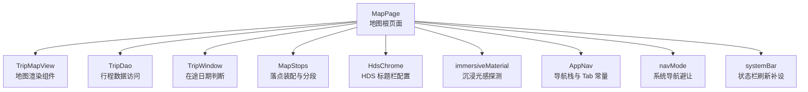
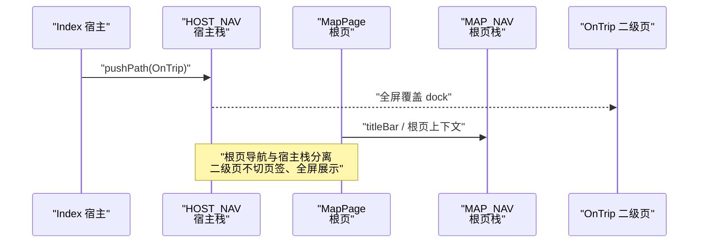
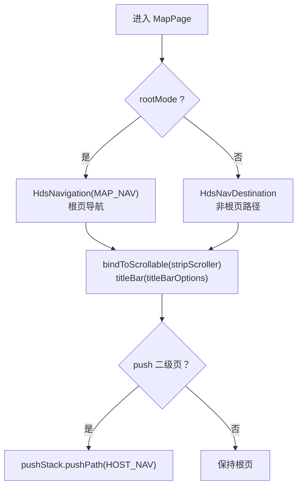
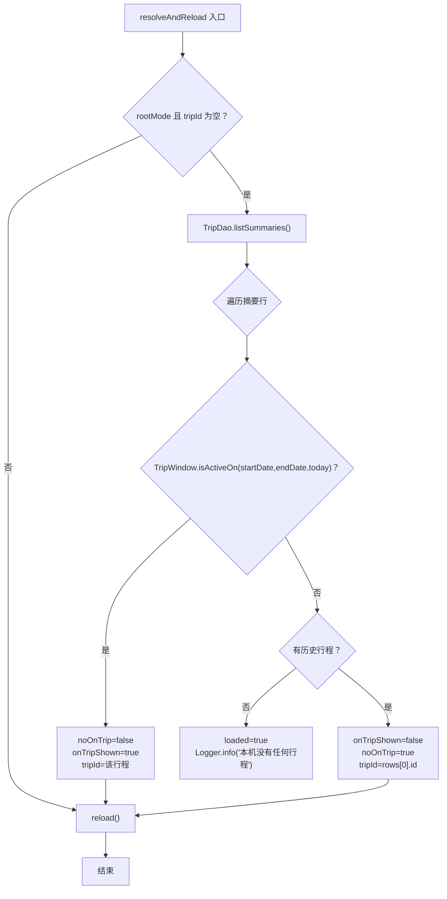
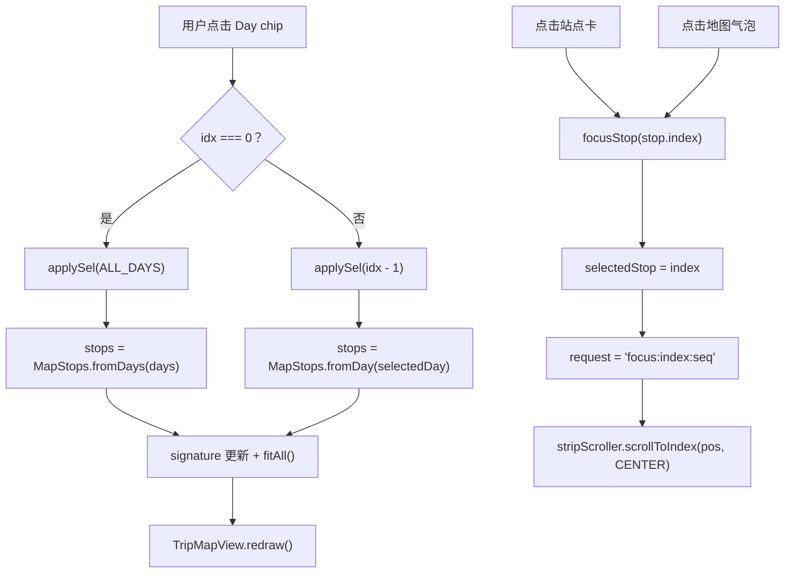
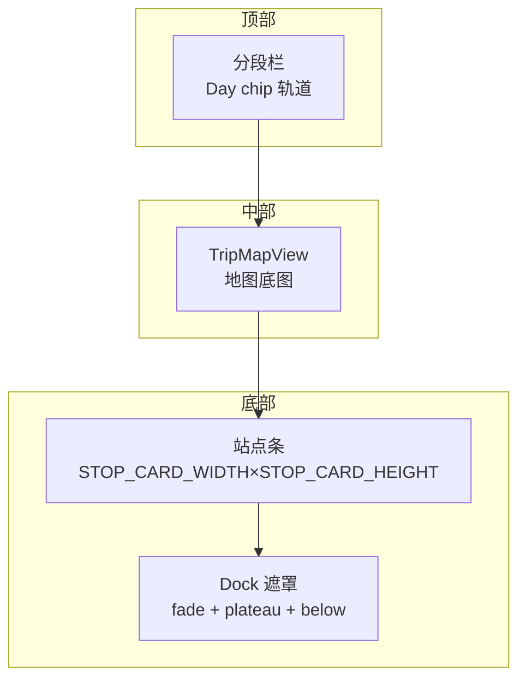
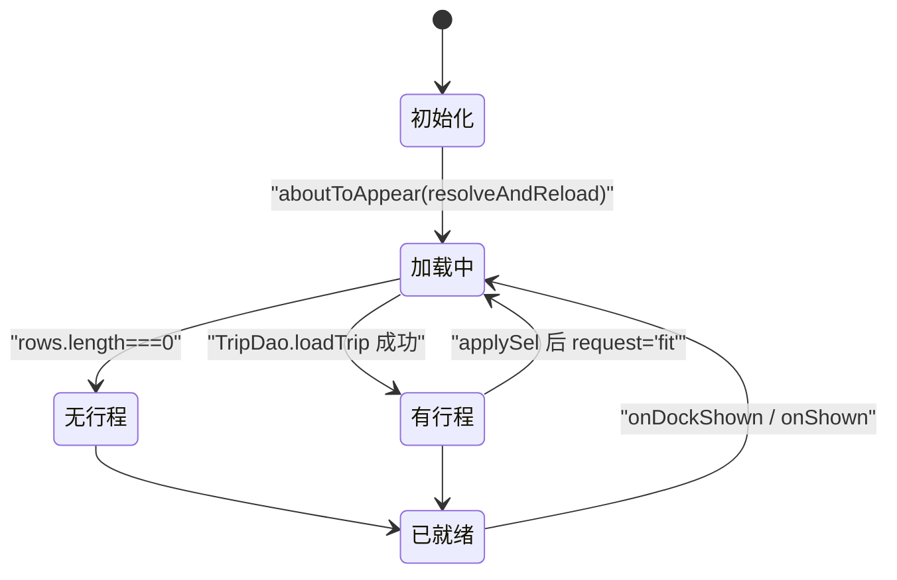
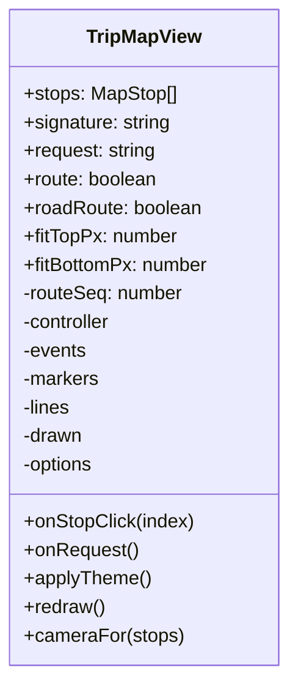
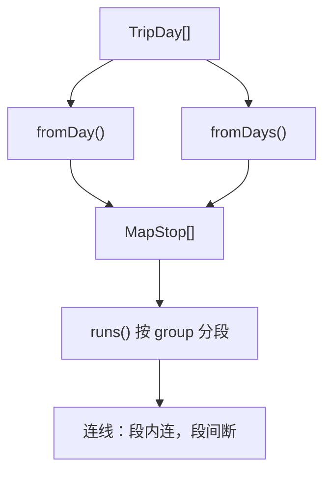
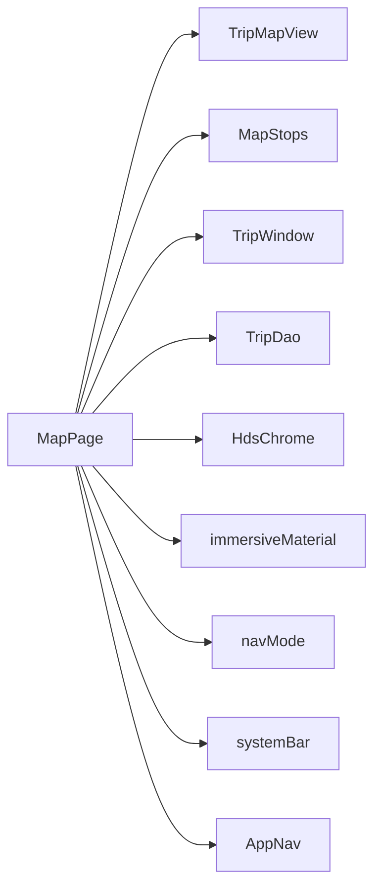

# 地图页面UI

<cite>
**本文引用的文件**   
- [MapPage.ets](file://entry/src/main/ets/pages/MapPage.ets)
- [TripMapView.ets](file://entry/src/main/ets/components/TripMapView.ets)
- [TripWindow.ets](file://entry/src/main/ets/utils/TripWindow.ets)
- [AppNav.ets](file://entry/src/main/ets/common/constants/AppNav.ets)
- [TripDao.ets](file://entry/src/main/ets/data/TripDao.ets)
- [MapStops.ets](file://entry/src/main/ets/utils/MapStops.ets)
- [HdsChrome.ets](file://entry/src/main/ets/design/HdsChrome.ets)
- [immersiveMaterial.ets](file://entry/src/main/ets/utils/immersiveMaterial.ets)
- [navMode.ets](file://entry/src/main/ets/utils/navMode.ets)
- [systemBar.ets](file://entry/src/main/ets/utils/systemBar.ets)
</cite>

## 目录
1. [引言](#引言)
2. [项目结构](#项目结构)
3. [核心组件](#核心组件)
4. [架构总览](#架构总览)
5. [详细组件分析](#详细组件分析)
6. [依赖关系分析](#依赖关系分析)
7. [性能与体验考量](#性能与体验考量)
8. [故障排查指南](#故障排查指南)
9. [结论](#结论)

## 引言
本文聚焦 MapPage 地图页面的 UI 架构与交互实现，围绕以下目标展开：
- 解析 HdsNavigation 导航容器、MAP_NAV / HOST_NAV 双栈管理、rootMode / dockMode 模式区分。
- 说明在途行程检测、历史回退策略、全览与单日切换、站点条过滤与选中同步。
- 解释顶部分段栏、底部站点条、Dock 遮罩几何等布局要点。
- 梳理玻璃珠显示条件、滚动控制、页签切换刷新触发等交互。
- 整理主题同步、加载状态、沉浸式光感适配、屏幕尺寸适配方案。
- 给出日志记录策略、性能监控与常见问题排查建议。

## 项目结构
MapPage 属于 entry 模块的页面层，核心由一个根页面组件和一个地图渲染子组件组成，并依赖导航常量、行程 DAO、落点工具、设计系统与系统能力探测模块：
- 页面入口：`entry/src/main/ets/pages/MapPage.ets`
- 地图渲染：`entry/src/main/ets/components/TripMapView.ets`
- 行程窗口判断：`entry/src/main/ets/utils/TripWindow.ets`
- 导航栈与 Tab 常量：`entry/src/main/ets/common/constants/AppNav.ets`
- 行程数据访问：`entry/src/main/ets/data/TripDao.ets`
- 落点装配与分段：`entry/src/main/ets/utils/MapStops.ets`
- HDS 标题栏配置：`entry/src/main/ets/design/HdsChrome.ets`
- 沉浸光感材质探测：`entry/src/main/ets/utils/immersiveMaterial.ets`
- 系统导航避让：`entry/src/main/ets/utils/navMode.ets`
- 状态栏图标刷新补设：`entry/src/main/ets/utils/systemBar.ets`



**图表来源**
- [MapPage.ets:1-120](file://entry/src/main/ets/pages/MapPage.ets#L1-L120)
- [TripMapView.ets:1-60](file://entry/src/main/ets/components/TripMapView.ets#L1-L60)
- [TripWindow.ets:1-24](file://entry/src/main/ets/utils/TripWindow.ets#L1-L24)
- [AppNav.ets:1-80](file://entry/src/main/ets/common/constants/AppNav.ets#L1-L80)
- [TripDao.ets:1-60](file://entry/src/main/ets/data/TripDao.ets#L1-L60)
- [MapStops.ets:1-40](file://entry/src/main/ets/utils/MapStops.ets#L1-L40)
- [HdsChrome.ets:1-60](file://entry/src/main/ets/design/HdsChrome.ets#L1-L60)
- [immersiveMaterial.ets:1-60](file://entry/src/main/ets/utils/immersiveMaterial.ets#L1-L60)
- [navMode.ets:1-40](file://entry/src/main/ets/utils/navMode.ets#L1-L40)
- [systemBar.ets:1-35](file://entry/src/main/ets/utils/systemBar.ets#L1-L35)

**章节来源**
- [MapPage.ets:1-120](file://entry/src/main/ets/pages/MapPage.ets#L1-L120)
- [TripMapView.ets:1-60](file://entry/src/main/ets/components/TripMapView.ets#L1-L60)
- [AppNav.ets:1-80](file://entry/src/main/ets/common/constants/AppNav.ets#L1-L80)

## 核心组件
- MapPage：地图 tab 的根页面，负责行程选择、视图切换、UI 布局（分段栏 + 地图 + 站点条 + Dock 遮罩）、导航栈与主题同步。
- TripMapView：基于 Map Kit 的真实底图组件，负责落点、动线、镜头控制、错误提示与主题切换。
- TripWindow：提供“今天是否在行程区间内”的判断逻辑。
- AppNav：全局导航栈单例与 Tab 序号常量，定义 MAP_NAV / HOST_NAV 的职责边界。
- TripDao：行程摘要列表与详情查询，是 MapPage 在途行程检测与回退的数据源。
- MapStops：把行程天活动转换为可上屏的 MapStop，并按天分组形成 runs，供连线与全览使用。
- HdsChrome：统一 HDS 标题栏配置，处理磨砂、渐变模糊、返回键位、主题 tick 重建等坑。
- immersiveMaterial：HDS 沉浸光感与 GlassBlurStyle 的统一探测与封装，低版本安全降级。
- navMode / systemBar：系统导航避让与状态栏图标明暗补设，确保 Dock 与全屏二级页不遮挡。

**章节来源**
- [MapPage.ets:1-120](file://entry/src/main/ets/pages/MapPage.ets#L1-L120)
- [TripMapView.ets:1-60](file://entry/src/main/ets/components/TripMapView.ets#L1-L60)
- [TripWindow.ets:1-24](file://entry/src/main/ets/utils/TripWindow.ets#L1-L24)
- [AppNav.ets:1-80](file://entry/src/main/ets/common/constants/AppNav.ets#L1-L80)
- [TripDao.ets:1-60](file://entry/src/main/ets/data/TripDao.ets#L1-L60)
- [MapStops.ets:1-40](file://entry/src/main/ets/utils/MapStops.ets#L1-L40)
- [HdsChrome.ets:1-60](file://entry/src/main/ets/design/HdsChrome.ets#L1-L60)
- [immersiveMaterial.ets:1-60](file://entry/src/main/ets/utils/immersiveMaterial.ets#L1-L60)
- [navMode.ets:1-40](file://entry/src/main/ets/utils/navMode.ets#L1-L40)
- [systemBar.ets:1-35](file://entry/src/main/ets/utils/systemBar.ets#L1-L35)

## 架构总览
MapPage 采用“根页内嵌导航 + 宿主栈全屏二级页”的双栈架构：
- rootMode 为 true 时，作为 dock “地图”格的内容区，自带 HdsNavigation，承载本页 titleBar。
- pushStack 绑定 HOST_NAV，用于推入 OnTrip 等全屏二级页；这些页会盖住 dock 页签栏，符合 HDS 一级页签 + 二级页全屏的标准形态。
- MAP_NAV 仅承载根页自身的导航上下文，不能与宿主栈混用，避免二级页无法渲染。



**图表来源**
- [AppNav.ets:1-80](file://entry/src/main/ets/common/constants/AppNav.ets#L1-L80)
- [MapPage.ets:451-649](file://entry/src/main/ets/pages/MapPage.ets#L451-L649)

## 详细组件分析

### 导航容器与双栈管理
- MAP_NAV：MapPage 根页绑定的内部栈，仅承载根页自己的 titleBar，不再接收二级路由。
- HOST_NAV：Index 外层 Navigation 持有的宿主栈，所有二级页（向导链、行程详情、设置等）都 push 到此处，全屏盖住 dock，不随 HdsTabs 左右滑切页签。
- 关键约束：一个 NavPathStack 只能被一个 Navigation 持有，因此绝不能把 HOST_NAV 也绑到 MapPage 的 HdsNavigation 上。



**图表来源**
- [MapPage.ets:451-649](file://entry/src/main/ets/pages/MapPage.ets#L451-L649)
- [AppNav.ets:1-80](file://entry/src/main/ets/common/constants/AppNav.ets#L1-L80)

**章节来源**
- [AppNav.ets:1-80](file://entry/src/main/ets/common/constants/AppNav.ets#L1-L80)
- [MapPage.ets:451-649](file://entry/src/main/ets/pages/MapPage.ets#L451-L649)

### 行程选择逻辑：resolveAndReload
流程要点：
- 当 rootMode 且 tripId 为空时，才执行在途行程检测；否则直接 reload，支持通过参数传入 tripId 的调用方式。
- 通过 TripDao.listSummaries 获取本地行程摘要，按 ISO 日期字符串比较，用 TripWindow.isActiveOn 判断“今天是否落在 startDate ~ endDate”。
- 找到在途行程：设置 noOnTrip=false、onTripShown=true、tripId，然后 reload。
- 没有在途行程但有历史行程：取 rows[0]（最近一条），设置 onTripShown=false、noOnTrip=true、tripId，再 reload，避免地图 tab 白屏。
- 无任何行程：置 loaded=true，输出引导空态。
- 异步竞态保护：使用 resolveSeq 递增，丢弃旧回调结果。



**图表来源**
- [MapPage.ets:120-200](file://entry/src/main/ets/pages/MapPage.ets#L120-L200)
- [TripWindow.ets:1-24](file://entry/src/main/ets/utils/TripWindow.ets#L1-L24)
- [TripDao.ets:1-60](file://entry/src/main/ets/data/TripDao.ets#L1-L60)

**章节来源**
- [MapPage.ets:120-200](file://entry/src/main/ets/pages/MapPage.ets#L120-L200)
- [TripWindow.ets:1-24](file://entry/src/main/ets/utils/TripWindow.ets#L1-L24)
- [TripDao.ets:1-60](file://entry/src/main/ets/data/TripDao.ets#L1-L60)

### 视图切换：daySel、stops 过滤与 selectedStop 同步
- daySel：ALL_DAYS=-1 表示全程；其他值表示具体天的下标。
- applySel：根据 daySel 决定从 days 中取出 MapStops.fromDays(days) 或 MapStops.fromDay(day)。
- signature：包含 stops 坐标签名和 transport.mode 串，任何一处变化都会让 TripMapView 重绘。
- fitAll：发出 'fit' 指令，让 TripMapView 收敛到全部落点。
- focusStop：点击地图气泡或站点卡时，设置 selectedStop，并发出 'focus:index:seq' 指令，同时用 stripScroller.scrollToIndex 把对应卡片滚到视野中心。
- 双向高亮：selectedStop 既影响站点卡 tint/描边，也由地图 markerClick 回调更新，保证“点地图 → 高亮卡”，“点卡 → 高亮地图”。



**图表来源**
- [MapPage.ets:201-450](file://entry/src/main/ets/pages/MapPage.ets#L201-L450)
- [TripMapView.ets:201-385](file://entry/src/main/ets/components/TripMapView.ets#L201-L385)

**章节来源**
- [MapPage.ets:201-450](file://entry/src/main/ets/pages/MapPage.ets#L201-L450)
- [TripMapView.ets:201-385](file://entry/src/main/ets/components/TripMapView.ets#L201-L385)

### UI 布局：分段栏、站点条与 Dock 遮罩
- 顶部分段栏：List + ForEach 渲染 chips，chipRow 使用 HdsMiniBarButton 或自绘背景，宽度 76vp、高度 38vp，支持玻璃珠材质与选中实心底。
- 底部站点条：STOP_CARD_WIDTH=168vp、STOP_CARD_HEIGHT=72vp，定宽定高的横向 List，支持滚动与选中高亮。
- Dock 遮罩：三段几何 DOCK_MASK_FADE_VP / DOCK_MASK_PLATEAU_VP / DOCK_MASK_BELOW_VP，线性渐变从透明到实心再到透明，避免压住地图 SDK 归属水印。
- 内容区 hitTestBehavior Transparent，浮层不遮挡地图手势；前景 Column 也使用 Transparent，保证地图交互完整。



**图表来源**
- [MapPage.ets:1-120](file://entry/src/main/ets/pages/MapPage.ets#L1-L120)
- [MapPage.ets:451-649](file://entry/src/main/ets/pages/MapPage.ets#L451-L649)

**章节来源**
- [MapPage.ets:1-120](file://entry/src/main/ets/pages/MapPage.ets#L1-L120)
- [MapPage.ets:451-649](file://entry/src/main/ets/pages/MapPage.ets#L451-L649)

### 交互处理：beadOn、stripScroller、onDockShown
- beadOn：未选中且设备支持沉浸光感时才显示玻璃珠；选中态保留实心底，避免半透明材质降低辨识度。
- stripScroller：点击地图气泡后，按 stop.index 在 stops 中定位 pos，再用 scrollToIndex 把卡片滚到视口中央。
- onDockShown：监听 TAB_SHOWN_KEY，isTabShownTick 校验当前页签序号，切回地图格时清空 tripId/noOnTrip 并重新 resolveAndReload，解决“刚出发/刚结束”导致的在途状态滞后。

```mermaid
sequenceDiagram
  participant Dock as "dock 页签广播"
  participant Page as "MapPage"
  participant Dao as "TripDao"
  participant Win as "TripWindow"

  Dock->>Page: "TAB_SHOWN_KEY 变更"
  Page->>Page: "onDockShown()"
  Page->>Page: "tripId='' ; noOnTrip=false"
  Page->>Dao: "listSummaries()"
  Dao-->>Page: "行程摘要"
  Page->>Win: "isActiveOn(startDate,endDate,today)"
  Win-->>Page: "布尔结果"
  Page->>Page: "确定 tripId 并 reload()"
```

**图表来源**
- [MapPage.ets:120-200](file://entry/src/main/ets/pages/MapPage.ets#L120-L200)
- [AppNav.ets:80-140](file://entry/src/main/ets/common/constants/AppNav.ets#L80-L140)

**章节来源**
- [MapPage.ets:120-200](file://entry/src/main/ets/pages/MapPage.ets#L120-L200)
- [MapPage.ets:201-450](file://entry/src/main/ets/pages/MapPage.ets#L201-L450)
- [AppNav.ets:80-140](file://entry/src/main/ets/common/constants/AppNav.ets#L80-L140)

### 状态管理：chromeThemeTick、dockTick、loaded/noOnTrip
- chromeThemeTick：@StorageProp 订阅深浅档变化，传给 HdsChrome.bar，使官方 HdsTitleBar 的自绘标题内容在新 tick 下重建，避免主题切换后标题颜色冻结。
- dockTick：@StorageProp(TAB_SHOWN_KEY) + @Watch(onDockShown)，只在 isTabShownTick(dockTick, TAB_MAP) 为真时刷新。
- loaded：数据请求完成标志，用于区分加载中与空态。
- noOnTrip：仅在 rootMode 下表达“本机没有当前在途行程”，与 loaded 语义不同，避免误判。



**图表来源**
- [MapPage.ets:120-200](file://entry/src/main/ets/pages/MapPage.ets#L120-L200)
- [MapPage.ets:201-450](file://entry/src/main/ets/pages/MapPage.ets#L201-L450)
- [MapPage.ets:451-649](file://entry/src/main/ets/pages/MapPage.ets#L451-L649)

**章节来源**
- [MapPage.ets:120-200](file://entry/src/main/ets/pages/MapPage.ets#L120-L200)
- [MapPage.ets:201-450](file://entry/src/main/ets/pages/MapPage.ets#L201-L450)
- [MapPage.ets:451-649](file://entry/src/main/ets/pages/MapPage.ets#L451-L649)

### 地图渲染：TripMapView
- 初始相机：aboutToAppear 若 stops 非空，用第一个 stop 的坐标构造 MapOptions，避免首帧中心点非法。
- 创建回调：onCreated 注册 markerClick，清理 mapError，应用主题，redraw，并在首帧对全部 stops 做 moveCamera 收敛。
- 指令入口 onRequest：'fit' 走 cameraFor(stops)，'focus:index:seq' 找到对应 stop 并 animateCamera。
- 主题：@StorageProp('isDarkMode') 驱动 setDayNightMode。
- 绘制：filter 可用坐标，MapStops.runs 分天组，roadRoute 开启则并行 RoadRouteStore.segment 算路，失败回退直线；markers 批量添加并设置 tag。
- 错误与清理：mapError 展示人话提示；拆除期 off event、clearOverlays，避免原生对象失效导致进程崩溃。



**图表来源**
- [TripMapView.ets:1-60](file://entry/src/main/ets/components/TripMapView.ets#L1-L60)
- [TripMapView.ets:201-385](file://entry/src/main/ets/components/TripMapView.ets#L201-L385)

**章节来源**
- [TripMapView.ets:1-60](file://entry/src/main/ets/components/TripMapView.ets#L1-L60)
- [TripMapView.ets:201-385](file://entry/src/main/ets/components/TripMapView.ets#L201-L385)

### 数据装配：MapStops
- usable：在中国大陆范围粗筛，防止 0/0 或跑偏坐标拉坏整条动线。
- eligible：排除交通节点与不可用坐标。
- fromDay / fromDays：生成 MapStop，fromDays 跨天连续编号但保留 group（天号），供 runs 分段连线。
- runs：group 变化时切段，确保“跨天不连”。
- bounds：计算经纬度包围盒，供相机收敛。
- signature：坐标序列化，作为子组件重绘的稳定键。



**图表来源**
- [MapStops.ets:1-187](file://entry/src/main/ets/utils/MapStops.ets#L1-L187)

**章节来源**
- [MapStops.ets:1-187](file://entry/src/main/ets/utils/MapStops.ets#L1-L187)

## 依赖关系分析
MapPage 依赖关系呈现“页面层协调、工具层纯逻辑、数据层持久化、系统层能力探测”的分层特征：
- 页面层：MapPage 聚合业务状态与 UI 构建。
- 组件层：TripMapView 封装地图 SDK 调用。
- 工具层：TripWindow、MapStops 提供日期与落点算法。
- 数据层：TripDao 读取本地数据库。
- 系统层：HdsChrome、immersiveMaterial、navMode、systemBar 处理平台差异与兼容。



**图表来源**
- [MapPage.ets:1-120](file://entry/src/main/ets/pages/MapPage.ets#L1-L120)
- [TripMapView.ets:1-60](file://entry/src/main/ets/components/TripMapView.ets#L1-L60)
- [MapStops.ets:1-40](file://entry/src/main/ets/utils/MapStops.ets#L1-L40)
- [TripWindow.ets:1-24](file://entry/src/main/ets/utils/TripWindow.ets#L1-L24)
- [TripDao.ets:1-60](file://entry/src/main/ets/data/TripDao.ets#L1-L60)
- [HdsChrome.ets:1-60](file://entry/src/main/ets/design/HdsChrome.ets#L1-L60)
- [immersiveMaterial.ets:1-60](file://entry/src/main/ets/utils/immersiveMaterial.ets#L1-L60)
- [navMode.ets:1-40](file://entry/src/main/ets/utils/navMode.ets#L1-L40)
- [systemBar.ets:1-35](file://entry/src/main/ets/utils/systemBar.ets#L1-L35)
- [AppNav.ets:1-80](file://entry/src/main/ets/common/constants/AppNav.ets#L1-L80)

**章节来源**
- [MapPage.ets:1-120](file://entry/src/main/ets/pages/MapPage.ets#L1-L120)
- [TripMapView.ets:1-60](file://entry/src/main/ets/components/TripMapView.ets#L1-L60)
- [MapStops.ets:1-40](file://entry/src/main/ets/utils/MapStops.ets#L1-L40)
- [TripWindow.ets:1-24](file://entry/src/main/ets/utils/TripWindow.ets#L1-L24)
- [TripDao.ets:1-60](file://entry/src/main/ets/data/TripDao.ets#L1-L60)
- [HdsChrome.ets:1-60](file://entry/src/main/ets/design/HdsChrome.ets#L1-L60)
- [immersiveMaterial.ets:1-60](file://entry/src/main/ets/utils/immersiveMaterial.ets#L1-L60)
- [navMode.ets:1-40](file://entry/src/main/ets/utils/navMode.ets#L1-L40)
- [systemBar.ets:1-35](file://entry/src/main/ets/utils/systemBar.ets#L1-L35)
- [AppNav.ets:1-80](file://entry/src/main/ets/common/constants/AppNav.ets#L1-L80)

## 性能与体验考量
- 在途行程检测防竞态：resolveSeq 递增，避免旧回调覆盖新状态。
- 地图重绘稳定键：signature 基于坐标序列，避免数组引用不稳定导致频繁 redraw。
- 沿路动线异步合并：Promise.all 并行算路，旧 routeSeq 比对丢弃过期结果；失败回退直线，保证动线不断。
- 相机收敛留白：FIT_PAD_TOP/FIT_PAD_BOTTOM/FIT_PAD_SIDE 针对图钉锚点与面板裁切实测调整，避免首站被截。
- 玻璃珠与投影净空：chipRow 与 stopChip 分别预留 segmentBarShadowRoom 与 cardAmbient 空间，避免投影被 List 裁成硬边灰带。
- 主题重建通道：chromeThemeTick 强制重建 HdsTitleBar 自绘内容，避免深浅档切换后标题色冻结。
- Dock 遮罩对比度：深色画布背景下提升遮罩透明度，确保选中蓝达到无障碍对比度阈值。
- 响应式列数：responsive.ets 提供 listLanesForBreakpoint 与 longFormMaxWidth，虽然 MapPage 不使用 Grid，但该规范保障仓内其它页面在折叠屏/平板上的可读性。

[本节为通用性能指导，不直接分析特定代码片段]

## 故障排查指南
- 地图空白或坐标异常：
  - 检查 MapStops.usable 的中国大陆范围筛选是否误杀坐标。
  - 查看 TripMapView.redraw 日志中的“无可用落点”提示。
- 动线缺失或错乱：
  - 确认 MapStops.runs 的 group 是否按天正确分割。
  - 检查 RoadRouteStore.segment 是否因离线/权限失败回退直线。
- 标题栏颜色不随深浅档切换：
  - 确认 chromeThemeTick 是否传入 HdsChrome.bar，并观察 HdsTitleBar 自绘内容是否重建。
- Dock 遮罩压住地图水印或对比度不足：
  - 核对 DOCK_MASK_FADE_VP / PLATEAU_VP / BELOW_VP 与渐变 colors 配置。
- 玻璃珠被裁切或落影变灰带：
  - 检查 chipRow 的 contentPadding/barBottomMargin 与 List 轨道 height 是否预留足够净空。
- 二级页全屏后 dock 仍可见：
  - 确认 push 是否落到 HOST_NAV，而不是 MAP_NAV。
- 状态栏图标看不见：
  - 检查 systemBar.requestSystemBarRefresh 是否被调用，以及 HDS 标题栏挂载后是否覆盖 isStatusBarLightIcon。

**章节来源**
- [MapPage.ets:120-200](file://entry/src/main/ets/pages/MapPage.ets#L120-L200)
- [MapPage.ets:201-450](file://entry/src/main/ets/pages/MapPage.ets#L201-L450)
- [MapPage.ets:451-649](file://entry/src/main/ets/pages/MapPage.ets#L451-L649)
- [TripMapView.ets:201-385](file://entry/src/main/ets/components/TripMapView.ets#L201-L385)
- [MapStops.ets:1-187](file://entry/src/main/ets/utils/MapStops.ets#L1-L187)
- [HdsChrome.ets:1-60](file://entry/src/main/ets/design/HdsChrome.ets#L1-L60)
- [systemBar.ets:1-35](file://entry/src/main/ets/utils/systemBar.ets#L1-L35)

## 结论
MapPage 以清晰的职责分层与稳健的状态机，实现了“在途行程优先、历史回退兜底、全览与单日切换、地图与站点条双向联动”的核心体验。双栈导航隔离了根页与全屏二级页的生命周期，TripWindow 与 MapStops 将日期与落点算法下沉为可测试工具，HdsChrome 与 immersiveMaterial 解决了 HDS 材质与标题栏的主题兼容问题。配合日志、竞态防护与投影净空等细节，MapPage 在当前仓库的工程实践中形成了可维护、可扩展、可验收的地图 UI 基座。