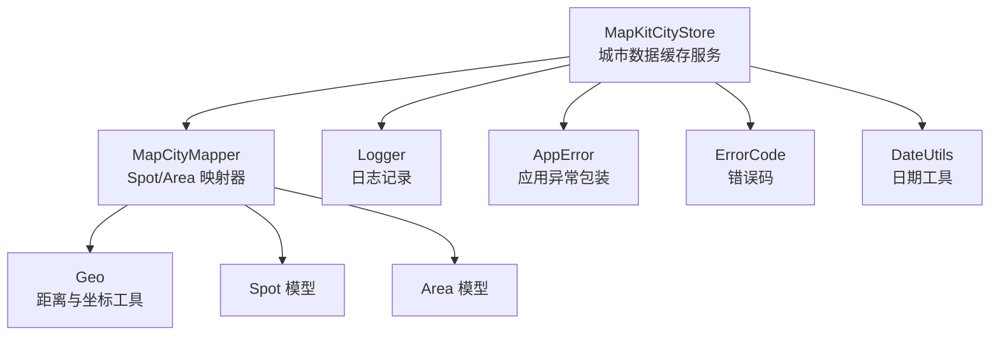
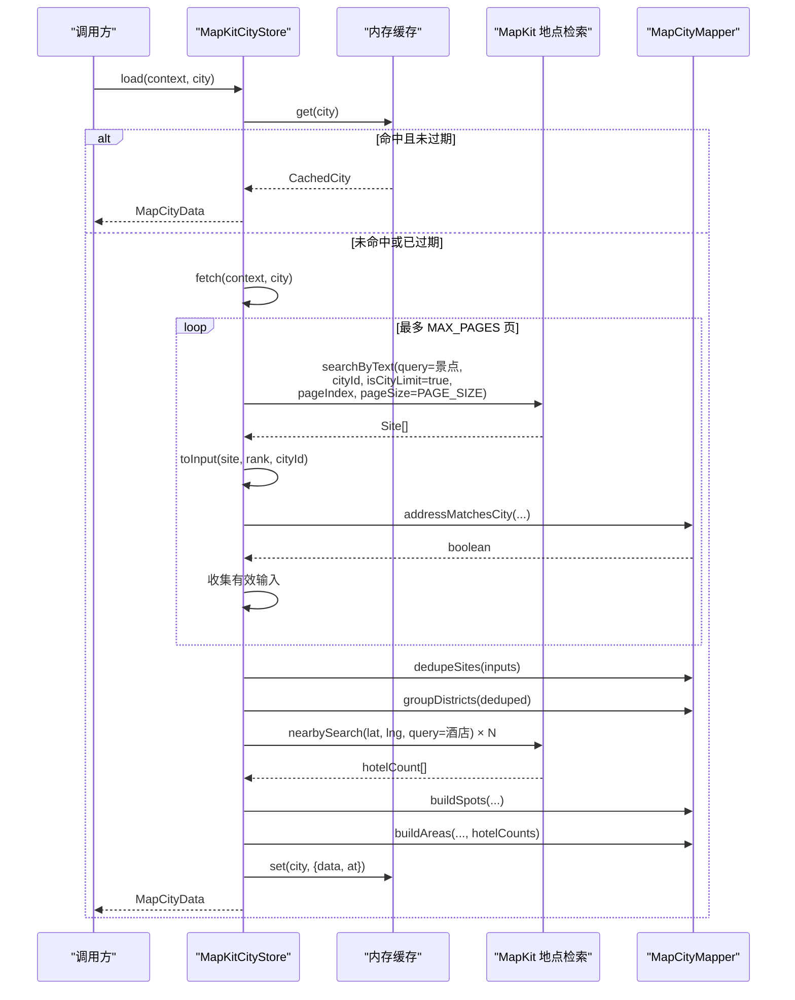
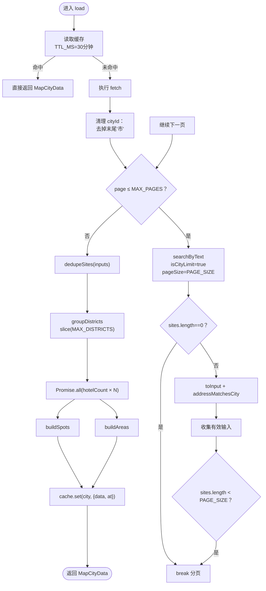
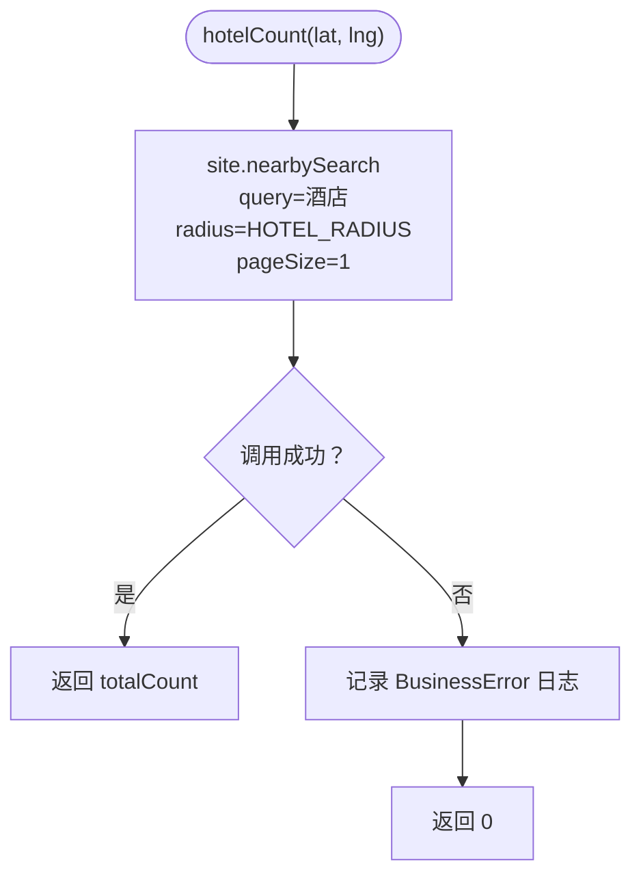
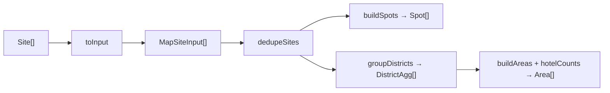
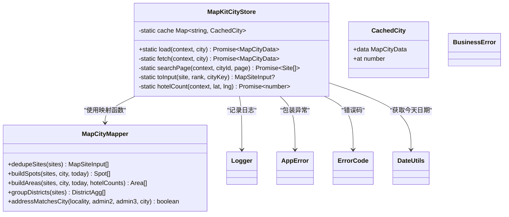

# 城市数据缓存服务

<cite>
**本文引用的文件**   
- [MapKitCityStore.ets](file://entry/src/main/ets/data/MapKitCityStore.ets)
- [MapCityMapper.ets](file://entry/src/main/ets/utils/MapCityMapper.ets)
- [AppError.ets](file://entry/src/main/ets/common/error/AppError.ets)
- [ErrorCode.ets](file://entry/src/main/ets/common/error/ErrorCode.ets)
- [Logger.ets](file://entry/src/main/ets/common/logger/Logger.ets)
</cite>

## 目录
1. [引言](#引言)
2. [项目结构定位](#项目结构定位)
3. [核心组件](#核心组件)
4. [架构总览](#架构总览)
5. [详细组件分析](#详细组件分析)
6. [依赖关系分析](#依赖关系分析)
7. [性能与并发特性](#性能与并发特性)
8. [配置指南](#配置指南)
9. [故障排查](#故障排查)
10. [结论](#结论)

## 引言
MapKitCityStore 是任意城市数据源（Stage 2）的核心缓存服务，负责把 Map Kit 地点检索结果转换成应用内的景点 Spot 和住宿区 Area。它同时承担三类职责：
- 城市级内存缓存：按城市名缓存 MapCityData，带 30 分钟 TTL。
- 安全检索与校验：强制使用 cityId + isCityLimit=true，并对 POI 地址做归属校验，防止“无效 cityId 返回全国结果”。
- 酒店供给聚合：对区县发起 nearbySearch，用 Promise.all 并发汇总酒店数量，作为住宿区排序依据。

设计约束来自真实探针结论：结果只放内存、不写 RDB 或文件；评分与预约字段不可得，热度由检索秩推导，预约一律 false；区县行政级别以 adminLevel3 为聚合键。

**章节来源**
- [MapKitCityStore.ets:1-179](file://entry/src/main/ets/data/MapKitCityStore.ets#L1-L179)
- [MapCityMapper.ets:1-20](file://entry/src/main/ets/utils/MapCityMapper.ets#L1-L20)

## 项目结构定位
MapKitCityStore 位于 entry 模块的 data 层，属于面向业务的数据获取与缓存入口；映射逻辑被剥离到 utils/MapCityMapper，保持纯函数、可离线 tsc 验证。错误类型、日志、日期工具则分别来自 common 与 utils。

**图表来源**
- [MapKitCityStore.ets:1-179](file://entry/src/main/ets/data/MapKitCityStore.ets#L1-L179)
- [MapCityMapper.ets:1-368](file://entry/src/main/ets/utils/MapCityMapper.ets#L1-L368)

**章节来源**
- [MapKitCityStore.ets:1-179](file://entry/src/main/ets/data/MapKitCityStore.ets#L1-L179)
- [MapCityMapper.ets:1-368](file://entry/src/main/ets/utils/MapCityMapper.ets#L1-L368)

## 核心组件
- `MapKitCityStore`：对外暴露 `load(context, city)`，内部维护静态 `cache: Map<string, CachedCity>`。
- `CachedCity`：接口包含 `data: MapCityData` 与 `at: number`（毫秒时间戳），用于 TTL 判断。
- `MapCityMapper`：提供 `dedupeSites`、`buildSpots`、`buildAreas`、`groupDistricts`、`addressMatchesCity` 等纯映射函数。
- `BusinessError` / `AppError` / `ErrorCode`：底层地图调用失败时统一包装为业务异常。
- `Logger`：记录命中、失败、区县候选、耗时等关键诊断信息。

**章节来源**
- [MapKitCityStore.ets:22-35](file://entry/src/main/ets/data/MapKitCityStore.ets#L22-L35)
- [MapCityMapper.ets:21-46](file://entry/src/main/ets/utils/MapCityMapper.ets#L21-L46)
- [AppError.ets](file://entry/src/main/ets/common/error/AppError.ets)
- [ErrorCode.ets](file://entry/src/main/ets/common/error/ErrorCode.ets)
- [Logger.ets](file://entry/src/main/ets/common/logger/Logger.ets)

## 架构总览
城市数据加载流程从页面调用 `MapKitCityStore.load` 开始，依次经历缓存检查、分页检索、地址校验、去重、区县聚合、酒店供给查询、Spot/Area 构建与缓存写入。

**图表来源**
- [MapKitCityStore.ets:36-179](file://entry/src/main/ets/data/MapKitCityStore.ets#L36-L179)
- [MapCityMapper.ets:148-200](file://entry/src/main/ets/utils/MapCityMapper.ets#L148-L200)
- [MapCityMapper.ets:239-368](file://entry/src/main/ets/utils/MapCityMapper.ets#L239-L368)

## 详细组件分析

### 任意城市景点与住宿区检索流程
`load` 先查内存缓存：若 `CachedCity` 存在且 `Date.now() - at < TTL_MS`，直接返回；否则调用私有 `fetch`。

`fetch` 的主要步骤：
1. **城市名归一化**：去掉末尾“市”字形成 `cityId`，用于检索；原始 `city` 保留给展示。
2. **分页检索**：循环 `page=1..MAX_PAGES`，每次调用 `searchPage`。若返回站点为空则提前终止；若站点数小于 `PAGE_SIZE` 说明已到最后，也提前终止。
3. **逐条转换与校验**：`toInput` 抽取坐标、名称、POI 摘要、开放时间、区县等信息，并调用 `addressMatchesCity` 过滤非目标城市结果。
4. **去重**：交给 `dedupeSites`。
5. **区县聚合与酒店供给**：`groupDistricts` 计算每个区县的平均经纬度与景点数，限制最多 `MAX_DISTRICTS` 个区县；对每个区县调用 `hotelCount`，并用 `Promise.all` 并发等待。
6. **构建结果**：`buildSpots` 生成景点列表，`buildAreas` 根据酒店供给生成住宿区。
7. **写入缓存**：将最终 `MapCityData` 与当前时间写入 `cache`。
8. **日志输出**：打印 raw/deduped/spots/areas/districts/耗时以及区县候选与住宿区顺序。

**图表来源**
- [MapKitCityStore.ets:36-119](file://entry/src/main/ets/data/MapKitCityStore.ets#L36-L119)
- [MapKitCityStore.ets:121-179](file://entry/src/main/ets/data/MapKitCityStore.ets#L121-L179)
- [MapCityMapper.ets:239-368](file://entry/src/main/ets/utils/MapCityMapper.ets#L239-L368)

**章节来源**
- [MapKitCityStore.ets:36-119](file://entry/src/main/ets/data/MapKitCityStore.ets#L36-L119)

### site.searchByText 调用与分页策略
- 调用位置：`searchPage`。
- 参数要点：
  - `query`: “景点”
  - `cityId`: 去“市”后缀后的城市标识
  - `isCityLimit`: true，强制限定城市范围
  - `pageIndex`: 从 1 递增
  - `pageSize`: `PAGE_SIZE=20`
  - `language`: “zh-CN”
- 分页策略：
  - 最大页数 `MAX_PAGES=3`，最多拉取约 60 条原始站点。
  - 空结果立即 break。
  - 返回站点数小于 20 时认为已到最后一页，不再继续请求。

这意味着即使后端有更多数据，服务也只消费前 3 页，避免无限滚动导致网络与内存压力。

**章节来源**
- [MapKitCityStore.ets:121-133](file://entry/src/main/ets/data/MapKitCityStore.ets#L121-L133)
- [MapKitCityStore.ets:47-72](file://entry/src/main/ets/data/MapKitCityStore.ets#L47-L72)

### cityId 参数处理与 isCityLimit 限制机制
- `cityId` 构造：若输入以“市”结尾，截取去掉最后一个字符；例如“西安市”→“西安”。
- `isCityLimit=true` 是安全边界：虽然真机探针表明某些无效 cityId 仍可能返回全国结果，但代码仍坚持传入该参数，作为第一道限制。
- 真正兜底的是 `addressMatchesCity`：只有 locality、adminLevel2、adminLevel3 中任一包含城市主名才放行。

这种“API 限制 + 地址校验”的双保险设计，既遵循 SDK 语义，又防御了边界 case。

**章节来源**
- [MapKitCityStore.ets:49-54](file://entry/src/main/ets/data/MapKitCityStore.ets#L49-L54)
- [MapKitCityStore.ets:121-133](file://entry/src/main/ets/data/MapKitCityStore.ets#L121-L133)
- [MapCityMapper.ets:331-368](file://entry/src/main/ets/utils/MapCityMapper.ets#L331-L368)

### 内存缓存设计：CachedCity、TTL 与 get/set
- 缓存容器：`private static cache: Map<string, CachedCity>`，键为城市名。
- `CachedCity`：
  - `data: MapCityData`
  - `at: number`，表示缓存写入时的毫秒时间戳。
- TTL：`TTL_MS = 30 * 60 * 1000`，即 30 分钟。
- `load` 中的命中条件：缓存存在且 `Date.now() - hit.at < TTL_MS`。
- 写入时机：成功完成 `fetch` 后调用 `cache.set(city, { data, at: Date.now() })`。

注意：缓存只在内存中，没有持久化；进程重启会丢失，这是有意为之，因为许可边界尚未确认是否允许落盘。

**章节来源**
- [MapKitCityStore.ets:22-35](file://entry/src/main/ets/data/MapKitCityStore.ets#L22-L35)
- [MapKitCityStore.ets:36-46](file://entry/src/main/ets/data/MapKitCityStore.ets#L36-L46)
- [MapKitCityStore.ets:110-119](file://entry/src/main/ets/data/MapKitCityStore.ets#L110-L119)

### 去重算法实现：dedupeSites
`dedupeSites` 在 `MapCityMapper` 中实现，核心思路是“保留顺序 + 名称相似 + 距离阈值”三重判断：
1. 丢弃无名称或坐标不可用的条目。
2. 与已保留集合逐个比较：
   - 完全同名且距离 ≤ 3km：视为重复。
   - 一个名称包含另一个且距离 ≤ 3km：视为重复，用于处理“西安城墙 / 城墙·碑林”这类父子命名。
   - 同区县、距离 ≤ 0.5km、共同前缀 ≥ 3 字：视为重复，用于处理“秦始皇帝陵博物院 / 秦始皇兵马俑博物馆”。
3. 遍历顺序保留先出现者，保证检索排名优先。

复杂度近似 O(n²)，n 为去重前站点数；考虑到 MAX_PAGES×PAGE_SIZE≈60，实际开销很小。

**章节来源**
- [MapCityMapper.ets:60-117](file://entry/src/main/ets/utils/MapCityMapper.ets#L60-L117)
- [MapCityMapper.ets:119-127](file://entry/src/main/ets/utils/MapCityMapper.ets#L119-L127)

### 地点验证逻辑：addressMatchesCity
`addressMatchesCity(locality, admin2, admin3, city)` 的职责是判断一条 POI 是否属于目标城市：
- 去除 city 末尾“市”，得到匹配 key。
- 只要 `locality`、`admin2`、`admin3` 三者之一包含 key，就判定归属成立。
- 如果 key 为空，直接拒绝。
- 注释强调：`adminLevel2` 实测是市级字段，不应查 `adminLevel1`，以避免省名与市名相同造成的误伤；也不看 `formatAddress`，以免路名误判。

该函数是防止“无效 cityId 返回全国结果”的关键防线。

**章节来源**
- [MapCityMapper.ets:331-368](file://entry/src/main/ets/utils/MapCityMapper.ets#L331-L368)
- [MapKitCityStore.ets:135-167](file://entry/src/main/ets/data/MapKitCityStore.ets#L135-L167)

### 酒店供给查询：nearbySearch 并发与降级
`hotelCount` 对单个区县的经纬度发起 `site.nearbySearch`，查询关键词“酒店”，半径 `HOTEL_RADIUS=3000`，`pageSize=1`，只关心 `totalCount`。

并发策略：
- 先 `groupDistricts` 并按景点数降序取前 `MAX_DISTRICTS=10` 个区县。
- 为每个区县创建 `Promise<number>`，放入数组。
- 使用 `Promise.all(hotelJobs)` 一次性并发请求，最慢路径决定整体延迟。
- 串行 10 次 nearbySearch 可能耗时 4–5 秒，并发后可显著降低尾延迟。

降级策略：
- 单个区县 nearbySearch 抛错不会阻断整座城市加载。
- 捕获 `BusinessError`，记录警告日志，返回 0。
- `buildAreas` 中，酒店数量为 0 的区县仍参与排序，只是优先级较低；若所有区县都无酒店数据，则退回按景点数排序。

**图表来源**
- [MapKitCityStore.ets:169-179](file://entry/src/main/ets/data/MapKitCityStore.ets#L169-L179)
- [MapKitCityStore.ets:83-108](file://entry/src/main/ets/data/MapKitCityStore.ets#L83-L108)

**章节来源**
- [MapKitCityStore.ets:83-108](file://entry/src/main/ets/data/MapKitCityStore.ets#L83-L108)
- [MapKitCityStore.ets:169-179](file://entry/src/main/ets/data/MapKitCityStore.ets#L169-L179)

### 数据处理流程：dedupeSites → buildSpots/buildAreas → groupDistricts
数据流分为两条主线：

1. **景点主线**：
   - `dedupeSites` 去重。
   - `buildSpots` 将每条输入映射为 `Spot`：
     - id 使用 `mk:${city}:${siteId}`。
     - popularity 由 rank 推导，第 1 名最高，越后越低。
     - booking.requiresBooking 固定为 false。
     - openingHours 仅当周营业文本一致时才展示。
     - provenance.source 标记为“MapKit 地点检索”。

2. **住宿区主线**：
   - `groupDistricts` 按 district 聚合，计算平均经纬度和景点数，并按 count 降序。
   - `buildAreas` 先筛选有酒店供给的区县，再按酒店数量降序、景点数量次优排序，最多取 `MAX_AREAS=8` 个。
   - 无酒店数据时退回全部区县池，但描述中标注“未校准”。

**图表来源**
- [MapKitCityStore.ets:47-119](file://entry/src/main/ets/data/MapKitCityStore.ets#L47-L119)
- [MapCityMapper.ets:148-200](file://entry/src/main/ets/utils/MapCityMapper.ets#L148-L200)
- [MapCityMapper.ets:239-368](file://entry/src/main/ets/utils/MapCityMapper.ets#L239-L368)

**章节来源**
- [MapKitCityStore.ets:47-119](file://entry/src/main/ets/data/MapKitCityStore.ets#L47-L119)
- [MapCityMapper.ets:148-200](file://entry/src/main/ets/utils/MapCityMapper.ets#L148-L200)
- [MapCityMapper.ets:239-368](file://entry/src/main/ets/utils/MapCityMapper.ets#L239-L368)

## 依赖关系分析

**图表来源**
- [MapKitCityStore.ets:1-179](file://entry/src/main/ets/data/MapKitCityStore.ets#L1-L179)
- [MapCityMapper.ets:1-368](file://entry/src/main/ets/utils/MapCityMapper.ets#L1-L368)

**章节来源**
- [MapKitCityStore.ets:1-179](file://entry/src/main/ets/data/MapKitCityStore.ets#L1-L179)
- [MapCityMapper.ets:1-368](file://entry/src/main/ets/utils/MapCityMapper.ets#L1-L368)

## 性能与并发特性
- **分页上限**：`MAX_PAGES=3`，`PAGE_SIZE=20`，原始站点最多约 60 条，控制内存与网络消耗。
- **区县上限**：`MAX_DISTRICTS=10`，限制 nearbySearch 并发数量，避免过多地理查询。
- **并发优化**：酒店供给使用 `Promise.all`，将原本串行的 10 次 nearbySearch 改为并发，尾延迟取决于最慢区县。
- **去重成本**：O(n²) 名称+距离比较，但 n 受分页上限约束，实际代价低。
- **TTL 缓存**：30 分钟内同一城市多次调用直接返回内存数据，减少重复 API 调用。
- **排序稳定**：Spot 按 rank 排序，Area 优先酒店供给、其次景点数，符合“市中心供给更足”的经验。

[本节为通用性能讨论，不直接分析具体代码片段]

## 配置指南
| 配置项 | 默认值 | 含义 | 调整建议 |
|---|---:|---|---|
| `TTL_MS` | `30 * 60 * 1000` | 城市缓存过期时间，单位毫秒 | 热点城市可增大以降低后端压力；弱网场景可适当缩短以保证时效 |
| `PAGE_SIZE` | `20` | 每次分页返回站点数 | 增大可提升单页召回，但会增加单次响应体积 |
| `MAX_PAGES` | `3` | 最大分页次数 | 增加可提高召回上限，但会放大网络和内存成本 |
| `MAX_DISTRICTS` | `10` | 最大参与酒店供给查询的区县数 | 大城市可增加；小城市可减少以降低 nearbySearch 次数 |
| `HOTEL_RADIUS` | `3000` | 酒店搜索半径，单位米 | 市中心可缩小提高精度；远郊或新区可扩大覆盖 |
| `MAX_AREAS` | `8` | 住宿区候选上限 | 界面需要更多分区时可增大，但会稀释热点密度 |

**章节来源**
- [MapKitCityStore.ets:26-31](file://entry/src/main/ets/data/MapKitCityStore.ets#L26-L31)
- [MapCityMapper.ets:46-50](file://entry/src/main/ets/utils/MapCityMapper.ets#L46-L50)

## 故障排查
### 常见错误与处理
- **地图服务调用失败**：
  - 捕获 `BusinessError`，记录 code 与 message。
  - 向上抛出 `AppError(ErrorCode.MAP_CITY_DATA_FAILED, ...)`，附带原始 Error。
- **城市无景点**：
  - 去重后结果为空时，直接抛出 `AppError(MAP_CITY_DATA_FAILED)`，提示地图服务未返回该城市景点。
- **单个区县酒店查询失败**：
  - 不阻断整城加载，记录警告日志，返回 0；`buildAreas` 会退回到按景点数排序。

### 日志线索
- 缓存命中日志：包含城市名、spots 数量、areas 数量。
- 地址样本日志：首次检索时打印 locality/admin2/admin3，便于判断归属字段取值。
- 失败日志：包含错误码与消息。
- 汇总日志：raw/deduped/spots/areas/districts/耗时。
- 排序取证日志：打印每个区县的景点数与酒店数，以及最终住宿区顺序。

### 排查建议
1. 若城市无景点：
   - 检查 cityId 是否有效，是否包含“市”后缀导致映射异常。
   - 查看 `addressMatchesCity` 相关日志，确认 locality/admin2/admin3 是否包含城市主名。
2. 若景点重复：
   - 检查 `dedupeSites` 的距离阈值与名称包含逻辑是否满足预期。
3. 若住宿区顺序异常：
   - 查看区县候选日志，确认酒店供给是否为零或分布不均。
4. 若整体失败：
   - 查看 `BusinessError` 的 code 与 message，区分网络超时、权限不足或服务端错误。

**章节来源**
- [MapKitCityStore.ets:109-119](file://entry/src/main/ets/data/MapKitCityStore.ets#L109-L119)
- [MapKitCityStore.ets:135-167](file://entry/src/main/ets/data/MapKitCityStore.ets#L135-L167)
- [MapKitCityStore.ets:169-179](file://entry/src/main/ets/data/MapKitCityStore.ets#L169-L179)

## 结论
MapKitCityStore 是一个围绕“安全检索 + 内存缓存 + 纯映射”的城市数据服务。它通过 `cityId + isCityLimit` 与 `addressMatchesCity` 双重防护避免全球结果污染，通过 `PAGE_SIZE/MAX_PAGES` 控制召回规模，通过 `Promise.all` 并发提升酒店供给查询效率，并通过 `TTL_MS` 提供稳定的本地缓存。映射层将不可靠的 Map Kit 字段转化为稳定可用的 Spot 与 Area，同时明确标注评分、预约、通勤等字段的置信度，确保界面不伪造数据。

在实际使用中，应优先关注：
- 城市名与 cityId 的一致性。
- 无效 cityId 导致的全国结果问题。
- 酒店供给缺失时的降级行为。
- 缓存 TTL 与分页参数对性能与召回的影响。

[本节为总结性内容，不直接分析具体文件]