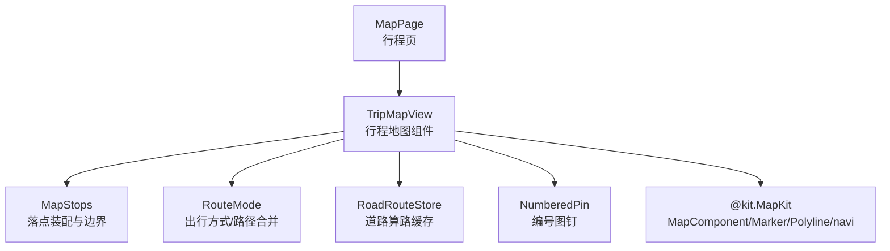
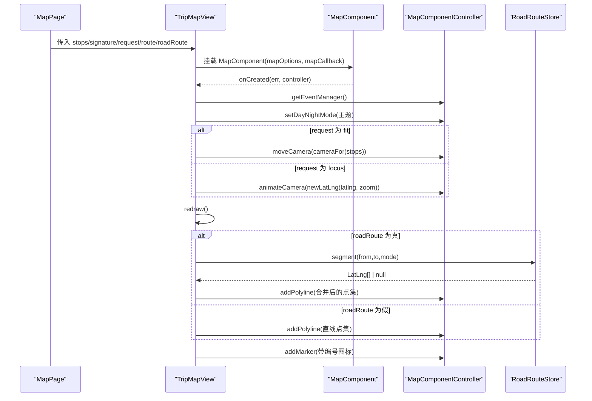
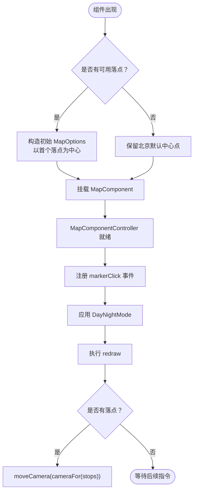
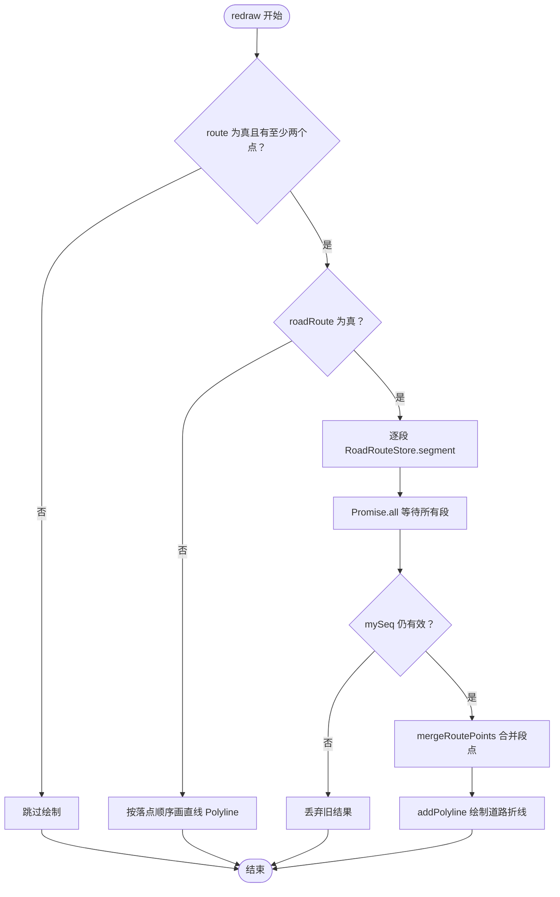
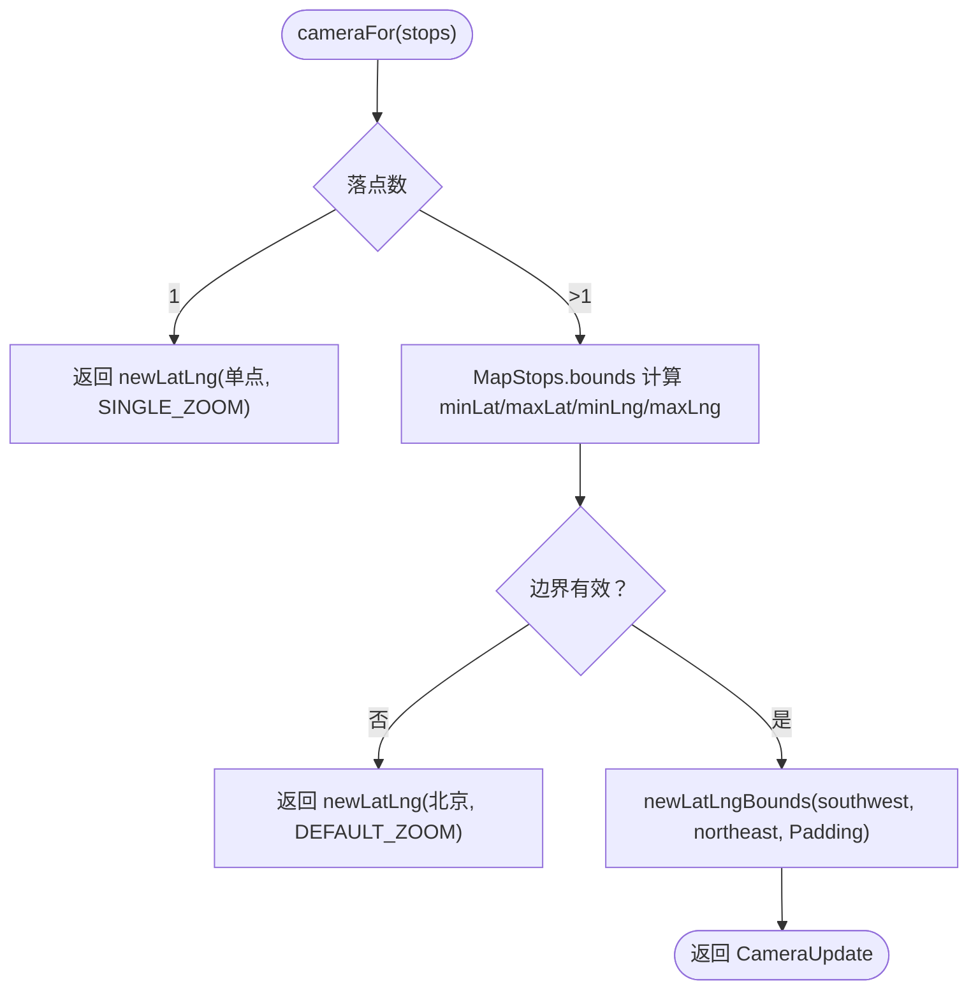
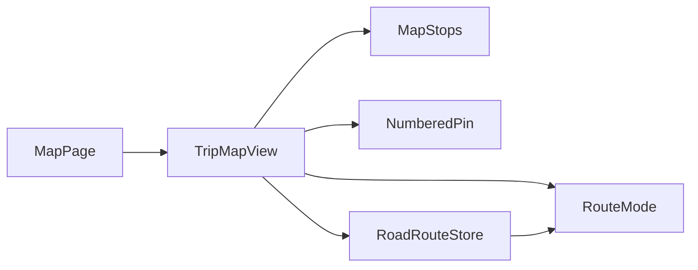

# 行程地图组件

<cite>
**本文引用的文件**   
- [TripMapView.ets](file://entry/src/main/ets/components/TripMapView.ets)
- [NumberedPin.ets](file://entry/src/main/ets/utils/NumberedPin.ets)
- [RoadRouteStore.ets](file://entry/src/main/ets/data/RoadRouteStore.ets)
- [MapPage.ets](file://entry/src/main/ets/pages/MapPage.ets)
- [MapStops.ets](file://entry/src/main/ets/utils/MapStops.ets)
- [RouteMode.ets](file://entry/src/main/ets/utils/RouteMode.ets)
- [ErrorCode.ets](file://entry/src/main/ets/common/error/ErrorCode.ets)
</cite>

## 目录
1. [引言](#引言)
2. [项目结构定位](#项目结构定位)
3. [核心组件总览](#核心组件总览)
4. [架构概览](#架构概览)
5. [详细组件分析](#详细组件分析)
6. [依赖关系分析](#依赖关系分析)
7. [性能与渲染特性](#性能与渲染特性)
8. [坐标系统与默认中心点](#坐标系统与默认中心点)
9. [错误处理与兜底机制](#错误处理与兜底机制)
10. [配置指南](#配置指南)
11. [故障排查](#故障排查)
12. [结论](#结论)

## 引言
本文件面向 TripMapView 行程地图组件，系统梳理其在 ArkTS + Map Kit 体系中的职责边界、生命周期、标记点系统、路线绘制、相机控制、主题切换、坐标转换约定、性能优化与错误兜底。该组件被用于屏 8 地图面板、dock 地图页与片区候选地图等场景：它只负责把一组落点（MapStop）画成“图钉 + 动线”，不直接持有业务数据模型；业务数据由上层页面组装为 MapStop 数组后传入。

## 项目结构定位
TripMapView 属于 UI 层 `components`，依赖纯逻辑工具 `utils` 与数据层 `data`：
- UI 层：`TripMapView.ets` 负责 MapComponent 挂载、覆盖物绘制、事件与相机。
- 工具层：`MapStops.ets` 负责落点装配、边界计算、分组；`RouteMode.ets` 负责出行方式识别与路径合并；`NumberedPin.ets` 负责编号图钉像素图生成。
- 数据层：`RoadRouteStore.ets` 封装 Map Kit navi 道路算路、缓存与公交段拼接。
- 页面层：`MapPage.ets` 是 dock 地图页，负责行程选择、Day 切换、留白参数与交互指令下发。

**图表来源**
- [MapPage.ets:1-120](file://entry/src/main/ets/pages/MapPage.ets#L1-L120)
- [TripMapView.ets:1-120](file://entry/src/main/ets/components/TripMapView.ets#L1-L120)
- [MapStops.ets:1-60](file://entry/src/main/ets/utils/MapStops.ets#L1-L60)
- [RouteMode.ets:1-68](file://entry/src/main/ets/utils/RouteMode.ets#L1-L68)
- [RoadRouteStore.ets:1-40](file://entry/src/main/ets/data/RoadRouteStore.ets#L1-L40)
- [NumberedPin.ets:1-30](file://entry/src/main/ets/utils/NumberedPin.ets#L1-L30)

**章节来源**
- [MapPage.ets:1-120](file://entry/src/main/ets/pages/MapPage.ets#L1-L120)
- [TripMapView.ets:1-120](file://entry/src/main/ets/components/TripMapView.ets#L1-L120)

## 核心组件总览
TripMapView 是一个可复用的 Map Kit 地图容器，核心能力包括：
- 使用 `MapComponent` 承载真实底图，并通过 `mapCallback` 拿到控制器。
- 接收 `stops`、`signature`、`request`、`route`、`roadRoute`、`fitTopPx`、`fitBottomPx` 等属性。
- 管理 Marker 与 Polyline 覆盖物，按 `signature` 去重重绘。
- 支持“全览收敛”和“聚焦某站”的相机控制。
- 支持 DayNightMode 主题切换。
- 在 `aboutToDisappear` 中安全注销事件并清理覆盖物。

关键属性语义：
- `stops`：落点集合，变更时通过 `redraw` 触发重铺。
- `signature`：内容指纹，作为真正决定是否重绘的键。
- `request`：父组件下发的镜头指令，形如 `'fit'` 或 `'focus:<index>:<seq>'`。
- `route`：是否绘制落点连线。
- `roadRoute`：是否调用 Map Kit navi 把直线替换为道路折线。
- `fitTopPx` / `fitBottomPx`：`newLatLngBounds` 的顶部/底部留白像素值。

**章节来源**
- [TripMapView.ets:24-120](file://entry/src/main/ets/components/TripMapView.ets#L24-L120)

## 架构概览
从页面到地图渲染的关键链路如下：

**图表来源**
- [TripMapView.ets:60-120](file://entry/src/main/ets/components/TripMapView.ets#L60-L120)
- [TripMapView.ets:201-385](file://entry/src/main/ets/components/TripMapView.ets#L201-L385)
- [RoadRouteStore.ets:20-118](file://entry/src/main/ets/data/RoadRouteStore.ets#L20-L118)

## 详细组件分析

### MapComponent 生命周期与初始化
- `aboutToAppear`：当存在首个可用落点时，用该落点的经纬度构造初始 `MapOptions`，避免首次挂载时中心点非法。
- `initialOptions`：设置初始 `CameraPosition`（目标经纬度与默认缩放），关闭缩放控件、指南针、比例尺、我的位置控件以及倾斜/旋转手势，保持地图行为可控。
- `onCreated`：Map Kit 回调创建结果；成功时获取事件管理器、注册 `markerClick`、清除错误状态、应用主题并执行首帧重绘与收敛；失败时记录错误码与消息，并将用户可见文案设为“地图加载失败”。

**图表来源**
- [TripMapView.ets:100-140](file://entry/src/main/ets/components/TripMapView.ets#L100-L140)
- [TripMapView.ets:140-180](file://entry/src/main/ets/components/TripMapView.ets#L140-L180)

**章节来源**
- [TripMapView.ets:90-180](file://entry/src/main/ets/components/TripMapView.ets#L90-L180)

### MapOptions 配置与 CameraPosition
- 初始中心点优先取 `stops[0]`，否则回退到北京的经纬度常量。
- 默认缩放级别为 `DEFAULT_ZOOM`。
- 禁用 Map Kit 原生缩放按钮、指南针、比例尺、我的位置控件及倾斜/旋转手势，使交互完全由业务控制。
- 主题切换通过 `setDayNightMode` 动态切换 DAY/NIGHT。

| 配置项 | 含义 | 默认值或策略 |
|---|---|---|
| `position.target.latitude` | 地图中心纬度 | 首个落点纬度，或北京纬度 |
| `position.target.longitude` | 地图中心经度 | 首个落点经度，或北京经度 |
| `position.zoom` | 初始缩放 | `DEFAULT_ZOOM` |
| `zoomControlsEnabled` | 缩放控件 | 关闭 |
| `compassControlsEnabled` | 指南针 | 关闭 |
| `scaleControlsEnabled` | 比例尺 | 关闭 |
| `myLocationControlsEnabled` | 我的位置 | 关闭 |
| `tiltGesturesEnabled` | 倾斜手势 | 关闭 |
| `rotateGesturesEnabled` | 旋转手势 | 关闭 |

**章节来源**
- [TripMapView.ets:24-50](file://entry/src/main/ets/components/TripMapView.ets#L24-L50)
- [TripMapView.ets:120-160](file://entry/src/main/ets/components/TripMapView.ets#L120-L160)

### 标记点系统：Marker、NumberedPin 与点击事件
- 每个 `MapStop` 对应一个 Marker，位置来自落点经纬度，标题为“序号 + 名称”，副标题为时间或区域信息。
- 锚点设置为针尖朝下，使相机收敛更贴近真实落点。
- `NumberedPin.of(index, brand)` 使用 OffscreenCanvas 绘制白底胶囊徽章、品牌色描边与细尖角，并缓存 `PixelMap`；绘制失败返回 undefined，Marker 自动退回默认图钉，保证地图不会整片无点。
- `markerClick` 回调通过 `marker.getTag()` 解析出 `MapStop.index`，再调用父组件提供的 `onStopClick`；对 `undefined` Marker 做防御，避免组件拆除期原生侧二次回调导致进程崩溃。

**图表来源**
- [TripMapView.ets:201-385](file://entry/src/main/ets/components/TripMapView.ets#L201-L385)
- [NumberedPin.ets:1-86](file://entry/src/main/ets/utils/NumberedPin.ets#L1-L86)
- [MapStops.ets:12-35](file://entry/src/main/ets/utils/MapStops.ets#L12-L35)

**章节来源**
- [TripMapView.ets:250-385](file://entry/src/main/ets/components/TripMapView.ets#L250-L385)
- [NumberedPin.ets:1-86](file://entry/src/main/ets/utils/NumberedPin.ets#L1-L86)
- [MapStops.ets:12-35](file://entry/src/main/ets/utils/MapStops.ets#L12-L35)

### 路线绘制：Polyline、roadRoute、mergeRoutePoints、routeSeq
- 当 `route=true` 且一段内至少有 2 个落点时绘制动线。
- 若 `roadRoute=false`，直接使用落点顺序构成直线 Polyline。
- 若 `roadRoute=true`，对相邻两站调用 `RoadRouteStore.segment` 获取道路折线；单段失败返回 null，调用方回退为 `[from, to]`，确保整条动线不断。
- 多个道路段的端点可能重复，需通过 `mergeRoutePoints` 去除连续重复点，避免 Polyline 出现零长线段。
- `routeSeq` 是递增竞态锁：每次 `redraw` 先自增，异步算路完成后比较 `mySeq !== this.routeSeq`，丢弃旧请求结果，防止新一天覆盖前一天的路线。

**图表来源**
- [TripMapView.ets:201-320](file://entry/src/main/ets/components/TripMapView.ets#L201-L320)
- [RoadRouteStore.ets:20-118](file://entry/src/main/ets/data/RoadRouteStore.ets#L20-L118)
- [RouteMode.ets:40-68](file://entry/src/main/ets/utils/RouteMode.ets#L40-L68)

**章节来源**
- [TripMapView.ets:201-320](file://entry/src/main/ets/components/TripMapView.ets#L201-L320)
- [RoadRouteStore.ets:20-118](file://entry/src/main/ets/data/RoadRouteStore.ets#L20-L118)
- [RouteMode.ets:1-68](file://entry/src/main/ets/utils/RouteMode.ets#L1-L68)

### 相机控制：cameraFor、newLatLngBounds、FIT_PAD_* 与 animateCamera
- 单个落点：使用 `SINGLE_ZOOM` 聚焦该点。
- 多个落点：调用 `MapStops.bounds` 计算最小矩形边界，再用 `map.newLatLngBounds` 生成 `CameraUpdate`。
- 留白策略：左侧与右侧固定 `FIT_PAD_SIDE`，顶部与底部由 `fitTopPx`、`fitBottomPx` 传入；这些单位是像素，不是视觉像素。
- 无有效边界时回退到北京默认中心点与 `DEFAULT_ZOOM`。
- `onRequest` 支持两种指令：
  - `'fit'`：立即 `moveCamera` 收敛全部落点。
  - `'focus:<index>:<seq>'`：找到对应落点后 `animateCamera` 平滑飞到 `FOCUS_ZOOM`。

**图表来源**
- [TripMapView.ets:160-201](file://entry/src/main/ets/components/TripMapView.ets#L160-L201)
- [MapStops.ets:120-187](file://entry/src/main/ets/utils/MapStops.ets#L120-L187)

**章节来源**
- [TripMapView.ets:160-201](file://entry/src/main/ets/components/TripMapView.ets#L160-L201)
- [MapStops.ets:120-187](file://entry/src/main/ets/utils/MapStops.ets#L120-L187)

### 主题切换：DayNightMode
- `@StorageProp('isDarkMode')` 监听深浅档变化。
- `applyTheme` 在控制器就绪后调用 `setDayNightMode`，深色模式使用 NIGHT，浅色模式使用 DAY。
- 图钉与动线颜色也随主题切换：浅色品牌蓝与深色浅蓝分别用于 Polyline 和 NumberedPin 描边。

**章节来源**
- [TripMapView.ets:40-60](file://entry/src/main/ets/components/TripMapView.ets#L40-L60)
- [TripMapView.ets:180-201](file://entry/src/main/ets/components/TripMapView.ets#L180-L201)
- [TripMapView.ets:300-385](file://entry/src/main/ets/components/TripMapView.ets#L300-L385)

## 依赖关系分析

**图表来源**
- [TripMapView.ets:1-40](file://entry/src/main/ets/components/TripMapView.ets#L1-L40)
- [RoadRouteStore.ets:1-25](file://entry/src/main/ets/data/RoadRouteStore.ets#L1-L25)
- [MapPage.ets:1-60](file://entry/src/main/ets/pages/MapPage.ets#L1-L60)

**章节来源**
- [TripMapView.ets:1-40](file://entry/src/main/ets/components/TripMapView.ets#L1-L40)
- [RoadRouteStore.ets:1-25](file://entry/src/main/ets/data/RoadRouteStore.ets#L1-L25)

## 性能与渲染特性
- **签名重绘**：`redraw` 优先使用父组件传入的 `signature`，否则用 `MapStops.signature` 生成标量键；相同键直接返回，避免频繁重建覆盖物。
- **条件触发**：只有 `controller` 非空才执行重绘；落点过滤掉不可用坐标后为空则仅打日志，不抛错。
- **资源清理**：`aboutToDisappear` 中对 `events.off`、`clearOverlays`、控制器置空均包裹 try/catch，因为原生侧回收时机不确定，异常逃出会杀死进程。
- **异步覆盖物保护**：Marker 与 Polyline 添加成功后，若 `this.controller === null` 说明组件已拆除，丢弃结果并记录警告。
- **算路缓存**：`RoadRouteStore` 对起终点坐标 + 出行方式的组合进行 30 分钟 TTL 缓存，减少重复调用 Map Kit navi。
- **公交段拼接**：公交路线按 sections 顺序拼接步行段与乘车段，再通过 `mergeRoutePoints` 去重，避免折线抖动。

**章节来源**
- [TripMapView.ets:180-250](file://entry/src/main/ets/components/TripMapView.ets#L180-L250)
- [TripMapView.ets:250-385](file://entry/src/main/ets/components/TripMapView.ets#L250-L385)
- [RoadRouteStore.ets:20-60](file://entry/src/main/ets/data/RoadRouteStore.ets#L20-L60)
- [RouteMode.ets:40-68](file://entry/src/main/ets/utils/RouteMode.ets#L40-L68)

## 坐标系统与默认中心点
- 组件注释明确：中国大陆 Map Kit 使用 GCJ02，WGS84 会整体偏几百米；种子层应在入库前完成 WGS84 到 GCJ02 转换。
- 坐标有效性检查由 `MapStops.usable` 提供，粗略限定中国境内范围，避免 AI 生成的无效坐标把整条动线拉到几内亚湾。
- 默认中心点使用北京经纬度常量；当边界计算失败或初始选项未更新时使用该回退值。
- `MapStops.signature` 将经纬度格式化到小数点后四位，作为稳定的重绘键。

| 概念 | 实现位置 | 说明 |
|---|---|---|
| GCJ02 约定 | TripMapView 头注释 | 喂入 WGS84 会偏移，应由上游转换 |
| 坐标有效性 | MapStops.usable | 限制在中国大陆近似范围内 |
| 默认中心点 | TripMapView | BEIJING_LAT / BEIJING_LNG |
| 经纬度格式化 | MapStops.signature | 保留四位小数用于签名 |

**章节来源**
- [TripMapView.ets:1-40](file://entry/src/main/ets/components/TripMapView.ets#L1-L40)
- [TripMapView.ets:24-50](file://entry/src/main/ets/components/TripMapView.ets#L24-L50)
- [MapStops.ets:1-40](file://entry/src/main/ets/utils/MapStops.ets#L1-L40)
- [MapStops.ets:170-187](file://entry/src/main/ets/utils/MapStops.ets#L170-L187)

## 错误处理与兜底机制
- **MapComponent 初始化失败**：`onCreated` 捕获 BusinessError，将用户可见文案设为“地图加载失败”，同时记录 code 与 message。
- **markerClick 拆除期异常**：对 undefined/null Marker 直接 return，避免进程崩溃。
- **地图服务鉴权或权限失败**：RoadRouteStore 对算路失败统一 warn 并返回 null，调用方回退为直线，保证地图不断线。
- **通用错误码**：ErrorCode 定义网络、存储、业务、账号、云端等全局错误码；地图城市数据失败使用 `MAP_CITY_DATA_FAILED`。
- **组件销毁期异常**：`aboutToDisappear` 对所有原生侧清理操作加 try/catch，避免异常逃逸。

| 错误场景 | 处理策略 | 日志/用户可见 |
|---|---|---|
| MapComponent 初始化失败 | 设置 `mapError`，不继续绘制 | 显示“地图加载失败” |
| markerClick 回调为 undefined | 直接返回 | 不抛错 |
| 道路算路失败 | 返回 null，回退直线 | Logger.warn |
| 城市数据检索失败 | 抛出 AppError(MAP_CITY_DATA_FAILED) | Logger.warn + 上层 AppError |
| 组件销毁期清理异常 | try/catch 包裹 | Logger.warn |

**章节来源**
- [TripMapView.ets:60-120](file://entry/src/main/ets/components/TripMapView.ets#L60-L120)
- [TripMapView.ets:180-250](file://entry/src/main/ets/components/TripMapView.ets#L180-L250)
- [RoadRouteStore.ets:40-80](file://entry/src/main/ets/data/RoadRouteStore.ets#L40-L80)
- [ErrorCode.ets:1-48](file://entry/src/main/ets/common/error/ErrorCode.ets#L1-L48)

## 配置指南
### TripMapView 属性
| 属性 | 类型 | 默认值 | 说明 |
|---|---|---|---|
| `stops` | `MapStop[]` | `[]` | 落点集合，驱动重绘 |
| `signature` | `string` | `''` | 内容指纹，优先级高于 stops 判断重铺 |
| `request` | `string` | `''` | 镜头指令：`'fit'` 或 `'focus:<index>:<seq>'` |
| `route` | `boolean` | `true` | 是否绘制落点连线 |
| `roadRoute` | `boolean` | `false` | 是否调用 Map Kit navi 计算道路折线 |
| `fitTopPx` | `number` | `FIT_PAD_TOP` | 顶部留白像素 |
| `fitBottomPx` | `number` | `FIT_PAD_BOTTOM` | 底部留白像素 |
| `onStopClick` | `(index: number) => void` | 无 | 点击落点回调，传入 1 起索引 |

### 缩放级别
| 常量 | 用途 | 典型场景 |
|---|---|---|
| `SINGLE_ZOOM` | 单点聚焦 | 只有一个落点 |
| `DEFAULT_ZOOM` | 初始默认缩放 | 地图刚挂载 |
| `FOCUS_ZOOM` | 聚焦某站动画缩放 | `focus:` 指令 |

### 线条颜色与图钉样式
- 浅色动线色与深色动线色分别定义为 ARGB 数值，供 Map Polyline 使用。
- 图钉品牌色为字符串格式，用于 OffscreenCanvas 描边与尖角；数字颜色固定深蓝以保证白底可读性。
- NumberedPin 根据序号位数自适应徽章宽度，并在缓存命中时复用 PixelMap。

**章节来源**
- [TripMapView.ets:24-50](file://entry/src/main/ets/components/TripMapView.ets#L24-L50)
- [TripMapView.ets:300-385](file://entry/src/main/ets/components/TripMapView.ets#L300-L385)
- [NumberedPin.ets:1-86](file://entry/src/main/ets/utils/NumberedPin.ets#L1-L86)

## 故障排查
- **地图空白但应用正常**：检查 MapComponent 初始化错误日志；若 code 为鉴权相关错误，用户侧提示“地图加载失败”，但行程时间线仍可正常使用。
- **地图无落点**：确认 `stops` 是否经过 `MapStops.usable` 过滤；AI 生成的 0/0 坐标会被丢弃。
- **动线断断续续**：检查 `roadRoute` 与 `route`；若道路算路失败，会回退为直线段，整条线不应断开。
- **图钉不显示序号**：检查 NumberedPin 生成是否抛错；失败时退回默认图钉，不影响其他落点。
- **相机位置不对**：确认 `request` 是否正确；`fit` 收敛全部落点，`focus:` 需要匹配 `MapStop.index`。
- **深/浅主题不生效**：检查 `isDarkMode` 是否随系统变化更新；`applyTheme` 需在控制器就绪后调用。
- **地图页无图**：MapPage 根模式下若无在途行程，会回退到最近一条历史行程；若没有任何行程，则输出引导空态而非空白地图。

**章节来源**
- [TripMapView.ets:180-385](file://entry/src/main/ets/components/TripMapView.ets#L180-L385)
- [MapStops.ets:1-60](file://entry/src/main/ets/utils/MapStops.ets#L1-L60)
- [RoadRouteStore.ets:40-80](file://entry/src/main/ets/data/RoadRouteStore.ets#L40-L80)
- [MapPage.ets:120-200](file://entry/src/main/ets/pages/MapPage.ets#L120-L200)

## 结论
TripMapView 是一个职责清晰、防御完善的地图展示组件：它以 MapComponent 为底座，以 MapStop 为输入，以 signature 为渲染去重键，以 routeSeq 为算路竞态锁，以 try/catch 为进程保护网。其设计重点在于：
- 把 Map Kit 细节封装在组件内部，上层只关心落点与镜头指令。
- 在鉴权失败、网络异常、坐标无效等情况下提供降级，而不是让地图变成“一碰就崩”的黑盒。
- 用 GCJ02 约定、边界留白与默认中心点，把地图行为约束在可预期范围内。
- 通过 NumberedPin、Polyline、cameraFor 的组合，把“落点 + 动线 + 相机”三件事统一到一次 redraw 中。