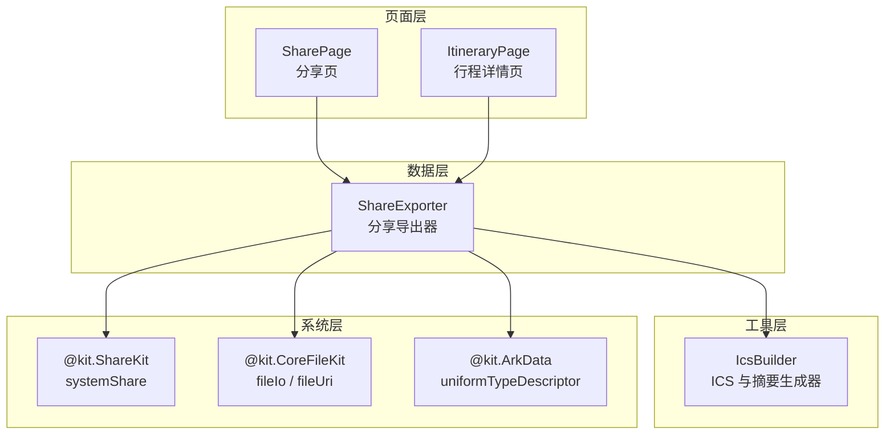
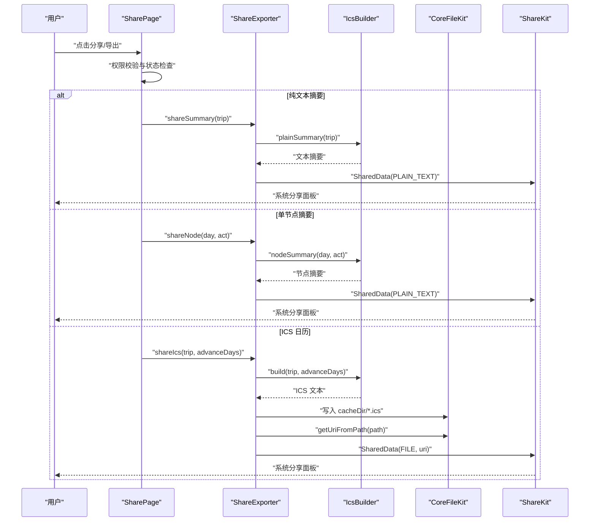
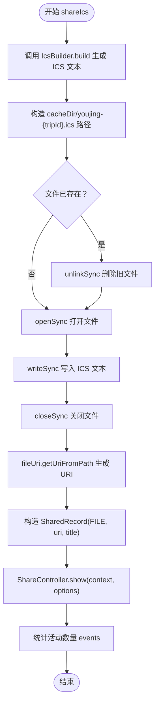
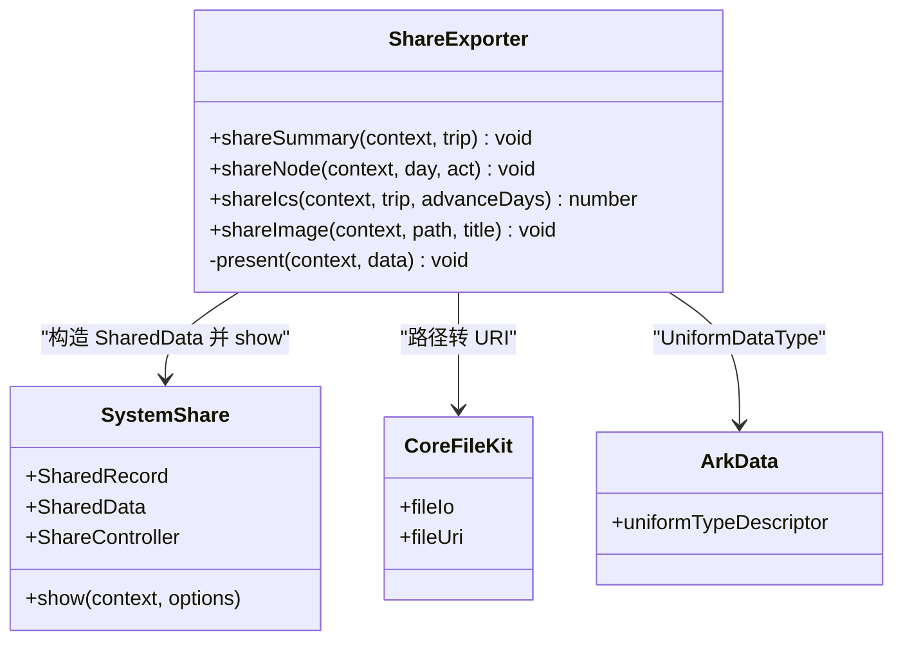
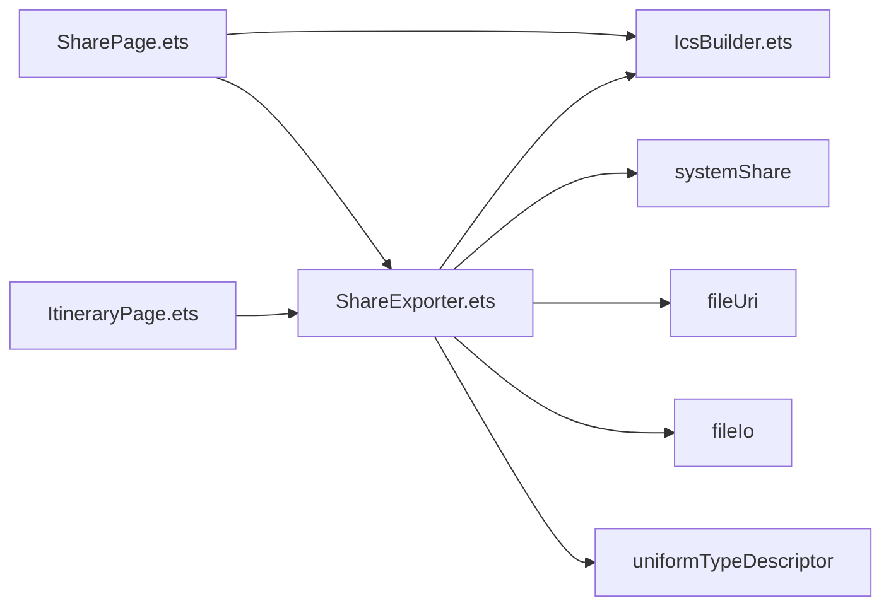

# ShareKit 分享导出

<cite>
**本文引用的文件**   
- [ShareExporter.ets](file://entry/src/main/ets/data/ShareExporter.ets)
- [IcsBuilder.ets](file://entry/src/main/ets/utils/IcsBuilder.ets)
- [SharePage.ets](file://entry/src/main/ets/pages/SharePage.ets)
- [ItineraryPage.ets](file://entry/src/main/ets/pages/ItineraryPage.ets)
</cite>

## 目录
1. [引言](#引言)
2. [项目结构](#项目结构)
3. [核心组件](#核心组件)
4. [架构总览](#架构总览)
5. [详细组件分析](#详细组件分析)
6. [依赖关系分析](#依赖关系分析)
7. [性能与隐私特性](#性能与隐私特性)
8. [故障排查指南](#故障排查指南)
9. [配置与扩展指南](#配置与扩展指南)
10. [结论](#结论)

## 引言
本文件面向有径应用中的“分享与导出”能力，系统性说明 ShareKit 体系如何把行程数据转化为系统分享面板可消费的内容。该方案完全运行在本地：不上传业务服务器、不携带账号信息；所有文本摘要、ICS 日历、长图均由本机生成后交给系统分享面板或剪贴板。文档覆盖以下目标：
- 支持的分享类型：纯文本摘要、单个活动节点摘要、ICS 日历文件、海报图片。
- 文件生成流程：ICS 构建、临时文件写入、URI 生成、权限传递。
- 系统分享面板集成：SharedData 构造、UniformTypeDescriptor 配置、ShareController.show 调用、回调与取消处理。
- 内容格式化：行程摘要、节点摘要、时间地点展示、预约状态表达。
- 错误处理：文件写入失败、URI 生成异常、分享取消、静态地图降级。
- 隐私保护：缓存目录清理、无网络上传、敏感信息过滤。
- 用户体验：进度反馈、成功提示、失败引导。
- 配置项：分享标题模板、提醒提前天数、日志输出位置。

## 项目结构
分享导出的实现横跨数据层、工具层与页面层：
- 数据层 `ShareExporter`：统一封装系统分享面板的 SharedData 构造、URI 转换与 ShareController.show。
- 工具层 `IcsBuilder`：纯函数式 ICS 文本与纯文本摘要生成器，不参与 UI 和系统 API。
- 页面层 `SharePage`：用户入口，负责动作分发、权限校验、UI 反馈与降级策略。
- 辅助入口 `ItineraryPage`：从行程详情页触发单节点分享。

**图示来源**
- [SharePage.ets:1-60](file://entry/src/main/ets/pages/SharePage.ets#L1-L60)
- [ShareExporter.ets:1-83](file://entry/src/main/ets/data/ShareExporter.ets#L1-L83)
- [IcsBuilder.ets:1-60](file://entry/src/main/ets/utils/IcsBuilder.ets#L1-L60)

**章节来源**
- [SharePage.ets:1-60](file://entry/src/main/ets/pages/SharePage.ets#L1-L60)
- [ShareExporter.ets:1-83](file://entry/src/main/ets/data/ShareExporter.ets#L1-L83)
- [IcsBuilder.ets:1-60](file://entry/src/main/ets/utils/IcsBuilder.ets#L1-L60)

## 核心组件
本节聚焦三个核心模块的职责边界与协作方式。

### ShareExporter：分享导出器
- 职责：
  - 将 Trip、TripDay、Activity 等模型转换为 systemShare.SharedRecord。
  - 根据内容类型选择 UniformDataType：PLAIN_TEXT、FILE、IMAGE。
  - 使用 fileUri.getUriFromPath 将本地路径转为 URI，并交由系统分享面板管理读取权限。
  - 通过 ShareController.show 拉起系统分享面板，统一设置预览模式与多选模式。
- 关键方法：
  - shareSummary：分享整段行程的纯文本摘要。
  - shareNode：分享单个活动节点的纯文本摘要。
  - shareIcs：生成 ICS 文本、写入 cacheDir、返回事件条数。
  - shareImage：分享已生成的海报图片。
  - present：创建 ShareController 并 show(context, options)。

**章节来源**
- [ShareExporter.ets:1-83](file://entry/src/main/ets/data/ShareExporter.ets#L1-L83)

### IcsBuilder：ICS 与摘要生成器
- 职责：
  - 生成 RFC 5545 兼容的 .ics 文本。
  - 生成面向用户的纯文本行程摘要。
  - 生成单节点摘要与预约状态中文标签。
- 关键能力：
  - escape/fold：按 UTF-8 字节长度进行 ICS 值转义与 75 字节折行。
  - stamp：将日期与时间转换为 iCalendar 时间戳。
  - build：遍历行程天与活动，生成 VEVENT，并在需要时附加 VALARM。
  - plainSummary：汇总目的地、日期区间、天数、人数、AI summary/highlights/tips、每日节奏与费用、餐饮与住宿。
  - nodeSummary/statusLabel：单节点时间、地址、交通、预约状态、备注与理由。

**章节来源**
- [IcsBuilder.ets:1-255](file://entry/src/main/ets/utils/IcsBuilder.ets#L1-L255)

### SharePage：分享与导出页面
- 职责：
  - 加载 Trip 并计算统计信息（目的地、日期区间、人数、站点数、需预约数）。
  - 提供四个高效出口：分享完整文本、复制文本、导出 ICS、分享长图。
  - 处理权限校验、UI 状态、错误提示与降级策略。
  - 使用 Map Kit staticMap 离屏渲染动线图，失败则回退到每日行卡片。

**章节来源**
- [SharePage.ets:1-450](file://entry/src/main/ets/pages/SharePage.ets#L1-L450)

### ItineraryPage：行程详情页的单节点分享入口
- 职责：
  - 从时间线或详情面板触发单个 Activity 的纯文本分享。
  - 复用 ShareExporter.shareNode 与 IcsBuilder.nodeSummary。

**章节来源**
- [ItineraryPage.ets:1-300](file://entry/src/main/ets/pages/ItineraryPage.ets#L1-L300)

## 架构总览
分享导出的整体流程可分为“内容准备 → 文件/URI 准备 → 系统分享面板 → 用户结果反馈”。

**图示来源**
- [SharePage.ets:250-450](file://entry/src/main/ets/pages/SharePage.ets#L250-L450)
- [ShareExporter.ets:18-83](file://entry/src/main/ets/data/ShareExporter.ets#L18-L83)
- [IcsBuilder.ets:100-255](file://entry/src/main/ets/utils/IcsBuilder.ets#L100-L255)

## 详细组件分析

### 分享类型支持
| 分享类型 | 输入 | 输出 | UniformType | 是否落盘 | 主要用途 |
|---|---|---|---:|---:|---|
| 纯文本摘要 | Trip | 多行文本摘要 | PLAIN_TEXT | 否 | 快速分享给微信、备忘录、笔记类应用 |
| 单节点摘要 | TripDay + Activity | 单站时间、地点、预约状态、备注 | PLAIN_TEXT | 否 | 行程详情页“分享某一站” |
| ICS 日历 | Trip + advanceDays | .ics 文件 | FILE | 是，cacheDir | 导入手机日历，带提醒 |
| 海报图片 | PixelMap/JPEG 文件路径 | 图片 | IMAGE | 否（分享时传 URI） | 分享长图，含静态地图或每日行 |

**章节来源**
- [ShareExporter.ets:18-83](file://entry/src/main/ets/data/ShareExporter.ets#L18-L83)
- [SharePage.ets:250-450](file://entry/src/main/ets/pages/SharePage.ets#L250-L450)

### 文件生成流程：ICS 导出
ICS 导出的关键步骤如下：
1. 调用 IcsBuilder.build 生成标准 .ics 文本。
2. 在 context.cacheDir 下构造路径 `youjing-{tripId}.ics`。
3. 若文件已存在，先 unlinkSync 清理旧文件。
4. openSync 以读写、创建、截断模式打开文件。
5. writeSync 写入 ICS 文本。
6. closeSync 关闭文件。
7. fileUri.getUriFromPath 生成 URI。
8. 构造 SharedRecord：UniformDataType.FILE，附带 URI 与标题。
9. 调用 ShareExporter.present 拉起系统分享面板。
10. 统计 trip.days 中 activities 总数作为 events 返回给调用方。

**图示来源**
- [ShareExporter.ets:36-63](file://entry/src/main/ets/data/ShareExporter.ets#L36-L63)
- [IcsBuilder.ets:100-199](file://entry/src/main/ets/utils/IcsBuilder.ets#L100-L199)

**章节来源**
- [ShareExporter.ets:36-63](file://entry/src/main/ets/data/ShareExporter.ets#L36-L63)
- [IcsBuilder.ets:100-199](file://entry/src/main/ets/utils/IcsBuilder.ets#L100-L199)

### 系统分享面板集成
ShareExporter 对系统分享面板的封装要点如下：
- SharedRecord 字段：
  - utd：由 uniformTypeDescriptor.UniformDataType 指定。
  - content：用于纯文本分享。
  - uri：用于文件与图片分享。
  - title：显示在分享面板上的标题。
- SharedData 构造：new systemShare.SharedData(record)。
- ShareController.show：传入 UIAbilityContext 与选项，包括：
  - previewMode：DETAIL，显示更详细的预览。
  - selectionMode：BATCH，允许批量选择接收应用。
- 回调与取消：
  - 页面层 catch 分享异常，区分“分享面板未能打开”“分享面板已取消”“文件生成失败”等场景。
  - 海报分享失败会降级为文本分享，避免用户看到空白结果。

**图示来源**
- [ShareExporter.ets:1-83](file://entry/src/main/ets/data/ShareExporter.ets#L1-L83)
- [SharePage.ets:250-450](file://entry/src/main/ets/pages/SharePage.ets#L250-L450)

**章节来源**
- [ShareExporter.ets:64-83](file://entry/src/main/ets/data/ShareExporter.ets#L64-L83)
- [SharePage.ets:300-450](file://entry/src/main/ets/pages/SharePage.ets#L300-L450)

### 内容格式化
#### 行程摘要
行程摘要是纯文本，适合直接粘贴到聊天或备忘录。它包含：
- 目的地、起止日期、行程天数、人数。
- AI 产出的 summary、highlights、tips。
- 每日主题、强度、预估费用、风险提示。
- 活动时间点与标题，以及“需预约”标记。
- 每日餐饮名称与地点。
- 住宿区域信息。

该摘要不包含账号、设备标识等敏感信息。

**章节来源**
- [IcsBuilder.ets:120-200](file://entry/src/main/ets/utils/IcsBuilder.ets#L120-L200)

#### 单节点摘要
单节点摘要针对行程详情页某个活动，包含：
- Day 编号、日期、活动标题。
- 时间区间。
- 地址或地点。
- 交通方式与通勤时长，首站时标注“当日首站，无通勤”。
- 预约状态中文标签：已预约、已约满、待定、需预约尚未确认、无需预约、预约信息未获取。
- 备注与理由。

**章节来源**
- [IcsBuilder.ets:220-255](file://entry/src/main/ets/utils/IcsBuilder.ets#L220-L255)

#### ICS 摘要
ICS 摘要遵循 RFC 5545：
- VCALENDAR 头部包含 VERSION、PRODID、CALSCALE、METHOD。
- DTSTAMP 使用当前本地时间。
- 每个活动一个 VEVENT：
  - UID 使用 tripId、dayIndex、activityId 组合。
  - DTSTART/DTEND 基于 date+time 或 endTime。
  - SUMMARY 包含 Day 序号与活动标题。
  - LOCATION 优先 address，其次 location。
  - DESCRIPTION 包含目的地、行程天数、主题、备注与预约标记。
  - 当活动属于“需预约节点”且 advanceDays > 0 时，追加 VALARM，提前 N 天提醒。
- 所有行按 CRLF 连接，并按 UTF-8 字节数进行 75 字节折行。

**章节来源**
- [IcsBuilder.ets:100-199](file://entry/src/main/ets/utils/IcsBuilder.ets#L100-L199)

### 错误处理方案
| 场景 | 发生位置 | 处理方式 |
|---|---|---|
| 文件写入失败 | ShareExporter.shareIcs | try/catch 包裹文件操作，向上抛出异常；页面层捕获并提示“日历文件生成失败” |
| URI 生成异常 | ShareExporter.shareIcs / shareImage | getUriFromPath 抛错会被上层捕获，页面提示“分享面板未能打开” |
| 分享面板无法打开 | ShareExporter.present | ShareController.show 抛错，页面层 catch 并 toast |
| 用户在分享面板取消 | SharePage.sharePoster | catch 分支记录“分享面板未能打开或已取消”，toast 提示“分享面板未能打开” |
| 静态地图请求失败 | SharePage.loadStaticMap | Logger.warn 降级为每日行，mapImage 保持空 |
| 长图快照或打包失败 | SharePage.sharePoster | 降级为文本分享，toast “长图没生成出来，已改为分享行程文字” |
| 剪贴板复制失败 | SharePage.copyText | catch 后提示“复制失败，请重试” |
| 行程未就绪 | SharePage 各入口 | 直接 toast “行程未就绪”，不发起分享 |

**章节来源**
- [SharePage.ets:250-450](file://entry/src/main/ets/pages/SharePage.ets#L250-L450)
- [ShareExporter.ets:36-83](file://entry/src/main/ets/data/ShareExporter.ets#L36-L83)

### 隐私保护措施
- 本地生成：所有文本、ICS、图片均在本地内存与缓存目录生成，不上传业务服务器。
- 无账号信息：ShareExporter 与 IcsBuilder 不读取 AccountStore 等账户数据。
- 缓存目录隔离：ICS 与海报图片均写入 context.cacheDir，文件名带有 youjing 前缀与 tripId，便于识别与清理。
- 只读分享：图片与 ICS 通过 URI 共享，由系统分享面板控制接收方的临时读取权限。
- 敏感信息过滤：摘要仅包含用户可见的行程信息；不暴露内部状态码、设备 ID、登录态。

**章节来源**
- [ShareExporter.ets:1-17](file://entry/src/main/ets/data/ShareExporter.ets#L1-L17)
- [IcsBuilder.ets:1-20](file://entry/src/main/ets/utils/IcsBuilder.ets#L1-L20)
- [SharePage.ets:250-450](file://entry/src/main/ets/pages/SharePage.ets#L250-L450)

### 用户体验
- 分享进度反馈：
  - 长图分享通过 sharingPoster 状态防止重复点击。
  - 静态地图异步加载，成功后替换每日行为真实动线图。
- 成功提示：
  - 文本复制成功 toast “行程文本已复制”。
  - ICS 导出成功不重复 toast，因为系统分享面板本身即反馈。
- 错误引导：
  - 文本分享失败 toast “分享面板未能打开”。
  - ICS 导出失败 toast “日历文件生成失败”。
  - 长图失败降级文本分享并明确告知。
  - 未通过导出权限时跳转定价页并标记原因。

**章节来源**
- [SharePage.ets:250-450](file://entry/src/main/ets/pages/SharePage.ets#L250-L450)

## 依赖关系分析
ShareKit 分享导出的代码依赖关系如下：

**图示来源**
- [SharePage.ets:1-60](file://entry/src/main/ets/pages/SharePage.ets#L1-L60)
- [ShareExporter.ets:1-20](file://entry/src/main/ets/data/ShareExporter.ets#L1-L20)
- [IcsBuilder.ets:1-20](file://entry/src/main/ets/utils/IcsBuilder.ets#L1-L20)

**章节来源**
- [SharePage.ets:1-60](file://entry/src/main/ets/pages/SharePage.ets#L1-L60)
- [ShareExporter.ets:1-20](file://entry/src/main/ets/data/ShareExporter.ets#L1-L20)

## 性能与隐私特性
### 性能特性
- IcsBuilder 是纯函数，无外部副作用，适合离线测试与断言。
- ICS 文本按 UTF-8 字节切分折行，避免超长行导致下游解析问题。
- 静态地图渲染采用离屏 PixelMap，成功后才更新 UI；失败静默降级，不影响主流程。
- 长图生成时对 ComponentSnapshot 增加延迟，确保纹理上传完成后再截图，避免白块。
- 海报 JPEG 质量设为 92，在清晰度与体积之间平衡。

### 隐私特性
- 不上传任何数据。
- 不读取账户信息。
- 文件落盘于 cacheDir，生命周期与应用缓存一致。
- 分享时通过 URI 传递，不向第三方应用暴露原始文件系统路径。

[本节为通用指导，不直接分析具体文件]

## 故障排查指南
### 常见问题定位
1. **分享面板打不开**
   - 现象：toast “分享面板未能打开”。
   - 可能原因：上下文无效、SharedData 构造参数不完整、系统限制。
   - 排查位置：ShareExporter.present 与 SharePage 各入口的 catch 分支。
2. **ICS 文件生成失败**
   - 现象：toast “日历文件生成失败”。
   - 可能原因：cacheDir 不可写、路径非法、磁盘空间不足。
   - 排查位置：ShareExporter.shareIcs 的文件写入逻辑。
3. **长图为空白**
   - 现象：分享长图为白图或小图。
   - 可能原因：静态地图未就绪、ComponentSnapshot 过早执行。
   - 排查位置：SharePage.loadStaticMap 与 sharePoster 的延迟截图逻辑。
4. **单节点摘要缺少地址**
   - 现象：节点摘要中地址为空。
   - 可能原因：activity.address 与 activity.location 均为空。
   - 排查位置：IcsBuilder.nodeSummary。
5. **ICS 没有提醒**
   - 现象：导入日历后没有 VALARM。
   - 可能原因：advanceDays ≤ 0，或活动不属于“需预约节点”。
   - 排查位置：IcsBuilder.bookingNode 与 build 中的 VALARM 分支。

**章节来源**
- [SharePage.ets:250-450](file://entry/src/main/ets/pages/SharePage.ets#L250-L450)
- [ShareExporter.ets:36-83](file://entry/src/main/ets/data/ShareExporter.ets#L36-L83)
- [IcsBuilder.ets:100-255](file://entry/src/main/ets/utils/IcsBuilder.ets#L100-L255)

## 配置与扩展指南
### 分享标题模板
- 纯文本摘要标题：`{destination} {days.length} 天行程`
- 单节点摘要标题：`{act.title} {act.time}`
- ICS 标题：`{destination} 行程日历.ics`
- 海报标题：`{destination} 行程长图`

如需调整，可在 ShareExporter 对应方法中修改 title 字符串。

**章节来源**
- [ShareExporter.ets:18-83](file://entry/src/main/ets/data/ShareExporter.ets#L18-L83)

### 文件格式配置
- 纯文本：UniformDataType.PLAIN_TEXT，content 字段填写摘要。
- 文件：UniformDataType.FILE，uri 字段填写 fileUri.getUriFromPath 的结果。
- 图片：UniformDataType.IMAGE，uri 字段填写海报图片路径对应的 URI。

**章节来源**
- [ShareExporter.ets:18-83](file://entry/src/main/ets/data/ShareExporter.ets#L18-L83)

### 调试日志输出
- ShareExporter 使用 Logger.info 记录 ICS 事件数与字节数。
- SharePage 使用 Logger.info/warn/error 记录静态地图、复制、导出、分享异常。
- 建议新增日志时统一使用 Logger，并带上 TAG，便于搜索。

**章节来源**
- [ShareExporter.ets:60-83](file://entry/src/main/ets/data/ShareExporter.ets#L60-L83)
- [SharePage.ets:200-450](file://entry/src/main/ets/pages/SharePage.ets#L200-L450)

### 扩展新分享类型
若要新增一种分享类型，建议遵循以下模式：
1. 在 ShareExporter 中新增静态方法，负责构造 SharedRecord。
2. 在 SharePage 或 ItineraryPage 中新增入口按钮与调用逻辑。
3. 如需自定义内容格式，优先放在 IcsBuilder 或独立 Formatter 中，保持页面层简洁。
4. 统一使用 present 拉起系统分享面板，保证预览模式与多选模式一致。
5. 在页面层添加错误提示与降级策略。

[本节为通用扩展指导，不直接分析具体文件]

## 结论
ShareKit 分享导出在有径应用中实现了“所见即所发”的本地化分享方案。它通过 ShareExporter 统一对接系统分享面板，通过 IcsBuilder 提供稳定、可测试的 ICS 与摘要生成能力，并通过 SharePage 提供清晰的用户入口、权限校验、进度反馈与降级策略。整个流程不上传数据、不携带账号信息，符合隐私优先的设计原则。未来扩展新分享类型时，应继续遵循本地生成、URI 共享、统一错误提示与日志记录的最佳实践。