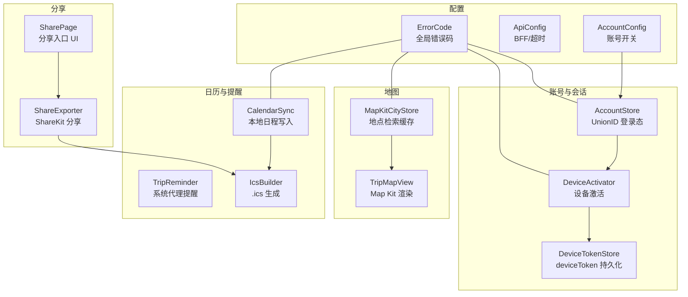
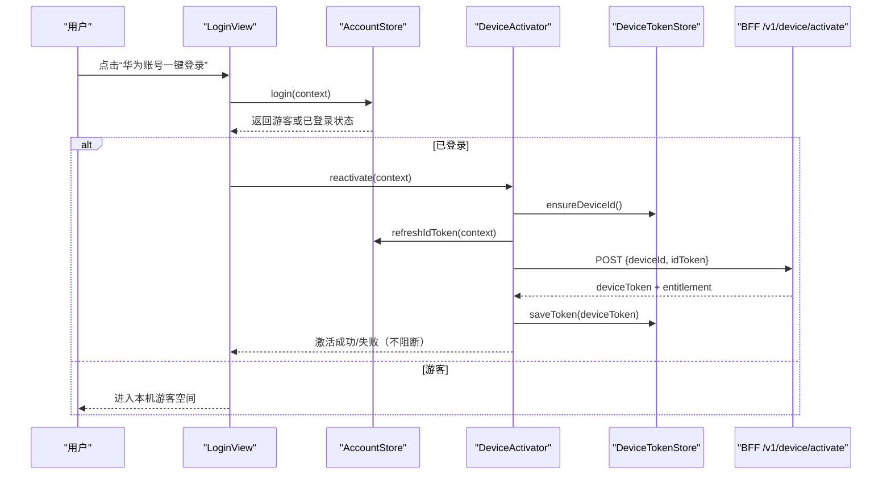
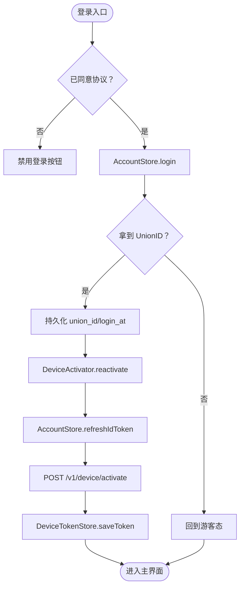
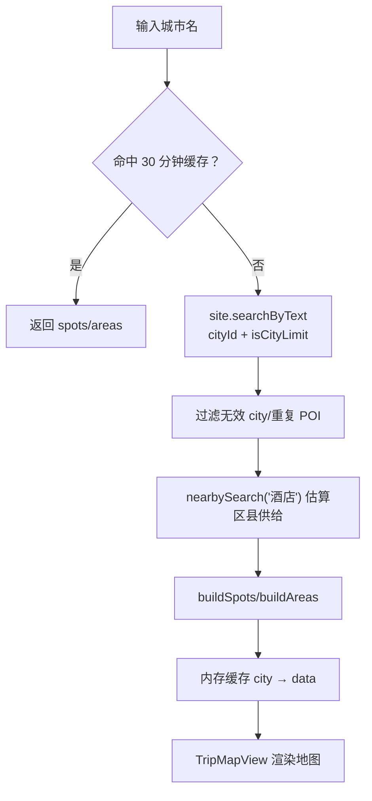
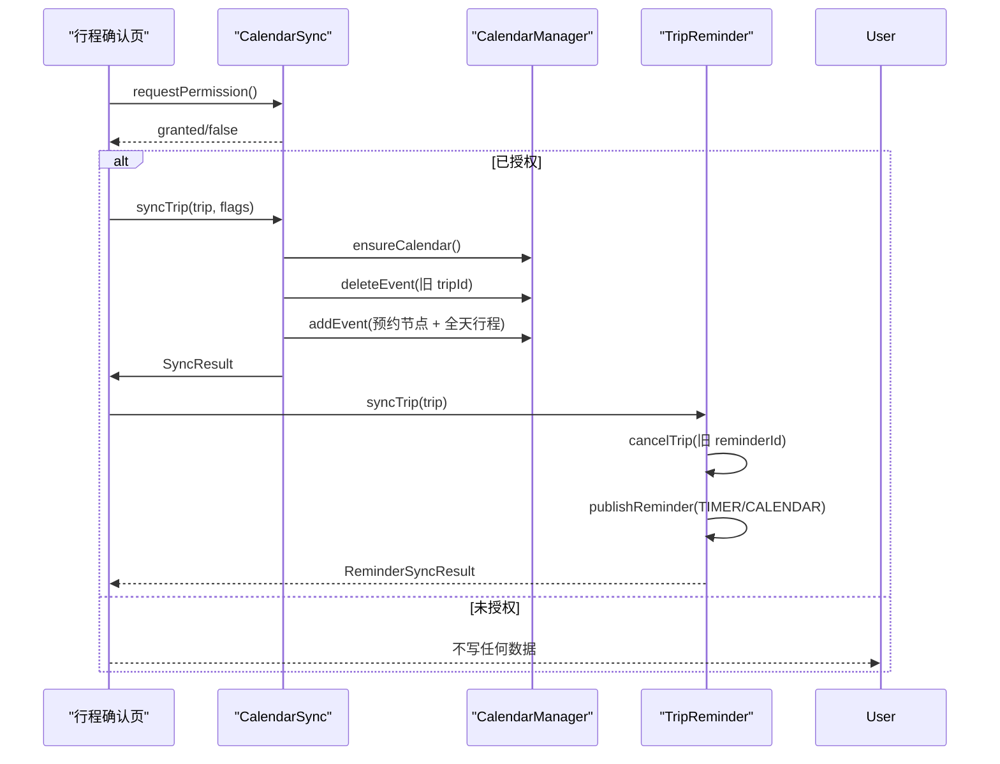
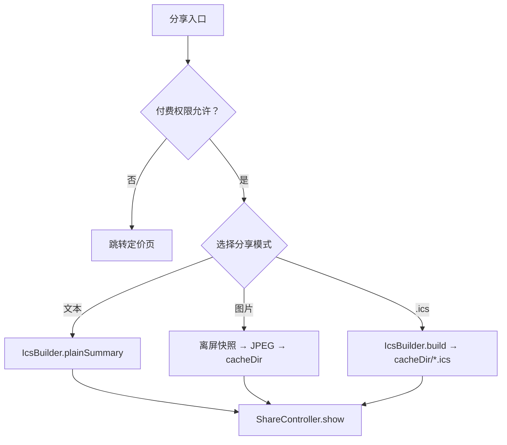
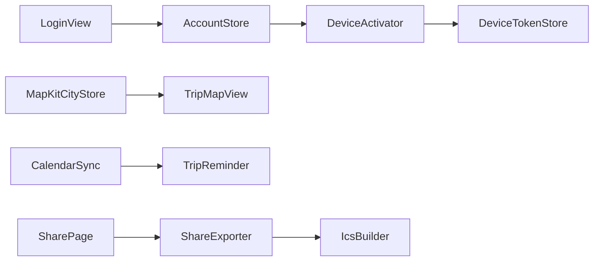

# 华为生态集成

<cite>
**本文引用的文件**   
- [AccountConfig.ets](file://entry/src/main/ets/common/config/AccountConfig.ets)
- [AccountStore.ets](file://entry/src/main/ets/data/AccountStore.ets)
- [Account.ets](file://entry/src/main/ets/model/Account.ets)
- [LoginView.ets](file://entry/src/main/ets/pages/LoginView.ets)
- [DeviceActivator.ets](file://entry/src/main/ets/data/DeviceActivator.ets)
- [DeviceTokenStore.ets](file://entry/src/main/ets/data/DeviceTokenStore.ets)
- [ApiConfig.ets](file://entry/src/main/ets/common/config/ApiConfig.ets)
- [MapKitCityStore.ets](file://entry/src/main/ets/data/MapKitCityStore.ets)
- [TripMapView.ets](file://entry/src/main/ets/components/TripMapView.ets)
- [CalendarSync.ets](file://entry/src/main/ets/data/CalendarSync.ets)
- [TripReminder.ets](file://entry/src/main/ets/utils/TripReminder.ets)
- [IcsBuilder.ets](file://entry/src/main/ets/utils/IcsBuilder.ets)
- [ShareExporter.ets](file://entry/src/main/ets/data/ShareExporter.ets)
- [SharePage.ets](file://entry/src/main/ets/pages/SharePage.ets)
- [ErrorCode.ets](file://entry/src/main/ets/common/error/ErrorCode.ets)
- [AppError.ets](file://entry/src/main/ets/common/error/AppError.ets)
- [TECH_STACK.md](file://Docs/TECH_STACK.md)
</cite>

## 目录
1. [引言](#引言)
2. [项目结构](#项目结构)
3. [核心组件](#核心组件)
4. [架构总览](#架构总览)
5. [关键流程详解](#关键流程详解)
6. [依赖关系分析](#依赖关系分析)
7. [性能与容量特性](#性能与容量特性)
8. [故障排查指南](#故障排查指南)
9. [安全与合规要点](#安全与合规要点)
10. [配置与上线清单](#配置与上线清单)
11. [结论](#结论)

## 引言
本文件聚焦有径应用在 HarmonyOS 环境下的华为生态集成，覆盖账号、地图、日历、分享四大能力，以及权限管理、错误处理、安全策略和上线配置。代码采用 ArkTS + @kit 系统能力，无后端直接交互：账号通过 Account Kit 静默获取 UnionID；地图通过 Map Kit 做地点检索与静态图导出；日历通过 Calendar Kit 写入本地日程；分享通过 ShareKit 拉起系统分享面板。

## 项目结构
从华为集成视角，相关代码主要分布在以下层次：
- 配置层：账号开关、网络端点、Mock 开关。
- 数据层：登录态、设备票据、地图城市数据、日历同步、提醒计划、分享导出。
- 页面层：登录页、分享页、地图渲染组件。
- 错误层：统一错误类型与全局错误码。

**图示来源**
- [AccountConfig.ets:1-29](file://entry/src/main/ets/common/config/AccountConfig.ets#L1-L29)
- [ApiConfig.ets:1-66](file://entry/src/main/ets/common/config/ApiConfig.ets#L1-L66)
- [ErrorCode.ets:1-48](file://entry/src/main/ets/common/error/ErrorCode.ets#L1-L48)
- [AccountStore.ets:1-213](file://entry/src/main/ets/data/AccountStore.ets#L1-L213)
- [DeviceActivator.ets:1-159](file://entry/src/main/ets/data/DeviceActivator.ets#L1-L159)
- [DeviceTokenStore.ets:1-142](file://entry/src/main/ets/data/DeviceTokenStore.ets#L1-L142)
- [MapKitCityStore.ets:1-179](file://entry/src/main/ets/data/MapKitCityStore.ets#L1-L179)
- [TripMapView.ets:1-200](file://entry/src/main/ets/components/TripMapView.ets#L1-L200)
- [CalendarSync.ets:1-200](file://entry/src/main/ets/data/CalendarSync.ets#L1-L200)
- [TripReminder.ets:1-200](file://entry/src/main/ets/utils/TripReminder.ets#L1-L200)
- [IcsBuilder.ets:1-200](file://entry/src/main/ets/utils/IcsBuilder.ets#L1-L200)
- [ShareExporter.ets:1-83](file://entry/src/main/ets/data/ShareExporter.ets#L1-L83)
- [SharePage.ets:1-200](file://entry/src/main/ets/pages/SharePage.ets#L1-L200)

**章节来源**
- [TECH_STACK.md:1-41](file://Docs/TECH_STACK.md#L1-L41)

## 核心组件
- **账号与会话**
  - `AccountStore`：UnionID 静默登录、游客兜底、登录态快照、idToken 刷新。
  - `AccountConfig`：是否启用真实华为账号登录、偏好分片名、游客 UID。
  - `DeviceActivator`：调用 BFF `/v1/device/activate` 完成设备激活与权益刷新。
  - `DeviceTokenStore`：设备标识 UUID、Bearer token、激活时间持久化。
- **地图服务**
  - `MapKitCityStore`：按城市分页检索景点、酒店供给估算、内存缓存 TTL。
  - `TripMapView`：Map Kit 动态地图渲染、相机收敛、鉴权失败兜底提示。
- **日历与提醒**
  - `CalendarSync`：本地日历创建、预约节点事件、全天行程事件、幂等清理。
  - `TripReminder`：系统代理提醒，区分能力未开通与数量超限。
  - `IcsBuilder`：RFC 5545 `.ics` 文本生成，含 VALARM。
- **分享**
  - `ShareExporter`：文本、图片、`.ics` 通过 ShareKit 系统分享面板。
  - `SharePage`：分享入口 UI、离屏长图、付费墙拦截。
- **错误体系**
  - `AppError`：统一错误包装。
  - `ErrorCode`：网络、解析、存储、业务、账号、云端错误码分区。

**章节来源**
- [AccountStore.ets:1-213](file://entry/src/main/ets/data/AccountStore.ets#L1-L213)
- [AccountConfig.ets:1-29](file://entry/src/main/ets/common/config/AccountConfig.ets#L1-L29)
- [DeviceActivator.ets:1-159](file://entry/src/main/ets/data/DeviceActivator.ets#L1-L159)
- [DeviceTokenStore.ets:1-142](file://entry/src/main/ets/data/DeviceTokenStore.ets#L1-L142)
- [MapKitCityStore.ets:1-179](file://entry/src/main/ets/data/MapKitCityStore.ets#L1-L179)
- [TripMapView.ets:1-200](file://entry/src/main/ets/components/TripMapView.ets#L1-L200)
- [CalendarSync.ets:1-200](file://entry/src/main/ets/data/CalendarSync.ets#L1-L200)
- [TripReminder.ets:1-200](file://entry/src/main/ets/utils/TripReminder.ets#L1-L200)
- [IcsBuilder.ets:1-200](file://entry/src/main/ets/utils/IcsBuilder.ets#L1-L200)
- [ShareExporter.ets:1-83](file://entry/src/main/ets/data/ShareExporter.ets#L1-L83)
- [SharePage.ets:1-200](file://entry/src/main/ets/pages/SharePage.ets#L1-L200)
- [AppError.ets:1-20](file://entry/src/main/ets/common/error/AppError.ets#L1-L20)
- [ErrorCode.ets:1-48](file://entry/src/main/ets/common/error/ErrorCode.ets#L1-L48)

## 架构总览
有径的华为生态集成采用“端侧单点 + 系统能力”的模式：账号认证、地图检索、日历写入、系统分享均通过 @kit 暴露的原生能力完成；与远端 BFF 的交互集中在设备激活与权益刷新。

**图示来源**
- [LoginView.ets:1-200](file://entry/src/main/ets/pages/LoginView.ets#L1-L200)
- [AccountStore.ets:60-120](file://entry/src/main/ets/data/AccountStore.ets#L60-L120)
- [DeviceActivator.ets:20-120](file://entry/src/main/ets/data/DeviceActivator.ets#L20-L120)
- [DeviceTokenStore.ets:40-110](file://entry/src/main/ets/data/DeviceTokenStore.ets#L40-L110)

## 关键流程详解

### 一、Account Kit 登录流程：授权、设备激活、Token 管理与会话生命周期
- **用户授权**
  - `LoginView` 要求用户勾选隐私政策与用户协议后才允许点击登录按钮。
  - 调用 `AccountStore.login(context)`，使用 `HuaweiIDProvider` 发起静默登录，取 `unionID`。
  - 如果未配置或未生效，`AccountStore` 退回游客态，不抛错阻断主流程。
- **设备激活**
  - 登录成功后，`LoginView` 调用 `DeviceActivator.reactivate(context)`。
  - `DeviceActivator` 先取 `DeviceTokenStore.ensureDeviceId()`，再尝试 `AccountStore.refreshIdToken(context)` 获取 `idToken`。
  - 向 BFF 发送 `/v1/device/activate`，携带 `deviceId` 和可选 `idToken`；成功后保存 `deviceToken` 并更新权益。
- **Token 管理**
  - `DeviceTokenStore` 持久化 `deviceId`、`deviceToken`、`activatedAt`；提供 `isActivated()`、`hasToken()`、`clear()`。
  - 权益刷新时若遇 401，会清 token 等待下次重新激活。
- **会话生命周期**
  - `AccountStore` 在应用启动时恢复偏好中的 `union_id` 与 `login_at`，并发布到 `AppStorage` 控制根闸门。
  - 登出时清空内存态、持久化键、并清除权益缓存。
  - `lastIdToken` 仅用于设备激活证明身份，不落盘、不在日志中打印完整值。

**图示来源**
- [LoginView.ets:60-120](file://entry/src/main/ets/pages/LoginView.ets#L60-L120)
- [AccountStore.ets:80-120](file://entry/src/main/ets/data/AccountStore.ets#L80-L120)
- [AccountStore.ets:160-213](file://entry/src/main/ets/data/AccountStore.ets#L160-L213)
- [DeviceActivator.ets:20-120](file://entry/src/main/ets/data/DeviceActivator.ets#L20-L120)
- [DeviceTokenStore.ets:40-110](file://entry/src/main/ets/data/DeviceTokenStore.ets#L40-L110)

**章节来源**
- [LoginView.ets:1-200](file://entry/src/main/ets/pages/LoginView.ets#L1-L200)
- [AccountStore.ets:1-213](file://entry/src/main/ets/data/AccountStore.ets#L1-L213)
- [DeviceActivator.ets:1-159](file://entry/src/main/ets/data/DeviceActivator.ets#L1-L159)
- [DeviceTokenStore.ets:1-142](file://entry/src/main/ets/data/DeviceTokenStore.ets#L1-L142)
- [AccountConfig.ets:1-29](file://entry/src/main/ets/common/config/AccountConfig.ets#L1-L29)
- [ErrorCode.ets:33-48](file://entry/src/main/ets/common/error/ErrorCode.ets#L33-L48)

### 二、Map Kit 地点检索服务：搜索、坐标、渲染与权限
- **地点搜索**
  - `MapKitCityStore.load(city)` 先查内存缓存（TTL 30 分钟），否则调用 `searchByText`。
  - 强制传入 `cityId` 与 `isCityLimit=true`，避免全球结果。
  - 最多翻页 3 次、每页 20 条；去重后映射为 Spot/Area；酒店供给用 `nearbySearch('酒店')` 估算。
- **坐标与地址校验**
  - 对每个 Site 的 `location` 与 `addressComponent` 校验归属城市；无效结果丢弃。
  - 探针文档指出中国地图坐标需 GCJ02，渲染层由种子层转换后再落库。
- **地图渲染**
  - `TripMapView` 负责 Map Kit 动态地图：创建控制器、注册 markerClick、首帧收敛镜头、昼夜模式切换。
  - 鉴权失败时底图可能空白，组件自身设置 `mapError` 提示“地图加载失败”，并把原始错误码记录到日志。
- **位置权限**
  - 当前代码未看到显式申请定位权限逻辑；地图渲染与静态图走 Map Kit 能力，而非定位服务。
  - 如需主动定位或围栏，应补充 `ohos.permission.LOCATION` 动态申请与拒绝处理。

**图示来源**
- [MapKitCityStore.ets:20-179](file://entry/src/main/ets/data/MapKitCityStore.ets#L20-L179)
- [TripMapView.ets:1-200](file://entry/src/main/ets/components/TripMapView.ets#L1-L200)

**章节来源**
- [MapKitCityStore.ets:1-179](file://entry/src/main/ets/data/MapKitCityStore.ets#L1-L179)
- [TripMapView.ets:1-200](file://entry/src/main/ets/components/TripMapView.ets#L1-L200)

### 三、Calendar Kit 日程同步：写入、提醒、权限与幂等
- **权限控制**
  - `CalendarSync.requestPermission` 通过 `abilityAccessCtrl` 申请 `READ_CALENDAR` 与 `WRITE_CALENDAR`。
  - 任一权限非 0 即视为拒绝，调用方不得写入任何数据。
- **日程写入**
  - 为每个需预约活动创建一条带标题“· 需预约”的事件；若无结束时间则延后 1 小时。
  - 每天创建一条全天事件，显示当天主题与首末站。
  - 提前提醒分钟数按 `advanceDays × 1440`；未传 `advanceDays` 时默认 1 天。
- **幂等性保证**
  - 每次写入前按 `tripId` 删除此前为本行程写入的事件 ID。
  - 事件 ID 列表保存在 preferences 分片 `youjing_access`，键前缀 `cal_events_`。
- **系统级提醒**
  - `TripReminder.syncTrip` 通过 `reminderAgentManager` 发布 TIMER 与 CALENDAR 提醒。
  - 能区分“能力未开通”和“系统提醒数量上限”，并记录通知开关状态。

**图示来源**
- [CalendarSync.ets:1-200](file://entry/src/main/ets/data/CalendarSync.ets#L1-L200)
- [CalendarSync.ets:200-259](file://entry/src/main/ets/data/CalendarSync.ets#L200-L259)
- [TripReminder.ets:1-200](file://entry/src/main/ets/utils/TripReminder.ets#L1-L200)

**章节来源**
- [CalendarSync.ets:1-259](file://entry/src/main/ets/data/CalendarSync.ets#L1-L259)
- [TripReminder.ets:1-200](file://entry/src/main/ets/utils/TripReminder.ets#L1-L200)

### 四、ShareKit 分享功能：内容、图片导出与系统面板
- **内容分享**
  - `ShareExporter.shareSummary` 使用 `UniformDataType.PLAIN_TEXT`，内容由 `IcsBuilder.plainSummary` 生成，不含账号信息。
- **图片导出**
  - `SharePage` 通过 `getComponentSnapshot` 生成 JPEG，写到 `cacheDir`，再通过 `ShareExporter.shareImage` 交给 ShareKit。
  - 生成失败时降级为文本分享，并提示用户。
- **.ics 导出**
  - `ShareExporter.shareIcs` 将 `IcsBuilder.build(trip, advanceDays)` 写入 `cacheDir/youjing-{tripId}.ics`，以 FILE 类型分享。
  - 导出前由 `EntitlementStore.canExport` 检查付费权限；未通过时跳转定价页。
- **系统分享面板**
  - 所有分享路径最终调用 `ShareController.show`，支持预览与多选接收方。

**图示来源**
- [SharePage.ets:200-606](file://entry/src/main/ets/pages/SharePage.ets#L200-L606)
- [ShareExporter.ets:1-83](file://entry/src/main/ets/data/ShareExporter.ets#L1-L83)
- [IcsBuilder.ets:1-200](file://entry/src/main/ets/utils/IcsBuilder.ets#L1-L200)

**章节来源**
- [SharePage.ets:1-686](file://entry/src/main/ets/pages/SharePage.ets#L1-L686)
- [ShareExporter.ets:1-83](file://entry/src/main/ets/data/ShareExporter.ets#L1-L83)
- [IcsBuilder.ets:1-255](file://entry/src/main/ets/utils/IcsBuilder.ets#L1-L255)

## 依赖关系分析
- **账号链**
  - `LoginView` → `AccountStore` → `DeviceActivator` → `DeviceTokenStore` → BFF。
  - `AccountStore` 与 `AccountConfig` 解耦，便于调试关闭真实账号。
- **地图链**
  - `MapKitCityStore` 依赖 `@kit.MapKit` 的 site/mapCommon；`TripMapView` 依赖 map/mapCommon。
- **日历链**
  - `CalendarSync` 依赖 `@kit.CalendarKit` 与 `abilityAccessCtrl`；`TripReminder` 依赖 `@kit.BackgroundTasksKit` 与 `notificationManager`。
- **分享链**
  - `SharePage` → `ShareExporter` → `IcsBuilder`；图片路径额外依赖 `image`、`fileIo`、`fileUri`。

**图示来源**
- [LoginView.ets:1-200](file://entry/src/main/ets/pages/LoginView.ets#L1-L200)
- [AccountStore.ets:1-213](file://entry/src/main/ets/data/AccountStore.ets#L1-L213)
- [DeviceActivator.ets:1-159](file://entry/src/main/ets/data/DeviceActivator.ets#L1-L159)
- [DeviceTokenStore.ets:1-142](file://entry/src/main/ets/data/DeviceTokenStore.ets#L1-L142)
- [MapKitCityStore.ets:1-179](file://entry/src/main/ets/data/MapKitCityStore.ets#L1-L179)
- [TripMapView.ets:1-200](file://entry/src/main/ets/components/TripMapView.ets#L1-L200)
- [CalendarSync.ets:1-259](file://entry/src/main/ets/data/CalendarSync.ets#L1-L259)
- [TripReminder.ets:1-200](file://entry/src/main/ets/utils/TripReminder.ets#L1-L200)
- [SharePage.ets:1-686](file://entry/src/main/ets/pages/SharePage.ets#L1-L686)
- [ShareExporter.ets:1-83](file://entry/src/main/ets/data/ShareExporter.ets#L1-L83)
- [IcsBuilder.ets:1-255](file://entry/src/main/ets/utils/IcsBuilder.ets#L1-L255)

## 性能与容量特性
- **账号与会话**
  - 登录态初始化一次完成，之后同步读取 uid/kind；idToken 仅内存持有，避免磁盘 IO。
  - 设备激活防重入，`activating` 标志防止冷启或重试时并发请求。
- **地图检索**
  - 城市数据内存缓存 TTL 30 分钟；分页上限 3 页、每页 20 条；酒店供给并发查询但取最慢结果。
  - 动态地图渲染注意首帧收敛、组件销毁期注销事件与清理覆盖物，避免进程崩溃。
- **日历与提醒**
  - 日历写入前先删旧事件，再批量新增；事件 ID 持久化保障幂等。
  - 提醒发布前可读取有效提醒数，辅助判断系统限制。
- **分享导出**
  - 图片与 .ics 都写到 `cacheDir`，不写相册、不上传服务端；分享面板由系统临时授权。

[本节为通用性能说明，不直接分析具体代码行]

## 故障排查指南

### 网络与服务异常
- **BFF 未配置**
  - `DeviceActivator.activate` 检测到 `ApiConfig.BFF_BASE_URL` 为空时跳过激活，开发期可继续运行。
- **HTTP 错误**
  - 激活响应非 2xx 时记录警告并返回 false；权益刷新遇到 401 会清 token，等待下次重新激活。
- **地图服务失败**
  - `MapKitCityStore.fetch` 捕获 `BusinessError`，包装为 `ErrorCode.MAP_CITY_DATA_FAILED`；`TripMapView` 在初始化失败时提示“地图加载失败”。

**章节来源**
- [ApiConfig.ets:1-66](file://entry/src/main/ets/common/config/ApiConfig.ets#L1-L66)
- [DeviceActivator.ets:40-159](file://entry/src/main/ets/data/DeviceActivator.ets#L40-L159)
- [MapKitCityStore.ets:40-179](file://entry/src/main/ets/data/MapKitCityStore.ets#L40-L179)
- [TripMapView.ets:60-120](file://entry/src/main/ets/components/TripMapView.ets#L60-L120)
- [ErrorCode.ets:8-16](file://entry/src/main/ets/common/error/ErrorCode.ets#L8-L16)

### 权限拒绝
- **账号登录**
  - 静默登录失败时不抛错阻断，退回游客态；`LoginView` 给出提示并提供“本机游客空间”入口。
- **日历权限**
  - `CalendarSync.requestPermission` 任一权限非 0 即返回 false；调用方不得写入数据。
- **代理提醒能力**
  - `TripReminder` 能识别能力未开通导致的 1700002，并标记 `blockedByCapability`。

**章节来源**
- [AccountStore.ets:80-120](file://entry/src/main/ets/data/AccountStore.ets#L80-L120)
- [LoginView.ets:120-200](file://entry/src/main/ets/pages/LoginView.ets#L120-L200)
- [CalendarSync.ets:220-259](file://entry/src/main/ets/data/CalendarSync.ets#L220-L259)
- [TripReminder.ets:60-150](file://entry/src/main/ets/utils/TripReminder.ets#L60-L150)

### 服务不可用时的降级
- **账号**
  - 关闭 `ACCOUNT_KIT_ENABLED` 时直接进入游客分区。
- **地图**
  - 静态图失败时分享页回退到每日行文本；动态地图初始化失败时显示错误提示。
- **分享**
  - 长图生成失败时降级为文本分享；分享面板打不开时提示用户。

**章节来源**
- [AccountConfig.ets:1-29](file://entry/src/main/ets/common/config/AccountConfig.ets#L1-L29)
- [SharePage.ets:200-606](file://entry/src/main/ets/pages/SharePage.ets#L200-L606)
- [TripMapView.ets:60-120](file://entry/src/main/ets/components/TripMapView.ets#L60-L120)

## 安全与合规要点
- **敏感数据处理**
  - 账号只持久化 `union_id` 与 `login_at`，不存手机号、邮箱、昵称；日志中对 UnionID 做掩码。
  - `lastIdToken` 仅在内存持有，用于设备激活，不落盘、不打印。
- **隐私同意机制**
  - `LoginView` 要求用户明确勾选隐私政策与用户协议；另有 `PrivacyConsentDialog` 作为一次性隐私明示同意。
- **本地数据优先**
  - 行程、打卡、记账默认保存在本机；分享文本不含账号信息；`.ics` 仅包含行程内容。
- **权限最小化**
  - 日历写入前申请读写权限；代理提醒能力需在 AGC 开放能力管理中申请。

**章节来源**
- [AccountStore.ets:100-213](file://entry/src/main/ets/data/AccountStore.ets#L100-L213)
- [LoginView.ets:1-120](file://entry/src/main/ets/pages/LoginView.ets#L1-L120)
- [ShareExporter.ets:1-83](file://entry/src/main/ets/data/ShareExporter.ets#L1-L83)
- [TripReminder.ets:1-100](file://entry/src/main/ets/utils/TripReminder.ets#L1-L100)

## 配置与上线清单

### AppGallery Connect 与签名
- **账号登录**
  - `AccountConfig.ACCOUNT_KIT_ENABLED` 控制是否启用真实 UnionID 静默登录。
  - 注释说明 AGC 已配置 APP ID 与 Client ID，且调试签名 SHA256 已登记；必须使用 AGC 手动创建的 Profile，不能用 DevEco 自动生成的随机 appIdentifier。
- **地图与分享**
  - 地图能力需在应用签名中包含 Map Kit；鉴权失败时底图空白，需确保包签名与 AGC 配置一致。
  - 代理提醒能力需在 AGC “开放能力管理 → 代理提醒” 申请，通过后重新生成 Profile 并手动签名。

**章节来源**
- [AccountConfig.ets:1-29](file://entry/src/main/ets/common/config/AccountConfig.ets#L1-L29)
- [TripMapView.ets:1-40](file://entry/src/main/ets/components/TripMapView.ets#L1-L40)
- [TripReminder.ets:1-40](file://entry/src/main/ets/utils/TripReminder.ets#L1-L40)

### API Key 与端点管理
- **BFF 基础地址**
  - `ApiConfig.BFF_BASE_URL` 是所有 LLM 请求经 BFF 中转的基础地址；空串表示开发期 Mock 模式。
  - 连接超时与读超时分别由 `CONNECT_TIMEOUT_MS` 与 `READ_TIMEOUT_MS` 控制。
- **Model 与 Replan**
  - `LLM_MODEL`、`REPLAN_URL`、`REPLAN_TOKEN` 等配置集中在此文件，修改后需全量重编重装 HAP。

**章节来源**
- [ApiConfig.ets:1-66](file://entry/src/main/ets/common/config/ApiConfig.ets#L1-L66)

### 工程与版本基线
- **HarmonyOS 版本**
  - `targetSdkVersion` 与 `compatibleSdkVersion` 均为 26.0.0；运行时 OS 为 HarmonyOS。
- **签名配置**
  - 工程默认 `signingConfigs` 为空，上架前需补正式签名与 AGC Profile。
- **依赖策略**
  - 运行时依赖默认为零，功能一律用 @kit 系统能力实现；升级依赖需登记变更。

**章节来源**
- [TECH_STACK.md:1-41](file://Docs/TECH_STACK.md#L1-L41)

## 结论
有径的华为生态集成以“端侧可控、系统能力为主、BFF 为辅”的方式落地：账号通过 Account Kit 静默登录并结合 BFF 设备激活获得令牌与权益；地图通过 Map Kit 完成地点检索与静态图导出；日历通过 Calendar Kit 写入本地事件并通过 BackgroundTasksKit 做系统提醒；分享通过 ShareKit 拉起系统面板，避免上传敏感数据。整体设计强调游客兜底、幂等写入、权限最小化和错误降级，适合在无后端直连场景下稳定运行。上线前需重点核对 AGC Profile、签名、地图与代理提醒能力配置，以及 BFF 地址与超时参数。