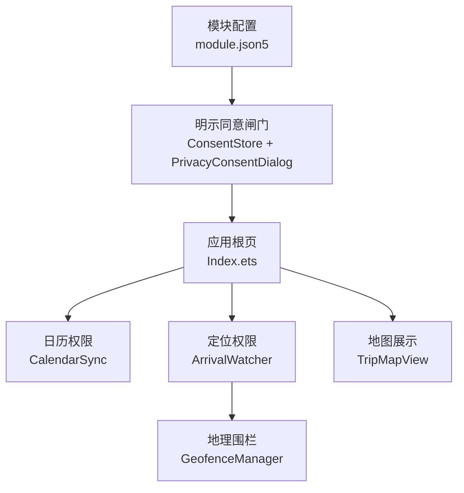
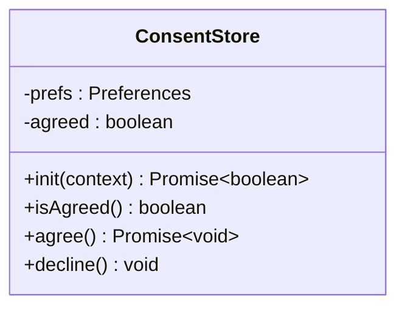
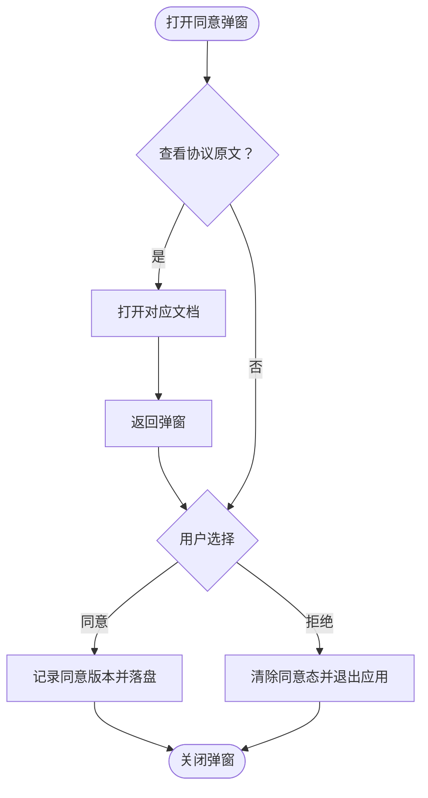
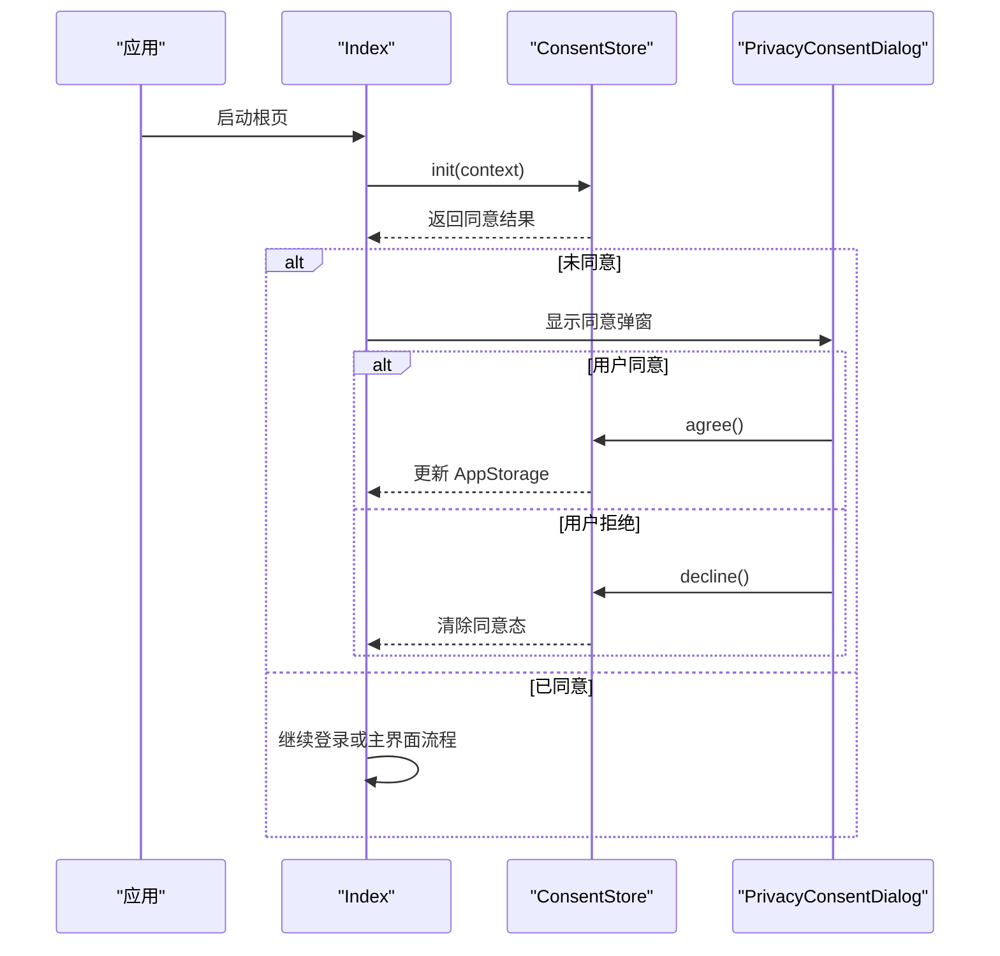
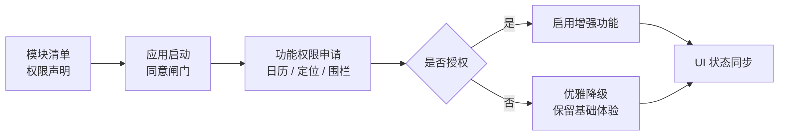
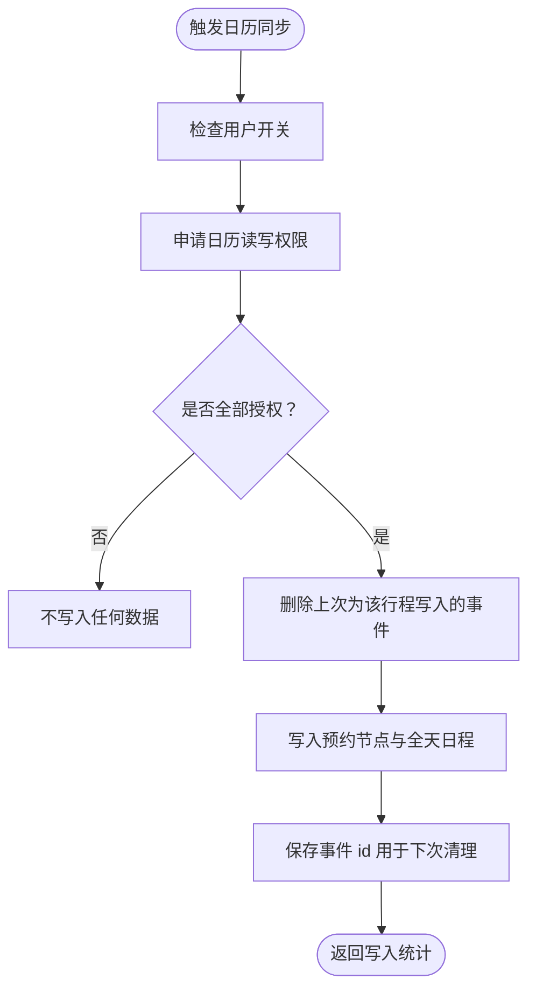
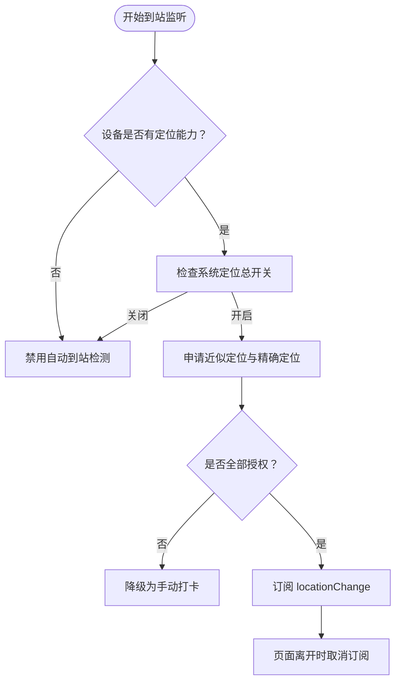
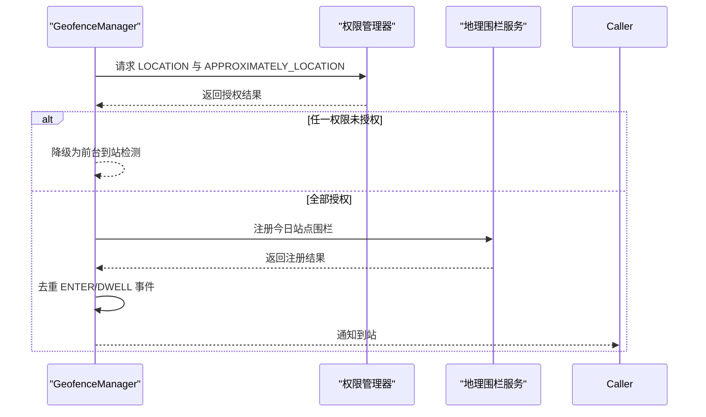
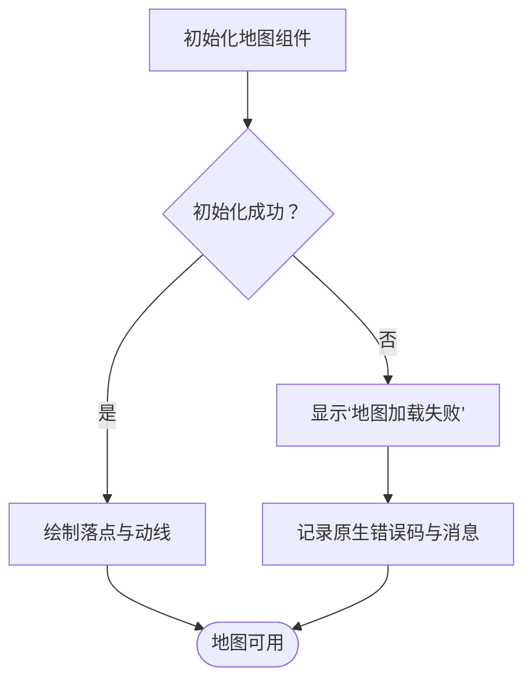
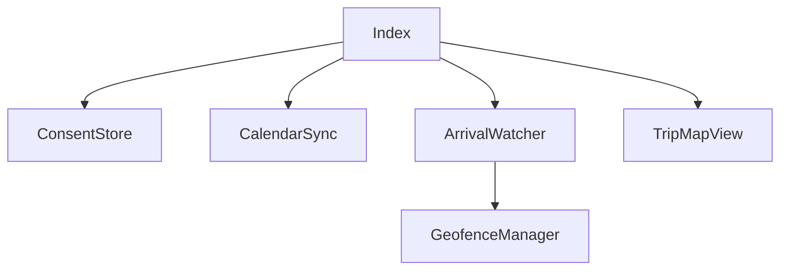

# 权限管理系统

<cite>
**本文引用的文件列表**   
- [entry/src/main/module.json5](file://entry/src/main/module.json5)
- [entry/src/main/ets/utils/ConsentStore.ets](file://entry/src/main/ets/utils/ConsentStore.ets)
- [entry/src/main/ets/components/PrivacyConsentDialog.ets](file://entry/src/main/ets/components/PrivacyConsentDialog.ets)
- [entry/src/main/ets/pages/Index.ets](file://entry/src/main/ets/pages/Index.ets)
- [entry/src/main/ets/common/location/ArrivalWatcher.ets](file://entry/src/main/ets/common/location/ArrivalWatcher.ets)
- [entry/src/main/ets/common/location/GeofenceManager.ets](file://entry/src/main/ets/common/location/GeofenceManager.ets)
- [entry/src/main/ets/data/CalendarSync.ets](file://entry/src/main/ets/data/CalendarSync.ets)
- [entry/src/main/ets/components/TripMapView.ets](file://entry/src/main/ets/components/TripMapView.ets)
</cite>

## 目录
1. [引言](#引言)
2. [项目结构](#项目结构)
3. [核心组件](#核心组件)
4. [架构总览](#架构总览)
5. [详细组件分析](#详细组件分析)
6. [依赖关系分析](#依赖关系分析)
7. [性能与体验考量](#性能与体验考量)
8. [故障排查指南](#故障排查指南)
9. [结论](#结论)

## 引言
本文聚焦有径应用的权限管理子系统，从“声明、同意、申请、状态、降级”五个维度说明系统如何组织日历、位置、网络等权限。文档面向两类读者：希望快速理解权限机制的产品/运营人员，以及需要定位权限问题或扩展权限能力的开发者。

## 项目结构
权限相关代码主要分布在以下四个层次：
- 模块级声明层：在 `module.json5` 中集中声明运行时权限。
- 明示同意层：通过 `ConsentStore` 和 `PrivacyConsentDialog` 实现隐私政策与用户协议的强制同意闸门。
- 功能权限层：日历写入、前台定位、地理围栏分别由 `CalendarSync`、`ArrivalWatcher`、`GeofenceManager` 负责。
- 展示与地图层：地图组件对鉴权失败做 UI 兜底，避免原生错误直接暴露给用户。

**图示来源**
- [entry/src/main/module.json5:1-133](file://entry/src/main/module.json5#L1-L133)
- [entry/src/main/ets/utils/ConsentStore.ets:1-82](file://entry/src/main/ets/utils/ConsentStore.ets#L1-L82)
- [entry/src/main/ets/components/PrivacyConsentDialog.ets:1-113](file://entry/src/main/ets/components/PrivacyConsentDialog.ets#L1-L113)
- [entry/src/main/ets/pages/Index.ets:707-1025](file://entry/src/main/ets/pages/Index.ets#L707-L1025)
- [entry/src/main/ets/data/CalendarSync.ets:1-259](file://entry/src/main/ets/data/CalendarSync.ets#L1-L259)
- [entry/src/main/ets/common/location/ArrivalWatcher.ets:1-135](file://entry/src/main/ets/common/location/ArrivalWatcher.ets#L1-L135)
- [entry/src/main/ets/common/location/GeofenceManager.ets:1-174](file://entry/src/main/ets/common/location/GeofenceManager.ets#L1-L174)
- [entry/src/main/ets/components/TripMapView.ets:1-200](file://entry/src/main/ets/components/TripMapView.ets#L1-L200)

**章节来源**
- [entry/src/main/module.json5:1-133](file://entry/src/main/module.json5#L1-L133)

## 核心组件
本节按权限生命周期梳理关键组件职责。

### 权限类型与分类
| 分类 | 权限标识 | 用途 | 申请入口 | 默认行为 |
|---|---|---|---|---|
| 日历访问 | `ohos.permission.READ_CALENDAR`、`ohos.permission.WRITE_CALENDAR` | 写入行程预约节点与全天日程，支持提前提醒 | 日历同步入口 | 未授权不写数据 |
| 位置定位 | `ohos.permission.LOCATION`、`ohos.permission.APPROXIMATELY_LOCATION` | 到站检测、地理围栏、坐标校准探针 | 到站监听、围栏注册 | 拒绝后降级为手动打卡 |
| 网络访问 | `ohos.permission.INTERNET` | 后端接口、地图服务、AI 调用 | 应用启动及业务请求时 | 网络不可用时走降级逻辑 |
| 提醒能力 | `ohos.permission.PUBLISH_AGENT_REMINDER` | 定时任务与提醒（与日历配合） | 提醒相关流程 | 未授权不影响主流程 |

上述权限均在模块清单中集中声明，并在具体功能首次使用时进行动态检查与申请。

**章节来源**
- [entry/src/main/module.json5:38-79](file://entry/src/main/module.json5#L38-L79)
- [entry/src/main/ets/data/CalendarSync.ets:206-230](file://entry/src/main/ets/data/CalendarSync.ets#L206-L230)
- [entry/src/main/ets/common/location/ArrivalWatcher.ets:40-70](file://entry/src/main/ets/common/location/ArrivalWatcher.ets#L40-L70)
- [entry/src/main/ets/common/location/GeofenceManager.ets:156-174](file://entry/src/main/ets/common/location/GeofenceManager.ets#L156-L174)

### 明示同意管理：ConsentStore
`ConsentStore` 是合规层面的“明示同意闸门”，负责：
- 存储协议版本与同意时间。
- 将同意状态同步到 `AppStorage`，供 UI 门控。
- 在读取偏好异常时采用“宁严勿松”策略，视为未同意。
- 提供“同意并继续”“不同意并退出”两个出口。

**图示来源**
- [entry/src/main/ets/utils/ConsentStore.ets:1-82](file://entry/src/main/ets/utils/ConsentStore.ets#L1-L82)

**章节来源**
- [entry/src/main/ets/utils/ConsentStore.ets:1-82](file://entry/src/main/ets/utils/ConsentStore.ets#L1-L82)

### 同意界面：PrivacyConsentDialog
该弹窗承担三类交互：
1. 打开《隐私政策》原文。
2. 打开《用户协议》原文。
3. “同意并继续”“不同意并退出”。

弹窗使用官方对话框组件承载，保证可访问性与布局一致性；同时强调“不同意必须真退出”，避免伪闸门。

**图示来源**
- [entry/src/main/ets/components/PrivacyConsentDialog.ets:1-113](file://entry/src/main/ets/components/PrivacyConsentDialog.ets#L1-L113)
- [entry/src/main/ets/utils/ConsentStore.ets:45-82](file://entry/src/main/ets/utils/ConsentStore.ets#L45-L82)

**章节来源**
- [entry/src/main/ets/components/PrivacyConsentDialog.ets:1-113](file://entry/src/main/ets/components/PrivacyConsentDialog.ets#L1-L113)

### 应用根页的门控逻辑：Index
`Index` 在冷启阶段加载 `ConsentStore`，并通过 `AppStorage` 中的 `privacyAgreed` 控制首屏渲染：
- 未同意：显示加载指示并弹出同意弹窗。
- 已同意且完成登录：进入主 Tab 容器。
- 未登录：先跳转登录流程。

这保证了“同意前不构建主界面内容”的合规要求。

**图示来源**
- [entry/src/main/ets/pages/Index.ets:256-260](file://entry/src/main/ets/pages/Index.ets#L256-L260)
- [entry/src/main/ets/pages/Index.ets:707-1025](file://entry/src/main/ets/pages/Index.ets#L707-L1025)
- [entry/src/main/ets/utils/ConsentStore.ets:33-82](file://entry/src/main/ets/utils/ConsentStore.ets#L33-L82)

**章节来源**
- [entry/src/main/ets/pages/Index.ets:707-1025](file://entry/src/main/ets/pages/Index.ets#L707-L1025)
- [entry/src/main/ets/utils/ConsentStore.ets:33-82](file://entry/src/main/ets/utils/ConsentStore.ets#L33-L82)

## 架构总览
权限系统采用“声明在前、同意在前、按需申请、失败降级”的分层架构：
- 模块清单声明所有可能用到的权限，满足平台审核要求。
- 明示同意作为全局闸门，控制是否允许采集设备标识等敏感信息。
- 功能模块各自负责最小化权限申请与降级处理。
- UI 层统一隐藏原生错误码，用用户可读文案呈现。

**图示来源**
- [entry/src/main/module.json5:38-79](file://entry/src/main/module.json5#L38-L79)
- [entry/src/main/ets/pages/Index.ets:707-1025](file://entry/src/main/ets/pages/Index.ets#L707-L1025)
- [entry/src/main/ets/data/CalendarSync.ets:206-230](file://entry/src/main/ets/data/CalendarSync.ets#L206-L230)
- [entry/src/main/ets/common/location/ArrivalWatcher.ets:40-70](file://entry/src/main/ets/common/location/ArrivalWatcher.ets#L40-L70)
- [entry/src/main/ets/common/location/GeofenceManager.ets:156-174](file://entry/src/main/ets/common/location/GeofenceManager.ets#L156-L174)

## 详细组件分析

### 日历权限管理
`CalendarSync` 负责：
- 查询是否需要写入日历事件。
- 申请读写日历权限。
- 清理历史事件并幂等写入新事件。
- 持久化“日历开关”“卡片开关”“提醒开关”。

**图示来源**
- [entry/src/main/ets/data/CalendarSync.ets:1-259](file://entry/src/main/ets/data/CalendarSync.ets#L1-L259)

**章节来源**
- [entry/src/main/ets/data/CalendarSync.ets:1-259](file://entry/src/main/ets/data/CalendarSync.ets#L1-L259)

### 前台定位权限管理
`ArrivalWatcher` 负责：
- 仅订阅“仅使用期间”的前台定位。
- 不保活、不申请长时任务。
- 权限被拒或系统定位关闭时返回失败。
- 页面销毁时安全退订。

**图示来源**
- [entry/src/main/ets/common/location/ArrivalWatcher.ets:1-135](file://entry/src/main/ets/common/location/ArrivalWatcher.ets#L1-L135)

**章节来源**
- [entry/src/main/ets/common/location/ArrivalWatcher.ets:1-135](file://entry/src/main/ets/common/location/ArrivalWatcher.ets#L1-L135)

### 地理围栏权限管理
`GeofenceManager` 负责：
- 计算当天需要围栏的站点。
- 申请定位权限。
- 批量注册地理围栏。
- 对注册失败、重复事件、回调竞态做防御性处理。

**图示来源**
- [entry/src/main/ets/common/location/GeofenceManager.ets:1-174](file://entry/src/main/ets/common/location/GeofenceManager.ets#L1-L174)

**章节来源**
- [entry/src/main/ets/common/location/GeofenceManager.ets:1-174](file://entry/src/main/ets/common/location/GeofenceManager.ets#L1-L174)

### 地图与网络权限的展示层处理
`TripMapView` 并不直接申请权限，但承担了“权限或鉴权失败后的用户体验兜底”：
- 地图初始化失败时设置本地错误文案。
- 原生错误码只记录日志，不直接暴露给用户。
- 地图控件本身可能因鉴权失败表现为空白，因此上层必须提供说明。

**图示来源**
- [entry/src/main/ets/components/TripMapView.ets:1-200](file://entry/src/main/ets/components/TripMapView.ets#L1-L200)

**章节来源**
- [entry/src/main/ets/components/TripMapView.ets:1-200](file://entry/src/main/ets/components/TripMapView.ets#L1-L200)

## 依赖关系分析
权限相关组件之间的耦合关系如下：
- `Index` 依赖 `ConsentStore` 控制整体准入。
- `CalendarSync`、`ArrivalWatcher`、`GeofenceManager` 彼此独立，分别对接日历与定位服务。
- `TripMapView` 依赖地图服务，属于展示层，不反向驱动权限申请。
- 所有权限申请均通过 `abilityAccessCtrl` 的统一接口完成，便于集中管理策略。

**图示来源**
- [entry/src/main/ets/pages/Index.ets:707-1025](file://entry/src/main/ets/pages/Index.ets#L707-L1025)
- [entry/src/main/ets/utils/ConsentStore.ets:1-82](file://entry/src/main/ets/utils/ConsentStore.ets#L1-L82)
- [entry/src/main/ets/data/CalendarSync.ets:1-259](file://entry/src/main/ets/data/CalendarSync.ets#L1-L259)
- [entry/src/main/ets/common/location/ArrivalWatcher.ets:1-135](file://entry/src/main/ets/common/location/ArrivalWatcher.ets#L1-L135)
- [entry/src/main/ets/common/location/GeofenceManager.ets:1-174](file://entry/src/main/ets/common/location/GeofenceManager.ets#L1-L174)
- [entry/src/main/ets/components/TripMapView.ets:1-200](file://entry/src/main/ets/components/TripMapView.ets#L1-L200)

**章节来源**
- [entry/src/main/ets/pages/Index.ets:707-1025](file://entry/src/main/ets/pages/Index.ets#L707-L1025)

## 性能与体验考量
- 最小权限原则：仅在功能真正需要时申请权限，例如日历写入只在确认写入前申请，定位只在到站监听与围栏注册时申请。
- 低侵入降级：定位权限被拒时回到手动打卡；日历权限被拒时不写数据；地图鉴权失败时用文案提示而非崩溃。
- 防重复与竞态：围栏注册使用取消令牌避免并发覆盖；到站监听使用 token 防止弹窗期间回调打到旧页面。
- 可恢复性：日历事件 id 持久化，每次写入前先清理历史事件，避免重复累积。
- 用户体验：同意弹窗提供阅读链接，且“不同意”能真正退出；地图错误文案对用户友好，原始错误码仅进日志。

[本节为通用指导，不直接分析具体源码行]

## 故障排查指南
常见问题与定位建议：

| 现象 | 可能原因 | 排查步骤 | 处理方式 |
|---|---|---|---|
| 首页一直弹同意弹窗 | 协议版本变化或偏好损坏 | 检查 `ConsentStore` 的版本与同意时间 | 重新同意；必要时清理偏好 |
| 日历没有写入 | 用户拒绝日历权限或关闭开关 | 查看 `CalendarSync.requestPermission` 日志 | 引导用户授权并开启开关 |
| 到站检测无效 | 系统定位关闭、无定位能力或权限拒绝 | 检查 `ArrivalWatcher.ensurePermission` 与 `isLocationEnabled` | 切换系统设置或降级为手动打卡 |
| 到站重复提示 | 围栏 ENTER 与 DWELL 未去重 | 检查 `announced` 集合与 fenceId 映射 | 修复事件去重逻辑 |
| 地图白屏 | 地图鉴权失败或服务不可用 | 查看 `TripMapView` 的错误日志 | 显示用户可读错误，避免崩溃 |
| 围栏注册失败 | AGC 未开通或权限不足 | 查看 `GeofenceManager.start` 日志 | 退回前台定位方案 |

**章节来源**
- [entry/src/main/ets/utils/ConsentStore.ets:33-82](file://entry/src/main/ets/utils/ConsentStore.ets#L33-L82)
- [entry/src/main/ets/data/CalendarSync.ets:206-259](file://entry/src/main/ets/data/CalendarSync.ets#L206-L259)
- [entry/src/main/ets/common/location/ArrivalWatcher.ets:40-135](file://entry/src/main/ets/common/location/ArrivalWatcher.ets#L40-L135)
- [entry/src/main/ets/common/location/GeofenceManager.ets:100-174](file://entry/src/main/ets/common/location/GeofenceManager.ets#L100-L174)
- [entry/src/main/ets/components/TripMapView.ets:120-180](file://entry/src/main/ets/components/TripMapView.ets#L120-L180)

## 结论
有径的权限管理系统以“合规优先、体验兜底”为核心：先用明示同意闸口守住隐私边界，再用模块化的权限申请实现最小侵入，最后用明确的降级策略保证用户在拒绝权限后仍可使用核心功能。未来若新增权限类型，应遵循现有模式：在模块清单声明、在功能入口申请、在失败路径降级、在 UI 层给出清晰解释。