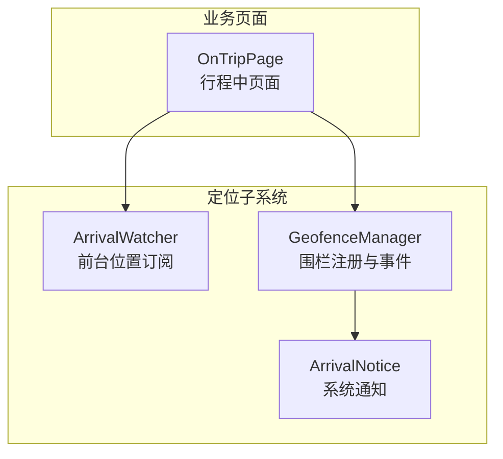
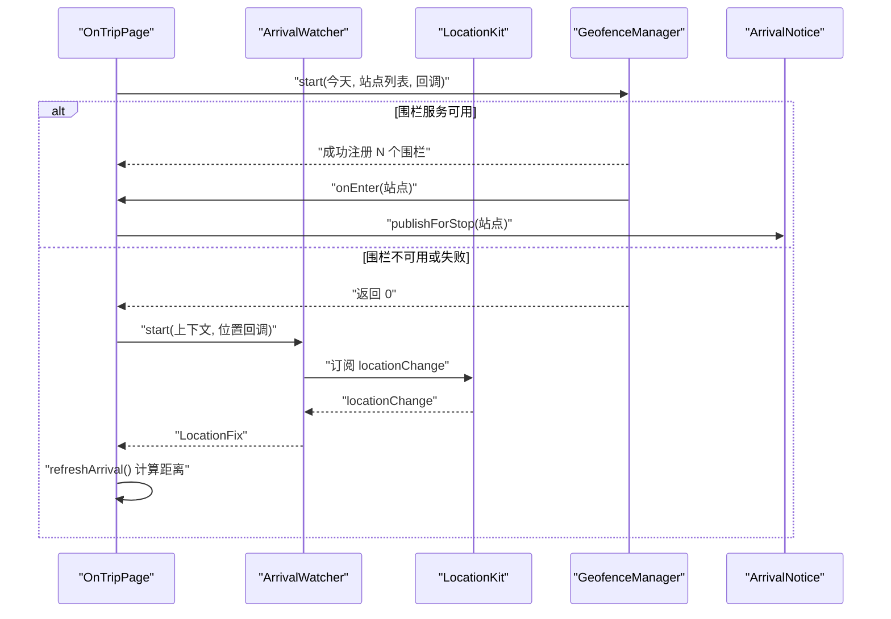
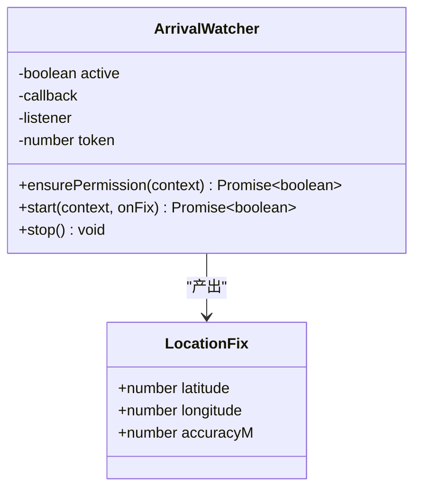
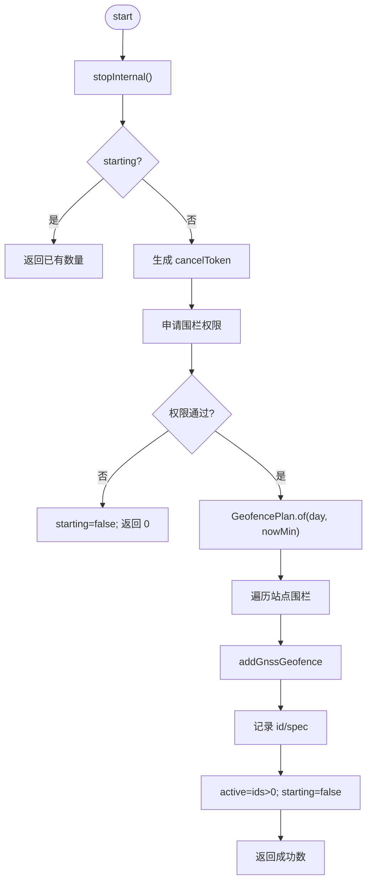
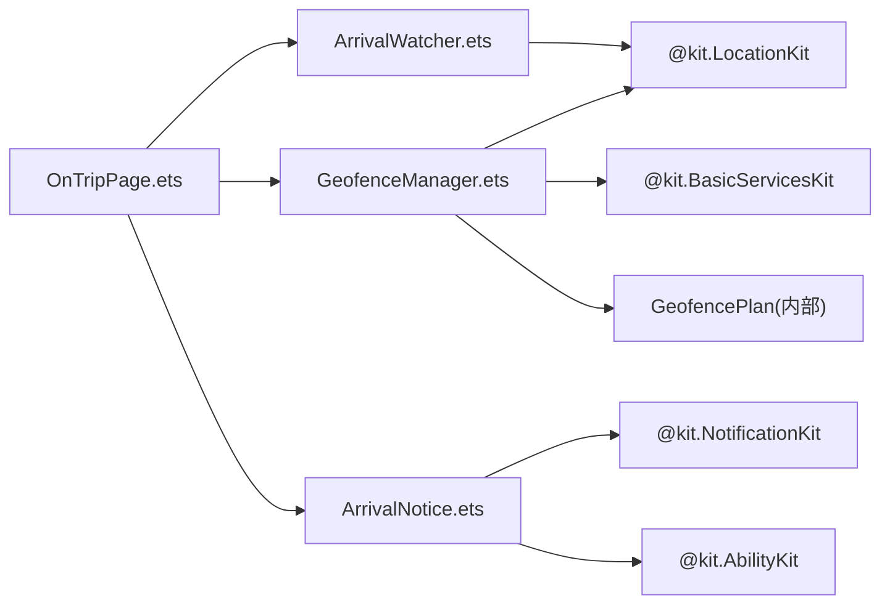

# 到达检测器

<cite>
**本文引用的文件**   
- [ArrivalWatcher.ets](file://entry/src/main/ets/common/location/ArrivalWatcher.ets)
- [GeofenceManager.ets](file://entry/src/main/ets/common/location/GeofenceManager.ets)
- [ArrivalNotice.ets](file://entry/src/main/ets/common/location/ArrivalNotice.ets)
- [OnTripPage.ets](file://entry/src/main/ets/pages/OnTripPage.ets)
</cite>

## 目录
1. [简介](#简介)
2. [项目结构中的定位模块](#项目结构中的定位模块)
3. [核心组件](#核心组件)
4. [架构总览](#架构总览)
5. [详细组件分析](#详细组件分析)
6. [依赖关系分析](#依赖关系分析)
7. [性能与电量优化](#性能与电量优化)
8. [故障排查指南](#故障排查指南)
9. [结论](#结论)

## 简介
本文聚焦 ArrivalWatcher 到达检测器及其与围栏系统、页面展示层的协作，说明前台位置跟踪机制、距离计算与到站判断、围栏集成策略、电量优化方案以及错误处理路径。该实现采用“前台定位优先 + 围栏补充”的双通道设计：当系统围栏服务可用时通过围栏事件触发到站提示；否则回退到前台位置订阅，在页面上实时显示距当前站点距离并给出可打卡提示。

## 项目结构中的定位模块
定位相关能力集中在 `entry/src/main/ets/common/location` 下：
- `ArrivalWatcher.ets`：前台位置订阅与权限管理。
- `GeofenceManager.ets`：今日站点围栏的注册、撤销、进入事件去重与降级。
- `ArrivalNotice.ets`：基于系统通知的到站提醒，不依赖实况窗权益。
- `OnTripPage.ets`：行程进行中页面，负责调度两个子系统、刷新界面状态。



**图表来源**
- [ArrivalWatcher.ets:1-135](file://entry/src/main/ets/common/location/ArrivalWatcher.ets#L1-L135)
- [GeofenceManager.ets:1-174](file://entry/src/main/ets/common/location/GeofenceManager.ets#L1-L174)
- [ArrivalNotice.ets:1-77](file://entry/src/main/ets/common/location/ArrivalNotice.ets#L1-L77)
- [OnTripPage.ets:1104-1207](file://entry/src/main/ets/pages/OnTripPage.ets#L1104-L1207)

**章节来源**
- [ArrivalWatcher.ets:1-135](file://entry/src/main/ets/common/location/ArrivalWatcher.ets#L1-L135)
- [GeofenceManager.ets:1-174](file://entry/src/main/ets/common/location/GeofenceManager.ets#L1-L174)
- [ArrivalNotice.ets:1-77](file://entry/src/main/ets/common/location/ArrivalNotice.ets#L1-L77)
- [OnTripPage.ets:180-195](file://entry/src/main/ets/pages/OnTripPage.ets#L180-L195)

## 核心组件
- ArrivalWatcher：封装系统定位订阅的生命周期、权限申请、精度与频率配置、回调安全取消。
- GeofenceManager：按当日剩余时间批量注册站点围栏，处理 ENTER/DWELL 事件去重，失败静默降级为前台定位。
- ArrivalNotice：将围栏进入事件转化为系统通知，点击后返回应用主页。
- OnTripPage：编排前台定位与围栏，计算距离、设置“已到站”状态、推送通知、更新 UI。

**章节来源**
- [ArrivalWatcher.ets:1-135](file://entry/src/main/ets/common/location/ArrivalWatcher.ets#L1-L135)
- [GeofenceManager.ets:1-174](file://entry/src/main/ets/common/location/GeofenceManager.ets#L1-L174)
- [ArrivalNotice.ets:1-77](file://entry/src/main/ets/common/location/ArrivalNotice.ets#L1-L77)
- [OnTripPage.ets:1104-1207](file://entry/src/main/ets/pages/OnTripPage.ets#L1104-L1207)

## 架构总览


**图表来源**
- [GeofenceManager.ets:46-135](file://entry/src/main/ets/common/location/GeofenceManager.ets#L46-L135)
- [ArrivalWatcher.ets:53-118](file://entry/src/main/ets/common/location/ArrivalWatcher.ets#L53-L118)
- [OnTripPage.ets:1138-1207](file://entry/src/main/ets/pages/OnTripPage.ets#L1138-L1207)
- [ArrivalNotice.ets:15-56](file://entry/src/main/ets/common/location/ArrivalNotice.ets#L15-L56)

## 详细组件分析

### ArrivalWatcher：前台位置订阅器
ArrivalWatcher 提供一次前台定位订阅的生命周期管理。它只做“获取当前位置 → 转换成轻量 LocationFix → 回调给调用方”，不负责复杂的到站判定逻辑。

- 定位请求参数
  - 优先级：ACCURACY（保证定位精度）。
  - 场景：DAILY_LIFE_SERVICE（日常生活服务，非导航级高耗电）。
  - 时间间隔：10 秒。
  - 距离间隔：20 米（设备移动超过 20 米才可能触发）。
- 权限申请
  - 同时申请近似定位与精确定位权限；任一拒绝即返回 false，调用方降级。
- 启动流程
  - 检查系统定位开关。
  - 申请权限。
  - 订阅 locationChange。
  - 成功后设置 active=true。
- 取消流程
  - token 自增作废旧 start。
  - 先清空 listener，再 off 回调，避免 off 期间仍有回调打入已销毁页面。
- 数据结构
  - LocationFix：仅包含纬度、经度、精度半径（accuracyM 仅用于展示，不参与到达判定）。



**图表来源**
- [ArrivalWatcher.ets:18-135](file://entry/src/main/ets/common/location/ArrivalWatcher.ets#L18-L135)

**章节来源**
- [ArrivalWatcher.ets:18-135](file://entry/src/main/ets/common/location/ArrivalWatcher.ets#L18-L135)

### GeofenceManager：围栏注册与事件分发
GeofenceManager 负责根据当天行程生成围栏计划，批量注册围栏，并在进入或停留时去重回调。

- 关键行为
  - start：内部 stopInternal 清理旧围栏；申请权限；调用 GeofencePlan 生成 FenceSpec；按当天剩余时间计算 expiration；逐个 addGnssGeofence。
  - handleTransition：过滤非 ENTER/DWELL；按 fenceId 去重 announced；回调 onEnter。
  - stop：cancelToken 自增并停止内部状态。
- 降级策略
  - 若权限不足、系统未开通围栏服务或坐标无效，直接返回 0，OnTripPage 保留前台定位。
- 防抖与并发
  - starting 标志避免重复开始。
  - cancelToken 确保弹窗期间或快速 reload 不会污染正在注册的围栏集合。



**图表来源**
- [GeofenceManager.ets:46-135](file://entry/src/main/ets/common/location/GeofenceManager.ets#L46-L135)

**章节来源**
- [GeofenceManager.ets:1-174](file://entry/src/main/ets/common/location/GeofenceManager.ets#L1-L174)

### ArrivalNotice：到站系统通知
ArrivalNotice 把围栏进入事件转成系统通知，支持点击跳转回应用。

- publishForStop：检查通知开关；构造 NotificationRequest；可选绑定 WantAgent；发布并记录日志。
- clickAction：创建 Ability 启动的 WantAgent。
- idOf：按日期+站点生成稳定通知 id，避免重复堆叠，并与系统提醒 id 区间隔离。

**章节来源**
- [ArrivalNotice.ets:1-77](file://entry/src/main/ets/common/location/ArrivalNotice.ets#L1-L77)

### OnTripPage：到站编排层
OnTripPage 是用户可见的“行程中”页面，负责协调 ArrivalWatcher 与 GeofenceManager，并根据最新位置计算到站文案。

- syncArrivalWatcher：
  - 仅对“今天 + 有有效当前站点坐标”启用定位订阅。
  - watcherActive 或 watcherStarting 时只刷新 UI，不再重复订阅。
  - 订阅成功后刷新 arrivalText、arrived 与信号。
- syncGeofences：
  - 仅今天注册围栏；同一天只注册一次。
  - 注册成功则走围栏事件；失败则保留前台定位。
- onGeofenceEnter：
  - 设置 arrived=true，更新 hero 提示条和 toast。
  - 尝试发布系统通知。
- refreshArrival：
  - 从 lastFix 与 current 站点坐标计算距离。
  - 使用 Geo.distanceText 生成文本。
  - 使用 Geo.arrived 决定 arrived 状态。

```mermaid
sequenceDiagram
  participant Page as "OnTripPage"
  participant Watcher as "ArrivalWatcher"
  participant Fence as "GeofenceManager"
  participant Notice as "ArrivalNotice"

  Note over Page: "reload/切换站点"
  Page->>Page: "syncArrivalWatcher()"
  Page->>Fence: "syncGeofences()"
  alt 今天且有围栏
    Fence-->>Page: "count>0"
    Fence->>Page: "onEnter(spec)"
    Page->>Page: "arrived=true; arrivalText='已进入...'"
    Page->>Notice: "publishForStop(day, activity)"
  else 无围栏或失败
    Page->>Watcher: "start(ctx, onFix)"
    Watcher-->>Page: "ok"
    Watcher-->>Page: "LocationFix"
    Page->>Page: "refreshArrival()"
  end
```

**图表来源**
- [OnTripPage.ets:1104-1207](file://entry/src/main/ets/pages/OnTripPage.ets#L1104-L1207)
- [GeofenceManager.ets:115-165](file://entry/src/main/ets/common/location/GeofenceManager.ets#L115-L165)
- [ArrivalNotice.ets:15-56](file://entry/src/main/ets/common/location/ArrivalNotice.ets#L15-L56)

**章节来源**
- [OnTripPage.ets:180-195](file://entry/src/main/ets/pages/OnTripPage.ets#L180-L195)
- [OnTripPage.ets:1104-1207](file://entry/src/main/ets/pages/OnTripPage.ets#L1104-L1207)

## 依赖关系分析
- ArrivalWatcher 依赖系统 LocationKit 的前台位置 API，并通过 Logger 输出诊断信息。
- GeofenceManager 依赖 LocationKit 的地理围栏 API、BasicServicesKit 的错误类型，以及内部 GeofencePlan 生成的围栏规格。
- ArrivalNotice 依赖 NotificationKit 与 AbilityKit 的通知与跳转能力。
- OnTripPage 组合以上三者，并依赖 TripDay、Activity、DateUtils、Geo 等模型与工具。



**图表来源**
- [ArrivalWatcher.ets:12-16](file://entry/src/main/ets/common/location/ArrivalWatcher.ets#L12-L16)
- [GeofenceManager.ets:12-20](file://entry/src/main/ets/common/location/GeofenceManager.ets#L12-L20)
- [ArrivalNotice.ets:10-14](file://entry/src/main/ets/common/location/ArrivalNotice.ets#L10-L14)
- [OnTripPage.ets:44-48](file://entry/src/main/ets/pages/OnTripPage.ets#L44-L48)

**章节来源**
- [ArrivalWatcher.ets:12-16](file://entry/src/main/ets/common/location/ArrivalWatcher.ets#L12-L16)
- [GeofenceManager.ets:12-20](file://entry/src/main/ets/common/location/GeofenceManager.ets#L12-L20)
- [ArrivalNotice.ets:10-14](file://entry/src/main/ets/common/location/ArrivalNotice.ets#L10-L14)
- [OnTripPage.ets:44-48](file://entry/src/main/ets/pages/OnTripPage.ets#L44-L48)

## 性能与电量优化
- 前台定位频率控制
  - timeInterval 设为 10 秒，distanceInterval 设为 20 米，避免高频刷新。
  - scenario 使用 DAILY_LIFE_SERVICE，属于低功耗日常场景，不是导航模式。
- 屏幕关闭与后台行为
  - 文档明确：仅订阅“仅使用期间”的前台 locationChange；退后台或锁屏不保活、不申请长时任务、不注册系统围栏（围栏受 AGC 审核限制）。因此到达检测仅在 App 前台可见时工作。
- 围栏作为节能补充
  - 当围栏服务可用时，系统侧的事件触发可减少频繁前台定位带来的电量消耗。
- 自适应与降级
  - 围栏注册失败或权限不足时，自动降级为前台定位，不阻断主流程。
  - 无定位能力、系统定位关闭、权限拒绝时，调用方静默降级为手动打卡。

[本节为通用指导，不直接分析具体代码行]

## 故障排查指南

### GPS 信号丢失或位置不准确
- 现象：arrivalText 为空、arrived=false，但用户确实在站点附近。
- 排查要点
  - 确认系统定位开关是否开启；ArrivalWatcher.start 会读取 isLocationEnabled。
  - 检查权限是否授予；ensurePermission 会返回 false 导致降级。
  - 观察 lastFix.accuracyM；精度较差时距离文本可能不可用。
  - 确认 OnTripPage 仅在“今天 + 当前站点坐标可用”时订阅定位。

**章节来源**
- [ArrivalWatcher.ets:71-118](file://entry/src/main/ets/common/location/ArrivalWatcher.ets#L71-L118)
- [OnTripPage.ets:1104-1136](file://entry/src/main/ets/pages/OnTripPage.ets#L1104-L1136)

### 位置服务异常或订阅失败
- 现象：start 返回 false，watcherActive=false。
- 排查要点
  - 查看 Logger.warn 中“定位订阅失败”的消息。
  - 检查 geoLocationManager.on 抛出的异常；stop 中对 off 也做了 try/catch。

**章节来源**
- [ArrivalWatcher.ets:93-118](file://entry/src/main/ets/common/location/ArrivalWatcher.ets#L93-L118)
- [ArrivalWatcher.ets:120-135](file://entry/src/main/ets/common/location/ArrivalWatcher.ets#L120-L135)

### 网络超时或服务端异常
- 本模块主要依赖系统定位与围栏服务，不直接发起网络请求；与 BFF 的交互不在 ArrivalWatcher/GeofenceManager/ArrivalNotice 中。
- 若涉及天气或行程数据加载失败，OnTripPage 中其他分支会静默降级，不影响到达检测主线。

[本节为通用说明，不直接分析具体代码行]

### 围栏无法注册或事件未触发
- 现象：syncGeofences 返回 0，或 no event received。
- 排查要点
  - 检查围栏权限；ensurePermission 会请求 LOCATION 与 APPROXIMATELY_LOCATION。
  - 查看日志“围栏注册失败 code=...”；可能是 AGC 未开通或系统限制。
  - 确认 expiration 计算合理；过期后围栏失效。
  - 检查 handleTransition 的去重逻辑；announced 已存在时会忽略重复事件。

**章节来源**
- [GeofenceManager.ets:46-135](file://entry/src/main/ets/common/location/GeofenceManager.ets#L46-L135)
- [GeofenceManager.ets:136-174](file://entry/src/main/ets/common/location/GeofenceManager.ets#L136-L174)

### 通知未显示
- 现象：onGeofenceEnter 触发但未出现系统通知。
- 排查要点
  - ArrivalNotice.publishForStop 会检查 notificationManager.isNotificationEnabled。
  - 检查 WantAgent 创建是否成功；clickAction 捕获 BusinessError 并返回 null。
  - 确认通知 id 稳定且不与其他提醒冲突。

**章节来源**
- [ArrivalNotice.ets:15-56](file://entry/src/main/ets/common/location/ArrivalNotice.ets#L15-L56)
- [ArrivalNotice.ets:58-77](file://entry/src/main/ets/common/location/ArrivalNotice.ets#L58-L77)

## 结论
ArrivalWatcher 提供简洁稳定的前台位置订阅能力，配合 GeofenceManager 的围栏事件，形成“前台定位 + 围栏补充”的到达检测体系。默认使用低功耗日常场景与稀疏采样策略以兼顾电量；当围栏不可用时自动降级，保证用户体验不被中断。到达判定最终由 OnTripPage 结合 Geo 工具完成，围栏事件仅触发“可以打卡”的提示，而不自动落库打卡，符合谨慎触达的设计原则。