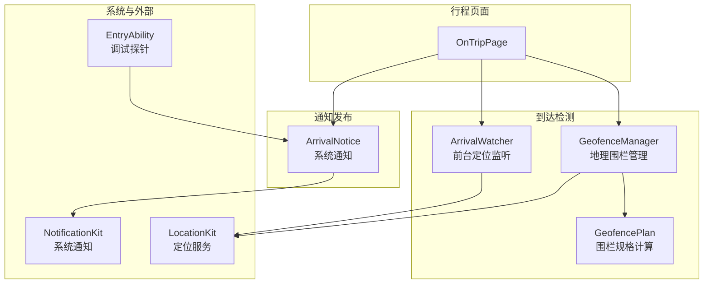
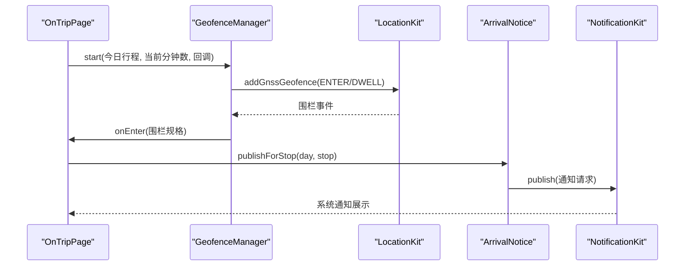
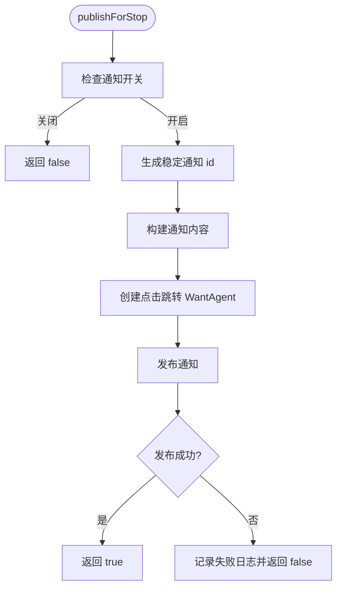
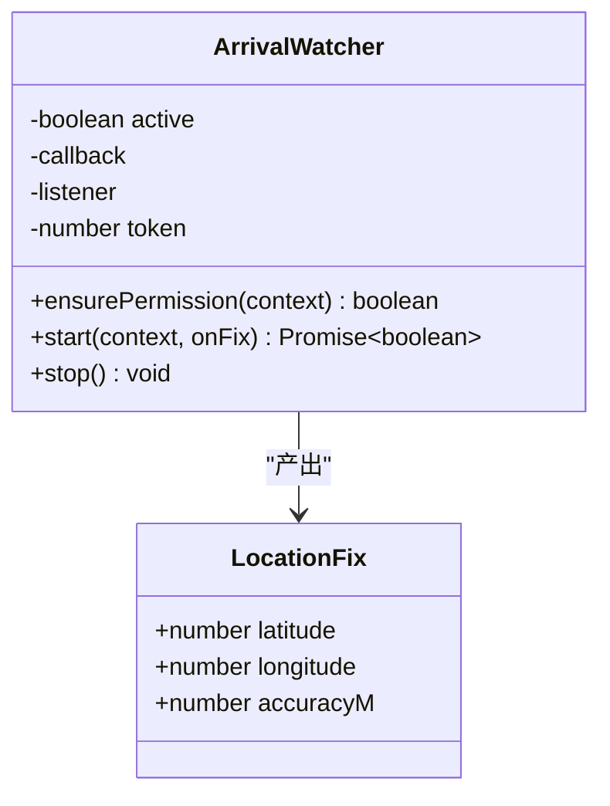
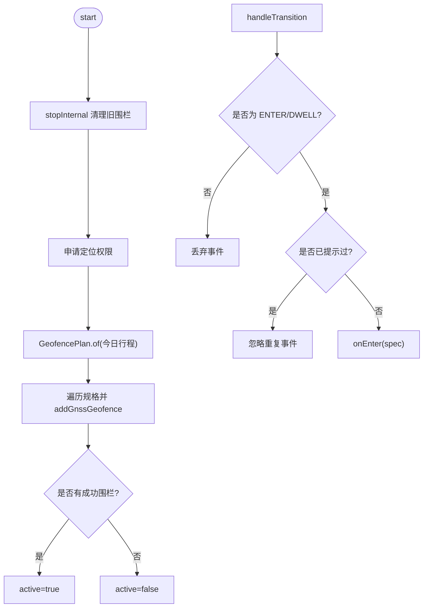
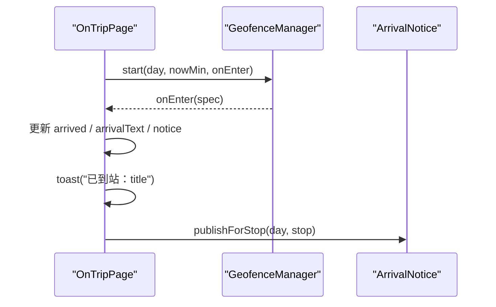
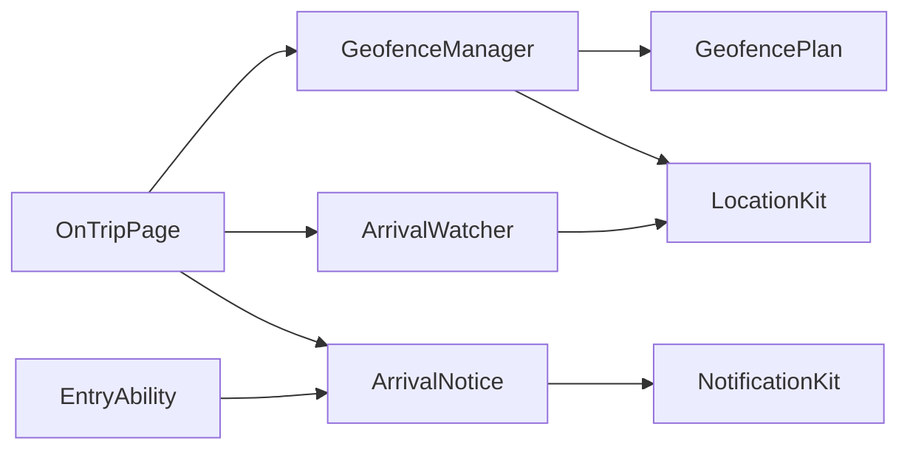

# 到达通知系统

<cite>
**本文引用的文件**   
- [ArrivalNotice.ets](file://entry/src/main/ets/common/location/ArrivalNotice.ets)
- [ArrivalWatcher.ets](file://entry/src/main/ets/common/location/ArrivalWatcher.ets)
- [GeofenceManager.ets](file://entry/src/main/ets/common/location/GeofenceManager.ets)
- [OnTripPage.ets](file://entry/src/main/ets/pages/OnTripPage.ets)
- [EntryAbility.ets](file://entry/src/main/ets/entryability/EntryAbility.ets)
- [GeofencePlan.ets](file://entry/src/main/ets/utils/GeofencePlan.ets)
- [Logger.ets](file://entry/src/main/ets/common/logger/Logger.ets)
</cite>

## 目录
1. [简介](#简介)
2. [项目结构](#项目结构)
3. [核心组件](#核心组件)
4. [架构总览](#架构总览)
5. [详细组件分析](#详细组件分析)
6. [依赖关系分析](#依赖关系分析)
7. [性能与电量特性](#性能与电量特性)
8. [故障排查指南](#故障排查指南)
9. [结论](#结论)
10. [附录：配置与定制示例](#附录配置与定制示例)

## 简介
本文件面向“到达通知系统”，即应用在当前行程中检测到用户抵达站点时，通过系统通知中心提示“已到站、可以打卡”的完整链路。它包含三部分：
- 到达检测：前台定位监听（ArrivalWatcher）和地理围栏（GeofenceManager）。
- 通知发布：系统通知（ArrivalNotice）。
- 页面协作：在行程进行中聚合状态并触发通知（OnTripPage），以及调试探针（EntryAbility）。

该通知不依赖实况窗能力，也不自动完成打卡；它只负责提醒用户“已到达站点，可点击回到应用确认”。

## 项目结构
到达通知相关代码集中在以下位置：
- common/location：到达检测与通知发布的业务类。
- pages：行程中的页面，负责订阅事件并展示到站状态。
- entryability：入口 Ability，提供调试探针直接调用通知。
- utils：围栏规格计算工具。
- model：行程数据模型（TripDay、Activity）。
- logger：统一日志输出。

**图示来源**
- [OnTripPage.ets:1150-1195](file://entry/src/main/ets/pages/OnTripPage.ets#L1150-L1195)
- [ArrivalWatcher.ets:1-135](file://entry/src/main/ets/common/location/ArrivalWatcher.ets#L1-L135)
- [GeofenceManager.ets:1-174](file://entry/src/main/ets/common/location/GeofenceManager.ets#L1-L174)
- [ArrivalNotice.ets:1-77](file://entry/src/main/ets/common/location/ArrivalNotice.ets#L1-L77)
- [EntryAbility.ets:260-305](file://entry/src/main/ets/entryability/EntryAbility.ets#L260-L305)
- [GeofencePlan.ets:11-50](file://entry/src/main/ets/utils/GeofencePlan.ets#L11-L50)

**章节来源**
- [ArrivalNotice.ets:1-77](file://entry/src/main/ets/common/location/ArrivalNotice.ets#L1-L77)
- [ArrivalWatcher.ets:1-135](file://entry/src/main/ets/common/location/ArrivalWatcher.ets#L1-L135)
- [GeofenceManager.ets:1-174](file://entry/src/main/ets/common/location/GeofenceManager.ets#L1-L174)
- [OnTripPage.ets:1150-1195](file://entry/src/main/ets/pages/OnTripPage.ets#L1150-L1195)
- [EntryAbility.ets:260-305](file://entry/src/main/ets/entryability/EntryAbility.ets#L260-L305)
- [GeofencePlan.ets:11-50](file://entry/src/main/ets/utils/GeofencePlan.ets#L11-L50)

## 核心组件
- ArrivalNotice：将“已到站”转为系统通知，处理通知开关、通知内容、点击行为、通知去重 id。
- ArrivalWatcher：前台定位监听，申请定位权限，控制订阅生命周期，输出精简定位结果。
- GeofenceManager：根据当天行程生成围栏规格，注册/撤销围栏，处理 ENTER/DWELL 事件并去重。
- OnTripPage：协调围栏与前台定位，更新 UI 到站提示，并在围栏命中时触发通知。
- EntryAbility：调试探针，直接调用通知发布接口用于验证。
- GeofencePlan：从 TripDay 中提取可用站点坐标，构造围栏半径等参数。
- Logger：统一日志记录，贯穿各模块。

**章节来源**
- [ArrivalNotice.ets:1-77](file://entry/src/main/ets/common/location/ArrivalNotice.ets#L1-L77)
- [ArrivalWatcher.ets:1-135](file://entry/src/main/ets/common/location/ArrivalWatcher.ets#L1-L135)
- [GeofenceManager.ets:1-174](file://entry/src/main/ets/common/location/GeofenceManager.ets#L1-L174)
- [OnTripPage.ets:1150-1195](file://entry/src/main/ets/pages/OnTripPage.ets#L1150-L1195)
- [GeofencePlan.ets:11-50](file://entry/src/main/ets/utils/GeofencePlan.ets#L11-L50)
- [Logger.ets:13-29](file://entry/src/main/ets/common/logger/Logger.ets#L13-L29)

## 架构总览
到达通知系统采用“检测层 + 通知层 + 页面层”的分层设计：
- 检测层：优先使用地理围栏，失败或无权限时回退到前台定位。
- 通知层：通过 NotificationKit 发送系统通知，携带点击跳转动作。
- 页面层：负责 UI 状态、用户交互与最终打卡流程。

**图示来源**
- [GeofenceManager.ets:60-140](file://entry/src/main/ets/common/location/GeofenceManager.ets#L60-L140)
- [OnTripPage.ets:1150-1195](file://entry/src/main/ets/pages/OnTripPage.ets#L1150-L1195)
- [ArrivalNotice.ets:18-55](file://entry/src/main/ets/common/location/ArrivalNotice.ets#L18-L55)

## 详细组件分析

### ArrivalNotice：到达通知发布器
ArrivalNotice 是到达通知系统的对外发布接口。其职责包括：
- 检查系统通知开关是否开启。
- 构建通知内容：标题、正文、附加文本。
- 设置通知点击行为：启动应用入口 Ability。
- 生成稳定通知 id，避免同一天同一站重复堆叠。
- 捕获并发布通知，记录成功或失败日志。

**图示来源**
- [ArrivalNotice.ets:18-55](file://entry/src/main/ets/common/location/ArrivalNotice.ets#L18-L55)

关键点说明：
- 通知内容：标题为“已到「站点名」”，正文为“可以打卡了 · 有径 Day X”，附加文本为“有径”。
- 点击行为：通过 WantAgent 启动 EntryAbility，允许后续由应用处理导航或打卡逻辑。
- 通知 id：基于日期与站点 id 哈希，落在高数值区间，避免与系统提醒覆盖冲突。
- 错误处理：若通知开关关闭或发布异常，均返回 false 并记录日志。

**章节来源**
- [ArrivalNotice.ets:18-55](file://entry/src/main/ets/common/location/ArrivalNotice.ets#L18-L55)
- [ArrivalNotice.ets:57-77](file://entry/src/main/ets/common/location/ArrivalNotice.ets#L57-L77)

### ArrivalWatcher：前台定位监听
ArrivalWatcher 负责前台定位订阅与权限申请，特点如下：
- 仅订阅“仅使用期间”的定位变更，退后台或锁屏不保活。
- 定位采样频率为每 10 秒或移动 20 米，属于低功耗日常场景。
- 申请近似定位与精确定位权限；任一被拒则降级为手动打卡。
- 支持 cancel token，避免权限弹窗期间多次 start/stop 导致状态错乱。
- 暴露 LocationFix 接口：纬度、经度、精度（仅用于界面显示）。

**图示来源**
- [ArrivalWatcher.ets:23-135](file://entry/src/main/ets/common/location/ArrivalWatcher.ets#L23-L135)

生命周期要点：
- start：检查设备定位能力 → 读取系统定位总开关 → 申请权限 → 注册 locationChange 回调 → 标记 active。
- stop：自增 token 作废在途 start → 清空 listener 与 callback → off 定位监听。
- 降级策略：无定位能力、权限拒绝、系统定位关闭、订阅失败都会返回 false，调用方静默降级。

**章节来源**
- [ArrivalWatcher.ets:1-135](file://entry/src/main/ets/common/location/ArrivalWatcher.ets#L1-L135)

### GeofenceManager：地理围栏管理
GeofenceManager 负责根据当日行程生成围栏、注册/撤销围栏、处理进入事件并去重。

主要逻辑：
- start：防止重复注册 → 内部 stopInternal 清理旧围栏 → 申请定位权限 → 从 GeofencePlan 获取围栏规格 → 逐个 addGnssGeofence。
- handleTransition：过滤非 ENTER/DWELL 事件 → 按 fenceId 去重 → 调用 onEnter(spec)。
- stop：cancelToken++ → stopInternal → 重置 starting。

**图示来源**
- [GeofenceManager.ets:40-140](file://entry/src/main/ets/common/location/GeofenceManager.ets#L40-L140)

降级策略：
- 若 AGC 未开通、权限被拒或坐标不可用，注册数量为 0，OnTripPage 保留前台定位作为兜底。
- 同一围栏的 ENTER 与 DWELL 会先后回调，使用 announced Set 去重，避免重复通知。

**章节来源**
- [GeofenceManager.ets:1-174](file://entry/src/main/ets/common/location/GeofenceManager.ets#L1-L174)
- [GeofencePlan.ets:11-50](file://entry/src/main/ets/utils/GeofencePlan.ets#L11-L50)

### OnTripPage：行程页面对接
OnTripPage 负责：
- 启动 GeofenceManager，并将围栏命中回调 into onGeofenceEnter。
- 当围栏命中时，更新 arrived、arrivalText、notice 等 UI 状态，弹出 toast，并调用 ArrivalNotice.publishForStop。
- 使用最近一次前台定位刷新 hero 到站状态；若无定位信息则不显示到站行。

**图示来源**
- [OnTripPage.ets:1150-1195](file://entry/src/main/ets/pages/OnTripPage.ets#L1150-L1195)

注意：
- 围栏命中不会自动打卡，而是把“可以打卡了”推到 UI，用户确认后落库。
- 如果围栏未注册成功，OnTripPage 保留前台定位，继续根据距离判断到站。

**章节来源**
- [OnTripPage.ets:1150-1195](file://entry/src/main/ets/pages/OnTripPage.ets#L1150-L1195)

### EntryAbility：调试探针
EntryAbility 提供调试探针 runArrivalProbe，仅在 debug 版本生效，用于快速验证到达通知发布是否正常。它会构造一个模拟 TripDay 与 Activity，并直接调用 ArrivalNotice.publishForStop。

**章节来源**
- [EntryAbility.ets:260-305](file://entry/src/main/ets/entryability/EntryAbility.ets#L260-L305)

## 依赖关系分析

**图示来源**
- [OnTripPage.ets:1150-1195](file://entry/src/main/ets/pages/OnTripPage.ets#L1150-L1195)
- [GeofenceManager.ets:1-174](file://entry/src/main/ets/common/location/GeofenceManager.ets#L1-L174)
- [ArrivalWatcher.ets:1-135](file://entry/src/main/ets/common/location/ArrivalWatcher.ets#L1-L135)
- [ArrivalNotice.ets:1-77](file://entry/src/main/ets/common/location/ArrivalNotice.ets#L1-L77)
- [EntryAbility.ets:260-305](file://entry/src/main/ets/entryability/EntryAbility.ets#L260-L305)

耦合与内聚：
- ArrivalNotice 与 NotificationKit 解耦良好，仅关注通知内容与点击行为。
- GeofenceManager 对 LocationKit 的依赖集中在围栏注册与事件回调，内部状态管理清晰。
- OnTripPage 承担编排职责，但不直接操作系统通知，符合单一职责原则。

潜在风险：
- 若系统通知开关关闭，ArrivalNotice 会静默失败；需要上层考虑用户引导或替代提示。
- 围栏注册依赖 AGC 能力，未开通时会降级；需保证前台定位兜底逻辑健壮。

**章节来源**
- [ArrivalNotice.ets:1-77](file://entry/src/main/ets/common/location/ArrivalNotice.ets#L1-L77)
- [GeofenceManager.ets:1-174](file://entry/src/main/ets/common/location/GeofenceManager.ets#L1-L174)
- [OnTripPage.ets:1150-1195](file://entry/src/main/ets/pages/OnTripPage.ets#L1150-L1195)

## 性能与电量特性
- 前台定位采样频率低：每 10 秒或移动 20 米，适用于日常场景而非导航场景，降低功耗。
- 围栏事件去重：同一围栏的 ENTER 与 DWELL 只触发一次通知，避免重复唤醒与 UI 抖动。
- 通知 id 稳定：同一天同一站复用相同 id，避免通知中心堆积。
- 通知发布轻量：仅基本文本内容，不携带媒体资源，减少内存与带宽开销。
- 降级路径明确：围栏不可用时回退前台定位，避免阻塞主流程。

[本节为通用性能讨论，不直接分析具体文件]

## 故障排查指南

常见问题与定位方法：
- 通知未展示：
  - 检查系统通知开关是否关闭。ArrivalNotice 会在关闭时返回 false 并记录日志。
  - 检查 NotificationKit 发布是否抛出 BusinessError，查看日志 code 与 message。
- 定位未生效：
  - 检查设备是否具备定位能力；ArrivalWatcher 在无定位能力时返回 false。
  - 检查系统定位总开关是否关闭；关闭时直接返回 false。
  - 检查定位权限是否授予；任一权限被拒都会降级。
- 围栏未注册：
  - 检查 AGC 是否开通；未开通时注册数量为 0。
  - 检查站点坐标是否可用；不可用会被跳过。
  - 查看围栏注册失败的日志，包含站点 title、code、message。
- 重复通知：
  - 确认是否同一围栏的 ENTER 与 DWELL 同时出现；GeofenceManager 已做去重。
  - 检查通知 id 是否因 day/date 或 stop.id 变化而改变。

建议日志关键词：
- “到站通知已发布”“到站通知发布失败”
- “定位权限未授予，到站检测降级为手动打卡”
- “围栏计划 N 站 / 注册成功 M 站”
- “到站围栏已提示，忽略 event=...”

**章节来源**
- [ArrivalNotice.ets:18-55](file://entry/src/main/ets/common/location/ArrivalNotice.ets#L18-L55)
- [ArrivalWatcher.ets:47-135](file://entry/src/main/ets/common/location/ArrivalWatcher.ets#L47-L135)
- [GeofenceManager.ets:60-174](file://entry/src/main/ets/common/location/GeofenceManager.ets#L60-L174)
- [Logger.ets:13-29](file://entry/src/main/ets/common/logger/Logger.ets#L13-L29)

## 结论
到达通知系统以“围栏为主、前台定位为辅”的检测策略，结合轻量系统通知与稳定的通知 id，实现了低侵入、低能耗的到站提醒。通知不自动打卡，保持用户意图闭环；权限不足或围栏不可用时，系统自动降级到前台定位与手动打卡。整体结构清晰、错误处理完善，便于扩展与排障。

[本节为总结性内容，不直接分析具体文件]

## 附录：配置与定制示例

以下示例描述如何配置和定制到达通知的行为与外观，所有修改点均以源码路径引用形式给出，避免直接粘贴代码内容。

- 自定义通知内容
  - 修改标题、正文、附加文本：参考 [ArrivalNotice.ets:24-35](file://entry/src/main/ets/common/location/ArrivalNotice.ets#L24-L35)。
  - 多语言支持：可在标题与正文处接入本地化字符串资源，例如替换硬编码文案为 i18n 键值。
- 自定义点击行为
  - 修改点击跳转目标：参考 [ArrivalNotice.ets:37-55](file://entry/src/main/ets/common/location/ArrivalNotice.ets#L37-L55)，调整 WantAgentInfo 中的 abilityName 或附加参数。
  - 如需跳转到特定行程页，可在 WantAgent 参数中携带 tripId 或 activityId，由 EntryAbility 或对应页面解析。
- 声音与震动反馈
  - 当前通知为纯文本类型，不包含声音或震动字段；如需启用，可在 NotificationRequest 中添加 sound/vibrate 配置项（需在 NotificationKit 支持范围内）。
- 通知样式模板
  - 当前使用基础文本通知；如需卡片样式或多行布局，可切换 notificationContentType 并填充 richer content 字段。
- 权限管理与降级
  - 通知权限：ArrivalNotice 依赖系统通知开关，关闭时直接返回 false；可在 OnTripPage 中增加引导用户开启通知的提示。
  - 定位权限：ArrivalWatcher 与 GeofenceManager 均会申请 LOCATION 与 APPROXIMATELY_LOCATION；任一被拒都会降级。
  - 权限被拒时的降级方案：保留前台定位与手动打卡，不再二次劝说。
- 围栏半径与检测范围
  - 默认半径来自 GeofencePlan.DEFAULT_RADIUS_M；可按城市或站点类型调整半径，参考 [GeofencePlan.ets:25-50](file://entry/src/main/ets/utils/GeofencePlan.ets#L25-L50)。
- 通知去重策略
  - 通知 id 基于日期与站点 id 哈希，避免重复堆叠；如需更细粒度去重，可加入 tripId 或 session 标识，参考 [ArrivalNotice.ets:57-77](file://entry/src/main/ets/common/location/ArrivalNotice.ets#L57-L77)。
- 调试与验证
  - 使用 EntryAbility 的 runArrivalProbe 直接触发通知，参考 [EntryAbility.ets:260-305](file://entry/src/main/ets/entryability/EntryAbility.ets#L260-L305)。
  - 观察日志“到站通知探针 ok=...”，确认发布链路正常。

**章节来源**
- [ArrivalNotice.ets:18-77](file://entry/src/main/ets/common/location/ArrivalNotice.ets#L18-L77)
- [GeofencePlan.ets:25-50](file://entry/src/main/ets/utils/GeofencePlan.ets#L25-L50)
- [EntryAbility.ets:260-305](file://entry/src/main/ets/entryability/EntryAbility.ets#L260-L305)
- [OnTripPage.ets:1150-1195](file://entry/src/main/ets/pages/OnTripPage.ets#L1150-L1195)