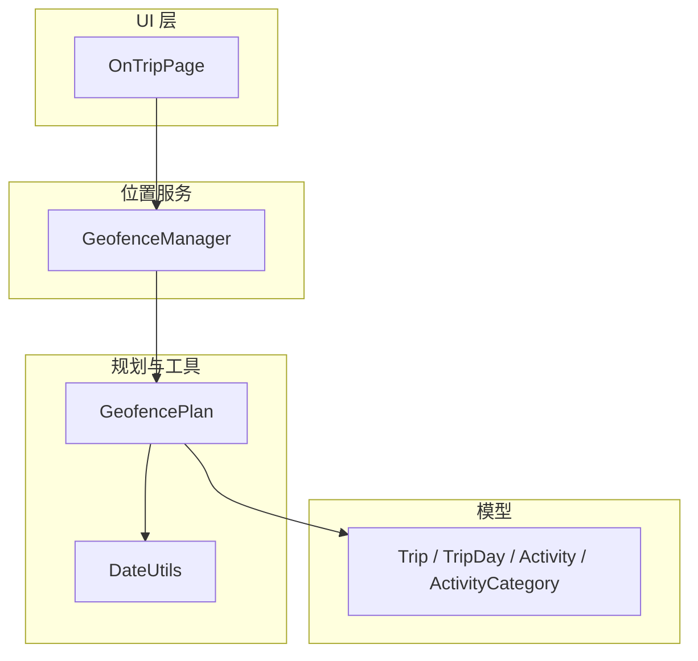
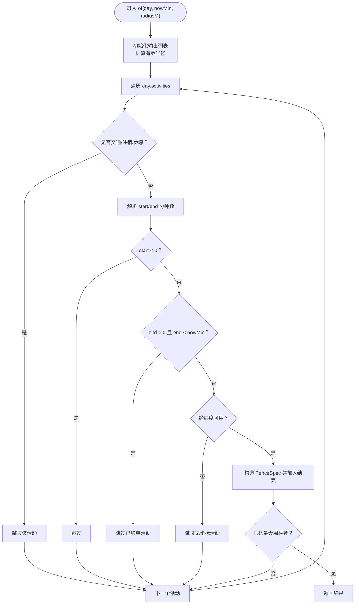
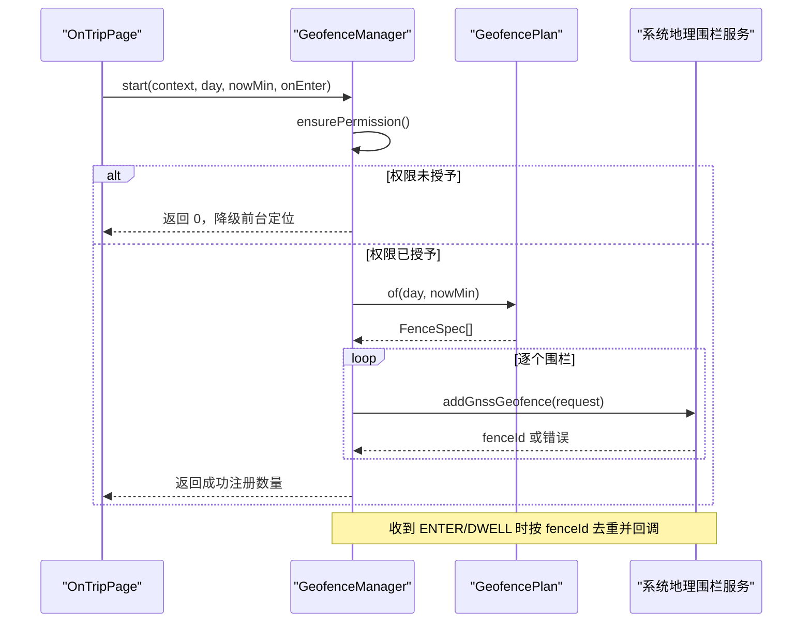
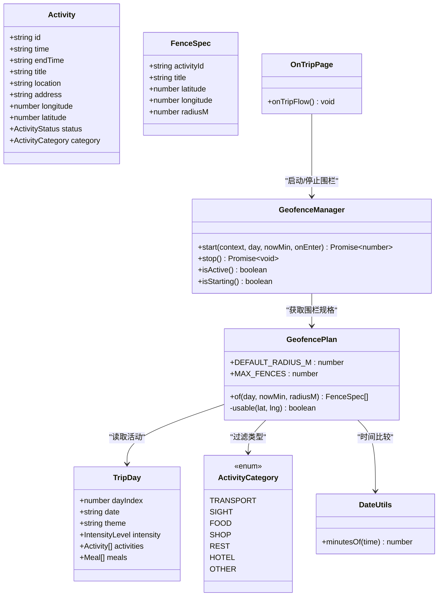
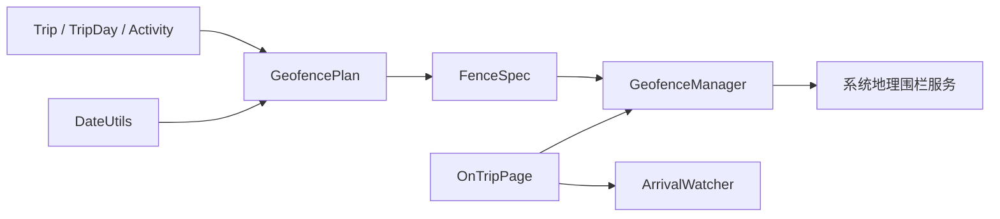

# 围栏规划引擎

<cite>
**本文引用的文件**   
- [GeofencePlan.ets](file://entry/src/main/ets/utils/GeofencePlan.ets)
- [GeofenceManager.ets](file://entry/src/main/ets/common/location/GeofenceManager.ets)
- [OnTripPage.ets](file://entry/src/main/ets/pages/OnTripPage.ets)
- [Trip.ets](file://entry/src/main/ets/model/Trip.ets)
- [DateUtils.ets](file://entry/src/main/ets/utils/DateUtils.ets)
</cite>

## 目录
1. [引言](#引言)
2. [项目结构中的定位](#项目结构中的定位)
3. [核心组件](#核心组件)
4. [架构总览](#架构总览)
5. [详细组件分析](#详细组件分析)
6. [依赖关系分析](#依赖关系分析)
7. [性能与复杂度](#性能与复杂度)
8. [配置选项说明](#配置选项说明)
9. [使用示例](#使用示例)
10. [故障排查](#故障排查)
11. [结论](#结论)

## 引言
本文面向 GeofencePlan 围栏规划引擎，聚焦“今天该为哪些站点注册系统围栏”的纯计算逻辑。当前实现是一个轻量、可离线断言的规划器：它从当日行程中筛选出需要提醒的站点，过滤已过期或无坐标的活动，按时间顺序输出最多若干条围栏规格；真正的围栏注册、权限申请、事件去重与降级由 GeofenceManager 负责，页面层 OnTripPage 负责把计划与前台到站检测组合起来。

需要特别说明的是：**当前版本没有目的地重要性评分、动态半径调整、用户偏好影响因子、地理位置密度聚类、围栏合并与去重等高级策略**。这些能力在文档中以“扩展建议”形式给出，便于后续演进时对照现有接口逐步增强。

## 项目结构中的定位
GeofencePlan 位于应用模块 `entry` 的 `utils` 目录，是纯函数式工具类，不直接依赖系统地理围栏 API，因此可在单元测试和离线断言中使用。它与以下组件协作：
- TripDay / Activity / ActivityCategory：提供输入数据与活动类型枚举。
- DateUtils：解析活动起止时刻为分钟数。
- GeofenceManager：消费 FenceSpec 列表并调用系统地理围栏服务。
- OnTripPage：作为 UI 入口，决定何时触发围栏计划与注册。

**图表来源**
- [OnTripPage.ets](file://entry/src/main/ets/pages/OnTripPage.ets)
- [GeofenceManager.ets:1-174](file://entry/src/main/ets/common/location/GeofenceManager.ets#L1-L174)
- [GeofencePlan.ets:1-63](file://entry/src/main/ets/utils/GeofencePlan.ets#L1-L63)
- [Trip.ets:1-137](file://entry/src/main/ets/model/Trip.ets#L1-L137)

**章节来源**
- [GeofencePlan.ets:1-63](file://entry/src/main/ets/utils/GeofencePlan.ets#L1-L63)
- [Trip.ets:1-137](file://entry/src/main/ets/model/Trip.ets#L1-L137)

## 核心组件
### GeofencePlan：围栏规划器
- 职责：根据 `TripDay` 与当前时间 `nowMin`，生成 `FenceSpec[]`。
- 关键常量：
  - 默认半径：300 米，与审核口径对齐。
  - 最大围栏数量：10，用于控制系统围栏上限与行中场景覆盖范围。
- 输入：
  - `day`：当日行程，包含活动列表、主题、强度等。
  - `nowMin`：当前时间的分钟数（从当天 00:00 起算）。
  - `radiusM`：可选半径参数，未传或小于等于 0 时使用默认值。
- 输出：
  - `FenceSpec[]`：每个元素包含活动标识、标题、经纬度、半径。
- 过滤规则：
  - 排除交通、住宿、休息三类活动。
  - 排除开始时间无效（负值）的活动。
  - 排除已结束且当前时间仍在结束时间之后的活动。
  - 排除经纬度不可用的活动。
- 排序与截断：
  - 按 `day.activities` 原始顺序遍历，即“活动时间线顺序”。
  - 达到 `MAX_FENCES` 后提前终止。

**图表来源**
- [GeofencePlan.ets:1-63](file://entry/src/main/ets/utils/GeofencePlan.ets#L1-L63)

**章节来源**
- [GeofencePlan.ets:1-63](file://entry/src/main/ets/utils/GeofencePlan.ets#L1-L63)

### GeofenceManager：围栏生命周期管理
- 职责：
  - 请求定位权限。
  - 调用 `GeofencePlan.of` 得到围栏规格。
  - 向系统地理围栏服务注册 ENTER 与 DWELL 事件。
  - 对同一围栏 ID 的 ENTER/DWELL 做去重，避免重复提示。
  - 失败时静默降级，不影响前台到站检测。
- 关键状态：
  - `ids`：已注册围栏的系统 ID 列表。
  - `specs`：系统 ID 到 `FenceSpec` 的映射。
  - `announced`：已通知过的围栏 ID 集合。
  - `cancelToken`：防止并发 start/stop 造成状态错乱。
- 有效期策略：
  - 以 `Math.max(3600, (1440 - nowMin) * 60 + 3600)` 计算秒级有效期，保证至少一小时，并按当日剩余时间延长。

**图表来源**
- [GeofenceManager.ets:1-174](file://entry/src/main/ets/common/location/GeofenceManager.ets#L1-L174)
- [GeofencePlan.ets:1-63](file://entry/src/main/ets/utils/GeofencePlan.ets#L1-L63)

**章节来源**
- [GeofenceManager.ets:1-174](file://entry/src/main/ets/common/location/GeofenceManager.ets#L1-L174)

### 模型与时间工具
- TripDay / Activity / ActivityCategory：定义活动分类、状态、坐标、时间、地点等信息。
- DateUtils：提供 `minutesOf(time)`，将 `HH:mm` 转换为分钟数，供围栏规划判断活动是否已结束。

**章节来源**
- [Trip.ets:1-137](file://entry/src/main/ets/model/Trip.ets#L1-L137)
- [DateUtils.ets](file://entry/src/main/ets/utils/DateUtils.ets)

## 架构总览
GeofencePlan 处于“纯计算层”，仅依据行程模型和时间工具输出围栏规格；GeofenceManager 处于“系统集成层”，负责权限、注册、事件回调与降级；OnTripPage 处于“交互层”，负责驱动整个流程并展示到站状态。

**图表来源**
- [Trip.ets:1-137](file://entry/src/main/ets/model/Trip.ets#L1-L137)
- [GeofencePlan.ets:1-63](file://entry/src/main/ets/utils/GeofencePlan.ets#L1-L63)
- [GeofenceManager.ets:1-174](file://entry/src/main/ets/common/location/GeofenceManager.ets#L1-L174)
- [OnTripPage.ets](file://entry/src/main/ets/pages/OnTripPage.ets)

## 详细组件分析

### 目的地分析算法现状
当前 GeofencePlan **不实现景点距离计算、类型识别权重、重要性评分**。其目的地筛选基于以下规则：
- 活动类型过滤：排除交通、住宿、休息。
- 时间有效性：排除负时间、已结束活动。
- 坐标可用性：排除经纬度无效的值。
- 最终选择：按活动原始顺序取前若干项，直到达到最大围栏数。

这意味着：
- 景点、餐饮、购物、其他活动都可能被纳入围栏，只要它们满足时间与坐标条件。
- 不存在“距离最近优先”或“重要景点优先”的评分机制。
- 不存在“用户偏好影响因子”或“地理位置密度考虑”。

**章节来源**
- [GeofencePlan.ets:1-63](file://entry/src/main/ets/utils/GeofencePlan.ets#L1-L63)
- [Trip.ets:1-137](file://entry/src/main/ets/model/Trip.ets#L1-L137)

### 围栏范围计算策略现状
当前围栏半径是常量：
- 默认 300 米。
- 可通过 `radiusM` 参数覆盖，但必须大于 0。
- 没有根据活动类型动态调整半径，也没有用户偏好或地理密度的影响因子。

扩展建议：
- 景点类可使用较小半径，餐饮与购物可使用中等半径，交通接驳点可使用较大半径。
- 引入用户偏好权重，例如家庭游放大亲子景点半径，自由行缩小排队风险点半径。
- 结合 POI 密度与地图缩放级别动态调整半径，避免高密度城市中心围栏过多重叠。

**章节来源**
- [GeofencePlan.ets:1-63](file://entry/src/main/ets/utils/GeofencePlan.ets#L1-L63)

### 围栏优先级排序逻辑现状
当前排序遵循“活动时间线顺序”：
- 直接遍历 `day.activities`，不重新排序。
- 通过 `MAX_FENCES` 截断，而不是评分排序。
- 没有地理位置聚类，也没有用户体验优化评分。

扩展建议：
- 先按活动类型分组，再按时间排序，确保早场活动不被晚场高权重活动挤掉。
- 引入“体验价值”评分，结合活动类别、预约状态、历史打卡率、天气适配度。
- 使用空间聚类减少相邻围栏数量，保留代表性站点。

**章节来源**
- [GeofencePlan.ets:1-63](file://entry/src/main/ets/utils/GeofencePlan.ets#L1-L63)

### 围栏合并与去重机制现状
当前 GeofencePlan **不执行围栏合并或重复目的地过滤**。去重主要由 GeofenceManager 在事件层完成：
- 使用 `announced` 集合按 `fenceId` 去重，避免同一围栏的 ENTER 与 DWELL 重复提示。
- 不对多个围栏之间的空间重叠进行合并。

扩展建议：
- 在生成阶段对经纬度相近的围栏进行合并，保留最高优先级目的地的规格。
- 对同名或同 POI 的重复活动进行过滤或合并。
- 对相邻且同类活动进行合并，降低系统围栏数量。

**章节来源**
- [GeofenceManager.ets:1-174](file://entry/src/main/ets/common/location/GeofenceManager.ets#L1-L174)
- [GeofencePlan.ets:1-63](file://entry/src/main/ets/utils/GeofencePlan.ets#L1-L63)

### 配置选项说明
当前可配置项如下表所示：

| 配置项 | 类型 | 默认值 | 作用 | 可扩展方向 |
|---|---|---:|---|---|
| 默认半径 | 米 | 300 | 所有围栏的统一半径 | 按活动类型、用户偏好、地理密度动态调整 |
| 最大围栏数量 | 个 | 10 | 限制系统围栏上限 | 根据行程强度、城市密度、设备能力调整 |
| 自定义半径 | 米 | 未传入则使用默认值 | 覆盖默认半径 | 增加最小/最大边界校验 |
| 活动时间过滤 | 布尔 | 启用 | 过滤已结束活动 | 可增加“允许进行中”开关 |
| 坐标有效性阈值 | 数值 | 0.0001 | 过滤近似零坐标 | 可改为地图投影误差阈值 |

**章节来源**
- [GeofencePlan.ets:1-63](file://entry/src/main/ets/utils/GeofencePlan.ets#L1-L63)

## 依赖关系分析
GeofencePlan 的依赖非常清晰：
- 对外暴露 `FenceSpec` 接口与 `GeofencePlan.of` 静态方法。
- 内部依赖 `TripDay`、`Activity`、`ActivityCategory` 与 `DateUtils.minutesOf`。
- 不依赖系统地理围栏 API，保持可测试性。
- GeofenceManager 依赖 GeofencePlan，同时依赖系统定位权限与服务。
- OnTripPage 依赖 GeofenceManager 与 ArrivalWatcher，形成“围栏优先、前台降级”的组合策略。

**图表来源**
- [GeofencePlan.ets:1-63](file://entry/src/main/ets/utils/GeofencePlan.ets#L1-L63)
- [GeofenceManager.ets:1-174](file://entry/src/main/ets/common/location/GeofenceManager.ets#L1-L174)
- [OnTripPage.ets](file://entry/src/main/ets/pages/OnTripPage.ets)
- [Trip.ets:1-137](file://entry/src/main/ets/model/Trip.ets#L1-L137)

**章节来源**
- [GeofencePlan.ets:1-63](file://entry/src/main/ets/utils/GeofencePlan.ets#L1-L63)
- [GeofenceManager.ets:1-174](file://entry/src/main/ets/common/location/GeofenceManager.ets#L1-L174)
- [OnTripPage.ets](file://entry/src/main/ets/pages/OnTripPage.ets)

## 性能与复杂度
### 时间复杂度
- GeofencePlan.of：对 `N` 个活动进行一次线性扫描，复杂度为 O(N)。
- 每步过滤、时间解析、坐标检查均为常数时间。
- 达到最大围栏数后提前返回，实际运行通常远小于 N。

### 空间复杂度
- 输出列表最多保存 `MAX_FENCES` 条 `FenceSpec`。
- 辅助变量为常数空间。
- GeofenceManager 额外维护已注册围栏 ID、规格映射与已通知集合，空间与注册围栏数量成正比。

### 性能优化建议
- 如果活动数量很大，可在上游对 TripDay.activities 预先按时间排序，避免重复排序。
- 若未来引入距离计算，可使用空间索引（如四叉树或网格）降低 O(N²) 风险。
- 对用户偏好与重要性评分，可采用增量评分缓存，避免每次重新计算全部活动。
- 对围栏合并与去重，建议在生成阶段完成，减少系统围栏注册数量，降低系统开销。

**章节来源**
- [GeofencePlan.ets:1-63](file://entry/src/main/ets/utils/GeofencePlan.ets#L1-L63)
- [GeofenceManager.ets:1-174](file://entry/src/main/ets/common/location/GeofenceManager.ets#L1-L174)

## 使用示例
以下为典型使用方式，描述如何为行程中的多个目的地生成最优围栏集合。注意：当前“最优”指“按时间顺序、满足过滤条件的最靠前若干站”，并不包含距离、重要性或密度优化。

### 示例一：上午景点加下午餐厅
假设当日行程包含：
- 上午 09:30 至 11:00 的景点 A。
- 中午 12:00 至 13:00 的餐厅 B。
- 下午 14:00 至 15:30 的交通 C。
- 下午 16:00 至 17:00 的景点 D。

GeofencePlan 的处理过程：
1. 过滤交通、住宿、休息：C 被排除。
2. 解析时间并判断是否已结束：若当前时间在 11:00 之前，A 保留；若在 11:00 之后，A 被排除。
3. 检查坐标：A、B、D 有有效坐标则保留。
4. 按顺序输出：A → B → D，直到达到最大围栏数。

结果通常是：A、B、D 的围栏规格，C 不注册围栏。

### 示例二：已有行程中的重复站点
如果行程中出现同一目的地的多次访问：
- 当前实现不会合并或去重，会分别生成多个围栏。
- GeofenceManager 会在事件层按围栏 ID 去重，避免重复提示。
- 建议后续在 GeofencePlan 阶段合并相邻重复目的地，减少系统围栏数量。

### 示例三：无坐标或坐标异常
如果某个活动的经纬度为 null、NaN、无穷大或接近 0：
- GeofencePlan.usable 会将其过滤掉。
- 该活动不会出现在围栏计划中。
- 建议上游数据清洗时补全坐标，或在 UI 层提示用户补充地点信息。

**章节来源**
- [GeofencePlan.ets:1-63](file://entry/src/main/ets/utils/GeofencePlan.ets#L1-L63)
- [GeofenceManager.ets:1-174](file://entry/src/main/ets/common/location/GeofenceManager.ets#L1-L174)

## 故障排查
常见问题与处理策略如下：

| 问题 | 现象 | 可能原因 | 处理建议 |
|---|---|---|---|
| 围栏数量为 0 | 注册成功数为 0 | 定位权限未授予 | 检查权限申请结果，确认用户授权 |
| 围栏注册失败 | 日志显示注册错误码 | 地理围栏服务未开通或参数异常 | 检查 AGC 围栏服务状态与围栏参数 |
| 到站通知重复 | 同一站点多次提示 | 事件去重失效或围栏 ID 不一致 | 检查 announced 集合与 fenceId 映射 |
| 围栏一直不触发 | 已到站点但未提示 | 坐标无效、半径过小、系统定位精度不足 | 检查活动坐标、半径、系统定位权限与精度 |
| 页面离开后仍残留围栏 | 进程退出后仍有围栏 | stop 未正确清理 | 检查 cancelToken 与 stopInternal 调用时机 |

**章节来源**
- [GeofenceManager.ets:1-174](file://entry/src/main/ets/common/location/GeofenceManager.ets#L1-L174)

## 结论
GeofencePlan 当前是一个简洁、可测试、面向行中到站提醒的围栏规划器。它以活动类型、时间与坐标为基础，按时间线顺序生成固定半径的围栏规格，并由 GeofenceManager 负责系统注册与事件去重。当前版本不包含目的地重要性评分、动态半径、用户偏好影响因子、地理密度聚类以及围栏合并去重等高级能力。

若后续需要更智能的围栏集合，建议分阶段演进：
1. 先扩展 GeofencePlan 的输出接口，增加评分、聚类、合并能力。
2. 在 GeofenceManager 层继续强化去重、降级与监控。
3. 在 OnTripPage 层统一调度围栏计划与前台到站检测，保持用户体验一致性。

这样可以在不破坏现有 P5 行为的前提下，逐步提升围栏规划的准确性与用户体验。