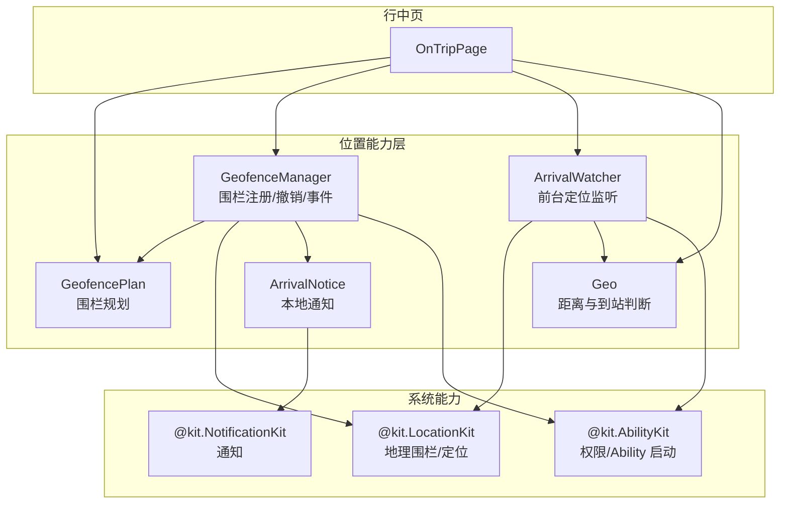
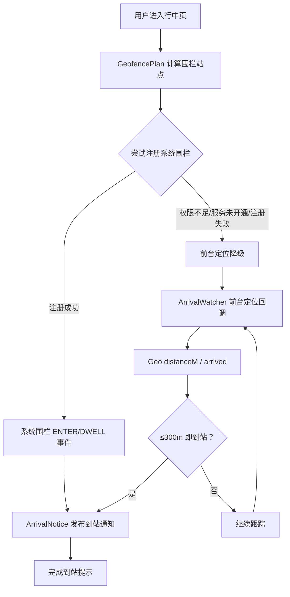
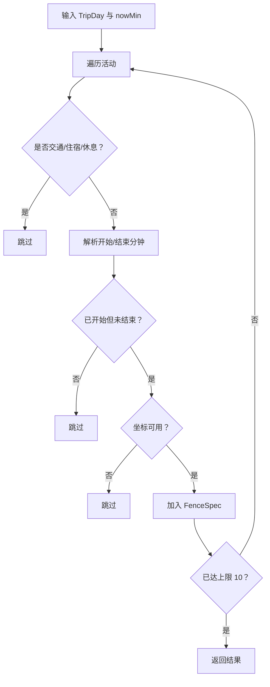
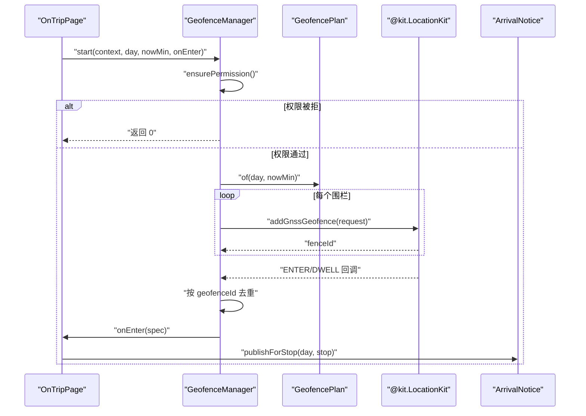
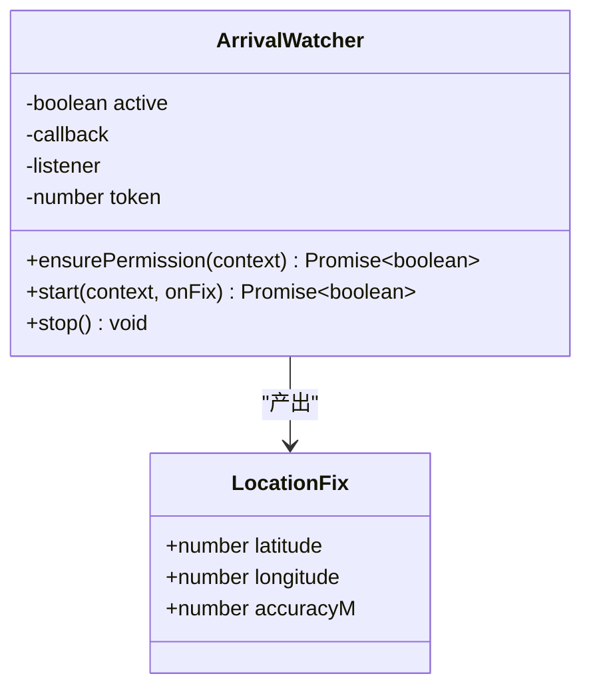
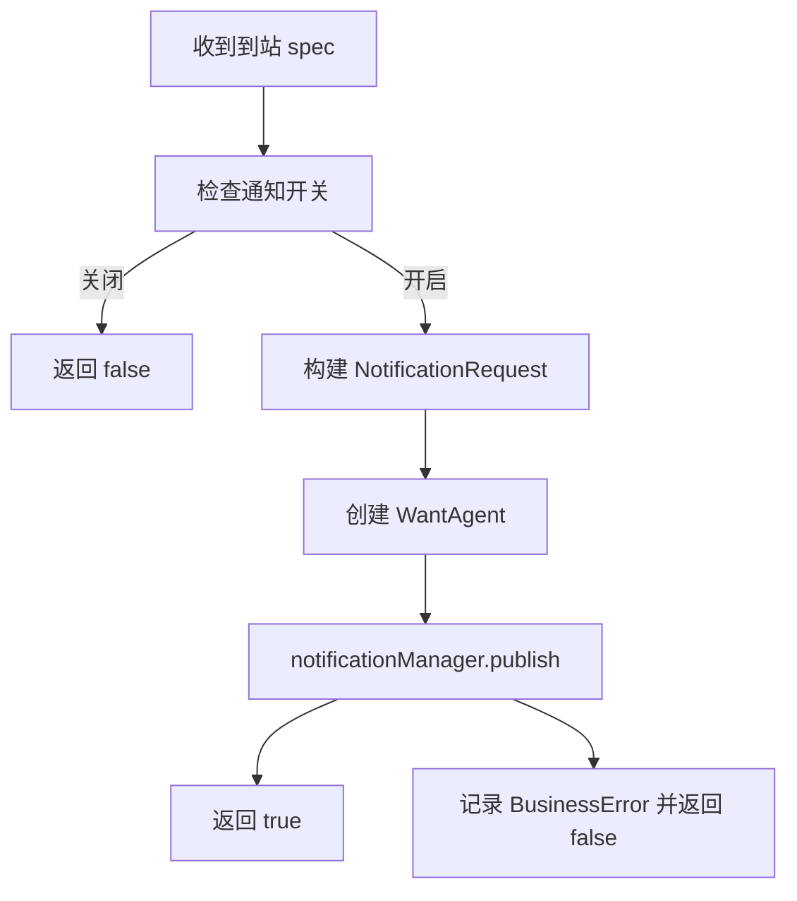
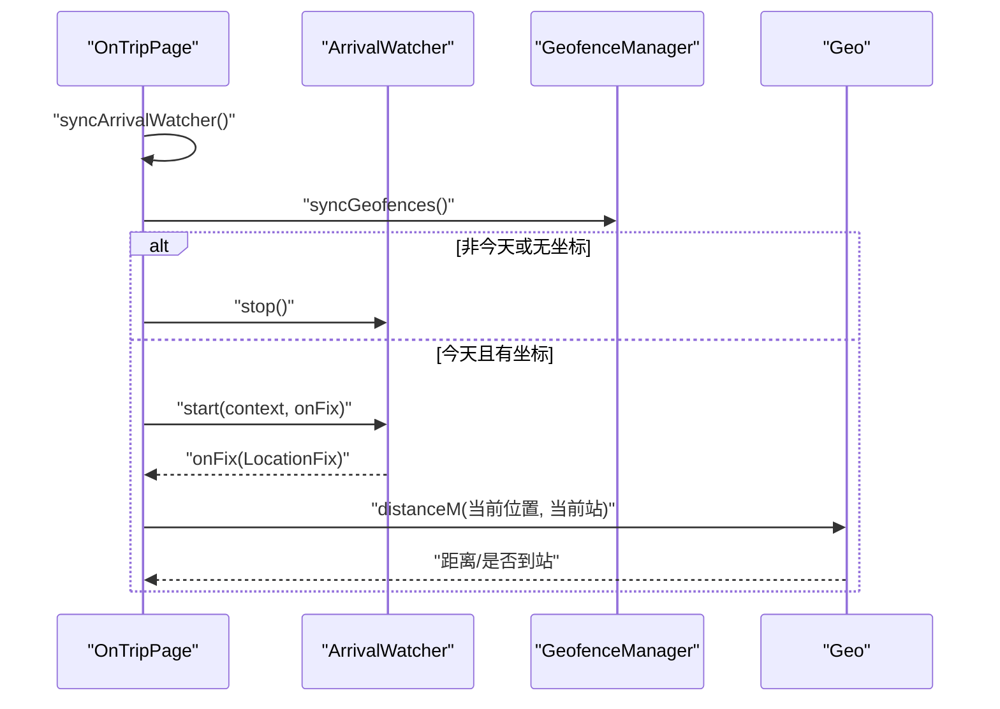

# 地理位置服务

<cite>
**本文引用的文件**   
- [GeofenceManager.ets](file://entry/src/main/ets/common/location/GeofenceManager.ets)
- [GeofencePlan.ets](file://entry/src/main/ets/utils/GeofencePlan.ets)
- [ArrivalWatcher.ets](file://entry/src/main/ets/common/location/ArrivalWatcher.ets)
- [ArrivalNotice.ets](file://entry/src/main/ets/common/location/ArrivalNotice.ets)
- [Geo.ets](file://entry/src/main/ets/utils/Geo.ets)
- [OnTripPage.ets](file://entry/src/main/ets/pages/OnTripPage.ets)
- [module.json5](file://entry/src/main/module.json5)
- [围栏与后台唤醒开通清单.md](file://Docs/围栏与后台唤醒开通清单.md)
</cite>

## 目录
1. [引言](#引言)
2. [项目结构](#项目结构)
3. [核心组件](#核心组件)
4. [架构总览](#架构总览)
5. [组件详解](#组件详解)
6. [依赖关系分析](#依赖关系分析)
7. [性能考量](#性能考量)
8. [故障排查指南](#故障排查指南)
9. [结论](#结论)
10. [附录：权限、AGC 与降级策略](#附录权限agc-与降级策略)

## 引言
本文面向“有径”应用中的地理位置能力，聚焦行中到站提醒链路。该链路由四类组件构成：
- 围栏规划器 `GeofencePlan`：决定当天哪些站点需要围栏、围栏半径和优先级。
- 围栏管理器 `GeofenceManager`：封装系统地理围栏的注册、撤销、事件去重与权限申请。
- 前台定位监听器 `ArrivalWatcher`：在页面存活期间订阅低耗电定位回调，用于围栏不可用时的降级到站检测。
- 通知器 `ArrivalNotice`：将到站事件转化为本地系统通知，支持点击打开应用。

当前实现以“前台定位为主、系统围栏为辅”。由于系统地理围栏监测服务需经 AGC 审核开通，未通过前所有设备走 T1 降级路径；审核通过后升级为 T2，使用系统围栏减少前台常驻定位。

**章节来源**
- [GeofenceManager.ets:1-174](file://entry/src/main/ets/common/location/GeofenceManager.ets#L1-L174)
- [GeofencePlan.ets:1-63](file://entry/src/main/ets/utils/GeofencePlan.ets#L1-L63)
- [ArrivalWatcher.ets:1-135](file://entry/src/main/ets/common/location/ArrivalWatcher.ets#L1-L135)
- [ArrivalNotice.ets:1-77](file://entry/src/main/ets/common/location/ArrivalNotice.ets#L1-L77)
- [围栏与后台唤醒开通清单.md:1-172](file://Docs/围栏与后台唤醒开通清单.md#L1-L172)

## 项目结构
地理位置相关代码集中在 `entry/src/main/ets/common/location` 与 `entry/src/main/ets/utils`：
- `common/location`：运行时位置能力（围栏管理、前台定位、通知）。
- `utils`：纯函数或可离线断言的地理计算与围栏规划。
- `pages/OnTripPage.ets`：行中页作为编排入口，协调围栏、前台定位与 UI 状态。
- `module.json5`：声明定位权限与代理提醒能力。



**图表来源**
- [OnTripPage.ets:188-195](file://entry/src/main/ets/pages/OnTripPage.ets#L188-L195)
- [GeofenceManager.ets:1-174](file://entry/src/main/ets/common/location/GeofenceManager.ets#L1-L174)
- [ArrivalWatcher.ets:1-135](file://entry/src/main/ets/common/location/ArrivalWatcher.ets#L1-L135)
- [ArrivalNotice.ets:1-77](file://entry/src/main/ets/common/location/ArrivalNotice.ets#L1-L77)
- [Geo.ets:1-99](file://entry/src/main/ets/utils/Geo.ets#L1-L99)

**章节来源**
- [OnTripPage.ets:188-195](file://entry/src/main/ets/pages/OnTripPage.ets#L188-L195)
- [module.json5:52-66](file://entry/src/main/module.json5#L52-L66)

## 核心组件
| 组件 | 职责 | 关键方法/属性 | 输出 |
|---|---|---|---|
| `GeofencePlan` | 从当日行程筛选应注册的围栏站点，过滤交通/住宿/休息与已过期站点 | `of(day, nowMin, radiusM)` | `FenceSpec[]` |
| `GeofenceManager` | 申请定位权限、注册/撤销系统围栏、处理 ENTER/DWELL 事件并去重 | `start(context, day, nowMin, onEnter)`、`stop()`、`handleTransition(...)` | 成功注册数量；到站回调 |
| `ArrivalWatcher` | 页面存活时订阅低耗电前台定位，屏蔽无定位能力、系统开关关闭、权限拒绝等异常 | `ensurePermission(context)`、`start(context, onFix)`、`stop()` | 前台定位结果 `LocationFix` |
| `ArrivalNotice` | 发布到站本地通知，生成稳定通知 ID，创建点击动作 | `publishForStop(day, stop)` | 是否成功发布通知 |
| `Geo` | 提供大圆距离、平均距离、到站判定与文案格式化 | `distanceM(a,b)`、`arrived(distanceM)`、`ARRIVAL_RADIUS_M` | 米级距离、布尔到站、文本 |

**章节来源**
- [GeofencePlan.ets:1-63](file://entry/src/main/ets/utils/GeofencePlan.ets#L1-L63)
- [GeofenceManager.ets:1-174](file://entry/src/main/ets/common/location/GeofenceManager.ets#L1-L174)
- [ArrivalWatcher.ets:1-135](file://entry/src/main/ets/common/location/ArrivalWatcher.ets#L1-L135)
- [ArrivalNotice.ets:1-77](file://entry/src/main/ets/common/location/ArrivalNotice.ets#L1-L77)
- [Geo.ets:1-99](file://entry/src/main/ets/utils/Geo.ets#L1-L99)

## 架构总览
到站提醒存在两条并行路径：



**图表来源**
- [GeofenceManager.ets:33-113](file://entry/src/main/ets/common/location/GeofenceManager.ets#L33-L113)
- [ArrivalWatcher.ets:39-135](file://entry/src/main/ets/common/location/ArrivalWatcher.ets#L39-L135)
- [Geo.ets:55-99](file://entry/src/main/ets/utils/Geo.ets#L55-L99)
- [ArrivalNotice.ets:15-77](file://entry/src/main/ets/common/location/ArrivalNotice.ets#L15-L77)

**章节来源**
- [GeofenceManager.ets:33-113](file://entry/src/main/ets/common/location/GeofenceManager.ets#L33-L113)
- [ArrivalWatcher.ets:39-135](file://entry/src/main/ets/common/location/ArrivalWatcher.ets#L39-L135)
- [OnTripPage.ets:1103-1170](file://entry/src/main/ets/pages/OnTripPage.ets#L1103-L1170)

## 组件详解

### GeofencePlan：围栏规划
`GeofencePlan` 是纯函数式规划器，不依赖系统 API，便于离线断言。它从 `TripDay.activities` 中筛选出适合做围栏的活动，规则如下：
- 排除交通、住宿、休息类活动。
- 排除开始时间无效或已结束的活动；正在进行的活动保留。
- 坐标必须可用，即经纬度有限且不为近似原点。
- 默认半径为 300 米，与 `Geo.ARRIVAL_RADIUS_M` 口径一致。
- 最多取前 10 个围栏，避免超出系统配额。



**图表来源**
- [GeofencePlan.ets:17-63](file://entry/src/main/ets/utils/GeofencePlan.ets#L17-L63)

复杂度分析：
- 时间复杂度：O(n)，n 为当日活动数。
- 空间复杂度：O(k)，k 为最终围栏数，上限 10。

**章节来源**
- [GeofencePlan.ets:1-63](file://entry/src/main/ets/utils/GeofencePlan.ets#L1-L63)
- [Geo.ets:78-99](file://entry/src/main/ets/utils/Geo.ets#L78-L99)

### GeofenceManager：围栏注册、撤销、监控与到站检测
`GeofenceManager` 负责把 `FenceSpec` 转换为系统 GNSS 围栏，并消费系统回调。其关键行为包括：

1. **权限前置**：调用内部 `ensurePermission` 申请 `ohos.permission.LOCATION` 与 `ohos.permission.APPROXIMATELY_LOCATION`；任一拒绝则降级为前台定位。
2. **围栏计划生成**：委托 `GeofencePlan.of(day, nowMin)` 获取围栏规格。
3. **有效期计算**：按当日剩余分钟乘以 60 秒再加缓冲，保证下午站点不会因固定 4 小时提前失效。
4. **围栏注册**：对每个围栏设置 ENTER 与 DWELL 事件，`loiterTimeMs=10000`，捕获 `BusinessError` 并记录日志。
5. **事件去重**：使用 `announced Set` 按 `geofenceId` 去重，避免 ENTER 与 DWELL 先后触发重复到站。
6. **并发安全**：使用 `cancelToken` 防止快速 reload、权限弹窗期间多次 start 导致旧任务覆盖新任务。
7. **停止流程**：逐个撤销已注册围栏，清空 id、spec、announced、回调与活跃标志。



**图表来源**
- [GeofenceManager.ets:33-113](file://entry/src/main/ets/common/location/GeofenceManager.ets#L33-L113)
- [ArrivalNotice.ets:15-77](file://entry/src/main/ets/common/location/ArrivalNotice.ets#L15-L77)

错误处理要点：
- 权限申请异常或拒绝：返回 false，页面降级到前台定位。
- 单个围栏注册失败：记录警告日志，继续注册其他围栏。
- 系统围栏事件错误码非 0：忽略该事件。
- 撤销围栏失败：记录警告但不影响后续清理。

**章节来源**
- [GeofenceManager.ets:1-174](file://entry/src/main/ets/common/location/GeofenceManager.ets#L1-L174)

### ArrivalWatcher：前台定位与到站判断
`ArrivalWatcher` 是 P5 降级方案的核心。它在页面显示时启用，隐藏时销毁；不申请长时任务保活，也不主动注册系统围栏。

关键设计：
- **定位请求参数**：优先级为高精度，场景为日常服务，时间间隔 10 秒，距离间隔 20 米，属于低功耗档。
- **权限与能力检查**：先检查设备是否支持 `SystemCapability.Location.Location.Core`，再读取系统定位开关，最后申请定位权限。
- **取消令牌**：避免权限弹窗期间页面退订或再次 start 导致旧回调写入已销毁页面。
- **回调转换**：将系统 `Location` 转为轻量 `LocationFix`，仅包含经纬度和精度。
- **退订保护**：先置空回调与 listener，再调用 `off`，防止 off 期间的在途回调打到已销毁对象。



**图表来源**
- [ArrivalWatcher.ets:24-135](file://entry/src/main/ets/common/location/ArrivalWatcher.ets#L24-L135)

到站判断不在 `ArrivalWatcher` 内完成，而是由 `OnTripPage` 拿到 `LocationFix` 后调用 `Geo.distanceM` 与 `Geo.arrived`，阈值 300 米。

**章节来源**
- [ArrivalWatcher.ets:1-135](file://entry/src/main/ets/common/location/ArrivalWatcher.ets#L1-L135)
- [Geo.ets:55-99](file://entry/src/main/ets/utils/Geo.ets#L55-L99)
- [OnTripPage.ets:1103-1170](file://entry/src/main/ets/pages/OnTripPage.ets#L1103-L1170)

### ArrivalNotice：通知机制
`ArrivalNotice` 负责把到站事件转成系统通知。它不依赖实况窗，也不依赖 AGC 后台唤醒能力，只受应用通知开关控制。

行为说明：
- 若通知开关关闭，直接返回失败并记录日志。
- 通知内容标题为已到站点名称，正文提示可打卡，附加文本为应用名。
- 尝试创建 `WantAgent`，点击后启动 `EntryAbility`。
- 通知 ID 基于日期与站点 ID 哈希生成，落在 20 亿以上区间，避免与系统提醒冲突。
- 发布失败时捕获 `BusinessError`，记录 code 与 message。



**图表来源**
- [ArrivalNotice.ets:15-77](file://entry/src/main/ets/common/location/ArrivalNotice.ets#L15-L77)

**章节来源**
- [ArrivalNotice.ets:1-77](file://entry/src/main/ets/common/location/ArrivalNotice.ets#L1-L77)

### OnTripPage：行中页调度
`OnTripPage` 是位置能力的编排者，负责：
- 初始化 `ArrivalWatcher` 与 `GeofenceManager`。
- 在 `aboutToDisappear` 中同时停止两者。
- 根据“是否今天、是否有当前站、是否有可用坐标”决定是否启动前台定位。
- 根据“是否今天、dayKey 是否变化、围栏是否正在启动”决定是否重新注册围栏。
- 将围栏回调与前台定位结果合并为到站状态。



**图表来源**
- [OnTripPage.ets:1103-1170](file://entry/src/main/ets/pages/OnTripPage.ets#L1103-L1170)

**章节来源**
- [OnTripPage.ets:188-195](file://entry/src/main/ets/pages/OnTripPage.ets#L188-L195)
- [OnTripPage.ets:228-237](file://entry/src/main/ets/pages/OnTripPage.ets#L228-L237)
- [OnTripPage.ets:1103-1170](file://entry/src/main/ets/pages/OnTripPage.ets#L1103-L1170)

## 依赖关系分析

```mermaid
graph LR
  Geo["Geo.ets"] --> OnTrip["OnTripPage.ets"]
  GeofencePlan["GeofencePlan.ets"] --> GeofenceMgr["GeofenceManager.ets"]
  GeofencePlan --> OnTrip
  GeofenceMgr --> OnTrip
  ArrivalWatcher --> OnTrip
  ArrivalNotice --> OnTrip
  GeofenceMgr -->|"ohos.permission.LOCATION"<br/>"ohos.permission.APPROXIMATELY_LOCATION"| Module["module.json5"]
  ArrivalWatcher --> Module
```

**图表来源**
- [Geo.ets:1-99](file://entry/src/main/ets/utils/Geo.ets#L1-L99)
- [GeofencePlan.ets:1-63](file://entry/src/main/ets/utils/GeofencePlan.ets#L1-L63)
- [GeofenceManager.ets:1-174](file://entry/src/main/ets/common/location/GeofenceManager.ets#L1-L174)
- [ArrivalWatcher.ets:1-135](file://entry/src/main/ets/common/location/ArrivalWatcher.ets#L1-L135)
- [module.json5:52-66](file://entry/src/main/module.json5#L52-L66)

耦合关系总结：
- `GeofenceManager` 强依赖 `GeofencePlan` 提供的围栏规格。
- `OnTripPage` 是外部编排点，但三个位置组件各自维护自身生命周期，降低单点故障风险。
- 位置能力统一通过 `@kit.LocationKit` 与 `@kit.NotificationKit` 接入系统。
- 权限声明集中在 `module.json5`，代码侧通过 `abilityAccessCtrl` 动态申请。

**章节来源**
- [GeofenceManager.ets:1-174](file://entry/src/main/ets/common/location/GeofenceManager.ets#L1-L174)
- [ArrivalWatcher.ets:1-135](file://entry/src/main/ets/common/location/ArrivalWatcher.ets#L1-L135)
- [module.json5:52-66](file://entry/src/main/module.json5#L52-L66)

## 性能考量
1. **定位频率控制**
   - `ArrivalWatcher` 使用 10 秒时间间隔与 20 米距离间隔，配合 `DAILY_LIFE_SERVICE` 场景，避免导航级高频刷新。
   - 只在页面可见且当天有有效当前站时订阅，退订后立即摘除回调。

2. **内存管理**
   - `GeofenceManager` 使用 Map 保存 fenceId 到 `FenceSpec` 的映射，撤销时清空；`announced` 使用 Set 去重。
   - `ArrivalWatcher` 在 `stop` 中置空回调引用，避免闭包持有所属页面。

3. **电池优化**
   - 前台定位采用低耗电档位，不申请长时任务。
   - 系统围栏在未审核通过前不强制运行；即使注册成功，若无事件回调也不会持续消耗额外资源。
   - 通知仅在到站时发布，ID 稳定复用，避免通知堆叠。

4. **计算成本**
   - `GeofencePlan` 线性扫描当日活动，上限 10 个围栏。
   - `Geo.distanceM` 使用大圆公式，单次计算常量开销；到站判定只比较一次距离阈值。

[本节为通用性能建议，不直接分析具体代码片段]

## 故障排查指南

| 现象 | 可能原因 | 排查步骤 | 降级策略 |
|---|---|---|---|
| 围栏注册成功但无 ENTER/DWELL 回调 | AGC 审核未通过，围栏监测引擎未运行 | 查看文档中真机探针结论；检查系统通知是否出现审核结果 | 保持前台 `locationChange` 降级路径 |
| 定位权限弹窗后页面消失仍收到回调 | 取消令牌未生效或回调未及时置空 | 检查 `token` 自增逻辑与 `stop` 中回调清理顺序 | 确保页面销毁时一定调用 `watcher.stop()` |
| 通知未展示 | 系统通知开关关闭 | 检查 `isNotificationEnabled` 返回值 | 静默降级，不二次引导 |
| 到站判定始终不触发 | 坐标不可用、距离 >300m、系统定位关闭 | 校验 `Geo.usable`、当前站坐标、系统定位开关 | 回到手动打卡 |
| 围栏频繁重复到站 | 未去重 ENTER 与 DWELL | 检查 `announced` 集合与 fenceId | 已在实现中去重 |
| 后台杀进程后收不到围栏事件 | “围栏后台唤醒”未开通 | 参考 AGC 开通清单与复测清单 | 前台定位无法保活，只能依赖页面存活 |

**章节来源**
- [围栏与后台唤醒开通清单.md:1-172](file://Docs/围栏与后台唤醒开通清单.md#L1-L172)
- [GeofenceManager.ets:97-113](file://entry/src/main/ets/common/location/GeofenceManager.ets#L97-L113)
- [ArrivalWatcher.ets:89-135](file://entry/src/main/ets/common/location/ArrivalWatcher.ets#L89-L135)
- [ArrivalNotice.ets:15-77](file://entry/src/main/ets/common/location/ArrivalNotice.ets#L15-L77)

## 结论
有径的地理位置服务以“前台定位保底、系统围栏升级”的方式实现到站提醒。`GeofencePlan` 提供稳定的围栏规划，`GeofenceManager` 封装系统围栏生命周期，`ArrivalWatcher` 提供低耗电前台定位降级，`ArrivalNotice` 负责到站通知。整体设计具备以下优点：
- 分层清晰：规划、执行、监听、通知解耦。
- 降级稳健：权限拒绝、系统定位关闭、围栏服务未开通都能回退到前台定位。
- 可审计：大量 `Logger` 记录权限、注册、事件、通知错误。
- 可控功耗：低频定位、限制围栏数量、避免后台保活。

未来当 AGC 围栏服务审核通过后，产品可从 T1 升级到 T2，真正依赖系统围栏减少前台定位；同时需关注“围栏后台唤醒”能力是否随同一审核生效。

[本节为总结性内容，不直接分析具体文件]

## 附录：权限、AGC 与降级策略

### 权限管理
- 定位权限：`ohos.permission.LOCATION` 与 `ohos.permission.APPROXIMATELY_LOCATION`，在 `module.json5` 中声明，并在 `GeofenceManager.ensurePermission` 与 `ArrivalWatcher.ensurePermission` 中动态申请。
- 代理提醒能力：`ohos.permission.PUBLISH_AGENT_REMINDER` 已声明，但与到站通知不同；到站通知使用本地通知而非代理提醒。
- 权限拒绝处理：两个组件均在权限未授予时返回 false，由上层降级。

**章节来源**
- [module.json5:44-66](file://entry/src/main/module.json5#L44-L66)
- [GeofenceManager.ets:136-174](file://entry/src/main/ets/common/location/GeofenceManager.ets#L136-L174)
- [ArrivalWatcher.ets:49-87](file://entry/src/main/ets/common/location/ArrivalWatcher.ets#L49-L87)

### AGC 集成现状
- 系统地理围栏注册 API 不拦截，但事件回调依赖 AGC 审核开通。
- 当前唯一闸门是 AGC 审核；邮件渠道不再单独开通。
- 审核通过前走 T1 前台定位；审核通过后复测 ENTER/DWELL、后台事件、半径体验，再升 T2。
- 实况窗已被驳回，不再作为交付依赖；P5 收敛为系统围栏事件加本地通知。

**章节来源**
- [围栏与后台唤醒开通清单.md:1-172](file://Docs/围栏与后台唤醒开通清单.md#L1-L172)

### 降级策略矩阵
| 条件 | 行为 |
|---|---|
| 系统围栏审核通过且权限满足 | 使用 `GeofenceManager` 注册 ENTER/DWELL，到站发通知 |
| 权限拒绝 | 不调用系统围栏，改用 `ArrivalWatcher` 前台定位 |
| 设备无定位能力 | `ArrivalWatcher.start` 返回 false |
| 系统定位开关关闭 | `ArrivalWatcher.start` 返回 false |
| 围栏注册失败 | 记录日志，继续注册其他围栏；最终数量为 0 时降级前台定位 |
| 通知开关关闭 | `ArrivalNotice.publishForStop` 返回 false |
| 页面退出 | 同时停止 watcher 与 geofence，释放资源 |

**章节来源**
- [GeofenceManager.ets:33-113](file://entry/src/main/ets/common/location/GeofenceManager.ets#L33-L113)
- [ArrivalWatcher.ets:65-135](file://entry/src/main/ets/common/location/ArrivalWatcher.ets#L65-L135)
- [ArrivalNotice.ets:15-77](file://entry/src/main/ets/common/location/ArrivalNotice.ets#L15-L77)
- [OnTripPage.ets:228-237](file://entry/src/main/ets/pages/OnTripPage.ets#L228-L237)