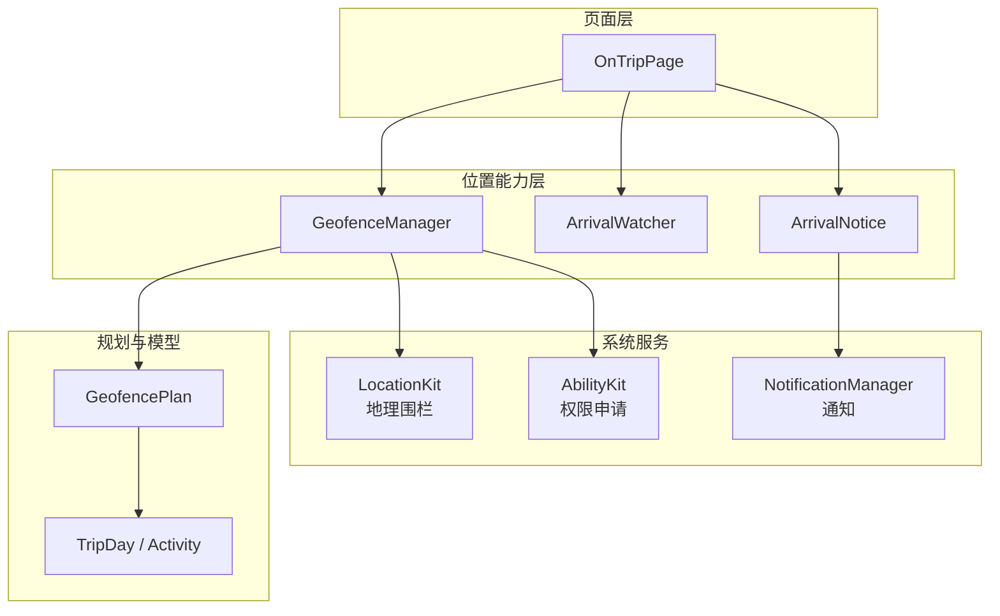
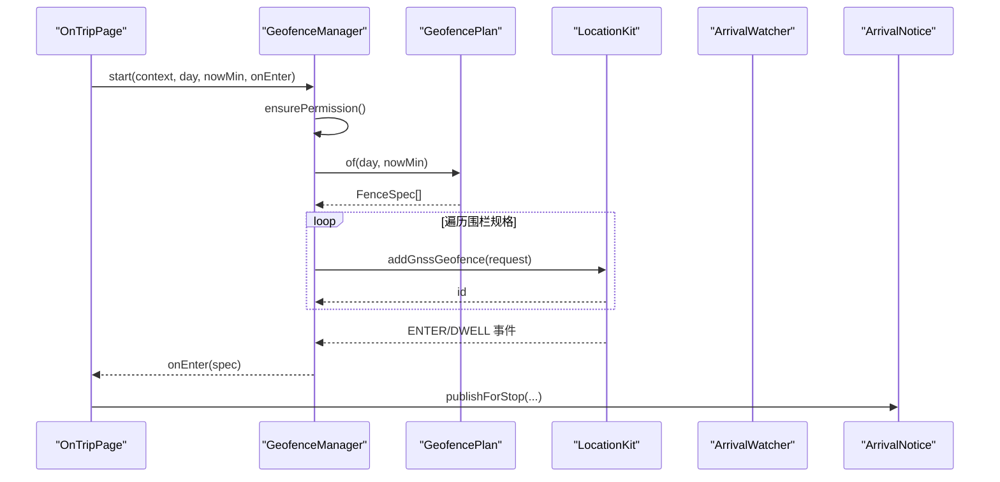
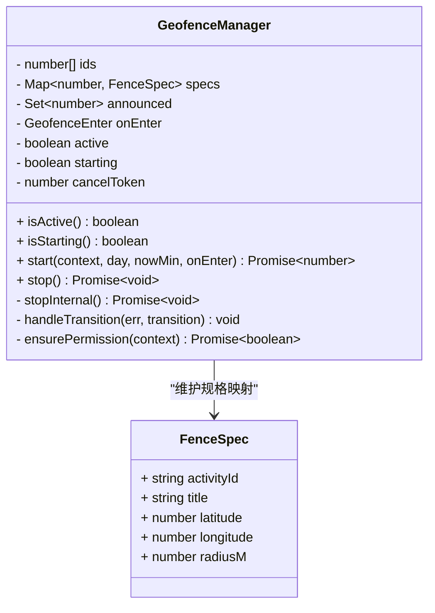
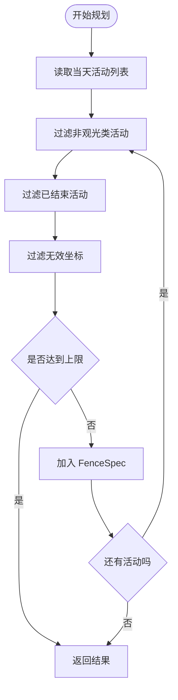
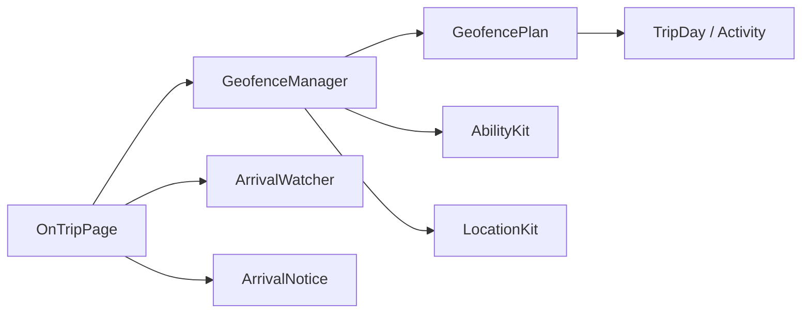

# 地理围栏管理

<cite>
**本文引用的文件**   
- [GeofenceManager.ets](file://entry/src/main/ets/common/location/GeofenceManager.ets)
- [GeofencePlan.ets](file://entry/src/main/ets/utils/GeofencePlan.ets)
- [ArrivalWatcher.ets](file://entry/src/main/ets/common/location/ArrivalWatcher.ets)
- [OnTripPage.ets](file://entry/src/main/ets/pages/OnTripPage.ets)
- [ArrivalNotice.ets](file://entry/src/main/ets/common/location/ArrivalNotice.ets)
</cite>

## 目录
1. [简介](#简介)
2. [项目结构](#项目结构)
3. [核心组件](#核心组件)
4. [架构总览](#架构总览)
5. [详细组件分析](#详细组件分析)
6. [依赖关系分析](#依赖关系分析)
7. [性能与电池优化](#性能与电池优化)
8. [权限与降级策略](#权限与降级策略)
9. [错误处理与排障](#错误处理与排障)
10. [完整使用流程示例](#完整使用流程示例)
11. [结论](#结论)

## 简介
本文件面向 GeofenceManager 地理围栏管理器，围绕“到站提醒”这一产品目标，说明围栏的生命周期、状态监控机制、配置参数、权限管理、错误处理与性能优化。GeofenceManager 负责为“今天尚未结束的站点”批量注册系统地理围栏，并在进入或常驻事件发生时触发回调；当系统服务未开通、权限不足或坐标不可用时，自动降级为前台定位检测。

## 项目结构
地理围栏相关代码位于应用入口模块的公共位置层和页面层：
- 公共位置能力
  - GeofenceManager：围栏生命周期与系统回调处理
  - ArrivalWatcher：前台定位到站检测（降级方案）
  - ArrivalNotice：到站通知展示（与围栏事件联动）
- 规划逻辑
  - GeofencePlan：纯函数式围栏计划（哪些站点需要围栏、半径与数量上限）
- 业务集成
  - OnTripPage：行程进行中页面，协调围栏与前台定位，消费到站回调并提示用户

图示来源
- [OnTripPage.ets:188-235](file://entry/src/main/ets/pages/OnTripPage.ets#L188-L235)
- [GeofenceManager.ets:1-174](file://entry/src/main/ets/common/location/GeofenceManager.ets#L1-L174)
- [ArrivalWatcher.ets:1-135](file://entry/src/main/ets/common/location/ArrivalWatcher.ets#L1-L135)
- [GeofencePlan.ets:1-63](file://entry/src/main/ets/utils/GeofencePlan.ets#L1-L63)
- [ArrivalNotice.ets:1-41](file://entry/src/main/ets/common/location/ArrivalNotice.ets#L1-L41)

章节来源
- [GeofenceManager.ets:1-174](file://entry/src/main/ets/common/location/GeofenceManager.ets#L1-L174)
- [GeofencePlan.ets:1-63](file://entry/src/main/ets/utils/GeofencePlan.ets#L1-L63)
- [ArrivalWatcher.ets:1-135](file://entry/src/main/ets/common/location/ArrivalWatcher.ets#L1-L135)
- [OnTripPage.ets:188-235](file://entry/src/main/ets/pages/OnTripPage.ets#L188-L235)

## 核心组件
- GeofenceManager：封装围栏注册、撤销、更新、进入/常驻事件去重与回调分发，同时负责权限检查与服务调用异常日志记录。
- GeofencePlan：根据行程当天活动过滤出需要围栏的活动集合，提供默认半径与最大围栏数量限制。
- ArrivalWatcher：前台定位订阅器，作为围栏不可用时的降级到站检测方案。
- ArrivalNotice：到站通知发布工具，与围栏回调配合推送可打卡提示。
- OnTripPage：在行程进行中页面中组合使用围栏与前台定位，并消费到站结果。

章节来源
- [GeofenceManager.ets:1-174](file://entry/src/main/ets/common/location/GeofenceManager.ets#L1-L174)
- [GeofencePlan.ets:1-63](file://entry/src/main/ets/utils/GeofencePlan.ets#L1-L63)
- [ArrivalWatcher.ets:1-135](file://entry/src/main/ets/common/location/ArrivalWatcher.ets#L1-L135)
- [ArrivalNotice.ets:1-41](file://entry/src/main/ets/common/location/ArrivalNotice.ets#L1-L41)
- [OnTripPage.ets:1139-1184](file://entry/src/main/ets/pages/OnTripPage.ets#L1139-L1184)

## 架构总览
GeofenceManager 不直接持有 UI，而是通过 onEnter 回调将“进入围栏”的事件交给 OnTripPage 消费。OnTripPage 再结合 ArrivalNotice 进行界面与通知提示。若围栏无法工作，OnTripPage 继续启动 ArrivalWatcher 进行前台定位检测。

图示来源
- [GeofenceManager.ets:45-120](file://entry/src/main/ets/common/location/GeofenceManager.ets#L45-L120)
- [GeofencePlan.ets:18-55](file://entry/src/main/ets/utils/GeofencePlan.ets#L18-L55)
- [OnTripPage.ets:1139-1184](file://entry/src/main/ets/pages/OnTripPage.ets#L1139-L1184)
- [ArrivalNotice.ets:16-41](file://entry/src/main/ets/common/location/ArrivalNotice.ets#L16-L41)

## 详细组件分析

### GeofenceManager：围栏生命周期与状态监控
GeofenceManager 是围栏能力的统一入口，对外暴露 start、stop、isActive、isStarting 等方法，内部维护已注册围栏 ID、围栏规格映射、已提示围栏集合、回调函数与运行状态。

- 围栏注册流程
  - 并发保护：starting 标志与 cancelToken 防止重复注册、页面快速 reload 导致的状态错乱。
  - 权限校验：ensurePermission 请求 LOCATION 与 APPROXIMATELY_LOCATION 权限；任一拒绝即返回失败，start 返回成功注册数量为 0。
  - 围栏计划：调用 GeofencePlan.of 获取当天应注册的围栏规格列表。
  - 批量注册：为每个 FenceSpec 构造系统围栏请求，包含经纬度、半径、过期时间、监测事件类型、loiterTimeMs、过渡回调。
  - 结果统计：仅记录成功添加的围栏 ID，单个失败不会中断其余围栏注册。

- 围栏撤销流程
  - stop 会自增 cancelToken 并调用内部 stopInternal。
  - stopInternal 逐个 removeGnssGeofence，清空 IDs、specs、announced、onEnter，并将 active 置为 false。

- 状态监控与回调处理
  - 监听 GEOFENCE_TRANSITION_EVENT_ENTER 与 GEOFENCE_TRANSITION_EVENT_DWELL。
  - 同一 geofenceId 只响应一次，避免重复到站提示。
  - handleTransition 先判断错误码，再按 geofenceId 查找对应 FenceSpec，最终调用 onEnter。

图示来源
- [GeofenceManager.ets:21-174](file://entry/src/main/ets/common/location/GeofenceManager.ets#L21-L174)
- [GeofencePlan.ets:14-21](file://entry/src/main/ets/utils/GeofencePlan.ets#L14-L21)

章节来源
- [GeofenceManager.ets:21-174](file://entry/src/main/ets/common/location/GeofenceManager.ets#L21-L174)

### GeofencePlan：围栏规划与配置参数
GeofencePlan 是纯函数式规划层，决定“今天该围哪几站”。它不依赖 LocationKit，便于离线断言与测试。

- 过滤规则
  - 排除交通、酒店、休息三类活动。
  - 排除已开始且已结束的活动；正在进行的活动保留。
  - 排除经纬度不可用的活动。
- 半径与上限
  - 默认半径 300 米，与项目其他地理精度口径一致。
  - 最多保留前 10 个活动，控制系统围栏数量。
- 输出结构
  - 返回 FenceSpec 数组，包含活动标识、标题、经纬度与半径。

图示来源
- [GeofencePlan.ets:18-63](file://entry/src/main/ets/utils/GeofencePlan.ets#L18-L63)

章节来源
- [GeofencePlan.ets:1-63](file://entry/src/main/ets/utils/GeofencePlan.ets#L1-L63)

### ArrivalWatcher：前台定位降级方案
ArrivalWatcher 订阅前台 locationChange，用于围栏不可用时的到站检测。

- 权限申请：请求 APPROXIMATELY_LOCATION 与 LOCATION。
- 能力检查：设备无定位能力时直接返回失败。
- 系统开关：读取定位总开关，关闭则返回失败。
- 订阅与退订：onAppear 起订阅，onDisappear 停订阅；退订前先摘回调，避免在途回调打给已销毁页面。
- 采样策略：10 秒间隔、20 米距离变化，场景为日常低功耗模式。

章节来源
- [ArrivalWatcher.ets:1-135](file://entry/src/main/ets/common/location/ArrivalWatcher.ets#L1-L135)

### OnTripPage：围栏与前台定位的组合调度
OnTripPage 在行程进行中页面中协调 GeofenceManager 与 ArrivalWatcher：

- 只在“今天”且当前站点可用时启动围栏。
- 同一天只注册一次；如果围栏已激活且日期未变，跳过重复注册。
- 若围栏注册成功数为 0，保留前台定位作为降级。
- 收到围栏进入回调后，设置到达状态、显示提示条，并发布到站通知。
- 页面销毁时停止 watcher 与 geofence。

章节来源
- [OnTripPage.ets:188-235](file://entry/src/main/ets/pages/OnTripPage.ets#L188-L235)
- [OnTripPage.ets:1139-1184](file://entry/src/main/ets/pages/OnTripPage.ets#L1139-L1184)

### ArrivalNotice：到站通知
ArrivalNotice 提供 publishForStop 方法，用于在到站事件中推送通知，供 OnTripPage 在围栏进入回调中使用。

章节来源
- [ArrivalNotice.ets:16-41](file://entry/src/main/ets/common/location/ArrivalNotice.ets#L16-L41)

## 依赖关系分析
- GeofenceManager 依赖
  - AbilityKit：权限申请
  - LocationKit：地理围栏注册与事件回调
  - Logger：日志记录
  - GeofencePlan：围栏规格规划
  - TripDay / Activity：行程数据
- OnTripPage 依赖
  - GeofenceManager：围栏生命周期
  - ArrivalWatcher：前台定位降级
  - ArrivalNotice：到站通知
  - DateUtils、Geo：时间与距离计算
- GeofencePlan 依赖
  - TripDay / Activity：行程数据
  - DateUtils：时间转换

图示来源
- [OnTripPage.ets:43-49](file://entry/src/main/ets/pages/OnTripPage.ets#L43-L49)
- [GeofenceManager.ets:11-20](file://entry/src/main/ets/common/location/GeofenceManager.ets#L11-L20)
- [GeofencePlan.ets:6-12](file://entry/src/main/ets/utils/GeofencePlan.ets#L6-L12)

章节来源
- [OnTripPage.ets:43-49](file://entry/src/main/ets/pages/OnTripPage.ets#L43-L49)
- [GeofenceManager.ets:11-20](file://entry/src/main/ets/common/location/GeofenceManager.ets#L11-L20)
- [GeofencePlan.ets:6-12](file://entry/src/main/ets/utils/GeofencePlan.ets#L6-L12)

## 性能与电池优化
- 围栏数量限制
  - GeofencePlan.MAX_FENCES 设置为 10，优先选择当日靠前活动，降低系统围栏负担。
- 半径与精度权衡
  - 默认半径 300 米，平衡到站准确率与系统功耗；可根据场景调整但需评估审核口径。
- 过期时间策略
  - 按当日剩余分钟数计算 expirationSec，保证下午站点不会提前失效，减少频繁重新注册。
- loiterTimeMs 防抖
  - 使用 10 秒 loiter 时间，降低进入/常驻事件抖动带来的重复回调与 UI 刷新。
- 内存占用
  - ids、specs、announced 三个集合随围栏生命周期清理；stopInternal 清空所有状态，避免泄漏。
- 前端定位采样
  - ArrivalWatcher 使用 10 秒间隔与 20 米距离阈值，场景为日常低功耗，降低电量消耗。

章节来源
- [GeofencePlan.ets:14-21](file://entry/src/main/ets/utils/GeofencePlan.ets#L14-L21)
- [GeofenceManager.ets:25-35](file://entry/src/main/ets/common/location/GeofenceManager.ets#L25-L35)
- [GeofenceManager.ets:60-78](file://entry/src/main/ets/common/location/GeofenceManager.ets#L60-L78)
- [ArrivalWatcher.ets:25-38](file://entry/src/main/ets/common/location/ArrivalWatcher.ets#L25-L38)

## 权限与降级策略
- 权限申请流程
  - GeofenceManager.ensurePermission 请求 LOCATION 与 APPROXIMATELY_LOCATION。
  - ArrivalWatcher.ensurePermission 请求 APPROXIMATELY_LOCATION 与 LOCATION。
- 后台定位权限处理
  - 当前实现未单独申请后台定位权限；后台唤醒能力取决于 AGC 侧围栏服务与 Profile 审核。
- 权限拒绝的降级方案
  - GeofenceManager 权限失败时返回 0，OnTripPage 保留前台定位检测。
  - ArrivalWatcher 权限失败时返回 false，OnTripPage 回退为手动打卡。
- 系统服务不可用
  - ArrivalWatcher 检测设备是否支持定位能力，不支持则直接返回失败。
  - GeofenceManager 对 addGnssGeofence 捕获 BusinessError，记录日志但不中断其他围栏注册。

章节来源
- [GeofenceManager.ets:143-174](file://entry/src/main/ets/common/location/GeofenceManager.ets#L143-L174)
- [ArrivalWatcher.ets:47-104](file://entry/src/main/ets/common/location/ArrivalWatcher.ets#L47-L104)
- [OnTripPage.ets:1139-1163](file://entry/src/main/ets/pages/OnTripPage.ets#L1139-L1163)

## 错误处理与排障
- 围栏注册失败
  - 单站注册失败被捕获并记录日志，不影响其余围栏注册；最终统计成功数量。
- 权限不足
  - 权限申请任一失败即返回 false，OnTripPage 降级为前台定位。
- 系统服务不可用
  - 设备无定位能力时，ArrivalWatcher 直接返回失败；OnTripPage 不再尝试定位。
- 事件回调错误
  - handleTransition 先判断错误码，非零则记录日志并忽略事件。
- 页面销毁与并发问题
  - OnTripPage 在 aboutToDisappear 中停止 watcher 与 geofence。
  - GeofenceManager 使用 cancelToken 与 starting 标志防止快速 reload 导致的重复注册与状态污染。

章节来源
- [GeofenceManager.ets:88-120](file://entry/src/main/ets/common/location/GeofenceManager.ets#L88-L120)
- [GeofenceManager.ets:121-142](file://entry/src/main/ets/common/location/GeofenceManager.ets#L121-L142)
- [ArrivalWatcher.ets:74-135](file://entry/src/main/ets/common/location/ArrivalWatcher.ets#L74-L135)
- [OnTripPage.ets:228-235](file://entry/src/main/ets/pages/OnTripPage.ets#L228-L235)

## 完整使用流程示例
以下示例描述从初始化到销毁的全生命周期，不直接粘贴代码，而是以步骤与源码路径指引方式呈现：

- 初始化阶段
  - 在 OnTripPage 中创建 GeofenceManager 实例，并保存当前日期的 key。
  - 参考：[OnTripPage.ets:188-195](file://entry/src/main/ets/pages/OnTripPage.ets#L188-L195)

- 启动围栏
  - 当处于“今天”且当前站点可用时，调用 geofence.start，传入 context、day、nowMin 与 onEnter 回调。
  - GeofenceManager 内部完成权限申请、围栏计划生成与批量注册。
  - 参考：
    - [OnTripPage.ets:1139-1163](file://entry/src/main/ets/pages/OnTripPage.ets#L1139-L1163)
    - [GeofenceManager.ets:45-120](file://entry/src/main/ets/common/location/GeofenceManager.ets#L45-L120)

- 围栏状态监控
  - 系统回调 ENTER 或 DWELL 时，GeofenceManager 去重后调用 onEnter。
  - OnTripPage 设置到达状态、显示提示条，并通过 ArrivalNotice 发布到站通知。
  - 参考：
    - [GeofenceManager.ets:121-142](file://entry/src/main/ets/common/location/GeofenceManager.ets#L121-L142)
    - [OnTripPage.ets:1167-1184](file://entry/src/main/ets/pages/OnTripPage.ets#L1167-L1184)
    - [ArrivalNotice.ets:16-41](file://entry/src/main/ets/common/location/ArrivalNotice.ets#L16-L41)

- 降级到前台定位
  - 若围栏注册成功数为 0，OnTripPage 保留 ArrivalWatcher 前台定位检测。
  - ArrivalWatcher 负责权限申请、能力检查、系统开关检查与订阅管理。
  - 参考：
    - [OnTripPage.ets:1155-1163](file://entry/src/main/ets/pages/OnTripPage.ets#L1155-L1163)
    - [ArrivalWatcher.ets:47-104](file://entry/src/main/ets/common/location/ArrivalWatcher.ets#L47-L104)

- 撤销与销毁
  - 页面离开时，OnTripPage 调用 watcher.stop 与 geofence.stop。
  - GeofenceManager.stopInternal 逐个移除围栏并清空状态。
  - 参考：
    - [OnTripPage.ets:228-235](file://entry/src/main/ets/pages/OnTripPage.ets#L228-L235)
    - [GeofenceManager.ets:121-142](file://entry/src/main/ets/common/location/GeofenceManager.ets#L121-L142)

章节来源
- [OnTripPage.ets:188-235](file://entry/src/main/ets/pages/OnTripPage.ets#L188-L235)
- [OnTripPage.ets:1139-1184](file://entry/src/main/ets/pages/OnTripPage.ets#L1139-L1184)
- [GeofenceManager.ets:45-142](file://entry/src/main/ets/common/location/GeofenceManager.ets#L45-L142)
- [ArrivalWatcher.ets:47-135](file://entry/src/main/ets/common/location/ArrivalWatcher.ets#L47-L135)
- [ArrivalNotice.ets:16-41](file://entry/src/main/ets/common/location/ArrivalNotice.ets#L16-L41)

## 结论
GeofenceManager 将围栏生命周期管理与系统回调解耦，通过 GeofencePlan 提供稳定的规划输入，使围栏注册具备可测试性与可控性。权限不足或服务不可用时，OnTripPage 能平滑降级到前台定位检测，确保到站体验不中断。建议在生产环境中持续监控围栏注册成功率、回调去重率与电池消耗，并根据实际审核口径调整半径与数量上限。