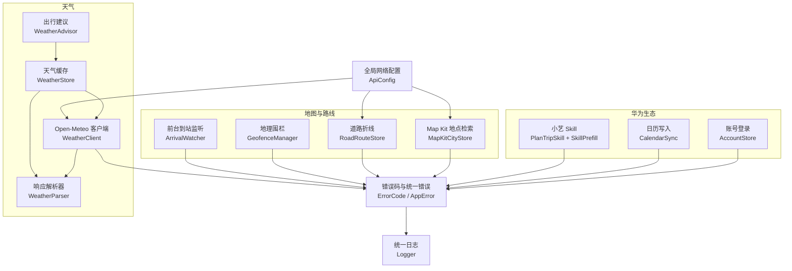
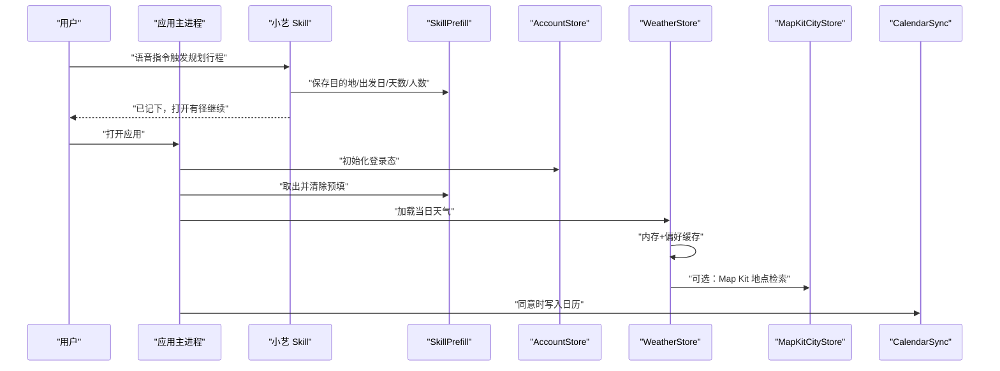
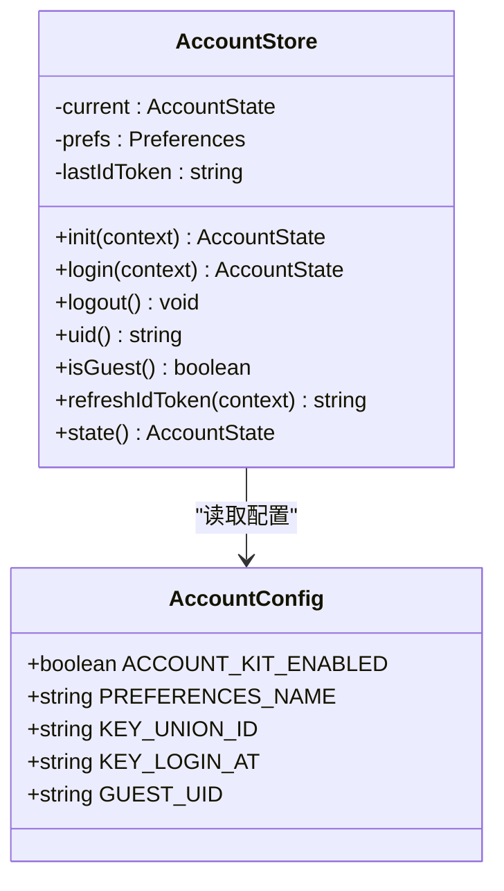
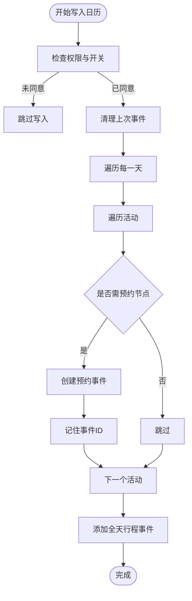
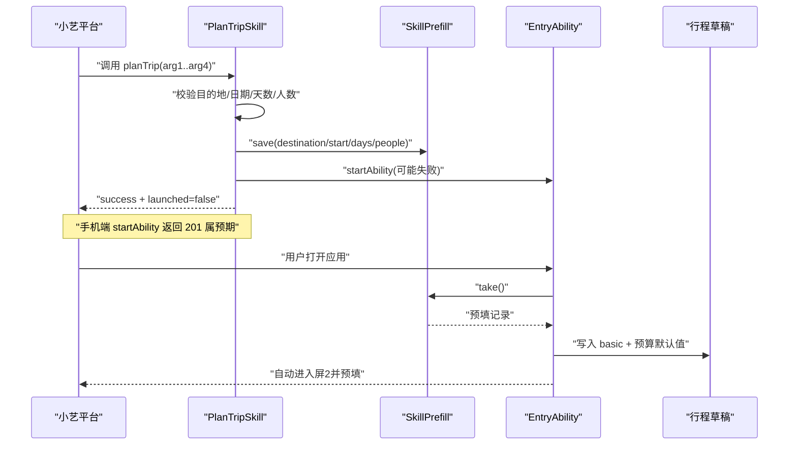
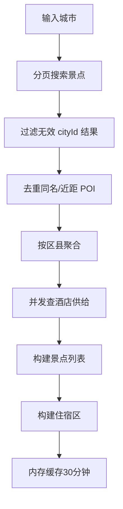
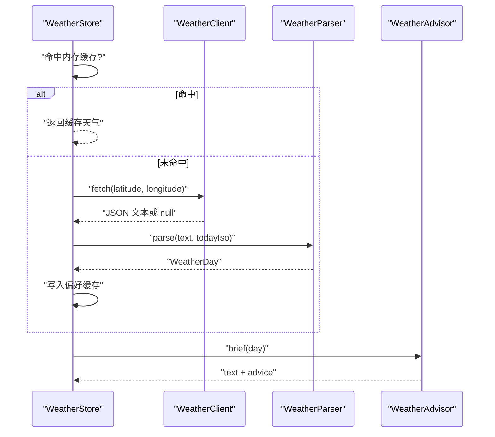
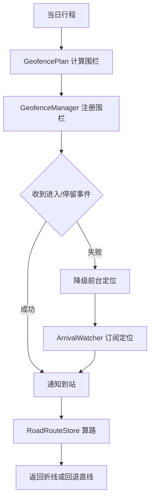
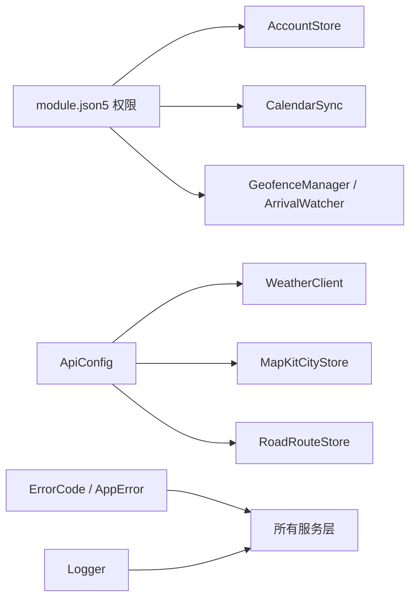

# 外部服务集成

<cite>
**本文引用的文件**   
- [entry/src/main/module.json5](file://entry/src/main/module.json5)
- [Docs/小艺Skill接入清单.md](file://Docs/小艺Skill接入清单.md)
- [entry/skills/youjing-plan-trip/scripts/PlanTripSkill.ets](file://entry/skills/youjing-plan-trip/scripts/PlanTripSkill.ets)
- [entry/src/main/ets/data/SkillPrefill.ets](file://entry/src/main/ets/data/SkillPrefill.ets)
- [Docs/MapKit地点检索探针-2026-10-31.md](file://Docs/MapKit地点检索探针-2026-10-31.md)
- [entry/src/main/ets/data/MapKitCityStore.ets](file://entry/src/main/ets/data/MapKitCityStore.ets)
- [Docs/任意城市接入方案.md](file://Docs/任意城市接入方案.md)
- [entry/src/main/ets/common/config/ApiConfig.ets](file://entry/src/main/ets/common/config/ApiConfig.ets)
- [entry/src/main/ets/common/weather/WeatherClient.ets](file://entry/src/main/ets/common/weather/WeatherClient.ets)
- [entry/src/main/ets/common/weather/WeatherParser.ets](file://entry/src/main/ets/common/weather/WeatherParser.ets)
- [entry/src/main/ets/model/Weather.ets](file://entry/src/main/ets/model/Weather.ets)
- [entry/src/main/ets/data/WeatherStore.ets](file://entry/src/main/ets/data/WeatherStore.ets)
- [entry/src/main/ets/data/WeatherAdvisor.ets](file://entry/src/main/ets/data/WeatherAdvisor.ets)
- [entry/src/main/ets/common/location/GeofenceManager.ets](file://entry/src/main/ets/common/location/GeofenceManager.ets)
- [entry/src/main/ets/common/location/ArrivalWatcher.ets](file://entry/src/main/ets/common/location/ArrivalWatcher.ets)
- [entry/src/main/ets/utils/GeofencePlan.ets](file://entry/src/main/ets/utils/GeofencePlan.ets)
- [entry/src/main/ets/data/RoadRouteStore.ets](file://entry/src/main/ets/data/RoadRouteStore.ets)
- [entry/src/main/ets/common/config/AccountConfig.ets](file://entry/src/main/ets/common/config/AccountConfig.ets)
- [entry/src/main/ets/data/AccountStore.ets](file://entry/src/main/ets/data/AccountStore.ets)
- [entry/src/main/ets/data/CalendarSync.ets](file://entry/src/main/ets/data/CalendarSync.ets)
- [entry/src/main/ets/common/error/AppError.ets](file://entry/src/main/ets/common/error/AppError.ets)
- [entry/src/main/ets/common/error/ErrorCode.ets](file://entry/src/main/ets/common/error/ErrorCode.ets)
- [entry/src/main/ets/common/logger/Logger.ets](file://entry/src/main/ets/common/logger/Logger.ets)
</cite>

## 目录
1. [引言](#引言)
2. [项目结构](#项目结构)
3. [核心组件](#核心组件)
4. [架构总览](#架构总览)
5. [详细组件分析](#详细组件分析)
6. [依赖关系分析](#依赖关系分析)
7. [性能考虑](#性能考虑)
8. [故障排查指南](#故障排查指南)
9. [配置与合规指南](#配置与合规指南)
10. [结论](#结论)

## 引言
本文件面向“有径”应用的外部服务集成，覆盖华为生态、天气服务、地理位置服务和小艺 Skill 四类第三方能力。文档从系统架构、数据流、错误处理、配置和性能五个维度展开，既帮助开发者理解现有实现，也帮助非技术读者把握各服务的边界与降级策略。

## 项目结构
外部服务相关代码集中在以下位置：
- 华为账号登录与权限：`common/config/AccountConfig.ets`、`data/AccountStore.ets`、`module.json5`
- 日历写入：`data/CalendarSync.ets`
- 小艺 Skill：`skills/youjing-plan-trip/scripts/PlanTripSkill.ets`、`data/SkillPrefill.ets`、`module.json5`、`Docs/小艺Skill接入清单.md`
- Map Kit 地点检索：`data/MapKitCityStore.ets`、`Docs/MapKit地点检索探针-2026-10-31.md`、`Docs/任意城市接入方案.md`
- 天气服务：`common/weather/WeatherClient.ets`、`common/weather/WeatherParser.ets`、`model/Weather.ets`、`data/WeatherStore.ets`、`data/WeatherAdvisor.ets`、`common/config/ApiConfig.ets`
- 地理位置：`common/location/GeofenceManager.ets`、`common/location/ArrivalWatcher.ets`、`utils/GeofencePlan.ets`、`data/RoadRouteStore.ets`
- 统一错误与日志：`common/error/AppError.ets`、`common/error/ErrorCode.ets`、`common/logger/Logger.ets`

**图表来源**
- [entry/src/main/ets/data/AccountStore.ets:1-213](file://entry/src/main/ets/data/AccountStore.ets#L1-L213)
- [entry/src/main/ets/data/CalendarSync.ets:1-259](file://entry/src/main/ets/data/CalendarSync.ets#L1-L259)
- [entry/skills/youjing-plan-trip/scripts/PlanTripSkill.ets:1-179](file://entry/skills/youjing-plan-trip/scripts/PlanTripSkill.ets#L1-L179)
- [entry/src/main/ets/data/SkillPrefill.ets:1-117](file://entry/src/main/ets/data/SkillPrefill.ets#L1-L117)
- [entry/src/main/ets/data/MapKitCityStore.ets:1-179](file://entry/src/main/ets/data/MapKitCityStore.ets#L1-L179)
- [entry/src/main/ets/data/RoadRouteStore.ets:1-118](file://entry/src/main/ets/data/RoadRouteStore.ets#L1-L118)
- [entry/src/main/ets/common/location/GeofenceManager.ets:1-174](file://entry/src/main/ets/common/location/GeofenceManager.ets#L1-L174)
- [entry/src/main/ets/common/location/ArrivalWatcher.ets:1-135](file://entry/src/main/ets/common/location/ArrivalWatcher.ets#L1-L135)
- [entry/src/main/ets/common/weather/WeatherClient.ets:1-55](file://entry/src/main/ets/common/weather/WeatherClient.ets#L1-L55)
- [entry/src/main/ets/common/weather/WeatherParser.ets:1-139](file://entry/src/main/ets/common/weather/WeatherParser.ets#L1-L139)
- [entry/src/main/ets/data/WeatherStore.ets:1-157](file://entry/src/main/ets/data/WeatherStore.ets#L1-L157)
- [entry/src/main/ets/data/WeatherAdvisor.ets:1-103](file://entry/src/main/ets/data/WeatherAdvisor.ets#L1-L103)
- [entry/src/main/ets/common/config/ApiConfig.ets:1-66](file://entry/src/main/ets/common/config/ApiConfig.ets#L1-L66)
- [entry/src/main/ets/common/error/ErrorCode.ets:1-48](file://entry/src/main/ets/common/error/ErrorCode.ets#L1-L48)
- [entry/src/main/ets/common/error/AppError.ets:1-20](file://entry/src/main/ets/common/error/AppError.ets#L1-L20)
- [entry/src/main/ets/common/logger/Logger.ets:1-35](file://entry/src/main/ets/common/logger/Logger.ets#L1-L35)

**章节来源**
- [entry/src/main/module.json5:1-133](file://entry/src/main/module.json5#L1-L133)
- [entry/src/main/ets/common/config/ApiConfig.ets:1-66](file://entry/src/main/ets/common/config/ApiConfig.ets#L1-L66)

## 核心组件
- 华为账号静默登录：以 UnionID 作为分区键，失败回退游客模式，不阻断首启流程。
- 日历同步：将需预约节点和每日行程写入本机日历，支持提前提醒和幂等清理。
- 小艺 Skill：平台侧按 SKILL.md 契约调用 `planTrip`，应用侧落盘预填并消费。
- Map Kit 地点检索：为未内置城市提供景点和住宿区，结果仅内存缓存。
- Open-Meteo 天气：取坐标后拉取两日逐小时数据，解析后生成人类可读简报。
- 地理位置：后台围栏检测 + 前台定位兜底；道路折线由 Map Kit navi 提供。
- 统一错误与日志：所有跨层异常包装为 `AppError`，错误码分域管理，日志通过 `Logger` 输出。

**章节来源**
- [entry/src/main/ets/data/AccountStore.ets:1-213](file://entry/src/main/ets/data/AccountStore.ets#L1-L213)
- [entry/src/main/ets/data/CalendarSync.ets:1-259](file://entry/src/main/ets/data/CalendarSync.ets#L1-L259)
- [entry/skills/youjing-plan-trip/scripts/PlanTripSkill.ets:1-179](file://entry/skills/youjing-plan-trip/scripts/PlanTripSkill.ets#L1-L179)
- [entry/src/main/ets/data/MapKitCityStore.ets:1-179](file://entry/src/main/ets/data/MapKitCityStore.ets#L1-L179)
- [entry/src/main/ets/common/weather/WeatherClient.ets:1-55](file://entry/src/main/ets/common/weather/WeatherClient.ets#L1-L55)
- [entry/src/main/ets/common/location/GeofenceManager.ets:1-174](file://entry/src/main/ets/common/location/GeofenceManager.ets#L1-L174)
- [entry/src/main/ets/common/error/AppError.ets:1-20](file://entry/src/main/ets/common/error/AppError.ets#L1-L20)
- [entry/src/main/ets/common/error/ErrorCode.ets:1-48](file://entry/src/main/ets/common/error/ErrorCode.ets#L1-L48)

## 架构总览
外部服务集成分三层：
1. 入口与协议层：模块权限声明、Skill 注册、API Key 与端点配置。
2. 服务适配层：AccountKit、CalendarKit、MapKit、LocationKit、NetworkKit 的 ArkTS 封装。
3. 业务层：登录态、行程草稿、天气简报、到站提醒、日历事件、地图折线。

**图表来源**
- [entry/skills/youjing-plan-trip/scripts/PlanTripSkill.ets:1-179](file://entry/skills/youjing-plan-trip/scripts/PlanTripSkill.ets#L1-L179)
- [entry/src/main/ets/data/SkillPrefill.ets:1-117](file://entry/src/main/ets/data/SkillPrefill.ets#L1-L117)
- [entry/src/main/ets/data/AccountStore.ets:1-213](file://entry/src/main/ets/data/AccountStore.ets#L1-L213)
- [entry/src/main/ets/data/WeatherStore.ets:1-157](file://entry/src/main/ets/data/WeatherStore.ets#L1-L157)
- [entry/src/main/ets/data/MapKitCityStore.ets:1-179](file://entry/src/main/ets/data/MapKitCityStore.ets#L1-L179)
- [entry/src/main/ets/data/CalendarSync.ets:1-259](file://entry/src/main/ets/data/CalendarSync.ets#L1-L259)

## 详细组件分析

### 华为账号登录（Account Kit）
- 登录态单点：`AccountStore` 负责静默获取 UnionID，持久化至 preferences 分区，失败则保持游客模式。
- 配置开关：`AccountConfig.ACCOUNT_KIT_ENABLED` 控制是否发起真实登录；关闭时直接走本地游客分区。
- 身份票据：`refreshIdToken` 可刷新 idToken，但不改变登录态，用于设备激活证明身份。
- 登出：回到游客分区，清登录态和权益缓存，不清隐私同意。

**图表来源**
- [entry/src/main/ets/common/config/AccountConfig.ets:1-29](file://entry/src/main/ets/common/config/AccountConfig.ets#L1-L29)
- [entry/src/main/ets/data/AccountStore.ets:1-213](file://entry/src/main/ets/data/AccountStore.ets#L1-L213)

**章节来源**
- [entry/src/main/ets/common/config/AccountConfig.ets:1-29](file://entry/src/main/ets/common/config/AccountConfig.ets#L1-L29)
- [entry/src/main/ets/data/AccountStore.ets:1-213](file://entry/src/main/ets/data/AccountStore.ets#L1-L213)

### 日历日程同步（Calendar Kit）
- 写入入口：屏14“同意并写入”，未授权或不接受不写任何数据。
- 事件类型：
  - 需预约节点：带标题“需预约”，含时间、地址、原因和提醒。
  - 每日行程：全天事件，显示首末站。
- 幂等性：每次写入前按 tripId 删除之前为本行程写入的事件，事件 ID 清单存 preferences。
- 权限：读写日历、发布提醒、定位等权限在模块中声明。

**图表来源**
- [entry/src/main/ets/data/CalendarSync.ets:1-259](file://entry/src/main/ets/data/CalendarSync.ets#L1-L259)
- [entry/src/main/module.json5:1-133](file://entry/src/main/module.json5#L1-L133)

**章节来源**
- [entry/src/main/ets/data/CalendarSync.ets:1-259](file://entry/src/main/ets/data/CalendarSync.ets#L1-L259)
- [entry/src/main/module.json5:1-133](file://entry/src/main/module.json5#L1-L133)

### 小艺 Skill 集成
- 契约与注册：`module.json5` 注册 `youjing-plan-trip`，版本必须与平台一致。
- 入口脚本：`PlanTripSkill.ets` 校验参数、落盘预填、尝试拉起应用，并通过 scriptManager 返回结果。
- 预填机制：因手机后台禁止拉起 UIAbility，Skill 先写入 `SkillPrefill`，应用启动后消费并推屏2。
- 参数规则：目的地仅限北京、上海、广州、深圳；日期为 ISO 格式；天数为 1–30；人数为 1–30。
- 失败语义：参数非法返回 `ERR_INVALID_PARAMS`，内部错误返回 `ERR_INTERNAL`，均附建议文案。

**图表来源**
- [entry/skills/youjing-plan-trip/scripts/PlanTripSkill.ets:1-179](file://entry/skills/youjing-plan-trip/scripts/PlanTripSkill.ets#L1-L179)
- [entry/src/main/ets/data/SkillPrefill.ets:1-117](file://entry/src/main/ets/data/SkillPrefill.ets#L1-L117)
- [entry/src/main/module.json5:1-133](file://entry/src/main/module.json5#L1-L133)
- [Docs/小艺Skill接入清单.md:1-251](file://Docs/小艺Skill接入清单.md#L1-L251)

**章节来源**
- [Docs/小艺Skill接入清单.md:1-251](file://Docs/小艺Skill接入清单.md#L1-L251)
- [entry/skills/youjing-plan-trip/scripts/PlanTripSkill.ets:1-179](file://entry/skills/youjing-plan-trip/scripts/PlanTripSkill.ets#L1-L179)
- [entry/src/main/ets/data/SkillPrefill.ets:1-117](file://entry/src/main/ets/data/SkillPrefill.ets#L1-L117)
- [entry/src/main/module.json5:1-133](file://entry/src/main/module.json5#L1-L133)

### Map Kit 地点检索
- 探针结论：`searchByText`、`geocode`、`nearbySearch`、`searchById` 可用；无评分；结果存在重复与远郊混入。
- 强制约束：必须传 `cityId` 且 `isCityLimit=true`，否则返回全球结果。
- 数据管线：`MapKitCityStore` 分页拉取景点、地址归属校验、去重、区县聚合、酒店供给查询、构建 Spot/Area。
- 缓存策略：内存缓存 30 分钟，不落 RDB；许可边界未确认前不持久化。
- 字段口径：热度用检索秩而非评分；简介来自 abstractText/description；开放时间只展示稳定时段；预约一律 false。

**图表来源**
- [entry/src/main/ets/data/MapKitCityStore.ets:1-179](file://entry/src/main/ets/data/MapKitCityStore.ets#L1-L179)
- [Docs/MapKit地点检索探针-2026-10-31.md:1-151](file://Docs/MapKit地点检索探针-2026-10-31.md#L1-L151)
- [Docs/任意城市接入方案.md:1-117](file://Docs/任意城市接入方案.md#L1-L117)

**章节来源**
- [Docs/MapKit地点检索探针-2026-10-31.md:1-151](file://Docs/MapKit地点检索探针-2026-10-31.md#L1-L151)
- [entry/src/main/ets/data/MapKitCityStore.ets:1-179](file://entry/src/main/ets/data/MapKitCityStore.ets#L1-L179)
- [Docs/任意城市接入方案.md:1-117](file://Docs/任意城市接入方案.md#L1-L117)

### 天气服务集成（Open-Meteo）
- 请求构造：`WeatherClient` 使用 `ApiConfig.WEATHER_URL`，只发送四舍五入到 0.1° 的坐标，避免泄露精确位置。
- 超时控制：连接超时 3 秒，读取超时 4 秒；非 2xx 或空响应降级为 null。
- 解析逻辑：`WeatherParser` 严格校验 daily/hourly 字段，缺失或类型不符抛出 `AppError`。
- 缓存策略：内存优先，其次 preferences 持久化；30 分钟内不重复请求。
- 出行建议：`WeatherAdvisor` 根据 WMO code、温度、降水概率生成人类可读简报与建议。

**图表来源**
- [entry/src/main/ets/data/WeatherStore.ets:1-157](file://entry/src/main/ets/data/WeatherStore.ets#L1-L157)
- [entry/src/main/ets/common/weather/WeatherClient.ets:1-55](file://entry/src/main/ets/common/weather/WeatherClient.ets#L1-L55)
- [entry/src/main/ets/common/weather/WeatherParser.ets:1-139](file://entry/src/main/ets/common/weather/WeatherParser.ets#L1-L139)
- [entry/src/main/ets/data/WeatherAdvisor.ets:1-103](file://entry/src/main/ets/data/WeatherAdvisor.ets#L1-L103)
- [entry/src/main/ets/model/Weather.ets:1-35](file://entry/src/main/ets/model/Weather.ets#L1-L35)
- [entry/src/main/ets/common/config/ApiConfig.ets:1-66](file://entry/src/main/ets/common/config/ApiConfig.ets#L1-L66)

**章节来源**
- [entry/src/main/ets/common/weather/WeatherClient.ets:1-55](file://entry/src/main/ets/common/weather/WeatherClient.ets#L1-L55)
- [entry/src/main/ets/common/weather/WeatherParser.ets:1-139](file://entry/src/main/ets/common/weather/WeatherParser.ets#L1-L139)
- [entry/src/main/ets/data/WeatherStore.ets:1-157](file://entry/src/main/ets/data/WeatherStore.ets#L1-L157)
- [entry/src/main/ets/data/WeatherAdvisor.ets:1-103](file://entry/src/main/ets/data/WeatherAdvisor.ets#L1-L103)
- [entry/src/main/ets/model/Weather.ets:1-35](file://entry/src/main/ets/model/Weather.ets#L1-L35)
- [entry/src/main/ets/common/config/ApiConfig.ets:1-66](file://entry/src/main/ets/common/config/ApiConfig.ets#L1-L66)

### 地理位置服务
- 当前位置与到站检测：
  - 后台：`GeofenceManager` 基于 LocationKit 注册站点围栏，失败降级为前台定位。
  - 前台：`ArrivalWatcher` 订阅 `locationChange`，10 秒/20 米采样，省电模式。
- 围栏计划：`GeofencePlan` 筛选当天有效站点，限制半径 300 米，最多 10 个围栏。
- 路线规划：`RoadRouteStore` 调用 MapKit navi 获取步行/驾车/公交折线，失败返回 null，调用方回退直线。

**图表来源**
- [entry/src/main/ets/utils/GeofencePlan.ets:1-63](file://entry/src/main/ets/utils/GeofencePlan.ets#L1-L63)
- [entry/src/main/ets/common/location/GeofenceManager.ets:1-174](file://entry/src/main/ets/common/location/GeofenceManager.ets#L1-L174)
- [entry/src/main/ets/common/location/ArrivalWatcher.ets:1-135](file://entry/src/main/ets/common/location/ArrivalWatcher.ets#L1-L135)
- [entry/src/main/ets/data/RoadRouteStore.ets:1-118](file://entry/src/main/ets/data/RoadRouteStore.ets#L1-L118)

**章节来源**
- [entry/src/main/ets/utils/GeofencePlan.ets:1-63](file://entry/src/main/ets/utils/GeofencePlan.ets#L1-L63)
- [entry/src/main/ets/common/location/GeofenceManager.ets:1-174](file://entry/src/main/ets/common/location/GeofenceManager.ets#L1-L174)
- [entry/src/main/ets/common/location/ArrivalWatcher.ets:1-135](file://entry/src/main/ets/common/location/ArrivalWatcher.ets#L1-L135)
- [entry/src/main/ets/data/RoadRouteStore.ets:1-118](file://entry/src/main/ets/data/RoadRouteStore.ets#L1-L118)

## 依赖关系分析
外部服务依赖集中在模块权限、配置常量与错误体系上：
- 模块权限：日历读写、提醒发布、近似定位、精确定位、互联网访问。
- API 配置：BFF、Replan、Open-Meteo 等 URL 与超时。
- 错误体系：网络、解析、存储、业务、账号、云端错误码分类。
- 日志体系：统一 hilog 输出，按模块 tag 分类。

**图表来源**
- [entry/src/main/module.json5:1-133](file://entry/src/main/module.json5#L1-L133)
- [entry/src/main/ets/common/config/ApiConfig.ets:1-66](file://entry/src/main/ets/common/config/ApiConfig.ets#L1-L66)
- [entry/src/main/ets/common/error/ErrorCode.ets:1-48](file://entry/src/main/ets/common/error/ErrorCode.ets#L1-L48)
- [entry/src/main/ets/common/error/AppError.ets:1-20](file://entry/src/main/ets/common/error/AppError.ets#L1-L20)
- [entry/src/main/ets/common/logger/Logger.ets:1-35](file://entry/src/main/ets/common/logger/Logger.ets#L1-L35)

**章节来源**
- [entry/src/main/module.json5:1-133](file://entry/src/main/module.json5#L1-L133)
- [entry/src/main/ets/common/config/ApiConfig.ets:1-66](file://entry/src/main/ets/common/config/ApiConfig.ets#L1-L66)
- [entry/src/main/ets/common/error/ErrorCode.ets:1-48](file://entry/src/main/ets/common/error/ErrorCode.ets#L1-L48)

## 性能考虑
- 请求合并与去重：
  - 天气缓存按坐标+日期+时间戳去重，30 分钟内复用。
  - Map Kit 城市数据按城市名内存缓存，30 分钟内复用。
  - RoadRouteStore 按起终点+出行方式缓存折线，30 分钟内复用。
- 异步处理：
  - 天气请求独立于主流程，失败不阻塞页面。
  - Map Kit 区县酒店供给查询使用并发，降低端到端耗时。
- 资源释放：
  - 天气 HTTP 句柄在 finally 销毁。
  - 定位监听在页面退出时 off，避免回调打到已销毁页面。
- 降级策略：
  - 天气无坐标/无网/解析失败不显示天气行。
  - 地图服务失败返回 null，地图连线回退直线。
  - 围栏注册失败退回前台定位。

[本节为通用性能指导，不直接分析具体文件]

## 故障排查指南
- 账号登录失败：
  - 检查 `AccountConfig.ACCOUNT_KIT_ENABLED` 与 AGC 签名指纹是否匹配。
  - 查看 `AccountStore` 日志中 UnionID 与分区一致性提示。
- 日历写入失败：
  - 确认日历权限与提醒权限已授予。
  - 检查事件时间是否合法、tripId 是否幂等。
- 小艺 Skill 失败：
  - 参数非法会返回 `ERR_INVALID_PARAMS`，检查目的地是否在白名单、日期是否为 ISO。
  - 手机端 `startAbility` 返回 201 属预期，重点看 `SkillPrefill` 是否落盘成功。
- 天气服务异常：
  - 检查 `ApiConfig.WEATHER_URL` 是否配置。
  - 关注 HTTP 状态码、JSON 解析异常、daily/hourly 字段缺失。
- 地图服务异常：
  - 检查是否传 `cityId` 与 `isCityLimit=true`。
  - 关注配额、鉴权、无结果等错误码。
- 地理位置异常：
  - 检查系统定位开关、定位权限、AGC 围栏服务开通情况。
  - 关注围栏事件错误码与前台定位订阅异常。

**章节来源**
- [entry/src/main/ets/data/AccountStore.ets:1-213](file://entry/src/main/ets/data/AccountStore.ets#L1-L213)
- [entry/src/main/ets/data/CalendarSync.ets:1-259](file://entry/src/main/ets/data/CalendarSync.ets#L1-L259)
- [entry/skills/youjing-plan-trip/scripts/PlanTripSkill.ets:1-179](file://entry/skills/youjing-plan-trip/scripts/PlanTripSkill.ets#L1-L179)
- [entry/src/main/ets/common/weather/WeatherClient.ets:1-55](file://entry/src/main/ets/common/weather/WeatherClient.ets#L1-L55)
- [entry/src/main/ets/common/weather/WeatherParser.ets:1-139](file://entry/src/main/ets/common/weather/WeatherParser.ets#L1-L139)
- [entry/src/main/ets/data/MapKitCityStore.ets:1-179](file://entry/src/main/ets/data/MapKitCityStore.ets#L1-L179)
- [entry/src/main/ets/common/location/GeofenceManager.ets:1-174](file://entry/src/main/ets/common/location/GeofenceManager.ets#L1-L174)
- [entry/src/main/ets/common/location/ArrivalWatcher.ets:1-135](file://entry/src/main/ets/common/location/ArrivalWatcher.ets#L1-L135)

## 配置与合规指南
- API Key 与端点管理：
  - 所有网络 URL 集中定义在 `ApiConfig`，修改后需全量重编。
  - BFF、Replan、Open-Meteo 等端点区分开发与正式环境。
- 权限声明：
  - 日历读写、提醒发布、定位、互联网权限在 `module.json5` 声明。
  - 权限申请失败时，功能降级而不阻断主流程。
- 隐私合规：
  - 账号侧仅持久化 UnionID，不写敏感字段。
  - 天气请求只发送粗略坐标，避免泄露实时位置。
  - 小艺 Skill 预填数据过期清理，避免跨日误消费。
- 错误反馈：
  - 所有异常包装为 `AppError`，错误码分域便于定位。
  - 日志统一经 `Logger` 输出，便于设备端抓取。

**章节来源**
- [entry/src/main/ets/common/config/ApiConfig.ets:1-66](file://entry/src/main/ets/common/config/ApiConfig.ets#L1-L66)
- [entry/src/main/module.json5:1-133](file://entry/src/main/module.json5#L1-L133)
- [entry/src/main/ets/common/config/AccountConfig.ets:1-29](file://entry/src/main/ets/common/config/AccountConfig.ets#L1-L29)
- [entry/src/main/ets/common/error/AppError.ets:1-20](file://entry/src/main/ets/common/error/AppError.ets#L1-L20)
- [entry/src/main/ets/common/error/ErrorCode.ets:1-48](file://entry/src/main/ets/common/error/ErrorCode.ets#L1-L48)
- [entry/src/main/ets/common/logger/Logger.ets:1-35](file://entry/src/main/ets/common/logger/Logger.ets#L1-L35)

## 结论
“有径”的外部服务集成采用分层解耦设计：协议层聚焦权限与配置，适配层封装华为生态与第三方 API，业务层专注体验与降级。整体策略强调“失败不阻断”：账号回退游客、天气不出行建议、地图回退直线、围栏回退前台定位。同时通过内存与偏好缓存、并发请求、超时控制和统一错误日志，提升稳定性与可观测性。未来可在许可明确后扩展持久化策略，并在配额与计费口径确认后优化 Map Kit 与 LLM 调用的成本上限。