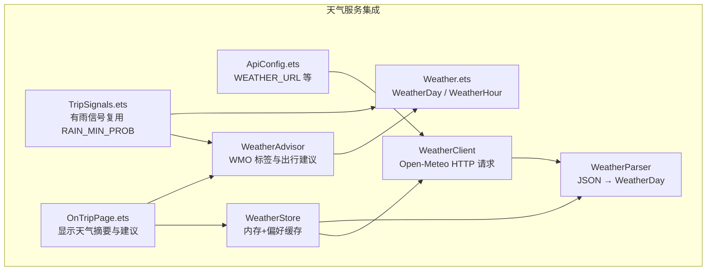
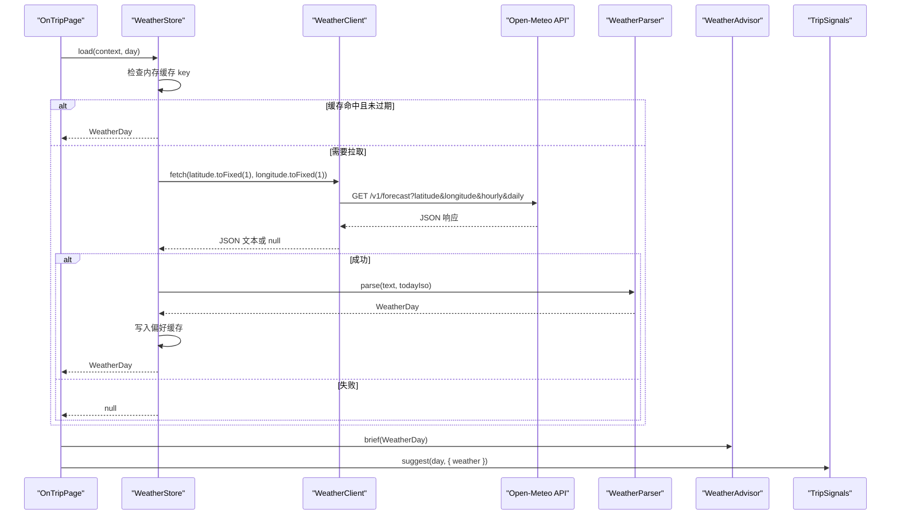
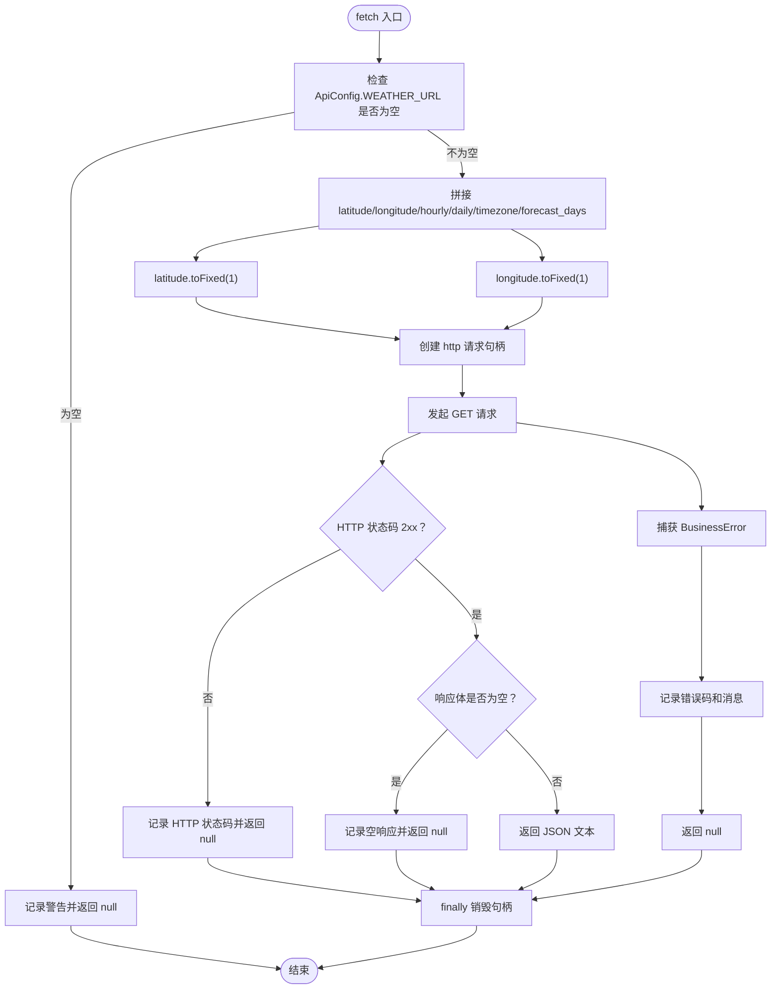
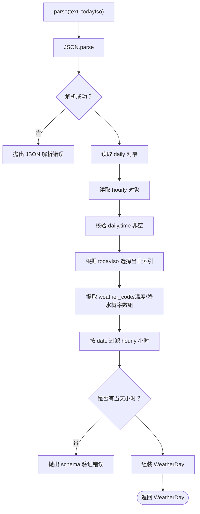
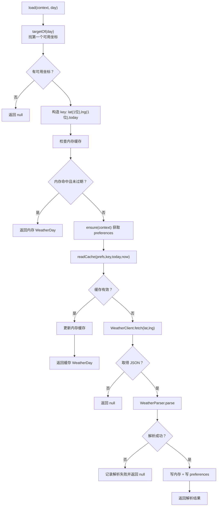
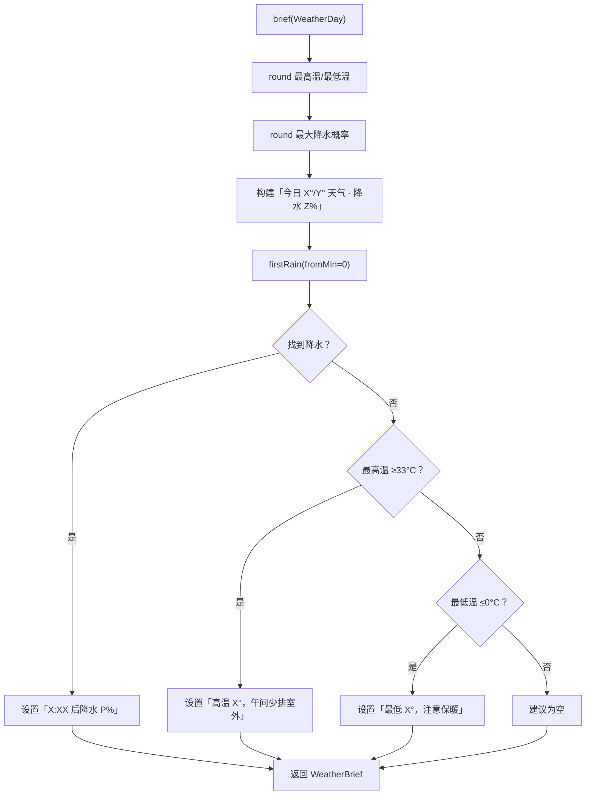
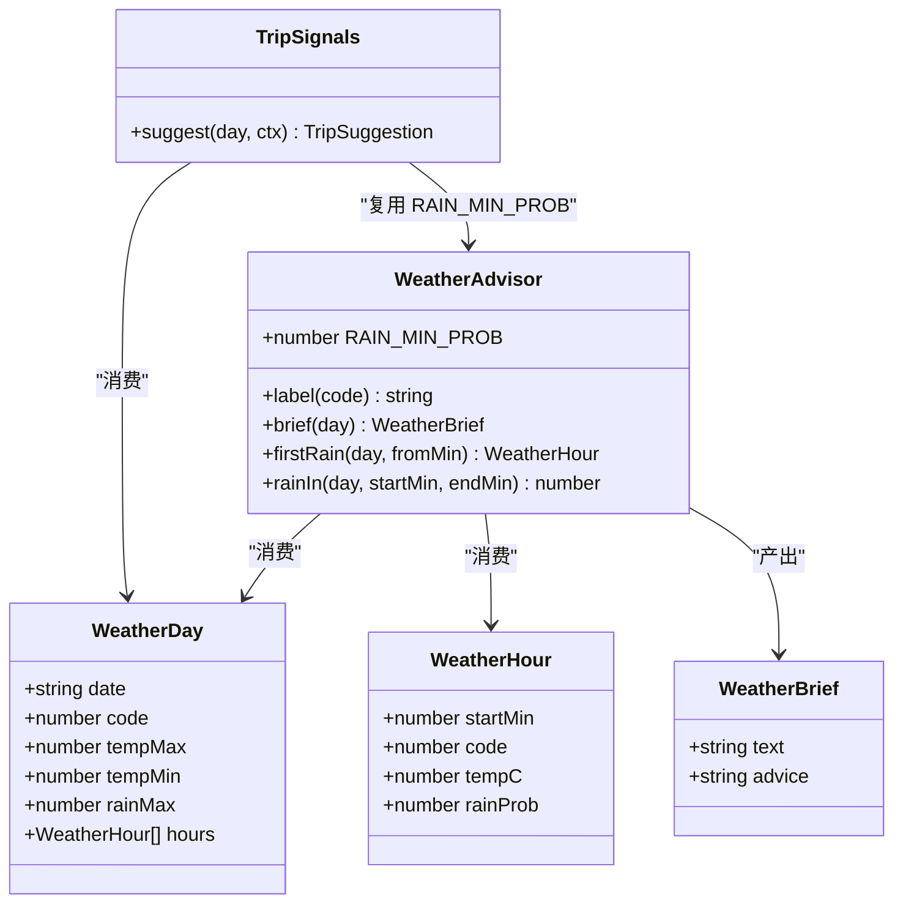
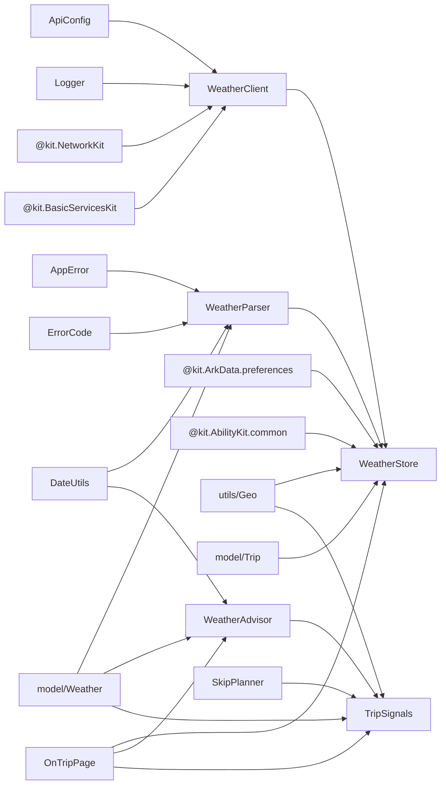
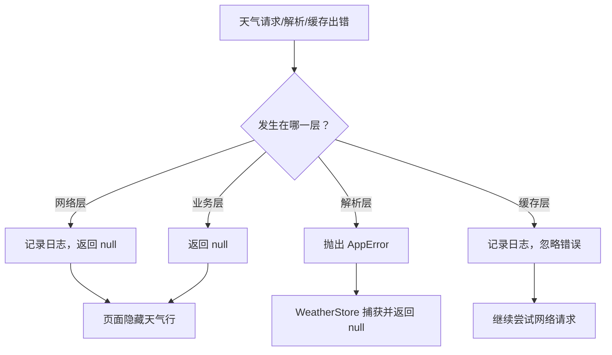
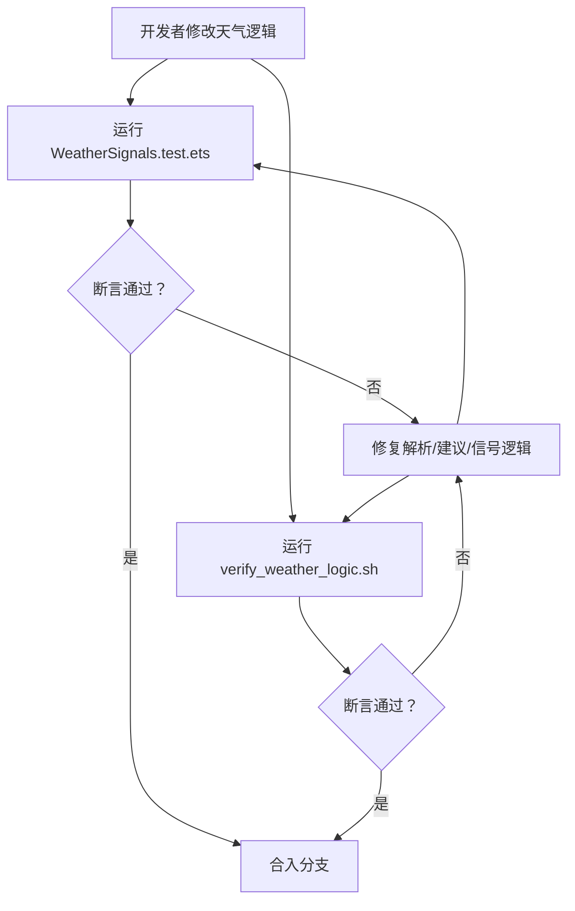

# 天气服务集成

<cite>
**本文引用的文件**   
- [WeatherClient.ets](file://entry/src/main/ets/common/weather/WeatherClient.ets)
- [WeatherParser.ets](file://entry/src/main/ets/common/weather/WeatherParser.ets)
- [WeatherStore.ets](file://entry/src/main/ets/data/WeatherStore.ets)
- [WeatherAdvisor.ets](file://entry/src/main/ets/data/WeatherAdvisor.ets)
- [Weather.ets](file://entry/src/main/ets/model/Weather.ets)
- [ApiConfig.ets](file://entry/src/main/ets/common/config/ApiConfig.ets)
- [TripSignals.ets](file://entry/src/main/ets/data/TripSignals.ets)
- [OnTripPage.ets](file://entry/src/main/ets/pages/OnTripPage.ets)
- [WeatherSignals.test.ets](file://entry/src/ohosTest/ets/test/WeatherSignals.test.ets)
- [weather_signals_check.ts](file://tools/weather_signals_check.ts)
- [verify_weather_logic.sh](file://tools/verify_weather_logic.sh)
</cite>

## 目录

1. [引言](#引言)
2. [项目结构](#项目结构)
3. [核心组件](#核心组件)
4. [架构总览](#架构总览)
5. [组件详细分析](#组件详细分析)
6. [依赖关系分析](#依赖关系分析)
7. [性能与并发优化](#性能与并发优化)
8. [错误处理策略](#错误处理策略)
9. [配置管理](#配置管理)
10. [故障排查](#故障排查)
11. [结论](#结论)

## 引言

本文件聚焦于项目中的 Open-Meteo 天气服务集成，目标是让读者既能理解整体架构，也能定位到具体实现细节。整个天气子系统围绕四个职责清晰的模块展开：

- **网络层**：`WeatherClient` 负责构造 Open-Meteo 请求、控制超时、返回原始 JSON 或失败降级。
- **解析层**：`WeatherParser` 把 Open-Meteo 的 `daily` 和 `hourly` 字段映射为内部 `WeatherDay` / `WeatherHour`。
- **缓存层**：`WeatherStore` 提供内存 + 持久化双层缓存，避免屏15频繁刷新导致重复请求。
- **建议层**：`WeatherAdvisor` 将 WMO 天气码、温度、降水概率翻译成用户可读简报，并支撑出行信号。

此外，天气数据还参与行中被动信号系统（偏离、落后、有雨），最终由屏15页面消费，用于显示天气摘要与建议条。

## 项目结构

天气相关代码集中在两个包下：

| 路径 | 职责 |
|---|---|
| `entry/src/main/ets/common/weather/` | 网络客户端与纯解析逻辑 |
| `entry/src/main/ets/data/` | 天气缓存、智能建议、行中信号 |
| `entry/src/main/ets/model/Weather.ets` | 天气数据契约 |
| `entry/src/main/ets/common/config/ApiConfig.ets` | Open-Meteo 地址等网络配置 |
| `entry/src/main/ets/pages/OnTripPage.ets` | 消费天气数据的页面入口之一 |
| `entry/src/ohosTest/.../WeatherSignals.test.ets` | 天气解析与信号阈值测试 |
| `tools/weather_signals_check.ts` | 离线断言脚本 |
| `tools/verify_weather_logic.sh` | 离线编译运行脚本 |

**图表来源**
- [WeatherClient.ets:1-55](file://entry/src/main/ets/common/weather/WeatherClient.ets#L1-L55)
- [WeatherParser.ets:1-139](file://entry/src/main/ets/common/weather/WeatherParser.ets#L1-L139)
- [WeatherStore.ets:1-157](file://entry/src/main/ets/data/WeatherStore.ets#L1-L157)
- [WeatherAdvisor.ets:1-103](file://entry/src/main/ets/data/WeatherAdvisor.ets#L1-L103)
- [Weather.ets:1-35](file://entry/src/main/ets/model/Weather.ets#L1-L35)
- [ApiConfig.ets:1-66](file://entry/src/main/ets/common/config/ApiConfig.ets#L1-L66)
- [TripSignals.ets:1-200](file://entry/src/main/ets/data/TripSignals.ets#L1-L200)
- [OnTripPage.ets:1-260](file://entry/src/main/ets/pages/OnTripPage.ets#L1-L260)

**章节来源**
- [WeatherClient.ets:1-55](file://entry/src/main/ets/common/weather/WeatherClient.ets#L1-L55)
- [WeatherParser.ets:1-139](file://entry/src/main/ets/common/weather/WeatherParser.ets#L1-L139)
- [WeatherStore.ets:1-157](file://entry/src/main/ets/data/WeatherStore.ets#L1-L157)
- [WeatherAdvisor.ets:1-103](file://entry/src/main/ets/data/WeatherAdvisor.ets#L1-L103)
- [Weather.ets:1-35](file://entry/src/main/ets/model/Weather.ets#L1-L35)
- [ApiConfig.ets:1-66](file://entry/src/main/ets/common/config/ApiConfig.ets#L1-L66)
- [TripSignals.ets:1-200](file://entry/src/main/ets/data/TripSignals.ets#L1-L200)
- [OnTripPage.ets:1-260](file://entry/src/main/ets/pages/OnTripPage.ets#L1-L260)

## 核心组件

### 组件职责总表

| 组件 | 输入 | 输出 | 关键行为 |
|---|---|---|---|
| `WeatherClient` | 纬度、经度 | 原始 JSON 字符串或 `null` | 构建 Open-Meteo URL；四舍五入坐标到 0.1°；连接超时 3 秒、读取超时 4 秒；失败返回 `null` |
| `WeatherParser` | JSON 文本、当日 ISO 日期 | `WeatherDay` | 校验 `daily` / `hourly`；过滤当天小时；缺测降水用 `-1`；类型不符抛出应用错误 |
| `WeatherStore` | 页面上下文、行程日 | `WeatherDay` 或 `null` | 内存键命中；偏好缓存 TTL 30 分钟；失败静默降级 |
| `WeatherAdvisor` | `WeatherDay` | `WeatherBrief` | WMO 天气码中文标签；降水阈值 60%；高温 33°C；低温 0°C |
| `Weather` 模型 | 无 | 接口定义 | `WeatherHour`、`WeatherDay`、`WeatherBrief` |
| `ApiConfig` | 无 | 配置对象 | `WEATHER_URL` 默认指向 Open-Meteo 预报接口 |

**章节来源**
- [WeatherClient.ets:1-55](file://entry/src/main/ets/common/weather/WeatherClient.ets#L1-L55)
- [WeatherParser.ets:1-139](file://entry/src/main/ets/common/weather/WeatherParser.ets#L1-L139)
- [WeatherStore.ets:1-157](file://entry/src/main/ets/data/WeatherStore.ets#L1-L157)
- [WeatherAdvisor.ets:1-103](file://entry/src/main/ets/data/WeatherAdvisor.ets#L1-L103)
- [Weather.ets:1-35](file://entry/src/main/ets/model/Weather.ets#L1-L35)
- [ApiConfig.ets:1-66](file://entry/src/main/ets/common/config/ApiConfig.ets#L1-L66)

## 架构总览

天气服务不是独立进程，而是嵌入在 ArkTS 端侧业务链路中的“锦上添花”能力：当天气取数失败时，不会中断主流程，而是静默隐藏天气信息。

**图表来源**
- [OnTripPage.ets:1-260](file://entry/src/main/ets/pages/OnTripPage.ets#L1-L260)
- [WeatherStore.ets:1-157](file://entry/src/main/ets/data/WeatherStore.ets#L1-L157)
- [WeatherClient.ets:1-55](file://entry/src/main/ets/common/weather/WeatherClient.ets#L1-L55)
- [WeatherParser.ets:1-139](file://entry/src/main/ets/common/weather/WeatherParser.ets#L1-L139)
- [WeatherAdvisor.ets:1-103](file://entry/src/main/ets/data/WeatherAdvisor.ets#L1-L103)
- [TripSignals.ets:1-200](file://entry/src/main/ets/data/TripSignals.ets#L1-L200)

## 组件详细分析

### WeatherClient：Open-Meteo 请求层

`WeatherClient` 是天气子系统的唯一出站网络出口。它不暴露重试、熔断、代理等高级能力，而是遵循“任何失败都返回 `null`”的设计原则，由调用方决定是否降级。

#### 关键实现要点

| 维度 | 实现方式 |
|---|---|
| 基础地址 | 从 `ApiConfig.WEATHER_URL` 读取，为空时直接跳过请求 |
| 坐标精度 | 使用 `toFixed(1)`，保留一位小数，约 11 公里 |
| 查询参数 | `hourly=precipitation_probability,weather_code,temperature_2m`；`daily=weather_code,temperature_2m_max,temperature_2m_min,precipitation_probability_max` |
| 时区 | `timezone=auto`，由服务端按坐标推断 |
| 预报天数 | `forecast_days=2`，但解析器只挑当天 |
| 超时 | 连接超时 3000 毫秒，读取超时 4000 毫秒 |
| 状态码 | 非 2xx 视为失败 |
| 空响应 | 长度为 0 的响应体视为失败 |
| 异常 | 捕获 `BusinessError`，记录日志后返回 `null` |
| 资源释放 | `finally` 中销毁 HTTP 句柄 |

**图表来源**
- [WeatherClient.ets:1-55](file://entry/src/main/ets/common/weather/WeatherClient.ets#L1-L55)
- [ApiConfig.ets:1-66](file://entry/src/main/ets/common/config/ApiConfig.ets#L1-L66)

**章节来源**
- [WeatherClient.ets:1-55](file://entry/src/main/ets/common/weather/WeatherClient.ets#L1-L55)
- [ApiConfig.ets:1-66](file://entry/src/main/ets/common/config/ApiConfig.ets#L1-L66)

### WeatherParser：Open-Meteo 数据解析层

`WeatherParser` 是纯函数式组件，不依赖 `@kit`，便于离线测试。它将 Open-Meteo 的扁平数组响应转换为带业务语义的 `WeatherDay`。

#### 数据结构映射

| Open-Meteo 字段 | 解析结果 | 说明 |
|---|---|---|
| `daily.time` | `WeatherDay.date` | 优先匹配 `todayIso`，否则回退到第一条 |
| `daily.weather_code[index]` | `WeatherDay.code` | WMO 天气码 |
| `daily.temperature_2m_max[index]` | `WeatherDay.tempMax` | 当日最高温 |
| `daily.temperature_2m_min[index]` | `WeatherDay.tempMin` | 当日最低温 |
| `daily.precipitation_probability_max[index]` | `WeatherDay.rainMax` | 当日最大降水概率 |
| `hourly.time[i]` | `WeatherHour.startMin` | 当日第几分钟，通过 `DateUtils.minutesOf` 转换 |
| `hourly.weather_code[i]` | `WeatherHour.code` | 整点天气码 |
| `hourly.temperature_2m[i]` | `WeatherHour.tempC` | 整点气温 |
| `hourly.precipitation_probability[i]` | `WeatherHour.rainProb` | 缺测时为 `-1`，不是 0 |

#### 容错策略

| 场景 | 行为 |
|---|---|
| JSON 无法解析 | 抛出 `AppError(JSON_PARSE_FAILED)` |
| 根字段类型不对 | 抛出 `AppError(TYPE_GUARD_FAILED)` |
| `daily.time` 为空 | 抛出 `AppError(SCHEMA_VALIDATION_FAILED)` |
| 当天没有小时数据 | 抛出 `AppError(SCHEMA_VALIDATION_FAILED)` |
| 数值字段缺失 | 使用 `nullAs` 默认值 |
| 数值字段类型错误 | 抛出 `AppError(TYPE_GUARD_FAILED)` |

**图表来源**
- [WeatherParser.ets:1-139](file://entry/src/main/ets/common/weather/WeatherParser.ets#L1-L139)
- [Weather.ets:1-35](file://entry/src/main/ets/model/Weather.ets#L1-L35)

**章节来源**
- [WeatherParser.ets:1-139](file://entry/src/main/ets/common/weather/WeatherParser.ets#L1-L139)
- [Weather.ets:1-35](file://entry/src/main/ets/model/Weather.ets#L1-L35)

### WeatherStore：缓存与取数层

`WeatherStore` 承担“该不该请求”和“从哪里读”的职责。它对外只暴露一个异步方法：传入页面上下文和行程日，返回 `WeatherDay` 或 `null`。

#### 缓存层级

| 层级 | 存储位置 | 键规则 | 过期策略 |
|---|---|---|---|
| 内存缓存 | 类静态字段 | `纬度(1位小数),经度(1位小数),当日ISO` | 30 分钟内有效 |
| 持久化缓存 | ArkData `preferences` | `weatherCache` 单键 | 写入时间戳超过 30 分钟视为过期 |

#### 取数顺序

1. 从行程日找出第一个可用坐标。
2. 构造缓存 key：`latitude.toFixed(1),longitude.toFixed(1),today`。
3. 检查内存缓存是否命中且未过期。
4. 如果未命中，尝试从 `preferences` 读取缓存条目。
5. 如果持久化缓存也无效，调用 `WeatherClient.fetch`。
6. 解析成功后同时更新内存缓存和持久化缓存。
7. 任何失败都返回 `null`，界面不出天气行。

**图表来源**
- [WeatherStore.ets:1-157](file://entry/src/main/ets/data/WeatherStore.ets#L1-L157)
- [WeatherClient.ets:1-55](file://entry/src/main/ets/common/weather/WeatherClient.ets#L1-L55)
- [WeatherParser.ets:1-139](file://entry/src/main/ets/common/weather/WeatherParser.ets#L1-L139)

**章节来源**
- [WeatherStore.ets:1-157](file://entry/src/main/ets/data/WeatherStore.ets#L1-L157)

### WeatherAdvisor：智能建议层

`WeatherAdvisor` 是纯逻辑组件，把结构化天气数据变成人类可读文案，同时被 `TripSignals` 复用其降水阈值。

#### 天气标签映射

| WMO 天气码范围 | 中文标签 |
|---|---|
| `0` | 晴 |
| `1` | 晴间多云 |
| `2` | 多云 |
| `3` | 阴 |
| `45`,`48` | 雾 |
| `51`–`57` | 毛毛雨 |
| `61`–`65` | 雨 |
| `66`,`67` | 冻雨 |
| `71`–`77` | 雪 |
| `80`–`82` | 阵雨 |
| `85`,`86` | 阵雪 |
| `≥95` | 雷阵雨 |
| 其他 | 多云 |

#### 建议生成规则

| 条件 | 建议内容 |
|---|---|
| 从指定分钟起存在降水概率 ≥60% 的小时 | 提示该时段后的降水概率 |
| 当日最高温 ≥33°C | 提示高温，午间少排室外 |
| 当日最低温 ≤0°C | 提示注意保暖 |
| 以上都不满足 | 建议为空串 |

#### 关键算法

| 方法 | 作用 | 复杂度 |
|---|---|---|
| `label(code)` | WMO 码转中文短标签 | O(1) |
| `brief(day)` | 生成主行和建议行 | O(1) |
| `firstRain(day, fromMin)` | 找首个达标降水小时 | O(n)，n 为当天小时数 |
| `rainIn(day, startMin, endMin)` | 区间内最大降水概率 | O(n) |

**图表来源**
- [WeatherAdvisor.ets:1-103](file://entry/src/main/ets/data/WeatherAdvisor.ets#L1-L103)
- [Weather.ets:1-35](file://entry/src/main/ets/model/Weather.ets#L1-L35)

**章节来源**
- [WeatherAdvisor.ets:1-103](file://entry/src/main/ets/data/WeatherAdvisor.ets#L1-L103)
- [Weather.ets:1-35](file://entry/src/main/ets/model/Weather.ets#L1-L35)

### 地理位置处理

天气服务的地理位置处理遵循“够用但不泄露精确位置”的原则。

| 方面 | 实现 |
|---|---|
| 坐标来源 | 行程日的活动坐标 |
| 可用性判断 | 通过 `Geo.usable` 校验 |
| 精度控制 | 发给 Open-Meteo 前四舍五入到 0.1° |
| 时区处理 | 使用 Open-Meteo 的 `timezone=auto`，解析器再用 `DateUtils.minutesOf` 计算当地分钟数 |
| 距离计算 | 行中信号通过 `Geo.distanceM` 计算当前位置与站点距离 |

**章节来源**
- [WeatherStore.ets:1-157](file://entry/src/main/ets/data/WeatherStore.ets#L1-L157)
- [WeatherParser.ets:1-139](file://entry/src/main/ets/common/weather/WeatherParser.ets#L1-L139)
- [TripSignals.ets:1-200](file://entry/src/main/ets/data/TripSignals.ets#L1-L200)

### 天气与行中信号的关系

`WeatherAdvisor` 暴露的 `RAIN_MIN_PROB = 60` 是天气系统与行中信号的共享阈值。这样避免“建议条说会下雨”和“信号条不说下雨”出现口径不一致。

**图表来源**
- [Weather.ets:1-35](file://entry/src/main/ets/model/Weather.ets#L1-L35)
- [WeatherAdvisor.ets:1-103](file://entry/src/main/ets/data/WeatherAdvisor.ets#L1-L103)
- [TripSignals.ets:1-200](file://entry/src/main/ets/data/TripSignals.ets#L1-L200)

**章节来源**
- [Weather.ets:1-35](file://entry/src/main/ets/model/Weather.ets#L1-L35)
- [WeatherAdvisor.ets:1-103](file://entry/src/main/ets/data/WeatherAdvisor.ets#L1-L103)
- [TripSignals.ets:1-200](file://entry/src/main/ets/data/TripSignals.ets#L1-L200)

## 依赖关系分析

### 模块依赖图

**图表来源**
- [ApiConfig.ets:1-66](file://entry/src/main/ets/common/config/ApiConfig.ets#L1-L66)
- [WeatherClient.ets:1-55](file://entry/src/main/ets/common/weather/WeatherClient.ets#L1-L55)
- [WeatherParser.ets:1-139](file://entry/src/main/ets/common/weather/WeatherParser.ets#L1-L139)
- [WeatherStore.ets:1-157](file://entry/src/main/ets/data/WeatherStore.ets#L1-L157)
- [WeatherAdvisor.ets:1-103](file://entry/src/main/ets/data/WeatherAdvisor.ets#L1-L103)
- [TripSignals.ets:1-200](file://entry/src/main/ets/data/TripSignals.ets#L1-L200)
- [OnTripPage.ets:1-260](file://entry/src/main/ets/pages/OnTripPage.ets#L1-L260)

### 耦合性评价

- **低耦合**：`WeatherParser` 是纯逻辑，仅依赖模型、工具类和错误类型，适合单元测试。
- **高内聚**：`WeatherStore` 集中了取数、缓存、TTL 控制，外部只看到 `load`。
- **单向依赖**：网络层不依赖业务层；建议层不依赖网络层；页面消费所有上游。
- **潜在风险**：`WeatherStore` 持有静态内存缓存和静态 `preferences` 引用，多实例或测试环境需要注意生命周期。

**章节来源**
- [WeatherParser.ets:1-139](file://entry/src/main/ets/common/weather/WeatherParser.ets#L1-L139)
- [WeatherStore.ets:1-157](file://entry/src/main/ets/data/WeatherStore.ets#L1-L157)
- [WeatherAdvisor.ets:1-103](file://entry/src/main/ets/data/WeatherAdvisor.ets#L1-L103)

## 性能与并发优化

### 已实现的优化

| 优化项 | 当前实现 | 效果 |
|---|---|---|
| 坐标降采样 | `toFixed(1)` | 减少隐私暴露，同时降低因微小位置变化导致的缓存碎片 |
| 内存缓存 | 类静态 `MemoryEntry` | 同一进程内多次 `load` 直接返回，避免 IO |
| 持久化缓存 | `preferences` 存原始 JSON | 进程重启后可快速恢复，避免立即重复网络请求 |
| TTL 控制 | 30 分钟 | 平衡新鲜度与请求频率 |
| 按需请求 | 只有当天且有可用坐标才请求 | 历史行程和餐次不会触发天气请求 |
| 解析失败降级 | 返回 `null` | 不阻塞主流程 |
| 页面级串行 reload | `reloadSeq` 序号 | 快速连点只保留最后一次结果 |

### 可考虑的未来优化

| 优化方向 | 建议 | 注意事项 |
|---|---|---|
| 请求合并 | 多个相同 key 的并发 `load` 共用一次 `WeatherClient.fetch` | 需维护 pending 队列，避免重复请求 |
| 增量更新 | 对长时间跨天的行程，按天拆分缓存 key | 当前已按 day key 区分，但 `WeatherStore.load` 仍传 `day`，key 本身已含当日 |
| 后台预取 | 在行程加载完成后预取次日天气 | 需评估电量与流量 |
| 重试机制 | 对 5xx 做指数退避重试 | 当前设计明确失败即降级，新增重试会改变现有契约 |
| 压缩缓存 | 原始 JSON 较长时可考虑压缩 | `preferences` 值大小有限制，需谨慎 |
| 缓存统计 | 记录命中率、失败率 | 便于监控天气服务可用性 |

**章节来源**
- [WeatherStore.ets:1-157](file://entry/src/main/ets/data/WeatherStore.ets#L1-L157)
- [WeatherClient.ets:1-55](file://entry/src/main/ets/common/weather/WeatherClient.ets#L1-L55)
- [OnTripPage.ets:1-260](file://entry/src/main/ets/pages/OnTripPage.ets#L1-L260)

## 错误处理策略

### 分层错误处理

| 层级 | 错误类型 | 处理方式 |
|---|---|---|
| 网络层 | 配置为空、HTTP 非 2xx、空响应、网络异常 | 记录日志，返回 `null` |
| 解析层 | JSON 解析失败、类型守卫失败、schema 验证失败 | 抛出 `AppError`，由 `WeatherStore` 捕获并降级 |
| 缓存层 | preferences 不可用、读取失败、写入失败 | 记录日志，降级为无缓存或直接网络请求 |
| 业务层 | 无可用坐标、无当天小时数据 | 返回 `null`，界面不出天气行 |

### 错误分类表

| 类别 | 典型原因 | 当前行为 | 建议改进 |
|---|---|---|---|
| 网络异常 | DNS 失败、超时、证书错误 | 返回 `null` | 可增加重试上限和可观测指标 |
| 服务限流 | Open-Meteo 返回 429/503 | 当前未特殊处理，视为普通失败 | 增加限流识别与退避 |
| 数据格式错误 | 上游字段缺失、类型变化 | 抛应用错误并被静吞 | 增加字段级告警和兼容默认值 |
| 权限问题 | 无定位权限 | `targetOf` 找不到可用坐标 | 已在逻辑层面自然降级 |
| 设备存储问题 | preferences 损坏 | 降级为不使用缓存 | 可清理损坏缓存并重新初始化 |

**图表来源**
- [WeatherClient.ets:1-55](file://entry/src/main/ets/common/weather/WeatherClient.ets#L1-L55)
- [WeatherParser.ets:1-139](file://entry/src/main/ets/common/weather/WeatherParser.ets#L1-L139)
- [WeatherStore.ets:1-157](file://entry/src/main/ets/data/WeatherStore.ets#L1-L157)

**章节来源**
- [WeatherClient.ets:1-55](file://entry/src/main/ets/common/weather/WeatherClient.ets#L1-L55)
- [WeatherParser.ets:1-139](file://entry/src/main/ets/common/weather/WeatherParser.ets#L1-L139)
- [WeatherStore.ets:1-157](file://entry/src/main/ets/data/WeatherStore.ets#L1-L157)

## 配置管理

### ApiConfig 中的天气相关配置

| 配置项 | 默认值 | 含义 |
|---|---|---|
| `WEATHER_URL` | `https://api.open-meteo.com/v1/forecast` | Open-Meteo 预报接口地址 |
| `CONNECT_TIMEOUT_MS` | 10000 | BFF 通用连接超时，不是 WeatherClient 专用 |
| `READ_TIMEOUT_MS` | 120000 | BFF 通用读取超时，不是 WeatherClient 专用 |
| `REPLAN_CONNECT_TIMEOUT_MS` | 2000 | 重排服务连接超时，与天气无关 |
| `REPLAN_READ_TIMEOUT_MS` | 8000 | 重排服务读取超时，与天气无关 |

`WeatherClient` 没有复用 `ApiConfig.CONNECT_TIMEOUT_MS` 和 `ApiConfig.READ_TIMEOUT_MS`，而是硬编码 3000/4000 毫秒。这意味着天气请求比 BFF 请求更短、更严格，符合“天气只是锦上添花”的定位。

### 可配置扩展建议

| 配置项 | 建议默认值 | 说明 |
|---|---:|---|
| `WEATHER_RETRY_COUNT` | `0` | 保持现有静默降级语义 |
| `WEATHER_RETRY_DELAY_MS` | `1000` | 若启用重试时的初始延迟 |
| `WEATHER_CACHE_TTL_MS` | `1800000` | 当前 30 分钟，可改为可配 |
| `WEATHER_COORD_PRECISION` | `1` | 当前固定 0.1°，可调整为 0.05° 或 0.5° |
| `WEATHER_FORECAST_DAYS` | `2` | 当前固定 2 天 |
| `WEATHER_MAX_JSON_SIZE` | `262144` | 防止超大响应体占用内存 |

**章节来源**
- [ApiConfig.ets:1-66](file://entry/src/main/ets/common/config/ApiConfig.ets#L1-L66)
- [WeatherClient.ets:1-55](file://entry/src/main/ets/common/weather/WeatherClient.ets#L1-L55)
- [WeatherStore.ets:1-157](file://entry/src/main/ets/data/WeatherStore.ets#L1-L157)

## 故障排查

### 常见问题诊断清单

| 现象 | 可能原因 | 排查步骤 |
|---|---|---|
| 屏15 完全不显示天气 | `ApiConfig.WEATHER_URL` 为空 | 检查配置文件和网络连通性 |
| 天气始终为 `null` | 行程日没有可用坐标 | 检查活动经纬度是否合法 |
| 每次打开屏15 都请求 | 内存缓存失效或进程重启 | 确认 30 分钟内是否再次访问同一天 |
| 缓存不生效 | preferences 不可用 | 查看日志中“天气缓存偏好不可用” |
| 解析报错 | Open-Meteo 响应结构变化 | 查看解析错误日志并对比测试用例 |
| 降水建议不准确 | 小时数据缺测 | 检查 `rainProb == -1` 的情况 |
| 天气请求太慢 | 网络差或远端限流 | 检查连接/读取超时，考虑后端代理 |
| 行中信号不下雨 | 降水概率 <60% | 对照 `WeatherAdvisor.RAIN_MIN_PROB` |

### 测试覆盖情况

仓库中已有两类测试保障天气逻辑正确性：

1. **Hypium 真机测试**：`WeatherSignals.test.ets` 覆盖 WMO 标签、简报、解析契约、信号优先级。
2. **离线断言脚本**：`weather_signals_check.ts` 配合 `verify_weather_logic.sh`，通过 tsc 编译后用 node 执行，不依赖 `@kit`。

**图表来源**
- [WeatherSignals.test.ets:1-200](file://entry/src/ohosTest/ets/test/WeatherSignals.test.ets#L1-L200)
- [weather_signals_check.ts:1-200](file://tools/weather_signals_check.ts#L1-L200)
- [verify_weather_logic.sh:1-38](file://tools/verify_weather_logic.sh#L1-L38)

**章节来源**
- [WeatherSignals.test.ets:1-200](file://entry/src/ohosTest/ets/test/WeatherSignals.test.ets#L1-L200)
- [weather_signals_check.ts:1-200](file://tools/weather_signals_check.ts#L1-L200)
- [verify_weather_logic.sh:1-38](file://tools/verify_weather_logic.sh#L1-L38)

## 结论

本项目的天气服务集成以“轻量、健壮、可降级”为核心设计目标：

- **WeatherClient** 只负责最小化的 HTTP 请求，失败一律返回 `null`。
- **WeatherParser** 严格校验 Open-Meteo 响应结构，把弱类型 JSON 转为强类型 `WeatherDay`。
- **WeatherStore** 用内存 + 偏好双层缓存降低重复请求，TTL 30 分钟适配移动端使用节奏。
- **WeatherAdvisor** 统一天气标签和降水阈值，既服务于 UI 简报，也服务于行中信号。
- **位置处理** 主动丢弃高精度坐标，符合隐私友好原则。
- **错误处理** 分层清晰，上层不感知下层失败细节，保证主行程流程稳定。

如果需要进一步增强，建议优先补充：请求合并、服务限流识别、可观测指标和更多边界条件的自动化测试。但在当前“天气是锦上添花”的前提下，现有实现已经足够简洁可靠。