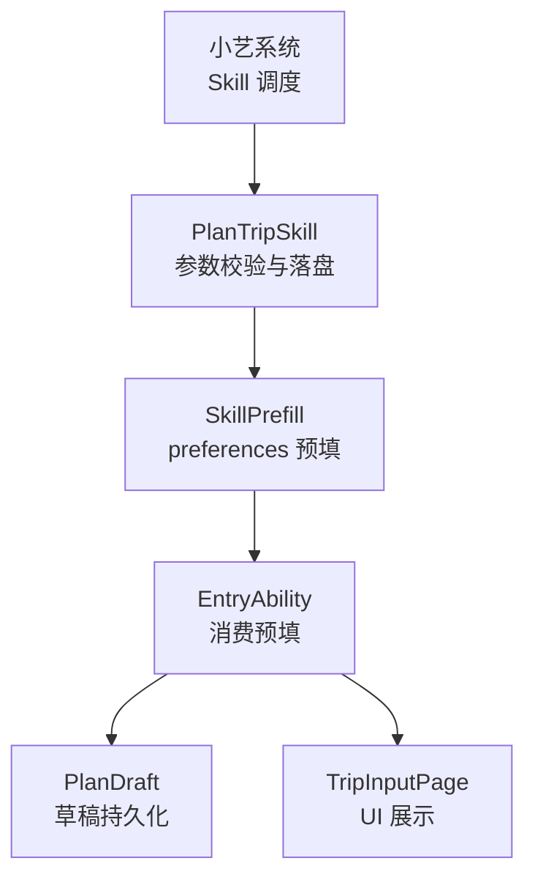
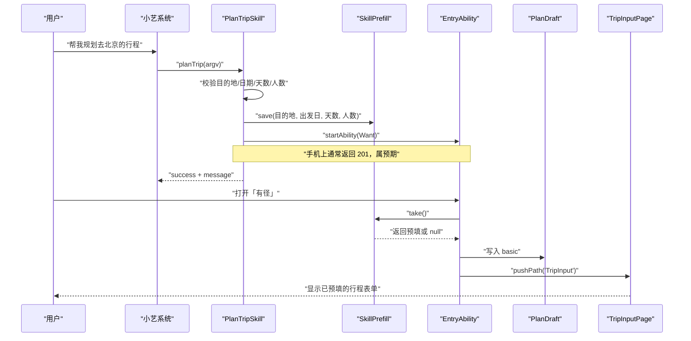
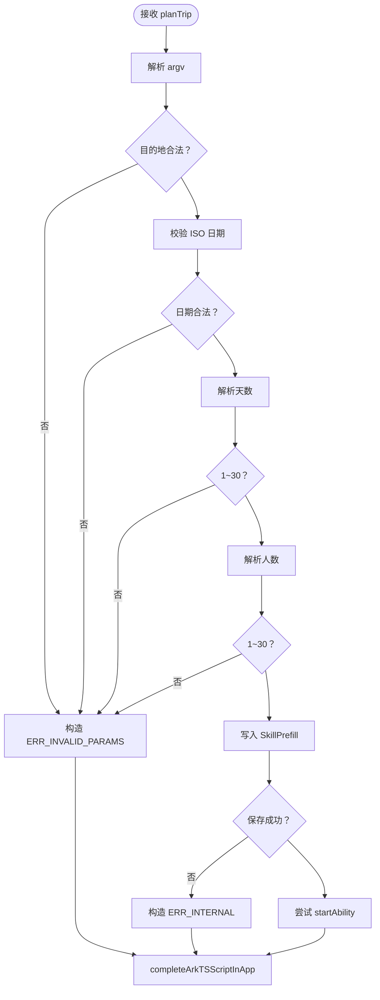
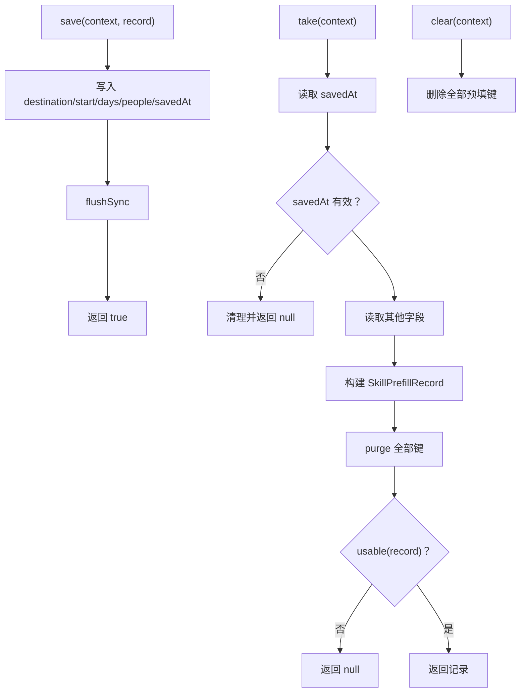
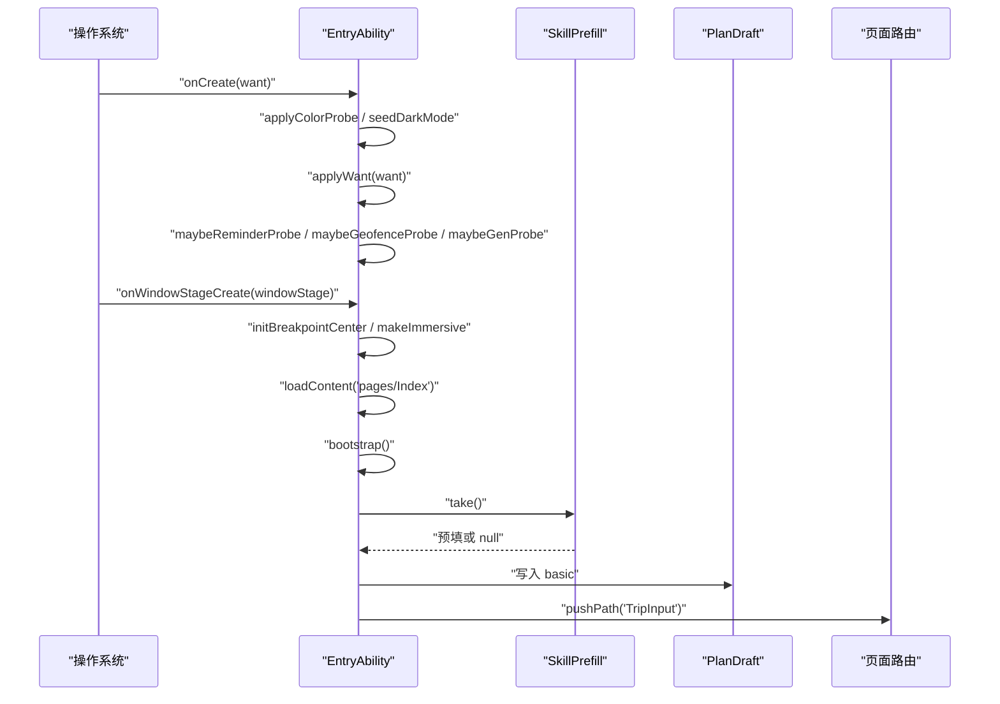
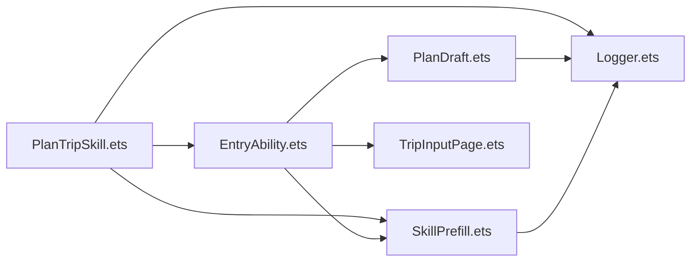

# 小艺 Skill 集成

<cite>
**本文引用的文件**   
- [PlanTripSkill.ets](file://entry/skills/youjing-plan-trip/scripts/PlanTripSkill.ets)
- [SkillPrefill.ets](file://entry/src/main/ets/data/SkillPrefill.ets)
- [EntryAbility.ets](file://entry/src/main/ets/entryability/EntryAbility.ets)
- [module.json5](file://entry/src/main/module.json5)
- [小艺Skill接入清单.md](file://Docs/小艺Skill接入清单.md)
- [Logger.ets](file://entry/src/main/ets/common/logger/Logger.ets)
- [PlanDraft.ets](file://entry/src/main/ets/data/PlanDraft.ets)
- [TripInputPage.ets](file://entry/src/main/ets/pages/TripInputPage.ets)
- [调试探针手册.md](file://Docs/调试探针手册.md)
</cite>

## 目录
1. [引言](#引言)
2. [项目结构](#项目结构)
3. [核心组件](#核心组件)
4. [架构总览](#架构总览)
5. [详细组件分析](#详细组件分析)
6. [依赖关系分析](#依赖关系分析)
7. [性能考虑](#性能考虑)
8. [故障排查指南](#故障排查指南)
9. [结论](#结论)

## 引言
本文面向“小艺语音助手”与“有径应用”之间的跨进程集成，重点解释以下问题：
- 为什么采用 `preferences` 做预填数据通道，而不是直接用 `Want`。
- `SkillPrefill` 的数据存储、生命周期、过期清理和并发安全策略。
- `PlanTripSkill` 脚本的意图识别、参数校验、错误处理和返回契约。
- `EntryAbility` 在冷启动、热启动、后台被拉起时的启动流程与状态管理。
- 预填数据模型、版本兼容与数据迁移设计。
- 数据损坏、权限异常、进程异常的恢复策略。
- 存储、内存与启动速度优化。
- 日志记录、数据验证和常见问题排查方法。

## 项目结构
小艺 Skill 集成涉及三个层次：
- **系统层**：HarmonyOS Ability、Skill 注册、脚本执行。
- **适配层**：`PlanTripSkill.ets` 负责解析系统传入的位置参数并写入本地预填。
- **应用层**：`SkillPrefill.ets` 提供基于 `preferences` 的持久化；`EntryAbility.ets` 消费预填并导航到行程规划页；`TripInputPage.ets` 展示和编辑最终表单。



**图表来源**
- [PlanTripSkill.ets:1-179](file://entry/skills/youjing-plan-trip/scripts/PlanTripSkill.ets#L1-L179)
- [SkillPrefill.ets:1-117](file://entry/src/main/ets/data/SkillPrefill.ets#L1-L117)
- [EntryAbility.ets:501-580](file://entry/src/main/ets/entryability/EntryAbility.ets#L501-L580)
- [PlanDraft.ets:1-200](file://entry/src/main/ets/data/PlanDraft.ets#L1-L200)
- [TripInputPage.ets:1-1158](file://entry/src/main/ets/pages/TripInputPage.ets#L1-L1158)

**章节来源**
- [小艺Skill接入清单.md:1-251](file://Docs/小艺Skill接入清单.md#L1-L251)
- [module.json5:1-133](file://entry/src/main/module.json5#L1-L133)

## 核心组件
- **PlanTripSkill**：小艺 Skill 入口脚本，负责接收系统位置参数、校验目的地/日期/天数/人数、写入 `SkillPrefill`，并尝试拉起 `EntryAbility`。
- **SkillPrefill**：基于 `preferences` 的跨进程预填数据管理器，提供保存、读取、清除和过期判断。
- **EntryAbility**：应用主入口，处理冷启动、热启动、外部 `Want`、Skill 触发，并消费预填后导航到行程输入页。
- **PlanDraft**：应用内跨页面共享的行程草稿，支持内存态和本地 `preferences` 持久化。
- **TripInputPage**：屏2 行程基础输入页，负责展示和编辑目的地、日期、人数、预算等字段。
- **Logger**：统一日志出口，封装 `hilog`，按模块打点。

**章节来源**
- [PlanTripSkill.ets:1-179](file://entry/skills/youjing-plan-trip/scripts/PlanTripSkill.ets#L1-L179)
- [SkillPrefill.ets:1-117](file://entry/src/main/ets/data/SkillPrefill.ets#L1-L117)
- [EntryAbility.ets:1-934](file://entry/src/main/ets/entryability/EntryAbility.ets#L1-L934)
- [PlanDraft.ets:1-233](file://entry/src/main/ets/data/PlanDraft.ets#L1-L233)
- [TripInputPage.ets:1-1158](file://entry/src/main/ets/pages/TripInputPage.ets#L1-L1158)
- [Logger.ets:1-35](file://entry/src/main/ets/common/logger/Logger.ets#L1-L35)

## 架构总览
整体通信路径如下：



**图表来源**
- [PlanTripSkill.ets:40-179](file://entry/skills/youjing-plan-trip/scripts/PlanTripSkill.ets#L40-L179)
- [SkillPrefill.ets:25-117](file://entry/src/main/ets/data/SkillPrefill.ets#L25-L117)
- [EntryAbility.ets:501-580](file://entry/src/main/ets/entryability/EntryAbility.ets#L501-L580)
- [PlanDraft.ets:1-200](file://entry/src/main/ets/data/PlanDraft.ets#L1-L200)
- [TripInputPage.ets:1-1158](file://entry/src/main/ets/pages/TripInputPage.ets#L1-L1158)

## 详细组件分析

### PlanTripSkill：意图识别与参数提取
`PlanTripSkill` 是薄适配层，不直接实现复杂业务，主要职责包括：
- 从 `argv` 提取四个位置参数：目的地、出发日、天数、人数。
- 校验目的地是否属于受支持城市集合。
- 校验出发日是否为合法 ISO 日期。
- 校验天数和人数是否为 1 到 30 的整数。
- 将合法参数转为 `SkillPrefillRecord` 并调用 `SkillPrefill.save`。
- 尝试通过 `startAbility` 拉起 `EntryAbility`，但手机场景下允许失败。
- 向小艺返回成功或失败结果，包含 `destination`、`startDate`、`days`、`people`、`route`、`launched`、`message`。



**图表来源**
- [PlanTripSkill.ets:24-179](file://entry/skills/youjing-plan-trip/scripts/PlanTripSkill.ets#L24-L179)

关键行为说明：
- 空目的地、非支持城市、非法日期、天数或人数越界都会返回 `ERR_INVALID_PARAMS`，并附带用户可理解的建议。
- 预填写入失败返回 `ERR_INTERNAL`，不会伪装成功。
- `startAbility` 抛出的 `BusinessError` 会被捕获并记录日志，不影响最终返回给小艺的成功语义，因为参数已经落盘。
- 返回结果中的 `launched` 用于告诉小艺是否真正拉起应用；`message` 可直接作为语音回复。

**章节来源**
- [PlanTripSkill.ets:1-179](file://entry/skills/youjing-plan-trip/scripts/PlanTripSkill.ets#L1-L179)
- [小艺Skill接入清单.md:1-251](file://Docs/小艺Skill接入清单.md#L1-L251)

### SkillPrefill：预填数据管理与生命周期
`SkillPrefill` 使用 `preferences` 分片 `youjing_skill_prefill` 存储一次未消费的预填请求。它不是通用配置库，而是“一次性的待消费数据槽”。

#### 数据结构
| 字段 | 类型 | 含义 | 约束 |
|---|---|---|---|
| `destination` | 字符串 | 目的地城市 | 非空 |
| `start` | 字符串 | 出发日 | 必须是合法 ISO 日期 |
| `days` | 数字 | 行程天数 | 1 到 30 的整数 |
| `people` | 数字 | 同行人数 | 1 到 30 的整数 |
| `savedAt` | 数字 | 保存时间戳 | 毫秒级时间戳 |

#### 生命周期
1. **写入**：`save` 同步写入五个字段并 flush。
2. **读取**：`take` 先读 `savedAt`，再读取其他字段，组装成 `SkillPrefillRecord`。
3. **清理**：无论读取成功与否，`take` 都会调用 `purge` 删除所有键值。
4. **过期**：`usable` 判断保存时间是否在当前时间前 2 小时以内，并允许 5 分钟时钟偏差。
5. **清空**：`clear` 直接删除整组预填键。



**图表来源**
- [SkillPrefill.ets:25-117](file://entry/src/main/ets/data/SkillPrefill.ets#L25-L117)

#### 为什么用 `preferences` 而不是 `Want`
- 手机系统禁止普通应用在后台拉起 UIAbility，`startAbility` 会返回 `201`。
- `Want` 只能随单次进程调用传递，无法保证用户稍后手动打开应用时仍然存在。
- `preferences` 是应用内持久化存储，即使进程被杀也能保留。
- 取后即删的设计避免重复消费。
- 两小时过期避免隔天误跳。

#### 并发安全
- 每次保存都覆盖同一份 key，因此多次请求以最后一次为准。
- 读取后立即删除，降低重复消费概率。
- 没有显式锁，因为单应用内 `preferences` 操作由系统层协调；但不同进程同时写入可能产生竞态，最终以最近写入为准。
- 如果希望严格互斥，可以在未来引入版本号或事务性写入，但当前实现以“最后写入优先”为产品约定。

#### 数据损坏处理
- `take` 对每个字段进行类型检查：字符串字段默认空串，数字字段默认 0。
- `usable` 校验日期格式、天数范围、人数范围和时间戳。
- 任何非法值都会导致记录被丢弃，而不是抛出异常影响应用启动。

**章节来源**
- [SkillPrefill.ets:1-117](file://entry/src/main/ets/data/SkillPrefill.ets#L1-L117)

### EntryAbility：启动流程与状态管理
`EntryAbility` 是应用主入口，承担多个职责：深浅档初始化、窗口布局、导航模式、外部参数消费、Skill 预填消费、探针调试。

#### 关键状态
| 状态 | 含义 |
|---|---|
| `pendingRoute` | 外部 `Want` 中携带的目标路由 |
| `pendingParam` | 外部 `Want` 中携带的参数片段 |
| `contentReady` | 页面已完成加载，可以安全推栈 |
| `visible` | 应用对用户可见，用于决定是否消费 Skill 预填 |
| `colorProbe` | 深浅档探针生效时防止重置 colorMode |

#### 启动时序


**图表来源**
- [EntryAbility.ets:1-934](file://entry/src/main/ets/entryability/EntryAbility.ets#L1-L934)
- [PlanDraft.ets:1-200](file://entry/src/main/ets/data/PlanDraft.ets#L1-L200)

#### 外部 Want 与 Skill 预填的关系
- `applyWant` 解析 `route`、`destination`、`start`、`end`、`days`、`people`。
- 如果外部参数有效，会写入 `PlanDraft.basic`，标记外部写入，并调用 `SkillPrefill.clear` 清理盘上预填，避免同一次请求被消费两次。
- `onNewWant` 用于应用存活时再次拉起，把 pending route 推入路由。
- `onForeground` 设置 `visible = true`，然后执行 `routePending`。
- 消费 Skill 预填的关键条件是应用可见且预填存在；后台被 Skill 绑起时不消费，避免进程被杀后丢失。

#### 预算策略
- Skill 带来的新行程固定使用默认预算（¥8000/人），因为 Skill 没有预算参数，且不应静默继承上一段草稿。
- 其他风格、节奏、选点仍按 `PlanDraft.fresh()` 的逻辑初始化。

**章节来源**
- [EntryAbility.ets:501-934](file://entry/src/main/ets/entryability/EntryAbility.ets#L501-L934)

### TripInputPage：表单展示与回显
`TripInputPage` 是屏2 行程基础输入页，负责把 `PlanDraft` 中的数据渲染为用户可编辑的界面。

#### 初始化逻辑
- 默认出发日取今天，返程日按默认天数计算。
- 如果草稿中有目的地，则回填到城市选择。
- 如果草稿中的日期无效或已过，则重新计算。
- 如果人数不在默认选项 1/2/4 中，页面会动态补入该人数并高亮。
- 预算在配置范围内才回填。

#### 用户交互
- 出发日和返程日通过两个连续日期弹窗选择。
- 字段改动防抖 500ms 写入本地草稿。
- 一句话成行程功能走本地意图解析，但不直接落盘原句。

**章节来源**
- [TripInputPage.ets:1-1158](file://entry/src/main/ets/pages/TripInputPage.ets#L1-L1158)

### PlanDraft：草稿持久化与版本兼容
`PlanDraft` 是跨页面的内存单例，同时支持本地 `preferences` 持久化。

#### 快照结构
| 字段 | 类型 | 含义 |
|---|---|---|
| `basic` | `TripBasicInput` | 目的地、开始日期、结束日期、人数、预算 |
| `style` | `TravelStyle` | 旅行风格 |
| `stayTier` | 字符串 | 住宿档位 |
| `transit` | `TransitPreference` | 交通偏好 |
| `paces` | 数组 | 节奏选项 |
| `selectedSpots` | 数组 | 选中景点 |
| `selectedArea` | 对象 | 选中片区 |

#### 版本兼容
- 水合时先检查快照形态是否合法。
- 不合法快照会被忽略，按默认档启动。
- 反向日期区间会被修复。
- 外部写入时会跳过盘上旧快照，避免覆盖小艺或深链带来的预填。

**章节来源**
- [PlanDraft.ets:1-233](file://entry/src/main/ets/data/PlanDraft.ets#L1-L233)

## 依赖关系分析



**图表来源**
- [PlanTripSkill.ets:1-179](file://entry/skills/youjing-plan-trip/scripts/PlanTripSkill.ets#L1-L179)
- [SkillPrefill.ets:1-117](file://entry/src/main/ets/data/SkillPrefill.ets#L1-L117)
- [EntryAbility.ets:1-934](file://entry/src/main/ets/entryability/EntryAbility.ets#L1-L934)
- [PlanDraft.ets:1-233](file://entry/src/main/ets/data/PlanDraft.ets#L1-L233)
- [TripInputPage.ets:1-1158](file://entry/src/main/ets/pages/TripInputPage.ets#L1-L1158)
- [Logger.ets:1-35](file://entry/src/main/ets/common/logger/Logger.ets#L1-L35)

耦合与内聚分析：
- `PlanTripSkill` 只依赖 `SkillPrefill` 和 `Logger`，保持薄适配。
- `SkillPrefill` 是独立的数据通道，不感知 UI 和路由。
- `EntryAbility` 是协调者，耦合较多，但职责清晰：生命周期、外部参数、预填消费、系统能力。
- `PlanDraft` 是应用内数据中心，与 `EntryAbility`、`TripInputPage` 双向协作。
- 日志系统贯穿所有关键路径，便于定位问题。

**章节来源**
- [PlanTripSkill.ets:1-179](file://entry/skills/youjing-plan-trip/scripts/PlanTripSkill.ets#L1-L179)
- [SkillPrefill.ets:1-117](file://entry/src/main/ets/data/SkillPrefill.ets#L1-L117)
- [EntryAbility.ets:1-934](file://entry/src/main/ets/entryability/EntryAbility.ets#L1-L934)
- [PlanDraft.ets:1-233](file://entry/src/main/ets/data/PlanDraft.ets#L1-L233)
- [Logger.ets:1-35](file://entry/src/main/ets/common/logger/Logger.ets#L1-L35)

## 性能考虑
- **存储优化**：`SkillPrefill` 只写 5 个短字段，并在读取后立即删除，减少磁盘占用和脏数据风险。
- **内存管理**：`PlanDraft` 使用单例，避免重复实例化；草稿防抖写盘，减少频繁 I/O。
- **启动速度**：Skill 预填不落 UI 线程阻塞路径，仅作为异步导航条件；冷启水合失败时降级为默认档，不阻断启动。
- **网络无关**：Skill 参数解析和预填完全本地运行，不需要联网。
- **容错优先**：所有关键路径都有 try-catch 或类型检查，失败时降级而不是崩溃。

[本节为通用性能建议，不直接分析具体代码行]

## 故障排查指南

### 常见现象与原因
| 现象 | 可能原因 | 排查方法 |
|---|---|---|
| 小艺说“已记下”，但打开应用没有跳转 | 预填已过期、被其他 Want 覆盖、或应用不可见时未消费 | 查看 `Data.SkillPrefill` 日志，确认是否有读取和清理记录 |
| 小艺直接返回参数非法 | 目的地不受支持、日期非法、天数或人数越界 | 检查 `PlanTripSkill` 的 `parseArgs` 分支 |
| 打开应用后跳转到其他页面 | 外部 `Want` 的 `route` 指定了其他目标 | 检查 `aa start` 或深链参数 |
| 预填被重复消费 | 外部 `Want` 没有正确清理 `SkillPrefill` | 确认 `applyWant` 中是否调用了 `SkillPrefill.clear` |
| 数据损坏导致草稿异常 | 盘上快照结构不符合预期 | 查看 `PlanDraft.hydrate` 的警告日志 |
| 小艺无响应或报错 | `completeArkTSScriptInApp` 失败 | 查看 `Skill.PlanTrip` 的错误日志 |

### 日志定位
- 统一使用 `Logger` 输出，Tag 带 `YouJing.` 前缀。
- 可关注以下 Tag：
  - `Skill.PlanTrip`：Skill 脚本执行情况。
  - `Data.SkillPrefill`：预填写入、读取、清理、过期。
  - `EntryAbility`：外部参数、探针、窗口和导航相关。
  - `PlanDraft`：草稿水合、清盘、外部写入。
  - `TripIntentParser`：一句话意图解析。

**章节来源**
- [Logger.ets:1-35](file://entry/src/main/ets/common/logger/Logger.ets#L1-L35)
- [PlanTripSkill.ets:120-179](file://entry/skills/youjing-plan-trip/scripts/PlanTripSkill.ets#L120-L179)
- [SkillPrefill.ets:35-117](file://entry/src/main/ets/data/SkillPrefill.ets#L35-L117)
- [EntryAbility.ets:501-934](file://entry/src/main/ets/entryability/EntryAbility.ets#L501-L934)
- [PlanDraft.ets:120-233](file://entry/src/main/ets/data/PlanDraft.ets#L120-L233)

### 调试探针
调试探针仅在 debug 构建生效，适合在开发机和真机上快速验证端侧能力。

常用命令：
```bash
HDC=/Applications/DevEco-Studio.app/Contents/sdk/default/openharmony/toolchains/hdc
T=<设备序列号>
$HDC -t $T install -r entry/build/default/outputs/default/entry-default-signed.hap
$HDC -t $T shell aa force-stop com.youjing.app
$HDC -t $T shell hilog -r
$HDC -t $T shell aa start -a EntryAbility -b com.youjing.app --ps <探针> <参数>
sleep N
$HDC -t $T shell hilog -x | grep 'Probe\\.'
```

可用探针包括生成直连、精选、提醒全链路、提醒单发、到站通知、围栏注册、坐标校准等。

**章节来源**
- [调试探针手册.md:1-57](file://Docs/调试探针手册.md#L1-L57)

## 结论
小艺 Skill 集成采用“脚本解析 + 本地预填 + 应用可见时消费”的分层方案，既绕过手机后台拉起限制，又保证数据可靠性和用户体验。核心设计要点如下：
- 使用 `preferences` 作为跨进程数据通道，避免 `Want` 生命周期过短的问题。
- `SkillPrefill` 提供一次性、可过期、可清理的预填槽。
- `PlanTripSkill` 只做轻量参数校验和落盘，不把错误传播给用户。
- `EntryAbility` 在可见时才消费预填，避免后台被绑起后进程被杀导致数据丢失。
- `PlanDraft` 提供草稿持久化和版本兼容，外部意图优先于盘上旧快照。
- 日志和探针体系覆盖 Skill、存储、启动、导航、系统能力等关键环节。

未来可考虑增强项：
- 为 `SkillPrefill` 增加版本号，支持更明确的数据迁移。
- 在高频写入场景下引入简单队列或原子更新机制。
- 为 Skill 失败路径增加重试或引导文案。
- 扩展受支持城市列表，并统一由 `Cities` 配置驱动。

[本节为总结性内容，不直接分析具体代码行]