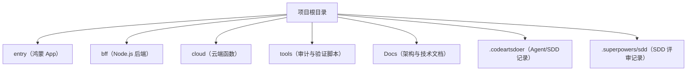
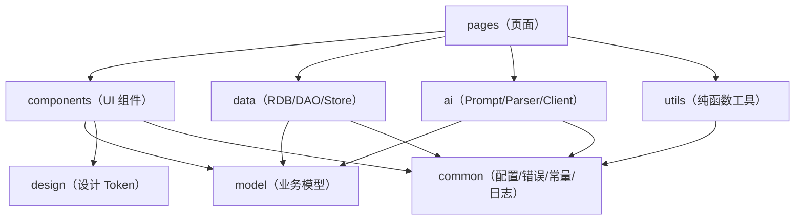
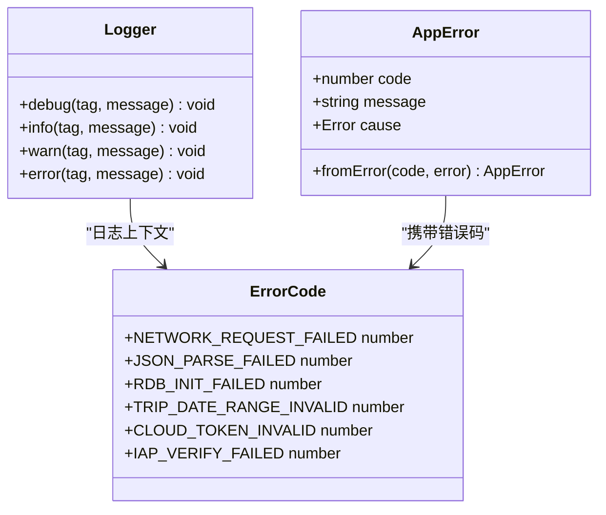
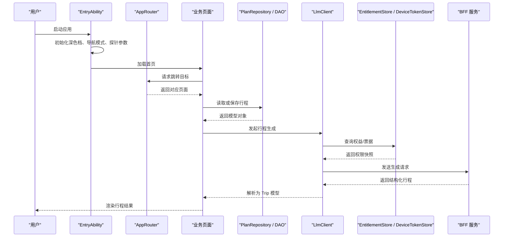
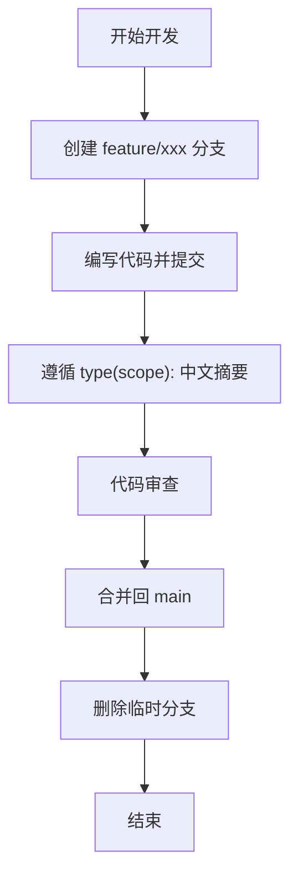
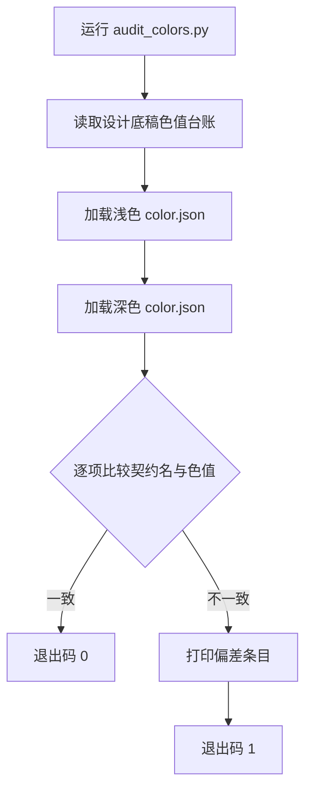
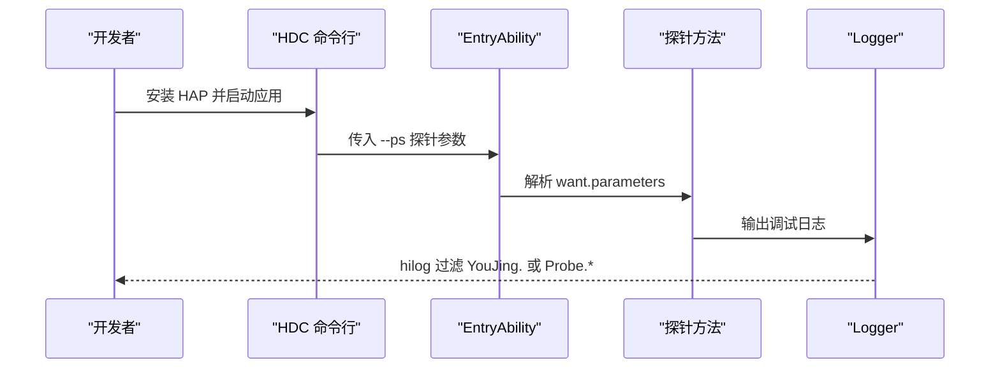
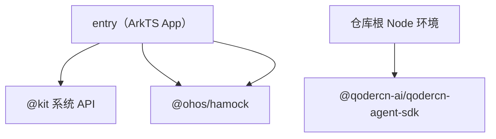
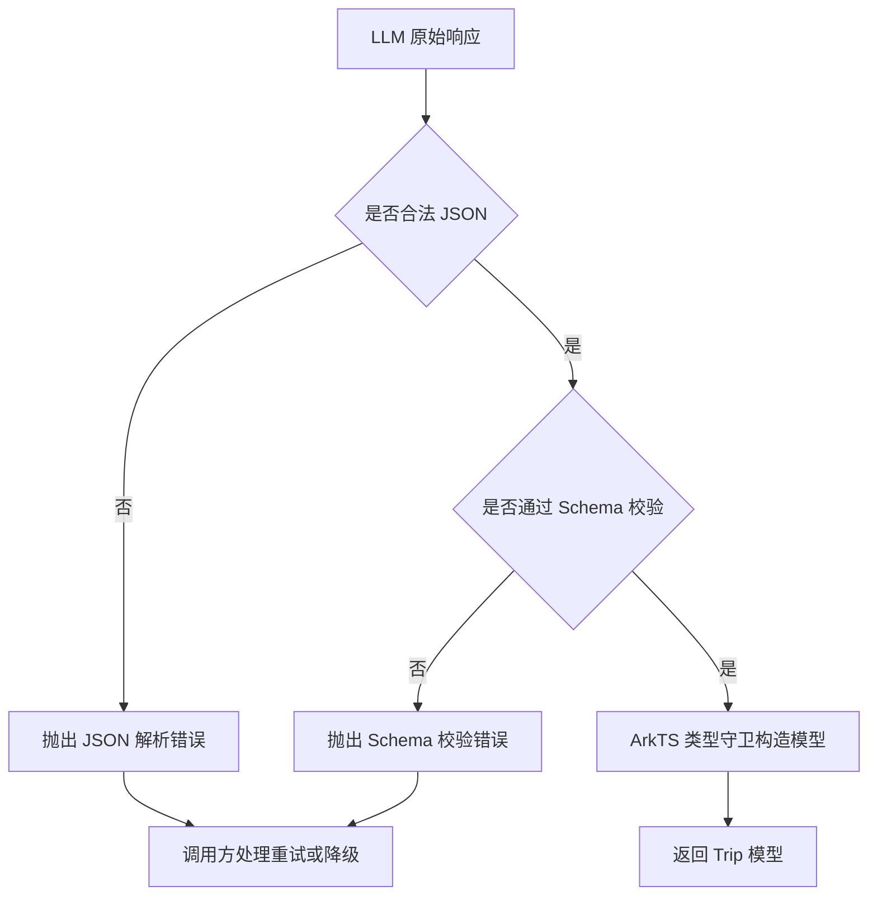

# 开发指南

<cite>
**本文引用的文件**   
- [package.json](file://package.json)
- [oh-package.json5](file://oh-package.json5)
- [build-profile.json5](file://build-profile.json5)
- [entry/build-profile.json5](file://entry/build-profile.json5)
- [hvigor/hvigor-config.json5](file://hvigor/hvigor-config.json5)
- [AppScope/app.json5](file://AppScope/app.json5)
- [code-linter.json5](file://code-linter.json5)
- [Docs/TECH_STACK.md](file://Docs/TECH_STACK.md)
- [Docs/ARCHITECTURE.md](file://Docs/ARCHITECTURE.md)
- [Docs/调试探针手册.md](file://Docs/调试探针手册.md)
- [Docs/有径·Qoder工程初始化.md](file://Docs/有径·Qoder工程初始化.md)
- [.gitmessage.txt](file://.gitmessage.txt)
- [entry/src/main/ets/common/logger/Logger.ets](file://entry/src/main/ets/common/logger/Logger.ets)
- [entry/src/main/ets/common/error/AppError.ets](file://entry/src/main/ets/common/error/AppError.ets)
- [entry/src/main/ets/common/error/ErrorCode.ets](file://entry/src/main/ets/common/error/ErrorCode.ets)
- [entry/src/main/ets/common/constants/BuildConfig.ets](file://entry/src/main/ets/common/constants/BuildConfig.ets)
- [entry/src/main/ets/common/config/MockConfig.ets](file://entry/src/main/ets/common/config/MockConfig.ets)
- [entry/src/main/ets/common/config/DirectConfig.ets](file://entry/src/main/ets/common/config/DirectConfig.ets)
- [entry/src/main/ets/entryability/EntryAbility.ets](file://entry/src/main/ets/entryability/EntryAbility.ets)
- [entry/src/main/ets/pages/AppRouter.ets](file://entry/src/main/ets/pages/AppRouter.ets)
- [entry/src/main/ets/data/TripDao.ets](file://entry/src/main/ets/data/TripDao.ets)
- [entry/src/main/ets/ai/LlmClient.ets](file://entry/src/main/ets/ai/LlmClient.ets)
- [tools/audit_colors.py](file://tools/audit_colors.py)
</cite>

## 目录
1. [简介](#简介)
2. [项目结构](#项目结构)
3. [核心组件](#核心组件)
4. [架构总览](#架构总览)
5. [详细组件分析](#详细组件分析)
6. [依赖分析](#依赖分析)
7. [性能与质量门禁](#性能与质量门禁)
8. [开发与调试最佳实践](#开发与调试最佳实践)
9. [故障排查](#故障排查)
10. [结论](#结论)

## 简介
本指南面向新加入「有径」项目的开发者，目标是帮助你在最短时间内完成环境搭建、理解代码分层、掌握 Git 工作流与质量门禁，并能在本地快速调试行程规划、LLM 调用、地图与提醒等关键流程。

本项目是 HarmonyOS ArkTS 原生应用，采用 DevEco Studio + hvigor 构建体系，使用 ohpm 管理鸿蒙依赖，同时包含 Node.js 后端（BFF）与工具脚本。仓库中已沉淀技术栈基线、架构契约、调试探针手册和提交模板，新成员应优先阅读这些“单一事实源”文档。

## 项目结构
根目录按职责划分为多个子系统：

| 路径 | 职责 | 说明 |
|---|---|---|
| `entry/` | 鸿蒙 App 主模块 | ArkTS 源码、资源、模块配置、测试 |
| `bff/` | Node.js 业务中间层 | 设备激活、权益校验、行程生成中转、配额与幂等控制 |
| `cloud/` | 云端函数示例 | 精选、重排程等云函数入口 |
| `tools/` | 审计脚本、验证脚本、部署探针 | 颜色核对、类型检查、BFF 探测、离线断言 |
| `Docs/` | 架构、技术栈、调试、商业化方案 | 开发前必读的契约型文档 |
| `.codeartsdoer/`、`.superpowers/sdd/` | Agent/SDD 任务记录与评审差异 | 历史推进过程归档，非运行时代码 |

ArkTS 源码位于 `entry/src/main/ets/`，其内部进一步分为 `pages`、`components`、`model`、`data`、`ai`、`common`、`design`、`utils`、`mock`、`widget` 等目录。该分层与依赖方向在架构文档中有明确约束，后续章节会结合具体实现解释。

**图表来源**
- [Docs/ARCHITECTURE.md:1-61](file://Docs/ARCHITECTURE.md#L1-L61)
- [Docs/TECH_STACK.md:1-41](file://Docs/TECH_STACK.md#L1-L41)

**小节来源**
- [Docs/ARCHITECTURE.md:1-61](file://Docs/ARCHITECTURE.md#L1-L61)
- [Docs/TECH_STACK.md:1-41](file://Docs/TECH_STACK.md#L1-L41)

## 核心组件
本节聚焦新成员最常接触的核心代码组织方式，而不是逐行解释所有业务逻辑。

### ArkTS 分层模型
ArkTS 源码遵循单向依赖规则：页面只编排 UI 与路由；组件只负责可复用展示；数据层封装 RDB 读写；AI 层封装 LLM/BFF/直连；公共层提供配置、错误码与日志。

**图表来源**
- [Docs/ARCHITECTURE.md:1-61](file://Docs/ARCHITECTURE.md#L1-L61)

### 统一日志与错误模型
全工程通过 `Logger` 输出 hilog 日志，并通过 `AppError` 包装跨层异常，错误码集中在 `ErrorCode`。

**图表来源**
- [entry/src/main/ets/common/logger/Logger.ets:1-35](file://entry/src/main/ets/common/logger/Logger.ets#L1-L35)
- [entry/src/main/ets/common/error/AppError.ets:1-20](file://entry/src/main/ets/common/error/AppError.ets#L1-L20)
- [entry/src/main/ets/common/error/ErrorCode.ets:1-48](file://entry/src/main/ets/common/error/ErrorCode.ets#L1-L48)

**小节来源**
- [Docs/ARCHITECTURE.md:1-61](file://Docs/ARCHITECTURE.md#L1-L61)
- [entry/src/main/ets/common/logger/Logger.ets:1-35](file://entry/src/main/ets/common/logger/Logger.ets#L1-L35)
- [entry/src/main/ets/common/error/AppError.ets:1-20](file://entry/src/main/ets/common/error/AppError.ets#L1-L20)
- [entry/src/main/ets/common/error/ErrorCode.ets:1-48](file://entry/src/main/ets/common/error/ErrorCode.ets#L1-L48)

## 架构总览
从应用启动到核心功能执行，典型链路如下：

**图表来源**
- [entry/src/main/ets/entryability/EntryAbility.ets:1-200](file://entry/src/main/ets/entryability/EntryAbility.ets#L1-L200)
- [entry/src/main/ets/pages/AppRouter.ets:1-100](file://entry/src/main/ets/pages/AppRouter.ets#L1-L100)
- [entry/src/main/ets/ai/LlmClient.ets:1-200](file://entry/src/main/ets/ai/LlmClient.ets#L1-L200)

## 详细组件分析

### 构建与运行环境
HarmonyOS 工程通过 `build-profile.json5` 声明应用签名、产品、SDK 版本与模块；`entry/build-profile.json5` 描述模块级 stageMode、release 混淆选项与测试 target；`hvigor/hvigor-config.json5` 暴露 hvigor 执行、日志、调试与 Node 选项开关。

| 配置项 | 当前行为 | 开发者注意事项 |
|---|---|---|
| runtimeOS | HarmonyOS | 仅面向 HarmonyOS 设备或模拟器 |
| targetSdkVersion | 26.0.0 | 以技术栈文档为准，升级需更新文档 |
| modelVersion | 26.0.0 | 根与 hvigor 均锁定 26.0.0 |
| bundleName | com.youjing.app | 包名已在应用清单定稿 |
| versionCode | 1000000 | 发布版本号 |
| release.obfuscation | 启用混淆规则文件 | 发布构建时引用 `obfuscation-rules.txt` |

**小节来源**
- [build-profile.json5:1-56](file://build-profile.json5#L1-L56)
- [entry/build-profile.json5:1-33](file://entry/build-profile.json5#L1-L33)
- [hvigor/hvigor-config.json5:1-23](file://hvigor/hvigor-config.json5#L1-L23)
- [AppScope/app.json5:1-11](file://AppScope/app.json5#L1-L11)
- [Docs/TECH_STACK.md:1-41](file://Docs/TECH_STACK.md#L1-L41)

### ArkTS 编码规范与命名约定
仓库通过架构文档和 lint 配置共同固化编码规范，重点包括：

| 类别 | 约定 | 依据 |
|---|---|---|
| 文件扩展名 | 一律 `.ets` | 架构文档 |
| 类/枚举/组件 | UpperCamelCase | 架构文档 |
| 变量/函数 | lowerCamelCase | 架构文档 |
| 数组类型 | `T[]` | 架构文档 |
| 禁止裸样式值 | 色值/字号/间距必须走 design token | 架构文档 UI 约定 |
| 组件标识 | 模块前缀-语义 id，禁止裸数字 id | 架构文档 |
| 禁止 any | 强制启用 | lint 规则 |
| 禁止未使用变量 | 强制启用 | lint 规则 |
| 要求显式返回类型 | 强制启用 | lint 规则 |
| 禁止直接 console | 统一走 Logger | lint 规则与 Logger 注释 |

**小节来源**
- [Docs/ARCHITECTURE.md:1-61](file://Docs/ARCHITECTURE.md#L1-L61)
- [code-linter.json5:1-43](file://code-linter.json5#L1-L43)
- [entry/src/main/ets/common/logger/Logger.ets:1-35](file://entry/src/main/ets/common/logger/Logger.ets#L1-L35)

### Git 工作流
提交信息模板定义 type、scope 与正文格式，推荐开启本地 commit template。分支策略在项目初始化提示词中体现为 main 主干加 feature 短分支，合并后删除。

| 要素 | 约定 |
|---|---|
| 提交类型 | feat / fix / refactor / docs / chore / test |
| scope | 常用目录名，如 common、design、docs、ets、root |
| 摘要长度 | ≤50 字，动词开头，不写句号 |
| 正文长度 | 可选，每行 ≤72 字 |
| 提交粒度 | 单 commit 单意图 |
| 分支策略 | main 主干 + feature/xxx 短分支，合并后删除 |
| 本地模板 | 通过 git config 启用 `.gitmessage.txt` |

**图表来源**
- [.gitmessage.txt:1-11](file://.gitmessage.txt#L1-L11)
- [Docs/有径·Qoder工程初始化.md:1-200](file://Docs/有径·Qoder工程初始化.md#L1-L200)

**小节来源**
- [.gitmessage.txt:1-11](file://.gitmessage.txt#L1-L11)
- [Docs/有径·Qoder工程初始化.md:1-200](file://Docs/有径·Qoder工程初始化.md#L1-L200)

### 代码质量工具
仓库的质量门禁由三部分组成：ArkTS lint 配置、Python 审计脚本、Node 工具脚本。

#### ArkTS 静态检查
`code-linter.json5` 指定扫描 `.ets` 文件，排除测试、mock、node_modules、构建产物与预览缓存，启用 TypeScript recommended 规则集、性能推荐规则集，并强化以下规则：

| 规则 | 级别 | 目的 |
|---|---:|---|
| `@typescript-eslint/no-explicit-any` | error | 禁止 any，配合 ArkTS 严格模式 |
| `@typescript-eslint/no-unused-vars` | error | 清理无用变量 |
| `@typescript-eslint/explicit-function-return-type` | error | 函数必须显式返回类型 |
| `@typescript-eslint/no-console` | error | 禁止直接 console，统一 Logger |
| `@security/*` 系列 | error/warn | 禁用不安全加密哈希操作 |

**小节来源**
- [code-linter.json5:1-43](file://code-linter.json5#L1-L43)

#### 自定义审计脚本
`tools/audit_colors.py` 将浅色与深色 `color.json` 与设计底稿中的色值台账做机器化比对，用于发现肉眼难以察觉的颜色偏差。它支持传入设计文档路径，默认指向本地设计文件位置，退出码 0 表示一致，1 表示存在偏差，2 表示找不到契约文件。

**图表来源**
- [tools/audit_colors.py:1-113](file://tools/audit_colors.py#L1-L113)

**小节来源**
- [tools/audit_colors.py:1-113](file://tools/audit_colors.py#L1-L113)

### 调试技巧
调试能力集中在 `EntryAbility` 与调试探针手册中。探针仅在 debug 构建下生效，通过 Ability 启动参数触发，并使用统一 Logger 输出 TAG 便于 hilog 过滤。

| 探针 | 用途 | 主要 TAG |
|---|---|---|
| `genprobe` | 真实 LLM 生成回归 | Probe.Gen |
| `pickprobe` | 精选候选链路 | Probe.Pick |
| `remindprobe` | 系统提醒单发 | 与 TripReminder 相关 |
| `arrivalprobe` | 到站通知 | Probe.Arrival |
| `geoprobe` | 围栏注册与事件 | Probe.Geofence |
| `coordprobe` | GPS 坐标校准 | Probe.Coord |

**图表来源**
- [Docs/调试探针手册.md:1-57](file://Docs/调试探针手册.md#L1-L57)
- [entry/src/main/ets/entryability/EntryAbility.ets:1-200](file://entry/src/main/ets/entryability/EntryAbility.ets#L1-L200)
- [entry/src/main/ets/common/logger/Logger.ets:1-35](file://entry/src/main/ets/common/logger/Logger.ets#L1-L35)

**小节来源**
- [Docs/调试探针手册.md:1-57](file://Docs/调试探针手册.md#L1-L57)
- [entry/src/main/ets/entryability/EntryAbility.ets:1-200](file://entry/src/main/ets/entryability/EntryAbility.ets#L1-L200)

### 项目管理
项目管理体现在三类材料中：

| 材料 | 作用 | 维护建议 |
|---|---|---|
| `Docs/TECH_STACK.md` | 技术栈与依赖基线 | 升级依赖前先登记变更，再改配置 |
| `Docs/ARCHITECTURE.md` | 目录职责、依赖方向、命名与 UI 约定 | 结构变更前先更新 |
| `.gitmessage.txt` | 提交信息模板 | 保持 type/scope/摘要规范 |

此外，仓库还包含商业化、LLM 接入、地图检索、实况窗、Skill 接入等专项文档，适合新成员按功能域逐步阅读。

**小节来源**
- [Docs/TECH_STACK.md:1-41](file://Docs/TECH_STACK.md#L1-L41)
- [Docs/ARCHITECTURE.md:1-61](file://Docs/ARCHITECTURE.md#L1-L61)
- [.gitmessage.txt:1-11](file://.gitmessage.txt#L1-L11)

## 依赖分析
项目依赖可分为三层：

1. **鸿蒙运行时依赖**：无外部三方运行时依赖，功能优先使用 @kit 系统 API。
2. **开发依赖**：根 `oh-package.json5` 引入 Hypium 与 Hamock 测试库。
3. **Node 侧依赖**：根 `package.json` 引入 Qoder Agent SDK，主要用于仓库内 Agent/SDD 工作流。

**图表来源**
- [oh-package.json5:1-10](file://oh-package.json5#L1-L10)
- [package.json:1-5](file://package.json#L1-L5)
- [Docs/TECH_STACK.md:1-41](file://Docs/TECH_STACK.md#L1-L41)

**小节来源**
- [oh-package.json5:1-10](file://oh-package.json5#L1-L10)
- [package.json:1-5](file://package.json#L1-L5)
- [Docs/TECH_STACK.md:1-41](file://Docs/TECH_STACK.md#L1-L41)

## 性能与质量门禁
### 构建性能
hvigor 配置中保留了 daemon、增量编译、并行编译、类型检查与优化策略等开关的注释位，说明工程允许按需开启高级构建特性。实际使用时应根据本机内存与 CI 环境调整，避免盲目开启导致内存压力过大。

### ArkTS 质量门禁
lint 配置把安全类规则和性能类规则纳入基础规则集，并将 no-any、no-unused-vars、explicit-return-type、no-console 提升到 error 级别。新成员新增代码时应保证 lint 零 error，否则无法通过本地门禁。

### 存储与解析质量
数据层 DAO 使用 RDB 事务封装写操作，读操作逐列收口为模型；AI 层对 LLM 响应进行 JSON 与 Schema 校验，失败时按错误码上抛，并由上层决定重试或降级。

**图表来源**
- [entry/src/main/ets/ai/LlmClient.ets:1-200](file://entry/src/main/ets/ai/LlmClient.ets#L1-L200)
- [entry/src/main/ets/common/error/ErrorCode.ets:1-48](file://entry/src/main/ets/common/error/ErrorCode.ets#L1-L48)

**小节来源**
- [hvigor/hvigor-config.json5:1-23](file://hvigor/hvigor-config.json5#L1-L23)
- [code-linter.json5:1-43](file://code-linter.json5#L1-L43)
- [entry/src/main/ets/data/TripDao.ets:1-200](file://entry/src/main/ets/data/TripDao.ets#L1-L200)
- [entry/src/main/ets/ai/LlmClient.ets:1-200](file://entry/src/main/ets/ai/LlmClient.ets#L1-L200)

## 开发与调试最佳实践

### 模块化设计
- 页面只做路由与状态编排，不直接访问 RDB 或 LLM。
- 组件只关注展示与交互，不持有复杂业务状态。
- 数据层统一通过 DAO 与 Store 读写，对外暴露模型。
- AI 层统一通过 PromptBuilder、TripParser、LlmClient 处理提示词与响应。
- 配置与常量集中在 `common/config` 与 `common/constants`，禁止散落硬编码。

**小节来源**
- [Docs/ARCHITECTURE.md:1-61](file://Docs/ARCHITECTURE.md#L1-L61)

### 错误处理
- 所有跨层错误统一包装为 `AppError`，并携带 `ErrorCode`。
- 网络、解析、存储、业务、账号、云端等错误码分区间管理。
- Logger 统一输出，debug 级别受 `IS_DEBUG` 门控。

**小节来源**
- [entry/src/main/ets/common/error/AppError.ets:1-20](file://entry/src/main/ets/common/error/AppError.ets#L1-L20)
- [entry/src/main/ets/common/error/ErrorCode.ets:1-48](file://entry/src/main/ets/common/error/ErrorCode.ets#L1-L48)
- [entry/src/main/ets/common/logger/Logger.ets:1-35](file://entry/src/main/ets/common/logger/Logger.ets#L1-L35)

### 性能优化
- 避免在页面或组件中直接发起网络或数据库请求。
- 避免在高频渲染路径中重复计算距离、时间、预算等值，优先放入工具函数或缓存。
- 使用 mock 传输在离线场景闭环验证生成管线，减少真实模型调用成本。
- 发布前确认 `BuildConfig.IS_DEBUG` 与 `MockConfig.USE_MOCK_DATA` 处于预期值。

**小节来源**
- [entry/src/main/ets/ai/LlmClient.ets:1-200](file://entry/src/main/ets/ai/LlmClient.ets#L1-L200)
- [entry/src/main/ets/common/constants/BuildConfig.ets:1-18](file://entry/src/main/ets/common/constants/BuildConfig.ets#L1-L18)
- [entry/src/main/ets/common/config/MockConfig.ets:1-15](file://entry/src/main/ets/common/config/MockConfig.ets#L1-L15)

### 调试技巧
- 使用 HDC 安装 HAP 后，通过 `hilog` 过滤 `YouJing.` 抓取全部应用日志。
- 通过 Ability 启动参数触发探针，例如坐标校准、精选、提醒、围栏、到站通知等。
- 开发期直连 LLM 时使用 `DirectConfig`，但必须确保 Key 不会进入发布包。
- 遇到页面跳转异常时，可通过 `AppRouter` 的未知路由出口定位未识别路由名。

**小节来源**
- [Docs/调试探针手册.md:1-57](file://Docs/调试探针手册.md#L1-L57)
- [entry/src/main/ets/common/config/DirectConfig.ets:1-33](file://entry/src/main/ets/common/config/DirectConfig.ets#L1-L33)
- [entry/src/main/ets/pages/AppRouter.ets:1-100](file://entry/src/main/ets/pages/AppRouter.ets#L1-L100)

## 故障排查
| 现象 | 可能原因 | 排查步骤 |
|---|---|---|
| ArkTS 静态检查报错 | any、未使用变量、缺失返回类型、console 直接调用 | 查看 lint 输出，修复对应 .ets 文件 |
| 构建成功但 UI 无变化 | 依赖未安装、hvigor daemon 缓存异常 | 参考初始化文档中的标准重建流程 |
| 日志为空 | IS_DEBUG 为 false 或 Logger tag 不匹配 | 检查 BuildConfig 与 Logger 调用 |
| LLM 生成失败 | JSON 不合法、Schema 校验失败、票据失效 | 查看 ErrorCode 区段与 BFF 错误映射 |
| 颜色与设计稿不一致 | 手工修改 color.json 未对齐 DESIGN.md | 运行 `tools/audit_colors.py` |
| 路由跳转异常 | 路由名不在 routerMap 中 | 查看 Unknown Route 输出或 ComingSoonPage |
| 提交被拦截 | pre-commit 或本地钩子失败 | 先跑静态检查与构建，再提交 |

**小节来源**
- [code-linter.json5:1-43](file://code-linter.json5#L1-L43)
- [entry/src/main/ets/common/constants/BuildConfig.ets:1-18](file://entry/src/main/ets/common/constants/BuildConfig.ets#L1-L18)
- [entry/src/main/ets/pages/AppRouter.ets:1-100](file://entry/src/main/ets/pages/AppRouter.ets#L1-L100)
- [tools/audit_colors.py:1-113](file://tools/audit_colors.py#L1-L113)
- [Docs/有径·Qoder工程初始化.md:1-200](file://Docs/有径·Qoder工程初始化.md#L1-L200)

## 结论
「有径」项目以明确的架构契约、技术栈基线和调试探针为基础，强调配置收敛、依赖最小化、日志统一与错误码驱动的错误处理。新成员建议按以下顺序上手：

1. 阅读 `Docs/TECH_STACK.md` 与 `Docs/ARCHITECTURE.md`，确认 DevEco、SDK、bundleName 与分层规则。
2. 在 DevEco Studio 中打开工程并完成一次完整构建。
3. 熟悉 `Logger`、`AppError`、`ErrorCode` 的使用方式。
4. 根据 `Docs/调试探针手册.md` 在本地跑通一个探针。
5. 按照 `.gitmessage.txt` 的提交规范进行分支与提交。
6. 新增代码前运行 ArkTS 静态检查，必要时运行 `tools/audit_colors.py` 等审计脚本。
7. 涉及依赖、配置、目录结构或 API 选型时，先评估影响面并更新相应契约文档。