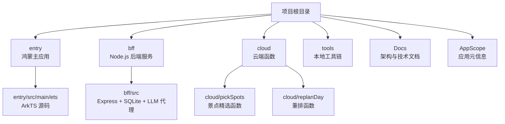
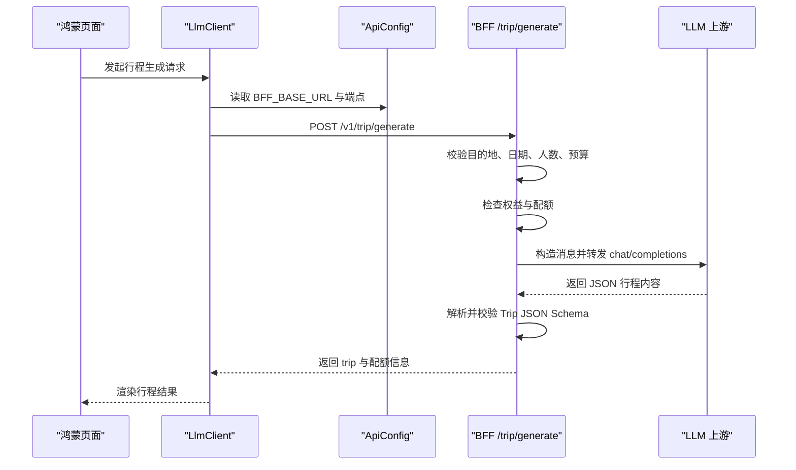

# 快速开始

<cite>
**本文引用的文件**   
- [TECH_STACK.md](file://Docs/TECH_STACK.md)
- [ARCHITECTURE.md](file://Docs/ARCHITECTURE.md)
- [app.json5](file://AppScope/app.json5)
- [oh-package.json5](file://oh-package.json5)
- [entry/oh-package.json5](file://entry/oh-package.json5)
- [bff/package.json](file://bff/package.json)
- [.env.example](file://bff/.env.example)
- [ApiConfig.ets](file://entry/src/main/ets/common/config/ApiConfig.ets)
- [DirectConfig.ets](file://entry/src/main/ets/common/config/DirectConfig.ets)
- [MockConfig.ets](file://entry/src/main/ets/common/config/MockConfig.ets)
- [LlmClient.ets](file://entry/src/main/ets/ai/LlmClient.ets)
- [trip.js](file://bff/src/routes/trip.js)
- [llm.js](file://bff/src/services/llm.js)
</cite>

## 目录
1. [简介](#简介)
2. [环境准备](#环境准备)
3. [项目结构总览](#项目结构总览)
4. [依赖安装](#依赖安装)
5. [启动后端服务](#启动后端服务)
6. [在 DevEco Studio 中运行主应用](#在-deveco-studio-中运行主应用)
7. [第一次调用：让 LLM 生成一个简单行程](#第一次调用让-llm-生成一个简单行程)
8. [调试与日志查看](#调试与日志查看)
9. [常见启动问题排查](#常见启动问题排查)
10. [总结与下一步](#总结与下一步)

## 简介
本指南面向首次接触「有径」项目的开发者，目标是在约 15 分钟内完成环境准备、依赖安装、后端 BFF 启动和鸿蒙主应用运行，并成功完成一次 LLM 行程生成调用。

项目采用多模块结构：
- `entry`：HarmonyOS 主应用（ArkTS）。
- `bff`：Node.js 后端服务（BFF），负责设备激活、权益配额、LLM 代理、IAP 校验等。
- `cloud`：云端函数，当前包含景点精选与重排相关逻辑。
- `tools`：本地审计、验证、构建辅助脚本。

## 环境准备

### 必需工具链
| 项目 | 要求 | 说明 |
|---|---|---|
| HarmonyOS SDK | API 26+ | 工程实际使用 API 26；最低兼容版本也为 26 |
| DevEco Studio | 26.0.0.x | 文档锁定为 26.0.0.851 |
| Node.js | 由 DevEco Studio 内置或系统可用 | BFF 使用 Node.js 原生 `fetch` 能力 |
| ohpm | 随 DevEco Studio 提供 | 用于鸿蒙模块依赖管理 |
| npm | 任意现代版本 | 用于 `bff` 子目录依赖安装 |
| 华为账号 | 已登录 DevEco Studio | 用于模拟器运行、真机调试、签名与 AGC 关联 |

技术栈基线来自仓库的单一事实源：

**章节来源**
- [TECH_STACK.md:1-41](file://Docs/TECH_STACK.md#L1-L41)

### 华为账号配置
1. 打开 DevEco Studio。
2. 登录后确保华为账号处于活跃状态。
3. 在 Device Manager 中添加并启动模拟器，或在真机上启用开发者选项。
4. 若后续需要 AGC 云函数、地图、天气等服务，请在华为云控制台按对应服务开通。

## 项目结构总览



**图示来源**
- [ARCHITECTURE.md:1-61](file://Docs/ARCHITECTURE.md#L1-L61)
- [bff/package.json:1-22](file://bff/package.json#L1-L22)
- [oh-package.json5:1-10](file://oh-package.json5#L1-L10)

各核心目录职责如下：

| 目录 | 职责 | 关键入口或产物 |
|---|---|---|
| `entry` | 鸿蒙主应用，包含页面、组件、数据层、AI 调用、设计 token 与配置 | `entry/src/main/ets/pages/Index.ets`、`EntryAbility.ets` |
| `bff` | 后端服务，聚合设备票据、权益、配额、提示词、LLM 代理与 IAP | `bff/src/index.js`、`bff/src/routes/trip.js` |
| `cloud` | 云端函数，承载可独立部署的 AI 计算任务 | `cloud/pickSpots/index.js`、`cloud/replanDay/index.js` |
| `tools` | 不随包分发的本地质量与验证脚本 | `audit_*.py`、`verify_*.sh`、`probe_*.mjs` |
| `AppScope` | 应用级元信息，包括 bundleName、版本号 | `AppScope/app.json5` |
| `Docs` | 架构契约、技术栈、接入方案、验收说明 | `ARCHITECTURE.md`、`TECH_STACK.md`、`LLM接入方案-2026-10-26.md` |

**章节来源**
- [ARCHITECTURE.md:1-61](file://Docs/ARCHITECTURE.md#L1-L61)
- [app.json5:1-11](file://AppScope/app.json5#L1-L11)

## 依赖安装

### 安装鸿蒙模块依赖
在项目根目录执行：

```bash
ohpm install --all
```

根 `oh-package.json5` 声明了模型版本和开发依赖：
- 模型版本：`26.0.0`
- 运行时依赖为空
- 开发依赖包括 `@ohos/hypium` 与 `@ohos/hamock`

`entry` 模块的 `entry/oh-package.json5` 当前也保持空运行时依赖。

**章节来源**
- [oh-package.json5:1-10](file://oh-package.json5#L1-L10)
- [entry/oh-package.json5:1-10](file://entry/oh-package.json5#L1-L10)

### 安装 BFF 后端依赖
进入 `bff` 目录并安装 Node.js 依赖：

```bash
cd bff
npm install
```

`bff/package.json` 定义了后端服务脚本：
- `start`：启动 Express 服务
- `dev`：开启 Node.js watch 模式
- `migrate`：执行数据库迁移
- `preflight`：运行前置检查
- `test`：运行测试套件

**章节来源**
- [bff/package.json:1-22](file://bff/package.json#L1-L22)

## 启动后端服务

### 最小化启动
后端默认监听端口由配置文件定义，环境变量示例位于 `.env.example`：

```bash
cd bff
cp .env.example .env
node src/index.js
```

若使用开发模式：

```bash
cd bff
npm run dev
```

默认端口为 `3000`，可通过 `.env` 中的 `PORT` 覆盖。

### 必须配置的环境变量
至少应关注以下变量：

| 变量 | 用途 | 是否必填 |
|---|---|---|
| `DEEPSEEK_API_KEY` | LLM 上游 API Key | 走真实 LLM 时必填 |
| `LLM_BASE_URL` | LLM 服务基础地址 | 默认指向 DeepSeek |
| `LLM_MODEL` | 使用的模型名 | 默认 `deepseek-flash` |
| `JWT_SECRET` | JWT 相关密钥 | 建议设置 |
| `PORT` | BFF 监听端口 | 默认 `3000` |

若只跑端侧 Mock 或直连 LLM，可以不启用完整后端，但 BFF 提供的行程生成接口将不可用。

**章节来源**
- [.env.example:1-41](file://bff/.env.example#L1-L41)

## 在 DevEco Studio 中运行主应用

### 打开项目
1. 使用 DevEco Studio 打开项目根目录。
2. 等待 Gradle/Hvigor 同步完成。
3. 确认右上角设备列表中有可用的模拟器或真机。

### 运行入口
1. 选择运行配置为 `entry`。
2. 点击运行按钮。
3. 若首次运行失败，优先执行标准重建流程：
   - 停止构建守护进程
   - 删除预览缓存目录
   - 重新构建 HAP

### Bundle 名称
当前应用 bundleName 为 `com.youjing.app`，不要随意修改，否则会影响华为账号签名、AGC 配置与 BFF 设备票据校验。

**章节来源**
- [app.json5:1-11](file://AppScope/app.json5#L1-L11)

## 第一次调用：让 LLM 生成一个简单行程

### 理解调用链路



**图示来源**
- [LlmClient.ets](file://entry/src/main/ets/ai/LlmClient.ets)
- [ApiConfig.ets:1-66](file://entry/src/main/ets/common/config/ApiConfig.ets#L1-L66)
- [trip.js:1-200](file://bff/src/routes/trip.js#L1-L200)
- [llm.js:1-98](file://bff/src/services/llm.js#L1-L98)

### 方式一：通过 BFF 生成（推荐）
这是项目默认的主路径：端侧把用户输入发给 BFF，BFF 做鉴权、配额、提示词拼装和 LLM 代理。

1. 启动 BFF：
   ```bash
   cd bff
   node src/index.js
   ```
2. 确认 `ApiConfig.BFF_BASE_URL` 指向本机 BFF，例如：
   ```
   http://192.168.2.1:3000
   ```
3. 在 `.env` 中填入真实的 `DEEPSEEK_API_KEY`。
4. 在鸿蒙主应用中触发“生成行程”，例如从首页或行程输入页进入生成流程。
5. 成功后可在 `bff` 终端看到日志输出，包括账户、提示词模式、响应格式与 token 用量。

如果首次遇到额度不足，可使用 `.env.example` 中的管理员账号 ID 临时绕过，仅用于本地联调。

### 方式二：端侧直连 LLM（开发兜底）
当 BFF 未部署或不需要权限门控时，可使用端侧直连：

1. 编辑 `entry/src/main/ets/common/config/DirectConfig.ets`，填写：
   - `URL`：OpenAI 兼容的 `chat/completions` 地址
   - `KEY`：LLM API Key
   - `MODEL`：如 `deepseek-flash`
2. 将 `DirectConfig.ets` 设为 skip-worktree，避免误提交：
   ```bash
   git update-index --skip-worktree entry/src/main/ets/common/config/DirectConfig.ets
   ```
3. 把 `ApiConfig.BFF_BASE_URL` 置空，使 `GenerationChannel.isLocal()` 为 true，跳过设备票据与权益门禁。
4. 全量重编并重装 HAP。
5. 触发行程生成，端侧会直接调用 LLM。

注意：发布前必须迁回云端或 BFF，发布包不能携带真实 Key。

### 方式三：使用 Mock 数据（零成本验证）
若只想验证 UI 和解析管线，不连接真实 LLM：

1. 保持 `MockConfig.USE_MOCK_DATA` 为默认值。
2. 不配置 BFF 或不配置真实 LLM Key。
3. 触发生成后，端侧会使用 Mock 数据走完整解析链路。

**章节来源**
- [ApiConfig.ets:1-66](file://entry/src/main/ets/common/config/ApiConfig.ets#L1-L66)
- [DirectConfig.ets:1-33](file://entry/src/main/ets/common/config/DirectConfig.ets#L1-L33)
- [MockConfig.ets:1-15](file://entry/src/main/ets/common/config/MockConfig.ets#L1-L15)
- [llm.js:1-98](file://bff/src/services/llm.js#L1-L98)
- [trip.js:1-200](file://bff/src/routes/trip.js#L1-L200)

## 调试与日志查看

### 鸿蒙端日志
1. 在 DevEco Studio 底部打开 **Log**。
2. 过滤标签以 `YouJing.` 开头，对应统一 Logger 前缀。
3. 若需查看网络与 LLM 调用，重点观察：
   - 传输层日志
   - 错误码
   - 超时与重试记录

### BFF 后端日志
BFF 是 Node.js 服务，日志直接输出到终端：
- 行程路由会打印账户、提示词模式、响应格式、token 用量。
- LLM 代理会打印上游 HTTP 状态、模型名、prompt_tokens 与 completion_tokens。
- 429 限流会原样透出，便于端侧显示“稍后再试”类文案。

```bash
cd bff
node src/index.js
```

### 调试技巧
| 场景 | 操作 |
|---|---|
| 想先验证 UI | 关闭 Mock 开关，使用 `MockConfig.USE_MOCK_DATA=true` |
| 想验证真实 LLM | 配置 BFF 的 `DEEPSEEK_API_KEY` |
| 想绕过付费墙 | 使用 `.env.example` 中的管理员账号 ID，或端侧直连并跳过 BFF |
| 想看具体请求体 | 查看 BFF 日志中 `[trip]` 和 `[llm]` 行 |
| 怀疑配置未生效 | 全量重编并重装 HAP；`ApiConfig` 明确说明改后须全量重编 |

**章节来源**
- [ARCHITECTURE.md:1-61](file://Docs/ARCHITECTURE.md#L1-L61)
- [ApiConfig.ets:1-66](file://entry/src/main/ets/common/config/ApiConfig.ets#L1-L66)
- [llm.js:1-98](file://bff/src/services/llm.js#L1-L98)
- [trip.js:1-200](file://bff/src/routes/trip.js#L1-L200)

## 常见启动问题排查

| 问题 | 可能原因 | 解决方法 |
|---|---|---|
| DevEco Studio 找不到 API 26 | SDK 未安装或未选中 | 在 DevEco Studio 中安装 HarmonyOS API 26 SDK |
| 构建失败 | hvigor 缓存异常 | 清理 `.preview`、`.hvigor`，重启构建，再重新 assemble |
| 无法启动模拟器 | 设备未就绪 | 在 Device Manager 中创建或启动模拟器 |
| 行程生成报额度不足 | BFF 未识别有效权益 | 使用管理员账号 ID 本地联调，或配置真实订阅 |
| 行程生成报 LLM 未配置 | `ApiConfig.BFF_BASE_URL` 为空且未启用直连 | 配置 BFF 地址，或启用 `DirectConfig` |
| 端侧直连无效 | 忘记设置 skip-worktree 或没重编 | 对 `DirectConfig.ets` 执行 skip-worktree，并全量重编 |
| BFF 无法访问 LLM | 缺少 `DEEPSEEK_API_KEY` | 在 `.env` 中配置真实 Key |
| 429 限流 | LLM 上游限流 | 等待后重试；BFF 保留 429 供端侧展示友好文案 |
| 页面不刷新 | 增量构建未重编译配置 | 全量重编并重装 HAP |
| 真机调试白屏 | 签名或 bundleName 不一致 | 使用华为账号正确签名，勿擅自改 `bundleName` |

**章节来源**
- [TECH_STACK.md:1-41](file://Docs/TECH_STACK.md#L1-L41)
- [ApiConfig.ets:1-66](file://entry/src/main/ets/common/config/ApiConfig.ets#L1-L66)
- [DirectConfig.ets:1-33](file://entry/src/main/ets/common/config/DirectConfig.ets#L1-L33)
- [.env.example:1-41](file://bff/.env.example#L1-L41)

## 总结与下一步

你现在应该已经：
1. 确认 HarmonyOS API 26、DevEco Studio、Node.js、ohpm、npm 与华为账号就绪。
2. 安装鸿蒙模块依赖与 BFF 依赖。
3. 启动 BFF 并在 DevEco Studio 中运行主应用。
4. 通过 BFF 或端侧直连完成一次 LLM 行程生成。
5. 了解如何查看鸿蒙端与 BFF 日志。

下一步建议：
- 阅读 `Docs/ARCHITECTURE.md`，理解 ArkTS 代码分层与依赖方向。
- 阅读 `Docs/TECH_STACK.md`，了解版本锁定策略。
- 阅读 `Docs/LLM接入方案-2026-10-26.md`，理解直连、BFF 与云端函数的三条路线。
- 尝试调整 `ApiConfig` 或 `DirectConfig`，对比 Mock、BFF、直连三种模式的差异。