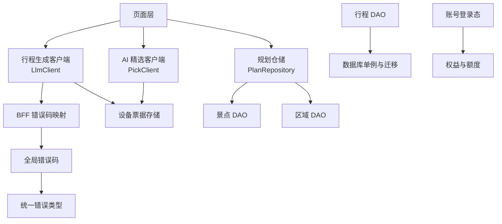
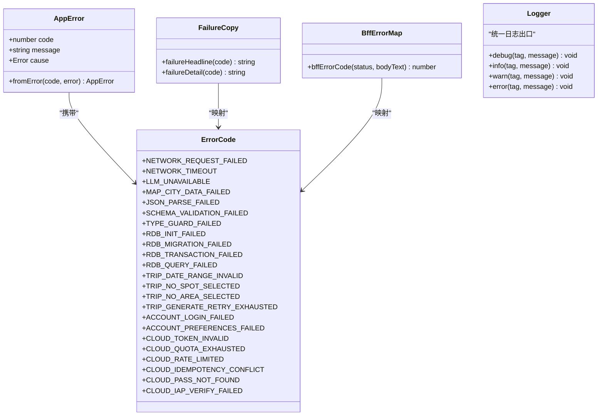
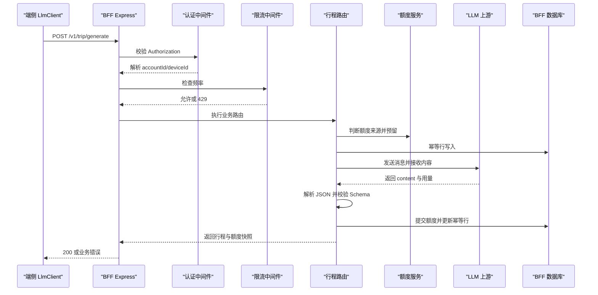

# 故障排除

<cite>
**本文引用的文件**   
- [AppError.ets](file://entry/src/main/ets/common/error/AppError.ets)
- [ErrorCode.ets](file://entry/src/main/ets/common/error/ErrorCode.ets)
- [FailureCopy.ets](file://entry/src/main/ets/common/error/FailureCopy.ets)
- [BffErrorMap.ets](file://entry/src/main/ets/utils/BffErrorMap.ets)
- [Logger.ets](file://entry/src/main/ets/common/logger/Logger.ets)
- [调试探针手册.md](file://Docs/调试探针手册.md)
- [MapKit地点检索探针-2026-10-31.md](file://Docs/MapKit地点检索探针-2026-10-31.md)
- [ApiConfig.ets](file://entry/src/main/ets/common/config/ApiConfig.ets)
- [DirectConfig.ets](file://entry/src/main/ets/common/config/DirectConfig.ets)
- [PickConfig.ets](file://entry/src/main/ets/common/config/PickConfig.ets)
- [MockConfig.ets](file://entry/src/main/ets/common/config/MockConfig.ets)
- [PlanRepository.ets](file://entry/src/main/ets/data/PlanRepository.ets)
- [DatabaseHelper.ets](file://entry/src/main/ets/data/DatabaseHelper.ets)
- [TripDao.ets](file://entry/src/main/ets/data/TripDao.ets)
- [SpotDao.ets](file://entry/src/main/ets/data/SpotDao.ets)
- [AccountStore.ets](file://entry/src/main/ets/data/AccountStore.ets)
- [DeviceTokenStore.ets](file://entry/src/main/ets/data/DeviceTokenStore.ets)
- [LlmClient.ets](file://entry/src/main/ets/ai/LlmClient.ets)
- [PickClient.ets](file://entry/src/main/ets/ai/PickClient.ets)
- [http-error.js](file://bff/src/lib/http-error.js)
- [index.js](file://bff/src/index.js)
- [trip.js](file://bff/src/routes/trip.js)
- [auth.js](file://bff/src/middleware/auth.js)
- [rateLimit.js](file://bff/src/middleware/rateLimit.js)
</cite>

## 目录
1. [引言](#引言)
2. [项目结构与错误边界](#项目结构与错误边界)
3. [核心错误体系](#核心错误体系)
4. [常见错误分类与定位方法](#常见错误分类与定位方法)
5. [错误码对照表](#错误码对照表)
6. [典型问题案例](#典型问题案例)
7. [调试工具与日志](#调试工具与日志)
8. [监控指标与可观测性](#监控指标与可观测性)
9. [依赖关系分析](#依赖关系分析)
10. [性能与稳定性注意事项](#性能与稳定性注意事项)
11. [预防性措施](#预防性措施)
12. [紧急响应流程](#紧急响应流程)
13. [结论](#结论)

## 引言
本故障排除文档面向有径应用（HarmonyOS / ArkTS）的开发者、测试人员与运维人员，目标是帮助快速定位编译期、运行时、网络、数据库及商业化链路中的常见问题。文档基于仓库中统一的错误类型、错误码、日志封装、调试探针、BFF 中间件与数据库迁移实现进行编写，所有结论均可追溯到对应源码或设计说明。

## 项目结构与错误边界
本项目的错误处理采用“统一包装 + 分段错误码 + 用户可读文案”的分层设计：
- 端侧所有跨层异常最终包装为 `AppError`，并携带全局唯一的 `ErrorCode`。
- BFF 层使用 `HttpError` 暴露 HTTP 状态码与业务错误码。
- 端侧通过 `BffErrorMap` 把服务端 HTTP 状态和 body 映射到客户端错误码。
- 用户可见文案集中在 `FailureCopy`，避免页面直接输出内部诊断术语。
- 日志统一通过 `Logger` 写入 hilog，禁止直接使用 `console.log`。

**图表来源**
- [AppError.ets:1-20](file://entry/src/main/ets/common/error/AppError.ets#L1-L20)
- [ErrorCode.ets:1-48](file://entry/src/main/ets/common/error/ErrorCode.ets#L1-L48)
- [BffErrorMap.ets:1-41](file://entry/src/main/ets/utils/BffErrorMap.ets#L1-L41)
- [LlmClient.ets:1-200](file://entry/src/main/ets/ai/LlmClient.ets#L1-L200)
- [PickClient.ets:1-154](file://entry/src/main/ets/ai/PickClient.ets#L1-L154)
- [PlanRepository.ets:1-55](file://entry/src/main/ets/data/PlanRepository.ets#L1-L55)
- [DatabaseHelper.ets:1-200](file://entry/src/main/ets/data/DatabaseHelper.ets#L1-L200)
- [AccountStore.ets:1-200](file://entry/src/main/ets/data/AccountStore.ets#L1-L200)

**章节来源**
- [AppError.ets:1-20](file://entry/src/main/ets/common/error/AppError.ets#L1-L20)
- [ErrorCode.ets:1-48](file://entry/src/main/ets/common/error/ErrorCode.ets#L1-L48)
- [FailureCopy.ets:1-87](file://entry/src/main/ets/common/error/FailureCopy.ets#L1-L87)
- [BffErrorMap.ets:1-41](file://entry/src/main/ets/utils/BffErrorMap.ets#L1-L41)
- [Logger.ets:1-35](file://entry/src/main/ets/common/logger/Logger.ets#L1-L35)

## 核心错误体系
### 统一错误类型
`AppError` 是端侧跨层上抛的统一错误类型，包含：
- `code`：来自 `ErrorCode` 的全局错误码。
- `message`：人类可读或诊断信息。
- `cause`：被包装的原始错误，便于根因追踪。

该类型提供 `fromError`，用于把原生 `Error` 转换为带业务语义的错误对象。

**章节来源**
- [AppError.ets:1-20](file://entry/src/main/ets/common/error/AppError.ets#L1-L20)

### 全局错误码分区
`ErrorCode` 是全工程唯一错误码定义点，按区段划分：
- `1xxx`：网络与 LLM 调用。
- `2xxx`：JSON 解析与 Schema 校验。
- `3xxx`：RDB 初始化、迁移、事务与查询。
- `4xxx`：行程生成前置业务规则。
- `5xxx`：账号静默登录与偏好持久化。
- `6xxx`：云端 BFF、权益、计费、幂等与 IAP。

新增错误码必须落在已有区段内顺延，不得重复。

**章节来源**
- [ErrorCode.ets:1-48](file://entry/src/main/ets/common/error/ErrorCode.ets#L1-L48)

### 用户可读文案隔离
`FailureCopy` 提供两个函数：
- `failureHeadline(code)`：屏 7 生成受阻标题。
- `failureDetail(code)`：标题下方原因说明。

其设计意图是把内部校验术语（例如“days 不能为空数组”）留在日志里，主界面只展示用户能理解的操作提示。

**章节来源**
- [FailureCopy.ets:1-87](file://entry/src/main/ets/common/error/FailureCopy.ets#L1-L87)

### BFF 错误映射
`BffErrorMap.bffErrorCode(status, bodyText)` 负责把 BFF 的 HTTP 状态和 body 转为端侧错误码：
- `401` → 令牌无效。
- `402` → 额度用尽。
- `429` → 频率超限。
- `409` → 幂等键冲突。
- `5xx` 且 error 为 `LLM_INVALID_TRIP` / `LLM_INVALID_JSON` → 重试已耗尽。
- 其他 `5xx` → LLM 不可用。
- 非上述情况 → 网络请求失败。

**章节来源**
- [BffErrorMap.ets:1-41](file://entry/src/main/ets/utils/BffErrorMap.ets#L1-L41)

### BFF 层错误类型
BFF 的 `HttpError` 暴露：
- `status`：HTTP 状态码。
- `code`：服务端业务错误码。
- `message`：错误消息。

Express 全局错误处理器会把未捕获错误转为 `{ error, message }` JSON。

**章节来源**
- [http-error.js:1-8](file://bff/src/lib/http-error.js#L1-L8)
- [index.js:1-55](file://bff/src/index.js#L1-L55)

## 常见错误分类与定位方法
### 编译错误
典型场景包括：
- 修改 `ApiConfig`、`PickConfig` 后增量构建未重新编译引用方，导致运行时行为不符合预期。
- 本地直连配置未加入 skip-worktree，干净检出时报字段缺失。
- Mock 数据开关在发布前未关闭。

定位步骤：
1. 检查是否修改了集中配置文件，尤其是 `ApiConfig`、`DirectConfig`、`PickConfig`、`MockConfig`。
2. 对涉及 URL、Key、超时时间的改动执行全量重编重装 HAP。
3. 确认本地开发分支没有意外提交密钥或未清理的临时字段。
4. 发布前核对 `MockConfig.USE_MOCK_DATA` 是否为 `false`。

相关入口：
- [ApiConfig.ets:1-66](file://entry/src/main/ets/common/config/ApiConfig.ets#L1-L66)
- [DirectConfig.ets:1-33](file://entry/src/main/ets/common/config/DirectConfig.ets#L1-L33)
- [PickConfig.ets:1-16](file://entry/src/main/ets/common/config/PickConfig.ets#L1-L16)
- [MockConfig.ets:1-15](file://entry/src/main/ets/common/config/MockConfig.ets#L1-L15)

**章节来源**
- [ApiConfig.ets:1-66](file://entry/src/main/ets/common/config/ApiConfig.ets#L1-L66)
- [DirectConfig.ets:1-33](file://entry/src/main/ets/common/config/DirectConfig.ets#L1-L33)
- [PickConfig.ets:1-16](file://entry/src/main/ets/common/config/PickConfig.ets#L1-L16)
- [MockConfig.ets:1-15](file://entry/src/main/ets/common/config/MockConfig.ets#L1-L15)

### 运行时异常
典型场景包括：
- 未先完成账号初始化就读取 RDB，导致分区键不稳定。
- 数据库迁移版本不一致或旧库升级跳过中间步骤。
- 写事务并发导致 RDB busy，但写通道已吞掉链式失败，后续写入不再阻塞。

定位步骤：
1. 确认入口能力在加载内容回调中先 `await init()` 账号与偏好。
2. 查看 RDB 版本号与迁移 SQL，确认跨级升级路径完整。
3. 若出现写失败，优先排查事务中多步插入是否超出单次记录限制或存在死锁。
4. 通过 hilog 过滤 `YouJing.` 与 `Data.DatabaseHelper`、`Data.TripDao` 等 TAG。

关键位置：
- [AccountStore.ets:1-200](file://entry/src/main/ets/data/AccountStore.ets#L1-L200)
- [DatabaseHelper.ets:1-200](file://entry/src/main/ets/data/DatabaseHelper.ets#L1-L200)
- [TripDao.ets:1-200](file://entry/src/main/ets/data/TripDao.ets#L1-L200)

**章节来源**
- [AccountStore.ets:1-200](file://entry/src/main/ets/data/AccountStore.ets#L1-L200)
- [DatabaseHelper.ets:1-200](file://entry/src/main/ets/data/DatabaseHelper.ets#L1-L200)
- [TripDao.ets:1-200](file://entry/src/main/ets/data/TripDao.ets#L1-L200)

### 网络请求失败
典型场景包括：
- BFF 基础地址未配置或本地服务未启动。
- 直连模式 Key 未填写或模型返回非法 JSON。
- 地图城市数据拉取失败、配额不足或无结果。
- 精选链路走 AGC 云函数、BFF 或直连时任意一层失败。

定位步骤：
1. 检查 `ApiConfig.BFF_BASE_URL`、`REPLAN_URL`、`WEATHER_URL`。
2. 如果使用直连，确认 `DirectConfig.URL` 与 `KEY` 同时非空。
3. 如果是 Map Kit 城市数据问题，参考探针文档确认 cityId、isCityLimit、分页与去重约束。
4. 如果是精选失败，注意该通路默认失败不阻断 UI，仅回退确定性规则。

关键位置：
- [ApiConfig.ets:1-66](file://entry/src/main/ets/common/config/ApiConfig.ets#L1-L66)
- [DirectConfig.ets:1-33](file://entry/src/main/ets/common/config/DirectConfig.ets#L1-L33)
- [PlanRepository.ets:1-55](file://entry/src/main/ets/data/PlanRepository.ets#L1-L55)
- [PickClient.ets:1-154](file://entry/src/main/ets/ai/PickClient.ets#L1-L154)
- [MapKit地点检索探针-2026-10-31.md:1-151](file://Docs/MapKit地点检索探针-2026-10-31.md#L1-L151)

**章节来源**
- [ApiConfig.ets:1-66](file://entry/src/main/ets/common/config/ApiConfig.ets#L1-L66)
- [DirectConfig.ets:1-33](file://entry/src/main/ets/common/config/DirectConfig.ets#L1-L33)
- [PlanRepository.ets:1-55](file://entry/src/main/ets/data/PlanRepository.ets#L1-L55)
- [PickClient.ets:1-154](file://entry/src/main/ets/ai/PickClient.ets#L1-L154)
- [MapKit地点检索探针-2026-10-31.md:1-151](file://Docs/MapKit地点检索探针-2026-10-31.md#L1-L151)

### 数据库操作错误
典型场景包括：
- RDB 初始化失败。
- onUpgrade 迁移漏列或漏表。
- 写事务 busy 或回滚。
- ResultSet 逐列收口时字段缺失或类型异常。

定位步骤：
1. 确认 `DatabaseHelper.DB_VERSION` 与迁移 SQL 一致。
2. 检查迁移判断是否为累积式 `oldVersion < N`，避免老库跨级升级漏步骤。
3. 对 `spot`、`area`、`trip`、`activity`、`meal`、`checkin`、`expense` 表结构变更，优先在迁移脚本而非建表语句中加列。
4. 查询异常优先检查列名、索引与 JSON 字段解析。

关键位置：
- [DatabaseHelper.ets:1-200](file://entry/src/main/ets/data/DatabaseHelper.ets#L1-L200)
- [SpotDao.ets:1-100](file://entry/src/main/ets/data/SpotDao.ets#L1-L100)
- [TripDao.ets:1-200](file://entry/src/main/ets/data/TripDao.ets#L1-L200)

**章节来源**
- [DatabaseHelper.ets:1-200](file://entry/src/main/ets/data/DatabaseHelper.ets#L1-L200)
- [SpotDao.ets:1-100](file://entry/src/main/ets/data/SpotDao.ets#L1-L100)
- [TripDao.ets:1-200](file://entry/src/main/ets/data/TripDao.ets#L1-L200)

## 错误码对照表
以下表格按错误码区段整理含义、可能原因与解决方案。

| 错误码 | 含义 | 可能原因 | 解决方案 |
|---|---|---|---|
| `1001` | 网络请求失败 | BFF 地址为空、本地服务未启动、非 2xx 响应 | 检查 `ApiConfig.BFF_BASE_URL`；确认 BFF 进程运行；查看 BFF 健康端点 |
| `1002` | 网络请求超时 | 连接超时或读超时过短 | 调整 `CONNECT_TIMEOUT_MS`、`READ_TIMEOUT_MS`；检查后端响应时间 |
| `1003` | LLM 服务不可用 | BFF 不可用、直连 Key 未配置、上游模型无响应 | 检查直连配置、BFF 部署、代理与密钥环境 |
| `1004` | 地图城市数据获取失败 | 网络、配额、cityId 缺失或无结果 | 按 Map Kit 探针要求传 cityId 与 isCityLimit；检查配额与网络 |
| `2001` | JSON 解析失败 | LLM 返回内容不是合法 JSON | 检查服务端 parse 与修复逻辑；查看修正调用日志 |
| `2002` | Schema 校验失败 | 行程缺少日期或站点、枚举越界 | 检查 PromptBuilder 与 trip-validator；缩短超长行程 |
| `2003` | 类型守卫失败 | ArkTS 构造 Trip 时字段不匹配 | 对齐 TripParser 与 Trip 模型；避免脏数据进入下游 |
| `3001` | RDB 初始化失败 | 权限不足、数据库损坏、安全级别配置异常 | 检查 ArkData 权限、卸载重装、重建 store |
| `3002` | 数据库迁移失败 | onUpgrade 漏列、SQL 语法错误或跨级升级不完整 | 补全迁移脚本；确保 oldVersion 累积判断 |
| `3003` | 写事务失败 | 并发写入、busy 冲突、回滚 | 减少并发写；检查事务粒度；观察日志堆栈 |
| `3004` | 查询失败 | ResultSet 列缺失或类型异常 | 核对 SQL 列名、索引与解析函数 |
| `4001` | 出发返程日期区间不合法 | 开始日期晚于结束日期、不在支持范围 | 校验输入日期格式与区间 |
| `4002` | 未选择任何景点 | 用户未勾选景点即点击生成 | 阻止生成或引导补充选择 |
| `4003` | 未选择住宿区域 | 未确定住宿片区 | 引导用户先选区域 |
| `4004` | 行程生成重试一次后仍失败 | 模型两次输出均无法拆成可用行程 | 显示降级文案；检查 prompt、token 上限与模型能力 |
| `5001` | 静默登录失败 | 华为账号未登录、AGC Client ID 或证书未配置 | 检查 Account Kit 配置；允许游客兜底 |
| `5002` | 登录态持久化读写失败 | preferences 初始化或 flush 失败 | 检查权限与存储空间；记录 masked uid 日志 |
| `6001` | 票据失效或未激活 | Authorization 头无效或 BFF 返回 401 | 重新激活设备；刷新 deviceToken |
| `6002` | 额度用尽 | gift 额度用完且无订阅或通行证 | 跳转定价页；使用重置脚本仅开发库 |
| `6003` | 频率超限 | 同一账号在窗口内请求过多 | 等待一分钟再试；检查客户端重试策略 |
| `6004` | 幂等键冲突 | 同 key 的请求仍在处理 | 不立即重试；由幂等中间件返回 409 |
| `6005` | 通行证不存在或不属于该账号 | passId 无效或账号不匹配 | 重新绑定通行证；检查 entitlement 查询 |
| `6006` | IAP 校验失败 | 收据签名或订单状态异常 | 检查 IAP 通知路由与证书；查看服务端日志 |

**章节来源**
- [ErrorCode.ets:1-48](file://entry/src/main/ets/common/error/ErrorCode.ets#L1-L48)
- [FailureCopy.ets:1-87](file://entry/src/main/ets/common/error/FailureCopy.ets#L1-L87)
- [BffErrorMap.ets:1-41](file://entry/src/main/ets/utils/BffErrorMap.ets#L1-L41)
- [trip.js:1-200](file://bff/src/routes/trip.js#L1-L200)
- [auth.js:1-25](file://bff/src/middleware/auth.js#L1-L25)
- [rateLimit.js:1-47](file://bff/src/middleware/rateLimit.js#L1-L47)

## 典型问题案例
### 权限拒绝
现象：
- 首次启动无法恢复登录态，或偏好写入失败。
- 账号静默登录返回空 UnionID。
- 设备标识或票据无法持久化。

排查过程：
1. 确认入口能力先执行账号初始化，而不是直接访问 RDB。
2. 检查 `AccountStore.init` 抛出 `ACCOUNT_PREFERENCES_FAILED` 时的日志。
3. 检查 `DeviceTokenStore.init` 与 `saveToken` 的 warn 日志，确认 preferences 是否可写。
4. 对于静默登录失败，确认 Account Kit 是否启用；未启用时应保持游客分区。

解决建议：
- 保证 `EntryAbility` 初始化顺序：先账号与设备票据，再加载种子数据。
- 对偏好读写失败做降级：不中断首启，但记录 masked 标识。
- 登出逻辑不清隐私同意，只清登录态与设备票据。

**章节来源**
- [AccountStore.ets:1-200](file://entry/src/main/ets/data/AccountStore.ets#L1-L200)
- [DeviceTokenStore.ets:1-142](file://entry/src/main/ets/data/DeviceTokenStore.ets#L1-L142)

### 内存泄漏
现象：
- 频繁触发 AI 精选或行程生成后内存缓慢增长。
- 网络句柄未释放，或长时间持有大对象。

排查过程：
1. 检查 `PickClient.pickSpots` 是否在 finally 中销毁 http 句柄。
2. 检查 LLM 客户端是否缓存大量原始响应体。
3. 检查 `PlanRepository` 是否把 Map Kit 结果长期缓存到静态变量。
4. 关注大数据对象是否被页面组件强引用，例如整份 Trip JSON。

解决建议：
- 网络请求完成后销毁句柄。
- 只缓存必要字段，不缓存原始大文本。
- 将 Map Kit 数据放入会话级缓存，而非应用级单例。
- 页面销毁时主动清空大型列表与图片资源。

**章节来源**
- [PickClient.ets:1-154](file://entry/src/main/ets/ai/PickClient.ets#L1-L154)
- [PlanRepository.ets:1-55](file://entry/src/main/ets/data/PlanRepository.ets#L1-L55)
- [LlmClient.ets:1-200](file://entry/src/main/ets/ai/LlmClient.ets#L1-L200)

### 界面卡顿
现象：
- 生成行程时界面明显卡顿。
- 地图城市数据加载后渲染候选列表慢。
- 数据库查询或 ResultSet 遍历耗时高。

排查过程：
1. 检查是否在主线程执行耗时网络或 IO。
2. 检查 Map Kit 是否一次性抓取过多页面或结果。
3. 检查 `TripDao` 与 `SpotDao` 的 ResultSet 遍历是否放在 UI 线程。
4. 检查 LLM 直连或 BFF 请求的超时设置是否过长。

解决建议：
- 将网络请求下沉到异步通道，UI 只消费结果。
- 对候选列表分页加载，避免一次性渲染大量卡片。
- 控制 Map Kit 分页上限，结合去重与距离过滤。
- 合理设置连接与读取超时，避免长阻塞影响帧率。

**章节来源**
- [PlanRepository.ets:1-55](file://entry/src/main/ets/data/PlanRepository.ets#L1-L55)
- [SpotDao.ets:1-100](file://entry/src/main/ets/data/SpotDao.ets#L1-L100)
- [TripDao.ets:1-200](file://entry/src/main/ets/data/TripDao.ets#L1-L200)
- [ApiConfig.ets:1-66](file://entry/src/main/ets/common/config/ApiConfig.ets#L1-L66)
- [MapKit地点检索探针-2026-10-31.md:1-151](file://Docs/MapKit地点检索探针-2026-10-31.md#L1-L151)

## 调试工具与日志
### 日志查看
端侧统一通过 `Logger` 输出 hilog，TAG 以模块命名，输出统一带 `YouJing.` 前缀。调试命令示例：
- 安装 HAP。
- 强制停止应用。
- 启动应用并携带探针参数。
- 使用 `hilog -x | grep "YouJing."` 过滤全部应用日志。

注意事项：
- debug 级别仅在 `BuildConfig.IS_DEBUG` 为 true 时输出。
- 不要直接打印敏感字段；账号和设备票据都做了掩码处理。

**章节来源**
- [Logger.ets:1-35](file://entry/src/main/ets/common/logger/Logger.ets#L1-L35)
- [AccountStore.ets:1-200](file://entry/src/main/ets/data/AccountStore.ets#L1-L200)
- [DeviceTokenStore.ets:1-142](file://entry/src/main/ets/data/DeviceTokenStore.ets#L1-L142)

### 探针工具
调试探针手册定义了多种端侧探针，包括生成直连、精选、提醒同步、到站通知、围栏注册、坐标校准等。常用方式是通过 `aa start` 传入 `--ps` 参数，并在设备端用 hilog 验证输出 TAG。

关键用途：
- 验证真实模型生成链路。
- 验证精选链路走 AGC、BFF 或直连。
- 验证系统提醒、围栏、地理围栏等外部能力。
- 切换本地 BFF 或端侧直连通路。

**章节来源**
- [调试探针手册.md:1-57](file://Docs/调试探针手册.md#L1-L57)

### Map Kit 地点检索探针
Map Kit 探针文档记录了任意城市数据管线的实测结论与 Stage 2 约束，重点包括：
- 必须传 cityId 且 isCityLimit=true。
- 评分字段恒为 0，不能伪造热度。
- 结果存在重复与远郊混入，需要去重与距离过滤。
- 分页上限 500，pageSize 最大 20。
- 失败不应困住用户，应给出地图服务无结果的降级提示。

**章节来源**
- [MapKit地点检索探针-2026-10-31.md:1-151](file://Docs/MapKit地点检索探针-2026-10-31.md#L1-L151)

### 性能分析器
仓库未内置独立性能分析 UI，但可通过以下方式辅助分析：
- 使用 hilog 统计关键路径耗时与失败次数。
- 使用 DevEco Studio 的性能分析器观察主线程阻塞。
- 结合调试探针测量端到端耗时，例如生成直连约 18 秒、精选约 12 秒。
- 在服务端通过 `/health` 与日志观察 BFF 健康状态。

**章节来源**
- [调试探针手册.md:1-57](file://Docs/调试探针手册.md#L1-L57)
- [index.js:1-55](file://bff/src/index.js#L1-L55)

## 监控指标与可观测性
### 关键性能指标
建议采集：
- 行程生成成功率、失败率、平均耗时、重试次数。
- AI 精选成功率、失败原因分布。
- Map Kit 城市数据拉取成功率、去重前后数量。
- 数据库初始化、迁移、写事务失败次数。
- 账号静默登录成功率和偏好读写失败率。
- BFF 限流命中次数、401/402/409/429 比例。

### 错误率统计
建议按错误码维度统计：
- 网络类：`1001`、`1002`、`1003`、`1004`。
- 解析类：`2001`、`2002`、`2003`。
- 存储类：`3001`、`3002`、`3003`、`3004`。
- 业务类：`4001`、`4002`、`4003`、`4004`。
- 账号类：`5001`、`5002`。
- 云端类：`6001`、`6002`、`6003`、`6004`、`6005`、`6006`。

### 用户行为分析
建议关联：
- 目的地城市、天数、节奏、预算。
- 是否使用 Mock 数据、BFF、直连。
- 是否经过精选、是否重试生成。
- 是否遇到额度用尽、频率超限、幂等冲突。

当前仓库未提供埋点 SDK，但这些指标可从 hilog、BFF 日志与探针输出中人工汇总，后续可扩展到服务端埋点与端侧上报。

**章节来源**
- [ErrorCode.ets:1-48](file://entry/src/main/ets/common/error/ErrorCode.ets#L1-L48)
- [LlmClient.ets:1-200](file://entry/src/main/ets/ai/LlmClient.ets#L1-L200)
- [PickClient.ets:1-154](file://entry/src/main/ets/ai/PickClient.ets#L1-L154)
- [rateLimit.js:1-47](file://bff/src/middleware/rateLimit.js#L1-L47)
- [trip.js:1-200](file://bff/src/routes/trip.js#L1-L200)

## 依赖关系分析
### 端侧错误依赖图

**图表来源**
- [AppError.ets:1-20](file://entry/src/main/ets/common/error/AppError.ets#L1-L20)
- [ErrorCode.ets:1-48](file://entry/src/main/ets/common/error/ErrorCode.ets#L1-L48)
- [FailureCopy.ets:1-87](file://entry/src/main/ets/common/error/FailureCopy.ets#L1-L87)
- [BffErrorMap.ets:1-41](file://entry/src/main/ets/utils/BffErrorMap.ets#L1-L41)
- [Logger.ets:1-35](file://entry/src/main/ets/common/logger/Logger.ets#L1-L35)

### BFF 请求处理流程

**图表来源**
- [index.js:1-55](file://bff/src/index.js#L1-L55)
- [auth.js:1-25](file://bff/src/middleware/auth.js#L1-L25)
- [rateLimit.js:1-47](file://bff/src/middleware/rateLimit.js#L1-L47)
- [trip.js:1-200](file://bff/src/routes/trip.js#L1-L200)

**章节来源**
- [index.js:1-55](file://bff/src/index.js#L1-L55)
- [auth.js:1-25](file://bff/src/middleware/auth.js#L1-L25)
- [rateLimit.js:1-47](file://bff/src/middleware/rateLimit.js#L1-L47)
- [trip.js:1-200](file://bff/src/routes/trip.js#L1-L200)

## 性能与稳定性注意事项
### 数据库写通道
`DatabaseHelper.write` 使用单写通道串行化写事务，避免 RDB busy。写失败会回滚并抛出 `RDB_TRANSACTION_FAILED`，但写链本身吞掉错误继续 resolve，防止后续写入被卡死。

优化建议：
- 批量写入尽量合并到一个事务。
- 避免在写事务中执行耗时计算。
- 对热点表增加合适索引，但避免过度索引拖慢写入。

**章节来源**
- [DatabaseHelper.ets:1-200](file://entry/src/main/ets/data/DatabaseHelper.ets#L1-L200)

### LLM 重试与降级
行程生成对解析失败最多重试一次；仍失败则返回 `TRIP_GENERATE_RETRY_EXHAUSTED`，由调用方进入降级页面。BFF 会在第一次解析失败时发起一次修正调用，并把 token 预算提升到至少 16384。

风险点：
- 免费档 token 上限较低，可能被截断。
- 修正调用可能再次失败，但仍只扣一次额度。
- 端侧需区分“模型内容不合格”和“网络不可用”。

**章节来源**
- [LlmClient.ets:1-200](file://entry/src/main/ets/ai/LlmClient.ets#L1-L200)
- [trip.js:1-200](file://bff/src/routes/trip.js#L1-L200)
- [BffErrorMap.ets:1-41](file://entry/src/main/ets/utils/BffErrorMap.ets#L1-L41)

### 精选链路容错
`PickClient` 在任何失败情况下返回 null，由页面保留现有确定性规则。这说明精选是增强功能，不是主干依赖。

建议：
- 明确区分“AI 精选失败”和“行程生成失败”。
- 在 UI 中保留候选池，不因精选失败丢失用户已选景点。

**章节来源**
- [PickClient.ets:1-154](file://entry/src/main/ets/ai/PickClient.ets#L1-L154)

## 预防性措施
### 代码审查清单
- 新增错误码是否落在正确区段且全局唯一。
- 用户可见文案是否通过 `FailureCopy`，而不是直接输出内部 message。
- 是否使用 `Logger` 替代 console。
- 是否对敏感字段做掩码处理。
- 是否对网络请求设置超时并销毁句柄。
- 是否对数据库写操作使用 `DatabaseHelper.write`。
- 是否避免在 UI 线程执行耗时 IO。
- 是否对 Map Kit 结果做去重与距离过滤。
- 是否区分免费档与付费档的 token 上限。
- 是否处理 401/402/409/429 等云端状态。

### 性能优化建议
- 合并多次 RDB 写入到单个事务。
- 分页加载地图城市数据与候选景点。
- 限制 Map Kit 抓取页数与 pageSize。
- 对热门查询建立索引。
- 避免缓存原始大响应体。
- 使用探针测量端到端耗时，定位瓶颈阶段。

### 安全加固方案
- 不提交 `DirectConfig.KEY` 到仓库；本地开发使用 skip-worktree。
- BFF JWT secret 从环境变量注入，不硬编码。
- 设备票据与 UnionID 不落明文敏感字段到 UI。
- IAP 通知验签使用原始字节，不重序列化 body。
- 限流保护生成接口，防止刷额度。
- 幂等键防止重复扣费与重复落盘。

**章节来源**
- [ErrorCode.ets:1-48](file://entry/src/main/ets/common/error/ErrorCode.ets#L1-L48)
- [FailureCopy.ets:1-87](file://entry/src/main/ets/common/error/FailureCopy.ets#L1-L87)
- [Logger.ets:1-35](file://entry/src/main/ets/common/logger/Logger.ets#L1-L35)
- [DirectConfig.ets:1-33](file://entry/src/main/ets/common/config/DirectConfig.ets#L1-L33)
- [index.js:1-55](file://bff/src/index.js#L1-L55)
- [auth.js:1-25](file://bff/src/middleware/auth.js#L1-L25)
- [rateLimit.js:1-47](file://bff/src/middleware/rateLimit.js#L1-L47)
- [trip.js:1-200](file://bff/src/routes/trip.js#L1-L200)

## 紧急响应流程
### 问题上报
1. 收集 hilog，过滤 `YouJing.`、`Probe.`、`Data.`、`Ai.`、`Bff` 等 TAG。
2. 记录错误码、用户操作步骤、城市、天数、是否使用 Mock、BFF 或直连。
3. 如果是云端问题，记录 BFF 返回的 HTTP 状态、error 字段与时间戳。
4. 如果是数据库问题，记录 RDB 版本、迁移步骤与失败 SQL。

### 临时修复
- 网络或 BFF 不可用时：切换直连或 Mock 通路，恢复主流程。
- 额度用尽时：开发库可使用重置脚本；生产环境引导用户升级或续费。
- 频率超限时：提示用户等待一分钟后再试。
- 幂等冲突时：不立即重试，等待上一次请求完成。

### 根因分析
1. 先从错误码定位分层：网络、解析、存储、业务、账号、云端。
2. 再用 `FailureCopy` 判断用户看到的是什么，用日志看实际原因是什么。
3. 对 LLM 相关问题，区分模型输出非法 JSON、Schema 校验失败、上游不可用。
4. 对数据库问题，检查迁移脚本、事务边界与索引。
5. 对权限问题，检查账号初始化顺序与偏好持久化。

**章节来源**
- [ErrorCode.ets:1-48](file://entry/src/main/ets/common/error/ErrorCode.ets#L1-L48)
- [FailureCopy.ets:1-87](file://entry/src/main/ets/common/error/FailureCopy.ets#L1-L87)
- [调试探针手册.md:1-57](file://Docs/调试探针手册.md#L1-L57)
- [Logger.ets:1-35](file://entry/src/main/ets/common/logger/Logger.ets#L1-L35)
- [DatabaseHelper.ets:1-200](file://entry/src/main/ets/data/DatabaseHelper.ets#L1-L200)
- [AccountStore.ets:1-200](file://entry/src/main/ets/data/AccountStore.ets#L1-L200)
- [trip.js:1-200](file://bff/src/routes/trip.js#L1-L200)

## 结论
本项目的故障排除核心在于：统一错误类型、分段错误码、用户文案与诊断日志分离、BFF 错误映射、调试探针与数据库迁移纪律。遇到问题时，应优先从错误码定位层级，再从日志与探针还原调用链，最后结合配置与部署环境给出修复方案。对于线上问题，应以最小恢复为目标，优先切换通路、提示用户重试、隔离失败链路，再进行根因分析与长期加固。