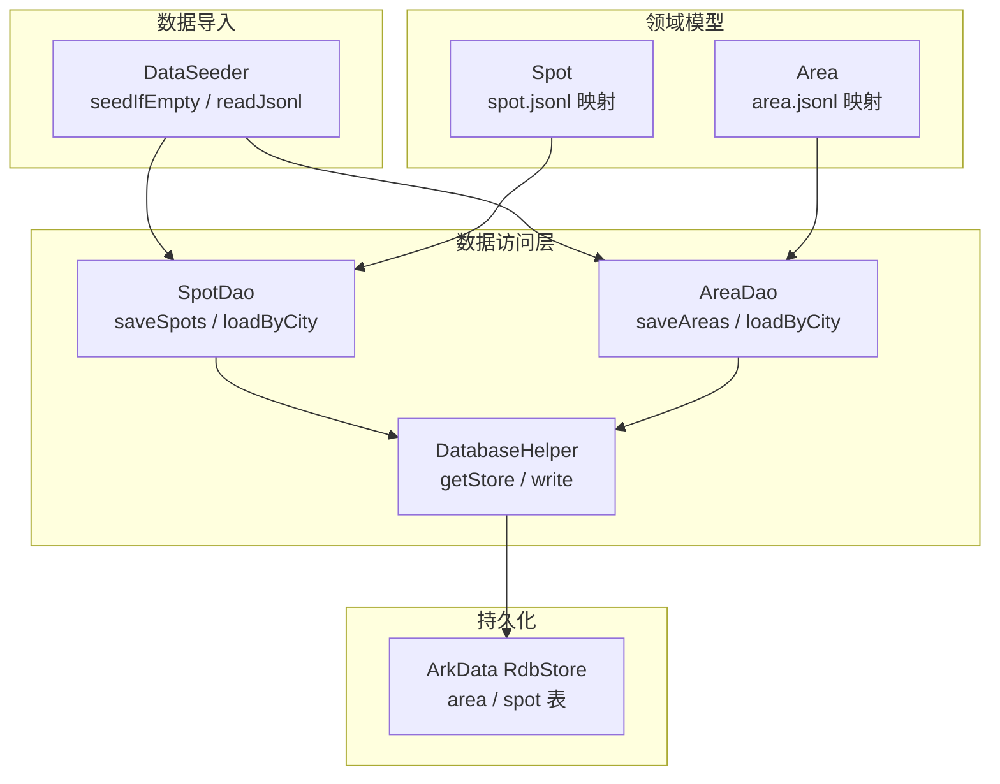
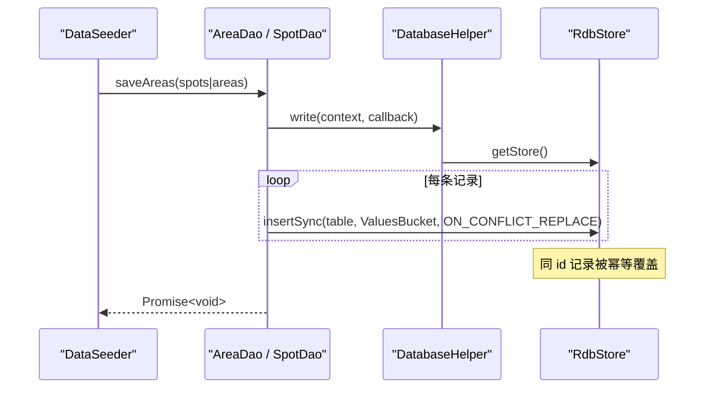
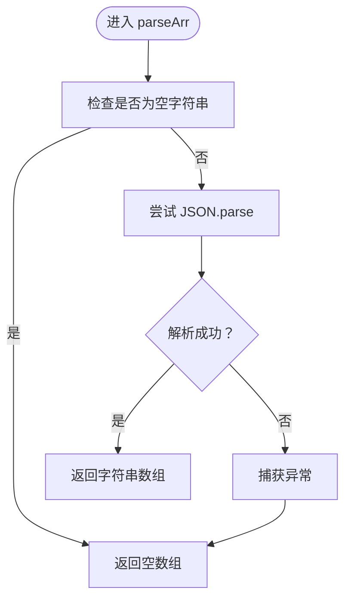
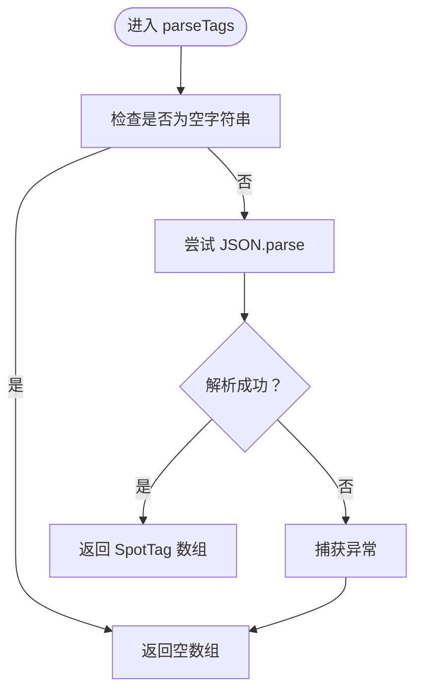
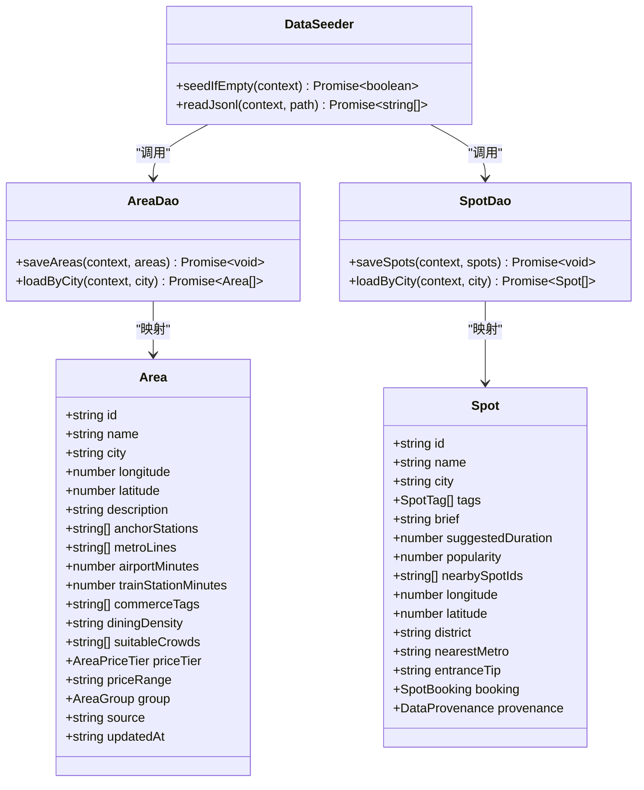
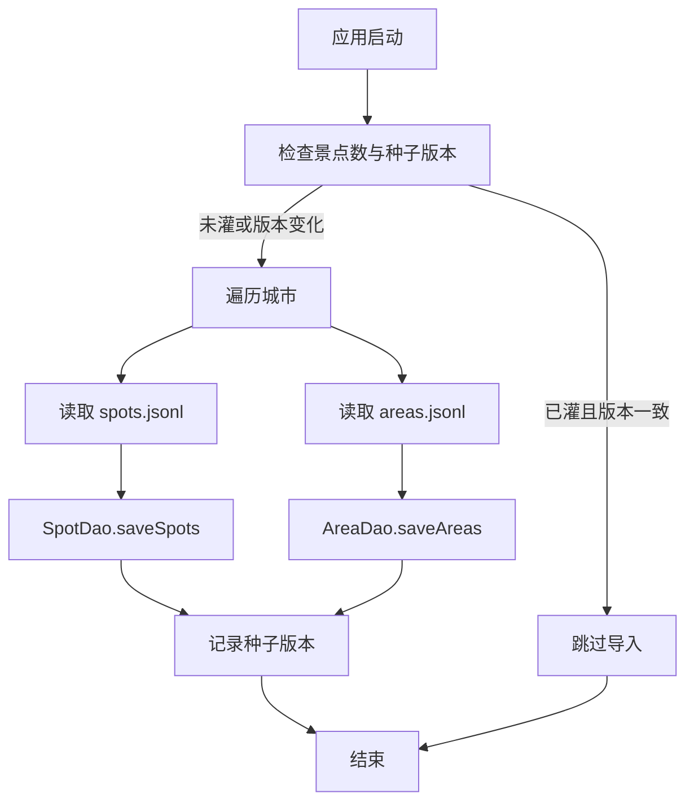

# AreaDao 与 SpotDao 区域景点 DAO

<cite>
**本文引用的文件**   
- [AreaDao.ets](file://entry/src/main/ets/data/AreaDao.ets)
- [SpotDao.ets](file://entry/src/main/ets/data/SpotDao.ets)
- [Area.ets](file://entry/src/main/ets/model/Area.ets)
- [Spot.ets](file://entry/src/main/ets/model/Spot.ets)
- [DataSeeder.ets](file://entry/src/main/ets/data/DataSeeder.ets)
</cite>

## 目录
1. [引言](#引言)
2. [项目结构](#项目结构)
3. [核心组件](#核心组件)
4. [架构总览](#架构总览)
5. [详细组件分析](#详细组件分析)
6. [依赖关系分析](#依赖关系分析)
7. [性能考虑](#性能考虑)
8. [故障排查指南](#故障排查指南)
9. [结论](#结论)
10. [附录：API 对比与使用示例](#附录api-对比与使用示例)

## 引言
本文件聚焦内置住宿区域库和景点库的本地数据访问层，详细说明 `AreaDao` 与 `SpotDao` 的数据模型、批量 upsert 写入模式、JSON 字段序列化与容错解析、按城市读取排序策略，以及从种子数据全量灌入的使用流程。目标读者包括需要维护或扩展这两个 DAO 的后端/客户端工程师，也包括希望理解“如何安全地把种子数据灌进 ArkTS 本地数据库”的非核心开发者。

## 项目结构
AreaDao 与 SpotDao 位于应用入口模块的 `data` 包中，分别对应 `model/Area.ets` 与 `model/Spot.ets` 两个领域模型；数据导入由 `DataSeeder` 统一调度，通过 `DatabaseHelper` 获取 ArkTS ArkData 的关系型存储实例。

图表来源
- [AreaDao.ets:1-75](file://entry/src/main/ets/data/AreaDao.ets#L1-L75)
- [SpotDao.ets:1-100](file://entry/src/main/ets/data/SpotDao.ets#L1-L100)
- [DataSeeder.ets:1-200](file://entry/src/main/ets/data/DataSeeder.ets#L1-L200)

章节来源
- [AreaDao.ets:1-75](file://entry/src/main/ets/data/AreaDao.ets#L1-L75)
- [SpotDao.ets:1-100](file://entry/src/main/ets/data/SpotDao.ets#L1-L100)
- [Area.ets:1-51](file://entry/src/main/ets/model/Area.ets#L1-L51)
- [Spot.ets:1-69](file://entry/src/main/ets/model/Spot.ets#L1-L69)
- [DataSeeder.ets:1-200](file://entry/src/main/ets/data/DataSeeder.ets#L1-L200)

## 核心组件
- **AreaDao**：负责住宿区域的批量幂等写入与按城市稳定排序读取。数组字段以 JSON 字符串落库，读取时通过 `parseArr` 容错反序列化为字符串数组。
- **SpotDao**：负责景点的批量幂等写入与按热度降序读取。除数组字段外，还承载嵌套对象 `booking` 与 `provenance` 的多列扁平映射。
- **DataSeeder**：从 `rawfile/seed/*.jsonl` 读取每城 spots 与 areas 行，调用 `SpotDao.saveSpots` 与 `AreaDao.saveAreas` 完成全量灌入，并用偏好设置记录种子版本实现增量回填。

章节来源
- [AreaDao.ets:1-75](file://entry/src/main/ets/data/AreaDao.ets#L1-L75)
- [SpotDao.ets:1-100](file://entry/src/main/ets/data/SpotDao.ets#L1-L100)
- [DataSeeder.ets:1-200](file://entry/src/main/ets/data/DataSeeder.ets#L1-L200)

## 架构总览
AreaDao 与 SpotDao 共享同一套 DAO 抽象：
1. 外部调用方传入领域对象数组。
2. DAO 遍历数组，将对象映射为 `ValuesBucket`。
3. 对 JSON 数组字段执行 `JSON.stringify`。
4. 对可空字段使用三元表达式转为 `null` 或保留值。
5. 调用 `store.insertSync` 并传入 `ON_CONFLICT_REPLACE`，实现基于主键的幂等覆盖。
6. 查询侧用 SQL 显式排序后逐行反序列化为领域对象。

图表来源
- [AreaDao.ets:24-40](file://entry/src/main/ets/data/AreaDao.ets#L24-L40)
- [SpotDao.ets:23-46](file://entry/src/main/ets/data/SpotDao.ets#L23-L46)
- [DataSeeder.ets:100-160](file://entry/src/main/ets/data/DataSeeder.ets#L100-L160)

## 详细组件分析

### AreaDao：住宿区域数据访问
#### 职责边界
- 批量保存：接收 `Area[]`，逐条转换为数据库行。
- 按城市加载：返回 `Area[]`，保证相同城市下切片结果可复现。

#### 批量 upsert 与 ValuesBucket 映射
写入时使用 `ON_CONFLICT_REPLACE`，因此只要 `id` 一致，重复导入会直接覆盖原记录。这是种子数据全量灌入的关键保障。

| 领域字段 | 数据库列名 | 类型 | 映射规则 |
|---|---|---|---|
| `id` | `id` | 文本 | 直接复制 |
| `name` | `name` | 文本 | 直接复制 |
| `city` | `city` | 文本 | 直接复制 |
| `longitude` | `longitude` | 数值 | 直接复制 |
| `latitude` | `latitude` | 数值 | 直接复制 |
| `description` | `description` | 文本 | 直接复制 |
| `anchorStations` | `anchor_stations` | 文本(JSON) | `JSON.stringify(a.anchorStations)` |
| `metroLines` | `metro_lines` | 文本(JSON) | `JSON.stringify(a.metroLines)` |
| `airportMinutes` | `airport_minutes` | 长整型 | 直接复制 |
| `trainStationMinutes` | `train_station_minutes` | 长整型 | 直接复制 |
| `commerceTags` | `commerce_tags` | 文本(JSON) | `JSON.stringify(a.commerceTags)` |
| `diningDensity` | `dining_density` | 文本 | 直接复制 |
| `suitableCrowds` | `suitable_crowds` | 文本(JSON) | `JSON.stringify(a.suitableCrowds)` |
| `priceTier` | `price_tier` | 文本 | 枚举值直存 |
| `priceRange` | `price_range` | 文本(可空) | 未定义时存 `null` |
| `group` | `grp` | 文本 | 直接复制 |
| `source` | `source` | 文本 | 直接复制 |
| `updatedAt` | `updated_at` | 文本 | 直接复制 |

#### 读取排序策略
`loadByCity` 使用 `ORDER BY grp, id`，先按浏览分组再按编号排序。这样即使 SQLite 底层行顺序不确定，同一城市的候选区列表也能稳定切出前 N 项，避免 UI 展示抖动。

#### JSON 数组解析容错
内部工具函数 `parseArr` 的行为如下：
- 输入为空字符串时返回空数组。
- 成功 `JSON.parse` 且结果为字符串数组时返回该数组。
- 捕获异常时降级返回空数组。

这保证了脏数据不会导致页面崩溃。

图表来源
- [AreaDao.ets:11-19](file://entry/src/main/ets/data/AreaDao.ets#L11-L19)

#### API 摘要
- `saveAreas(context, areas)`：批量 upsert 住宿区域。
- `loadByCity(context, city)`：按城市加载并稳定排序。

章节来源
- [AreaDao.ets:1-75](file://entry/src/main/ets/data/AreaDao.ets#L1-L75)
- [Area.ets:1-51](file://entry/src/main/ets/model/Area.ets#L1-L51)

### SpotDao：景点数据访问
#### 职责边界
- 批量保存：接收 `Spot[]`，把复杂嵌套对象展开为多列。
- 按城市加载：按 `popularity DESC` 返回热门优先的景点列表。

#### 批量 upsert 与 ValuesBucket 映射
写入同样使用 `ON_CONFLICT_REPLACE`，因此对已有 `id` 的景点记录进行覆盖更新。

| 领域字段 | 数据库列名 | 类型 | 映射规则 |
|---|---|---|---|
| `id` | `id` | 文本 | 直接复制 |
| `name` | `name` | 文本 | 直接复制 |
| `city` | `city` | 文本 | 直接复制 |
| `tags` | `tags` | 文本(JSON) | `JSON.stringify(s.tags)` |
| `brief` | `brief` | 文本 | 直接复制 |
| `suggestedDuration` | `suggested_duration` | 长整型 | 直接复制 |
| `popularity` | `popularity` | 长整型 | 直接复制 |
| `nearbySpotIds` | `nearby_ids` | 文本(JSON) | `JSON.stringify(s.nearbySpotIds)` |
| `longitude` | `longitude` | 数值 | 直接复制 |
| `latitude` | `latitude` | 数值 | 直接复制 |
| `district` | `district` | 文本 | 直接复制 |
| `nearestMetro` | `nearest_metro` | 文本 | 直接复制 |
| `entranceTip` | `entrance_tip` | 文本(可空) | 未定义时存 `null` |
| `requiresBooking` | `requires_booking` | 长整型 | 布尔转 `1` 或 `0` |
| `bookingMethod` | `booking_method` | 文本(可空) | 未定义时存 `null` |
| `advanceDays` | `advance_days` | 长整型(可空) | 未定义时存 `null` |
| `releaseTime` | `release_time` | 文本(可空) | 未定义时存 `null` |
| `closedDay` | `closed_day` | 文本(可空) | 未定义时存 `null` |
| `difficulty` | `difficulty` | 文本(可空) | 未定义时存 `null` |
| `source` | `source` | 文本 | 来自 `provenance.source` |
| `updatedAt` | `updated_at` | 文本 | 来自 `provenance.updatedAt` |
| `confidence` | `confidence` | 文本 | 未定义时存空字符串 |

#### 嵌套对象 `booking` 的读回逻辑
读取时把多列重新组合成 `SpotBooking`：
- `requiresBooking`：当列值为 `1` 时为真。
- `bookingMethod`、`releaseTime`、`closedDay`、`difficulty`：空字符串还原为 `undefined`。
- `advanceDays`：使用 `isColumnNull` 判断数据库 `NULL`，否则取长整型值。

#### 溯源对象 `provenance` 的读回逻辑
- `source` 与 `updatedAt` 总是读取。
- `confidence` 空字符串还原为 `undefined`，使上层可按是否存在该字段区分“未标注可信度”和“明确低可信度”。

#### 周边景点 ID 解析容错
`nearbySpotIds` 单独在读取路径中 try-catch：
- 正常 JSON 数组则使用。
- 非法 JSON 降级为空数组。

#### 读取排序策略
`loadByCity` 使用 `ORDER BY popularity DESC`，让热门景点优先出现在列表前端。这与 `Area.loadByCity` 的稳定排序形成互补：区域强调可复现切片，景点强调热度展示。

图表来源
- [SpotDao.ets:11-19](file://entry/src/main/ets/data/SpotDao.ets#L11-L19)

#### API 摘要
- `saveSpots(context, spots)`：批量 upsert 景点。
- `loadByCity(context, city)`：按城市加载并按热度降序。

章节来源
- [SpotDao.ets:1-100](file://entry/src/main/ets/data/SpotDao.ets#L1-L100)
- [Spot.ets:1-69](file://entry/src/main/ets/model/Spot.ets#L1-L69)

## 依赖关系分析

图表来源
- [AreaDao.ets:1-75](file://entry/src/main/ets/data/AreaDao.ets#L1-L75)
- [SpotDao.ets:1-100](file://entry/src/main/ets/data/SpotDao.ets#L1-L100)
- [Area.ets:1-51](file://entry/src/main/ets/model/Area.ets#L1-L51)
- [Spot.ets:1-69](file://entry/src/main/ets/model/Spot.ets#L1-L69)
- [DataSeeder.ets:1-200](file://entry/src/main/ets/data/DataSeeder.ets#L1-L200)

章节来源
- [AreaDao.ets:1-75](file://entry/src/main/ets/data/AreaDao.ets#L1-L75)
- [SpotDao.ets:1-100](file://entry/src/main/ets/data/SpotDao.ets#L1-L100)
- [DataSeeder.ets:1-200](file://entry/src/main/ets/data/DataSeeder.ets#L1-L200)

## 性能考虑
- **批量 upsert 成本**：当前实现为逐行 `insertSync`，简单可靠但缺少单条事务包裹。对于大规模 seed 数据，建议后续评估是否改用批处理接口或显式事务以减少磁盘同步次数。
- **JSON 序列化开销**：每个数组字段都调用 `JSON.stringify`，属于 CPU 密集型操作。若 seed 数据量增长到万级，可在导入阶段预序列化，或在 `DataSeeder` 中缓存常用标签的 JSON 片段。
- **查询排序成本**：`AREA` 表按 `grp, id` 排序，`SPOT` 表按 `popularity DESC` 排序。建议在 `city`、`grp`、`id`、`popularity` 上建立合适索引，尤其当城市维度扩大时。
- **内存占用**：`loadByCity` 构建完整数组后再返回，适合列表一次性渲染；若未来需要分页或流式渲染，应改为游标式消费。
- **容错代价**：JSON 解析失败降级为空集合，避免了崩溃，但也可能掩盖脏数据问题。建议在日志中记录失败次数和样本，便于监控种子数据质量。

[本节为通用性能建议，不直接分析具体代码行]

## 故障排查指南
- **导入后数据未出现**
  - 检查 `DataSeeder.seedIfEmpty` 是否判定“已有景点且种子版本一致”，从而跳过导入。
  - 确认 `SEED_VERSION` 是否升级；版本变化会强制再次 upsert。
- **区域或景点数组字段为空**
  - 检查 seed 文件中对应字段是否为合法 JSON 数组。
  - 查看 `parseArr` 与 `parseTags` 的异常降级行为：非法 JSON 会被清空。
- **预约信息缺失**
  - `SpotDao` 会把 `undefined` 写为 `null` 或空字符串；读取时再还原为 `undefined`。如果 UI 显示“无”，可能是上游种子数据确实未提供。
- **排序不符合预期**
  - 区域排序依赖 `grp, id`；景点排序依赖 `popularity DESC`。检查模型字段是否正确填充。
- **坐标异常**
  - 种子数据说明指出地理编码失败时会退回默认坐标或不落点；结合 `provenance.source` 与日志定位。

章节来源
- [DataSeeder.ets:1-200](file://entry/src/main/ets/data/DataSeeder.ets#L1-L200)
- [AreaDao.ets:11-19](file://entry/src/main/ets/data/AreaDao.ets#L11-L19)
- [SpotDao.ets:11-19](file://entry/src/main/ets/data/SpotDao.ets#L11-L19)

## 结论
`AreaDao` 与 `SpotDao` 采用一致的 DAO 设计：以 `ON_CONFLICT_REPLACE` 实现幂等批量写入，以 JSON 列承载数组与嵌套元数据，以 SQL 显式排序保证查询确定性。`AreaDao` 强调稳定分组与可复现实例切片，`SpotDao` 强调热门优先展示与预约规则的精细建模。配合 `DataSeeder`，这套方案非常适合“从 seed 文件全量灌入、按城市按需读取”的端侧内置资产场景。

[本节为总结性内容，不直接分析具体代码行]

## 附录：API 对比与使用示例

### API 对比表
| 能力 | AreaDao | SpotDao |
|---|---|---|
| 批量写入 | `saveAreas(context, areas)` | `saveSpots(context, spots)` |
| 冲突策略 | `ON_CONFLICT_REPLACE` | `ON_CONFLICT_REPLACE` |
| 主要 JSON 字段 | `anchorStations`、`metroLines`、`commerceTags`、`suitableCrowds` | `tags`、`nearbySpotIds` |
| 嵌套对象 | 无 | `booking`、`provenance` |
| 查询方法 | `loadByCity(context, city)` | `loadByCity(context, city)` |
| 排序方式 | `ORDER BY grp, id` | `ORDER BY popularity DESC` |
| 典型用途 | 住宿区域列表、商圈分组、“查看更多区域” | 景点推荐列表、热门优先、筛选与提示构造 |

### 数据导入流程
1. 启动时调用 `DataSeeder.seedIfEmpty(context)`。
2. Seeder 读取当前景点数量与已记录种子版本。
3. 若未灌入或版本不一致，遍历所有城市定义。
4. 按城市读取 `spots_file` 与 `areas_file` 中的 JSONL 行。
5. 将行解析为 `Spot[]` 与 `Area[]`。
6. 调用 `SpotDao.saveSpots` 与 `AreaDao.saveAreas` 执行幂等 upsert。
7. 写入新种子版本，供下次启动判断。

图表来源
- [DataSeeder.ets:100-160](file://entry/src/main/ets/data/DataSeeder.ets#L100-L160)

### 使用示例（描述性）
- **首次安装灌入**
  - 在应用初始化阶段调用 `DataSeeder.seedIfEmpty(context)`。
  - 若返回 `true`，表示本次执行了导入；返回 `false` 表示已有数据且版本匹配，无需重复灌入。
- **刷新内置区域库**
  - 业务侧可通过后台配置触发种子版本升级，促使下一次启动执行全量 upsert。
- **查询某城市住宿区域**
  - 调用 `AreaDao.loadByCity(context, '北京')`，得到按分组与编号排序的区域列表。
  - UI 可根据 `group` 做分组标题，根据 `anchorStations`、`metroLines`、`commerceTags` 渲染标签。
- **查询某城市景点**
  - 调用 `SpotDao.loadByCity(context, '上海')`，得到热门优先的景点列表。
  - UI 使用 `tags`、`brief`、`suggestedDuration`、`popularity` 渲染卡片；需要预约时读取 `booking.requiresBooking` 及 `bookingMethod`、`releaseTime` 等字段。

### 查询优化建议
- 为 `area.city`、`area.grp`、`area.id` 建立复合索引，加速按城市分组切片。
- 为 `spot.city`、`spot.popularity` 建立索引，加速热门景点加载。
- 若未来引入分页，应增加 `LIMIT`/`OFFSET` 或基于游标的分页，避免一次拉取整个城市数据。
- 对高频展示的标签与分组值，可在应用层做轻量缓存，减少重复解析压力。

[本节为概念性与建议性内容，不直接分析具体代码行]