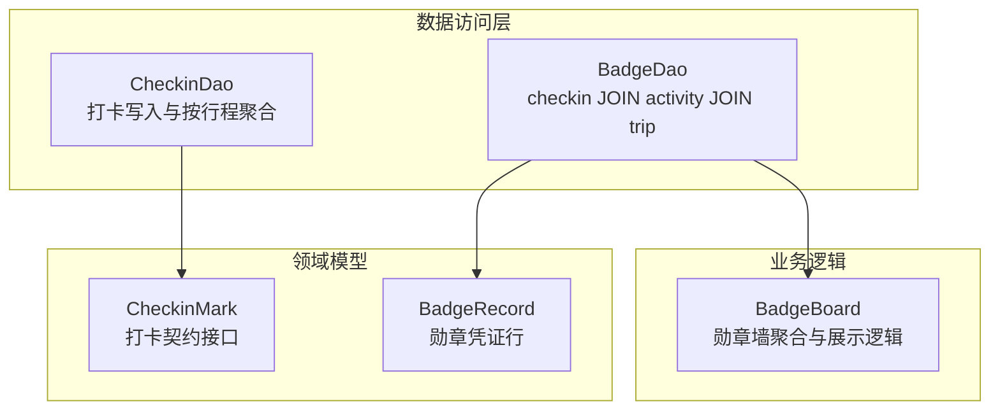
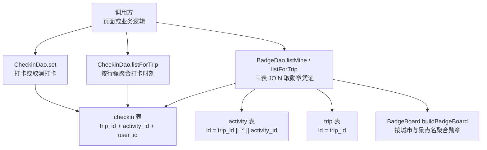
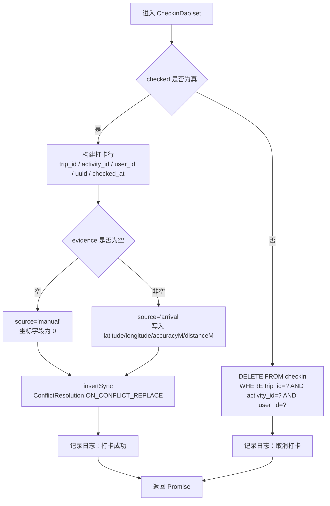
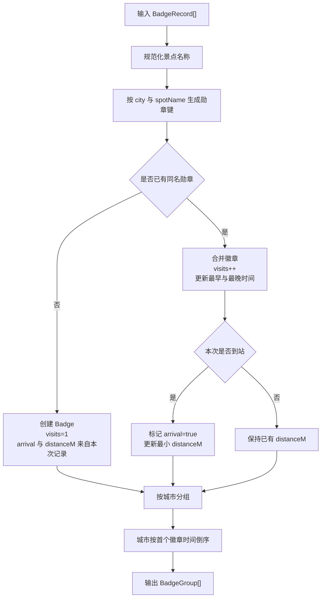
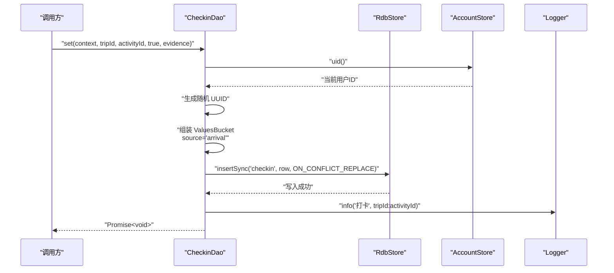
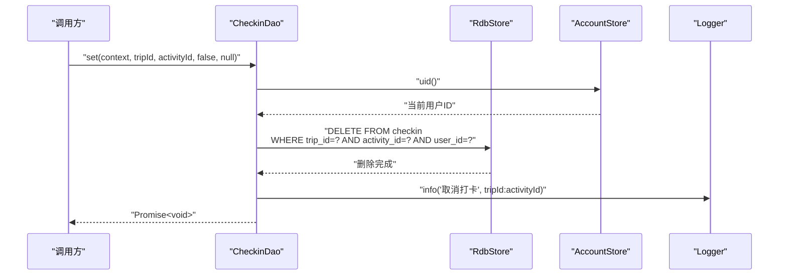
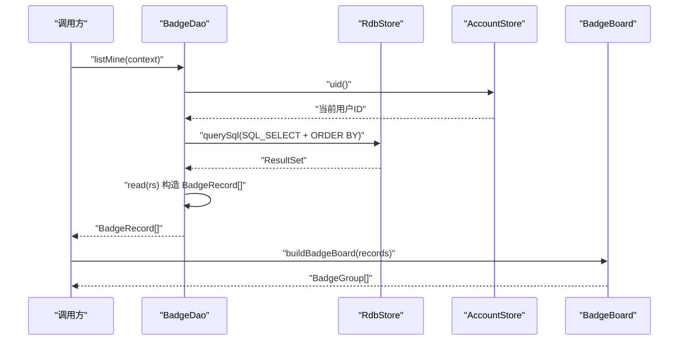
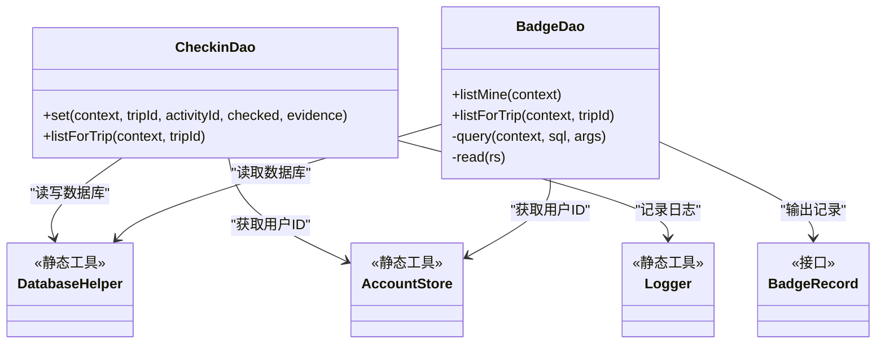

# CheckinDao 与 BadgeDao 打卡徽章 DAO

<cite>
**本文引用的文件**   
- [CheckinDao.ets](file://entry/src/main/ets/data/CheckinDao.ets)
- [BadgeDao.ets](file://entry/src/main/ets/data/BadgeDao.ets)
- [Checkin.ets](file://entry/src/main/ets/model/Checkin.ets)
- [BadgeBoard.ets](file://entry/src/main/ets/utils/BadgeBoard.ets)
</cite>

## 目录

1. [引言](#引言)
2. [项目结构定位](#项目结构定位)
3. [核心组件总览](#核心组件总览)
4. [架构概览](#架构概览)
5. [详细组件分析](#详细组件分析)
6. [依赖关系分析](#依赖关系分析)
7. [性能与一致性考虑](#性能与一致性考虑)
8. [故障排查指南](#故障排查指南)
9. [结论](#结论)

## 引言

本文面向节点打卡与勋章凭证的数据访问层，聚焦两个 ArkTS DAO：

- **CheckinDao**：负责 checkin 表的写入口 `set`，以及按行程聚合打卡时刻的读接口。
- **BadgeDao**：只读查询层，通过 checkin 联 activity、trip 三表关联，产出供 BadgeBoard 聚合的 `BadgeRecord`。

重点说明：

- `CheckinDao.set` 的双向语义：checked=true 生成随机 UUID 并记录位置凭证；checked=false 按 trip_id+activity_id+user_id 精确删除。
- `ON_CONFLICT_REPLACE` 冲突策略下，同一节点的重复打卡会更新 checked_at 时间戳，而非重复插入。
- BadgeDao 的 JOIN 主键匹配规则：activity.id = trip_id || ':' || activity_id，用于前缀化主键匹配。
- listMine 与 listForTrip 的区别：前者查全部行程证据，后者限定单行程用于行后回顾。
- BadgeRecord 派生逻辑：id=tripId:activityId，spotName/title 来自活动标题，arrival 标志判断 source='arrival'。

## 项目结构定位

CheckinDao 与 BadgeDao 位于 entry 模块的 `data` 目录中，是应用本地数据库访问层的组成部分。它们不直接参与 UI，而是被页面或业务逻辑调用，以读写打卡记录和生成勋章数据。



**图表来源**
- [CheckinDao.ets:1-70](file://entry/src/main/ets/data/CheckinDao.ets#L1-L70)
- [BadgeDao.ets:1-70](file://entry/src/main/ets/data/BadgeDao.ets#L1-L70)
- [Checkin.ets:1-14](file://entry/src/main/ets/model/Checkin.ets#L1-L14)
- [BadgeBoard.ets:1-172](file://entry/src/main/ets/utils/BadgeBoard.ets#L1-L172)

**章节来源**
- [CheckinDao.ets:1-10](file://entry/src/main/ets/data/CheckinDao.ets#L1-L10)
- [BadgeDao.ets:1-15](file://entry/src/main/ets/data/BadgeDao.ets#L1-L15)

## 核心组件总览

### CheckinDao

CheckinDao 是节点打卡的主 DAO，承担以下职责：

| 能力 | 说明 |
|---|---|
| `set(context, tripId, activityId, checked, evidence)` | 打卡或取消打卡；checked=true 时插入或覆盖，checked=false 时按三键删除 |
| `listForTrip(context, tripId)` | 返回某行程内 activityId → checkedAt 的映射，供行程页快速判断哪些节点已打卡 |
| 位置凭证 | 到站打卡携带 latitude、longitude、accuracyM、distanceM，source='arrival'；手动打卡 source='manual'，坐标字段为 0 |
| 安全隔离 | user_id 取自 AccountStore.uid()，同机多账号互不可见 |
| 冲突策略 | 使用 ON_CONFLICT_REPLACE，保证同一 (trip_id, activity_id) 唯一，重复打卡更新 checked_at |

**章节来源**
- [CheckinDao.ets:1-20](file://entry/src/main/ets/data/CheckinDao.ets#L1-L20)
- [CheckinDao.ets:21-48](file://entry/src/main/ets/data/CheckinDao.ets#L21-L48)
- [CheckinDao.ets:49-70](file://entry/src/main/ets/data/CheckinDao.ets#L49-L70)

### BadgeDao

BadgeDao 是只读 DAO，不修改任何表。它从 checkin 出发，联 activity 和 trip，输出 BadgeRecord。

| 能力 | 说明 |
|---|---|
| `listMine(context)` | 返回当前账号全部可作为勋章凭证的打卡记录 |
| `listForTrip(context, tripId)` | 仅返回指定 tripId 下的打卡凭证，用于行后回顾 |
| 三表 JOIN | checkin JOIN activity ON a.id = c.trip_id || ':' || c.activity_id；再 JOIN trip ON t.id = c.trip_id |
| 餐次过滤 | 餐次没有 activity 行，JOIN 自然落选，不会进入勋章集合 |
| 分区隔离 | WHERE c.user_id = ? AND t.user_id = ?，确保用户维度隔离 |
| 派生记录 | 由 read(rs) 构造 BadgeRecord，包含 id、spotName、arrival、distanceM 等 |

**章节来源**
- [BadgeDao.ets:1-25](file://entry/src/main/ets/data/BadgeDao.ets#L1-L25)
- [BadgeDao.ets:26-70](file://entry/src/main/ets/data/BadgeDao.ets#L26-L70)

### CheckinMark 与 BadgeRecord

CheckinMark 是打卡契约接口，强调打卡对象由 tripId、activityId、checkedAt 组成，刻意不与 Trip/Activity 契约耦合。BadgeRecord 则是 BadgeDao 输出的中间凭证，供 BadgeBoard 合并成最终勋章。

| 类型 | 关键字段 | 用途 |
|---|---|---|
| CheckinMark | tripId、activityId、checkedAt | 描述一次打卡事件 |
| BadgeRecord | id、tripId、spotName、city、earnedAt、arrival、distanceM | 作为勋章墙聚合输入 |
| Badge | spotName、city、earnedAt、lastAt、visits、arrival、firstCheckinId、firstTripId、distanceM | 聚合后的勋章实体 |

**章节来源**
- [Checkin.ets:1-14](file://entry/src/main/ets/model/Checkin.ets#L1-L14)
- [BadgeBoard.ets:1-60](file://entry/src/main/ets/utils/BadgeBoard.ets#L1-L60)

## 架构概览

CheckinDao 与 BadgeDao 围绕 checkin 表形成“写单点、读扩展”的结构：写操作集中在 set，读操作分为行程聚合与勋章凭证两类。



**图表来源**
- [CheckinDao.ets:21-70](file://entry/src/main/ets/data/CheckinDao.ets#L21-L70)
- [BadgeDao.ets:26-70](file://entry/src/main/ets/data/BadgeDao.ets#L26-L70)
- [BadgeBoard.ets:61-172](file://entry/src/main/ets/utils/BadgeBoard.ets#L61-L172)

## 详细组件分析

### CheckinDao.set 双向操作与冲突策略

#### 双向语义

CheckinDao.set 接收四个参数：context、tripId、activityId、checked、evidence。

当 checked=true 时：

1. 读取当前用户 ID：AccountStore.uid()。
2. 生成随机 UUID：util.generateRandomUUID()。
3. 组装 ValuesBucket，写入 trip_id、activity_id、checked_at、user_id、uuid、坐标字段与 source。
4. 如果 evidence 为 null，则 latitude、longitude、accuracy_m、distance_m 为 0，source='manual'。
5. 如果 evidence 存在，则 source='arrival'，并按传入经纬度、精度半径、距离填写凭证。
6. 调用 insertSync 并传入 ConflictResolution.ON_CONFLICT_REPLACE。

当 checked=false 时：

1. 不写入新行。
2. 执行 DELETE FROM checkin WHERE trip_id = ? AND activity_id = ? AND user_id = ?。
3. 三个条件必须同时满足，避免 A 账号误删 B 账号的打卡。

#### 冲突策略 ON_CONFLICT_REPLACE

同一 (trip_id, activity_id) 被视为同一节点打卡。重复打卡时，数据库不是插入第二行，而是替换已有行。由于 checked_at 在每次打卡时都会重新赋值为 Date.now()，所以重复打卡的效果是“更新时间戳”，而不是产生多条打卡记录。



**图表来源**
- [CheckinDao.ets:21-48](file://entry/src/main/ets/data/CheckinDao.ets#L21-L48)

**章节来源**
- [CheckinDao.ets:13-20](file://entry/src/main/ets/data/CheckinDao.ets#L13-L20)
- [CheckinDao.ets:21-48](file://entry/src/main/ets/data/CheckinDao.ets#L21-L48)

### CheckinDao.listForTrip

listForTrip 返回 Record<string, number>，即 activityId 到 checkedAt 的映射。其 SQL 只查询 trip_id 与 user_id 对应的 checkin 行，因此适合在行程页渲染时快速判断每个节点是否已打卡。

需要注意：

- 该方法只返回打卡时刻，不包含 location、uuid、source 等凭证信息。
- 若需要勋章凭证，应改用 BadgeDao.listForTrip。
- 游标遍历结束后必须在 finally 中关闭 ResultSet，防止资源泄漏。

**章节来源**
- [CheckinDao.ets:49-70](file://entry/src/main/ets/data/CheckinDao.ets#L49-L70)

### BadgeDao 只读查询与三表 JOIN

BadgeDao 内部维护一个 SQL_SELECT 常量，定义了三表 JOIN 的基础查询：

```text
SELECT c.activity_id, c.checked_at, c.source, c.distance_m, c.trip_id,
       a.title, t.destination, t.start_date, t.end_date
FROM checkin c
JOIN activity a ON a.id = c.trip_id || ':' || c.activity_id
JOIN trip t ON t.id = c.trip_id
WHERE c.user_id = ? AND t.user_id = ?
```

关键设计点：

| 设计点 | 含义 |
|---|---|
| a.id = c.trip_id \|\| ':' \|\| c.activity_id | activity 主键采用前缀化格式，例如 tripId:activityId；这样可直接拼接匹配 |
| t.id = c.trip_id | trip 表通过 trip_id 关联 |
| WHERE c.user_id = ? AND t.user_id = ? | 同时校验 checkin 与 trip 的用户归属，避免跨用户泄露 |
| ORDER BY c.checked_at DESC | 最近打卡优先，便于勋章墙展示 |
| 餐次行为 | 餐次没有 activity 行，JOIN 失败，该笔打卡不会出现在 BadgeRecord 中 |

listMine 与 listForTrip 的区别如下：

| 方法 | 过滤条件 | 典型用途 |
|---|---|---|
| listMine | 无 tripId 过滤 | 全量勋章墙、历史成就汇总 |
| listForTrip | AND c.trip_id = ? | 行后回顾、单行程证据列表 |

**章节来源**
- [BadgeDao.ets:16-45](file://entry/src/main/ets/data/BadgeDao.ets#L16-L45)

### BadgeRecord 派生逻辑

BadgeDao.read 将 ResultSet 一行转换为 BadgeRecord。其派生规则如下：

| BadgeRecord 字段 | 数据来源 | 派生规则 |
|---|---|---|
| id | trip_id + activity_id | 字符串拼接 `${tripId}:${activityId}` |
| tripId | c.trip_id | 直接取值 |
| spotName | a.title | 活动标题 |
| city | t.destination | 目的地城市 |
| tripStartDate | t.start_date | 行程开始日期 |
| tripEndDate | t.end_date | 行程结束日期 |
| earnedAt | c.checked_at | 打卡毫秒时间戳 |
| arrival | c.source | source === 'arrival' 时为 true |
| distanceM | c.distance_m | 到站距离；手动打卡通常为 0 |

这个 id 与 activity 表主键保持一致的前缀化约定，使得 BadgeBoard 能够把勋章与活动语义对齐。

**章节来源**
- [BadgeDao.ets:46-70](file://entry/src/main/ets/data/BadgeDao.ets#L46-L70)

### BadgeBoard 聚合逻辑

BadgeBoard 接收 BadgeRecord 数组，输出 BadgeGroup 数组。聚合目标是将“同城同名”的多次打卡合并为一枚勋章。

主要派生逻辑：

1. 对 spotName 做规范化处理，去除首尾空白与多余空格。
2. 使用 `city + 分隔符 + spotName` 作为勋章 key。
3. 首次出现时创建 Badge，visited=1，arrival 与 distanceM 按本次打卡计算。
4. 重复出现时 visits 自增，earnedAt 取更早时间，lastAt 取更晚时间。
5. 任一次 arrival 为 true，则 Badge.arrival 为 true；distanceM 取所有到站打卡中的最小值。
6. 最后按城市分组，并在城市内部按 earnedAt 倒序排列。



**图表来源**
- [BadgeBoard.ets:61-172](file://entry/src/main/ets/utils/BadgeBoard.ets#L61-L172)

**章节来源**
- [BadgeBoard.ets:1-60](file://entry/src/main/ets/utils/BadgeBoard.ets#L1-L60)
- [BadgeBoard.ets:61-172](file://entry/src/main/ets/utils/BadgeBoard.ets#L61-L172)

### 打卡流程时序图

下面展示一次到站打卡的完整时序，包括位置凭证生成、DAO 写入、日志记录与冲突处理。



**图表来源**
- [CheckinDao.ets:21-48](file://entry/src/main/ets/data/CheckinDao.ets#L21-L48)

### 取消打卡时序图

取消打卡走 DELETE 路径，并以 trip_id、activity_id、user_id 三键精确删除。



**图表来源**
- [CheckinDao.ets:35-48](file://entry/src/main/ets/data/CheckinDao.ets#L35-L48)

### 勋章凭证查询时序图

BadgeDao.listMine 与 listForTrip 都复用 private query 方法，区别在于是否追加 tripId 过滤。



**图表来源**
- [BadgeDao.ets:26-70](file://entry/src/main/ets/data/BadgeDao.ets#L26-L70)
- [BadgeBoard.ets:61-172](file://entry/src/main/ets/utils/BadgeBoard.ets#L61-L172)

## 依赖关系分析

CheckinDao 与 BadgeDao 的依赖关系如下：



**图表来源**
- [CheckinDao.ets:11-70](file://entry/src/main/ets/data/CheckinDao.ets#L11-L70)
- [BadgeDao.ets:16-70](file://entry/src/main/ets/data/BadgeDao.ets#L16-L70)

**章节来源**
- [CheckinDao.ets:11-70](file://entry/src/main/ets/data/CheckinDao.ets#L11-L70)
- [BadgeDao.ets:16-70](file://entry/src/main/ets/data/BadgeDao.ets#L16-L70)

## 性能与一致性考虑

### 写路径性能

CheckinDao.set 是单写入口，write 通道由 DatabaseHelper.write 管理。建议：

- 前台到站打卡应避免高频重复触发；到达判定逻辑应在上游控制去抖。
- 手动打卡传 null evidence，可避免不必要的坐标解析。
- 重复打卡虽然由 ON_CONFLICT_REPLACE 保证幂等，但仍会产生数据库写入成本，不应当成计数机制使用。

### 读路径性能

- CheckinDao.listForTrip 只返回 activityId 与 checkedAt，适合轻量级行程页判断。
- BadgeDao.listMine 返回完整凭证列，适合勋章墙；如果只需要某个行程，应优先用 listForTrip，减少网络与内存传输。
- BadgeDao 的 JOIN 依赖 activity 与 trip 表数据完整性；若 activity 缺失，该打卡不会成为勋章，这是预期行为。

### 一致性保障

| 场景 | 当前实现 | 风险与建议 |
|---|---|---|
| 同机多账号切换 | user_id 写入并参与 DELETE/WHERE | 必须确保 AccountStore.uid() 稳定；否则可能误删其他账号记录 |
| 重复打卡 | ON_CONFLICT_REPLACE | 检查 trip_id+activity_id 是否真正构成业务唯一键 |
| 到站 vs 手动 | source='arrival'/'manual' | 不要靠 distanceM 是否为 0 反推来源，应以 source 为准 |
| 餐次打卡 | 无 activity 行 | JOIN 自然丢弃；若未来需要餐次勋章，需调整主键或建独立表 |
| 时间戳更新 | checked_at=Date.now() | 设备时间异常会影响勋章顺序；后续如需强一致，可引入服务端时间 |

[本节为通用性能与一致性讨论，未直接分析具体代码片段]

## 故障排查指南

### 现象：同一节点出现多条打卡记录

**可能原因：**

- trip_id 或 activity_id 不一致，导致 ON_CONFLICT_REPLACE 无法命中同一冲突键。
- 上层调用传入的 activityId 在不同场景下不一致。

**排查步骤：**

1. 检查调用方传入的 tripId 与 activityId 是否稳定。
2. 确认 checkin 表上 trip_id+activity_id 的唯一约束是否存在。
3. 查看日志中打卡记录的 tripId:activityId 是否相同。

**章节来源**
- [CheckinDao.ets:1-10](file://entry/src/main/ets/data/CheckinDao.ets#L1-L10)
- [CheckinDao.ets:21-48](file://entry/src/main/ets/data/CheckinDao.ets#L21-L48)

### 现象：取消打卡无效

**可能原因：**

- 传入的 user_id 与实际记录不一致。
- trip_id 或 activity_id 拼写错误。
- 使用了错误的上下文或账户。

**排查步骤：**

1. 确认 AccountStore.uid() 是否返回期望用户。
2. 打印 DELETE 语句中的 tripId、activityId、userId。
3. 直接查询 checkin 表，确认是否存在完全匹配的三键组合。

**章节来源**
- [CheckinDao.ets:35-48](file://entry/src/main/ets/data/CheckinDao.ets#L35-L48)

### 现象：勋章列表为空

**可能原因：**

- checkin 记录存在，但对应 activity 缺失。
- trip 记录缺失或 user_id 不一致。
- 打卡为餐次，没有 activity 行，JOIN 自然排除。

**排查步骤：**

1. 先确认 BadgeDao.listMine 是否能查到 checkin 行。
2. 检查 activity.id 是否等于 trip_id||':'||activity_id。
3. 检查 trip.user_id 是否与 checkin.user_id 一致。
4. 确认该打卡是否属于餐次。

**章节来源**
- [BadgeDao.ets:16-45](file://entry/src/main/ets/data/BadgeDao.ets#L16-L45)

### 现象：勋章 arrival 标志不符合预期

**可能原因：**

- 调用 set 时未传 evidence，source 变成 'manual'。
- 上游定位服务未判定到站。
- 误把 distanceM==0 当作 manual，而忽略 source 字段。

**排查步骤：**

1. 检查 CheckinEvidence 是否传入。
2. 检查 source 字段是否为 'arrival'。
3. 检查 distanceM 是否大于 0。
4. 在 BadgeBoard 中确认 arrival 推导逻辑。

**章节来源**
- [CheckinDao.ets:21-48](file://entry/src/main/ets/data/CheckinDao.ets#L21-L48)
- [BadgeDao.ets:46-70](file://entry/src/main/ets/data/BadgeDao.ets#L46-L70)
- [BadgeBoard.ets:61-172](file://entry/src/main/ets/utils/BadgeBoard.ets#L61-L172)

## 结论

CheckinDao 与 BadgeDao 构成了旅行打卡与勋章凭证的核心数据访问层：

- CheckinDao.set 是唯一的写入口，兼顾到站凭证与手动打卡，并通过 ON_CONFLICT_REPLACE 保证同节点幂等。
- checked=false 的删除路径使用 trip_id+activity_id+user_id 三键，确保同机多账号安全隔离。
- BadgeDao 是只读查询层，通过前缀化主键 JOIN 规则，将 checkin 转化为可展示的 BadgeRecord。
- listMine 与 listForTrip 分别服务于全局勋章墙与单行程行后回顾。
- BadgeBoard 负责把原始打卡凭证合并为按城市分组的勋章墙，arrival 标志决定勋章是否属于“到站章”。

整体设计简洁明确：写侧收敛、读侧分层、凭证与展示分离。未来若引入服务器同步或防伪需求，可在现有 checkin 凭证基础上扩展，而不必推翻当前 DAO 结构。