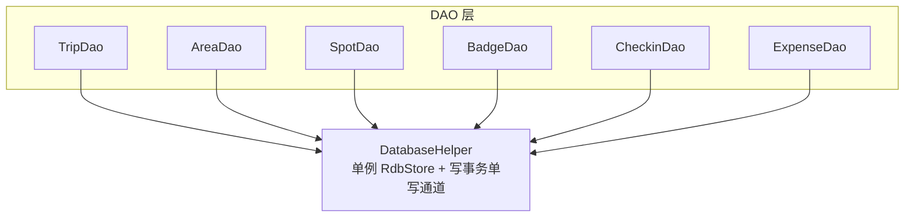
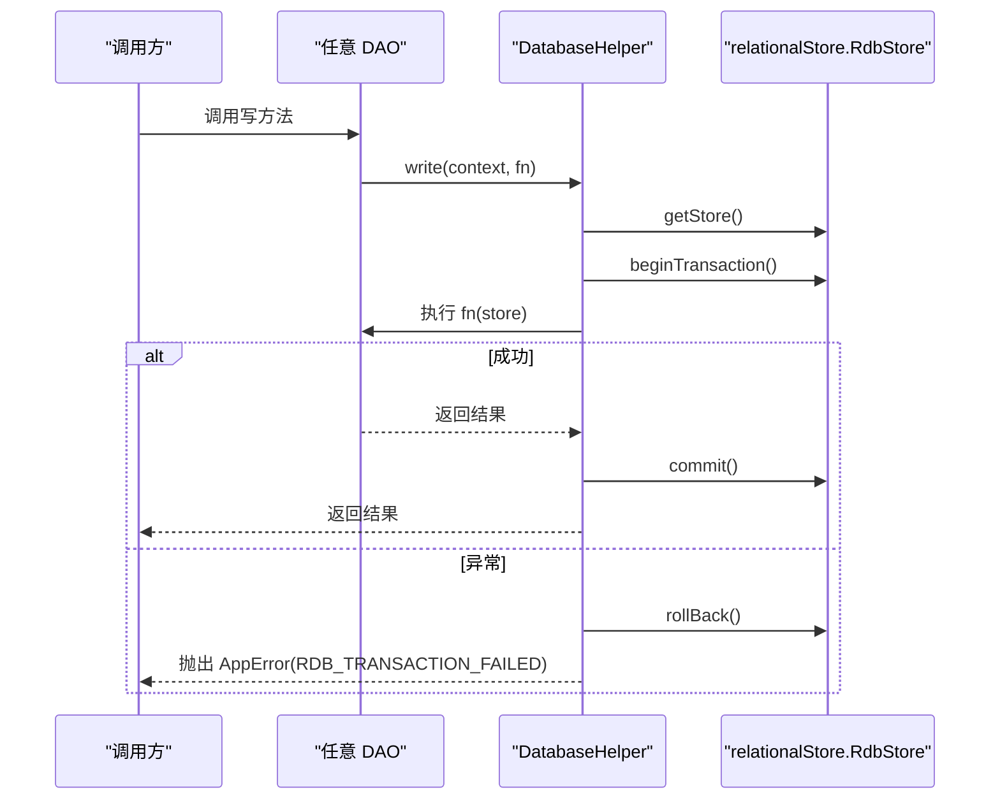
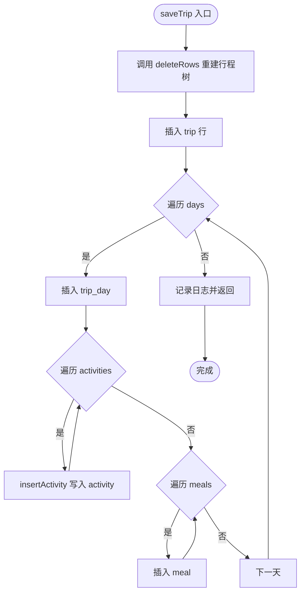
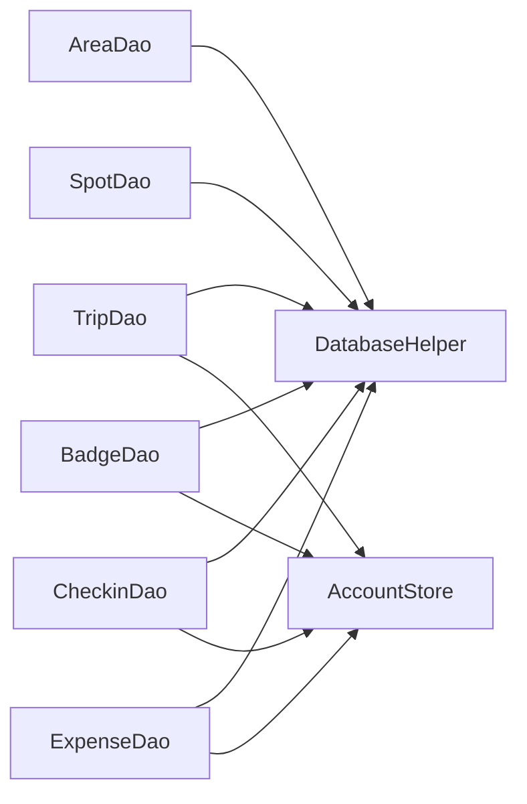

# DAO 数据访问层

<cite>
**本文引用的文件**   
- [entry/src/main/ets/data/TripDao.ets](file://entry/src/main/ets/data/TripDao.ets)
- [entry/src/main/ets/data/AreaDao.ets](file://entry/src/main/ets/data/AreaDao.ets)
- [entry/src/main/ets/data/SpotDao.ets](file://entry/src/main/ets/data/SpotDao.ets)
- [entry/src/main/ets/data/BadgeDao.ets](file://entry/src/main/ets/data/BadgeDao.ets)
- [entry/src/main/ets/data/CheckinDao.ets](file://entry/src/main/ets/data/CheckinDao.ets)
- [entry/src/main/ets/data/ExpenseDao.ets](file://entry/src/main/ets/data/ExpenseDao.ets)
- [entry/src/main/ets/data/DatabaseHelper.ets](file://entry/src/main/ets/data/DatabaseHelper.ets)
</cite>

## 目录
1. [引言](#引言)
2. [项目结构](#项目结构)
3. [核心组件](#核心组件)
4. [架构总览](#架构总览)
5. [详细组件分析](#详细组件分析)
6. [依赖关系分析](#依赖关系分析)
7. [性能与优化](#性能与优化)
8. [故障排查](#故障排查)
9. [API 参考](#api-参考)
10. [结论](#结论)

## 引言
本文聚焦有径应用的数据访问抽象层，围绕 ArkTS + ArkData 的关系型数据库使用方式，系统说明各 DAO 的职责、统一事务封装、ValuesBucket 到领域对象的映射模式，以及批量写入、复杂查询聚合、级联删除等关键实现。重点解析 TripDao 的整存整取流程，并解释 AreaDao、SpotDao、BadgeDao、CheckinDao、ExpenseDao 在整体数据流中的分工。

## 项目结构
DAO 层位于 `entry/src/main/ets/data`，按“业务域 + 职责”划分：
- TripDao：行程聚合根 CRUD、列表摘要、今日卡片、游客数据归户、分类预算更新。
- AreaDao：内置住宿区域库批量 upsert 与按城市读取。
- SpotDao：内置景点库批量 upsert 与按城市读取。
- BadgeDao：从打卡关联活动与行程，派生勋章凭证记录。
- CheckinDao：节点打卡写入与取消，以及按行程读取打卡集合。
- ExpenseDao：费用记账增删、按行程列表、按分类聚合、按活动聚合。
- DatabaseHelper：RdbStore 单例、版本化建库迁移、写事务单写通道。

**图示来源**
- [entry/src/main/ets/data/TripDao.ets:1-40](file://entry/src/main/ets/data/TripDao.ets#L1-L40)
- [entry/src/main/ets/data/AreaDao.ets:1-20](file://entry/src/main/ets/data/AreaDao.ets#L1-L20)
- [entry/src/main/ets/data/SpotDao.ets:1-20](file://entry/src/main/ets/data/SpotDao.ets#L1-L20)
- [entry/src/main/ets/data/BadgeDao.ets:1-25](file://entry/src/main/ets/data/BadgeDao.ets#L1-L25)
- [entry/src/main/ets/data/CheckinDao.ets:1-25](file://entry/src/main/ets/data/CheckinDao.ets#L1-L25)
- [entry/src/main/ets/data/ExpenseDao.ets:1-20](file://entry/src/main/ets/data/ExpenseDao.ets#L1-L20)
- [entry/src/main/ets/data/DatabaseHelper.ets:157-200](file://entry/src/main/ets/data/DatabaseHelper.ets#L157-L200)

**章节来源**
- [entry/src/main/ets/data/TripDao.ets:1-40](file://entry/src/main/ets/data/TripDao.ets#L1-L40)
- [entry/src/main/ets/data/DatabaseHelper.ets:157-200](file://entry/src/main/ets/data/DatabaseHelper.ets#L157-L200)

## 核心组件
- TripDao：聚合根整存整写；activity 主键采用 `${tripId}:${activityId}` 前缀避免跨行程 id 冲突；列表摘要通过 SQL 子查询聚合 spotCount、bookingCount、legCount、checkinCount；提供 todayPlan 预筛+按需加载策略；支持游客数据归户到正式账号。
- AreaDao / SpotDao：面向内置资产库的批量 upsert（ON_CONFLICT_REPLACE），并按 city 索引顺序读取；JSON 数组字段在入库时序列化、出库时反序列化为数组或对象。
- BadgeDao：无独立表，直接 join checkin/activity/trip 获取可作为勋章凭证的打卡记录，按 trip/user_id 分区过滤。
- CheckinDao：打卡写入走单写通道；重复打卡使用 ON_CONFLICT REPLACE 更新 checked_at；取消打卡按 (trip_id, activity_id, user_id) 精准删除；按行程返回 activityId→checkedAt 映射。
- ExpenseDao：新增返回自增 id；删除需校验 user_id；提供最近列表、分类聚合、按活动聚合；totalOfTrip 汇总分类合计。
- DatabaseHelper：全局唯一 RdbStore；write(fn) 将 fn 串行排队，并在内部执行 beginTransaction/commit/rollBack；异常包装为 AppError(RDB_TRANSACTION_FAILED)。

**章节来源**
- [entry/src/main/ets/data/TripDao.ets:40-120](file://entry/src/main/ets/data/TripDao.ets#L40-L120)
- [entry/src/main/ets/data/AreaDao.ets:20-75](file://entry/src/main/ets/data/AreaDao.ets#L20-L75)
- [entry/src/main/ets/data/SpotDao.ets:20-100](file://entry/src/main/ets/data/SpotDao.ets#L20-L100)
- [entry/src/main/ets/data/BadgeDao.ets:25-70](file://entry/src/main/ets/data/BadgeDao.ets#L25-L70)
- [entry/src/main/ets/data/CheckinDao.ets:25-70](file://entry/src/main/ets/data/CheckinDao.ets#L25-L70)
- [entry/src/main/ets/data/ExpenseDao.ets:20-111](file://entry/src/main/ets/data/ExpenseDao.ets#L20-L111)
- [entry/src/main/ets/data/DatabaseHelper.ets:157-200](file://entry/src/main/ets/data/DatabaseHelper.ets#L157-L200)

## 架构总览
所有写操作必须经过 DatabaseHelper.write，从而形成“读自由、写串行”的架构约束；读操作可直接获取 store 后执行 querySql，由各自 DAO 负责 ResultSet 的逐列映射与资源释放。

**图示来源**
- [entry/src/main/ets/data/DatabaseHelper.ets:162-195](file://entry/src/main/ets/data/DatabaseHelper.ets#L162-L195)

## 详细组件分析

### TripDao：行程聚合根与复杂查询
TripDao 承担行程全生命周期管理，包括：
- saveTrip：先 deleteRows 重建整棵树，再依次插入 trip、trip_day、activity、meal；JSON 字段 highlights/tips/category_budget 序列化存储。
- listSummaries：一条 SQL 对 trip 做外层查询，并用多个子查询统计景点数、待预约数、通勤数、打卡数，最终映射为 TripSummary。
- loadTrip：分步加载 trip → trip_day → activity → meal，再按 dayIndex 合并回 Trip 树；readActivity 处理 transport、advanceDays、note/reason 的空值语义。
- todayPlan：先用 start_date/end_date 预筛命中行程，再逐个 loadTrip 并交给 TodayPlan.of 判断是否覆盖今天，避免对全部行程都整份加载。
- adoptGuestData：将游客 uid 下的 trip/expense/checkin 迁移到目标 uid，三张表同一事务内迁移，随后统计数量。
- saveCategoryBudgets：仅更新 trip.category_budget 与 updated_at，不重建整棵行程树。
- deleteTrip：委托 deleteRows(purgeChildren=true)，彻底清理打卡与费用。
- deleteRows：先校验 trip.user_id 归属；purgeChildren=true 时删除 checkin/expense，再删除 meal/activity/trip_day/trip。
- insertActivity：将 Activity 映射为 ValuesBucket，activity.id 以 tripId 前缀化。
- query：统一封装 store.querySql、ResultSet 遍历、finally 关闭。

**图示来源**
- [entry/src/main/ets/data/TripDao.ets:40-120](file://entry/src/main/ets/data/TripDao.ets#L40-L120)
- [entry/src/main/ets/data/TripDao.ets:300-345](file://entry/src/main/ets/data/TripDao.ets#L300-L345)

**章节来源**
- [entry/src/main/ets/data/TripDao.ets:40-120](file://entry/src/main/ets/data/TripDao.ets#L40-L120)
- [entry/src/main/ets/data/TripDao.ets:120-200](file://entry/src/main/ets/data/TripDao.ets#L120-L200)
- [entry/src/main/ets/data/TripDao.ets:201-384](file://entry/src/main/ets/data/TripDao.ets#L201-L384)

### AreaDao：住宿区域批量 upsert
- saveAreas：循环 insertSync，使用 ConflictResolution.ON_CONFLICT_REPLACE 实现幂等 upsert；JSON 字段 anchor_stations/metro_lines/commerce_tags/suitable_crowds 序列化。
- loadByCity：按 city 查询并按 grp,id 排序；解析 JSON 数组、空串转 undefined、价格区间等字段。

**章节来源**
- [entry/src/main/ets/data/AreaDao.ets:20-75](file://entry/src/main/ets/data/AreaDao.ets#L20-L75)

### SpotDao：景点批量 upsert 与详情读取
- saveSpots：批量 upsert；tags/nearby_ids 序列化；booking/provenance 展平为多列；requires_booking 用 0/1 整数存储。
- loadByCity：按 popularity DESC 读取；解析 tags、nearbySpotIds、booking、provenance，空值统一转为 undefined。

**章节来源**
- [entry/src/main/ets/data/SpotDao.ets:20-100](file://entry/src/main/ets/data/SpotDao.ets#L20-L100)

### BadgeDao：勋章凭证派生查询
- listMine：join checkin/activity/trip，按 user_id 过滤，返回可成为勋章证据的记录。
- listForTrip：额外按 trip_id 过滤，用于行后回顾场景。
- read：拼接复合 id tripId:activityId，并提取 source 是否为 arrival 作为到达标志。

**章节来源**
- [entry/src/main/ets/data/BadgeDao.ets:25-70](file://entry/src/main/ets/data/BadgeDao.ets#L25-L70)

### CheckinDao：打卡写入与去重
- set：checked=true 时 insertSync 并使用 ON_CONFLICT REPLACE 保证 (trip_id, activity_id) 唯一；checked=false 时按 trip_id/activity_id/user_id 删除。
- listForTrip：返回 activityId→checkedAt 映射，供页面展示打卡状态。

**章节来源**
- [entry/src/main/ets/data/CheckinDao.ets:25-70](file://entry/src/main/ets/data/CheckinDao.ets#L25-L70)

### ExpenseDao：费用记账与聚合
- add：写入 expense 行，返回自增 id。
- delete：按 id + user_id 删除，防止跨用户误删。
- listByTrip：按 created_at DESC 限制条数。
- sumByCategory：GROUP BY category 得到分类合计。
- sumGroupedByActivity：按 activity_id 聚合开销，供行内金额显示。
- totalOfTrip：汇总分类合计。

**章节来源**
- [entry/src/main/ets/data/ExpenseDao.ets:20-111](file://entry/src/main/ets/data/ExpenseDao.ets#L20-L111)

## 依赖关系分析
DAO 之间的耦合较低，主要通过以下公共点协作：
- DatabaseHelper：所有写事务的唯一入口，确保并发安全。
- AccountStore：提供当前登录 uid，用于分区过滤。
- 模型与工具类：如 CategoryBudget、TodayPlan、AppError、ErrorCode、Logger。

**图示来源**
- [entry/src/main/ets/data/TripDao.ets:1-40](file://entry/src/main/ets/data/TripDao.ets#L1-L40)
- [entry/src/main/ets/data/DatabaseHelper.ets:157-200](file://entry/src/main/ets/data/DatabaseHelper.ets#L157-L200)

**章节来源**
- [entry/src/main/ets/data/TripDao.ets:1-40](file://entry/src/main/ets/data/TripDao.ets#L1-L40)
- [entry/src/main/ets/data/DatabaseHelper.ets:157-200](file://entry/src/main/ets/data/DatabaseHelper.ets#L157-L200)

## 性能与优化
- 批量 upsert：AreaDao.saveAreas 与 SpotDao.saveSpots 使用 ON_CONFLICT_REPLACE 减少条件判断，提高批量导入效率。
- 查询聚合下推：listSummaries、sumByCategory、sumGroupedByActivity 均在 SQLite 侧聚合，避免在 JS/ETS 层循环累加。
- 今日卡片预筛：todayPlan 先用 start_date/end_date 筛选候选行程，再按需 loadTrip，将复杂度从 O(行程数×全量加载) 降为 O(命中数×全量加载)。
- 单写通道：DatabaseHelper.writeChain 将所有写任务串行排队，避免 RDB busy 与并发写竞争；失败不会阻塞后续写入。
- JSON 字段最小化：仅在必要时使用 JSON 文本列（highlights/tips/category_budget/tags/nearby_ids 等），其余字段尽量拆分为普通列并建立索引。
- 游标及时释放：所有 querySql 均在使用 ResultSet 的 finally 中 close，避免内存泄漏。
- 分区键过滤：trip/expense/checkin 等关键表均带 user_id，查询和删除时必须带上分区键，避免跨账号数据污染。

[本节为通用优化建议，不直接分析具体代码片段]

## 故障排查
常见异常与定位要点：
- 写事务失败：DatabaseHelper.write 捕获异常后包装为 AppError(RDB_TRANSACTION_FAILED)，检查调用链中 executeSync/insertSync 的 SQL 与参数是否正确。
- 数据未落盘：确认是否通过 DatabaseHelper.write 写入；自行 open store 后直接写不会进入事务单写通道。
- 打卡重复：CheckinDao.set 使用 ON_CONFLICT REPLACE，若期望保留旧时间则需在业务层判空后再写入。
- 删除孤儿数据：deleteRows(purgeChildren=true) 会清 checkin/expense；若仍出现孤儿，检查 v9 迁移是否已执行。
- 游客数据归户：adoptGuestData 需要同时迁移 trip/expense/checkin 三张表，否则会出现登录后部分数据不可见。
- JSON 解析异常：parseStringArray/parseArr/parseTags 等函数在解析失败时返回空数组，注意上层不要断言非空。

**章节来源**
- [entry/src/main/ets/data/DatabaseHelper.ets:162-195](file://entry/src/main/ets/data/DatabaseHelper.ets#L162-L195)
- [entry/src/main/ets/data/TripDao.ets:300-345](file://entry/src/main/ets/data/TripDao.ets#L300-L345)
- [entry/src/main/ets/data/CheckinDao.ets:25-70](file://entry/src/main/ets/data/CheckinDao.ets#L25-L70)
- [entry/src/main/ets/data/AreaDao.ets:20-75](file://entry/src/main/ets/data/AreaDao.ets#L20-L75)
- [entry/src/main/ets/data/SpotDao.ets:20-100](file://entry/src/main/ets/data/SpotDao.ets#L20-L100)

## API 参考

### TripDao
- saveTrip(context, trip)：整存整写行程树；先重建再插入 trip/day/activity/meal。
- listSummaries(context)：返回 TripSummary[]，包含目的地、日期、人数、总花费、景点数、待预约数、通勤数、打卡数。
- loadTrip(context, tripId)：返回 Trip 或 null。
- todayPlan(context)：返回 TodayPlanData 或 null。
- adoptGuestData(context, toUid)：将游客数据迁移至目标 uid，返回迁移后的 trip 计数。
- saveCategoryBudgets(context, tripId, list)：仅更新行程的分类预算 JSON。
- deleteTrip(context, tripId)：彻底删除行程及其子数据。

**章节来源**
- [entry/src/main/ets/data/TripDao.ets:40-120](file://entry/src/main/ets/data/TripDao.ets#L40-L120)
- [entry/src/main/ets/data/TripDao.ets:120-200](file://entry/src/main/ets/data/TripDao.ets#L120-L200)
- [entry/src/main/ets/data/TripDao.ets:201-384](file://entry/src/main/ets/data/TripDao.ets#L201-L384)

### AreaDao
- saveAreas(context, areas)：批量 upsert 区域。
- loadByCity(context, city)：按城市读取区域列表。

**章节来源**
- [entry/src/main/ets/data/AreaDao.ets:20-75](file://entry/src/main/ets/data/AreaDao.ets#L20-L75)

### SpotDao
- saveSpots(context, spots)：批量 upsert 景点。
- loadByCity(context, city)：按城市读取景点列表。

**章节来源**
- [entry/src/main/ets/data/SpotDao.ets:20-100](file://entry/src/main/ets/data/SpotDao.ets#L20-L100)

### BadgeDao
- listMine(context)：返回当前账号全部可作为勋章凭证的打卡。
- listForTrip(context, tripId)：返回指定行程的打卡凭证。

**章节来源**
- [entry/src/main/ets/data/BadgeDao.ets:25-70](file://entry/src/main/ets/data/BadgeDao.ets#L25-L70)

### CheckinDao
- set(context, tripId, activityId, checked, evidence)：打卡或取消打卡；evidence 为空表示手动打卡。
- listForTrip(context, tripId)：返回 activityId→checkedAt 映射。

**章节来源**
- [entry/src/main/ets/data/CheckinDao.ets:25-70](file://entry/src/main/ets/data/CheckinDao.ets#L25-L70)

### ExpenseDao
- add(context, expense)：新增费用，返回自增 id。
- delete(context, id)：删除指定费用（需匹配 user_id）。
- listByTrip(context, tripId, limit)：返回最近若干条费用。
- sumByCategory(context, tripId)：返回分类聚合。
- sumGroupedByActivity(context, tripId)：返回 activityId→amount 映射。
- totalOfTrip(context, tripId)：返回行程总花费。

**章节来源**
- [entry/src/main/ets/data/ExpenseDao.ets:20-111](file://entry/src/main/ets/data/ExpenseDao.ets#L20-L111)

### DatabaseHelper
- getStore(context)：获取全局唯一的 RdbStore。
- write(context, fn)：串行执行写事务；fn 内抛异常会自动回滚并包装为 AppError(RDB_TRANSACTION_FAILED)。

**章节来源**
- [entry/src/main/ets/data/DatabaseHelper.ets:157-200](file://entry/src/main/ets/data/DatabaseHelper.ets#L157-L200)

## 结论
该 DAO 层通过明确的职责拆分与统一的写事务通道，实现了高内聚、低耦合的数据访问抽象：TripDao 作为聚合根承担复杂写入与聚合查询，AreaDao/SpotDao 专注内置资产库批量导入，BadgeDao/CheckinDao/ExpenseDao 分别承担打卡、勋章凭证与费用记账。ValuesBucket 到领域对象的逐列映射、JSON 字段的健壮序列化、分区键过滤与游标释放，共同构成了稳定可靠的数据层基座。未来如需扩展新实体，应遵循现有模式：写走 DatabaseHelper.write、读走 querySql 并显式关闭 ResultSet、对频繁过滤列建立索引，并对批量写入优先采用 upsert 策略。