# ExpenseDao 费用记账 DAO

<cite>
**本文引用的文件**   
- [ExpenseDao.ets](file://entry/src/main/ets/data/ExpenseDao.ets)
- [Expense.ets](file://entry/src/main/ets/model/Expense.ets)
- [DatabaseHelper.ets](file://entry/src/main/ets/data/DatabaseHelper.ets)
- [AccountStore.ets](file://entry/src/main/ets/data/AccountStore.ets)
- [Logger.ets](file://entry/src/main/ets/common/logger/Logger.ets)
</cite>

## 目录
1. [引言](#引言)
2. [项目结构定位](#项目结构定位)
3. [核心组件总览](#核心组件总览)
4. [架构概览](#架构概览)
5. [详细方法分析](#详细方法分析)
6. [依赖关系分析](#依赖关系分析)
7. [性能与索引建议](#性能与索引建议)
8. [故障排查指南](#故障排查指南)
9. [结论](#结论)

## 引言
ExpenseDao 是费用记账模块的数据访问层，封装了对 expense 表的写通道、安全删除、分页查询、分类聚合以及按活动节点聚合等能力。它遵循以下设计原则：
- 写操作统一走 DatabaseHelper 的单写通道，避免并发写入竞争。
- 所有读/写均通过 user_id 分区，保证多账号数据隔离。
- 聚合类查询尽量在数据库层完成，减少页面端循环计算。
- 金额单位使用“元”取整的数值类型，与行程预算、活动门票口径保持一致。

## 项目结构定位
ExpenseDao 位于 entry 模块的 data 包下，属于领域数据访问层；Expense 模型定义在 model 包下，被 DAO 直接消费；账户信息从 AccountStore 读取；日志输出使用 Logger。

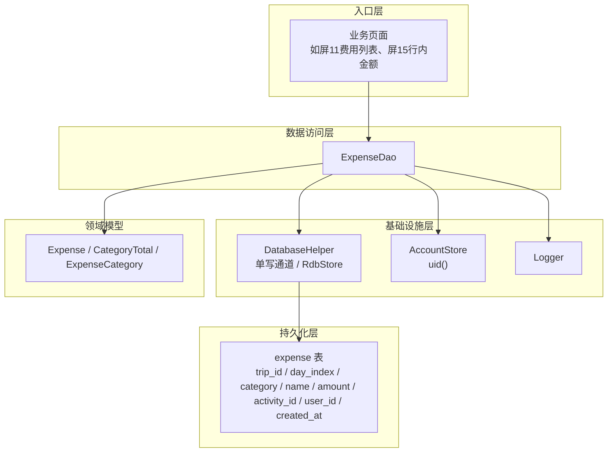

**图示来源**
- [ExpenseDao.ets:1-111](file://entry/src/main/ets/data/ExpenseDao.ets#L1-L111)
- [Expense.ets:1-45](file://entry/src/main/ets/model/Expense.ets#L1-L45)

**章节来源**
- [ExpenseDao.ets:1-15](file://entry/src/main/ets/data/ExpenseDao.ets#L1-L15)
- [Expense.ets:1-45](file://entry/src/main/ets/model/Expense.ets#L1-L45)

## 核心组件总览
ExpenseDao 提供以下静态方法：
- add：新增一笔费用，返回自增 id。
- delete：按 id 和 user_id 双条件删除，防止跨账号误删。
- listByTrip：按 trip_id + user_id 分页查询最近 N 条费用。
- sumByCategory：按 category 分组汇总，返回分类总额数组。
- sumGroupedByActivity：按 activity_id 分组汇总，返回节点到金额的映射。
- totalOfTrip：遍历分类总额累加并记录日志，返回行程合计。
- query：内部通用 SQL 查询封装，负责 ResultSet 迭代与关闭。

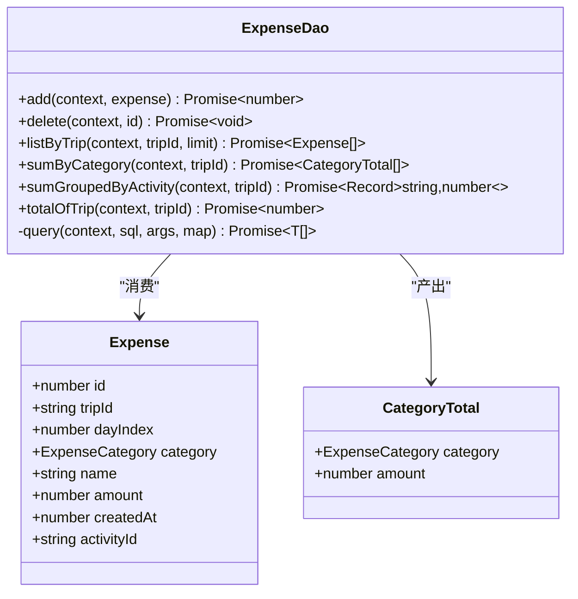

**图示来源**
- [ExpenseDao.ets:16-109](file://entry/src/main/ets/data/ExpenseDao.ets#L16-L109)
- [Expense.ets:10-45](file://entry/src/main/ets/model/Expense.ets#L10-L45)

**章节来源**
- [ExpenseDao.ets:16-109](file://entry/src/main/ets/data/ExpenseDao.ets#L16-L109)
- [Expense.ets:10-45](file://entry/src/main/ets/model/Expense.ets#L10-L45)

## 架构概览
ExpenseDao 不直接持有数据库连接，而是委托 DatabaseHelper 获取 RdbStore；所有写方法通过 write 包装进入事务上下文，读方法通过 querySql 执行原生 SQL。账户分区键 user_id 由 AccountStore.uid() 注入，确保同机切换账号后数据隔离。

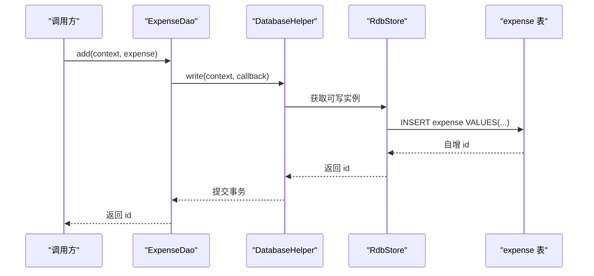

**图示来源**
- [ExpenseDao.ets:18-33](file://entry/src/main/ets/data/ExpenseDao.ets#L18-L33)

## 详细方法分析

### add：新增费用并返回自增 id
- 作用：将 Expense 领域对象持久化为 expense 表一行，并返回数据库自增 id。
- ValuesBucket 字段映射：
  - trip_id ← expense.tripId
  - day_index ← expense.dayIndex
  - category ← expense.category
  - name ← expense.name
  - amount ← expense.amount
  - created_at ← expense.createdAt
  - activity_id ← expense.activityId（undefined 时转为 null）
  - user_id ← AccountStore.uid()
- 事务封装：通过 DatabaseHelper.write 包裹 store.insert，保证写入原子性。
- 返回值：Promise<number>，上层可直接使用该 id 更新本地 Expense 对象或 UI。

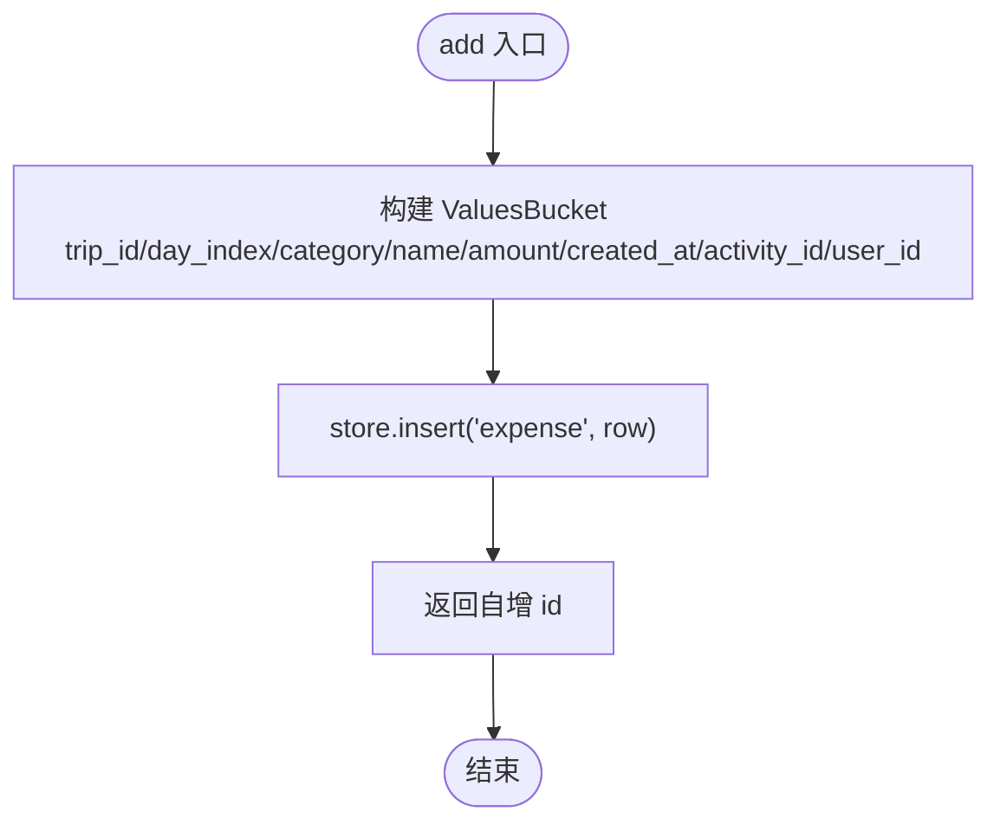

**图示来源**
- [ExpenseDao.ets:18-33](file://entry/src/main/ets/data/ExpenseDao.ets#L18-L33)
- [Expense.ets:10-28](file://entry/src/main/ets/model/Expense.ets#L10-L28)

**章节来源**
- [ExpenseDao.ets:18-33](file://entry/src/main/ets/data/ExpenseDao.ets#L18-L33)
- [Expense.ets:10-28](file://entry/src/main/ets/model/Expense.ets#L10-L28)

### delete：安全双条件删除
- 安全设计：WHERE id=? AND user_id=?。即使传入 id 属于其他账号，也不会删除成功，从而防止跨账号误删。
- 实现方式：executeSync 执行 DELETE，并通过 DatabaseHelper.write 保证事务一致性。
- 返回值：Promise<void>，上层无需处理 id，只关心是否删除成功。

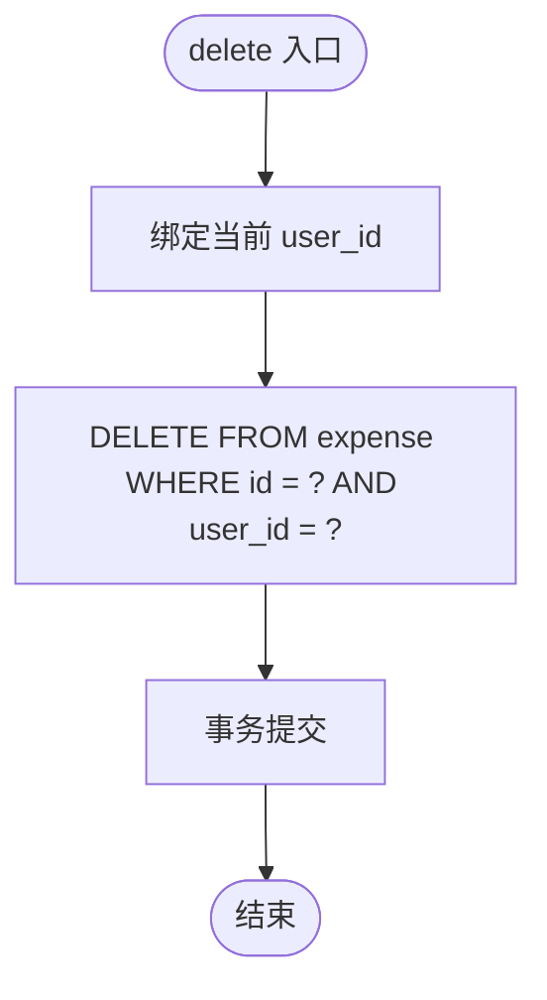

**图示来源**
- [ExpenseDao.ets:35-41](file://entry/src/main/ets/data/ExpenseDao.ets#L35-L41)

**章节来源**
- [ExpenseDao.ets:35-41](file://entry/src/main/ets/data/ExpenseDao.ets#L35-L41)

### listByTrip：按行程分页读取最近 N 条
- 用途：用于屏11的费用列表展示，按创建时间倒序取前 limit 条。
- SQL 关键：
  - 过滤条件：trip_id=? AND user_id=?
  - 排序：ORDER BY created_at DESC
  - 分页：LIMIT ?
- 结果映射：ResultSet 中逐列取值并构造 Expense 对象，包含 id、tripId、dayIndex、category、name、amount、createdAt。
- 注意：该方法未选择 activity_id，因此仅适合列表展示；若需行内金额显示应使用 sumGroupedByActivity。

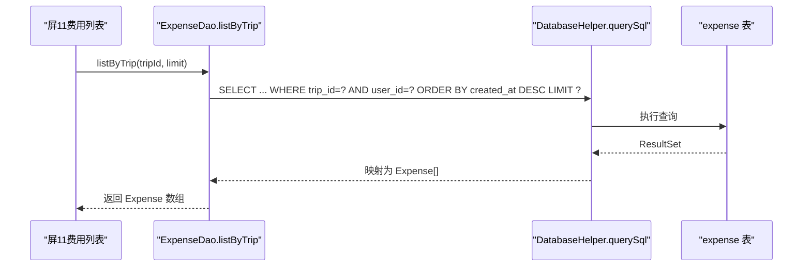

**图示来源**
- [ExpenseDao.ets:43-63](file://entry/src/main/ets/data/ExpenseDao.ets#L43-L63)
- [Expense.ets:10-28](file://entry/src/main/ets/model/Expense.ets#L10-L28)

**章节来源**
- [ExpenseDao.ets:43-63](file://entry/src/main/ets/data/ExpenseDao.ets#L43-L63)

### sumByCategory：分类聚合
- 目的：一次 SQL 返回全部消费档位（ticket、food、transport、hotel、shop、other），缺项不补零，由表现层按固定 6 档渲染。
- SQL 关键：
  - GROUP BY category
  - SUM(amount) AS total
  - 过滤：trip_id=? AND user_id=?
  - 排序：ORDER BY total DESC
- 返回值：Promise<CategoryTotal[]>，每个元素包含 category 与 amount。
- 优点：避免页面端多次查询或内存聚合，降低 UI 线程压力。

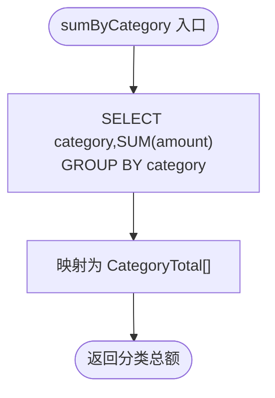

**图示来源**
- [ExpenseDao.ets:65-76](file://entry/src/main/ets/data/ExpenseDao.ets#L65-L76)
- [Expense.ets:30-45](file://entry/src/main/ets/model/Expense.ets#L30-L45)

**章节来源**
- [ExpenseDao.ets:65-76](file://entry/src/main/ets/data/ExpenseDao.ets#L65-L76)
- [Expense.ets:30-45](file://entry/src/main/ets/model/Expense.ets#L30-L45)

### sumGroupedByActivity：按活动节点聚合
- 目的：供屏15行内金额显示，把 activity_id 作为分组键，返回 Record<string, number>。
- SQL 关键：
  - GROUP BY activity_id
  - SUM(amount) AS total
  - 过滤：trip_id=? AND user_id=? AND activity_id IS NOT NULL
- 结果转换：先将每行映射为字符串数组 [activity_id, total]，再合并为键值对对象。
- 边界行为：没有费用的节点不会出现在结果中，调用方应在渲染时做缺省处理。

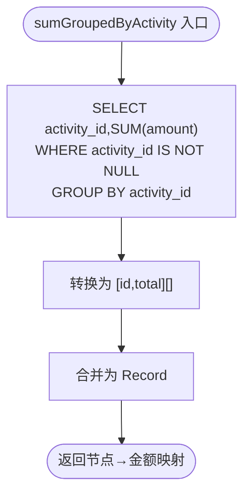

**图示来源**
- [ExpenseDao.ets:78-93](file://entry/src/main/ets/data/ExpenseDao.ets#L78-L93)

**章节来源**
- [ExpenseDao.ets:78-93](file://entry/src/main/ets/data/ExpenseDao.ets#L78-L93)

### totalOfTrip：行程合计汇总
- 逻辑：先调用 sumByCategory 获取分类总额数组，然后遍历累加 amount，得到行程总费用。
- 日志：使用 Logger.info 输出 tripId、总金额、分类数量，便于问题追踪。
- 返回值：Promise<number>，供预算对比、进度展示等场景使用。

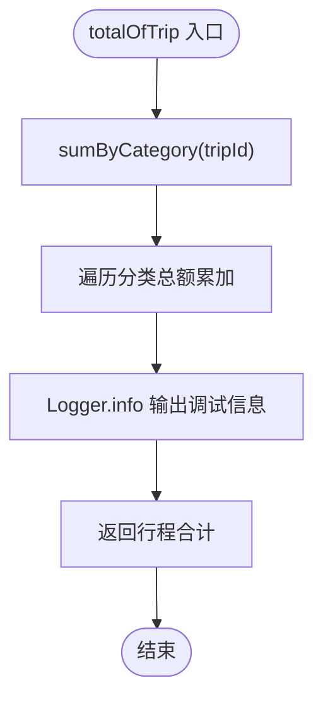

**图示来源**
- [ExpenseDao.ets:95-103](file://entry/src/main/ets/data/ExpenseDao.ets#L95-L103)
- [Logger.ets](file://entry/src/main/ets/common/logger/Logger.ets)

**章节来源**
- [ExpenseDao.ets:95-103](file://entry/src/main/ets/data/ExpenseDao.ets#L95-L103)

### query：通用查询封装
- 职责：获取 RdbStore、执行 SQL、逐行映射并收集结果，最终关闭 ResultSet。
- 资源管理：在 finally 中关闭 rs，避免连接泄漏。
- 扩展性：对外暴露泛型 T，便于不同查询结果复用同一迭代逻辑。

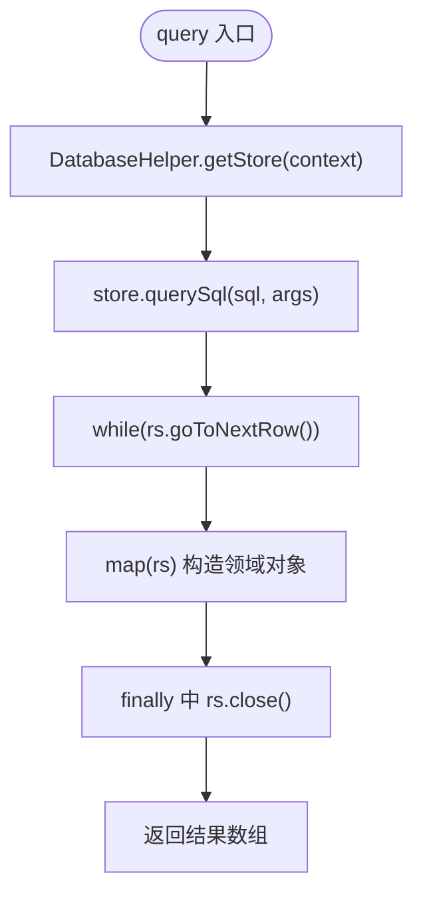

**图示来源**
- [ExpenseDao.ets:105-109](file://entry/src/main/ets/data/ExpenseDao.ets#L105-L109)

**章节来源**
- [ExpenseDao.ets:105-109](file://entry/src/main/ets/data/ExpenseDao.ets#L105-L109)

## 依赖关系分析
ExpenseDao 的依赖如下：
- DatabaseHelper：提供 getStore 与 write，统一管理 RdbStore 生命周期与事务。
- AccountStore：提供 uid()，作为 user_id 分区键。
- Logger：输出调试日志。
- Expense / CategoryTotal：领域模型与聚合结果类型。

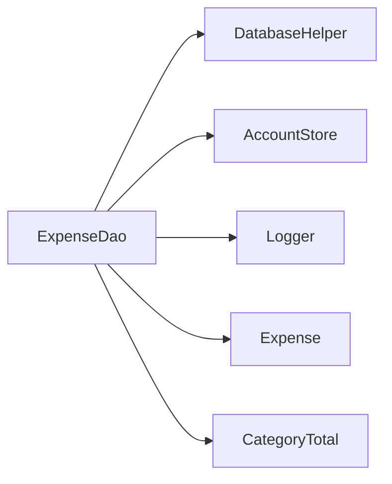

**图示来源**
- [ExpenseDao.ets:8-15](file://entry/src/main/ets/data/ExpenseDao.ets#L8-L15)

**章节来源**
- [ExpenseDao.ets:8-15](file://entry/src/main/ets/data/ExpenseDao.ets#L8-L15)

## 性能与索引建议
基于 ExpenseDao 的实际 SQL，推荐以下索引优化方向：
- trip_id + user_id + created_at：覆盖 listByTrip 的 WHERE 与 ORDER BY，显著减少排序开销。
- trip_id + user_id + category：覆盖 sumByCategory 的分组聚合，提升分类汇总速度。
- trip_id + user_id + activity_id：覆盖 sumGroupedByActivity 的分组过滤，提高节点维度聚合效率。
- user_id：作为全局分区键，有助于跨行程与跨活动的快速过滤。

注意事项：
- 不要过度索引，优先覆盖高频查询路径。
- created_at 建议使用毫秒级数值列，与 Expense.createdAt 语义一致。
- 若未来需要按 day_index 查询，可增加 trip_id + day_index 复合索引。

[本节为通用性能建议，不涉及具体代码片段]

## 故障排查指南
常见问题与排查要点：
- 新增后未返回 id：确认 DatabaseHelper.write 是否正确提交事务；检查 ValuesBucket 字段是否完整。
- 删除失败或误删：检查传入 id 是否属于当前 AccountStore.uid()；确认 delete 的 WHERE 条件是否仍包含 user_id。
- 列表为空：检查 trip_id 与 user_id 是否正确；确认 created_at 是否已写入；核对 limit 参数。
- 分类总额为 0：确认 sumByCategory 是否被正确调用；检查是否有数据满足 trip_id 与 user_id 过滤。
- 节点金额为空：确认 activity_id 是否为非空；检查 sumGroupedByActivity 的 activity_id IS NOT NULL 条件。
- 合计不一致：查看 Logger 输出的 tripId、总金额、分类数量；检查 sumByCategory 结果是否正确。

**章节来源**
- [ExpenseDao.ets:18-103](file://entry/src/main/ets/data/ExpenseDao.ets#L18-L103)

## 结论
ExpenseDao 以清晰的职责划分封装了费用记账的核心数据访问逻辑：写通道统一、用户分区明确、聚合计算下沉到数据库层。其 add 方法通过 ValuesBucket 精准映射 Expense 领域对象；delete 方法采用双条件删除保障数据安全；listByTrip 支持最近 N 条分页读取；sumByCategory 与 sumGroupedByActivity 分别承担分类与节点维度的聚合；totalOfTrip 配合 Logger 提供可观测性。结合合理的索引策略，可在多账号、多行程、多节点的复杂场景下保持良好性能与稳定性。