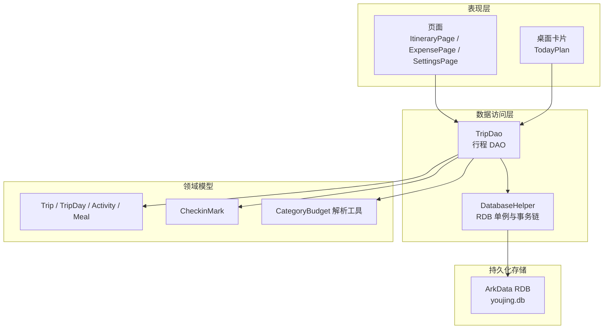
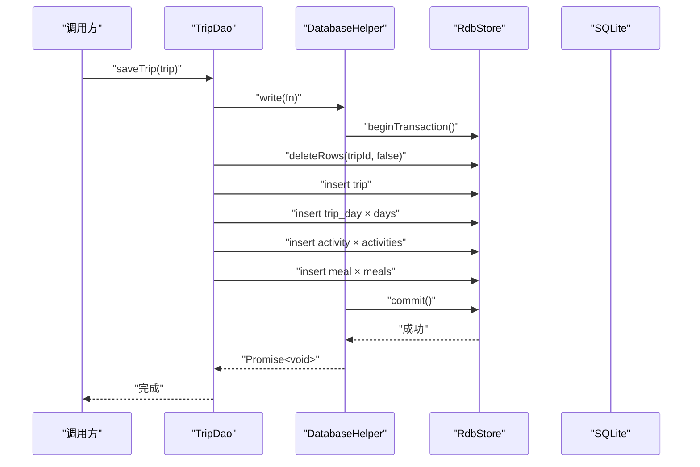
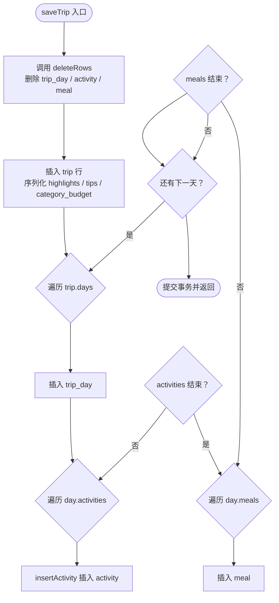
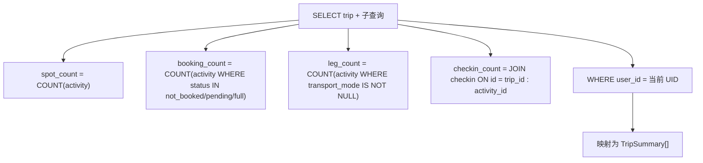
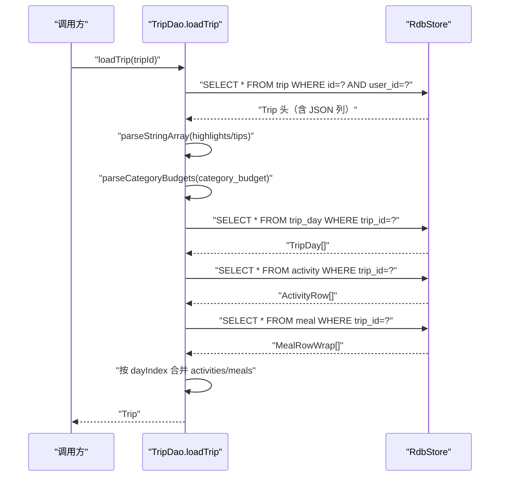
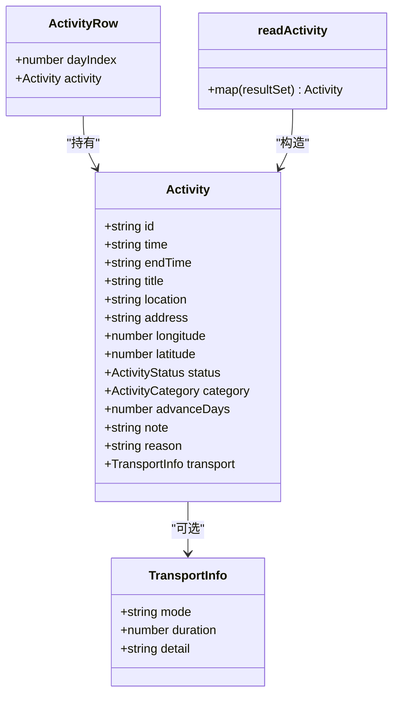
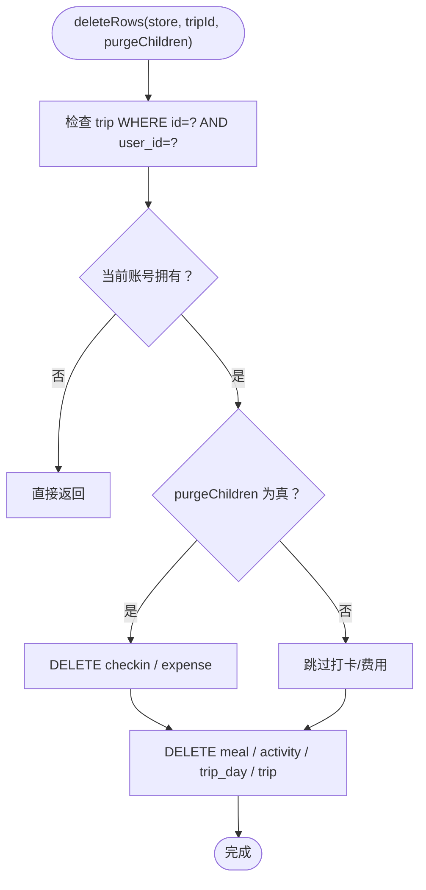
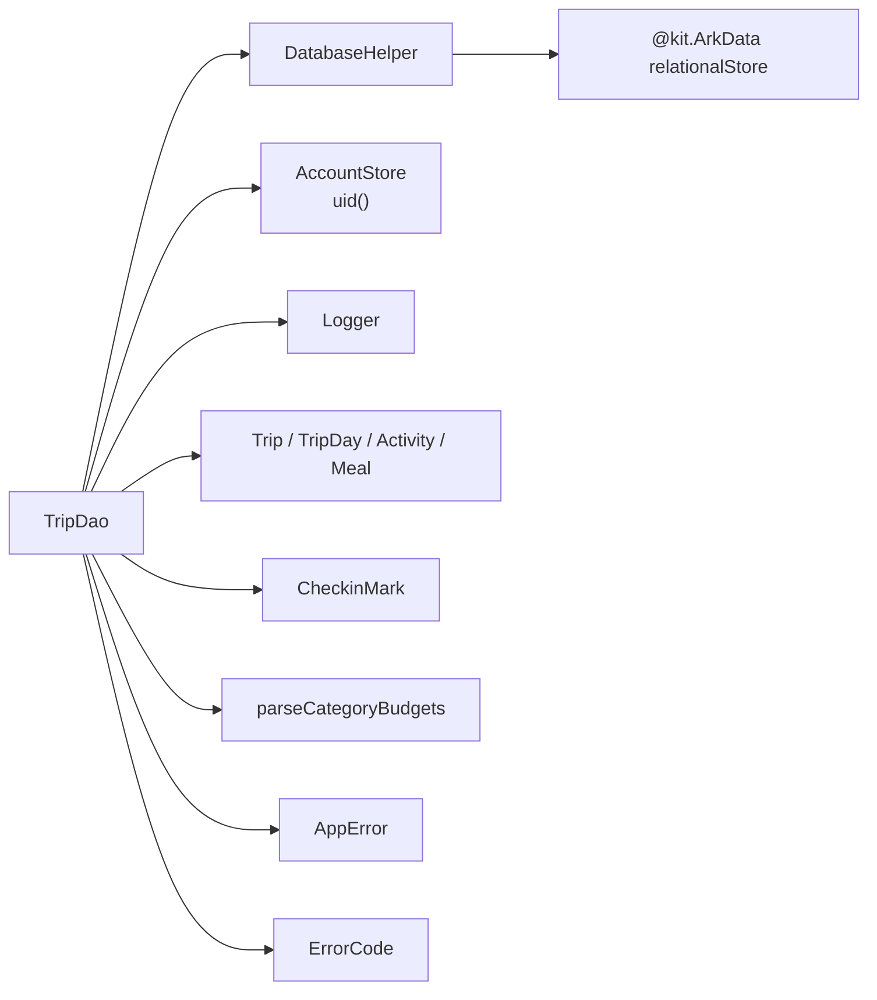

# TripDao 行程 DAO

<cite>
**本文引用的文件**   
- [TripDao.ets](file://entry/src/main/ets/data/TripDao.ets)
- [DatabaseHelper.ets](file://entry/src/main/ets/data/DatabaseHelper.ets)
- [Trip.ets](file://entry/src/main/ets/model/Trip.ets)
- [Checkin.ets](file://entry/src/main/ets/model/Checkin.ets)
- [CategoryBudget.ets](file://entry/src/main/ets/utils/CategoryBudget.ets)
</cite>

## 目录

1. [简介](#简介)
2. [项目结构与定位](#项目结构与定位)
3. [核心组件总览](#核心组件总览)
4. [架构总览](#架构总览)
5. [详细组件分析](#详细组件分析)
6. [依赖关系分析](#依赖关系分析)
7. [性能与索引](#性能与索引)
8. [API 参考](#api-参考)
9. [故障排查](#故障排查)
10. [结论](#结论)

## 简介

TripDao 是有径应用中最核心的行程数据访问层，承担“行程聚合根”的整存整取写入、列表摘要查询和详情加载。它把 `trip` → `trip_day` → `activity` / `meal` 四张表组织成一次写事务中的完整更新，并把打卡、记账等用户态数据作为关联维度参与查询，但保持它们不在 AI 生成契约中。

关键设计原则有三点：

- **整存整取**：保存行程时先级联删除旧子树，再按 `trip` → `days` → `activities` / `meals` 顺序重建。
- **用户分区隔离**：所有读写通过 `AccountStore.uid()` 限定当前登录账号；游客归户时三张带 `user_id` 的表在同一事务迁移。
- **读模型解耦**：数据库列只负责持久化，DAO 在读取阶段逐列映射为 `Trip` / `TripDay` / `Activity` / `Meal` 等业务模型。

## 项目结构与定位

TripDao 位于 `entry/src/main/ets/data/` 数据层，向上被页面、卡片、计划草稿等模块使用，向下通过 `DatabaseHelper` 复用 ArkData 的 `relationalStore.RdbStore`。

**图示来源**
- [TripDao.ets:1-384](file://entry/src/main/ets/data/TripDao.ets#L1-L384)
- [DatabaseHelper.ets:1-200](file://entry/src/main/ets/data/DatabaseHelper.ets#L1-L200)
- [Trip.ets:1-137](file://entry/src/main/ets/model/Trip.ets#L1-L137)
- [Checkin.ets:1-14](file://entry/src/main/ets/model/Checkin.ets#L1-L14)
- [CategoryBudget.ets:1-63](file://entry/src/main/ets/utils/CategoryBudget.ets#L1-L63)

**章节来源**
- [TripDao.ets:1-40](file://entry/src/main/ets/data/TripDao.ets#L1-L40)
- [DatabaseHelper.ets:1-60](file://entry/src/main/ets/data/DatabaseHelper.ets#L1-L60)

## 核心组件总览

| 名称 | 类型 | 职责 | 关键行为 |
|---|---|---|---|
| `TripDao` | 类 | 行程数据访问入口 | 提供 `saveTrip`、`listSummaries`、`loadTrip`、`deleteTrip`、`todayPlan`、`adoptGuestData`、`saveCategoryBudgets` |
| `DatabaseHelper` | 类 | RDB 连接、建库、版本迁移、串行写事务 | 维护 `youjing.db`、版本 v11、写链 `writeChain` |
| `Trip` / `TripDay` / `Activity` / `Meal` | 接口 | 行程聚合根及子实体 | 定义日期、时间、枚举、预算、通勤、预约状态等字段 |
| `CheckinMark` | 接口 | 节点打卡记录 | 以 `(trip_id, activity_id)` 唯一，独立于 AI 契约 |
| `parseCategoryBudgets` | 函数 | 分类预算 JSON 反序列化 | 校验六档类别码和正数金额，脏条目整条丢弃 |

**章节来源**
- [TripDao.ets:1-40](file://entry/src/main/ets/data/TripDao.ets#L1-L40)
- [DatabaseHelper.ets:1-60](file://entry/src/main/ets/data/DatabaseHelper.ets#L1-L60)
- [Trip.ets:1-137](file://entry/src/main/ets/model/Trip.ets#L1-L137)
- [Checkin.ets:1-14](file://entry/src/main/ets/model/Checkin.ets#L1-L14)
- [CategoryBudget.ets:1-63](file://entry/src/main/ets/utils/CategoryBudget.ets#L1-L63)

## 架构总览

TripDao 采用“写走单写通道、读逐列收口”的分层结构：

**图示来源**
- [TripDao.ets:41-90](file://entry/src/main/ets/data/TripDao.ets#L41-L90)
- [DatabaseHelper.ets:130-175](file://entry/src/main/ets/data/DatabaseHelper.ets#L130-L175)

## 详细组件分析

### 1. `saveTrip` 事务写入流程

`saveTrip` 是行程聚合根的整存整取入口。它通过 `DatabaseHelper.write` 进入一个串行写事务，保证删除与重建原子一致。

#### 写入步骤

1. **级联删除旧数据**：调用私有方法 `deleteRows(store, trip.id, false)`，清空该行程下的 `trip_day`、`activity`、`meal`，但不删除打卡和费用，因为编辑行程时这些用户态数据仍需保留。
2. **写入 trip 行**：将 `Trip` 聚合根展平为 `trip` 表列，其中 `highlights`、`tips`、`category_budget` 序列化为 JSON 文本。
3. **批量写入天**：遍历 `trip.days`，插入 `trip_day`。
4. **批量写入活动**：对每天的活动调用 `insertActivity`，以 `${tripId}:${activityId}` 作为主键，避免跨行程 ID 冲突。
5. **批量写入餐**：对每天的餐饮插入 `meal` 行。

**图示来源**
- [TripDao.ets:41-90](file://entry/src/main/ets/data/TripDao.ets#L41-L90)
- [TripDao.ets:300-330](file://entry/src/main/ets/data/TripDao.ets#L300-L330)
- [TripDao.ets:335-370](file://entry/src/main/ets/data/TripDao.ets#L335-L370)

#### 关键实现要点

- `deleteRows` 先验证 `trip.user_id = AccountStore.uid()`，防止同名他人行程或脏数据被误删。
- 活动主键前缀化：`${tripId}:${act.id}`，使同一 `activityId` 可安全用于多个行程。
- `insertActivity` 把可选的 `transport` 拆解为 `transport_mode` / `transport_duration` / `transport_detail` 三列，把未提供的值设为 `null`。
- JSON 字段写入时使用 `JSON.stringify`；空数组或未定义时仍写入稳定默认值，避免后续反序列化分支歧义。

**章节来源**
- [TripDao.ets:41-90](file://entry/src/main/ets/data/TripDao.ets#L41-L90)
- [TripDao.ets:300-330](file://entry/src/main/ets/data/TripDao.ets#L300-L330)
- [TripDao.ets:335-370](file://entry/src/main/ets/data/TripDao.ets#L335-L370)
- [DatabaseHelper.ets:130-175](file://entry/src/main/ets/data/DatabaseHelper.ets#L130-L175)

### 2. `listSummaries` 复杂查询

`listSummaries` 是列表页和卡片的数据源，返回每趟行程的摘要，而不是整棵行程树。它使用一条 SQL 配合多个子查询，一次性聚合 `spot_count`、`booking_count`、`leg_count`、`checkin_count`。

#### 聚合指标说明

| 指标 | 含义 | SQL 语义 |
|---|---|---|
| `spotCount` | 行程中活动总数 | `activity` 表中 `trip_id = t.id` 的行数 |
| `bookingCount` | 需预约且尚未确认的节点数 | 状态为 `not_booked`、`pending` 或 `full` 的活动数 |
| `legCount` | 有通勤记录的节点数 | `transport_mode IS NOT NULL` 的活动数 |
| `checkinCount` | 已打卡的活动数 | 通过 `checkin.trip_id || ':' || checkin.activity_id = activity.id` 关联计数 |
| 用户隔离 | 仅返回当前登录账号的行程 | `t.user_id = ?`，参数为 `AccountStore.uid()` |

**图示来源**
- [TripDao.ets:92-130](file://entry/src/main/ets/data/TripDao.ets#L92-L130)

#### 结果映射

查询结果通过回调映射为 `TripSummary`，包含目的地、起止日期、人数、总花费、更新时间以及四个统计字段。`long` 类型字段统一通过 `rs.getLong` 读取，便于数值展示。

**章节来源**
- [TripDao.ets:92-130](file://entry/src/main/ets/data/TripDao.ets#L92-L130)
- [Checkin.ets:1-14](file://entry/src/main/ets/model/Checkin.ets#L1-L14)

### 3. `loadTrip` 三级关联加载

`loadTrip` 不是简单的一次 `JOIN`，而是分三次查询并按 `dayIndex` 拼装到 `Trip` 聚合根中。这种设计避免大 `JOIN` 膨胀，同时允许按天独立渲染。

#### 加载步骤

1. **加载 trip 头**：按 `id` 和 `user_id` 查一行；若为空返回 `null`。
2. **反序列化 JSON 字段**：
   - `highlights`、`tips`：通过 `parseStringArray` 转为字符串数组。
   - `category_budgets`：通过 `parseCategoryBudgets` 转为分类预算数组。
3. **加载 trip_day**：按 `trip_id` 排序 `day_index`。
4. **加载 activity**：按 `trip_id`、`day_index`、`time` 排序，映射为中间结构 `ActivityRow`。
5. **加载 meal**：按 `trip_id`、`day_index`、`type` 排序，映射为中间结构 `MealRowWrap`。
6. **拼装**：按 `dayIndex` 把活动和餐推入对应 `TripDay`。

**图示来源**
- [TripDao.ets:132-200](file://entry/src/main/ets/data/TripDao.ets#L132-L200)

#### `readActivity` 字段映射

`readActivity` 处理以下细节：

- 从主键中剥离 `tripId:` 前缀，恢复业务层 `Activity.id`。
- 将 `transport_mode` 非空时还原为 `TransportInfo`。
- 兼容历史库中可能不存在的 `advance_days` 列。
- 将空字符串 `note` / `reason` 转为 `undefined`，保持领域模型语义。

**图示来源**
- [TripDao.ets:335-384](file://entry/src/main/ets/data/TripDao.ets#L335-L384)
- [Trip.ets:40-137](file://entry/src/main/ets/model/Trip.ets#L40-L137)

**章节来源**
- [TripDao.ets:132-200](file://entry/src/main/ets/data/TripDao.ets#L132-L200)
- [TripDao.ets:335-384](file://entry/src/main/ets/data/TripDao.ets#L335-L384)
- [Trip.ets:40-137](file://entry/src/main/ets/model/Trip.ets#L40-L137)
- [CategoryBudget.ets:1-63](file://entry/src/main/ets/utils/CategoryBudget.ets#L1-L63)

### 4. 中间结构 `ActivityRow` / `MealRowWrap`

这两个接口不是持久化模型，而是查询阶段的临时包装：

| 中间结构 | 字段 | 作用 |
|---|---|---|
| `ActivityRow` | `dayIndex`、`activity` | 把 `activity` 查询结果与所属天绑定，便于按天分组 |
| `MealRowWrap` | `dayIndex`、`meal` | 同上，但针对 `meal` 表 |

它们的价值在于：

- 避免在 `loadTrip` 中直接操作原始 `ResultSet`，降低映射逻辑耦合。
- 让 `dayIndex` 与业务模型分离，方便在拼装循环中做相等匹配。
- 与 `insertActivity` 形成对照：写入侧构造 `ValuesBucket`，读取侧构造中间对象。

**章节来源**
- [TripDao.ets:160-200](file://entry/src/main/ets/data/TripDao.ets#L160-L200)
- [TripDao.ets:335-384](file://entry/src/main/ets/data/TripDao.ets#L335-L384)

### 5. `deleteRows` 级联删除策略

`deleteRows` 是 `saveTrip` 和 `deleteTrip` 共同使用的内部删除器。

| 删除目标 | 是否清理打卡/费用 | 触发场景 |
|---|---:|---|
| `checkin` | 仅 `purgeChildren=true` | 删除整条行程 |
| `expense` | 仅 `purgeChildren=true` | 删除整条行程 |
| `meal` | 始终清理 | 编辑或删除行程 |
| `activity` | 始终清理 | 编辑或删除行程 |
| `trip_day` | 始终清理 | 编辑或删除行程 |
| `trip` | 始终清理 | 编辑或删除行程 |

重要安全约束：

- 删除前先检查 `trip.id` 和 `trip.user_id`，只有归属当前账号的行才继续。
- 删除子表时不带 `user_id`，因为 `trip_day` / `activity` / `meal` 没有 `user_id` 列。
- 删除整条行程时必须清理 `checkin` 和 `expense`，否则会产生不可见的孤儿数据。

**图示来源**
- [TripDao.ets:335-370](file://entry/src/main/ets/data/TripDao.ets#L335-L370)

**章节来源**
- [TripDao.ets:335-370](file://entry/src/main/ets/data/TripDao.ets#L335-L370)

### 6. 辅助方法：`query`、`todayPlan`、`adoptGuestData`、`saveCategoryBudgets`

| 方法 | 用途 | 返回值 |
|---|---|---|
| `query(context, sql, args, map)` | 通用查询封装 | 泛型数组 `T[]` |
| `todayPlan(context)` | 桌面卡片数据源 | `TodayPlanData | null` |
| `adoptGuestData(context, toUid)` | 游客数据归户 | 归户后 trip 数量 |
| `saveCategoryBudgets(context, tripId, list)` | 只更新分类预算列 | `Promise<void>` |
| `deleteTrip(context, tripId)` | 删除整条行程 | `Promise<void>` |

`todayPlan` 做了重要优化：先用日期范围预筛候选行程 ID，再逐个调用 `loadTrip`，避免对所有行程都执行完整的四次查询。

`adoptGuestData` 在同一个写事务中迁移 `trip`、`expense`、`checkin` 三张表的 `user_id`，保证登录前后数据可见性一致。

**章节来源**
- [TripDao.ets:201-330](file://entry/src/main/ets/data/TripDao.ets#L201-L330)

## 依赖关系分析

**图示来源**
- [TripDao.ets:1-40](file://entry/src/main/ets/data/TripDao.ets#L1-L40)
- [DatabaseHelper.ets:1-60](file://entry/src/main/ets/data/DatabaseHelper.ets#L1-L60)

### 耦合与内聚

- **高内聚**：TripDao 集中了行程的所有持久化语义，包括聚合根、子实体、打卡关联、JSON 反序列化。
- **低耦合**：数据库连接、事务、迁移由 `DatabaseHelper` 管理；错误类型由 `AppError` 和 `ErrorCode` 抽象。
- **潜在风险**：`loadTrip` 拆分为多次查询，虽然避免了单次大 `JOIN`，但在极端大数据量下仍存在 N+1 风险，应通过索引和数据规模控制缓解。

**章节来源**
- [TripDao.ets:1-40](file://entry/src/main/ets/data/TripDao.ets#L1-L40)
- [DatabaseHelper.ets:1-60](file://entry/src/main/ets/data/DatabaseHelper.ets#L1-L60)

## 性能与索引

### 现有索引

`DatabaseHelper` 已创建以下关键索引：

| 索引 | 表 | 适用查询 |
|---|---|---|
| `idx_trip_user` | `trip(user_id)` | `listSummaries`、`loadTrip` 的用户过滤 |
| `idx_activity_trip_day` | `activity(trip_id, day_index)` | `loadTrip` 中活动加载 |
| `idx_meal_trip_day` | `meal(trip_id, day_index)` | `loadTrip` 中餐加载 |
| `idx_checkin_user` | `checkin(user_id)` | 打卡相关查询 |
| `idx_expense_user` | `expense(user_id)` | 记账用户分区 |
| `idx_trip_day` | `trip_day(trip_id)` | 按行程加载天数 |

### 建议优化

1. **避免 N+1 查询**：如果未来需要高频加载大量行程详情，可考虑一次性拉取 `trip` + `trip_day` + `activity` + `meal`，在内存中按 `tripId` 和 `dayIndex` 组装，减少往返次数。
2. **合理使用索引**：`listSummaries` 的子查询会扫描 `activity` 表，建议在活跃行程较多时确保 `trip_id` 索引有效；如需按 `status` 或 `transport_mode` 高频过滤，可评估复合索引。
3. **控制 JSON 字段大小**：`highlights`、`tips`、`category_budget` 均为 JSON 文本列；应限制条目数量和单条长度，避免 SQLite 单行过大。
4. **避免重复全量重建**：`saveTrip` 每次都会删除并重写整棵树，适合编辑场景；对于增量变更，应优先使用 `saveCategoryBudgets` 这类细粒度更新。
5. **打卡与费用孤儿防护**：删除整条行程必须设置 `purgeChildren=true`，否则会留下无父行程的打卡和记账数据。

[本节为通用性能建议，不直接分析具体代码片段]

## API 参考

### `saveTrip(context, trip)`

- **目的**：整存整取保存行程聚合根。
- **参数**：
  - `context`：AbilityKit 上下文。
  - `trip`：`Trip` 聚合根，包含 `days`、`overview`、`tips`、`categoryBudgets`。
- **返回值**：`Promise<void>`。
- **异常**：写事务失败时抛出 `AppError(ErrorCode.RDB_TRANSACTION_FAILED)`。
- **副作用**：
  - 删除旧 `trip_day`、`activity`、`meal`。
  - 保留旧 `checkin` 和 `expense`。
  - 重新插入 trip 及其子树。

**章节来源**
- [TripDao.ets:41-90](file://entry/src/main/ets/data/TripDao.ets#L41-L90)
- [DatabaseHelper.ets:130-175](file://entry/src/main/ets/data/DatabaseHelper.ets#L130-L175)

### `listSummaries(context)`

- **目的**：获取当前账号下所有行程的摘要列表。
- **参数**：`context`。
- **返回值**：`Promise<TripSummary[]>`。
- **排序**：按 `updated_at DESC`。
- **异常**：底层查询异常由 `query` 透传。

**章节来源**
- [TripDao.ets:92-130](file://entry/src/main/ets/data/TripDao.ets#L92-L130)

### `loadTrip(context, tripId)`

- **目的**：加载完整行程树，包含天、活动、餐。
- **参数**：
  - `context`：AbilityKit 上下文。
  - `tripId`：行程 ID。
- **返回值**：`Promise<Trip | null>`；行程不存在或不属于当前用户时返回 `null`。
- **异常**：底层查询异常由 `query` 透传。

**章节来源**
- [TripDao.ets:132-200](file://entry/src/main/ets/data/TripDao.ets#L132-L200)

### `deleteTrip(context, tripId)`

- **目的**：删除整条行程，包括打卡和费用。
- **参数**：`context`、`tripId`。
- **返回值**：`Promise<void>`。
- **异常**：写事务失败时抛出 `AppError(ErrorCode.RDB_TRANSACTION_FAILED)`。

**章节来源**
- [TripDao.ets:312-318](file://entry/src/main/ets/data/TripDao.ets#L312-L318)

### `saveCategoryBudgets(context, tripId, list)`

- **目的**：只更新行程的分类预算 JSON 列。
- **参数**：
  - `context`：AbilityKit 上下文。
  - `tripId`：行程 ID。
  - `list`：`CategoryBudget[]`。
- **返回值**：`Promise<void>`。
- **异常**：写事务失败时抛出 `AppError(ErrorCode.RDB_TRANSACTION_FAILED)`。

**章节来源**
- [TripDao.ets:280-295](file://entry/src/main/ets/data/TripDao.ets#L280-L295)

### `todayPlan(context)`

- **目的**：桌面卡片数据源，返回覆盖今天的最近行程。
- **参数**：`context`。
- **返回值**：`Promise<TodayPlanData | null>`。
- **行为**：先按日期范围筛选，再逐个 `loadTrip` 计算当日计划。

**章节来源**
- [TripDao.ets:201-240](file://entry/src/main/ets/data/TripDao.ets#L201-L240)

### `adoptGuestData(context, toUid)`

- **目的**：静默登录后把游客分区数据迁移到正式账号。
- **参数**：
  - `context`：AbilityKit 上下文。
  - `toUid`：目标 UID。
- **返回值**：`Promise<number>`：归户后 trip 数量。
- **异常**：写事务失败时抛出 `AppError(ErrorCode.RDB_TRANSACTION_FAILED)`。

**章节来源**
- [TripDao.ets:242-275](file://entry/src/main/ets/data/TripDao.ets#L242-L275)

### `query(context, sql, args, map)`

- **目的**：通用查询封装，收集 `ResultSet` 并调用映射函数。
- **参数**：
  - `context`：AbilityKit 上下文。
  - `sql`：SQL 语句。
  - `args`：参数数组。
  - `map`：`(resultSet) => T`。
- **返回值**：`Promise<T[]>`。
- **资源管理**：自动关闭 `ResultSet`。

**章节来源**
- [TripDao.ets:372-384](file://entry/src/main/ets/data/TripDao.ets#L372-L384)

## 故障排查

### 行程保存后活动丢失

- 检查是否调用了 `saveTrip` 而非仅更新部分字段。
- 确认 `trip.days` 不为空，且每个 `Activity.id` 合法。
- 查看日志中 `saveTrip ${trip.id} days=${trip.days.length}` 输出。

**章节来源**
- [TripDao.ets:41-90](file://entry/src/main/ets/data/TripDao.ets#L41-L90)

### 删除行程后打卡或费用仍存在

- 确认使用的是 `deleteTrip`，其内部 `purgeChildren=true`。
- 如果使用自定义 SQL，请显式删除 `checkin` 和 `expense`。

**章节来源**
- [TripDao.ets:335-370](file://entry/src/main/ets/data/TripDao.ets#L335-L370)

### 列表摘要中打卡数不准确

- 检查 `checkin` 表是否设置了正确的 `trip_id`、`activity_id` 和 `user_id`。
- 确认 `activity.id` 与 `checkin.activity_id` 拼接规则一致。

**章节来源**
- [TripDao.ets:92-130](file://entry/src/main/ets/data/TripDao.ets#L92-L130)
- [Checkin.ets:1-14](file://entry/src/main/ets/model/Checkin.ets#L1-L14)

### JSON 字段解析失败

- `parseStringArray` 对非法 JSON 返回空数组。
- `parseCategoryBudgets` 丢弃无效类别码或非正数金额。
- 建议检查 AI 生成或导入数据的 JSON 合法性。

**章节来源**
- [TripDao.ets:33-40](file://entry/src/main/ets/data/TripDao.ets#L33-L40)
- [CategoryBudget.ets:1-63](file://entry/src/main/ets/utils/CategoryBudget.ets#L1-L63)

### 写事务频繁失败

- 检查是否并发调用 `saveTrip` 等方法；`DatabaseHelper.write` 使用串行写链，不应出现 busy，但深层异常会回滚。
- 关注 `AppError(ErrorCode.RDB_TRANSACTION_FAILED)` 的原始错误信息。

**章节来源**
- [DatabaseHelper.ets:130-175](file://entry/src/main/ets/data/DatabaseHelper.ets#L130-L175)

## 结论

TripDao 是有径应用行程域的核心数据边界。它通过整存整取的 `saveTrip` 保证聚合根一致性，通过 `listSummaries` 的聚合子查询高效支撑列表页，通过 `loadTrip` 的三级映射还原业务模型，并通过 `deleteRows` 的安全删除策略保护打卡与记账数据。

在生产使用中，应重点关注：

- 不要绕过 `DatabaseHelper.write` 直接操作 RDBStore。
- 不要假设 `loadTrip` 是单次查询；它是四次查询加内存拼装。
- 不要忽略 JSON 字段的体积和合法性。
- 删除整条行程必须使用 `deleteTrip`，避免孤儿数据。
- 列表和详情都应基于 `AccountStore.uid()` 进行用户分区隔离。