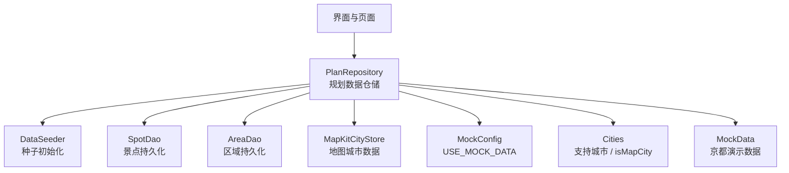
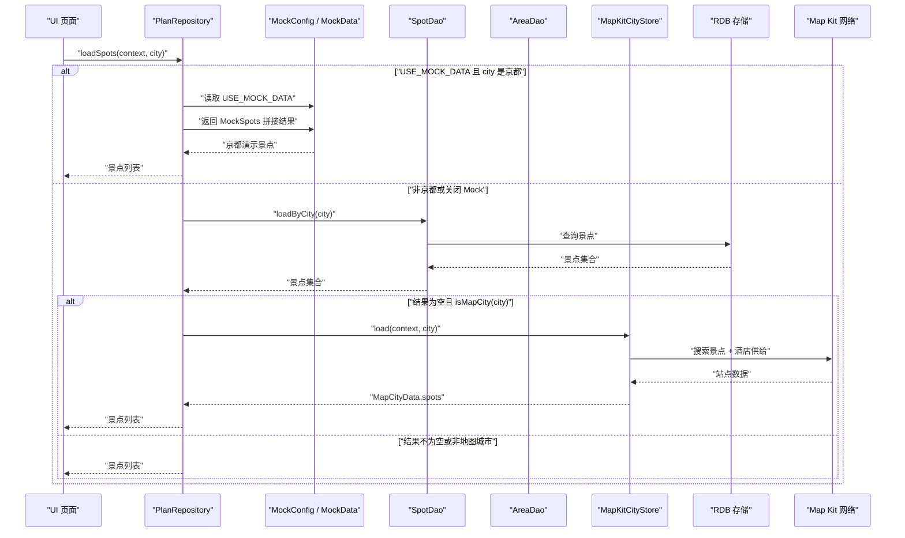
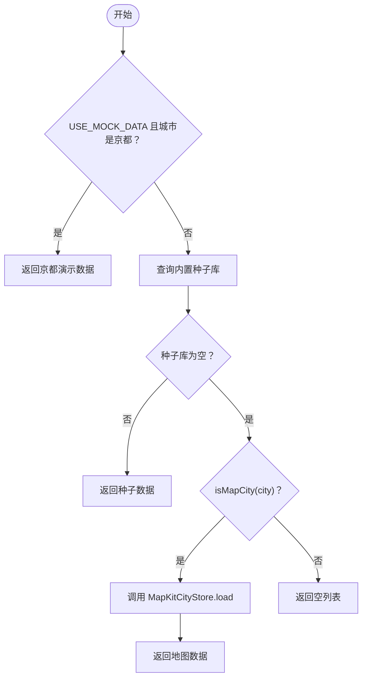
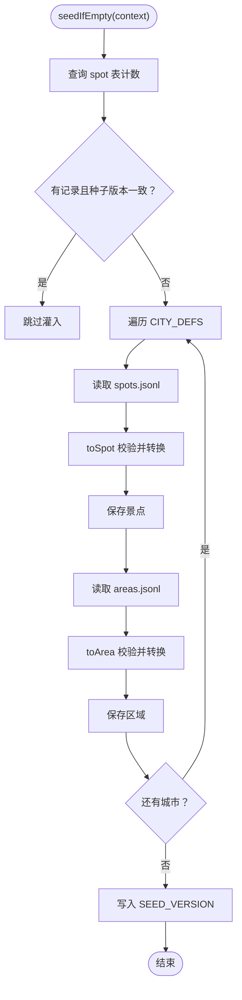
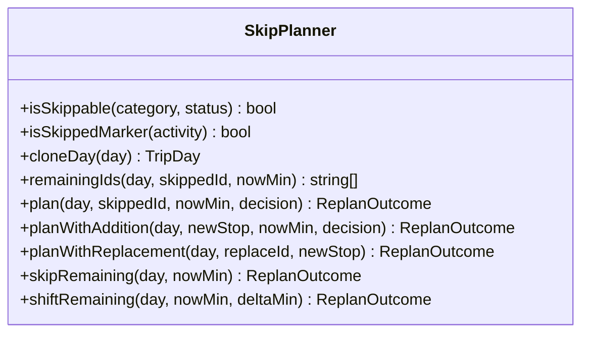
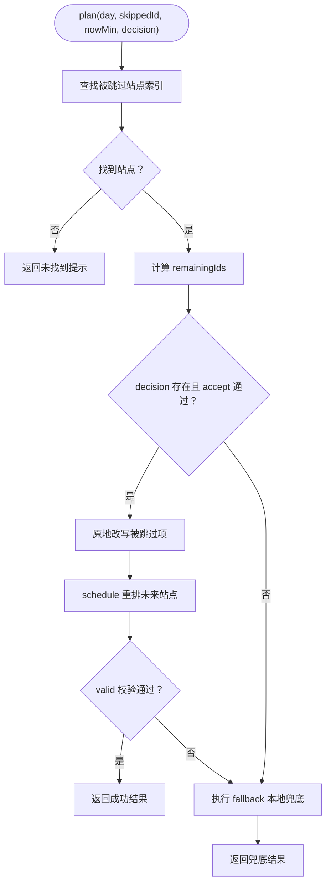
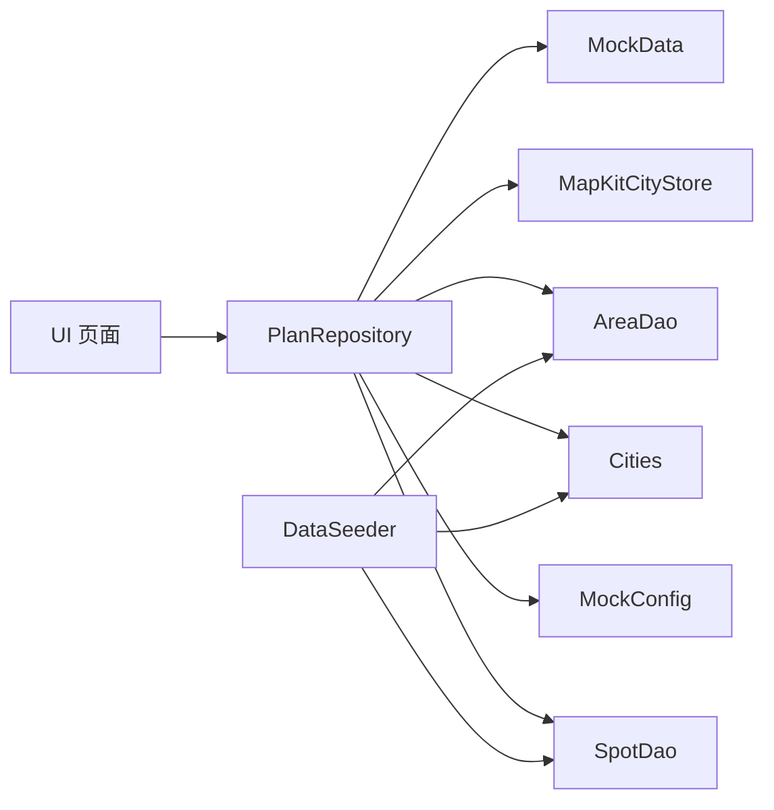

# 仓储模式与业务封装

<cite>
**本文引用的文件**   
- [PlanRepository.ets](file://entry/src/main/ets/data/PlanRepository.ets)
- [MockConfig.ets](file://entry/src/main/ets/common/config/MockConfig.ets)
- [Cities.ets](file://entry/src/main/ets/common/constants/Cities.ets)
- [MapKitCityStore.ets](file://entry/src/main/ets/data/MapKitCityStore.ets)
- [DataSeeder.ets](file://entry/src/main/ets/data/DataSeeder.ets)
- [SkipPlanner.ets](file://entry/src/main/ets/data/SkipPlanner.ets)
- [MockData.ets](file://entry/src/main/ets/mock/MockData.ets)
- [MockTrip.ets](file://entry/src/main/ets/mock/MockTrip.ets)
</cite>

## 目录
1. [引言](#引言)
2. [项目结构定位](#项目结构定位)
3. [核心组件总览](#核心组件总览)
4. [架构总览](#架构总览)
5. [详细组件分析](#详细组件分析)
6. [依赖关系分析](#依赖关系分析)
7. [性能与可靠性特征](#性能与可靠性特征)
8. [排错指南](#排错指南)
9. [结论](#结论)

## 引言
本文面向有径应用的数据与调度层，围绕仓储模式展开：以 `PlanRepository` 为单一入口，屏蔽页面直连数据访问对象（DAO）；通过 `USE_MOCK_DATA` 开关实现京都演示数据；按“内置种子库优先 → Map Kit 联网回退 → 空结果”的三级策略选择数据源；同时说明 `DataSeeder` 的种子初始化流程与 `SkipPlanner` 的智能跳过、顺延等本地调度逻辑。文档提供数据流图与决策流程图，帮助读者从 UI 调用一直追踪到数据存储与网络回退。

## 项目结构定位
本次分析聚焦 `entry/src/main/ets/data` 及其相邻配置、模型和 Mock 层：

图表来源
- [PlanRepository.ets:1-55](file://entry/src/main/ets/data/PlanRepository.ets#L1-L55)
- [DataSeeder.ets:1-200](file://entry/src/main/ets/data/DataSeeder.ets#L1-L200)
- [MapKitCityStore.ets:1-179](file://entry/src/main/ets/data/MapKitCityStore.ets#L1-L179)
- [MockConfig.ets:1-15](file://entry/src/main/ets/common/config/MockConfig.ets#L1-L15)
- [Cities.ets:1-101](file://entry/src/main/ets/common/constants/Cities.ets#L1-L101)
- [MockData.ets:1-100](file://entry/src/main/ets/mock/MockData.ets#L1-L100)

章节来源
- [PlanRepository.ets:1-55](file://entry/src/main/ets/data/PlanRepository.ets#L1-L55)
- [Cities.ets:1-101](file://entry/src/main/ets/common/constants/Cities.ets#L1-L101)

## 核心组件总览
- `PlanRepository`：规划数据的统一仓储入口，负责 Mock 路由、DAO 读取、Map Kit 回退与日志记录。
- `MockConfig`：全局 Mock 开关，单点定义 `USE_MOCK_DATA`。
- `Cities`：支持城市定义、别名映射、是否走 Map Kit 的判断。
- `MapKitCityStore`：任意城市联网检索景点与住宿区，带内存缓存与错误封装。
- `DataSeeder`：启动时按城市批量导入种子 JSONL，完成 Spot/Area 预填充与版本管理。
- `SkipPlanner`：旅行中页的纯逻辑调度器，负责跳过、加站、换站、顺延等决策校验与本地兜底。
- `MockData` / `MockTrip`：京都演示景点、区域与行程时间线数据。

章节来源
- [PlanRepository.ets:1-55](file://entry/src/main/ets/data/PlanRepository.ets#L1-L55)
- [MockConfig.ets:1-15](file://entry/src/main/ets/common/config/MockConfig.ets#L1-L15)
- [Cities.ets:1-101](file://entry/src/main/ets/common/constants/Cities.ets#L1-L101)
- [MapKitCityStore.ets:1-179](file://entry/src/main/ets/data/MapKitCityStore.ets#L1-L179)
- [DataSeeder.ets:1-200](file://entry/src/main/ets/data/DataSeeder.ets#L1-L200)
- [SkipPlanner.ets:1-200](file://entry/src/main/ets/data/SkipPlanner.ets#L1-L200)
- [MockData.ets:1-100](file://entry/src/main/ets/mock/MockData.ets#L1-L100)
- [MockTrip.ets:1-93](file://entry/src/main/ets/mock/MockTrip.ets#L1-L93)

## 架构总览
下图展示从 UI 调用到数据落盘或网络回退的完整路径。

图表来源
- [PlanRepository.ets:10-42](file://entry/src/main/ets/data/PlanRepository.ets#L10-L42)
- [MockConfig.ets:1-15](file://entry/src/main/ets/common/config/MockConfig.ets#L1-L15)
- [MockData.ets:1-100](file://entry/src/main/ets/mock/MockData.ets#L1-L100)
- [MapKitCityStore.ets:40-179](file://entry/src/main/ets/data/MapKitCityStore.ets#L40-L179)
- [Cities.ets:82-101](file://entry/src/main/ets/common/constants/Cities.ets#L82-L101)

## 详细组件分析

### PlanRepository：仓储入口与数据路由
`PlanRepository` 暴露 `loadSpots` 与 `loadAreas` 两个静态方法，承担以下职责：
- 强制 UI 不直接访问 DAO，保持分层纪律。
- 在 `USE_MOCK_DATA` 开启且城市为“京都”时，返回演示数据。
- 否则先查本地种子库；若为空且城市被判定为地图城市，则回退到 Map Kit。
- 对空结果进行日志记录，避免把空态误认为成功。

#### 数据源选择策略
- 第一优先级：Mock 演示数据（仅京都）。
- 第二优先级：内置种子库（北京、上海、广州、深圳、杨凌）。
- 第三优先级：Map Kit 联网检索（非内置五城且非京都）。
- 第四优先级：空列表，由调用方呈现空态。

图表来源
- [PlanRepository.ets:14-42](file://entry/src/main/ets/data/PlanRepository.ets#L14-L42)
- [Cities.ets:82-101](file://entry/src/main/ets/common/constants/Cities.ets#L82-L101)

#### Mock 数据开关机制
- 开关位于 `MockConfig.USE_MOCK_DATA`，默认关闭。
- 只有当开关为真且城市名等于“京都”时才走 Mock。
- Mock 不会冒充其他城市，防止演示数据污染真实场景。

章节来源
- [PlanRepository.ets:1-55](file://entry/src/main/ets/data/PlanRepository.ets#L1-L55)
- [MockConfig.ets:1-15](file://entry/src/main/ets/common/config/MockConfig.ets#L1-L15)
- [Cities.ets:82-101](file://entry/src/main/ets/common/constants/Cities.ets#L82-L101)

### DataSeeder：种子初始化与预填充
`DataSeeder` 负责应用首次或种子版本升级时的数据灌入：
- 首启检查：若已有景点记录且种子版本一致，则跳过。
- 城市分发：遍历 `CITY_DEFS`，分别读取对应 `spotsFile` 与 `areasFile`。
- 行解析：逐行 JSONL 解析为 `Spot` / `Area`，非法或缺字段行被跳过。
- 坐标策略：优先使用种子中的 GCJ02 坐标；缺失时用片区近似坐标；片区无法落点时使用零坐标。
- 版本管理：将种子版本写入持久偏好，便于已装机用户增量回填。

图表来源
- [DataSeeder.ets:70-130](file://entry/src/main/ets/data/DataSeeder.ets#L70-L130)
- [DataSeeder.ets:240-340](file://entry/src/main/ets/data/DataSeeder.ets#L240-L340)
- [Cities.ets:10-33](file://entry/src/main/ets/common/constants/Cities.ets#L10-L33)

#### 生成规则要点
- Spot：
  - 必须含 `id` 与名称；否则整行跳过。
  - `tags` 经白名单过滤后转为枚举值。
  - `booking` 可选字段保留，未采集字段留空。
  - `provenance.source` 区分坐标来源：有地理编码为高级来源，否则为早期种子来源。
- Area：
  - 同样要求 `id` 与名称。
  - 无坐标时采用 `[NO_COORD, NO_COORD]`，避免错误落入城市质心。
  - `priceTier` 与 `group` 使用白名单回退到默认值，保证契约安全。

章节来源
- [DataSeeder.ets:70-130](file://entry/src/main/ets/data/DataSeeder.ets#L70-L130)
- [DataSeeder.ets:240-340](file://entry/src/main/ets/data/DataSeeder.ets#L240-L340)

### SkipPlanner：智能跳过与本地调度
`SkipPlanner` 是旅行中页的纯逻辑调度器，核心能力包括：
- 可跳过判断：排除交通、住宿、休息以及已预约活动。
- 剩余站点计算：排除已跳过项、锚点类型及已过时刻。
- 云端决策守卫：校验 schema 版本、保留项数量、停留时长、空闲块范围。
- 本地兜底：云端不可用或决策不合法时，执行确定性改写。
- 加站、换站、提前结束、整体顺延等操作均基于同一套锚点与预算约束。

图表来源
- [SkipPlanner.ets:1-200](file://entry/src/main/ets/data/SkipPlanner.ets#L1-L200)
- [SkipPlanner.ets:201-600](file://entry/src/main/ets/data/SkipPlanner.ets#L201-L600)

#### 跳过与重排主流程

图表来源
- [SkipPlanner.ets:201-280](file://entry/src/main/ets/data/SkipPlanner.ets#L201-L280)

章节来源
- [SkipPlanner.ets:1-200](file://entry/src/main/ets/data/SkipPlanner.ets#L1-L200)
- [SkipPlanner.ets:201-600](file://entry/src/main/ets/data/SkipPlanner.ets#L201-L600)

### MockData 与 MockTrip：京都演示数据
- `MockSpots`：按文化、美食、自然三类聚合京都景点，统一携带城市、标签、热度、预约信息与伪坐标。
- `MockAreas`：按精选、商圈便利、交通枢纽三类输出区域卡片包装。
- `MockTrip`：对齐稿件文案的三日行程时间线，覆盖不同状态与交通信息。

章节来源
- [MockData.ets:1-100](file://entry/src/main/ets/mock/MockData.ets#L1-L100)
- [MockTrip.ets:1-93](file://entry/src/main/ets/mock/MockTrip.ets#L1-L93)

## 依赖关系分析
仓储层的依赖方向清晰：UI 只依赖仓储；仓储依赖配置、常量、DAO、地图服务与 Mock 数据。

图表来源
- [PlanRepository.ets:1-55](file://entry/src/main/ets/data/PlanRepository.ets#L1-L55)
- [DataSeeder.ets:1-200](file://entry/src/main/ets/data/DataSeeder.ets#L1-L200)
- [Cities.ets:1-101](file://entry/src/main/ets/common/constants/Cities.ets#L1-L101)

### 耦合与内聚评估
- 高内聚：`PlanRepository` 集中数据路由，`DataSeeder` 集中种子初始化，`SkipPlanner` 集中调度逻辑。
- 低耦合：UI 不感知 DAO 与 Map Kit；Mock 仅受 `USE_MOCK_DATA` 控制；Map Kit 调用被封装在独立 Store。
- 潜在风险：当前仓库文件较多且变更频繁，建议持续维护仓储边界，避免页面绕过 Repository 直连 DAO。

章节来源
- [PlanRepository.ets:1-55](file://entry/src/main/ets/data/PlanRepository.ets#L1-L55)
- [DataSeeder.ets:1-200](file://entry/src/main/ets/data/DataSeeder.ets#L1-L200)
- [SkipPlanner.ets:1-200](file://entry/src/main/ets/data/SkipPlanner.ets#L1-L200)

## 性能与可靠性特征
- 种子灌入幂等：基于景点计数与种子版本，避免重复写库。
- 地图数据内存缓存：Map Kit 结果按城市缓存 30 分钟，减少重复网络请求。
- 分页与去重：地图检索限制页数、站点去重，避免全量拉取。
- 失败隔离：单个区县酒店供给查询失败不影响整城结果。
- 空态明确：种子为空且非地图城市时返回空列表，由上层呈现空态。

[本节为通用性能讨论，不直接分析具体代码片段]

## 排错指南
- 京都演示数据未出现：
  - 确认 `MockConfig.USE_MOCK_DATA` 是否为真。
  - 确认传入城市是否为“京都”。
- 非内置城市始终为空：
  - 检查 `isMapCity` 判定是否命中。
  - 查看 Map Kit 是否返回有效站点；注意城市别称与地址归属校验。
- 地图检索失败：
  - 关注 `MapKitCityStore` 抛出的地图服务异常。
  - 检查 cityId 是否带行政后缀导致匹配失败。
- 种子未灌入：
  - 检查 RDB 中是否已有景点记录。
  - 检查种子版本是否一致。
  - 查看 JSONL 是否存在解析失败的行。
- 跳过操作无效：
  - 检查目标活动是否属于交通、住宿、休息或已预约。
  - 检查云端决策是否通过 `accept` 守卫。
  - 检查顺延是否触发越界或锚点冲突。

章节来源
- [MockConfig.ets:1-15](file://entry/src/main/ets/common/config/MockConfig.ets#L1-L15)
- [PlanRepository.ets:14-42](file://entry/src/main/ets/data/PlanRepository.ets#L14-L42)
- [MapKitCityStore.ets:40-179](file://entry/src/main/ets/data/MapKitCityStore.ets#L40-L179)
- [DataSeeder.ets:70-130](file://entry/src/main/ets/data/DataSeeder.ets#L70-L130)
- [SkipPlanner.ets:201-600](file://entry/src/main/ets/data/SkipPlanner.ets#L201-L600)

## 结论
有径应用的仓储模式以 `PlanRepository` 为核心，严格分离 UI 与数据访问，并通过 `USE_MOCK_DATA` 与 `isMapCity` 构建清晰的三级数据源降级策略。`DataSeeder` 以版本化、白名单与坐标兜底保障种子质量，`SkipPlanner` 以纯逻辑与多重守卫确保旅行中体验的可预测性与可恢复性。该设计满足单一职责、依赖倒置与测试友好的仓储原则，并为后续扩展更多城市、更多数据源与更复杂的行程调度预留了稳定接口。