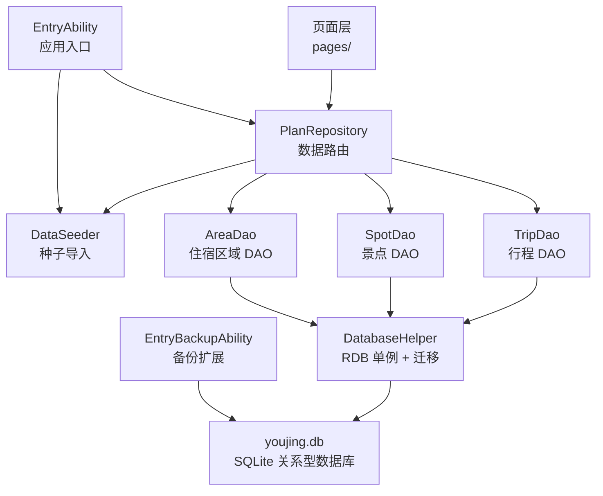
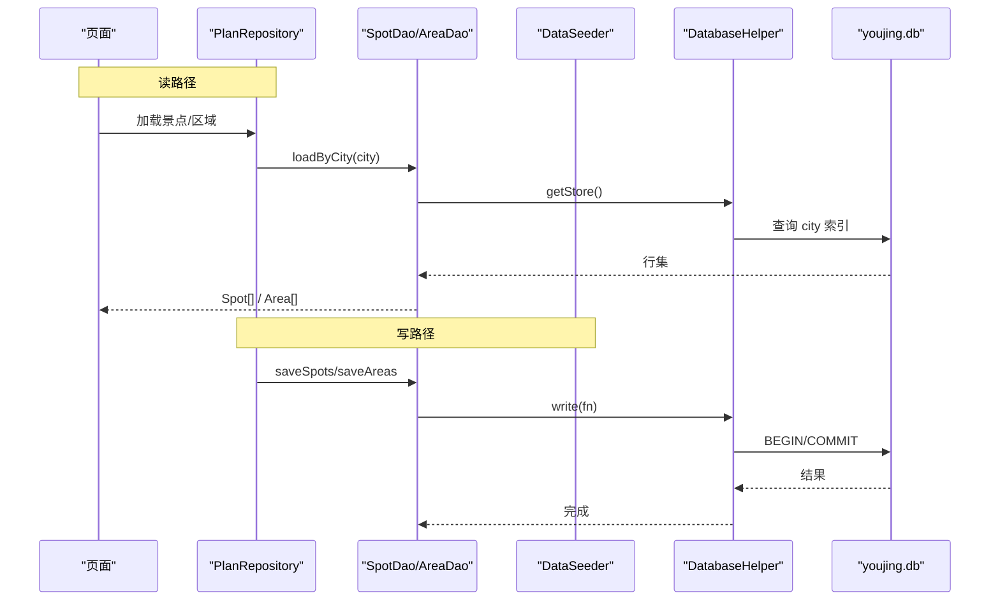
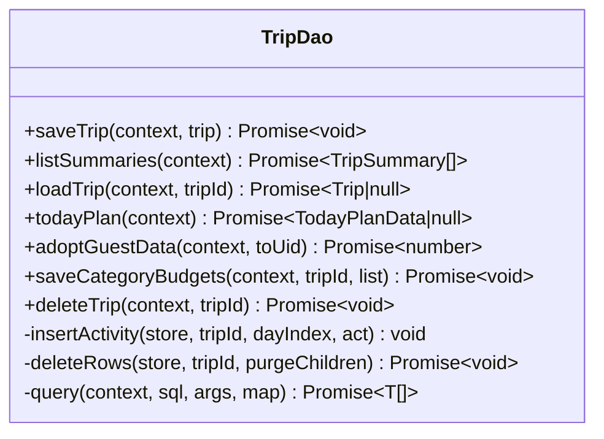
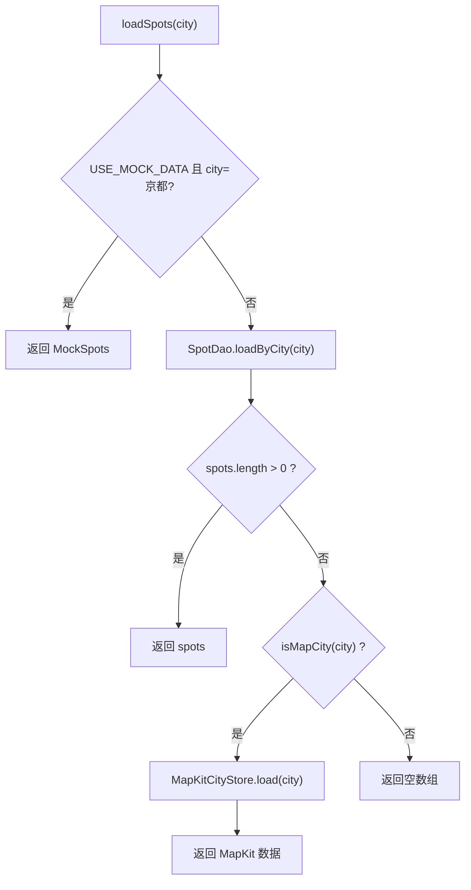
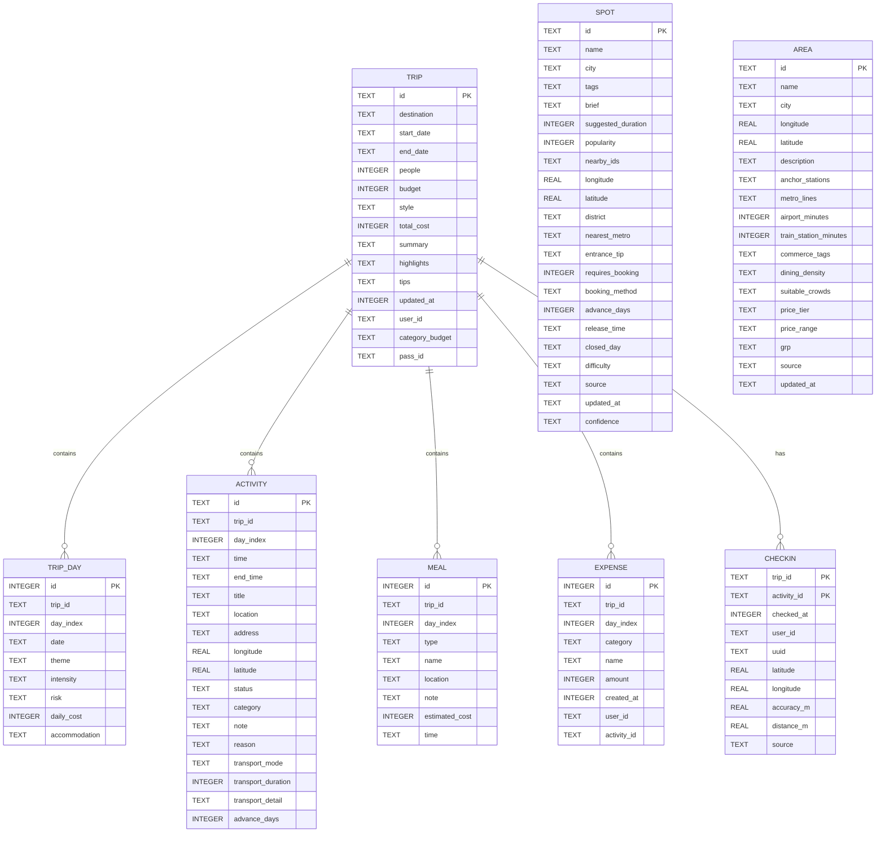
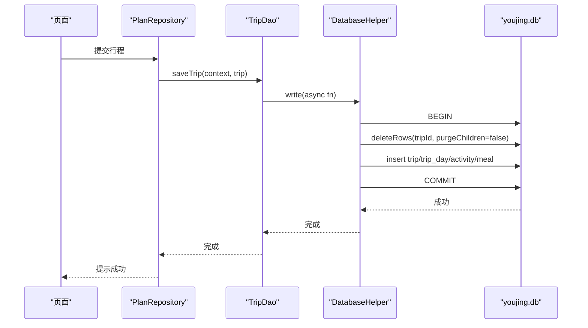
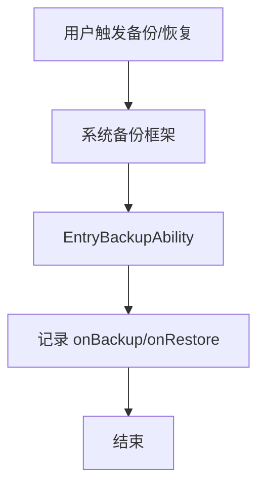
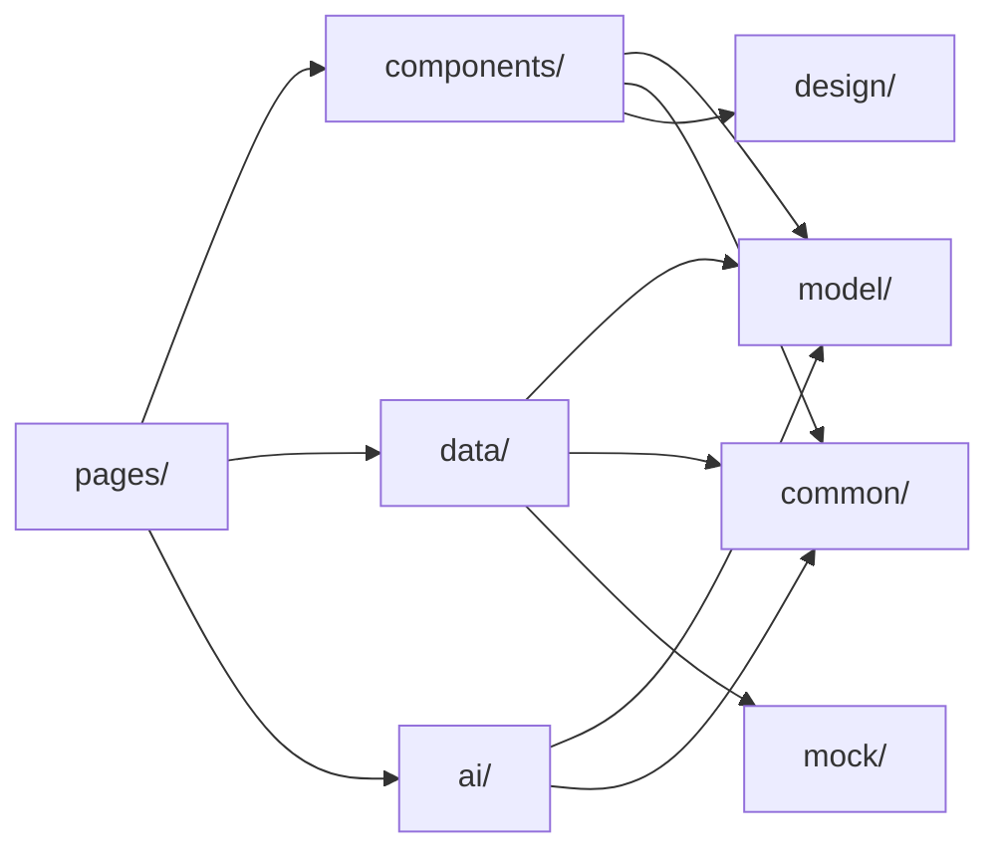

# 数据层设计

<cite>
**本文引用的文件**   
- [DatabaseHelper.ets](file://entry/src/main/ets/data/DatabaseHelper.ets)
- [TripDao.ets](file://entry/src/main/ets/data/TripDao.ets)
- [SpotDao.ets](file://entry/src/main/ets/data/SpotDao.ets)
- [AreaDao.ets](file://entry/src/main/ets/data/AreaDao.ets)
- [PlanRepository.ets](file://entry/src/main/ets/data/PlanRepository.ets)
- [DataSeeder.ets](file://entry/src/main/ets/data/DataSeeder.ets)
- [AccountStore.ets](file://entry/src/main/ets/data/AccountStore.ets)
- [EntryAbility.ets](file://entry/src/main/ets/entryability/EntryAbility.ets)
- [EntryBackupAbility.ets](file://entry/src/main/ets/entrybackupability/EntryBackupAbility.ets)
- [Trip.ets](file://entry/src/main/ets/model/Trip.ets)
- [Spot.ets](file://entry/src/main/ets/model/Spot.ets)
- [Area.ets](file://entry/src/main/ets/model/Area.ets)
- [Account.ets](file://entry/src/main/ets/model/Account.ets)
- [Cities.ets](file://entry/src/main/ets/common/constants/Cities.ets)
- [ARCHITECTURE.md](file://Docs/ARCHITECTURE.md)
- [backup_config.json](file://entry/src/main/resources/base/profile/backup_config.json)
</cite>

## 目录
1. [引言](#引言)
2. [项目结构](#项目结构)
3. [核心组件](#核心组件)
4. [架构总览](#架构总览)
5. [详细组件分析](#详细组件分析)
6. [依赖关系分析](#依赖关系分析)
7. [性能考量](#性能考量)
8. [故障排查指南](#故障排查指南)
9. [结论](#结论)

## 引言
本文件聚焦有径应用的数据层设计与实现，覆盖 RDB 数据库设计、DAO 层 CRUD、仓储模式、实体模型、版本迁移、种子数据导入、备份恢复与性能优化策略。目标是让非深度技术读者也能理解“从页面到数据库”的完整调用链，以及 Trip、Activity、Spot、Area、User（账号分区）等关键实体的关系和约束。

## 项目结构
数据层代码集中在 `entry/src/main/ets/data`，业务模型集中在 `entry/src/main/ets/model`，配置与常量在 `common/config` 与 `common/constants`，入口能力负责初始化与探针，备份扩展能力提供系统备份钩子。

**图表来源**
- [EntryAbility.ets:1-40](file://entry/src/main/ets/entryability/EntryAbility.ets#L1-L40)
- [PlanRepository.ets:1-55](file://entry/src/main/ets/data/PlanRepository.ets#L1-L55)
- [DataSeeder.ets:1-40](file://entry/src/main/ets/data/DataSeeder.ets#L1-L40)
- [SpotDao.ets:1-30](file://entry/src/main/ets/data/SpotDao.ets#L1-L30)
- [AreaDao.ets:1-20](file://entry/src/main/ets/data/AreaDao.ets#L1-L20)
- [TripDao.ets:1-30](file://entry/src/main/ets/data/TripDao.ets#L1-L30)
- [DatabaseHelper.ets:1-40](file://entry/src/main/ets/data/DatabaseHelper.ets#L1-L40)
- [EntryBackupAbility.ets:1-14](file://entry/src/main/ets/entrybackupability/EntryBackupAbility.ets#L1-L14)

**章节来源**
- [ARCHITECTURE.md:1-61](file://Docs/ARCHITECTURE.md#L1-L61)

## 核心组件
- **DatabaseHelper**：RDB 单例、建库、版本迁移、写事务队列。
- **TripDao**：行程聚合根持久化、列表摘要、今日卡片、游客数据归户、分类预算更新、删除级联清理。
- **SpotDao / AreaDao**：内置资产库批量 upsert 与按城市读取。
- **PlanRepository**：面向页面的仓储接口，封装 Mock/种子/Map Kit 多源数据路由。
- **DataSeeder**：首启种子导入与版本升级回填，幂等控制。
- **模型层**：Trip、Activity、Meal、Spot、Area、Account 等类型定义与枚举。

**章节来源**
- [DatabaseHelper.ets:1-40](file://entry/src/main/ets/data/DatabaseHelper.ets#L1-L40)
- [TripDao.ets:1-60](file://entry/src/main/ets/data/TripDao.ets#L1-L60)
- [SpotDao.ets:1-25](file://entry/src/main/ets/data/SpotDao.ets#L1-L25)
- [AreaDao.ets:1-20](file://entry/src/main/ets/data/AreaDao.ets#L1-L20)
- [PlanRepository.ets:1-55](file://entry/src/main/ets/data/PlanRepository.ets#L1-L55)
- [DataSeeder.ets:1-40](file://entry/src/main/ets/data/DataSeeder.ets#L1-L40)
- [Trip.ets:1-40](file://entry/src/main/ets/model/Trip.ets#L1-L40)
- [Spot.ets:1-30](file://entry/src/main/ets/model/Spot.ets#L1-L30)
- [Area.ets:1-30](file://entry/src/main/ets/model/Area.ets#L1-L30)
- [Account.ets:1-20](file://entry/src/main/ets/model/Account.ets#L1-L20)

## 架构总览
数据访问遵循“页面 → 仓储 → DAO → 数据库”的分层纪律，禁止页面直连 RDB；Mock 仅作为数据路由开关，不绕过 data 层。

**图表来源**
- [PlanRepository.ets:10-55](file://entry/src/main/ets/data/PlanRepository.ets#L10-L55)
- [SpotDao.ets:20-60](file://entry/src/main/ets/data/SpotDao.ets#L20-L60)
- [AreaDao.ets:20-75](file://entry/src/main/ets/data/AreaDao.ets#L20-L75)
- [DatabaseHelper.ets:140-180](file://entry/src/main/ets/data/DatabaseHelper.ets#L140-L180)

**章节来源**
- [ARCHITECTURE.md:20-40](file://Docs/ARCHITECTURE.md#L20-L40)

## 详细组件分析

### RDB 数据库设计
数据库名为 `youjing.db`，采用 SQLite RDB 存储，当前版本号由 `DatabaseHelper.DB_VERSION` 管理。表结构包括：
- trip：行程聚合根，包含目的地、日期、人数、预算、风格、总花费、亮点、小贴士、更新时间、用户分区键 user_id、分类预算 JSON、通行证 pass_id。
- trip_day：单日行程，含主题、强度、风险、当日花费、住宿描述。
- activity：活动节点，主键为 `${tripId}:${activityId}`，避免跨行程 id 冲突；包含状态、分类、通勤三列、预约提前量等。
- meal：餐饮，含餐次、名称、位置、时间、预估花费。
- spot：内置景点库，city 索引，JSON 标签与邻近点，预约信息与溯源字段。
- area：住宿区域库，city 索引，JSON 锚定站、地铁线、商圈标签、适合人群，分组与价格档位。
- expense：记账表，user_id 分区，trip_id+day_index 索引，可挂 activity_id。
- checkin：打卡表，(trip_id, activity_id) 复合主键，user_id 分区，v8 起增加 uuid/坐标/精度/距离/source 凭证字段。

索引策略：
- trip(user_id)、spot(city)、area(city)
- trip_day(trip_id)、activity(trip_id, day_index)、meal(trip_id, day_index)
- expense(trip_id, day_index)、expense(user_id)、checkin(user_id)

约束要点：
- trip.id 为主键；activity.id 使用前缀拼接；checkin.trip_id+activity_id 为复合主键；多数文本字段允许空或默认值以兼容旧数据。

**章节来源**
- [DatabaseHelper.ets:40-120](file://entry/src/main/ets/data/DatabaseHelper.ets#L40-L120)
- [DatabaseHelper.ets:120-140](file://entry/src/main/ets/data/DatabaseHelper.ets#L120-L140)

### 数据迁移机制（DB_VERSION = 11）
迁移逻辑位于 `DatabaseHelper.migrate`，采用累积式 `oldVersion < N` 判断，保证任意老库升级到最新版时逐级补齐。主要版本变更：
- v1→v2：trip.user_id 分区列新增。
- v3：创建 expense 表。
- v4：创建 checkin 表并给 expense 加 activity_id。
- v5：spot 增加 confidence 字段。
- v6：meal 增加 time 列。
- v7：trip 增加 category_budget JSON。
- v8：checkin 增加凭证字段 uuid/latitude/longitude/accuracy_m/distance_m/source。
- v9：清理孤儿行（checkin/expense/meal/activity/trip_day 中 trip_id 不在 trip 的行）。
- v10：trip 增加 pass_id。
- v11：activity 增加 advance_days；存在回退场景需先检测列是否存在再 ALTER。

所有建表、增列、清理与索引构建在一个事务中执行，成功才写入新版本号，失败则回滚并抛出迁移错误。

```mermaid
flowchart TD
  Start(["开始迁移"]) --> Check["检查 oldVersion 与 DB_VERSION"]
  Check -->|相等| Done["直接返回"]
  Check -->|不等| BeginTx["BEGIN 事务"]
  BeginTx --> BuildTables["首次安装建表"]
  BuildTables --> V2{"oldVersion < 2"}
  V2 -->|是| AddUserId["trip.user_id"]
  V2 -->|否| V3{"oldVersion < 3"}
  AddUserId --> V3
  V3 -->|是| CreateExpense["CREATE expense"]
  V3 -->|否| V4{"oldVersion < 4"}
  CreateExpense --> V4
  V4 -->|是| CreateCheckin["CREATE checkin + expense.activity_id"]
  V4 -->|否| V5{"oldVersion < 5"}
  CreateCheckin --> V5
  V5 -->|是| AddConfidence["spot.confidence"]
  V5 -->|否| V6{"oldVersion < 6"}
  AddConfidence --> V6
  V6 -->|是| AddMealTime["meal.time"]
  V6 -->|否| V7{"oldVersion < 7"}
  AddMealTime --> V7
  V7 -->|是| AddBudget["trip.category_budget"]
  V7 -->|否| V8{"oldVersion < 8"}
  AddBudget --> V8
  V8 -->|是| AddEvidence["checkin 凭证字段"]
  V8 -->|否| V9{"oldVersion < 9"}
  AddEvidence --> V9
  V9 -->|是| CleanOrphans["清理孤儿行"]
  V9 -->|否| V10{"oldVersion < 10"}
  CleanOrphans --> V10
  V10 -->|是| AddPassId["trip.pass_id"]
  V10 -->|否| V11{"oldVersion < 11"}
  AddPassId --> V11
  V11 -->|是| AddAdvanceDays["activity.advance_days（带 hasColumn 保护）"]
  V11 -->|否| Indexes["创建索引"]
  AddAdvanceDays --> Indexes
  Indexes --> Commit["commit 并写入 version"]
  Commit --> Done
```

**图表来源**
- [DatabaseHelper.ets:140-295](file://entry/src/main/ets/data/DatabaseHelper.ets#L140-L295)

**章节来源**
- [DatabaseHelper.ets:140-295](file://entry/src/main/ets/data/DatabaseHelper.ets#L140-L295)

### TripDao 核心 CRUD 与事务处理
TripDao 承担行程聚合根的整存整取语义：
- **保存行程**：先删除同 tripId 下的 trip_day/activity/meal（保留打卡与费用），再重建 trip、trip_day、activity、meal 行；categoryBudgets 单独通过 update 更新，避免重建整棵树。
- **列表摘要**：通过聚合 SQL 计算 spot_count、booking_count、leg_count、checkin_count，并按 updated_at 倒序返回 TripSummary。
- **详情加载**：顺序读取 trip → trip_day → activity → meal，并在内存中按 dayIndex 组装 Trip 对象。
- **今日卡片**：先用 start_date/end_date 预筛当天行程，命中后逐条调用 loadTrip，减少全量加载成本。
- **游客数据归户**：在单一事务内将 trip/expense/checkin 的 user_id 从游客分区迁移到 UnionID；成功后统计 trip 数量。
- **删除行程**：验证归属后级联删除 trip_day/activity/meal，若 purgeChildren=true 还删除 checkin/expense，防止孤儿行。
- **写事务队列**：所有写操作经 DatabaseHelper.write 串行排队，异常自动 rollback 并包装 AppError。

**图表来源**
- [TripDao.ets:1-200](file://entry/src/main/ets/data/TripDao.ets#L1-L200)
- [TripDao.ets:201-384](file://entry/src/main/ets/data/TripDao.ets#L201-L384)

**章节来源**
- [TripDao.ets:1-200](file://entry/src/main/ets/data/TripDao.ets#L1-L200)
- [TripDao.ets:201-384](file://entry/src/main/ets/data/TripDao.ets#L201-L384)

### PlanRepository 仓储模式与缓存策略
PlanRepository 是面向页面的唯一数据入口，职责是“数据路由 + 业务封装”，不直接操作 RDB：
- **景点加载**：若启用 Mock 且城市为“京都”，返回演示数据；否则走 SpotDao.loadByCity；若为空且为 MapKit 城市，则回退到 MapKitCityStore 联网获取。
- **区域加载**：同样支持 Mock 京都演示数据，然后走 AreaDao；空库时回退 MapKitCityStore。
- **日志与降级**：对空库与回退路径均有日志记录，便于定位数据源问题。
- **缓存说明**：当前仓库未实现显式内存缓存；读路径每次都查 DAO。如需缓存，建议在 Repository 层引入弱引用缓存或按城市分片缓存，注意失效时机与一致性。

**图表来源**
- [PlanRepository.ets:10-55](file://entry/src/main/ets/data/PlanRepository.ets#L10-L55)
- [Cities.ets:70-101](file://entry/src/main/ets/common/constants/Cities.ets#L70-L101)

**章节来源**
- [PlanRepository.ets:1-55](file://entry/src/main/ets/data/PlanRepository.ets#L1-L55)
- [Cities.ets:1-101](file://entry/src/main/ets/common/constants/Cities.ets#L1-L101)

### 数据模型设计
- **Trip**：聚合根，包含 overview、days、tips、style、budget、categoryBudgets、passId。枚举 ActivityStatus、ActivityCategory、IntensityLevel、MealType 稳定映射到存储字符串。
- **Activity**：活动节点，含地点、经纬度、状态、分类、通勤信息 transport(mode/duration/detail)、reason、advanceDays。
- **Meal**：餐次，type/name/location/time/estimatedCost/note。
- **Spot**：景点，tags/brief/suggestedDuration/popularity/openingHours/nearbySpotIds/经纬度/district/nearestMetro/entranceTip/booking/provenance。
- **Area**：住宿区域，anchorStations/metroLines/airportMinutes/trainStationMinutes/commerceTags/diningDensity/suitableCrowds/priceTier/priceRange/group/source/updatedAt。
- **AccountState**：UnionID 分区键 uid，kind(huawei/guest)，loginAt；uid 即 RDB 分区键。

字段约束与兼容性：
- 大量 JSON 文本列（tags、nearby_ids、highlights、tips、category_budget、anchor_stations 等）通过解析函数安全读取，缺失或非法值回退默认。
- 可选字段（如 reason、note、openingHours、priceRange、confidence）在存储层可为空或默认值，读取层按需赋值 undefined。

**图表来源**
- [DatabaseHelper.ets:40-120](file://entry/src/main/ets/data/DatabaseHelper.ets#L40-L120)
- [Trip.ets:1-137](file://entry/src/main/ets/model/Trip.ets#L1-L137)
- [Spot.ets:1-69](file://entry/src/main/ets/model/Spot.ets#L1-L69)
- [Area.ets:1-51](file://entry/src/main/ets/model/Area.ets#L1-L51)
- [Account.ets:1-20](file://entry/src/main/ets/model/Account.ets#L1-L20)

**章节来源**
- [Trip.ets:1-137](file://entry/src/main/ets/model/Trip.ets#L1-L137)
- [Spot.ets:1-69](file://entry/src/main/ets/model/Spot.ets#L1-L69)
- [Area.ets:1-51](file://entry/src/main/ets/model/Area.ets#L1-L51)
- [Account.ets:1-20](file://entry/src/main/ets/model/Account.ets#L1-L20)

### 数据流图：从 UI 到数据库
以“保存行程”为例，展示页面到数据库的调用链：

**图表来源**
- [TripDao.ets:30-120](file://entry/src/main/ets/data/TripDao.ets#L30-L120)
- [DatabaseHelper.ets:140-180](file://entry/src/main/ets/data/DatabaseHelper.ets#L140-L180)

**章节来源**
- [TripDao.ets:30-120](file://entry/src/main/ets/data/TripDao.ets#L30-L120)

### 数据备份恢复机制
- 备份扩展能力 `EntryBackupAbility` 提供 `onBackup` 与 `onRestore` 钩子，当前实现为占位日志。
- `backup_config.json` 开启允许备份恢复。
- 实际备份内容取决于系统备份框架对应用数据的范围，当前代码未自定义序列化/还原逻辑；后续如需精确控制，应在 onRestore 中触发数据校验与修复流程。

**图表来源**
- [EntryBackupAbility.ets:1-14](file://entry/src/main/ets/entrybackupability/EntryBackupAbility.ets#L1-L14)
- [backup_config.json:1-3](file://entry/src/main/resources/base/profile/backup_config.json#L1-L3)

**章节来源**
- [EntryBackupAbility.ets:1-14](file://entry/src/main/ets/entrybackupability/EntryBackupAbility.ets#L1-L14)
- [backup_config.json:1-3](file://entry/src/main/resources/base/profile/backup_config.json#L1-L3)

## 依赖关系分析
- pages 不得直连 data 写操作，必须经 PlanRepository；data 层不得反向引用 pages/components/ai/design。
- mock 仅在 DataSeeder 与 PlanRepository 中使用，受 USE_MOCK_DATA 控制。
- common 与 design 为底层，被其他目录引用但不反向依赖业务目录。

**图表来源**
- [ARCHITECTURE.md:10-61](file://Docs/ARCHITECTURE.md#L10-L61)

**章节来源**
- [ARCHITECTURE.md:10-61](file://Docs/ARCHITECTURE.md#L10-L61)

## 性能考量
- **查询优化**：
  - TripDao.listSummaries 使用聚合 SQL 一次返回摘要指标，避免 N+1 查询。
  - todayPlan 先用 start_date/end_date 预筛当天行程，再逐条 loadTrip，降低行程增长时的刷新成本。
  - SpotDao/AreaDao 按 city 查询并使用 ORDER BY 保证排序稳定性。
- **批量操作**：
  - SpotDao.saveSpots 与 AreaDao.saveAreas 使用 ON_CONFLICT_REPLACE 进行批量 upsert，减少重复写入。
  - DataSeeder 按城市分批次插入，最后记录 SEED_VERSION 以跳过已灌入。
- **内存管理**：
  - ResultSet 遍历后统一 close，避免资源泄漏。
  - JSON 文本列解析采用 try/catch 回退默认，避免异常导致 UI 卡顿。
- **写并发控制**：
  - DatabaseHelper.writeChain 将所有写事务串行化，规避 RDB busy 与锁竞争。
- **建议**：
  - 在 PlanRepository 层引入按城市的弱引用缓存，设置 TTL 与失效策略（如种子版本变化、MapKit 更新）。
  - 对高频只读表（spot/area）考虑启动期预热缓存，减少冷启动 IO。
  - 对大行程 loadTrip 可分页或懒加载 days/activities，降低单次对象图大小。

[本节为通用性能建议，不直接分析具体文件]

## 故障排查指南
- **迁移失败**：
  - 现象：建库或升级时报迁移错误，行程列表不可见。
  - 排查：确认 oldVersion 累积式分支是否覆盖目标版本；检查 hasColumn 保护是否生效（如 v11 advance_days）。
  - 参考：[DatabaseHelper.ets:140-295](file://entry/src/main/ets/data/DatabaseHelper.ets#L140-L295)
- **写事务失败**：
  - 现象：保存行程报错，数据未落盘。
  - 排查：检查 writeChain 是否被异常卡住；确认事务内所有 execute 调用均无异常。
  - 参考：[DatabaseHelper.ets:140-180](file://entry/src/main/ets/data/DatabaseHelper.ets#L140-L180)
- **游客数据归户异常**：
  - 现象：登录后行程/费用/打卡消失。
  - 排查：确认 adoptGuestData 事务内 trip/expense/checkin 三张表均已更新；核对 user_id 是否为 AccountConfig.GUEST_UID。
  - 参考：[TripDao.ets:201-260](file://entry/src/main/ets/data/TripDao.ets#L201-L260)
- **景点库为空**：
  - 现象：城市面板或精选结果为空。
  - 排查：检查 DataSeeder 是否执行；确认 SEED_VERSION 与 jsonl 版本一致；若为 MapKit 城市，确认 isMapCity 分支与 MapKitCityStore 可用性。
  - 参考：[DataSeeder.ets:40-120](file://entry/src/main/ets/data/DataSeeder.ets#L40-L120)
  - 参考：[PlanRepository.ets:10-55](file://entry/src/main/ets/data/PlanRepository.ets#L10-L55)
- **备份恢复无效**：
  - 现象：备份后数据未恢复。
  - 排查：确认 backup_config.json 已开启；检查 EntryBackupAbility.onRestore 是否触发；如需精确控制，补充自定义还原逻辑。
  - 参考：[EntryBackupAbility.ets:1-14](file://entry/src/main/ets/entrybackupability/EntryBackupAbility.ets#L1-L14)
  - 参考：[backup_config.json:1-3](file://entry/src/main/resources/base/profile/backup_config.json#L1-L3)

**章节来源**
- [DatabaseHelper.ets:140-295](file://entry/src/main/ets/data/DatabaseHelper.ets#L140-L295)
- [TripDao.ets:201-260](file://entry/src/main/ets/data/TripDao.ets#L201-L260)
- [DataSeeder.ets:40-120](file://entry/src/main/ets/data/DataSeeder.ets#L40-L120)
- [PlanRepository.ets:10-55](file://entry/src/main/ets/data/PlanRepository.ets#L10-L55)
- [EntryBackupAbility.ets:1-14](file://entry/src/main/ets/entrybackupability/EntryBackupAbility.ets#L1-L14)
- [backup_config.json:1-3](file://entry/src/main/resources/base/profile/backup_config.json#L1-L3)

## 结论
有径数据层采用清晰的分层架构：页面经 PlanRepository 访问数据，DAO 封装 RDB 操作，DatabaseHelper 统一管理单例与迁移。Trip 聚合根通过 TripDao 整存整取，Spot/Area 通过 DAO 批量 upsert，Account 通过 user_id 分区隔离数据。迁移机制采用累积式版本判断，保证跨级升级健壮性；种子导入具备幂等与版本控制。当前备份恢复为占位实现，可按需扩展。性能方面已有聚合查询、批处理与写串行化基础，后续可在仓储层引入缓存与懒加载进一步优化。