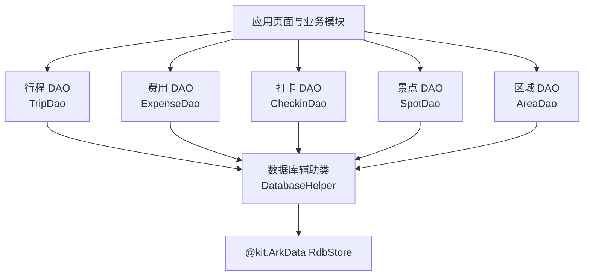
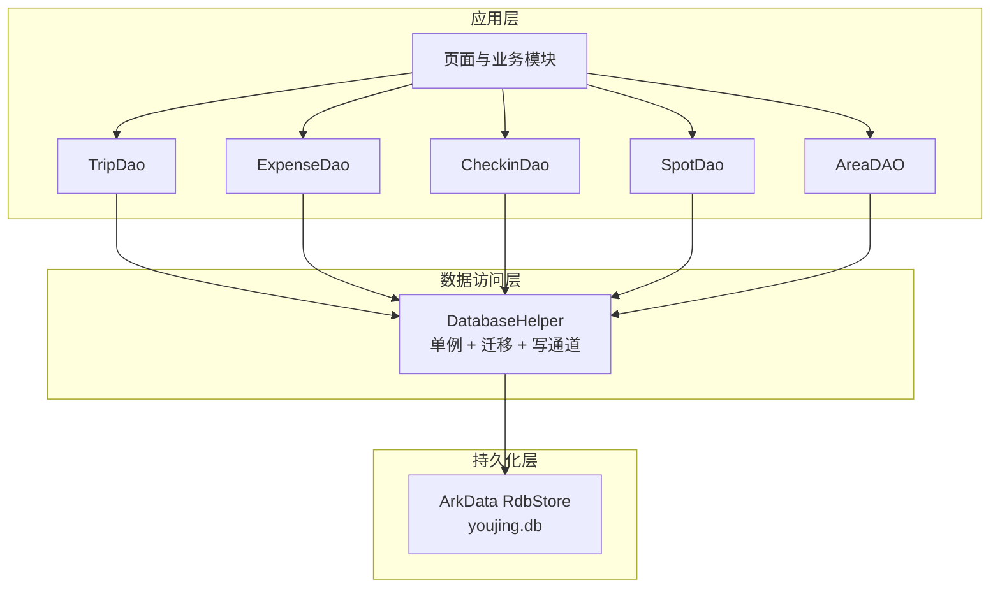
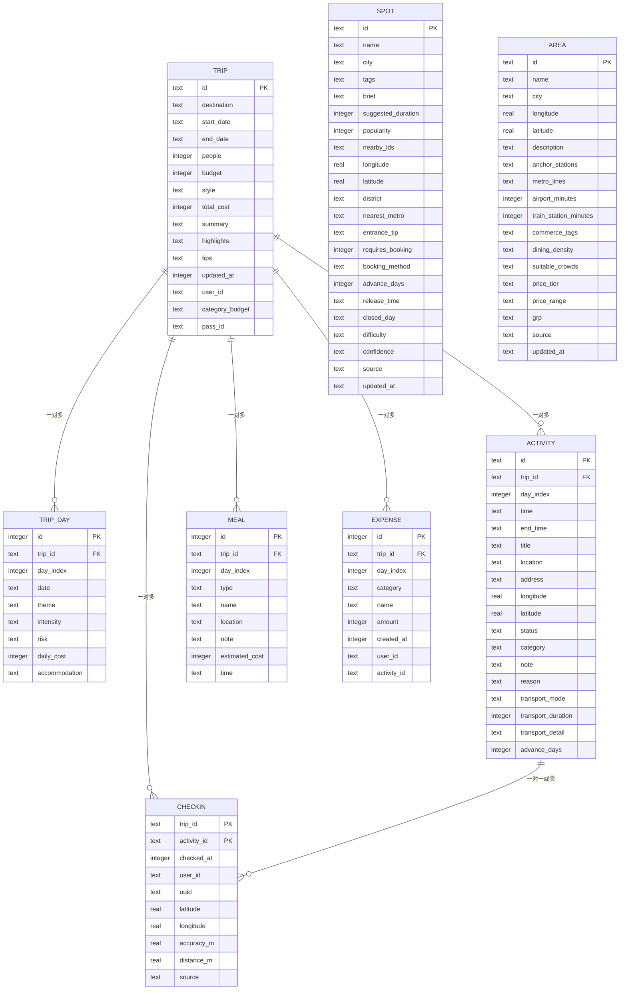
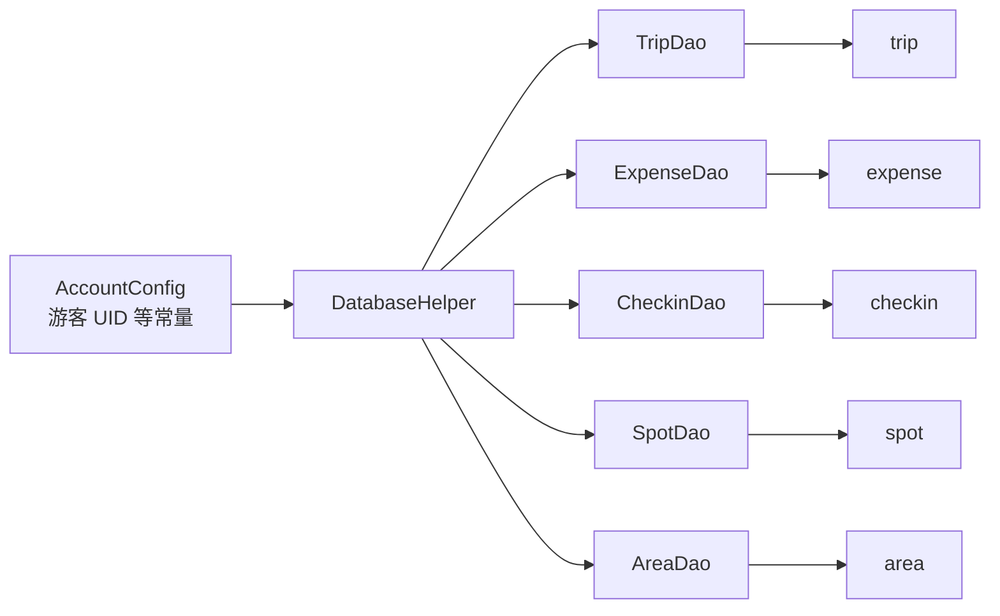

# 数据库架构与迁移

<cite>
**本文引用的文件**   
- [DatabaseHelper.ets](file://entry/src/main/ets/data/DatabaseHelper.ets)
- [TripDao.ets](file://entry/src/main/ets/data/TripDao.ets)
- [ExpenseDao.ets](file://entry/src/main/ets/data/ExpenseDao.ets)
- [CheckinDao.ets](file://entry/src/main/ets/data/CheckinDao.ets)
- [SpotDao.ets](file://entry/src/main/ets/data/SpotDao.ets)
- [AreaDao.ets](file://entry/src/main/ets/data/AreaDao.ets)
- [AccountConfig.ets](file://entry/src/main/ets/common/config/AccountConfig.ets)
</cite>

## 目录
1. [引言](#引言)
2. [项目结构](#项目结构)
3. [核心组件](#核心组件)
4. [架构总览](#架构总览)
5. [详细组件分析](#详细组件分析)
6. [依赖关系分析](#依赖关系分析)
7. [性能考量](#性能考量)
8. [故障排查指南](#故障排查指南)
9. [结论](#结论)
10. [附录：建表 SQL 参考](#附录建表-sql-参考)

## 引言
本文件系统性梳理“有径”应用基于 `@kit.ArkData` RDB 的本地数据持久化设计。文档围绕以下目标展开：

- 完整说明七张业务表的字段定义、数据类型、约束与业务含义，覆盖行程聚合根 trip、单日计划 trip_day、活动节点 activity、餐饮 meal、景点库 spot、区域库 area、费用记录 expense、打卡凭证 checkin。
- 解释索引策略的设计原理与查询优化效果，包括 `idx_trip_user`、`idx_activity_trip_day`、`idx_spot_city` 等。
- 拆解版本迁移机制：当前 `DB_VERSION = 11`，逐条解释 v1→v2→...→v11 的迁移逻辑，强调累积式 `oldVersion < N` 判断纪律。
- 说明数据分区策略：以 `user_id` 实现多账号隔离，默认游客账号作为兼容占位。
- 提供 ER 关系图、建表 SQL 参考、迁移回滚策略和常见故障排查指引。

该文档既适合维护者理解代码级实现，也适合非专业读者把握整体数据模型。

## 项目结构
与数据库相关的主要源码集中在 `entry/src/main/ets/data` 目录下：

- `DatabaseHelper.ets`：RDB 单例、建库语句、迁移编排、写事务通道、索引与常量。
- `TripDao.ets`：行程聚合根的增删改查入口。
- `ExpenseDao.ets`：费用记录的 DAO。
- `CheckinDao.ets`：打卡凭证的 DAO。
- `SpotDao.ets`、`AreaDao.ets`：内置景点与区域资产库的 DAO。
- `AccountConfig.ets`：提供游客用户标识等账号配置常量。

**图表来源**
- [DatabaseHelper.ets:1-110](file://entry/src/main/ets/data/DatabaseHelper.ets#L1-L110)
- [TripDao.ets](file://entry/src/main/ets/data/TripDao.ets)
- [ExpenseDao.ets](file://entry/src/main/ets/data/ExpenseDao.ets)
- [CheckinDao.ets](file://entry/src/main/ets/data/CheckinDao.ets)
- [SpotDao.ets](file://entry/src/main/ets/data/SpotDao.ets)
- [AreaDao.ets](file://entry/src/main/ets/data/AreaDao.ets)

**章节来源**
- [DatabaseHelper.ets:1-110](file://entry/src/main/ets/data/DatabaseHelper.ets#L1-L110)

## 核心组件
本节聚焦 `DatabaseHelper` 的核心职责：

| 职责 | 说明 |
|---|---|
| RDB 单例 | 通过 `getStore` 保证全应用复用同一个 `RdbStore`，避免连接分散。 |
| 建库 | 首次安装或空库时创建 trip、trip_day、activity、meal、spot、area、expense、checkin 八张表。 |
| 迁移 | 在 `onUpgrade` 对应的迁移流程中，按旧版本号逐级执行 ALTER TABLE、清理孤儿数据和重建索引。 |
| 写事务通道 | 通过串行 Promise 链统一封装写事务，失败自动回滚并抛出 `AppError`。 |
| 幂等检测 | 使用 `PRAGMA table_info` 检测列是否存在，防止降级后重复加列导致迁移失败。 |

关键实现要点：

- 数据库文件名固定为 `youjing.db`，安全等级为 S4。
- 所有建表语句集中在文件顶部常量中，便于阅读和维护。
- 索引语句集中在 `SQL_INDEXES` 数组中，每次迁移都会重新 `CREATE INDEX IF NOT EXISTS`。
- 迁移全部放在一个事务中执行；只有所有步骤成功才写入 `store.version = DB_VERSION`。
- 游标读取结果集后显式 `close()`，避免资源泄漏。

**章节来源**
- [DatabaseHelper.ets:1-110](file://entry/src/main/ets/data/DatabaseHelper.ets#L1-L110)
- [DatabaseHelper.ets:201-295](file://entry/src/main/ets/data/DatabaseHelper.ets#L201-L295)

## 架构总览
下图展示应用层 DAO、数据库辅助类与 ArkData RDB 之间的关系，以及主要业务表之间的关联方向。

**图表来源**
- [DatabaseHelper.ets:1-110](file://entry/src/main/ets/data/DatabaseHelper.ets#L1-L110)
- [TripDao.ets](file://entry/src/main/ets/data/TripDao.ets)
- [ExpenseDao.ets](file://entry/src/main/ets/data/ExpenseDao.ets)
- [CheckinDao.ets](file://entry/src/main/ets/data/CheckinDao.ets)
- [SpotDao.ets](file://entry/src/main/ets/data/SpotDao.ets)
- [AreaDao.ets](file://entry/src/main/ets/data/AreaDao.ets)

## 详细组件分析

### 数据模型总览
下表汇总八张表的核心字段、类型、约束和业务含义。为避免直接粘贴大段代码，字段定义以结构化表格呈现，并在末尾附录给出对应建表 SQL 路径。

#### trip：行程聚合根
| 字段 | 类型 | 约束 | 业务含义 |
|---|---|---|---|
| id | TEXT | 主键 | 行程唯一标识，通常由上层生成或同步。 |
| destination | TEXT | 非空 | 目的地名称。 |
| start_date | TEXT | 非空 | 行程开始日期。 |
| end_date | TEXT | 非空 | 行程结束日期。 |
| people | INTEGER | 非空 | 出行人数。 |
| budget | INTEGER | 非空 | 预算金额。 |
| style | TEXT | 非空 | 行程风格标签。 |
| total_cost | INTEGER | 非空，默认 0 | 行程累计花费。 |
| summary | TEXT | 非空，默认空串 | 行程摘要。 |
| highlights | TEXT | 非空，默认空数组字符串 | 行程亮点 JSON。 |
| tips | TEXT | 非空，默认空数组字符串 | 行程提示 JSON。 |
| updated_at | INTEGER | 非空 | 更新时间戳。 |
| user_id | TEXT | 非空，默认游客 UID | 账号分区键，用于多账号隔离。 |
| category_budget | TEXT | 非空，默认空数组字符串 | 分类预算 JSON。 |
| pass_id | TEXT | 非空，默认空串 | 通行证标识，空串表示未购买。 |

trip 是行程聚合根，trip_day、activity、meal、expense、checkin 都通过 trip_id 与其关联。

#### trip_day：单日计划
| 字段 | 类型 | 约束 | 业务含义 |
|---|---|---|---|
| id | INTEGER | 自增主键 | 单日记录主键。 |
| trip_id | TEXT | 非空 | 所属行程。 |
| day_index | INTEGER | 非空 | 第几天，从 0 或 1 起算由上层约定。 |
| date | TEXT | 非空 | 实际日期。 |
| theme | TEXT | 非空，默认空串 | 当日主题。 |
| intensity | TEXT | 非空，默认 medium | 当日强度。 |
| risk | TEXT | 可为空 | 风险提示。 |
| daily_cost | INTEGER | 非空，默认 0 | 当日预估成本。 |
| accommodation | TEXT | 可为空 | 住宿信息。 |

trip_day 与 trip 是一对多关系；activity 和 meal 又通过 trip_id + day_index 与单日计划对齐。

#### activity：活动节点
| 字段 | 类型 | 约束 | 业务含义 |
|---|---|---|---|
| id | TEXT | 主键 | 活动节点唯一标识。 |
| trip_id | TEXT | 非空 | 所属行程。 |
| day_index | INTEGER | 非空 | 所属日索引。 |
| time | TEXT | 非空 | 开始时间。 |
| end_time | TEXT | 非空 | 结束时间。 |
| title | TEXT | 非空 | 活动标题。 |
| location | TEXT | 非空，默认空串 | 活动地点名称。 |
| address | TEXT | 非空，默认空串 | 详细地址。 |
| longitude | REAL | 非空，默认 0 | 经度。 |
| latitude | REAL | 非空，默认 0 | 纬度。 |
| status | TEXT | 非空 | 活动状态。 |
| category | TEXT | 非空 | 活动分类。 |
| note | TEXT | 可为空 | 备注。 |
| reason | TEXT | 可为空 | 活动原因。 |
| transport_mode | TEXT | 可为空 | 交通方式。 |
| transport_duration | INTEGER | 可为空 | 交通时长。 |
| transport_detail | TEXT | 可为空 | 交通详情。 |
| advance_days | INTEGER | 可为空 | 预约提前量天数，供系统提醒排序。 |

activity 是行程中最细粒度的可操作单元，也是 checkin 打卡的直接目标。

#### meal：餐饮
| 字段 | 类型 | 约束 | 业务含义 |
|---|---|---|---|
| id | INTEGER | 自增主键 | 餐饮记录主键。 |
| trip_id | TEXT | 非空 | 所属行程。 |
| day_index | INTEGER | 非空 | 所属日索引。 |
| type | TEXT | 非空 | 餐次类型，如早餐、午餐、晚餐。 |
| name | TEXT | 非空 | 餐厅或食物名称。 |
| location | TEXT | 非空，默认空串 | 就餐地点。 |
| note | TEXT | 可为空 | 备注。 |
| estimated_cost | INTEGER | 非空，默认 0 | 预估花费。 |
| time | TEXT | 非空，默认空串 | 就餐时刻，v6 新增。 |

meal 与 activity 并列挂在 trip_day 下，支持按时间并排显示。

#### spot：景点库
| 字段 | 类型 | 约束 | 业务含义 |
|---|---|---|---|
| id | TEXT | 主键 | 景点唯一标识。 |
| name | TEXT | 非空 | 景点名称。 |
| city | TEXT | 非空 | 所在城市。 |
| tags | TEXT | 非空，默认空数组字符串 | 标签 JSON。 |
| brief | TEXT | 非空，默认空串 | 简介。 |
| suggested_duration | INTEGER | 非空，默认 60 | 建议游玩时长（分钟）。 |
| popularity | INTEGER | 非空，默认 50 | 热度。 |
| nearby_ids | TEXT | 非空，默认空数组字符串 | 附近景点 ID 列表。 |
| longitude | REAL | 非空，默认 0 | 经度。 |
| latitude | REAL | 非空，默认 0 | 纬度。 |
| district | TEXT | 非空，默认空串 | 行政区。 |
| nearest_metro | TEXT | 非空，默认空串 | 最近地铁站。 |
| entrance_tip | TEXT | 可为空 | 入口提示。 |
| requires_booking | INTEGER | 非空，默认 0 | 是否需要预约。 |
| booking_method | TEXT | 可为空 | 预约方式。 |
| advance_days | INTEGER | 可为空 | 预约提前天数。 |
| release_time | TEXT | 可为空 | 放票时间。 |
| closed_day | TEXT | 可为空 | 闭馆日。 |
| difficulty | TEXT | 可为空 | 难度。 |
| confidence | TEXT | 非空，默认空串 | 可信度，v5 新增。 |
| source | TEXT | 非空，默认空串 | 数据来源。 |
| updated_at | TEXT | 非空，默认空串 | 数据更新时间。 |

spot 是内置资产库，不直接挂到 trip，而是被 activity、spot 选择流程引用。

#### area：区域库
| 字段 | 类型 | 约束 | 业务含义 |
|---|---|---|---|
| id | TEXT | 主键 | 区域唯一标识。 |
| name | TEXT | 非空 | 区域名称。 |
| city | TEXT | 非空 | 城市。 |
| longitude | REAL | 非空，默认 0 | 经度。 |
| latitude | REAL | 非空，默认 0 | 纬度。 |
| description | TEXT | 非空，默认空串 | 描述。 |
| anchor_stations | TEXT | 非空，默认空数组字符串 | 锚点车站。 |
| metro_lines | TEXT | 非空，默认空数组字符串 | 地铁线路。 |
| airport_minutes | INTEGER | 非空，默认 0 | 机场耗时。 |
| train_station_minutes | INTEGER | 非空，默认 0 | 火车站耗时。 |
| commerce_tags | TEXT | 非空，默认空数组字符串 | 商业标签。 |
| dining_density | TEXT | 非空，默认空串 | 餐饮密度。 |
| suitable_crowds | TEXT | 非空，默认空数组字符串 | 适合人群。 |
| price_tier | TEXT | 非空，默认 comfort | 价格档位。 |
| price_range | TEXT | 可为空 | 价格区间。 |
| grp | TEXT | 非空，默认 core | 分组。 |
| source | TEXT | 非空，默认空串 | 数据来源。 |
| updated_at | TEXT | 非空，默认空串 | 更新时间。 |

area 与 spot 共同构成城市空间数据底座。

#### expense：费用记录
| 字段 | 类型 | 约束 | 业务含义 |
|---|---|---|---|
| id | INTEGER | 自增主键 | 费用记录主键。 |
| trip_id | TEXT | 非空 | 所属行程。 |
| day_index | INTEGER | 非空 | 所属日索引。 |
| category | TEXT | 非空 | 费用分类。 |
| name | TEXT | 非空 | 费用名称。 |
| amount | INTEGER | 非空 | 金额。 |
| created_at | INTEGER | 非空 | 创建时间戳。 |
| user_id | TEXT | 非空，默认游客 UID | 账号分区键。 |
| activity_id | TEXT | 可为空 | 可挂到具体活动节点，v4 新增。 |

expense 同 trip 一样按 user_id 分区，但本身没有独立主表聚合语义，更多是明细记账。

#### checkin：打卡凭证
| 字段 | 类型 | 约束 | 业务含义 |
|---|---|---|---|
| trip_id | TEXT | 非空，复合主键 | 所属行程。 |
| activity_id | TEXT | 非空，复合主键 | 所属活动。 |
| checked_at | INTEGER | 非空 | 打卡时间戳。 |
| user_id | TEXT | 非空，默认游客 UID | 账号分区键。 |
| uuid | TEXT | 非空，默认空串 | 到站凭证 UUID，v8 新增。 |
| latitude | REAL | 非空，默认 0 | 打卡纬度，v8 新增。 |
| longitude | REAL | 非空，默认 0 | 打卡经度，v8 新增。 |
| accuracy_m | REAL | 非空，默认 0 | 定位精度（米），v8 新增。 |
| distance_m | REAL | 非空，默认 0 | 距离（米），v8 新增。 |
| source | TEXT | 非空，默认 manual | 打卡来源，v8 新增。 |

checkin 的主键是 `(trip_id, activity_id)`，确保同一行程内同一活动只有一条打卡记录。

**章节来源**
- [DatabaseHelper.ets:35-110](file://entry/src/main/ets/data/DatabaseHelper.ets#L35-L110)

### 索引策略
索引定义集中在 `SQL_INDEXES` 中，并通过 `CREATE INDEX IF NOT EXISTS` 保证幂等。

| 索引名 | 表 | 字段 | 设计原理 | 查询优化效果 |
|---|---|---|---|---|
| idx_trip_day | trip_day | trip_id | 快速查找某行程下的所有单日计划。 | 行程详情页加载单日列表时避免全表扫描。 |
| idx_activity_trip_day | activity | trip_id, day_index | 联合索引，同时按行程和日索引过滤。 | 行程某日的活动列表查询更精确。 |
| idx_meal_trip_day | meal | trip_id, day_index | 与 activity 对齐，按行程和日查询餐次。 | 一日三餐与活动并排渲染更快。 |
| idx_spot_city | spot | city | 按城市筛选景点库。 | 切换城市时减少全库扫描。 |
| idx_area_city | area | city | 按城市筛选区域库。 | 区域推荐和城市联动查询更快。 |
| idx_trip_user | trip | user_id | 按用户隔离行程。 | 多账号场景下只查当前用户行程。 |
| idx_expense_trip_day | expense | trip_id, day_index | 按行程和日查询费用明细。 | 行程费用和单日费用聚合更高效。 |
| idx_expense_user | expense | user_id | 按用户隔离费用。 | 多账号费用统计隔离。 |
| idx_checkin_user | checkin | user_id | 按用户隔离打卡。 | 多账号打卡记录和勋章统计隔离。 |

其中 `idx_trip_user` 是多账号隔离的关键索引；`idx_activity_trip_day` 是行程日历渲染的核心索引；`idx_spot_city` 支撑景点库按城市检索。

**章节来源**
- [DatabaseHelper.ets:90-110](file://entry/src/main/ets/data/DatabaseHelper.ets#L90-L110)

### 版本迁移机制
当前数据库版本为 `DB_VERSION = 11`。迁移入口会先比较 `store.version` 与 `DB_VERSION`，相同则跳过迁移；否则开启事务，按 `oldVersion < N` 的累积条件逐级执行。

迁移顺序如下：

| 阶段 | 旧版本范围 | 操作 | 业务目的 |
|---|---|---|---|
| 初始建表 | oldVersion == 0 | 创建 trip、trip_day、activity、meal、spot、area、expense、checkin 八张表 | 首次安装或空库初始化。 |
| v1 → v2 | oldVersion < 2 | trip 增加 user_id 列 | 行程按账号分区，历史行默认游客 UID。 |
| v2 → v3 | oldVersion < 3 | 创建 expense 表 | 引入手工记账能力。 |
| v3 → v4 | oldVersion < 4 | 创建 checkin 表，expense 增加 activity_id 列 | 引入打卡凭证，费用可挂到具体活动。 |
| v4 → v5 | oldVersion < 5 | spot 增加 confidence 列 | 景点库增加可信度字段。 |
| v5 → v6 | oldVersion < 6 | meal 增加 time 列 | 餐次支持具体时刻，与活动并排显示。 |
| v6 → v7 | oldVersion < 7 | trip 增加 category_budget 列 | 行程携带分类预算 JSON。 |
| v7 → v8 | oldVersion < 8 | checkin 增加 uuid、latitude、longitude、accuracy_m、distance_m、source 列 | 打卡留到站凭证，区分手动与自动来源。 |
| v8 → v9 | oldVersion < 9 | 清理孤儿数据 | 删除父行程已不存在但子表仍残留的记录。 |
| v9 → v10 | oldVersion < 10 | trip 增加 pass_id 列 | 行程绑定通行证，空串表示未购买。 |
| v10 → v11 | oldVersion < 11 | 幂等检查 activity.advance_days 列后加列 | 活动支持预约提前量，供系统提醒排序。 |
| 索引重建 | 每次迁移 | 重建所有索引 | 保证索引存在且幂等。 |
| 提交版本 | 最后 | 写入 DB_VERSION 并提交事务 | 标记迁移成功。 |

关键纪律：

- **累积式判断**：一律使用 `oldVersion < N`，而不是 `oldVersion === N`。这样从任意老版本跨级升级到最新版本时，中间缺失的变更都会被补齐。
- **事务包裹**：所有 ALTER TABLE、DELETE、INSERT 等操作都在一个事务中；任何一步失败都会回滚。
- **幂等索引**：索引使用 `IF NOT EXISTS`，避免重复创建报错。
- **列存在性检测**：v11 特别通过 `PRAGMA table_info` 检测列是否已存在，防止旧版本 App 把 version 降回 10 后再升级时出现 duplicate column。
- **游标关闭**：查询 `PRAGMA table_info` 的结果集会在 finally 中关闭，避免内存泄漏。

```mermaid
flowchart TD
    Start["开始迁移"] --> CheckSame{"当前版本等于 DB_VERSION ?"}
    CheckSame -->|是| End["直接返回"]
    CheckSame -->|否| BeginTx["开启事务"]
    BeginTx --> V0{"oldVersion == 0 ?"}
    V0 -->|是| CreateTables["创建八张表"]
    V0 -->|否| NextV2["继续判断 v2"]
    CreateTables --> NextV2
    NextV2 --> V2{"oldVersion < 2 ?"}
    V2 -->|是| AddUserId["trip 加 user_id"]
    V2 -->|否| NextV3["继续判断 v3"]
    AddUserId --> NextV3
    NextV3 --> V3{"oldVersion < 3 ?"}
    V3 -->|是| CreateExpense["创建 expense 表"]
    V3 -->|否| NextV4["继续判断 v4"]
    CreateExpense --> NextV4
    NextV4 --> V4{"oldVersion < 4 ?"}
    V4 -->|是| CreateCheckinAndActivityId["创建 checkin 表<br/>expense 加 activity_id"]
    V4 -->|否| NextV5["继续判断 v5"]
    CreateCheckinAndActivityId --> NextV5
    NextV5 --> V5{"oldVersion < 5 ?"}
    V5 -->|是| AddSpotConfidence["spot 加 confidence"]
    V5 -->|否| NextV6["继续判断 v6"]
    AddSpotConfidence --> NextV6
    NextV6 --> V6{"oldVersion < 6 ?"}
    V6 -->|是| AddMealTime["meal 加 time"]
    V6 -->|否| NextV7["继续判断 v7"]
    AddMealTime --> NextV7
    NextV7 --> V7{"oldVersion < 7 ?"}
    V7 -->|is| AddCategoryBudget["trip 加 category_budget"]
    V7 -->|否| NextV8["继续判断 v8"]
    AddCategoryBudget --> NextV8
    NextV8 --> V8{"oldVersion < 8 ?"}
    V8 -->|是| AddCheckinEvidence["checkin 增加到站凭证字段"]
    V8 -->|否| NextV9["继续判断 v9"]
    AddCheckinEvidence --> NextV9
    NextV9 --> V9{"oldVersion < 9 ?"}
    V9 -->|是| CleanOrphans["清理孤儿数据"]
    V9 -->|否| NextV10["继续判断 v10"]
    CleanOrphans --> NextV10
    NextV10 --> V10{"oldVersion < 10 ?"}
    V10 -->|是| AddPassId["trip 加 pass_id"]
    V10 -->|否| NextV11["继续判断 v11"]
    AddPassId --> NextV11
    NextV11 --> V11{"oldVersion < 11 ?"}
    V11 -->|是| CheckAdvanceDays["检测 activity.advance_days 列是否存在<br/>不存在则加列"]
    V11 -->|否| BuildIndexes["重建索引"]
    CheckAdvanceDays --> BuildIndexes
    BuildIndexes --> SetVersion["写入 DB_VERSION"]
    SetVersion --> Commit["提交事务"]
    Commit --> Success["迁移完成"]
```

**图表来源**
- [DatabaseHelper.ets:201-295](file://entry/src/main/ets/data/DatabaseHelper.ets#L201-L295)

**章节来源**
- [DatabaseHelper.ets:35-110](file://entry/src/main/ets/data/DatabaseHelper.ets#L35-L110)
- [DatabaseHelper.ets:201-295](file://entry/src/main/ets/data/DatabaseHelper.ets#L201-L295)

### 数据分区策略：user_id 多账号隔离
应用通过 trip、expense、checkin 三张表中的 `user_id` 字段实现多账号数据隔离：

- trip.user_id：行程归属用户。
- expense.user_id：费用归属用户。
- checkin.user_id：打卡归属用户。
- 默认值为 `AccountConfig.GUEST_UID`，即游客账号，用于兼容历史本机数据。
- 索引 `idx_trip_user`、`idx_expense_user`、`idx_checkin_user` 保障按用户查询的性能。

这意味着同一设备上多个账号的数据不会互相污染；新账号登录后，应基于其 user_id 读写各自数据。对于历史数据，如果尚未迁移 user_id，默认会落入游客分区，这属于兼容行为。

**章节来源**
- [DatabaseHelper.ets:70-110](file://entry/src/main/ets/data/DatabaseHelper.ets#L70-L110)
- [AccountConfig.ets](file://entry/src/main/ets/common/config/AccountConfig.ets)

### ER 关系图
下图展示八张表之间的实体关系。trip 是聚合根；trip_day、activity、meal、expense、checkin 均通过 trip_id 关联；checkin 还通过 activity_id 指向 activity。

**图表来源**
- [DatabaseHelper.ets:35-110](file://entry/src/main/ets/data/DatabaseHelper.ets#L35-L110)

## 依赖关系分析

依赖关系要点：

- `DatabaseHelper` 是数据层核心，向上暴露 RdbStore 和写事务通道。
- 各 DAO 负责将业务对象映射为数据库查询参数，再委托给 `DatabaseHelper`。
- `AccountConfig` 提供默认游客用户标识，影响 expense、checkin、trip 的 user_id 默认值。
- 表之间通过 trip_id、activity_id、city 形成强关联。

**图表来源**
- [DatabaseHelper.ets:1-110](file://entry/src/main/ets/data/DatabaseHelper.ets#L1-L110)
- [AccountConfig.ets](file://entry/src/main/ets/common/config/AccountConfig.ets)

**章节来源**
- [DatabaseHelper.ets:1-110](file://entry/src/main/ets/data/DatabaseHelper.ets#L1-L110)

## 性能考量

| 维度 | 现状与建议 |
|---|---|
| 连接复用 | 已通过 `DatabaseHelper.storePromise` 单例复用 RdbStore，避免多次建库开销。 |
| 写并发 | 通过 `writeChain` Promise 串行化写事务，规避 RDB busy 问题，代价是写吞吐受限，需保持写操作轻量。 |
| 索引命中 | trip.user_id、activity.trip_id+day_index、spot.city 等索引覆盖高频查询；新增查询时应优先评估是否可复用现有索引。 |
| JSON 文本列 | highlights、tips、category_budget、tags、nearby_ids 等使用 TEXT 存储 JSON，适合移动端轻量使用，但不具备原生 JSON 查询能力；复杂筛选建议在上层处理。 |
| 游标管理 | PRAGMA 和查询结果集需要 close()，已在 hasColumn 中体现；DAO 层也应遵循同样规范。 |
| 数据体积 | 单条记录上限约 2MB，行程 JSON 列应保持精简；历史数据膨胀时需考虑清理策略。 |
| 迁移事务 | 全量迁移在一个事务中执行，长迁移会增加锁时间；新增 ALTER 语句应谨慎评估对存量数据的影响。 |

[本节为通用性能指导，不直接分析具体代码片段]

## 故障排查指南

### 常见迁移错误及处理

| 现象 | 可能原因 | 排查方法 | 处理建议 |
|---|---|---|---|
| 迁移失败，行程列表为空 | 迁移事务中途异常，导致版本未更新或数据不一致 | 查看日志中 `迁移失败` 信息，确认哪一步 ALTER 或 DELETE 失败 | 不要直接删库；先确认旧版本，再评估是否可安全重建数据。 |
| duplicate column 错误 | 旧版本 App 把 version 降到 10，但 activity.advance_days 列仍存在 | 检查 `PRAGMA table_info(activity)` 是否已有 advance_days | 依靠 v11 的幂等检测；若检测失效，可手动检查并跳过重复加列。 |
| 多账号数据串号 | user_id 未正确传入或默认游客 UID 被复用 | 检查 trip、expense、checkin 的 user_id 是否为当前账号 | 确认账号切换逻辑是否正确传递 user_id，必要时做数据清洗。 |
| 行程删除后仍有孤儿打卡或费用 | 历史数据未走 v9 清理逻辑 | 检查 trip_id 是否仍在 trip 表中 | 重新触发迁移或手动执行孤儿清理逻辑。 |
| 景点按城市查询慢 | spot.city 缺少索引或数据量极大 | 检查 idx_spot_city 是否存在 | 重建索引或限制查询范围。 |
| 行程某日活动加载慢 | 缺少 trip_id + day_index 联合索引 | 检查 idx_activity_trip_day | 重建索引或优化查询条件。 |

### 回滚策略
由于 ArkData RDB 不支持传统意义上的版本回退脚本，回滚应采取保守策略：

1. **优先保留原数据库文件**：不要在排查过程中直接删除 youjing.db。
2. **验证当前版本**：通过 `PRAGMA user_version` 或读取 store.version 确认数据库版本。
3. **只读恢复**：如需恢复，可从备份复制原始数据库文件，然后重启应用。
4. **重建而非回退**：若数据损坏严重，可在测试环境重建数据库，再导入必要数据。
5. **谨慎清空**：仅当确认数据可重建或无价值时，才卸载重装或清除应用数据。
6. **迁移幂等保护**：依赖 `IF NOT EXISTS` 和列存在性检测，避免反复升级造成二次破坏。

**章节来源**
- [DatabaseHelper.ets:201-295](file://entry/src/main/ets/data/DatabaseHelper.ets#L201-L295)

## 结论
“有径”应用的本地数据层以 `DatabaseHelper` 为核心，采用 ArkData RDB 构建 trip、trip_day、activity、meal、spot、area、expense、checkin 八张表，并通过 user_id 实现多账号隔离。当前数据库版本为 11，迁移逻辑严格遵循累积式 `oldVersion < N` 判断，确保任意跨级升级都能补齐中间变更。索引设计覆盖行程、活动、餐饮、景点、区域和用户隔离等高频查询路径。

维护者新增字段或表时，应遵循以下原则：

- 新建表放在初始建表分支中。
- 修改字段通过 ALTER TABLE 加入新版本迁移。
- 始终使用 `oldVersion < N`，禁止使用精确匹配。
- 涉及列存在性的迁移必须幂等。
- 高频查询字段补充索引。
- 所有迁移放入单一事务，保证原子性。
- 明确 user_id 的业务归属，避免多账号数据污染。

[本节为总结性内容，不直接分析具体代码片段]

## 附录：建表 SQL 参考

以下为八张表的建表 SQL 常量所在路径。为避免直接粘贴大段代码，开发者可据此定位源码查看完整建表语句。

| 表 | 建表 SQL 常量 | 参考路径 |
|---|---|---|
| trip | SQL_CREATE_TRIP | [DatabaseHelper.ets:35-50](file://entry/src/main/ets/data/DatabaseHelper.ets#L35-L50) |
| trip_day | SQL_CREATE_TRIP_DAY | [DatabaseHelper.ets:50-60](file://entry/src/main/ets/data/DatabaseHelper.ets#L50-L60) |
| activity | SQL_CREATE_ACTIVITY | [DatabaseHelper.ets:60-75](file://entry/src/main/ets/data/DatabaseHelper.ets#L60-L75) |
| meal | SQL_CREATE_MEAL | [DatabaseHelper.ets:75-85](file://entry/src/main/ets/data/DatabaseHelper.ets#L75-L85) |
| spot | SQL_CREATE_SPOT | [DatabaseHelper.ets:85-100](file://entry/src/main/ets/data/DatabaseHelper.ets#L85-L100) |
| area | SQL_CREATE_AREA | [DatabaseHelper.ets:100-115](file://entry/src/main/ets/data/DatabaseHelper.ets#L100-L115) |
| expense | SQL_CREATE_EXPENSE | [DatabaseHelper.ets:115-125](file://entry/src/main/ets/data/DatabaseHelper.ets#L115-L125) |
| checkin | SQL_CREATE_CHECKIN | [DatabaseHelper.ets:125-135](file://entry/src/main/ets/data/DatabaseHelper.ets#L125-L135) |

注意：
- trip、expense、checkin 的 user_id 默认值来自 `AccountConfig.GUEST_UID`。
- expense 的 activity_id 由 v4 迁移追加，不在初始建表中。
- meal 的 time 由 v6 迁移追加。
- spot 的 confidence 由 v5 迁移追加。
- checkin 的到站凭证字段由 v8 迁移追加。
- trip 的 category_budget 由 v7 迁移追加。
- trip 的 pass_id 由 v10 迁移追加。
- activity 的 advance_days 由 v11 迁移幂等追加。

**章节来源**
- [DatabaseHelper.ets:35-135](file://entry/src/main/ets/data/DatabaseHelper.ets#L35-L135)
- [DatabaseHelper.ets:201-295](file://entry/src/main/ets/data/DatabaseHelper.ets#L201-L295)