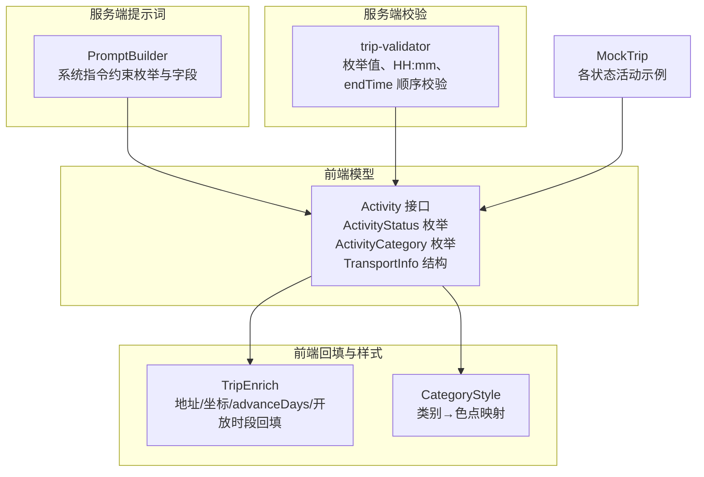
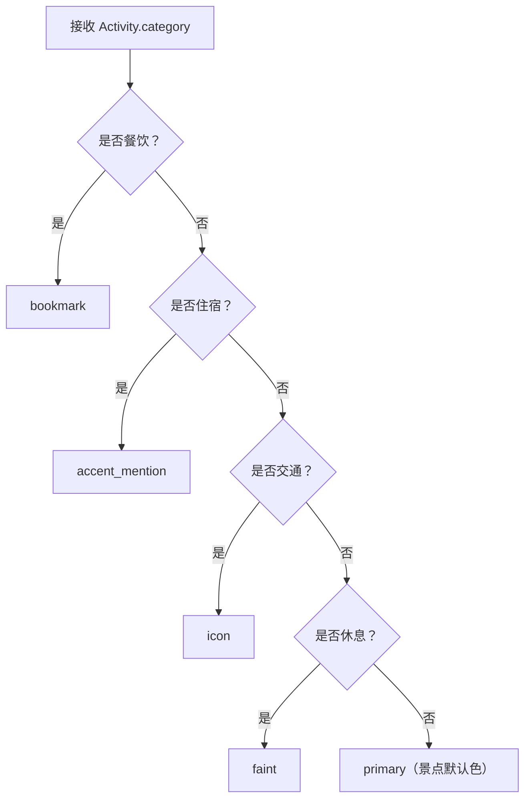
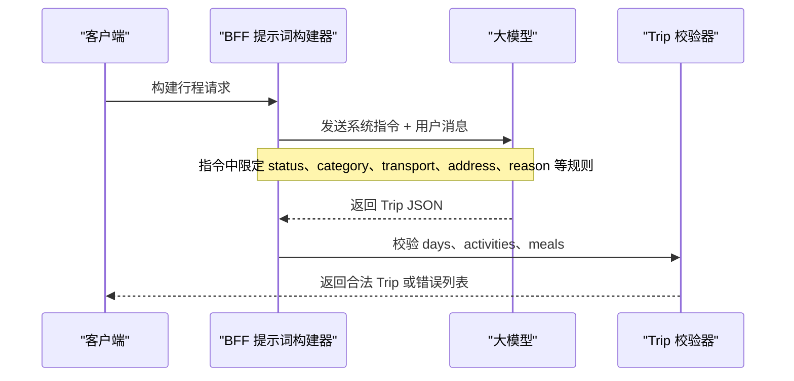
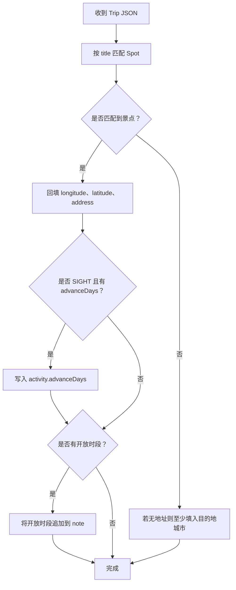
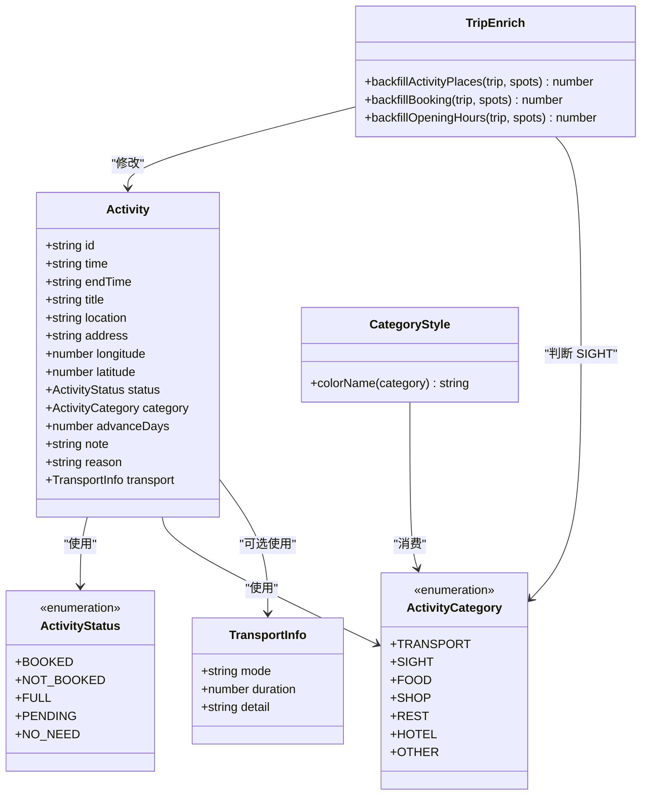

# Activity 活动节点模型

<cite>
**本文引用的文件**   
- [entry/src/main/ets/model/Trip.ets](file://entry/src/main/ets/model/Trip.ets)
- [entry/src/main/ets/utils/CategoryStyle.ets](file://entry/src/main/ets/utils/CategoryStyle.ets)
- [entry/src/main/ets/utils/TripEnrich.ets](file://entry/src/main/ets/utils/TripEnrich.ets)
- [bff/src/prompt/generated/ai/PromptBuilder.js](file://bff/src/prompt/generated/ai/PromptBuilder.js)
- [bff/src/prompt/trip-validator.js](file://bff/src/prompt/trip-validator.js)
- [entry/src/main/ets/mock/MockTrip.ets](file://entry/src/main/ets/mock/MockTrip.ets)
</cite>

## 目录
1. [简介](#简介)
2. [项目结构定位](#项目结构定位)
3. [核心数据模型总览](#核心数据模型总览)
4. [ActivityStatus 五值封闭枚举](#activitystatus-五值封闭枚举)
5. [ActivityCategory 七值分类](#activitycategory-七值分类)
6. [TransportInfo 通勤信息结构](#transportinfo-通勤信息结构)
7. [Activity 基础字段与可选字段](#activity-基础字段与可选字段)
8. [不同状态下的数据表示示例](#不同状态下的数据表示示例)
9. [模型在生成、校验与回填链路中的位置](#模型在生成校验与回填链路中的位置)
10. [依赖关系分析](#依赖关系分析)
11. [性能与健壮性注意事项](#性能与健壮性注意事项)
12. [常见问题排查](#常见问题排查)
13. [结论](#结论)

## 简介
本文聚焦行程规划系统中的 Activity 活动节点模型，围绕其核心字段、预约状态枚举、活动类型分类、通勤信息结构以及可选字段的业务语义进行系统化说明。该模型是“一日行程”的原子单位，既承载展示层需要的标题、地点、时间、坐标等信息，也承载服务端提示词约束、后端校验逻辑和端侧回填逻辑共同维护的数据契约。

## 项目结构定位
Activity 模型定义位于应用前端 ArkTS 模块的核心行程模型文件中；其使用方覆盖页面、提醒、地图、分享、日历导出等多个子系统。服务端通过 BFF 提示词构造器把同一套枚举约束传给大模型，再由校验器对返回的 Trip JSON 做二次拦截。

**图示来源**
- [entry/src/main/ets/model/Trip.ets:1-137](file://entry/src/main/ets/model/Trip.ets#L1-L137)
- [bff/src/prompt/generated/ai/PromptBuilder.js:1-158](file://bff/src/prompt/generated/ai/PromptBuilder.js#L1-L158)
- [bff/src/prompt/trip-validator.js:1-200](file://bff/src/prompt/trip-validator.js#L1-L200)
- [entry/src/main/ets/utils/TripEnrich.ets:1-135](file://entry/src/main/ets/utils/TripEnrich.ets#L1-L135)
- [entry/src/main/ets/utils/CategoryStyle.ets:1-51](file://entry/src/main/ets/utils/CategoryStyle.ets#L1-L51)
- [entry/src/main/ets/mock/MockTrip.ets:1-93](file://entry/src/main/ets/mock/MockTrip.ets#L1-L93)

**章节来源**
- [entry/src/main/ets/model/Trip.ets:1-137](file://entry/src/main/ets/model/Trip.ets#L1-L137)

## 核心数据模型总览
Activity 是一个结构化对象，描述一次出行中某个时间点上的具体事项。它由以下维度组成：

| 维度 | 字段或类型 | 是否必填 | 含义简述 |
|---|---|---:|---|
| 标识 | `id`（字符串） | 是 | 活动唯一标识；编辑期有独立铸造规则，避免同景点多次出现时主键冲突 |
| 时间 | `time`（字符串） | 是 | 开始时间，格式为 `HH:mm`，24 小时制 |
| 结束时间 | `endTime`（字符串） | 是 | 结束时间，格式为 `HH:mm`，且必须晚于 `time` |
| 标题 | `title`（字符串） | 是 | 活动名称，如“伏见稻荷大社”“清水寺”等 |
| 场所名 | `location`（字符串） | 否 | POI 场所名或入口别称，例如“山脚入口”“北门”，不得与 `title`、`address` 重复 |
| 地址 | `address`（字符串） | 否 | 完整地址；AI 通常留空，落库前按景点库回填 |
| 经度 | `longitude`（数值） | 否 | WGS84/GCJ02 经度；AI 常填 0，由回填逻辑替换 |
| 纬度 | `latitude`（数值） | 否 | WGS84/GCJ02 纬度；同上 |
| 预约状态 | `status`（ActivityStatus） | 是 | 五值封闭枚举，表示是否需要或能否预约 |
| 活动分类 | `category`（ActivityCategory） | 是 | 七值封闭枚举，表示活动属于交通、景点、餐饮等哪一类 |
| 提前天数 | `advanceDays`（可选数值） | 否 | 需提前几天预约；SIGHT 类且景点库有值时回填 |
| 备注 | `note`（可选字符串） | 否 | 用户或系统备注，可包含开放时段、官方渠道提示等 |
| 排期理由 | `reason`（可选字符串） | 否 | AI 生成的中文排期理由，解释为何安排在该时段 |
| 通勤信息 | `transport`（可选 TransportInfo） | 否 | 到达本活动前的通勤段；若活动本身是交通类，则不额外写 transport |

从数据结构复杂度看，单个 Activity 的读写成本为常数级；当遍历行程中所有天的活动时，整体复杂度为 O(活动总数)。

**章节来源**
- [entry/src/main/ets/model/Trip.ets:1-137](file://entry/src/main/ets/model/Trip.ets#L1-L137)
- [bff/src/prompt/trip-validator.js:1-200](file://bff/src/prompt/trip-validator.js#L1-L200)

## ActivityStatus 五值封闭枚举
`ActivityStatus` 是 Activity 的预约状态域，采用五值封闭设计，不允许扩展未声明值：

| 枚举值 | 英文码 | 中文语义 | 典型使用场景 |
|---|---|---|---|
| BOOKED | `booked` | 已约 | 已在官方渠道完成预约，具备明确预约凭证 |
| NOT_BOOKED | `not_booked` | 未约 | 当前尚未预约，但允许或建议后续预约 |
| FULL | `full` | 约满 | 目标时段或名额已满，无法继续预约 |
| PENDING | `pending` | 待定 | 正在等待预约结果、审核结果或外部确认 |
| NO_NEED | `no_need` | 无需预约 | 可直接入场，不需要预约流程 |

这五种状态构成一个互斥且完备的状态空间：任何活动要么已经预约成功，要么未预约，要么约满不可约，要么处于等待态，要么根本不需要预约。UI 展示时可使用中文标签，但底层存储和协议层应始终使用英文稳定码，以保证跨端和跨版本一致性。

**章节来源**
- [entry/src/main/ets/model/Trip.ets:1-137](file://entry/src/main/ets/model/Trip.ets#L1-L137)

## ActivityCategory 七值分类
`ActivityCategory` 是活动类型的七值封闭枚举，用于区分活动性质并驱动 UI 色点、预算统计和提示词约束：

| 枚举值 | 英文码 | 中文语义 | 分类逻辑与用途 |
|---|---|---|---|
| TRANSPORT | `transport` | 交通 | 通勤、换乘、步行、打车等移动过程；这类活动本体不再携带 `transport`，避免重复计算通勤 |
| SIGHT | `sight` | 景点 | 游览类 POI，常见需要预约、开放时段、闭馆日等业务信息 |
| FOOD | `food` | 餐饮 | 特色餐饮、小吃街、下午茶等作为“活动内容”的餐饮；普通餐次优先放在 meals 而非 activities |
| SHOP | `shop` | 购物 | 商店、集市、纪念品购买等 |
| REST | `rest` | 休息 | 休息、休整、中转停留等非游览型活动 |
| HOTEL | `hotel` | 住宿 | 酒店、民宿、住宿区域相关节点 |
| OTHER | `other` | 其他 | 不属于上述六类的兜底分类 |

样式层将类别映射到色点颜色：SIGHT 默认 primary，FOOD 使用 bookmark，HOTEL 使用 accent_mention，TRANSPORT 使用 icon，REST 使用 faint；未知类别统一回退到 primary，保证界面不会因未知类型崩溃。

**图示来源**
- [entry/src/main/ets/utils/CategoryStyle.ets:1-51](file://entry/src/main/ets/utils/CategoryStyle.ets#L1-L51)

**章节来源**
- [entry/src/main/ets/model/Trip.ets:1-137](file://entry/src/main/ets/model/Trip.ets#L1-L137)
- [entry/src/main/ets/utils/CategoryStyle.ets:1-51](file://entry/src/main/ets/utils/CategoryStyle.ets#L1-L51)

## TransportInfo 通勤信息结构
`TransportInfo` 描述“到达某个活动之前”的一段通勤，而不是活动本身的停留时长。其三个字段语义如下：

| 字段 | 类型 | 是否必填 | 语义说明 |
|---|---|---:|---|
| `mode` | 字符串 | 是 | 出行方式自由文案，如“地铁 2 号线”“步行”“打车”，直接用于 UI 展示 |
| `duration` | 数值 | 是 | 耗时，单位为分钟 |
| `detail` | 字符串 | 是 | 通勤详情或换乘说明，例如距离、票价、换乘站、步行米数等 |

需要注意两个重要边界：

1. **交通类活动与通勤的关系**：如果 Activity 的 `category` 是 `transport`，那么该节点本身就是通勤段，不应再为其填写 `transport`，否则会导致同一段移动被重复计入时间和预算。
2. **空通勤的表达**：当没有通勤信息时，整个 `transport` 字段应为 `undefined` 或省略；校验层对 `transport` 为 null 的情况做了兼容，以便旧数据或模型输出仍能解析。

**章节来源**
- [entry/src/main/ets/model/Trip.ets:1-137](file://entry/src/main/ets/model/Trip.ets#L1-L137)
- [bff/src/prompt/generated/ai/PromptBuilder.js:1-158](file://bff/src/prompt/generated/ai/PromptBuilder.js#L1-L158)
- [bff/src/prompt/trip-validator.js:1-200](file://bff/src/prompt/trip-validator.js#L1-L200)

## Activity 基础字段与可选字段

### 基础信息字段
| 字段 | 类型 | 是否必填 | 说明 |
|---|---|---:|---|
| `id` | 字符串 | 是 | 活动唯一标识；编辑期使用带时间戳和随机后缀的 ID 生成函数，避免同一景点在同行程内重复 |
| `time` | 字符串 | 是 | 开始时间，格式 `HH:mm`，非空且符合正则 |
| `endTime` | 字符串 | 是 | 结束时间，格式 `HH:mm`，且必须严格晚于 `time` |
| `title` | 字符串 | 是 | 活动标题 |
| `location` | 字符串 | 否 | 场所名或入口别称；提示词要求不要与标题或地址重复 |
| `address` | 字符串 | 否 | 地址；AI 生成时常留空，由回填逻辑按景点库填充 |
| `longitude` | 数值 | 否 | 经度；AI 生成时常填 0，由回填逻辑覆盖 |
| `latitude` | 数值 | 否 | 纬度；同上 |
| `status` | ActivityStatus | 是 | 五值预约状态 |
| `category` | ActivityCategory | 是 | 七值活动分类 |

### 可选业务字段
| 字段 | 类型 | 说明 |
|---|---|---|
| `advanceDays` | 可选数值 | 预约提前天数；仅 SIGHT 类且景点库提供时回填；未提供时提醒按 1 天兜底 |
| `note` | 可选字符串 | 备注；可用于标注开放时段、官方渠道提示、用户自定义备注 |
| `reason` | 可选字符串 | AI 生成的排期理由，解释清晨、夜间或紧凑节奏下的安排原因 |
| `transport` | 可选 TransportInfo | 到达本活动前的通勤段 |

**章节来源**
- [entry/src/main/ets/model/Trip.ets:1-137](file://entry/src/main/ets/model/Trip.ets#L1-L137)
- [bff/src/prompt/generated/ai/PromptBuilder.js:1-158](file://bff/src/prompt/generated/ai/PromptBuilder.js#L1-L158)
- [entry/src/main/ets/utils/TripEnrich.ets:1-135](file://entry/src/main/ets/utils/TripEnrich.ets#L1-L135)

## 不同状态下的数据表示示例
以下示例基于 Mock 数据中的构造模式，用结构化描述表达 Activity 在不同 `status` 下的典型形态。为避免泄露实现细节，这里不直接粘贴源码，而是以字段取值方式进行说明。

### 无需预约：NO_NEED
- `status`：`no_need`
- `category`：通常为 `sight`
- `advanceDays`：可省略
- `note`：可省略；若景点库开放时段一致，回填后可能追加开放时段
- `transport`：若有前一节点通勤，则携带；若活动本身是交通，则不携带
- 示例语义：某神社、广场等可直接进入的景点

### 未预约：NOT_BOOKED
- `status`：`not_booked`
- `category`：通常为 `sight`
- `advanceDays`：可能为空，也可能由景点库回填
- `note`：可包含“以官方为准”等提示
- 示例语义：推荐前往但尚未完成预约的景点

### 约满：FULL
- `status`：`full`
- `category`：通常为 `sight`
- `advanceDays`：可能有值，但实际已无名额
- 示例语义：热门时段或日期已被约满，只能调整时间或更换备选

### 待定：PENDING
- `status`：`pending`
- `category`：可为 `sight` 或其他需要外部确认的活动
- `note`：可补充“等待审核结果”“等待平台确认”等
- 示例语义：提交预约后尚未返回最终结果

### 已约：BOOKED
- `status`：`booked`
- `category`：通常为 `sight`
- `note`：可附带预约凭证、取票方式或官方链接提示
- 示例语义：已成功预约，行程中应重点提醒

此外，Mock 中还展示了交通类活动的通勤信息：`transport.mode` 为“步行”或“打车”，`transport.duration` 为分钟数，`transport.detail` 为距离或费用等说明。

**章节来源**
- [entry/src/main/ets/mock/MockTrip.ets:1-93](file://entry/src/main/ets/mock/MockTrip.ets#L1-L93)
- [entry/src/main/ets/model/Trip.ets:1-137](file://entry/src/main/ets/model/Trip.ets#L1-L137)

## 模型在生成、校验与回填链路中的位置

### 生成阶段：提示词约束
BFF 的 PromptBuilder 在系统指令中明确要求：
- `status` 只能取五个枚举值；
- `category` 只能取七个枚举值；
- `transport` 的 `mode`、`duration`、`detail` 分别表示出行方式、分钟耗时和换乘说明；
- 交通类活动本身即为通勤段，不能再附加 `transport`；
- `address`、`longitude`、`latitude` 由 App 回填，模型不应重写；
- `reason` 用于解释紧张或非常规时间的排期理由。

**图示来源**
- [bff/src/prompt/generated/ai/PromptBuilder.js:1-158](file://bff/src/prompt/generated/ai/PromptBuilder.js#L1-L158)
- [bff/src/prompt/trip-validator.js:1-200](file://bff/src/prompt/trip-validator.js#L1-L200)

### 校验阶段：结构与时间约束
校验器对 Activity 的关键约束包括：
- `id`、`title` 非空；
- `time`、`endTime` 为 HH:mm 格式；
- `endTime` 必须晚于 `time`；
- `transport.mode`、`transport.detail` 非空；
- `transport` 允许 null，保持与端侧解析口径一致。

### 回填阶段：地址、坐标、预约天数、开放时段
前端 TripEnrich 负责三类回填：
1. 根据活动标题匹配景点库，回填 `longitude`、`latitude`、`address`；
2. 对 SIGHT 类活动，若景点库存在 `booking.advanceDays`，则写入 `activity.advanceDays`；
3. 对 SIGHT 类活动，若景点库有开放时段，则将开放时段追加到 `note`，避免重复。

**图示来源**
- [entry/src/main/ets/utils/TripEnrich.ets:1-135](file://entry/src/main/ets/utils/TripEnrich.ets#L1-L135)

**章节来源**
- [bff/src/prompt/generated/ai/PromptBuilder.js:1-158](file://bff/src/prompt/generated/ai/PromptBuilder.js#L1-L158)
- [bff/src/prompt/trip-validator.js:1-200](file://bff/src/prompt/trip-validator.js#L1-L200)
- [entry/src/main/ets/utils/TripEnrich.ets:1-135](file://entry/src/main/ets/utils/TripEnrich.ets#L1-L135)

## 依赖关系分析
Activity 模型不是孤立类型，而是多个子系统共同依赖的稳定契约：

**图示来源**
- [entry/src/main/ets/model/Trip.ets:1-137](file://entry/src/main/ets/model/Trip.ets#L1-L137)
- [entry/src/main/ets/utils/CategoryStyle.ets:1-51](file://entry/src/main/ets/utils/CategoryStyle.ets#L1-L51)
- [entry/src/main/ets/utils/TripEnrich.ets:1-135](file://entry/src/main/ets/utils/TripEnrich.ets#L1-L135)

**章节来源**
- [entry/src/main/ets/model/Trip.ets:1-137](file://entry/src/main/ets/model/Trip.ets#L1-L137)
- [entry/src/main/ets/utils/CategoryStyle.ets:1-51](file://entry/src/main/ets/utils/CategoryStyle.ets#L1-L51)
- [entry/src/main/ets/utils/TripEnrich.ets:1-135](file://entry/src/main/ets/utils/TripEnrich.ets#L1-L135)

## 性能与健壮性注意事项
1. **避免模型幻觉重写地址**：大模型容易重写地址和坐标，导致 token 浪费和地理信息错误。因此提示词要求地址和坐标留空，再由 TripEnrich 按景点库回填。
2. **枚举值必须稳定**：status 和 category 使用英文稳定码，UI 展示层再做中文映射，防止未来语言变化破坏协议。
3. **时间顺序强约束**：`endTime > time` 是基本时序正确性要求，校验失败时应拒绝该活动。
4. **通勤不重复计算**：交通类活动本身即通勤段，不能再附加 `transport`，否则会重复增加停留时长和预算。
5. **未知类别不崩溃**：CategoryStyle 对未知类别回退到 primary，保证界面可用。
6. **预约提前天数只写真值**：只有 SIGHT 类且景点库确实提供 `advanceDays` 时才写入，避免用“1 天兜底”冒充真实库存。

## 常见问题排查

| 问题 | 可能原因 | 处理建议 |
|---|---|---|
| `endTime` 早于 `time` | 模型输出错误或手动编辑错误 | 校验器会报错；修复为有效 HH:mm 且 endTime 更晚 |
| `transport` 为空字符串或缺少字段 | 模型输出不完整 | 确保 `mode`、`duration`、`detail` 均非空；若无通勤则省略 `transport` |
| 交通活动又带了 `transport` | 把通勤段和活动段混在一起 | 交通类活动不填 `transport`，通勤信息只写在下一活动前 |
| 地址为空或坐标为 0 | 模型未按提示词留空或被误写 | 运行 TripEnrich 回填；若仍无对应 Spot，至少保留目的地城市地址 |
| 预约提前天数不正确 | 景点库无 `advanceDays` 或类别不是 SIGHT | 检查 Spot 数据；只有 SIGHT 且库中有值才回填 |
| 开放时段重复写入 note | 回填逻辑检测到已有相同时段应跳过 | 检查 note 是否已包含该开放时段文本 |
| 未知 category 显示异常 | 新加类别未在样式映射中处理 | 新增 CategoryStyle 分支，或使用默认 primary 色 |

**章节来源**
- [bff/src/prompt/trip-validator.js:1-200](file://bff/src/prompt/trip-validator.js#L1-L200)
- [entry/src/main/ets/utils/TripEnrich.ets:1-135](file://entry/src/main/ets/utils/TripEnrich.ets#L1-L135)
- [entry/src/main/ets/utils/CategoryStyle.ets:1-51](file://entry/src/main/ets/utils/CategoryStyle.ets#L1-L51)

## 结论
Activity 活动节点是整个行程模型的原子单元。它的核心价值在于把“什么时候、去哪里、做什么、是否需要预约、如何到达”这些信息封装成一个稳定的数据结构。`ActivityStatus` 的五值封闭设计和 `ActivityCategory` 的七值封闭设计，使得前端展示、服务端提示词、后端校验和端侧回填都能围绕同一份语义工作。`TransportInfo` 将通勤与活动停留解耦，使时间与预算的计算更加清晰。配合提示词约束、校验器和 TripEnrich 回填，Activity 模型能够在生成、传输、存储、展示全链路中保持一致性和鲁棒性。