# Expense 与 Checkin 事务模型

<cite>
**本文引用的文件**   
- [Expense.ets](file://entry/src/main/ets/model/Expense.ets)
- [Trip.ets](file://entry/src/main/ets/model/Trip.ets)
- [Checkin.ets](file://entry/src/main/ets/model/Checkin.ets)
- [ExpenseDao.ets](file://entry/src/main/ets/data/ExpenseDao.ets)
- [CheckinDao.ets](file://entry/src/main/ets/data/CheckinDao.ets)
- [CategoryBudget.ets](file://entry/src/main/ets/utils/CategoryBudget.ets)
- [ExpensePage.ets](file://entry/src/main/ets/pages/ExpensePage.ets)
</cite>

## 目录
1. [引言](#引言)
2. [项目结构定位](#项目结构定位)
3. [核心数据模型](#核心数据模型)
4. [分类体系与预算逻辑](#分类体系与预算逻辑)
5. [打卡凭证设计](#打卡凭证设计)
6. [架构总览](#架构总览)
7. [详细组件分析](#详细组件分析)
8. [依赖关系分析](#依赖关系分析)
9. [性能与扩展建议](#性能与扩展建议)
10. [故障排查](#故障排查)
11. [结论](#结论)

## 引言
本文聚焦费用记录与打卡凭证两套事务型数据，面向“如何建模、如何关联行程、如何读写”给出完整说明。文档严格基于仓库中的模型定义、DAO 实现和页面使用方式整理，不引入外部假设。

- 费用记录围绕 `Expense`、`ExpenseCategory`、`CategoryBudget`、`CategoryTotal` 展开，用于用户手动记账、分类预算和对账报表。
- 打卡凭证围绕 `CheckinMark` 展开，强调打卡数据独立于 AI 生成的 Trip/Activity 契约，避免污染生成对象并保持业务边界清晰。

## 项目结构定位
费用和打卡相关代码主要分布在以下三个层次：

| 层次 | 文件 | 职责 |
|---|---|---|
| 模型层 | `model/Expense.ets` | 定义费用枚举、费用记录、分类预算、分类聚合行 |
| 模型层 | `model/Checkin.ets` | 定义打卡凭证接口及设计理念说明 |
| 数据访问层 | `data/ExpenseDao.ets` | 费用表增删查、按分类聚合、按活动聚合、行程合计 |
| 数据访问层 | `data/CheckinDao.ets` | 打卡写入、取消打卡、查询行程打卡映射 |
| 工具层 | `utils/CategoryBudget.ets` | 解析分类预算 JSON、计算预算上限、画条基线和百分比 |
| 表现层 | `pages/ExpensePage.ets` | 费用录入、分类预算编辑、分类支出条、最近记账列表 |
| 关联模型 | `model/Trip.ets` | 行程聚合根，携带 `categoryBudgets` 字段，与费用分类预算形成契约 |

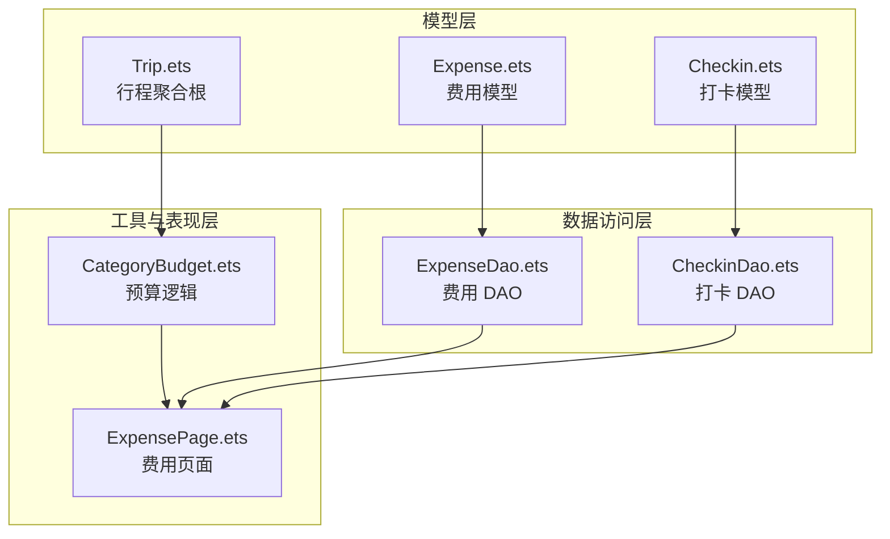

**图表来源**
- [Expense.ets:1-45](file://entry/src/main/ets/model/Expense.ets#L1-L45)
- [Checkin.ets:1-14](file://entry/src/main/ets/model/Checkin.ets#L1-L14)
- [Trip.ets:1-137](file://entry/src/main/ets/model/Trip.ets#L1-L137)
- [ExpenseDao.ets:1-111](file://entry/src/main/ets/data/ExpenseDao.ets#L1-L111)
- [CheckinDao.ets:1-70](file://entry/src/main/ets/data/CheckinDao.ets#L1-L70)
- [CategoryBudget.ets:1-63](file://entry/src/main/ets/utils/CategoryBudget.ets#L1-L63)
- [ExpensePage.ets:1-200](file://entry/src/main/ets/pages/ExpensePage.ets#L1-L200)

**章节来源**
- [Expense.ets:1-45](file://entry/src/main/ets/model/Expense.ets#L1-L45)
- [Checkin.ets:1-14](file://entry/src/main/ets/model/Checkin.ets#L1-L14)
- [ExpenseDao.ets:1-111](file://entry/src/main/ets/data/ExpenseDao.ets#L1-L111)
- [CheckinDao.ets:1-70](file://entry/src/main/ets/data/CheckinDao.ets#L1-L70)
- [CategoryBudget.ets:1-63](file://entry/src/main/ets/utils/CategoryBudget.ets#L1-L63)
- [ExpensePage.ets:1-200](file://entry/src/main/ets/pages/ExpensePage.ets#L1-L200)

## 核心数据模型

### 费用记录 Expense
`Expense` 是费用记账的实体，对应数据库中的 `expense` 表。

| 字段 | 类型 | 是否必填 | 语义与约束 |
|---|---:|---:|---|
| `id` | `number` | 是 | 自增主键；新建时传入 `0`，由存储层返回真实主键 |
| `tripId` | `string` | 是 | 归属行程标识，与 `Trip.id` 关联 |
| `dayIndex` | `number` | 是 | 归属第几天，从 `1` 开始 |
| `category` | `ExpenseCategory` | 是 | 六值费用分类枚举 |
| `name` | `string` | 是 | 费用名称，如“故宫门票”“打车去机场” |
| `amount` | `number` | 是 | 金额，单位为人民币元；模型注释明确取整，与 `Trip.budget` 口径一致 |
| `createdAt` | `number` | 是 | 记账时刻，毫秒时间戳 |
| `activityId` | `string` | 否 | 关联活动节点；未挂到具体活动时为空 |

DAO 写入时将 `activityId === undefined` 转为空值，使“未关联活动”的状态在数据库层也有明确表达。

**章节来源**
- [Expense.ets:12-33](file://entry/src/main/ets/model/Expense.ets#L12-L33)
- [ExpenseDao.ets:19-33](file://entry/src/main/ets/data/ExpenseDao.ets#L19-L33)

### 分类预算 CategoryBudget
`CategoryBudget` 表示用户在每个费用类别上设置的预算上限。

| 字段 | 类型 | 语义 |
|---|---|---|
| `category` | `ExpenseCategory` | 对应六档分类之一 |
| `amount` | `number` | 该类预算上限；正数才有效，`0` 表示“未设上限” |

它与 `Trip.categoryBudgets` 同存：行程聚合根携带分类预算数组，但分类预算本身不是 AI 生成的行程内容，而是用户行为产生的对照基线。

**章节来源**
- [Expense.ets:35-45](file://entry/src/main/ets/model/Expense.ets#L35-L45)
- [Trip.ets:100-137](file://entry/src/main/ets/model/Trip.ets#L100-L137)

### 分类聚合行 CategoryTotal
`CategoryTotal` 是报表展示用的聚合结果，不等同于单条记账记录。

| 字段 | 类型 | 语义 |
|---|---:|---|
| `category` | `ExpenseCategory` | 某类费用 |
| `amount` | `number` | 该类在当前行程下的累计金额 |

它由 `ExpenseDao.sumByCategory` 通过 SQL `GROUP BY category` 生成，缺失的类别不会补零，由表现层按固定六档渲染。

**章节来源**
- [Expense.ets:47-45](file://entry/src/main/ets/model/Expense.ets#L47-L45)
- [ExpenseDao.ets:62-77](file://entry/src/main/ets/data/ExpenseDao.ets#L62-L77)

### 打卡凭证 CheckinMark
`CheckinMark` 是打卡凭证的领域模型，只保留三字段：

| 字段 | 类型 | 语义 |
|---|---|---|
| `tripId` | `string` | 所属行程 |
| `activityId` | `string` | 被打卡的活动节点 |
| `checkedAt` | `number` | 打卡时刻，毫秒时间戳 |

DAO 实际表还包含坐标、精度、距离、来源等凭证字段，但领域模型只抽象出“哪个行程、哪个活动、何时打卡”。这种抽象让上层业务可以仅凭组合键判断“是否已打卡”，而不关心定位细节。

**章节来源**
- [Checkin.ets:1-14](file://entry/src/main/ets/model/Checkin.ets#L1-L14)
- [CheckinDao.ets:1-70](file://entry/src/main/ets/data/CheckinDao.ets#L1-L70)

## 分类体系与预算逻辑

### ExpenseCategory 六值分类
费用分类是封闭六值枚举：

| 枚举值 | 英文码 | 中文标签 | 典型场景 |
|---|---|---|---|
| `TICKET` | `ticket` | 门票 | 景点门票、预约费 |
| `FOOD` | `food` | 餐饮 | 正餐、小吃、咖啡 |
| `TRANSPORT` | `transport` | 交通 | 打车、地铁、城际交通 |
| `HOTEL` | `hotel` | 酒店 | 住宿、民宿 |
| `SHOP` | `shop` | 购物 | 纪念品、日用品 |
| `OTHER` | `other` | 其他 | 无法归入前五类的杂项 |

注意：`ExpenseCategory` 是“费用分类”，与 `Trip.ets` 中的 `ActivityCategory`（活动类型）不同。前者用于记账对账，后者用于 AI 生成的行程节点分类。两者共享部分语义，但不互相复用。

**章节来源**
- [Expense.ets:12-20](file://entry/src/main/ets/model/Expense.ets#L12-L20)
- [Trip.ets:28-36](file://entry/src/main/ets/model/Trip.ets#L28-L36)
- [ExpensePage.ets:49-76](file://entry/src/main/ets/pages/ExpensePage.ets#L49-L76)

### 分类预算解析与画条逻辑
`CategoryBudget` 工具模块提供三类纯函数能力：

1. **解析存量 JSON**：`parseCategoryBudgets` 只接受稳定码和正数，脏条目整体丢弃，旧行程没有该字段时返回空数组。
2. **查询某类预算上限**：`budgetOf` 没找到对应类别返回 `0`，作为“不设上限”哨兵。
3. **画条基线与百分比**：`barBase` 优先用用户预算上限，否则回退调用方提供的基线；`barPct` 将百分比封顶为 `100`、保底为 `1`，防止超支显示负值。

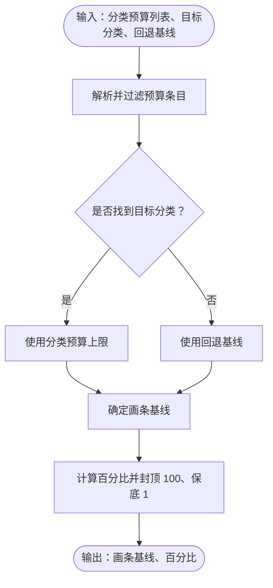

**图表来源**
- [CategoryBudget.ets:1-63](file://entry/src/main/ets/utils/CategoryBudget.ets#L1-L63)

**章节来源**
- [CategoryBudget.ets:1-63](file://entry/src/main/ets/utils/CategoryBudget.ets#L1-L63)
- [ExpensePage.ets:1-200](file://entry/src/main/ets/pages/ExpensePage.ets#L1-L200)

## 打卡凭证设计

### 独立契约的设计理念
`Checkin.ets` 中明确说明：打卡不进 `Trip` / `Activity` 契约。原因有三：

1. **Trip 由 LLM 生成并由 `TripParser` 守卫**，属于 AI 产物。
2. **打卡是本地用户态行为**，不应让 AI 契约长出与生成无关的字段。
3. **业务边界清晰**：行程规划是计划层，打卡是执行层；凭证表按 `(trip_id, activity_id)` 唯一，避免重复打卡造成数据歧义。

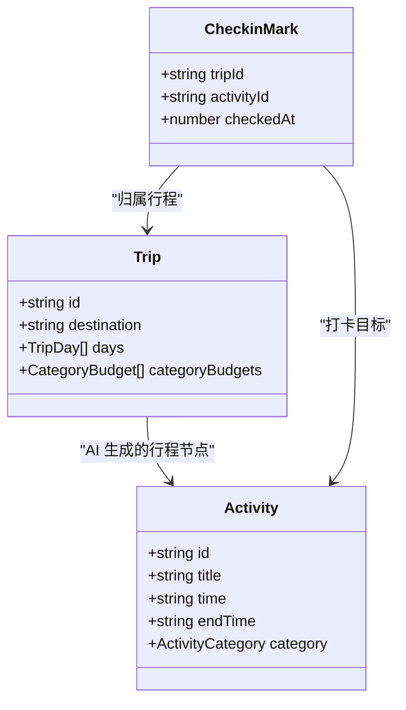

**图表来源**
- [Trip.ets:1-137](file://entry/src/main/ets/model/Trip.ets#L1-L137)
- [Checkin.ets:1-14](file://entry/src/main/ets/model/Checkin.ets#L1-L14)

### 打卡写入与去重策略
`CheckinDao.set` 的行为如下：

- 打卡：写入 `checkin` 表，使用 `ON_CONFLICT_REPLACE` 以 `(trip_id, activity_id)` 为冲突键，重复打卡会更新 `checked_at`。
- 取消打卡：删除指定行程和活动对应的打卡记录。
- 凭证来源区分：
  - `source = 'arrival'`：前台定位判定已到站，带经纬度、精度、距离。
  - `source = 'manual'`：手动打卡，坐标留 `0`。

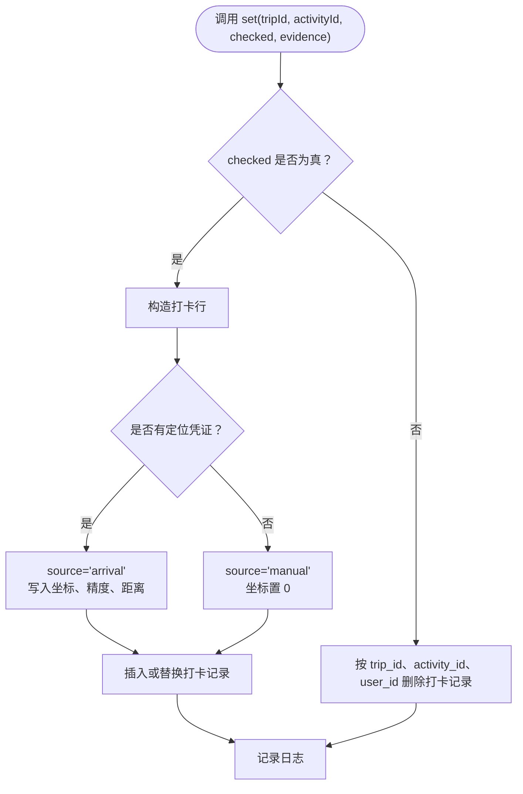

**图表来源**
- [CheckinDao.ets:27-54](file://entry/src/main/ets/data/CheckinDao.ets#L27-L54)

**章节来源**
- [Checkin.ets:1-14](file://entry/src/main/ets/model/Checkin.ets#L1-L14)
- [CheckinDao.ets:1-70](file://entry/src/main/ets/data/CheckinDao.ets#L1-L70)

## 架构总览

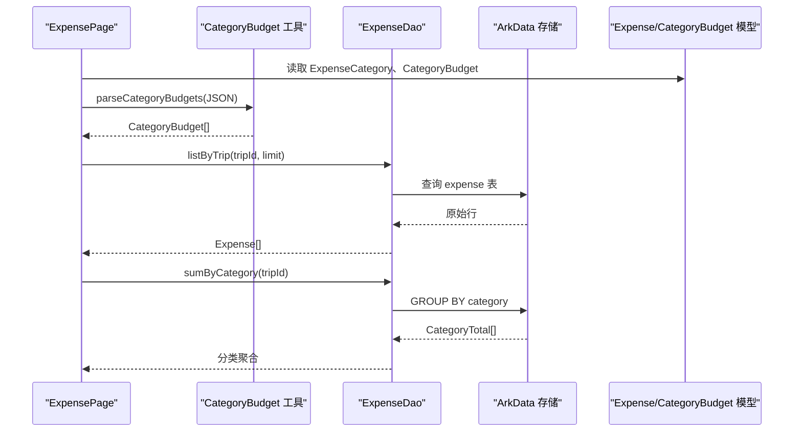

**图表来源**
- [ExpensePage.ets:1-200](file://entry/src/main/ets/pages/ExpensePage.ets#L1-L200)
- [ExpenseDao.ets:19-77](file://entry/src/main/ets/data/ExpenseDao.ets#L19-L77)
- [CategoryBudget.ets:1-63](file://entry/src/main/ets/utils/CategoryBudget.ets#L1-L63)
- [Expense.ets:1-45](file://entry/src/main/ets/model/Expense.ets#L1-L45)

## 详细组件分析

### 费用记录 Expense 的 CRUD 模式

#### 新增 Expense
- 入口：`ExpenseDao.add(context, expense)`
- 关键字段映射：
  - `trip_id` ← `tripId`
  - `day_index` ← `dayIndex`
  - `category` ← `category`
  - `name` ← `name`
  - `amount` ← `amount`
  - `created_at` ← `createdAt`
  - `activity_id` ← `activityId`（`undefined` 转空值）
  - `user_id` ← `AccountStore.uid()`
- 返回值：自增主键 `id`

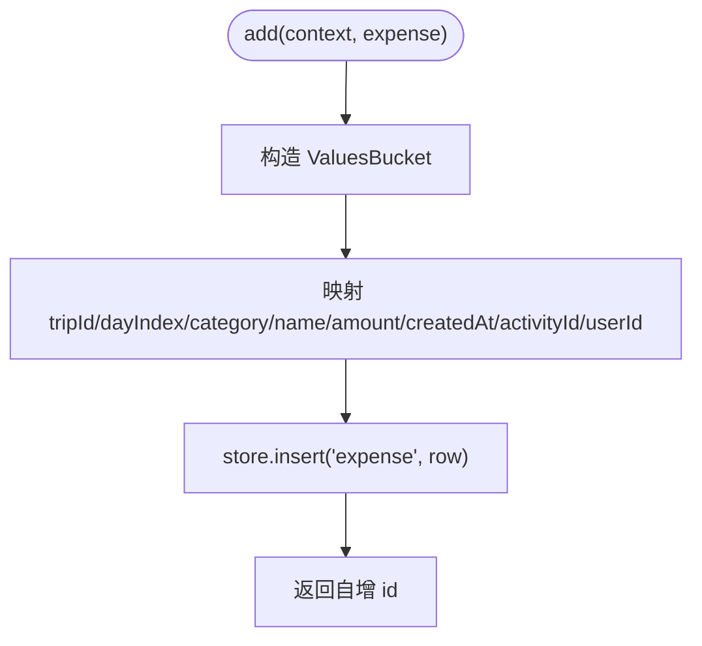

**图表来源**
- [ExpenseDao.ets:19-33](file://entry/src/main/ets/data/ExpenseDao.ets#L19-L33)

**章节来源**
- [ExpenseDao.ets:19-33](file://entry/src/main/ets/data/ExpenseDao.ets#L19-L33)
- [Expense.ets:12-33](file://entry/src/main/ets/model/Expense.ets#L12-L33)

#### 删除 Expense
- 入口：`ExpenseDao.delete(context, id)`
- 安全约束：删除条件必须同时包含 `id` 和 `user_id`，防止同机切换账号后误删他人数据。

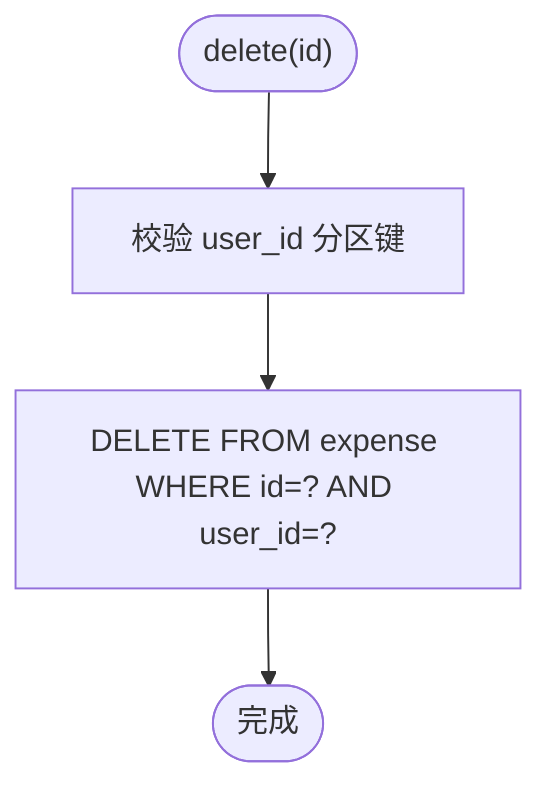

**图表来源**
- [ExpenseDao.ets:35-41](file://entry/src/main/ets/data/ExpenseDao.ets#L35-L41)

**章节来源**
- [ExpenseDao.ets:35-41](file://entry/src/main/ets/data/ExpenseDao.ets#L35-L41)

#### 查询 Expense
- 最近记账列表：`listByTrip(tripId, limit)`，按 `created_at DESC` 排序，供费用页最近消费列表使用。
- 分类汇总：`sumByCategory(tripId)`，按 `category` 分组求和。
- 按活动汇总：`sumGroupedByActivity(tripId)`，用于行程节点行内金额展示。
- 行程合计：`totalOfTrip(tripId)`，遍历分类汇总累加并记录日志。

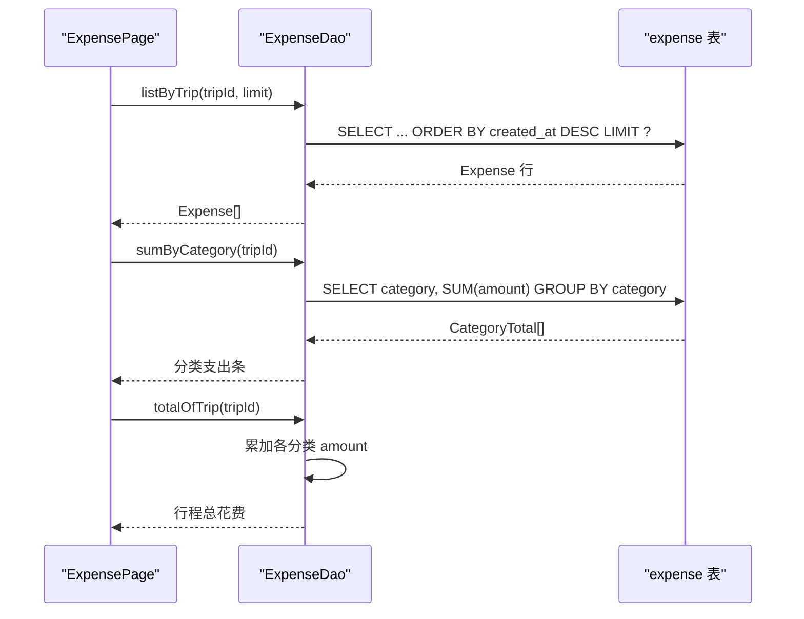

**图表来源**
- [ExpenseDao.ets:43-105](file://entry/src/main/ets/data/ExpenseDao.ets#L43-L105)

**章节来源**
- [ExpenseDao.ets:43-105](file://entry/src/main/ets/data/ExpenseDao.ets#L43-L105)

### 打卡凭证 CheckinMark 的 CRUD 模式

#### 写入打卡
- 入口：`CheckinDao.set(context, tripId, activityId, checked, evidence)`
- 行为：
  - `checked = true`：写入打卡行，`ON_CONFLICT_REPLACE` 保证同一活动只保留最新打卡时刻。
  - `checked = false`：删除该活动的打卡记录。
- 凭证字段：
  - 到站打卡：带 `latitude`、`longitude`、`accuracy_m`、`distance_m`，`source='arrival'`。
  - 手动打卡：上述坐标字段为 `0`，`source='manual'`。

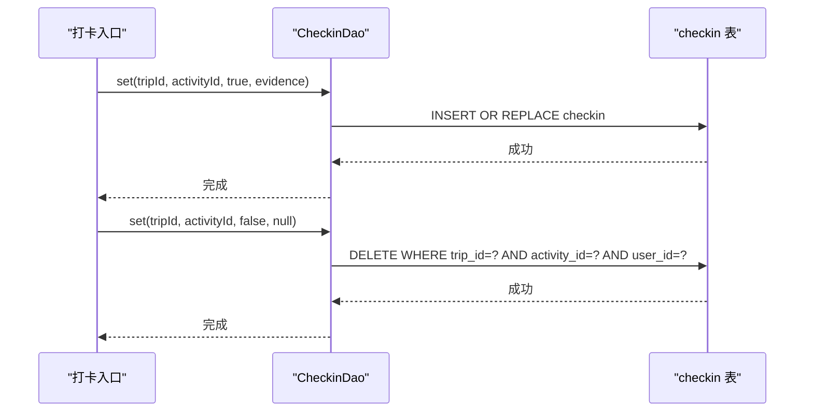

**图表来源**
- [CheckinDao.ets:27-54](file://entry/src/main/ets/data/CheckinDao.ets#L27-L54)

**章节来源**
- [CheckinDao.ets:27-54](file://entry/src/main/ets/data/CheckinDao.ets#L27-L54)

#### 查询打卡
- 入口：`CheckinDao.listForTrip(tripId)`
- 返回：`Record<string, number>`，键为 `activityId`，值为 `checkedAt`。
- 用途：页面只需判断某个活动是否已打卡，无需关心凭证坐标。

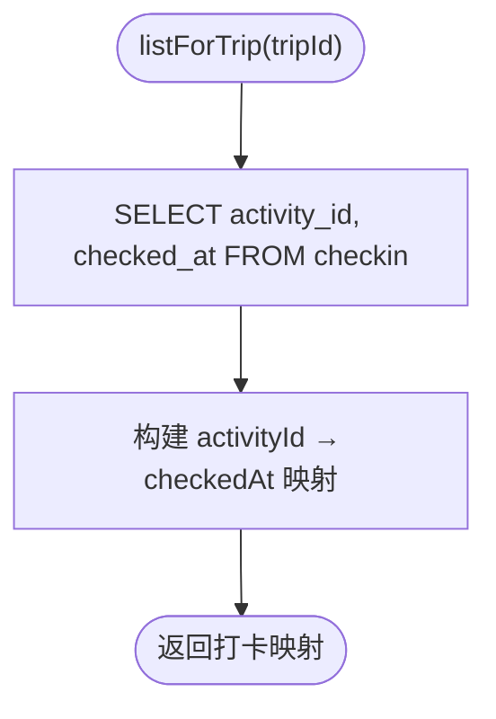

**图表来源**
- [CheckinDao.ets:56-69](file://entry/src/main/ets/data/CheckinDao.ets#L56-L69)

**章节来源**
- [CheckinDao.ets:56-69](file://entry/src/main/ets/data/CheckinDao.ets#L56-L69)

### 与 Trip 实体的关联查询模式

| 查询目的 | 推荐模式 | 说明 |
|---|---|---|
| 查看某行程所有费用 | `ExpenseDao.listByTrip(tripId, limit)` | 按创建时间倒序，适合最近记账列表 |
| 统计某行程分类支出 | `ExpenseDao.sumByCategory(tripId)` | 一次 SQL 聚合，缺失类别不补零 |
| 查看某行程总花费 | `ExpenseDao.totalOfTrip(tripId)` | 内部调用分类聚合后累加 |
| 查看某活动下累计花费 | `ExpenseDao.sumGroupedByActivity(tripId)` | 仅包含 `activity_id IS NOT NULL` 的记录 |
| 查看某行程是否已打卡 | `CheckinDao.listForTrip(tripId)` | 判断目标 `activityId` 是否在映射中 |
| 设置某活动打卡状态 | `CheckinDao.set(tripId, activityId, checked, evidence)` | 支持到站凭证和手动打卡 |

**章节来源**
- [ExpenseDao.ets:43-105](file://entry/src/main/ets/data/ExpenseDao.ets#L43-L105)
- [CheckinDao.ets:27-69](file://entry/src/main/ets/data/CheckinDao.ets#L27-L69)

## 依赖关系分析

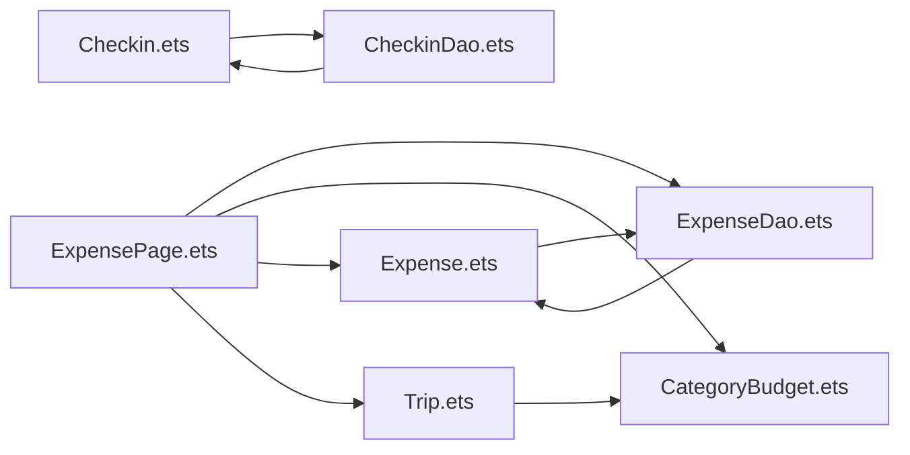

**图表来源**
- [Expense.ets:1-45](file://entry/src/main/ets/model/Expense.ets#L1-L45)
- [Checkin.ets:1-14](file://entry/src/main/ets/model/Checkin.ets#L1-L14)
- [Trip.ets:1-137](file://entry/src/main/ets/model/Trip.ets#L1-L137)
- [ExpenseDao.ets:1-111](file://entry/src/main/ets/data/ExpenseDao.ets#L1-L111)
- [CheckinDao.ets:1-70](file://entry/src/main/ets/data/CheckinDao.ets#L1-L70)
- [CategoryBudget.ets:1-63](file://entry/src/main/ets/utils/CategoryBudget.ets#L1-L63)
- [ExpensePage.ets:1-200](file://entry/src/main/ets/pages/ExpensePage.ets#L1-L200)

### 耦合与边界
- **低耦合**：费用模型只定义数据结构；DAO 负责 SQL；`CategoryBudget` 工具是纯函数；页面负责 UI 状态。
- **高内聚**：费用相关逻辑集中在 `ExpenseDao` 和 `ExpensePage`；打卡相关逻辑集中在 `CheckinDao`。
- **边界清晰**：打卡凭证不在 `Trip` 契约中，避免 AI 生成对象膨胀；分类预算随行程存储，但解析逻辑独立成可测试工具。

**章节来源**
- [Checkin.ets:1-14](file://entry/src/main/ets/model/Checkin.ets#L1-L14)
- [CategoryBudget.ets:1-63](file://entry/src/main/ets/utils/CategoryBudget.ets#L1-L63)

## 性能与扩展建议

### 当前性能特征
- 费用查询使用显式列选择，避免加载多余字段。
- 分类汇总和按活动汇总都通过 SQL 聚合，减少前端循环计算。
- 打卡查询直接返回 `activityId → checkedAt` 映射，便于页面快速判空。

### 可扩展点
- **分页**：`listByTrip` 目前用 `LIMIT`，未来可按天或按时间范围分页。
- **索引**：建议在 `expense(trip_id, user_id, created_at)`、`checkin(trip_id, activity_id, user_id)` 建立复合索引以提升常用查询。
- **审计**：如需保留历史版本，可将 `ON_CONFLICT_REPLACE` 改为追加版本号或软删除。
- **国际化**：`ExpenseCategory` 展示名已在页面中维护，可考虑迁移到资源文件统一管控。

[本节为通用建议，不直接分析具体源码]

## 故障排查

| 现象 | 可能原因 | 处理建议 |
|---|---|---|
| 费用列表为空 | 尚未记账，或 `tripId` 未正确传入 | 检查 `ExpenseDao.listByTrip` 的 `tripId` 和 `user_id` |
| 分类支出条缺少某类 | 该分类无记账记录 | 符合“缺项不补零”设计，由表现层补齐六档展示 |
| 预算条始终占满 | 预算设为 `0`，走回退基线 | 检查 `CategoryBudget.amount > 0`，确认用户是否设置了上限 |
| 打卡反复点击仍显示已打卡 | `ON_CONFLICT_REPLACE` 更新的是时间戳 | 正常行为；若需禁止重复，可在应用层增加防抖或提示 |
| 切换账号后看到他人数据 | DAO 查询漏带 `user_id` | 检查 `ExpenseDao` 和 `CheckinDao` 的 SQL 是否包含分区键 |
| 打卡坐标异常 | 非到站打卡或定位失败 | 检查 `source` 是否为 `manual`，凭证字段是否为 `0` |

**章节来源**
- [ExpenseDao.ets:43-105](file://entry/src/main/ets/data/ExpenseDao.ets#L43-L105)
- [CheckinDao.ets:27-69](file://entry/src/main/ets/data/CheckinDao.ets#L27-L69)
- [CategoryBudget.ets:1-63](file://entry/src/main/ets/utils/CategoryBudget.ets#L1-L63)

## 结论
- `Expense` 是费用记账的核心实体，字段围绕“谁、哪天、哪类、花多少、什么时候记、是否挂在活动上”组织。
- `ExpenseCategory` 提供稳定的六值分类，与活动类型解耦；`CategoryBudget` 为用户自定义预算上限提供数据载体，`CategoryTotal` 则承担报表聚合职责。
- `CheckinMark` 采用最小领域模型，配合 DAO 的唯一键策略和凭证来源字段，既满足打卡需求，又保持与 AI 行程契约的清晰边界。
- 在实现层面，DAO 使用显式列查询和 SQL 聚合，兼顾可读性、可测性和性能；页面侧负责分类展示、预算画条和用户交互。

[本节为总结性内容，不直接分析具体源码]