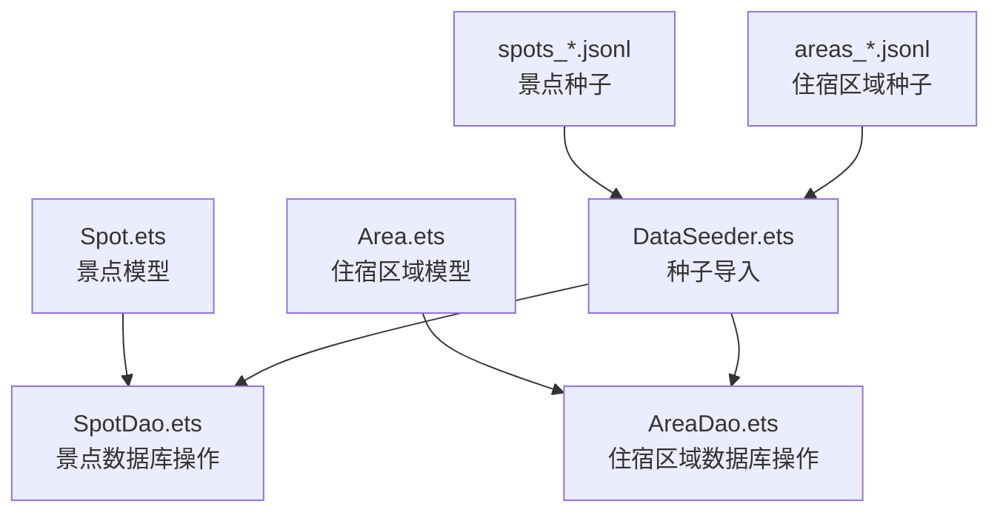
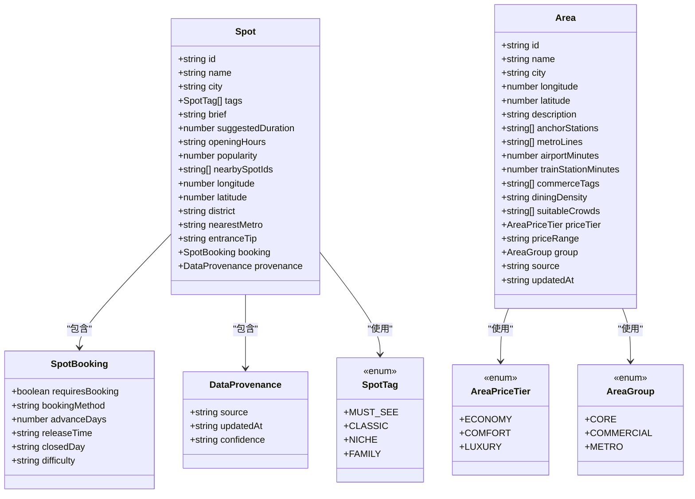
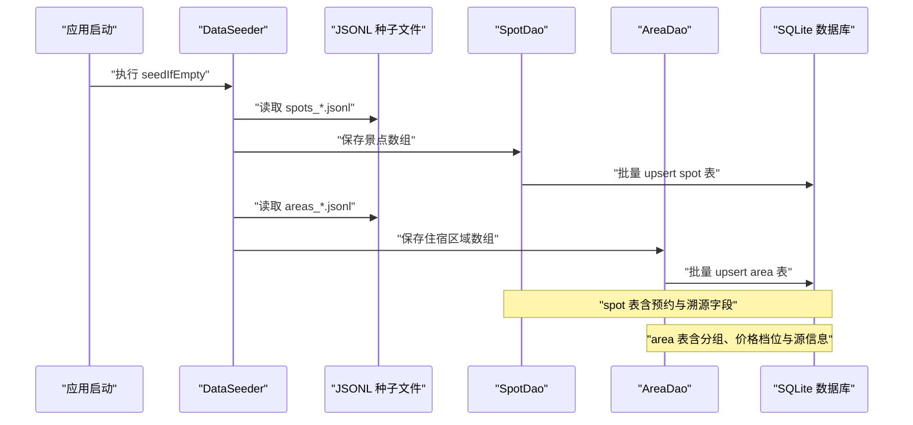
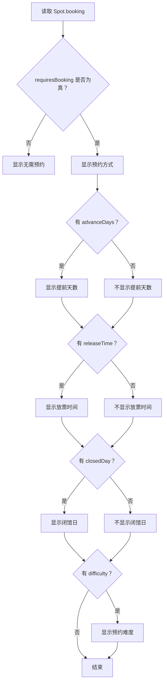
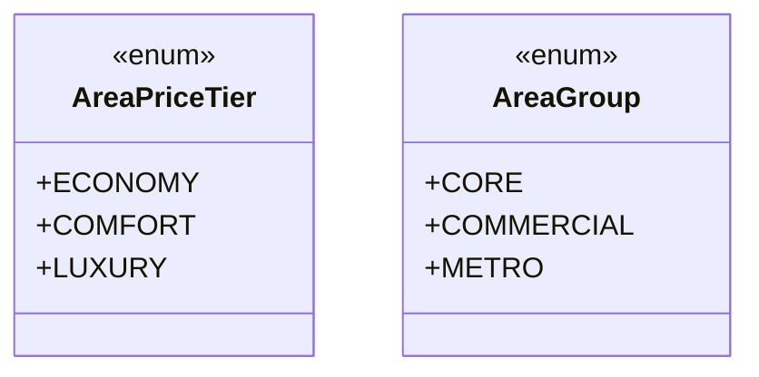
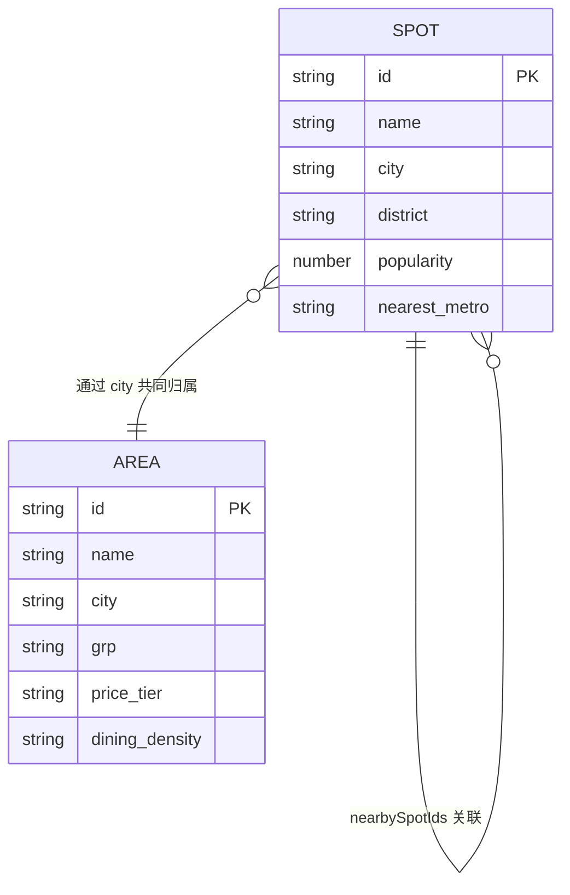
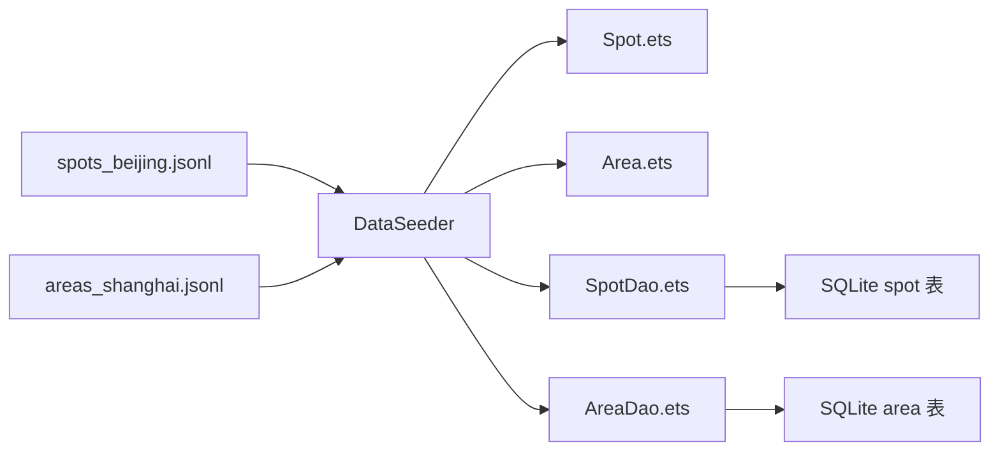

# Spot 与 Area 地理数据模型

<cite>
**本文引用的文件**   
- [Spot.ets](file://entry/src/main/ets/model/Spot.ets)
- [Area.ets](file://entry/src/main/ets/model/Area.ets)
- [DataSeeder.ets](file://entry/src/main/ets/data/DataSeeder.ets)
- [SpotDao.ets](file://entry/src/main/ets/data/SpotDao.ets)
- [AreaDao.ets](file://entry/src/main/ets/data/AreaDao.ets)
- [spots_beijing.jsonl](file://entry/src/main/resources/rawfile/seed/spots_beijing.jsonl)
- [areas_shanghai.jsonl](file://entry/src/main/resources/rawfile/seed/areas_shanghai.jsonl)
</cite>

## 目录
1. [引言](#引言)
2. [项目结构定位](#项目结构定位)
3. [核心数据模型总览](#核心数据模型总览)
4. [架构与数据流](#架构与数据流)
5. [Spot 景点模型详解](#spot-景点模型详解)
6. [SpotBooking 预约规则组](#spotbooking-预约规则组)
7. [DataProvenance 数据来源追踪](#dataprovenance-数据来源追踪)
8. [Area 住宿区域模型详解](#area-住宿区域模型详解)
9. [AreaPriceTier 与 AreaGroup 枚举设计](#areapricetier-与-areagroup-枚举设计)
10. [种子数据与持久化映射](#种子数据与持久化映射)
11. [数据示例与关联关系图](#数据示例与关联关系图)
12. [依赖关系分析](#依赖关系分析)
13. [性能与扩展建议](#性能与扩展建议)
14. [故障排查指南](#故障排查指南)
15. [结论](#结论)

## 引言
本文件聚焦项目中「景点库」和「住宿区域库」两类内置地理资产，系统性说明 Spot（景点）与 Area（住宿区域）的数据模型、枚举、预约规则、数据来源追踪、持久化映射以及种子数据格式。文档既面向需要理解字段含义的产品和测试人员，也面向负责数据库表结构、数据灌入和端侧渲染的开发者。

## 项目结构定位
Spot 与 Area 相关代码集中在以下位置：
- 模型定义：`entry/src/main/ets/model/Spot.ets`、`entry/src/main/ets/model/Area.ets`
- 数据灌入：`entry/src/main/ets/data/DataSeeder.ets`
- 数据访问层：`entry/src/main/ets/data/SpotDao.ets`、`entry/src/main/ets/data/AreaDao.ets`
- 内置种子数据：`entry/src/main/resources/rawfile/seed/*.jsonl`

**图表来源**
- [Spot.ets:1-69](file://entry/src/main/ets/model/Spot.ets#L1-L69)
- [Area.ets:1-51](file://entry/src/main/ets/model/Area.ets#L1-L51)
- [DataSeeder.ets:1-200](file://entry/src/main/ets/data/DataSeeder.ets#L1-L200)
- [SpotDao.ets:1-100](file://entry/src/main/ets/data/SpotDao.ets#L1-L100)
- [AreaDao.ets:1-75](file://entry/src/main/ets/data/AreaDao.ets#L1-L75)

**章节来源**
- [Spot.ets:1-69](file://entry/src/main/ets/model/Spot.ets#L1-L69)
- [Area.ets:1-51](file://entry/src/main/ets/model/Area.ets#L1-L51)
- [DataSeeder.ets:1-200](file://entry/src/main/ets/data/DataSeeder.ets#L1-L200)

## 核心数据模型总览
Spot 与 Area 是两个并列的地理实体：
- Spot 表示具体景点，强调名称、标签、简介、游玩时长、开放信息、热度、周边关联、地理位置、行政区、最近地铁站、入口提示及预约规则。
- Area 表示住宿推荐区域，强调锚定站点、地铁线路、通勤时间、商圈、餐饮密度、适合人群、价格档位、分组及地理位置。

两者都包含经纬度，并用于地图展示；Spot 还携带 `nearbySpotIds` 以串联周边景点，Area 则通过 `anchorStations` 和 `metroLines` 表达交通属性。

**图表来源**
- [Spot.ets:1-69](file://entry/src/main/ets/model/Spot.ets#L1-L69)
- [Area.ets:1-51](file://entry/src/main/ets/model/Area.ets#L1-L51)

**章节来源**
- [Spot.ets:1-69](file://entry/src/main/ets/model/Spot.ets#L1-L69)
- [Area.ets:1-51](file://entry/src/main/ets/model/Area.ets#L1-L51)

## 架构与数据流
数据从种子文件进入应用，经过 DataSeeder 解析为 Spot 或 Area 对象，再通过 SpotDao / AreaDao 写入 SQLite 表，最终按城市查询返回给页面或地图组件。

**图表来源**
- [DataSeeder.ets:1-200](file://entry/src/main/ets/data/DataSeeder.ets#L1-L200)
- [SpotDao.ets:1-100](file://entry/src/main/ets/data/SpotDao.ets#L1-L100)
- [AreaDao.ets:1-75](file://entry/src/main/ets/data/AreaDao.ets#L1-L75)

**章节来源**
- [DataSeeder.ets:1-200](file://entry/src/main/ets/data/DataSeeder.ets#L1-L200)
- [SpotDao.ets:1-100](file://entry/src/main/ets/data/SpotDao.ets#L1-L100)
- [AreaDao.ets:1-75](file://entry/src/main/ets/data/AreaDao.ets#L1-L75)

## Spot 景点模型详解
Spot 是「景点库」的核心记录，字段分为基础信息、空间信息、筛选展示信息、关联信息和元数据五类。

| 字段 | 类型 | 是否可选 | 语义说明 |
|---|---|---:|---|
| `id` | string | 否 | 景点唯一标识，例如北京故宫博物院对应 `bj-001` |
| `name` | string | 否 | 景点中文名 |
| `city` | string | 否 | 所属城市，首批支持北上广深等 |
| `tags` | `SpotTag[]` | 否 | 四值封闭标签：必去、经典、小众、亲子 |
| `brief` | string | 否 | 一句话简介，用于列表层精简输出 |
| `suggestedDuration` | number | 否 | 建议游玩时长，单位为分钟 |
| `openingHours` | string | 是 | 每日一致的开放时段，如“全天开放”；不一致或缺数据时留空 |
| `popularity` | number | 否 | 热度指数，范围 0–100，作为组内排序键 |
| `nearbySpotIds` | string[] | 否 | 周边景点 id 列表，用于第三层规划串联 |
| `longitude` | number | 否 | 经度 |
| `latitude` | number | 否 | 纬度 |
| `district` | string | 否 | 所在行政区 |
| `nearestMetro` | string | 否 | 最近地铁站名 |
| `entranceTip` | string | 是 | 入口提示，例如“从午门进” |
| `booking` | `SpotBooking` | 否 | 预约规则组 |
| `provenance` | `DataProvenance` | 否 | 数据来源追踪 |

Spot 的设计目标是：AI 不是数据源，字段本身就是端侧筛选与 Prompt 构造的全部输入。因此 Spot 字段必须同时满足 UI 展示、地图标注、排序和规划串联的需要。

**章节来源**
- [Spot.ets:1-69](file://entry/src/main/ets/model/Spot.ets#L1-L69)

## SpotBooking 预约规则组
`SpotBooking` 描述一个景点是否需要预约、如何预约、提前多久、放票时间、闭馆日和预约难度。

| 字段 | 类型 | 是否可选 | 语义说明 |
|---|---|---:|---|
| `requiresBooking` | boolean | 否 | 是否必须预约 |
| `bookingMethod` | string | 是 | 预约方式，如公众号、官网、电话等自由文案 |
| `advanceDays` | number | 是 | 需提前多少天预约 |
| `releaseTime` | string | 是 | 放票时间文案，例如“每天 18:00” |
| `closedDay` | string | 是 | 闭馆日，例如“周一” |
| `difficulty` | string | 是 | 预约难度，例如“易/中/难”自由文案 |

重要约束：
- 所有硬信息在界面必须带“以官方为准”标注。
- 当无闭馆日或没有开放时段数据时，应留空而不是编造默认值。
- `requiresBooking` 为 false 时，其他预约字段通常为空或不适用。

**图表来源**
- [Spot.ets:18-36](file://entry/src/main/ets/model/Spot.ets#L18-L36)
- [SpotDao.ets:20-98](file://entry/src/main/ets/data/SpotDao.ets#L20-L98)

**章节来源**
- [Spot.ets:18-36](file://entry/src/main/ets/model/Spot.ets#L18-L36)
- [SpotDao.ets:20-98](file://entry/src/main/ets/data/SpotDao.ets#L20-L98)

## DataProvenance 数据来源追踪
`DataProvenance` 是数据管理用溯源组，不上 UI。它用于回答“这条景点数据从哪里来、什么时候更新、可信度如何”。

| 字段 | 类型 | 是否可选 | 语义说明 |
|---|---|---:|---|
| `source` | string | 否 | 数据来源，例如购买、爬虫、官方整理 |
| `updatedAt` | string | 否 | 更新时间，格式为 `YYYY-MM-DD` |
| `confidence` | string | 是 | 可信度，例如高/中/低 |

在种子导入过程中，`DataSeeder` 会维护种子版本，并根据坐标有效性区分数据质量；缺失坐标或无法落点的行仍可保留，但会在逻辑上降级处理。

**章节来源**
- [Spot.ets:38-47](file://entry/src/main/ets/model/Spot.ets#L38-L47)
- [DataSeeder.ets:1-200](file://entry/src/main/ets/data/DataSeeder.ets#L1-L200)

## Area 住宿区域模型详解
Area 表示“住在哪里更方便”，不涉及第三方住宿服务预订，只推荐位置和配套属性。

| 字段 | 类型 | 是否可选 | 语义说明 |
|---|---|---:|---|
| `id` | string | 否 | 区域唯一标识 |
| `name` | string | 否 | 区域名称，例如“南京东路-人民广场” |
| `city` | string | 否 | 所属城市 |
| `longitude` | number | 否 | 经度 |
| `latitude` | number | 否 | 纬度 |
| `description` | string | 否 | 一句话描述 |
| `anchorStations` | string[] | 否 | 锚定地铁站，1–3 个 |
| `metroLines` | string[] | 否 | 途经地铁线路 |
| `airportMinutes` | number | 否 | 到机场通勤分钟数 |
| `trainStationMinutes` | number | 否 | 到火车站通勤分钟数 |
| `commerceTags` | string[] | 否 | 商圈标签 |
| `diningDensity` | string | 否 | 餐饮密度，如高/中/低 |
| `suitableCrowds` | string[] | 否 | 适合人群，例如“亲子”“首次来京” |
| `priceTier` | `AreaPriceTier` | 否 | 价格档位 |
| `priceRange` | string | 是 | 参考价位段文案，例如“400-700/晚” |
| `group` | `AreaGroup` | 否 | 浏览分组 |
| `source` | string | 否 | 数据来源 |
| `updatedAt` | string | 否 | 更新时间，格式为 `YYYY-MM-DD` |

Area 的字段设计重点在于“位置可标、交通可读、消费可筛、人群可懂”。它不是酒店预订结果，而是帮助游客选择住宿片区的基础设施。

**章节来源**
- [Area.ets:1-51](file://entry/src/main/ets/model/Area.ets#L1-L51)

## AreaPriceTier 与 AreaGroup 枚举设计
### AreaPriceTier
`AreaPriceTier` 是住宿区域的价格档位枚举，当前值为：
- `economy`：经济型
- `comfort`：舒适型
- `luxury`：豪华型

设计意图：
- 将价格水平结构化，便于前端筛选和预算协同后续启用更复杂的 `priceLevel`。
- 避免直接用用户输入的金额字符串做比较。

### AreaGroup
`AreaGroup` 是浏览分组枚举，用于“查看更多区域”时的分组键：
- `core`：核心区
- `commercial`：商圈区
- `metro`：地铁站导向区

设计意图：
- 让“住宿区域库”在 UI 上按业务维度分组，而不是单纯按字母排序。
- 使排序稳定且可预测：DAO 层按 `grp, id` 排序。

**图表来源**
- [Area.ets:7-21](file://entry/src/main/ets/model/Area.ets#L7-L21)

**章节来源**
- [Area.ets:7-21](file://entry/src/main/ets/model/Area.ets#L7-L21)

## 种子数据与持久化映射
### Spot 种子字段到 Spot 模型
景点种子 JSONL 每行是一个短键对象，DataSeeder 将其转换为完整 Spot 对象。

| 种子键 | Spot 字段 | 转换规则 |
|---|---|---|
| `id` | `id` | 直接复制 |
| `n` | `name` | 短键映射 |
| `d` | `district` | 短键映射 |
| `t` | `tags` | 白名单过滤，仅保留 `must_see`、`classic`、`niche`、`family` |
| `dur` | `suggestedDuration` | 分钟数 |
| `pop` | `popularity` | 热度指数 |
| `bk.req` | `booking.requiresBooking` | 布尔值 |
| `bk.m` | `booking.bookingMethod` | 空串转 undefined/null |
| `bk.adv` | `booking.advanceDays` | 数字 |
| `bk.rel` | `booking.releaseTime` | 空串转 undefined/null |
| `bk.closed` | `booking.closedDay` | 空串转 undefined/null |
| `bk.diff` | `booking.difficulty` | 空串转 undefined/null |
| `la` | `latitude` | WGS84 → GCJ02 后落库 |
| `lo` | `longitude` | WGS84 → GCJ02 后落库 |

### Area 种子字段到 Area 模型
住宿区域种子同样使用短键，例如 `g` 对应分组、`tier` 对应价格档位、`st` 对应锚定站、`lines` 对应地铁线路、`air/train` 对应通勤时间、`din` 对应餐饮密度、`crowds` 对应适合人群。

| 种子键 | Area 字段 | 转换规则 |
|---|---|---|
| `id` | `id` | 直接复制 |
| `n` | `name` | 短键映射 |
| `g` | `group` | 映射到 `AreaGroup` |
| `tier` | `priceTier` | 映射到 `AreaPriceTier` |
| `st` | `anchorStations` | 数组 |
| `lines` | `metroLines` | 数组 |
| `air` | `airportMinutes` | 分钟数 |
| `train` | `trainStationMinutes` | 分钟数 |
| `din` | `diningDensity` | 高/中/低 |
| `crowds` | `suitableCrowds` | 数组 |
| `la` | `latitude` | 坐标 |
| `lo` | `longitude` | 坐标 |

### Spot 模型到数据库表
SpotDao 将 Spot 对象写入 `spot` 表，关键字段映射如下：

| Spot 字段 | 数据库列 | 类型与行为 |
|---|---|---|
| `id` | `id` | 主键 |
| `name` | `name` | 文本 |
| `city` | `city` | 文本 |
| `tags` | `tags` | JSON 字符串，空值解析为空数组 |
| `brief` | `brief` | 文本 |
| `suggestedDuration` | `suggested_duration` | 数值 |
| `popularity` | `popularity` | 数值 |
| `nearbySpotIds` | `nearby_ids` | JSON 字符串，异常解析回空数组 |
| `longitude` | `longitude` | 浮点 |
| `latitude` | `latitude` | 浮点 |
| `district` | `district` | 文本 |
| `nearestMetro` | `nearest_metro` | 文本 |
| `entranceTip` | `entrance_tip` | 空值写 null |
| `booking.requiresBooking` | `requires_booking` | 布尔转 1/0 |
| `booking.bookingMethod` | `booking_method` | 空值 null |
| `booking.advanceDays` | `advance_days` | 空值 null |
| `booking.releaseTime` | `release_time` | 空值 null |
| `booking.closedDay` | `closed_day` | 空值 null |
| `booking.difficulty` | `difficulty` | 空值 null |
| `provenance.source` | `source` | 文本 |
| `provenance.updatedAt` | `updated_at` | 文本 |
| `provenance.confidence` | `confidence` | 空值写空串 |

### Area 模型到数据库表
AreaDao 将 Area 对象写入 `area` 表，关键字段映射如下：

| Area 字段 | 数据库列 | 类型与行为 |
|---|---|---|
| `id` | `id` | 主键 |
| `name` | `name` | 文本 |
| `city` | `city` | 文本 |
| `longitude` | `longitude` | 浮点 |
| `latitude` | `latitude` | 浮点 |
| `description` | `description` | 文本 |
| `anchorStations` | `anchor_stations` | JSON 字符串 |
| `metroLines` | `metro_lines` | JSON 字符串 |
| `airportMinutes` | `airport_minutes` | 数值 |
| `trainStationMinutes` | `train_station_minutes` | 数值 |
| `commerceTags` | `commerce_tags` | JSON 字符串 |
| `diningDensity` | `dining_density` | 文本 |
| `suitableCrowds` | `suitable_crowds` | JSON 字符串 |
| `priceTier` | `price_tier` | 文本枚举值 |
| `priceRange` | `price_range` | 空值 null |
| `group` | `grp` | 文本枚举值 |
| `source` | `source` | 文本 |
| `updatedAt` | `updated_at` | 文本 |

**章节来源**
- [DataSeeder.ets:1-200](file://entry/src/main/ets/data/DataSeeder.ets#L1-L200)
- [SpotDao.ets:1-100](file://entry/src/main/ets/data/SpotDao.ets#L1-L100)
- [AreaDao.ets:1-75](file://entry/src/main/ets/data/AreaDao.ets#L1-L75)

## 数据示例与关联关系图
### 景点数据示例
北京景点种子中包含多个真实景点记录，例如：
- `bj-001`：故宫博物院，东城区，必去+经典，建议游玩 240 分钟，热度 99，需要官网或小程序预约，提前 7 天，20:00 放票，周一闭馆，难度“难”。
- `bj-004`：天坛公园，东城区，必去+经典，建议游玩 150 分钟，热度 93，无需预约。
- `bj-016`：北京大学，海淀区，小众+亲子，建议游玩 120 分钟，热度 80，节假日访客系统预约，提前 7 天，08:00 放票，难度“难”。

这些示例体现 Spot 的典型差异：是否预约、提前量、闭馆日、难度、标签组合和热度排序。

### 住宿区域数据示例
上海住宿区域种子中包含多个区域记录，例如：
- `sha-001`：南京东路-人民广场，核心区，舒适档，锚定“南京东路”“人民广场”，途经 1/2/8 号线，机场 40 分钟，火车站 10 分钟，餐饮密度“高”，适合“首次来沪”“购物”。
- `sha-003`：陆家嘴，商业区，豪华档，锚定“陆家嘴”“东昌路”，途经 2/14 号线，机场 35 分钟，火车站 15 分钟，餐饮密度“高”，适合“商务”“天际线”。
- `sha-008`：中山公园，地铁站导向区，经济档，锚定“中山公园”“延安西路”，途经 2/3/4 号线，餐饮密度“高”，适合“预算型”“枢纽”。

这些示例体现 Area 的典型差异：分区、价格档位、通勤时间和目标人群。

### 景点与住宿区域的关联关系
Spot 与 Area 没有强制外键关联，但它们共享城市维度，并在用户决策流程中配合使用：
- 用户在选城市后，先根据 Area 选择住宿片区，再根据 Spot 选择景点。
- Spot 的 `city` 与 Area 的 `city` 一致时，二者属于同一目的地。
- Spot 的 `district` 可与 Area 的 `anchorStations`、`metroLines` 形成间接交通关联，但模型本身不建立显式外键。

**图表来源**
- [Spot.ets:1-69](file://entry/src/main/ets/model/Spot.ets#L1-L69)
- [Area.ets:1-51](file://entry/src/main/ets/model/Area.ets#L1-L51)
- [spots_beijing.jsonl:1-20](file://entry/src/main/resources/rawfile/seed/spots_beijing.jsonl#L1-L20)
- [areas_shanghai.jsonl:1-20](file://entry/src/main/resources/rawfile/seed/areas_shanghai.jsonl#L1-L20)

**章节来源**
- [spots_beijing.jsonl:1-20](file://entry/src/main/resources/rawfile/seed/spots_beijing.jsonl#L1-L20)
- [areas_shanghai.jsonl:1-20](file://entry/src/main/resources/rawfile/seed/areas_shanghai.jsonl#L1-L20)

## 依赖关系分析
Spot 与 Area 模型被 DAO 层引用，DAO 又由 DataSeeder 引用；种子数据文件由 DataSeeder 读取。SpotDao 和 AreaDao 均基于 ArkTS 的 relationalStore 进行 SQLite 读写。

**图表来源**
- [DataSeeder.ets:1-200](file://entry/src/main/ets/data/DataSeeder.ets#L1-L200)
- [SpotDao.ets:1-100](file://entry/src/main/ets/data/SpotDao.ets#L1-L100)
- [AreaDao.ets:1-75](file://entry/src/main/ets/data/AreaDao.ets#L1-L75)
- [spots_beijing.jsonl:1-20](file://entry/src/main/resources/rawfile/seed/spots_beijing.jsonl#L1-L20)
- [areas_shanghai.jsonl:1-20](file://entry/src/main/resources/rawfile/seed/areas_shanghai.jsonl#L1-L20)

**章节来源**
- [DataSeeder.ets:1-200](file://entry/src/main/ets/data/DataSeeder.ets#L1-L200)
- [SpotDao.ets:1-100](file://entry/src/main/ets/data/SpotDao.ets#L1-L100)
- [AreaDao.ets:1-75](file://entry/src/main/ets/data/AreaDao.ets#L1-L75)

## 性能与扩展建议
- Spot 查询按城市并按 `popularity` 降序，适合热门景点优先展示的场景。
- Area 查询按 `grp, id` 排序，保证“更多区域”视图的稳定分组顺序。
- 种子导入使用批量 upsert，避免每次首启重复覆盖相同版本数据。
- 新增 Spot 标签或 Area 分组时，应同步更新白名单校验，防止脏数据进入数据库。
- 若未来增加跨表关联，例如将 Spot 与 Area 通过 `district` 或 `nearestMetro` 关联，应先评估查询复杂度，避免全表扫描。

[本节为通用优化建议，不直接分析具体代码片段]

## 故障排查指南
常见问题与定位思路：
- 景点标签丢失或为空：检查种子中的 `t` 字段是否在白名单内；SpotDao 解析失败时会回退为空数组。
- 预约信息显示异常：确认 `requiresBooking` 与实际文案字段是否匹配；空文案应转为 undefined 或 null，避免显示空字符串。
- 地图点位偏移：确认种子坐标是否为合法 GCJ02 坐标；非法坐标或超出中国大陆范围的值会被丢弃。
- 住宿区域排序不稳定：确认数据库查询是否仍按 `grp, id` 排序。
- 数据未灌入或版本未更新：检查 DataSeeder 的种子版本与存储版本是否一致；版本变化会触发整表 upsert。

**章节来源**
- [DataSeeder.ets:1-200](file://entry/src/main/ets/data/DataSeeder.ets#L1-L200)
- [SpotDao.ets:1-100](file://entry/src/main/ets/data/SpotDao.ets#L1-L100)
- [AreaDao.ets:1-75](file://entry/src/main/ets/data/AreaDao.ets#L1-L75)

## 结论
Spot 与 Area 构成了项目的地理基础数据层：Spot 聚焦景点识别、标签、热度、预约规则和溯源；Area 聚焦住宿片区的位置、交通、消费和人群匹配。两者通过城市维度协作，并通过 DataSeeder 与 DAO 层完成从种子文件到 SQLite 的可靠灌入。模型设计兼顾 UI 展示、地图绘制、排序筛选和数据治理，为后续行程生成、地图交互和商业化扩展提供了稳定基础。