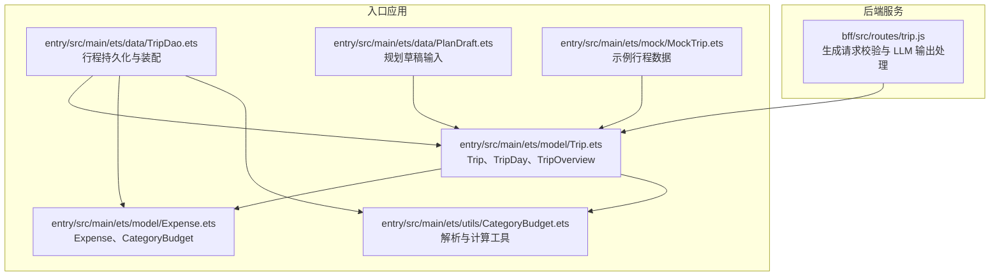
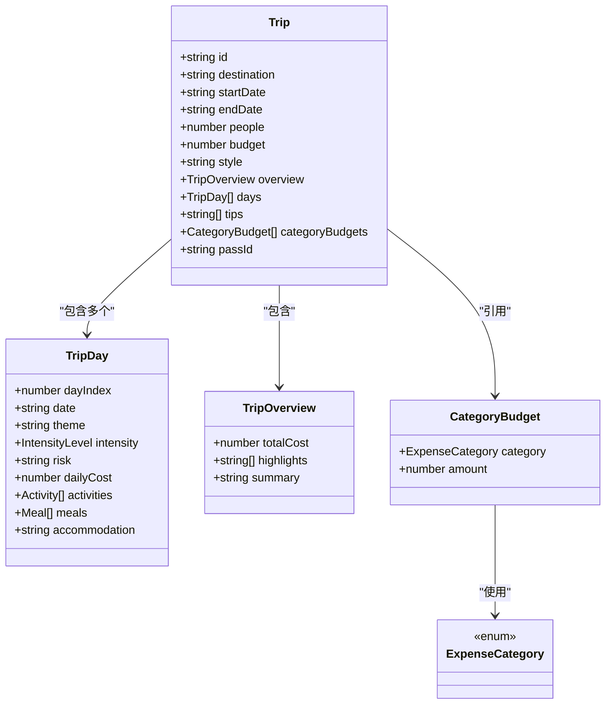
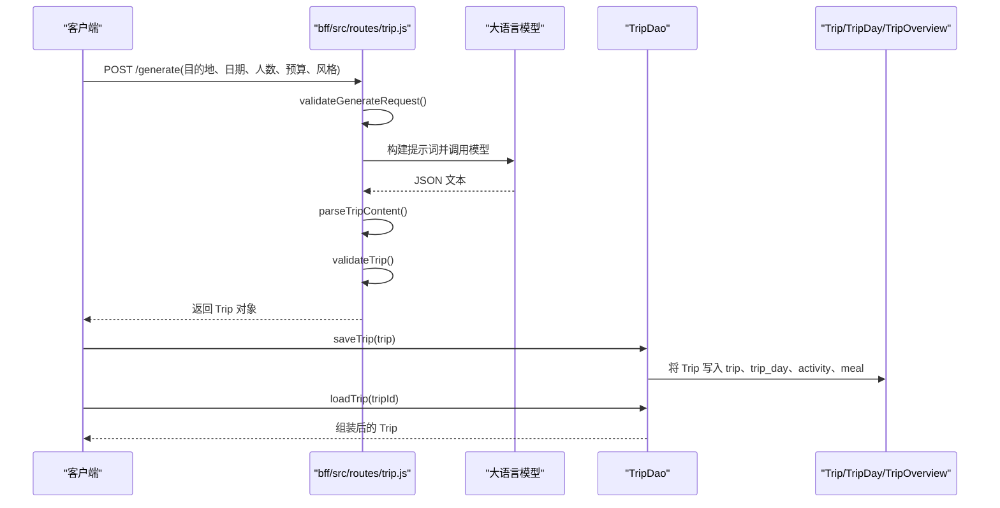
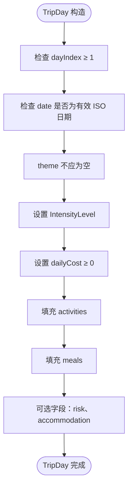
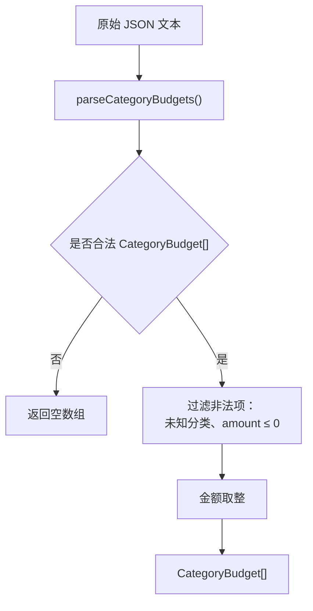
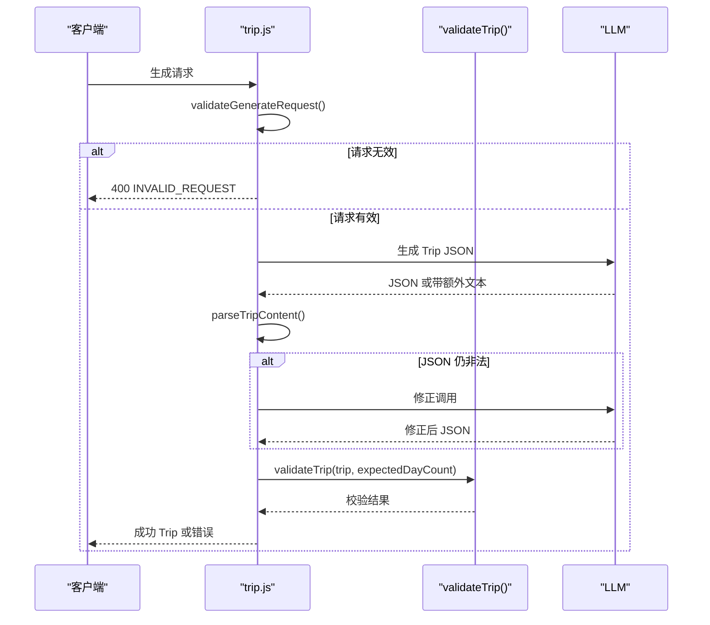
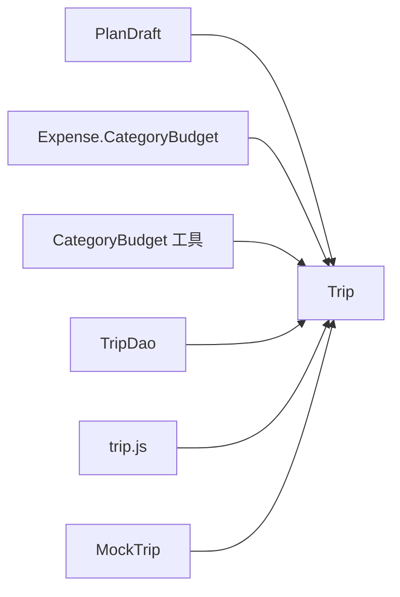
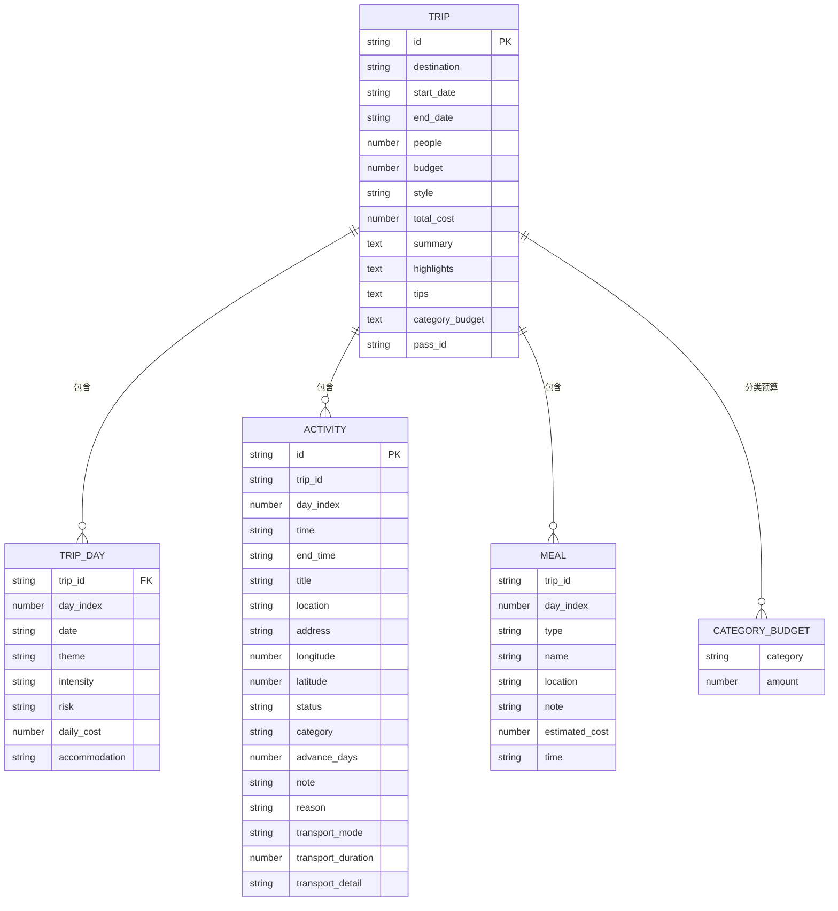

# Trip 聚合根模型

<cite>
**本文引用的文件**   
- [Trip.ets](file://entry/src/main/ets/model/Trip.ets)
- [Expense.ets](file://entry/src/main/ets/model/Expense.ets)
- [CategoryBudget.ets](file://entry/src/main/ets/utils/CategoryBudget.ets)
- [PlanDraft.ets](file://entry/src/main/ets/data/PlanDraft.ets)
- [TripDao.ets](file://entry/src/main/ets/data/TripDao.ets)
- [MockTrip.ets](file://entry/src/main/ets/mock/MockTrip.ets)
- [trip.js](file://bff/src/routes/trip.js)
</cite>

## 目录
1. [引言](#引言)
2. [项目结构与定位](#项目结构与定位)
3. [核心数据模型](#核心数据模型)
4. [架构总览](#架构总览)
5. [详细组件分析](#详细组件分析)
6. [依赖关系分析](#依赖关系分析)
7. [性能与存储特征](#性能与存储特征)
8. [示例数据](#示例数据)
9. [常见问题与排错](#常见问题与排错)
10. [结论](#结论)

## 引言
本文聚焦 **Trip** 作为行程聚合根的数据模型，说明它如何承载一次旅行从“城市目的地、时间区间、人数预算”到“每日活动、餐饮、住宿、风险提示、分类预算、通行证 ID”的完整语义。文档同时覆盖：

- Trip 基础字段与业务字段；
- TripDay 单日结构及其约束；
- TripOverview 展示型字段；
- 与 Expense.CategoryBudget 的分类预算关联；
- 生成请求边界校验（BFF）与持久化映射（DAO）；
- 完整的 TypeScript / ArkTS 接口定义和示例数据结构。

## 项目结构与定位
Trip 聚合根位于入口模块的领域模型层，是行程数据的权威来源：

**图表来源**
- [Trip.ets:1-137](file://entry/src/main/ets/model/Trip.ets#L1-L137)
- [Expense.ets:1-45](file://entry/src/main/ets/model/Expense.ets#L1-L45)
- [CategoryBudget.ets:1-63](file://entry/src/main/ets/utils/CategoryBudget.ets#L1-L63)
- [TripDao.ets:1-200](file://entry/src/main/ets/data/TripDao.ets#L1-L200)
- [PlanDraft.ets:1-77](file://entry/src/main/ets/data/PlanDraft.ets#L1-L77)
- [MockTrip.ets:1-93](file://entry/src/main/ets/mock/MockTrip.ets#L1-L93)
- [trip.js:1-200](file://bff/src/routes/trip.js#L1-L200)

**章节来源**
- [Trip.ets:1-137](file://entry/src/main/ets/model/Trip.ets#L1-L137)
- [TripDao.ets:1-200](file://entry/src/main/ets/data/TripDao.ets#L1-L200)

## 核心数据模型
Trip 是行程聚合根，围绕一个目的地组织所有子实体。其核心职责包括：

| 类别 | 字段 | 类型 | 语义与约束 |
|---|---|---|---|
| 标识 | `id` | string | 行程主键，由上层或 DAO 分配 |
| 目的地 | `destination` | string | 城市或目的地名称 |
| 时间区间 | `startDate` | string | ISO 日期 `YYYY-MM-DD` |
| 时间区间 | `endDate` | string | ISO 日期 `YYYY-MM-DD`，不得早于 `startDate` |
| 人员 | `people` | number | 出行人数，正整数 |
| 预算 | `budget` | number | 总预算，单位人民币元 |
| 风格 | `style` | string | 复用旅行风格码值，例如休闲、文化等 |
| 总览 | `overview` | TripOverview | 总览摘要卡 |
| 日程 | `days` | TripDay[] | 按日行程数组 |
| 小贴士 | `tips` | string[] | 行前提示列表 |
| 分类预算 | `categoryBudgets` | CategoryBudget[] | 可选；存量可能为空数组 |
| 通行证 | `passId` | string | 可选；空串表示未购买通行证 |

**章节来源**
- [Trip.ets:78-137](file://entry/src/main/ets/model/Trip.ets#L78-L137)

### TripDay 单日结构
TripDay 表示某一天的行程切片，承担“主题、强度、成本、活动、餐饮、住宿、风险”的一体化表达：

| 字段 | 类型 | 语义与约束 |
|---|---|---|
| `dayIndex` | number | 从 1 开始，用于排序和与 expense/activity 关联 |
| `date` | string | 该日日期，ISO `YYYY-MM-DD` |
| `theme` | string | 当日主题，如“故宫国家博物馆文化线” |
| `intensity` | IntensityLevel | 单日强度：低、中、高 |
| `risk` | string \| undefined | 可选；天气、闭馆、预约冲突等风险提示 |
| `dailyCost` | number | 当日估算费用，单位元 |
| `activities` | Activity[] | 当日活动节点 |
| `meals` | Meal[] | 当日餐饮项 |
| `accommodation` | string \| undefined | 可选；当晚住宿区域 + 建议酒店档位文案 |

Activity 与 Meal 进一步细化为：

| 实体 | 关键字段 | 说明 |
|---|---|---|
| Activity | `id`、`time`、`endTime`、`title`、`location`、`address`、`longitude`、`latitude`、`status`、`category`、`advanceDays`、`note`、`reason`、`transport` | 单个活动节点；交通类活动也可用 `transport` 描述相邻节点通勤 |
| TransportInfo | `mode`、`duration`、`detail` | 相邻活动前的通勤方式、耗时、详情 |
| Meal | `type`、`time`、`name`、`location`、`note`、`estimatedCost` | 餐次类型可缺省；金额单位元 |

**章节来源**
- [Trip.ets:20-77](file://entry/src/main/ets/model/Trip.ets#L20-L77)

### TripOverview 展示字段
TripOverview 是面向用户展示的头部摘要，不包含强一致性计算逻辑：

| 字段 | 类型 | 含义 |
|---|---|---|
| `totalCost` | number | 行程总成本估算 |
| `highlights` | string[] | 亮点条目，通常约 3 条，用于标题式展示 |
| `summary` | string | 一段话总结行程主线 |

**章节来源**
- [Trip.ets:68-77](file://entry/src/main/ets/model/Trip.ets#L68-L77)

### 与 Expense.CategoryBudget 的关联
Trip 不直接持有支出记录，而是通过 `categoryBudgets` 引用 Expense 模块中的 `CategoryBudget`：

- `CategoryBudget.category` 使用 Expense 的 `ExpenseCategory` 枚举；
- `CategoryBudget.amount` 表示某一类的预算上限；
- 当行程没有分类预算时，字段为可选且读回为空数组；
- 分类预算解析器对脏数据采取“整条丢弃”策略，不会猜测修复。

**图表来源**
- [Trip.ets:20-137](file://entry/src/main/ets/model/Trip.ets#L20-L137)
- [Expense.ets:1-45](file://entry/src/main/ets/model/Expense.ets#L1-L45)

**章节来源**
- [Expense.ets:24-45](file://entry/src/main/ets/model/Expense.ets#L24-L45)
- [CategoryBudget.ets:1-63](file://entry/src/main/ets/utils/CategoryBudget.ets#L1-L63)
- [Trip.ets:98-137](file://entry/src/main/ets/model/Trip.ets#L98-L137)

## 架构总览
Trip 聚合根贯穿“生成 → 校验 → 持久化 → 读取 → 展示”全链路：

**图表来源**
- [trip.js:1-200](file://bff/src/routes/trip.js#L1-L200)
- [TripDao.ets:1-200](file://entry/src/main/ets/data/TripDao.ets#L1-L200)
- [Trip.ets:1-137](file://entry/src/main/ets/model/Trip.ets#L1-L137)

## 详细组件分析

### Trip 聚合根
Trip 作为聚合根，统一了以下语义：

1. **基础信息**：目的地、出发与结束日期、人数、总预算、风格。
2. **展示摘要**：`overview.totalCost`、`highlights`、`summary` 供首页卡片、生成结果页展示。
3. **结构化日程**：`days` 是按日聚合的核心集合，每片 TripDay 对应一天。
4. **附加信息**：`tips` 提供行前建议；`categoryBudgets` 提供分类预算上限；`passId` 标记通行证状态。

在持久化层，DAO 把 Trip 拆成多张表：

- trip：行程头、总览、预算、风格、小贴士、分类预算、通行证；
- trip_day：每日主题、强度、风险、日均成本、住宿；
- activity：每个活动节点；
- meal：每餐。

这意味着 Trip 在内存中是聚合根，在数据库中是规范化关系结构。

**章节来源**
- [Trip.ets:78-137](file://entry/src/main/ets/model/Trip.ets#L78-L137)
- [TripDao.ets:33-120](file://entry/src/main/ets/data/TripDao.ets#L33-L120)

### TripDay 单日聚合
TripDay 不是简单数组元素，而是“一日事务”的边界：

- `dayIndex` 必须从 1 开始，与 expense/activity/meal 的 dayIndex 一致；
- `date` 应与行程区间匹配；
- `intensity` 用于 UI 强度标识和风险感知；
- `risk` 可空，适合天气预警、景点闭馆、预约冲突等提示；
- `dailyCost` 是当日估算值，可与实际 Expense 累计对比；
- `activities` 与 `meals` 共同构成当日体验；
- `accommodation` 描述住宿位置与档次，但非强制。

**图表来源**
- [Trip.ets:48-67](file://entry/src/main/ets/model/Trip.ets#L48-L67)
- [TripDao.ets:88-116](file://entry/src/main/ets/data/TripDao.ets#L88-L116)

**章节来源**
- [Trip.ets:48-67](file://entry/src/main/ets/model/Trip.ets#L48-L67)

### TripOverview 展示模型
TripOverview 的职责是“呈现”，不是“计算契约”。它的三个字段：

- `totalCost`：可由 `days[].dailyCost` 汇总，或由 LLM 生成；
- `highlights`：3 条左右亮点，UI 以 serif 标题展示；
- `summary`：一句话总结行程主轴。

DAO 读取时从数据库恢复 highlights 字符串数组和 summary 文本；写入时将 highlights 序列化为 JSON 字符串。

**章节来源**
- [Trip.ets:68-77](file://entry/src/main/ets/model/Trip.ets#L68-L77)
- [TripDao.ets:45-71](file://entry/src/main/ets/data/TripDao.ets#L45-L71)
- [TripDao.ets:121-153](file://entry/src/main/ets/data/TripDao.ets#L121-L153)

### 分类预算与 Expense 的关系
分类预算属于“预算对照基线”，而不是支出本身：

- `ExpenseCategory` 定义六档固定分类：门票、餐饮、交通、住宿、购物、其他；
- `CategoryBudget` 只包含 `category` 和 `amount`；
- Trip 的 `categoryBudgets` 是这些分类预算的集合；
- 解析器要求 `amount > 0`，否则丢弃该项；
- 若旧数据缺少该列，则返回空数组，避免 UI 崩溃；
- 画条基线和百分比计算优先使用用户设置的分类上限，再退回到调用方提供的兜底基线。

**图表来源**
- [CategoryBudget.ets:1-63](file://entry/src/main/ets/utils/CategoryBudget.ets#L1-L63)
- [Expense.ets:24-45](file://entry/src/main/ets/model/Expense.ets#L24-L45)

**章节来源**
- [Expense.ets:24-45](file://entry/src/main/ets/model/Expense.ets#L24-L45)
- [CategoryBudget.ets:1-63](file://entry/src/main/ets/utils/CategoryBudget.ets#L1-L63)
- [Trip.ets:98-110](file://entry/src/main/ets/model/Trip.ets#L98-L110)

### 生成请求与 Trip 数据契约
BFF 的 trip 路由负责把前端输入转化为模型输出：

- 校验 `destination`、`startDate`、`endDate`、`people`、`budget`；
- 限制日期范围与行程天数；
- 调用 LLM 生成 Trip JSON；
- 若 JSON 非法，尝试提取第一个完整对象，失败则发起修正调用；
- 对生成的 trip 做二次校验，确保 days 数量与预期一致；
- 成功后提交额度并返回响应体。

**图表来源**
- [trip.js:1-200](file://bff/src/routes/trip.js#L1-L200)

**章节来源**
- [trip.js:20-120](file://bff/src/routes/trip.js#L20-L120)

### 规划草稿与 Trip 输入
PlanDraft 是页面到 Trip 之间的过渡态，保存用户逐步填写的基础信息：

- `basic.destination`、`startDate`、`endDate`、`people`、`budget`；
- `style`、停留档位、交通偏好、节奏、已选地点和区域；
- 提供反向日期区间修复，防止 `endDate < startDate`；
- 提供 `days()` 计算入口，保证显示口径与生成请求一致。

虽然 PlanDraft 不直接等于 Trip，但它决定 Trip 的起点：目的地、日期、人数、预算、风格。

**章节来源**
- [PlanDraft.ets:1-77](file://entry/src/main/ets/data/PlanDraft.ets#L1-L77)

## 依赖关系分析
Trip 聚合根的依赖方向清晰：

- Trip 依赖 Expense 的分类枚举和分类预算类型；
- CategoryBudget 工具函数独立于 DAO，便于单元测试；
- TripDao 依赖 Trip 模型进行读写；
- BFF 对 Trip 做生成与校验；
- MockTrip 提供示例数据，对齐 Trip 结构。

**图表来源**
- [Trip.ets:1-137](file://entry/src/main/ets/model/Trip.ets#L1-L137)
- [Expense.ets:1-45](file://entry/src/main/ets/model/Expense.ets#L1-L45)
- [CategoryBudget.ets:1-63](file://entry/src/main/ets/utils/CategoryBudget.ets#L1-L63)
- [TripDao.ets:1-200](file://entry/src/main/ets/data/TripDao.ets#L1-L200)
- [trip.js:1-200](file://bff/src/routes/trip.js#L1-L200)
- [MockTrip.ets:1-93](file://entry/src/main/ets/mock/MockTrip.ets#L1-L93)

**章节来源**
- [Trip.ets:1-137](file://entry/src/main/ets/model/Trip.ets#L1-L137)
- [TripDao.ets:1-200](file://entry/src/main/ets/data/TripDao.ets#L1-L200)

## 性能与存储特征
从 DAO 实现可以看出 Trip 聚合根的存储特征：

1. **整存整写**：保存 Trip 时会先删除同 id 的行，再批量插入 trip、trip_day、activity、meal；
2. **分区隔离**：trip.user_id 使用当前登录用户 ID，列表与详情都按 user_id 过滤；
3. **活动主键前缀化**：activity 主键形如 `${tripId}:${activityId}`，避免跨行程 id 冲突；
4. **可选字段序列化**：risk、accommodation、note、tips、highlights、categoryBudgets 等通过 null 或 JSON 字符串适配关系表；
5. **读取装配开销**：loadTrip 分别查询 trip、trip_day、activity、meal，然后按 dayIndex 拼装，时间复杂度约为 O(n + m + k)，其中 n 为天数、m 为活动数、k 为餐饮数；
6. **分类预算容错**：解析失败或脏数据会降级为空数组，避免页面渲染崩溃。

**章节来源**
- [TripDao.ets:1-200](file://entry/src/main/ets/data/TripDao.ets#L1-L200)
- [CategoryBudget.ets:1-63](file://entry/src/main/ets/utils/CategoryBudget.ets#L1-L63)

## 示例数据
以下是一个完整行程示例的结构说明，对应 MockTrip 的数据形态：

- 行程：京都，2026-06-10 至 2026-06-14，2 人，总预算 16000 元，风格 culture；
- 总览：总成本 39800 元，亮点包括清晨伏见稻荷、东山步道串联、祇园老铺定食，总结为五日文化线；
- 第一天：主题“东山 · 清水”，高强度，包含伏见稻荷大社、清水寺、二年坂·三年坂、键善良房本店、八坂神社等，午餐预算 1800 元；
- 第二天：主题“岚山 · 竹林”，中等强度，包含岚山竹林小径、天龙寺；
- 第三天：主题“伏见 · 宇治”，低强度，包含宇治抹茶街；
- 小贴士：寺社避开团队客流、巴士一日券随上随下。

**图表来源**
- [TripDao.ets:33-120](file://entry/src/main/ets/data/TripDao.ets#L33-L120)
- [MockTrip.ets:1-93](file://entry/src/main/ets/mock/MockTrip.ets#L1-L93)

**章节来源**
- [MockTrip.ets:1-93](file://entry/src/main/ets/mock/MockTrip.ets#L1-L93)

## 常见问题与排错
针对 Trip 聚合根及相关模型，常见排查点如下：

1. **日期顺序异常**：如果 `endDate < startDate`，PlanDraft 会尝试修复为同日；BFF 也会拒绝此类请求。
2. **JSON 生成失败**：BFF 会先尝试解析完整 JSON，失败后提取首个对象，再失败则发起修正调用；仍失败返回 LLM_INVALID_JSON。
3. **行程天数不一致**：validateTrip 会根据期望天数校验 days 数量，防止长行程被截断或生成过多天。
4. **分类预算缺失**：旧数据没有 categoryBudgets 时，DAO 返回空数组；解析器丢弃非法项，不会抛错。
5. **活动或餐饮错位**：DAO 通过 dayIndex 将 activity 和 meal 归入对应 TripDay；若 dayIndex 不一致，会导致某日内容缺失。
6. **通行证状态**：passId 为空串表示未购买；BFF 根据 passId 判断额度来源，影响免费档与 token 上限。

**章节来源**
- [PlanDraft.ets:34-77](file://entry/src/main/ets/data/PlanDraft.ets#L34-L77)
- [trip.js:20-120](file://bff/src/routes/trip.js#L20-L120)
- [CategoryBudget.ets:14-63](file://entry/src/main/ets/utils/CategoryBudget.ets#L14-L63)
- [TripDao.ets:88-153](file://entry/src/main/ets/data/TripDao.ets#L88-L153)

## 结论
Trip 聚合根是整个行程系统的核心数据契约。它把“目的地、时间、人员、预算、风格”与“总览、每日行程、活动、餐饮、贴士、分类预算、通行证”统一在一个稳定模型中。TripDay 提供一日边界，TripOverview 提供展示摘要，CategoryBudget 提供分类预算对照。后端负责生成与校验，DAO 负责持久化与装配，Mock 提供可验收的数据样本。理解这个聚合根，就能准确理解从行程生成到页面展示的完整数据流。