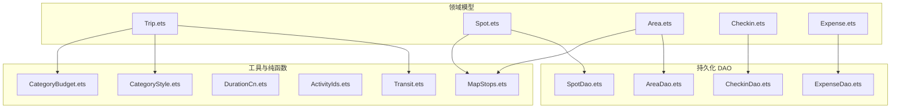
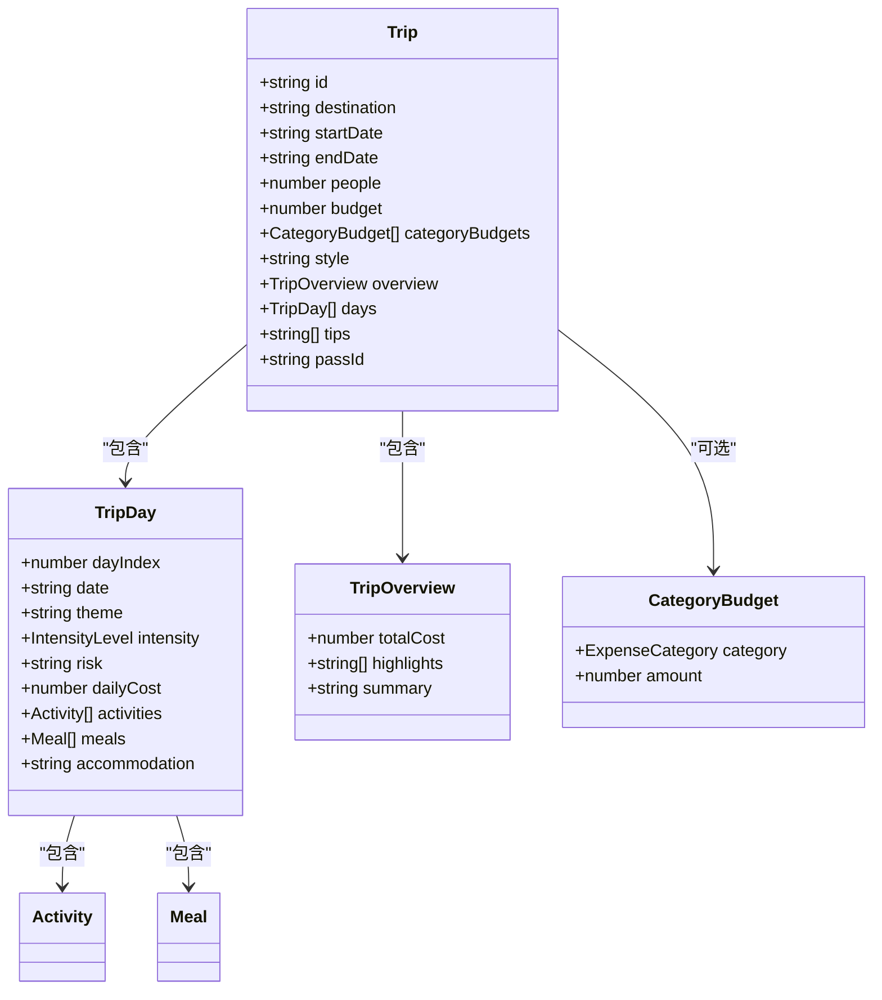
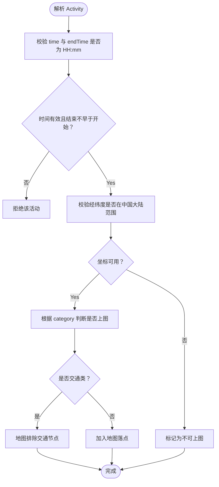
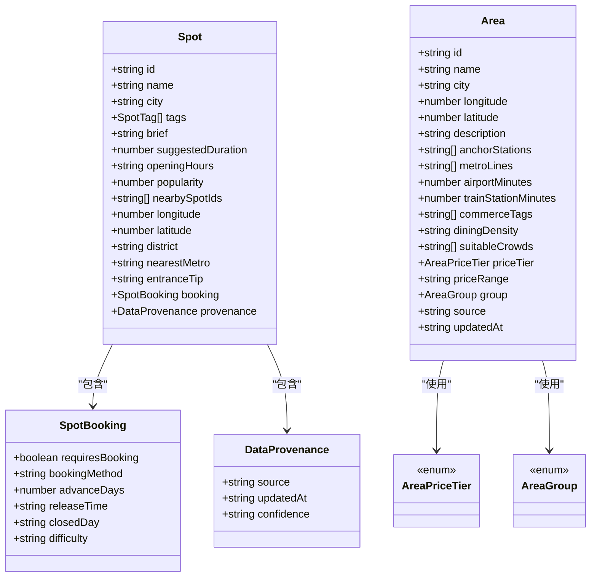
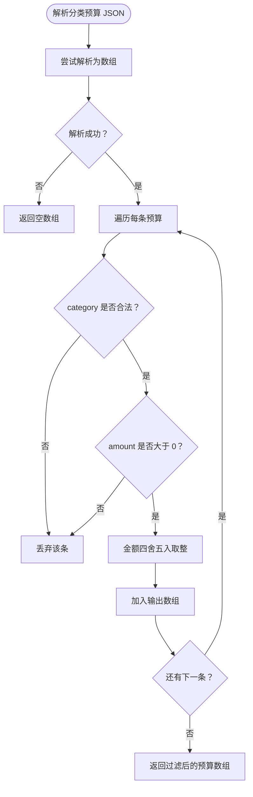
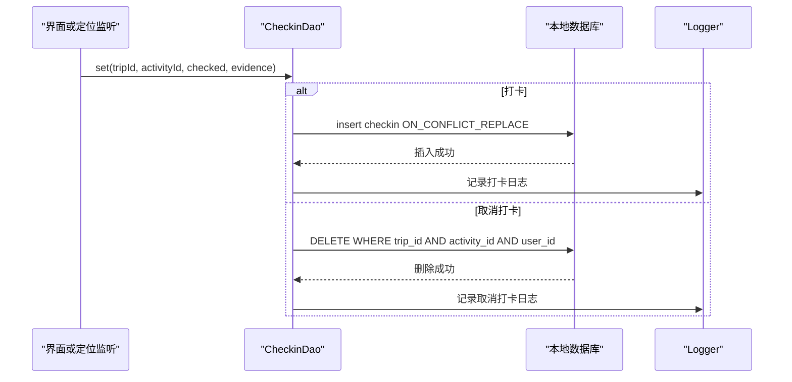
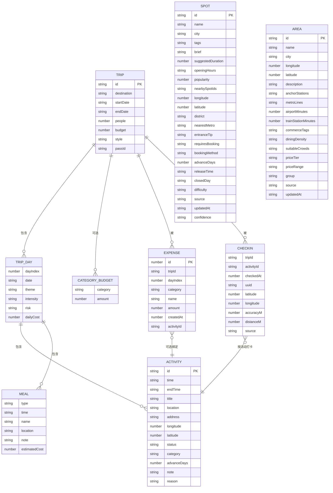
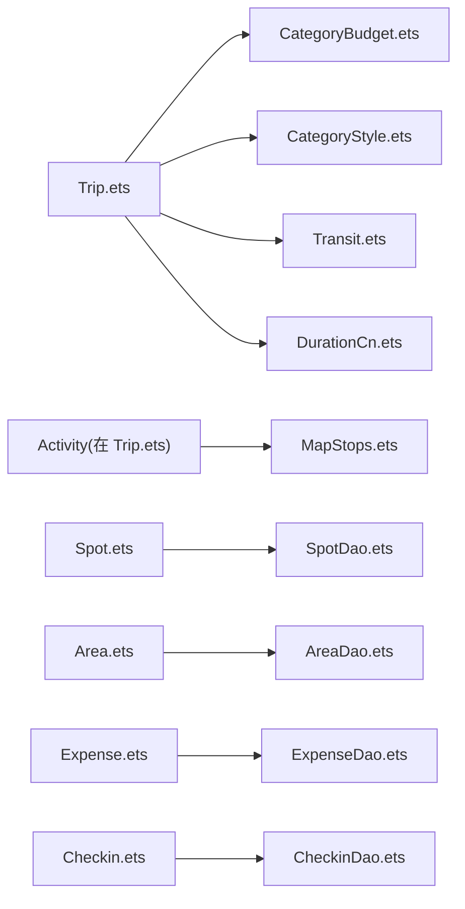

# 数据模型定义

<cite>
**本文引用的文件 **
- [Trip.ets](file://entry/src/main/ets/model/Trip.ets)
- [Area.ets](file://entry/src/main/ets/model/Area.ets)
- [Spot.ets](file://entry/src/main/ets/model/Spot.ets)
- [Checkin.ets](file://entry/src/main/ets/model/Checkin.ets)
- [Expense.ets](file://entry/src/main/ets/model/Expense.ets)
- [CategoryBudget.ets](file://entry/src/main/ets/utils/CategoryBudget.ets)
- [Transit.ets](file://entry/src/main/ets/utils/Transit.ets)
- [DurationCn.ets](file://entry/src/main/ets/utils/DurationCn.ets)
- [ActivityIds.ets](file://entry/src/main/ets/utils/ActivityIds.ets)
- [CategoryStyle.ets](file://entry/src/main/ets/utils/CategoryStyle.ets)
- [MapStops.ets](file://entry/src/main/ets/utils/MapStops.ets)
- [CheckinDao.ets](file://entry/src/main/ets/data/CheckinDao.ets)
- [ExpenseDao.ets](file://entry/src/main/ets/data/ExpenseDao.ets)
- [SpotDao.ets](file://entry/src/main/ets/data/SpotDao.ets)
- [AreaDao.ets](file://entry/src/main/ets/data/AreaDao.ets)
</cite>

## 目录
1. [引言](#引言)
2. [项目结构中的领域模型位置](#项目结构中的领域模型位置)
3. [核心实体总览](#核心实体总览)
4. [行程聚合根 Trip](#行程聚合根-trip)
5. [活动节点 Activity](#活动节点-activity)
6. [景点 Spot 与住宿区域 Area](#景点-spot-与住宿区域-area)
7. [费用 Expense 与分类预算 CategoryBudget](#费用-expense-与分类预算-categorybudget)
8. [打卡 Checkin](#打卡-checkin)
9. [枚举类型与取值语义](#枚举类型与取值语义)
10. [数据验证规则与约束](#数据验证规则与约束)
11. [模型关系图与字段映射](#模型关系图与字段映射)
12. [依赖分析与耦合说明](#依赖分析与耦合说明)
13. [性能与存储特性](#性能与存储特性)
14. [常见问题与排障](#常见问题与排障)
15. [结论](#结论)

## 引言
本文是“有径”应用的数据模型文档，聚焦领域实体、业务枚举、聚合关系以及持久化契约。重点包括：
- 行程聚合根 `Trip` 的完整结构，包括每日行程、活动、餐饮、总览、小贴士和分类预算。
- 活动节点 `Activity` 的时间范围、位置、预约状态、分类、通勤信息语义。
- 地点数据契约 `Spot` 与 `Area`：属性、坐标、标签、来源追踪。
- 费用记录 `Expense` 与打卡凭证 `Checkin` 的数据结构。
- 全部枚举类型的取值范围和业务含义。
- 数据校验规则、边界处理及与数据库表结构的映射。

## 项目结构中的领域模型位置
领域模型集中在 `entry/src/main/ets/model` 下；辅助计算逻辑集中在 `entry/src/main/ets/utils`；DAO 层集中在 `entry/src/main/ets/data`。

**图表来源**
- [Trip.ets:1-137](file://entry/src/main/ets/model/Trip.ets#L1-L137)
- [Spot.ets:1-69](file://entry/src/main/ets/model/Spot.ets#L1-L69)
- [Area.ets:1-51](file://entry/src/main/ets/model/Area.ets#L1-L51)
- [Checkin.ets:1-14](file://entry/src/main/ets/model/Checkin.ets#L1-L14)
- [Expense.ets:1-45](file://entry/src/main/ets/model/Expense.ets#L1-L45)
- [CategoryBudget.ets:1-63](file://entry/src/main/ets/utils/CategoryBudget.ets#L1-L63)
- [Transit.ets:1-52](file://entry/src/main/ets/utils/Transit.ets#L1-L52)
- [DurationCn.ets:1-25](file://entry/src/main/ets/utils/DurationCn.ets#L1-L25)
- [ActivityIds.ets:1-10](file://entry/src/main/ets/utils/ActivityIds.ets#L1-L10)
- [CategoryStyle.ets:1-51](file://entry/src/main/ets/utils/CategoryStyle.ets#L1-L51)
- [MapStops.ets:1-187](file://entry/src/main/ets/utils/MapStops.ets#L1-L187)
- [CheckinDao.ets:1-70](file://entry/src/main/ets/data/CheckinDao.ets#L1-L70)
- [ExpenseDao.ets:1-111](file://entry/src/main/ets/data/ExpenseDao.ets#L1-L111)
- [SpotDao.ets:1-100](file://entry/src/main/ets/data/SpotDao.ets#L1-L100)
- [AreaDao.ets:1-75](file://entry/src/main/ets/data/AreaDao.ets#L1-L75)

**章节来源**
- [Trip.ets:1-137](file://entry/src/main/ets/model/Trip.ets#L1-L137)
- [Spot.ets:1-69](file://entry/src/main/ets/model/Spot.ets#L1-L69)
- [Area.ets:1-51](file://entry/src/main/ets/model/Area.ets#L1-L51)
- [Checkin.ets:1-14](file://entry/src/main/ets/model/Checkin.ets#L1-L14)
- [Expense.ets:1-45](file://entry/src/main/ets/model/Expense.ets#L1-L45)

## 核心实体总览
| 实体 | 主要职责 | 关键标识 | 关联实体 |
|---|---|---|---|
| `Trip` | 行程聚合根，承载目的地、时间、人数、预算、每日行程、概览、贴士、通行证等 | `id` | `TripDay`、`TripOverview`、`CategoryBudget` |
| `TripDay` | 单日行程，含日期、主题、强度、风险、消费、活动集合、餐饮集合、住宿描述 | `dayIndex`、`date` | `Activity`、`Meal` |
| `Activity` | 行程活动节点，含时间、位置、预约状态、分类、通勤、备注、理由 | `id` | `TransportInfo` |
| `Meal` | 餐次记录，含餐型、时刻、名称、地点、备注、预估花费 | 无主键，随 `TripDay` 存在 | 无 |
| `TripOverview` | 行程总览摘要，含总花费、亮点、总结 | 无主键，随 `Trip` 存在 | 无 |
| `Spot` | 内置景点数据，含标签、简介、时长、热度、坐标、分区、地铁、入口提示、预约规则、来源 | `id` | `SpotBooking`、`DataProvenance` |
| `Area` | 内置住宿区域数据，含坐标、锚站、线路、通勤、商圈、人群、价格档位、分组、来源 | `id` | `AreaPriceTier`、`AreaGroup` |
| `Expense` | 费用记账行，含行程、天数、分类、名称、金额、时间、可选活动绑定 | `id` | `ExpenseCategory`、`Trip` |
| `CheckinMark` | 打卡凭证简模，含行程、活动、打卡时刻 | 复合唯一键 `(tripId, activityId)` | `Trip`、`Activity` |

**章节来源**
- [Trip.ets:1-137](file://entry/src/main/ets/model/Trip.ets#L1-L137)
- [Spot.ets:1-69](file://entry/src/main/ets/model/Spot.ets#L1-L69)
- [Area.ets:1-51](file://entry/src/main/ets/model/Area.ets#L1-L51)
- [Expense.ets:1-45](file://entry/src/main/ets/model/Expense.ets#L1-L45)
- [Checkin.ets:1-14](file://entry/src/main/ets/model/Checkin.ets#L1-L14)

## 行程聚合根 Trip
`Trip` 是整个行程域的核心聚合根，负责把目的地元信息、预算、行程总览、每日行程、贴士、通行证 ID 组合成一个可展示、可持久化的对象。

| 字段 | 类型 | 是否必填 | 业务含义 |
|---|---|---:|---|
| `id` | string | 是 | 行程主键，用于跨模块引用 |
| `destination` | string | 是 | 目的地城市名 |
| `startDate` | string | 是 | 开始日期，格式 `YYYY-MM-DD` |
| `endDate` | string | 是 | 结束日期，格式 `YYYY-MM-DD` |
| `people` | number | 是 | 出行人数 |
| `budget` | number | 是 | 总预算，单位人民币元 |
| `categoryBudgets` | `CategoryBudget[]` | 否 | 分类预算数组；存量行程可能为空 |
| `style` | string | 是 | 旅行风格码值，复用计划参数风格 |
| `overview` | `TripOverview` | 是 | 行程生成结果头部摘要 |
| `days` | `TripDay[]` | 是 | 按天展开的行程列表 |
| `tips` | string[] | 是 | 小贴士文本数组 |
| `passId` | string | 否 | 行程通行证 ID，空串表示未购买 |

`TripDay` 字段如下：

| 字段 | 类型 | 是否必填 | 业务含义 |
|---|---|---:|---|
| `dayIndex` | number | 是 | 从 1 开始的天序号 |
| `date` | string | 是 | 当天日期，格式 `YYYY-MM-DD` |
| `theme` | string | 是 | 当日主题文案 |
| `intensity` | `IntensityLevel` | 是 | 单日节奏强度 |
| `risk` | string | 否 | 当日风险提示，如天气、闭馆日、预约冲突 |
| `dailyCost` | number | 是 | 当日成本 |
| `activities` | `Activity[]` | 是 | 当日活动列表 |
| `meals` | `Meal[]` | 是 | 当日餐饮列表 |
| `accommodation` | string | 否 | 当晚住宿描述 |

`TripOverview` 字段如下：

| 字段 | 类型 | 是否必填 | 业务含义 |
|---|---|---:|---|
| `totalCost` | number | 是 | 行程总花费 |
| `highlights` | string[] | 是 | 亮点条目数组 |
| `summary` | string | 是 | 一段话总结 |

**图表来源**
- [Trip.ets:1-137](file://entry/src/main/ets/model/Trip.ets#L1-L137)
- [Expense.ets:1-45](file://entry/src/main/ets/model/Expense.ets#L1-L45)

**章节来源**
- [Trip.ets:1-137](file://entry/src/main/ets/model/Trip.ets#L1-L137)

## 活动节点 Activity
`Activity` 是行程中可排期的最小单元，承载时间、位置、预约、分类、通勤、备注和 AI 排期理由。

| 字段 | 类型 | 是否必填 | 业务含义 |
|---|---|---:|---|
| `id` | string | 是 | 活动主键；编辑期和生成期使用不同铸造策略 |
| `time` | string | 是 | 开始时间，格式 `HH:mm` |
| `endTime` | string | 是 | 结束时间，格式 `HH:mm` |
| `title` | string | 是 | 活动标题 |
| `location` | string | 是 | 场所名或 POI 名 |
| `address` | string | 是 | 详细地址 |
| `longitude` | number | 是 | 经度 |
| `latitude` | number | 是 | 纬度 |
| `status` | `ActivityStatus` | 是 | 预约状态 |
| `category` | `ActivityCategory` | 是 | 活动分类 |
| `advanceDays` | number | 否 | 需提前预约天数；未携带时 UI 按 1 天兜底提醒 |
| `note` | string | 否 | 用户备注 |
| `reason` | string | 否 | AI 生成的排期理由 |
| `transport` | `TransportInfo` | 否 | 到达此节点前的通勤信息 |

`TransportInfo` 字段如下：

| 字段 | 类型 | 是否必填 | 业务含义 |
|---|---|---:|---|
| `mode` | string | 是 | 出行方式自由文案，例如“地铁 2 号线”“步行”“打车” |
| `duration` | number | 是 | 通勤耗时，单位分钟 |
| `detail` | string | 是 | 通勤详情或换乘说明 |

时间语义约束：
- `time` 和 `endTime` 为 `HH:mm` 字符串。
- 地图落点过滤会排除交通类活动；坐标不可用的活动不会进入地图视图。
- 通勤估算统一由 `Transit` 工具提供，避免前端各处自行写死文案。

**图表来源**
- [Trip.ets:1-137](file://entry/src/main/ets/model/Trip.ets#L1-L137)
- [MapStops.ets:1-187](file://entry/src/main/ets/utils/MapStops.ets#L1-L187)
- [Transit.ets:1-52](file://entry/src/main/ets/utils/Transit.ets#L1-L52)

**章节来源**
- [Trip.ets:1-137](file://entry/src/main/ets/model/Trip.ets#L1-L137)
- [MapStops.ets:1-187](file://entry/src/main/ets/utils/MapStops.ets#L1-L187)
- [Transit.ets:1-52](file://entry/src/main/ets/utils/Transit.ets#L1-L52)

## 景点 Spot 与住宿区域 Area
### Spot 数据契约
`Spot` 是端侧内置景点库的主实体，AI 不直接作为数据源，而是基于这些字段构造筛选条件和 Prompt。

| 字段 | 类型 | 是否必填 | 业务含义 |
|---|---|---:|---|
| `id` | string | 是 | 景点唯一标识 |
| `name` | string | 是 | 景点名称 |
| `city` | string | 是 | 所在城市 |
| `tags` | `SpotTag[]` | 是 | 必去、经典、小众、亲子等标签 |
| `brief` | string | 是 | 一句话简介 |
| `suggestedDuration` | number | 是 | 建议游玩时长，单位分钟 |
| `openingHours` | string | 否 | 每日一致开放时段 |
| `popularity` | number | 是 | 热度指数，用于排序 |
| `nearbySpotIds` | string[] | 是 | 周边景点 ID，用于串联规划 |
| `longitude` | number | 是 | 经度 |
| `latitude` | number | 是 | 纬度 |
| `district` | string | 是 | 所在区 |
| `nearestMetro` | string | 是 | 最近地铁站 |
| `entranceTip` | string | 否 | 入口提示 |
| `booking` | `SpotBooking` | 是 | 预约规则组 |
| `provenance` | `DataProvenance` | 是 | 数据来源与可信度 |

`SpotBooking` 字段：
| 字段 | 类型 | 是否必填 | 业务含义 |
|---|---|---:|---|
| `requiresBooking` | boolean | 是 | 是否需要预约 |
| `bookingMethod` | string | 否 | 预约方式 |
| `advanceDays` | number | 否 | 需提前几天 |
| `releaseTime` | string | 否 | 放票时间 |
| `closedDay` | string | 否 | 闭馆日 |
| `difficulty` | string | 否 | 预约难度 |

`DataProvenance` 字段：
| 字段 | 类型 | 是否必填 | 业务含义 |
|---|---|---:|---|
| `source` | string | 是 | 数据来源 |
| `updatedAt` | string | 是 | 更新时间，格式 `YYYY-MM-DD` |
| `confidence` | string | 否 | 可信度 |

### Area 数据契约
`Area` 是住宿区域库，只推荐位置，不接入第三方住宿服务。

| 字段 | 类型 | 是否必填 | 业务含义 |
|---|---|---:|---|
| `id` | string | 是 | 区域唯一标识 |
| `name` | string | 是 | 区域名 |
| `city` | string | 是 | 所属城市 |
| `longitude` | number | 是 | 经度 |
| `latitude` | number | 是 | 纬度 |
| `description` | string | 是 | 一句话描述 |
| `anchorStations` | string[] | 是 | 锚定地铁站名 |
| `metroLines` | string[] | 是 | 途经地铁线路 |
| `airportMinutes` | number | 是 | 到机场通勤分钟数 |
| `trainStationMinutes` | number | 是 | 到火车站通勤分钟数 |
| `commerceTags` | string[] | 是 | 商圈标签 |
| `diningDensity` | string | 是 | 餐饮密度 |
| `suitableCrowds` | string[] | 是 | 适合人群 |
| `priceTier` | `AreaPriceTier` | 是 | 价格档位 |
| `priceRange` | string | 否 | 参考价位段文案 |
| `group` | `AreaGroup` | 是 | 浏览分组 |
| `source` | string | 是 | 数据来源 |
| `updatedAt` | string | 是 | 更新时间，格式 `YYYY-MM-DD` |

**图表来源**
- [Spot.ets:1-69](file://entry/src/main/ets/model/Spot.ets#L1-L69)
- [Area.ets:1-51](file://entry/src/main/ets/model/Area.ets#L1-L51)

**章节来源**
- [Spot.ets:1-69](file://entry/src/main/ets/model/Spot.ets#L1-L69)
- [Area.ets:1-51](file://entry/src/main/ets/model/Area.ets#L1-L51)

## 费用 Expense 与分类预算 CategoryBudget
### Expense 数据结构
`Expense` 是阶段 10 的费用记账实体，金额单位与行程预算保持一致，均为人民币元。

| 字段 | 类型 | 是否必填 | 业务含义 |
|---|---|---:|---|
| `id` | number | 是 | 自增主键，新建时为 0 |
| `tripId` | string | 是 | 归属行程 |
| `dayIndex` | number | 是 | 归属第几天，从 1 开始 |
| `category` | `ExpenseCategory` | 是 | 费用分类 |
| `name` | string | 是 | 费用名称 |
| `amount` | number | 是 | 金额，取整元 |
| `createdAt` | number | 是 | 记账时刻，毫秒时间戳 |
| `activityId` | string | 否 | 绑定到某个活动节点 |

### CategoryBudget 数据结构
`CategoryBudget` 表示每个分类预算上限，随行程保存，而不是从总预算按比例硬拆。

| 字段 | 类型 | 是否必填 | 业务含义 |
|---|---|---:|---|
| `category` | `ExpenseCategory` | 是 | 费用分类 |
| `amount` | number | 是 | 该类预算上限；大于 0 才生效 |

预算解析与画条逻辑：
- 仅接受六档稳定分类码。
- 只接受正数金额。
- 脏条目整条丢弃。
- 未设置上限时返回 0，表示不设上限。
- 百分比计算时封顶 100，至少为 1，避免画不出进度条。

**图表来源**
- [CategoryBudget.ets:1-63](file://entry/src/main/ets/utils/CategoryBudget.ets#L1-L63)

**章节来源**
- [Expense.ets:1-45](file://entry/src/main/ets/model/Expense.ets#L1-L45)
- [CategoryBudget.ets:1-63](file://entry/src/main/ets/utils/CategoryBudget.ets#L1-L63)

## 打卡 Checkin
`CheckinMark` 是打卡凭证的轻量模型；实际持久化通过 `CheckinDao` 写入独立表，按 `(trip_id, activity_id)` 唯一，重复打卡更新打卡时刻。

| 字段 | 类型 | 是否必填 | 业务含义 |
|---|---|---:|---|
| `tripId` | string | 是 | 行程 ID |
| `activityId` | string | 是 | 活动 ID |
| `checkedAt` | number | 是 | 打卡时刻，毫秒 |

DAO 扩展凭证字段：
| 字段 | 类型 | 是否必填 | 业务含义 |
|---|---|---:|---|
| `uuid` | string | 是 | 打卡记录 UUID |
| `latitude` | number | 否 | 到站定位纬度 |
| `longitude` | number | 否 | 到站定位经度 |
| `accuracyM` | number | 否 | 定位精度半径，单位米 |
| `distanceM` | number | 否 | 打卡时到站点距离，单位米 |
| `source` | string | 是 | 来源：`arrival` 表示到站凭证，`manual` 表示手动打卡 |

**图表来源**
- [Checkin.ets:1-14](file://entry/src/main/ets/model/Checkin.ets#L1-L14)
- [CheckinDao.ets:1-70](file://entry/src/main/ets/data/CheckinDao.ets#L1-L70)

**章节来源**
- [Checkin.ets:1-14](file://entry/src/main/ets/model/Checkin.ets#L1-L14)
- [CheckinDao.ets:1-70](file://entry/src/main/ets/data/CheckinDao.ets#L1-L70)

## 枚举类型与取值语义
| 枚举 | 取值 | 业务含义 |
|---|---|---|
| `ActivityStatus` | `booked` | 已约 |
| `ActivityStatus` | `not_booked` | 未约 |
| `ActivityStatus` | `full` | 约满 |
| `ActivityStatus` | `pending` | 待定 |
| `ActivityStatus` | `no_need` | 无需预约 |
| `ActivityCategory` | `transport` | 交通 |
| `ActivityCategory` | `sight` | 景点 |
| `ActivityCategory` | `food` | 餐饮 |
| `ActivityCategory` | `shop` | 购物 |
| `ActivityCategory` | `rest` | 休息或休整 |
| `ActivityCategory` | `hotel` | 住宿 |
| `ActivityCategory` | `other` | 其他 |
| `IntensityLevel` | `low` | 低强度，UI 显示“轻松” |
| `IntensityLevel` | `medium` | 中强度，UI 显示“标准” |
| `IntensityLevel` | `high` | 高强度，UI 显示“紧凑” |
| `MealType` | `breakfast` | 早餐 |
| `MealType` | `lunch` | 午餐 |
| `MealType` | `dinner` | 晚餐 |
| `SpotTag` | `must_see` | 必去 |
| `SpotTag` | `classic` | 经典 |
| `SpotTag` | `niche` | 小众 |
| `SpotTag` | `family` | 亲子 |
| `AreaPriceTier` | `economy` | 经济 |
| `AreaPriceTier` | `comfort` | 舒适 |
| `AreaPriceTier` | `luxury` | 豪华 |
| `AreaGroup` | `core` | 核心区 |
| `AreaGroup` | `commercial` | 商圈 |
| `AreaGroup` | `metro` | 地铁站 |
| `ExpenseCategory` | `ticket` | 门票 |
| `ExpenseCategory` | `food` | 餐饮 |
| `ExpenseCategory` | `transport` | 交通 |
| `ExpenseCategory` | `hotel` | 住宿 |
| `ExpenseCategory` | `shop` | 购物 |
| `ExpenseCategory` | `other` | 其他 |

分类颜色映射：
- 餐饮对应书签色。
- 住宿对应强调提及色。
- 交通对应图标色。
- 休息对应淡色。
- 其他类别默认景点主色。

强度中文标签映射：
- `low` → “轻松”。
- `medium` → “标准”。
- `high` → “紧凑”。
- 未知值返回空串，宁缺毋假。

**章节来源**
- [Trip.ets:1-137](file://entry/src/main/ets/model/Trip.ets#L1-L137)
- [Spot.ets:1-69](file://entry/src/main/ets/model/Spot.ets#L1-L69)
- [Area.ets:1-51](file://entry/src/main/ets/model/Area.ets#L1-L51)
- [Expense.ets:1-45](file://entry/src/main/ets/model/Expense.ets#L1-L45)
- [CategoryStyle.ets:1-51](file://entry/src/main/ets/utils/CategoryStyle.ets#L1-L51)

## 数据验证规则与约束
### 通用规则
- 日期字段统一使用 `YYYY-MM-DD`。
- 时间字段统一使用 `HH:mm`，24 小时制。
- 金额单位为人民币元，数值类型。
- 枚举值采用英文稳定码，中文展示标签由 UI 层映射。
- 坐标必须位于中国大陆粗筛范围内才可作为地图落点。

### Trip 约束
- `days` 中 `dayIndex` 从 1 开始。
- `categoryBudgets` 可为空，表示存量行程未设置分类预算。
- `passId` 空串表示未购买通行证。
- `overview.highlights` 一般为 3 条左右，供标题式展示。

### Activity 约束
- `time` 与 `endTime` 应满足时间先后语义。
- `advanceDays` 未提供时，UI 按 1 天兜底提醒预约。
- `transport` 用于相邻活动前的通勤；交通类活动本体也使用该结构。
- 交通类活动不上地图。
- 坐标不可用时不上地图，避免异常连线。

### Meal 约束
- `type` 必须属于 `MealType`。
- `time` 可选；省略时按餐次档位排位，不显示假时间。
- `estimatedCost` 为正数金额。

### Spot 约束
- `tags` 必须属于 `SpotTag`。
- `openingHours` 仅在 MapKit 城市可用，否则留空。
- `booking` 所有硬信息 UI 需带“以官方为准”标注。
- `provenance.source` 和 `provenance.updatedAt` 必须存在。

### Area 约束
- `priceTier` 必须属于 `AreaPriceTier`。
- `group` 必须属于 `AreaGroup`。
- `anchorStations`、`metroLines`、`commerceTags`、`suitableCrowds` 为字符串数组。
- `priceRange` 可选，预算协同启用前仅展示。

### Expense 约束
- `category` 必须属于 `ExpenseCategory`。
- `amount` 为正整数元。
- `activityId` 可选，用于行内金额绑定。
- DAO 查询严格按 `user_id` 分区，防止跨账号误删。

### Checkin 约束
- `(tripId, activityId)` 唯一。
- 重复打卡更新 `checkedAt`。
- 到站打卡带坐标和距离；手动打卡坐标留 0，来源标记为 `manual`。

**章节来源**
- [Trip.ets:1-137](file://entry/src/main/ets/model/Trip.ets#L1-L137)
- [Spot.ets:1-69](file://entry/src/main/ets/model/Spot.ets#L1-L69)
- [Area.ets:1-51](file://entry/src/main/ets/model/Area.ets#L1-L51)
- [Expense.ets:1-45](file://entry/src/main/ets/model/Expense.ets#L1-L45)
- [CheckinDao.ets:1-70](file://entry/src/main/ets/data/CheckinDao.ets#L1-L70)
- [ExpenseDao.ets:1-111](file://entry/src/main/ets/data/ExpenseDao.ets#L1-L111)
- [MapStops.ets:1-187](file://entry/src/main/ets/utils/MapStops.ets#L1-L187)

## 模型关系图与字段映射
### 实体关系图

**图表来源**
- [Trip.ets:1-137](file://entry/src/main/ets/model/Trip.ets#L1-L137)
- [Spot.ets:1-69](file://entry/src/main/ets/model/Spot.ets#L1-L69)
- [Area.ets:1-51](file://entry/src/main/ets/model/Area.ets#L1-L51)
- [Expense.ets:1-45](file://entry/src/main/ets/model/Expense.ets#L1-L45)
- [Checkin.ets:1-14](file://entry/src/main/ets/model/Checkin.ets#L1-L14)

### 数据库字段映射要点
| 模型 | 数据库行为 | 重要映射规则 |
|---|---|---|
| `Spot.tags` | 存储为 JSON 字符串 | 空字符串解析为空数组；非法 JSON 回退为空数组 |
| `Spot.nearbySpotIds` | 存储为 JSON 字符串 | 读取失败时回退为空数组 |
| `Spot.booking` | 多列布尔与可选字符串 | 空字符串转为 undefined 或 false |
| `Spot.provenance` | `source`、`updated_at`、`confidence` | 空可信度留空 |
| `Area.anchorStations/metroLines/commerceTags/suitableCrowds` | 存储为 JSON 字符串 | 空字符串解析为空数组 |
| `Area.priceRange` | 可为 null | 空字符串转 undefined |
| `Expense.activityId` | 可为 null | 无法绑定时允许空 |
| `Checkin` | `(trip_id, activity_id)` 唯一 | 重复打卡替换旧记录 |
| `Checkin.evidence` | 手动打卡坐标为 0 | 凭据来源区分 `arrival` 与 `manual` |
| `Expense` | 按 `user_id` 分区 | 查询、删除均强制带上账号分区 |

**章节来源**
- [SpotDao.ets:1-100](file://entry/src/main/ets/data/SpotDao.ets#L1-L100)
- [AreaDao.ets:1-75](file://entry/src/main/ets/data/AreaDao.ets#L1-L75)
- [ExpenseDao.ets:1-111](file://entry/src/main/ets/data/ExpenseDao.ets#L1-L111)
- [CheckinDao.ets:1-70](file://entry/src/main/ets/data/CheckinDao.ets#L1-L70)

## 依赖分析与耦合说明
- `Trip` 聚合根依赖 `Activity`、`Meal`、`TripDay`、`TripOverview`、`CategoryBudget`。
- `CategoryBudget` 工具函数依赖 `ExpenseCategory`，但不依赖 DAO，便于离线测试。
- `Activity` 的地图可见性由 `MapStops.eligible` 决定，同时受 `ActivityCategory.TRANSPORT` 和坐标可用性限制。
- `CategoryStyle` 将 `ActivityCategory` 映射到视觉颜色名称，并负责 `IntensityLevel` 的中文标签。
- `Transit` 提供通勤估算口径，避免各页面各自实现不一致。
- `DurationCn` 提供统一的时长中文文案，避免 UI 直接打印原始分钟数。
- `ActivityIds` 提供编辑期活动 ID 生成策略，避免同一景点在同行程多次出现导致唯一键冲突。

**图表来源**
- [Trip.ets:1-137](file://entry/src/main/ets/model/Trip.ets#L1-L137)
- [CategoryBudget.ets:1-63](file://entry/src/main/ets/utils/CategoryBudget.ets#L1-L63)
- [CategoryStyle.ets:1-51](file://entry/src/main/ets/utils/CategoryStyle.ets#L1-L51)
- [Transit.ets:1-52](file://entry/src/main/ets/utils/Transit.ets#L1-L52)
- [DurationCn.ets:1-25](file://entry/src/main/ets/utils/DurationCn.ets#L1-L25)
- [MapStops.ets:1-187](file://entry/src/main/ets/utils/MapStops.ets#L1-L187)
- [Spot.ets:1-69](file://entry/src/main/ets/model/Spot.ets#L1-L69)
- [SpotDao.ets:1-100](file://entry/src/main/ets/data/SpotDao.ets#L1-L100)
- [Area.ets:1-51](file://entry/src/main/ets/model/Area.ets#L1-L51)
- [AreaDao.ets:1-75](file://entry/src/main/ets/data/AreaDao.ets#L1-L75)
- [Expense.ets:1-45](file://entry/src/main/ets/model/Expense.ets#L1-L45)
- [ExpenseDao.ets:1-111](file://entry/src/main/ets/data/ExpenseDao.ets#L1-L111)
- [Checkin.ets:1-14](file://entry/src/main/ets/model/Checkin.ets#L1-L14)
- [CheckinDao.ets:1-70](file://entry/src/main/ets/data/CheckinDao.ets#L1-L70)

**章节来源**
- [CategoryBudget.ets:1-63](file://entry/src/main/ets/utils/CategoryBudget.ets#L1-L63)
- [CategoryStyle.ets:1-51](file://entry/src/main/ets/utils/CategoryStyle.ets#L1-L51)
- [Transit.ets:1-52](file://entry/src/main/ets/utils/Transit.ets#L1-L52)
- [DurationCn.ets:1-25](file://entry/src/main/ets/utils/DurationCn.ets#L1-L25)
- [MapStops.ets:1-187](file://entry/src/main/ets/utils/MapStops.ets#L1-L187)
- [ActivityIds.ets:1-10](file://entry/src/main/ets/utils/ActivityIds.ets#L1-L10)

## 性能与存储特性
- `SpotDao.saveSpots` 使用批量 upsert，按 `ON_CONFLICT_REPLACE` 覆盖已有景点数据。
- `AreaDao.saveAreas` 同样使用批量 upsert，并按 `grp, id` 排序保证候选切片可复现。
- `ExpenseDao.sumByCategory` 一次 SQL 聚合分类支出，避免页面循环累加。
- `ExpenseDao.sumGroupedByActivity` 一次 SQL 聚合活动开销，供行内金额展示。
- `CheckinDao.set` 对重复打卡使用 `ON_CONFLICT_REPLACE`，减少额外查询。
- 所有读操作逐列映射，避免全量反序列化带来的冗余。
- 工具类如 `CategoryBudget`、`DurationCn`、`Transit`、`MapStops`、`CategoryStyle` 都是纯函数或静态方法，便于单元测试和离线断言。

**章节来源**
- [SpotDao.ets:1-100](file://entry/src/main/ets/data/SpotDao.ets#L1-L100)
- [AreaDao.ets:1-75](file://entry/src/main/ets/data/AreaDao.ets#L1-L75)
- [ExpenseDao.ets:1-111](file://entry/src/main/ets/data/ExpenseDao.ets#L1-L111)
- [CheckinDao.ets:1-70](file://entry/src/main/ets/data/CheckinDao.ets#L1-L70)
- [CategoryBudget.ets:1-63](file://entry/src/main/ets/utils/CategoryBudget.ets#L1-L63)
- [DurationCn.ets:1-25](file://entry/src/main/ets/utils/DurationCn.ets#L1-L25)
- [Transit.ets:1-52](file://entry/src/main/ets/utils/Transit.ets#L1-L52)
- [MapStops.ets:1-187](file://entry/src/main/ets/utils/MapStops.ets#L1-L187)
- [CategoryStyle.ets:1-51](file://entry/src/main/ets/utils/CategoryStyle.ets#L1-L51)

## 常见问题与排障
| 问题 | 可能原因 | 排查建议 |
|---|---|---|
| 行程地图出现异常连线 | 活动坐标不可用或包含交通类活动 | 检查 `MapStops.usable` 和 `MapStops.eligible`；确认活动不是 `transport` 分类 |
| 通勤文案前后不一致 | 各页面自行拼接距离和方式 | 使用 `Transit.of` 统一生成模式、分钟数和详情 |
| 分类预算进度条为 0 或超过 100% | 预算未设置或金额计算未走 `barPct` | 使用 `parseCategoryBudgets`、`budgetOf`、`barBase`、`barPct` |
| 活动 ID 冲突导致保存失败 | 同一景点在同行程重复出现 | 使用 `mintEditActivityId` 或生成期重铸 ID |
| 打卡后勋章不出现 | 打卡证据不在回顾过滤范围内 | 检查 `activityId` 是否在行程真实活动集合中 |
| 费用合计为 0 但实际花钱 | 没有记账或分类预算未设置 | 区分“未记账”和“未设上限”；查看 `ExpenseDao.totalOfTrip` |
| 景点列表排序不稳定 | 读取未按固定顺序 | 确认 `SpotDao.loadByCity` 使用 `ORDER BY popularity DESC` |
| 住宿区域顺序变化 | 未显式排序 | 确认 `AreaDao.loadByCity` 使用 `ORDER BY grp, id` |
| 时长显示为原始分钟数 | UI 直接打印数字 | 使用 `DurationCn.text` 转换中文时长 |
| 活动强度未显示 | AI 产出强度值不在映射范围 | 使用 `CategoryStyle.pace`，未知值返回空串 |

**章节来源**
- [Transit.ets:1-52](file://entry/src/main/ets/utils/Transit.ets#L1-L52)
- [CategoryBudget.ets:1-63](file://entry/src/main/ets/utils/CategoryBudget.ets#L1-L63)
- [ActivityIds.ets:1-10](file://entry/src/main/ets/utils/ActivityIds.ets#L1-L10)
- [DurationCn.ets:1-25](file://entry/src/main/ets/utils/DurationCn.ets#L1-L25)
- [CategoryStyle.ets:1-51](file://entry/src/main/ets/utils/CategoryStyle.ets#L1-L51)
- [MapStops.ets:1-187](file://entry/src/main/ets/utils/MapStops.ets#L1-L187)
- [ExpenseDao.ets:1-111](file://entry/src/main/ets/data/ExpenseDao.ets#L1-L111)
- [SpotDao.ets:1-100](file://entry/src/main/ets/data/SpotDao.ets#L1-L100)
- [AreaDao.ets:1-75](file://entry/src/main/ets/data/AreaDao.ets#L1-L75)

## 结论
本项目的数据模型围绕“行程聚合根”组织，将 LLM 生成的结构化行程与端侧本地凭证、地点资产、费用记录解耦：
- `Trip` 是生成结果的核心契约，字段与后续 Schema、解析器同源。
- `Activity` 是排期与展示的最小单元，承担时间、位置、预约、分类、通勤等核心语义。
- `Spot` 与 `Area` 是端侧内置资产，承担地点筛选、地图落点和住宿区域推荐。
- `Expense` 与 `Checkin` 是用户态记录，分别解决“花了多少钱”和“到了没”的问题。
- 枚举集中收敛，UI 层负责中文映射，后端与存储层保持英文稳定码。
- DAO 层提供批量写入、按城市加载、按行程分区查询等能力，保证一致性、可测试性和可维护性。