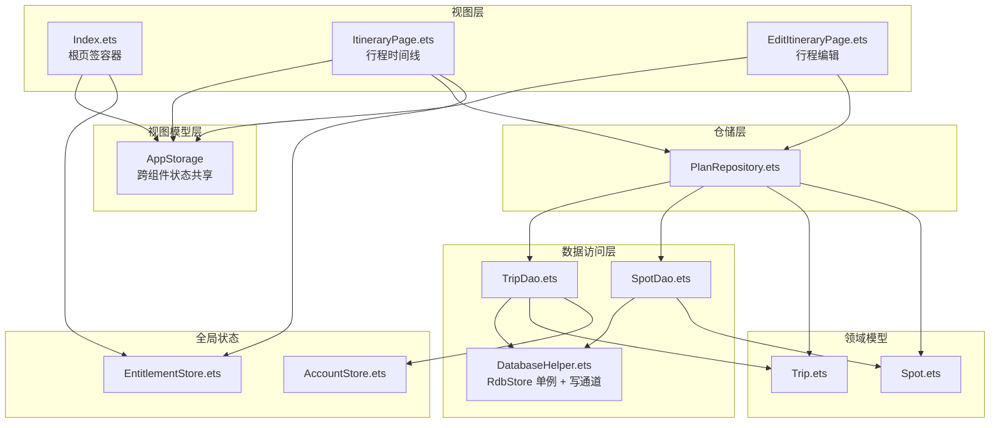
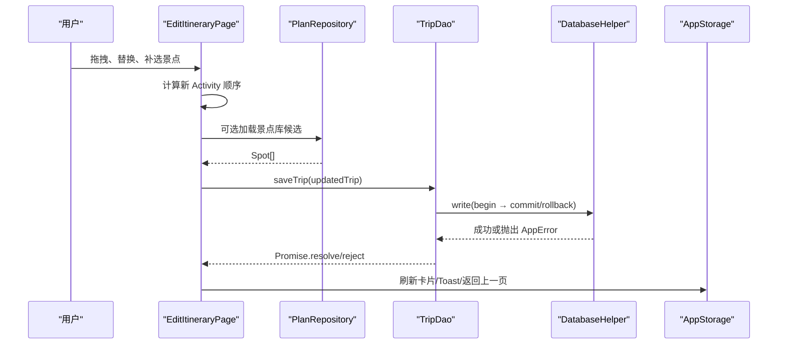
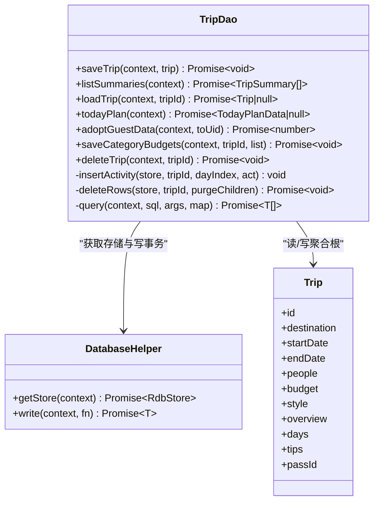
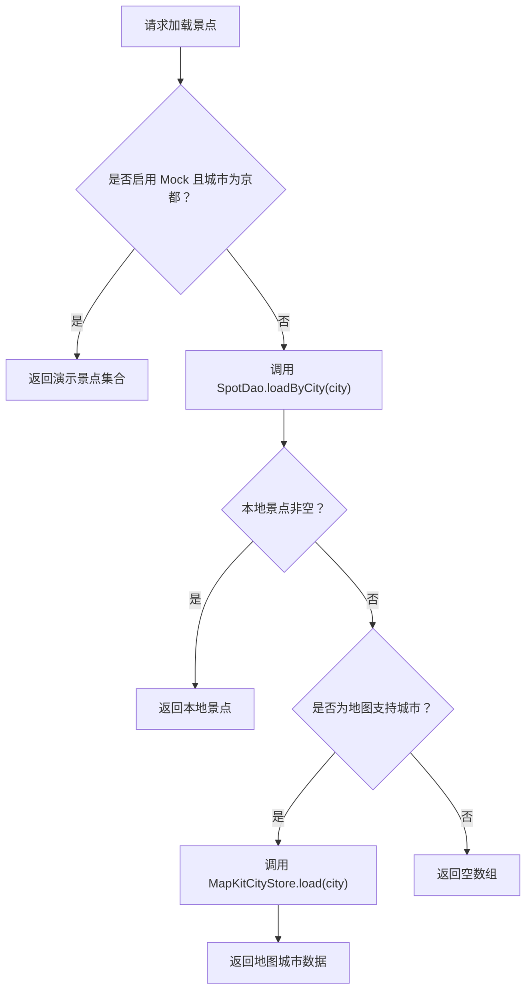
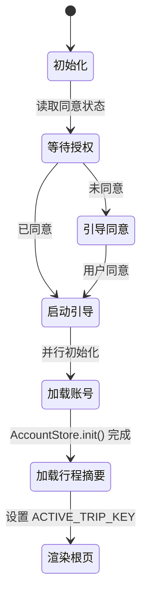
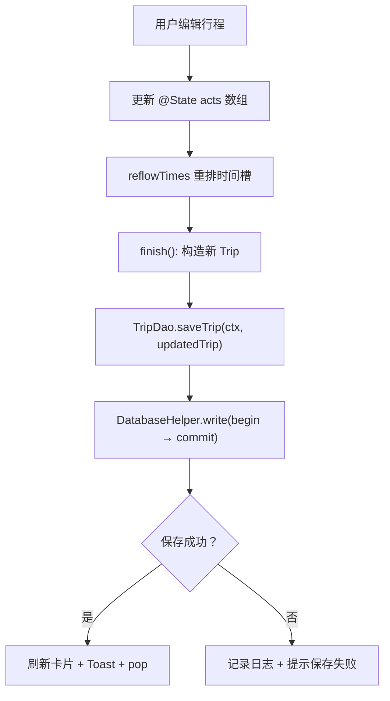
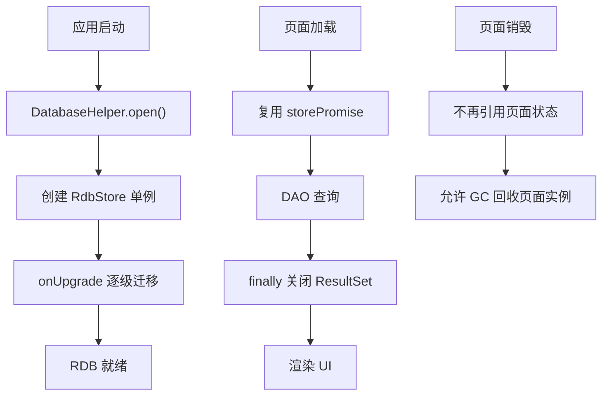
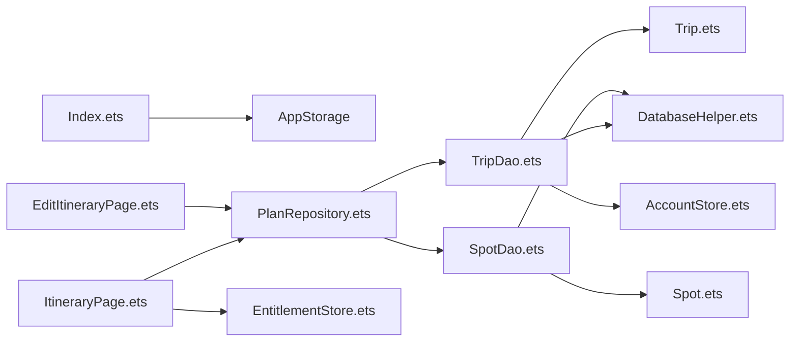

# MVVM 模式实现

<cite>
**本文引用的文件**   
- [TripDao.ets](file://entry/src/main/ets/data/TripDao.ets)
- [SpotDao.ets](file://entry/src/main/ets/data/SpotDao.ets)
- [PlanRepository.ets](file://entry/src/main/ets/data/PlanRepository.ets)
- [DatabaseHelper.ets](file://entry/src/main/ets/data/DatabaseHelper.ets)
- [AccountStore.ets](file://entry/src/main/ets/data/AccountStore.ets)
- [EntitlementStore.ets](file://entry/src/main/ets/data/EntitlementStore.ets)
- [MockConfig.ets](file://entry/src/main/ets/common/config/MockConfig.ets)
- [Trip.ets](file://entry/src/main/ets/model/Trip.ets)
- [Spot.ets](file://entry/src/main/ets/model/Spot.ets)
- [Index.ets](file://entry/src/main/ets/pages/Index.ets)
- [ItineraryPage.ets](file://entry/src/main/ets/pages/ItineraryPage.ets)
- [EditItineraryPage.ets](file://entry/src/main/ets/pages/EditItineraryPage.ets)
</cite>

## 目录
1. [引言](#引言)
2. [项目结构](#项目结构)
3. [核心组件](#核心组件)
4. [架构总览](#架构总览)
5. [详细组件分析](#详细组件分析)
6. [依赖关系分析](#依赖关系分析)
7. [性能考量](#性能考量)
8. [故障排查指南](#故障排查指南)
9. [结论](#结论)

## 引言
本文面向 ArkTS 应用中的 MVVM 实践，基于当前仓库中“行程规划”相关代码，系统梳理 Model、ViewModel、View 三层职责与协作方式。需要特别说明的是：该项目并未引入独立的 ViewModel 类；其 MVVM 的“视图模型层”由页面组件自身通过 ArkUI 状态装饰器（`@State`、`@Prop`、`@Link`、`@StorageProp`、`@StorageLink`）承担，同时借助 `AppStorage` 在根容器与子页之间共享状态。数据访问则由 DAO 与仓储层封装，最终落到 RDB 数据库。

## 项目结构
MVVM 在本仓中的落点如下：

| 层级 | 对应位置 | 职责 |
| --- | --- | --- |
| Model | `model/Trip.ets`、`model/Spot.ets` | 纯数据结构与枚举契约，不包含持久化或 UI 逻辑 |
| Data / Repository | `data/TripDao.ets`、`data/SpotDao.ets`、`data/PlanRepository.ets`、`data/DatabaseHelper.ets` | 封装 RDB 读写、事务、迁移与数据源路由 |
| Store | `data/AccountStore.ets`、`data/EntitlementStore.ets` | 登录态、权益等全局单例状态 |
| View | `pages/Index.ets`、`pages/ItineraryPage.ets`、`pages/EditItineraryPage.ets` | ArkTS UI 组件，持有 `@State` 并调用 Repository / DAO |
| 配置 | `common/config/MockConfig.ets` | Mock 数据开关，影响仓储层数据源选择 |

**图示来源**
- [Index.ets:1-120](file://entry/src/main/ets/pages/Index.ets#L1-L120)
- [ItineraryPage.ets:1-120](file://entry/src/main/ets/pages/ItineraryPage.ets#L1-L120)
- [EditItineraryPage.ets:1-60](file://entry/src/main/ets/pages/EditItineraryPage.ets#L1-L60)
- [PlanRepository.ets:1-55](file://entry/src/main/ets/data/PlanRepository.ets#L1-L55)
- [TripDao.ets:1-60](file://entry/src/main/ets/data/TripDao.ets#L1-L60)
- [SpotDao.ets:1-40](file://entry/src/main/ets/data/SpotDao.ets#L1-L40)
- [DatabaseHelper.ets:1-80](file://entry/src/main/ets/data/DatabaseHelper.ets#L1-L80)
- [Trip.ets:1-60](file://entry/src/main/ets/model/Trip.ets#L1-L60)
- [Spot.ets:1-40](file://entry/src/main/ets/model/Spot.ets#L1-L40)
- [AccountStore.ets:1-60](file://entry/src/main/ets/data/AccountStore.ets#L1-L60)
- [EntitlementStore.ets:1-60](file://entry/src/main/ets/data/EntitlementStore.ets#L1-L60)

**章节来源**
- [Index.ets:1-120](file://entry/src/main/ets/pages/Index.ets#L1-L120)
- [ItineraryPage.ets:1-120](file://entry/src/main/ets/pages/ItineraryPage.ets#L1-L120)
- [EditItineraryPage.ets:1-60](file://entry/src/main/ets/pages/EditItineraryPage.ets#L1-L60)
- [PlanRepository.ets:1-55](file://entry/src/main/ets/data/PlanRepository.ets#L1-L55)
- [TripDao.ets:1-60](file://entry/src/main/ets/data/TripDao.ets#L1-L60)
- [SpotDao.ets:1-40](file://entry/src/main/ets/data/SpotDao.ets#L1-L40)
- [DatabaseHelper.ets:1-80](file://entry/src/main/ets/data/DatabaseHelper.ets#L1-L80)
- [Trip.ets:1-60](file://entry/src/main/ets/model/Trip.ets#L1-L60)
- [Spot.ets:1-40](file://entry/src/main/ets/model/Spot.ets#L1-L40)
- [AccountStore.ets:1-60](file://entry/src/main/ets/data/AccountStore.ets#L1-L60)
- [EntitlementStore.ets:1-60](file://entry/src/main/ets/data/EntitlementStore.ets#L1-L60)

## 核心组件
本节按 MVVM 分层说明关键类型与方法。

### Model 层：Trip 与 Spot
`Trip` 是行程聚合根，包含目的地、日期、人数、预算、风格、概览、天数、活动、餐食、小贴士和通行证标识；`Activity`、`TripDay`、`Meal`、`TransportInfo` 是其组成元素。`Spot` 描述内置景点库条目，包括标签、简介、建议时长、热度、坐标、区域、预约信息和溯源信息。

这些类型是纯数据契约，DAO 负责把 RDB 列映射为它们，Repository 对外暴露以它们为参数或返回值的方法。

**章节来源**
- [Trip.ets:1-137](file://entry/src/main/ets/model/Trip.ets#L1-L137)
- [Spot.ets:1-69](file://entry/src/main/ets/model/Spot.ets#L1-L69)

### Data 层：DAO 与仓储

#### TripDao：行程数据访问对象
`TripDao` 封装行程的完整 CRUD 与查询摘要：

| 方法 | 行为 | 复杂度与注意点 |
| --- | --- | --- |
| `saveTrip(context, trip)` | 清空原行程后重建 trip、trip_day、activity、meal 行 | 整存整取，适合生成结果落库；对大行程有 JSON 序列化成本 |
| `listSummaries(context)` | 返回当前用户行程摘要列表 | 使用 SQL 聚合计算站点数、预约数、通勤数、打卡数 |
| `loadTrip(context, tripId)` | 加载完整行程树 | 多表查询后按 dayIndex 组装，注意 activity 主键带 tripId 前缀 |
| `todayPlan(context)` | 卡片用今日行程 | 先按日期范围筛选 tripId，再逐条 loadTrip，避免全量扫描 |
| `adoptGuestData(context, toUid)` | 游客数据归户到已登录账号 | 三张带 user_id 表在同一事务迁移 |
| `saveCategoryBudgets(context, tripId, list)` | 只更新分类预算 JSON 列 | 不重建整棵行程树，属于局部更新优化 |
| `deleteTrip(context, tripId)` | 删除行程及子表 | 需显式清理 checkin、expense，防止孤儿行 |

**章节来源**
- [TripDao.ets:1-200](file://entry/src/main/ets/data/TripDao.ets#L1-L200)
- [TripDao.ets:201-384](file://entry/src/main/ets/data/TripDao.ets#L201-L384)

#### SpotDao：景点库数据访问对象
`SpotDao` 提供两件事：

1. `saveSpots(context, spots)`：批量 upsert 景点库，主键冲突时替换。
2. `loadByCity(context, city)`：按城市读取景点，按 popularity 排序，并解析 tags、nearby_ids 等 JSON 字段。

它直接依赖 `DatabaseHelper.getStore`，用于种子数据灌入和 MapKit 回退场景。

**章节来源**
- [SpotDao.ets:1-100](file://entry/src/main/ets/data/SpotDao.ets#L1-L100)

#### PlanRepository：统一仓储接口
`PlanRepository` 是页面应调用的唯一数据入口，屏蔽 DAO 与 mock 数据：

- 当 `MockConfig.USE_MOCK_DATA` 且城市为“京都”时返回演示数据。
- 否则走 `SpotDao.loadByCity`。
- 若本地景点库为空且城市是地图支持城市，则回退到 `MapKitCityStore.load`。
- 区域数据同理。

这个设计让页面不必关心数据来源，也便于后续接入缓存、网络或切换真实数据源。

**章节来源**
- [PlanRepository.ets:1-55](file://entry/src/main/ets/data/PlanRepository.ets#L1-L55)
- [MockConfig.ets:1-15](file://entry/src/main/ets/common/config/MockConfig.ets#L1-L15)

#### DatabaseHelper：RDB 单例与写通道
`DatabaseHelper` 承担基础设施职责：

- 单例 `RdbStore`：`getStore` 保证全应用复用同一连接。
- 单写通道：`writeChain` 串行排队所有写事务，规避 RDB busy。
- 事务包装：`write(context, fn)` 自动 begin、commit、rollback，失败抛 `AppError`。
- 版本迁移：v1→v11 多步 ALTER，使用累积式 `oldVersion < N` 判断，确保跨级升级不走漏。

**章节来源**
- [DatabaseHelper.ets:1-200](file://entry/src/main/ets/data/DatabaseHelper.ets#L1-L200)

### ViewModel 层：AppStorage 与响应式状态
本仓库没有独立 ViewModel 类，而是把“视图模型”能力放在页面组件中：

- `@State`：组件内部可变状态，例如 `ItineraryPage` 的 `days`、`dayIndex`、`showDetail`。
- `@Prop`：从父组件传入不可变数据，例如 `ItineraryPage.tripId`、`EditItineraryPage.dayIndex`。
- `@StorageProp` / `@StorageLink`：从 `AppStorage` 订阅全局状态，例如根页的 `TAB_INDEX_KEY`、`BOTTOM_NAV_INSET_KEY`、断点与主题 tick。
- `AppStorage.setOrCreate`：写入全局键值，供其他页面或 tab 消费，如 `ACTIVE_TRIP_KEY`。

这种方案天然具备响应式特性：当 `AppStorage` 变化时，订阅方会触发重新构建，无需手动通知观察者。

**章节来源**
- [Index.ets:1-120](file://entry/src/main/ets/pages/Index.ets#L1-L120)
- [ItineraryPage.ets:120-240](file://entry/src/main/ets/pages/ItineraryPage.ets#L120-L240)
- [EditItineraryPage.ets:60-140](file://entry/src/main/ets/pages/EditItineraryPage.ets#L60-L140)

### View 层：ArkTS UI 组件绑定
- `Index.ets` 作为根容器，管理底部页签、深链初始页、顶层导航栈、顶部条带与 dock 胶囊动画。
- `ItineraryPage.ets` 展示行程时间线，处理日历同步、桌面卡片、提醒、分享、换时间槽等操作。
- `EditItineraryPage.ets` 提供拖动排序、移除、替换景点、补选景点等编辑能力。

这些页面既承担 UI 渲染，也承担轻量业务编排，是 ArkTS MVVM 中的“轻量 ViewModel”。

**章节来源**
- [Index.ets:1-200](file://entry/src/main/ets/pages/Index.ets#L1-L200)
- [ItineraryPage.ets:1-200](file://entry/src/main/ets/pages/ItineraryPage.ets#L1-L200)
- [EditItineraryPage.ets:1-200](file://entry/src/main/ets/pages/EditItineraryPage.ets#L1-L200)

## 架构总览
下图展示一次“从用户输入到数据持久化”的典型端到端流程。

**图示来源**
- [EditItineraryPage.ets:500-700](file://entry/src/main/ets/pages/EditItineraryPage.ets#L500-L700)
- [PlanRepository.ets:1-55](file://entry/src/main/ets/data/PlanRepository.ets#L1-L55)
- [TripDao.ets:1-120](file://entry/src/main/ets/data/TripDao.ets#L1-L120)
- [DatabaseHelper.ets:120-200](file://entry/src/main/ets/data/DatabaseHelper.ets#L120-L200)

## 详细组件分析

### TripDao 类分析
`TripDao` 的核心模式是“静态方法 + 纯函数映射 + 事务写通道”：

**图示来源**
- [TripDao.ets:1-200](file://entry/src/main/ets/data/TripDao.ets#L1-L200)
- [TripDao.ets:201-384](file://entry/src/main/ets/data/TripDao.ets#L201-L384)
- [DatabaseHelper.ets:120-200](file://entry/src/main/ets/data/DatabaseHelper.ets#L120-L200)
- [Trip.ets:1-137](file://entry/src/main/ets/model/Trip.ets#L1-L137)

关键实现要点：

1. **主键分区**：activity 主键形如 `${tripId}:${activityId}`，避免不同行程活动撞 id。
2. **账号隔离**：trip 表有 `user_id`，所有列表和详情查询都带当前 `AccountStore.uid()`。
3. **写安全**：删除前校验归属，删除整行程时显式清理 checkin 和 expense。
4. **可维护映射**：`readActivity` 是独立函数，集中处理 transport、advanceDays、note、reason 等可选字段。

**章节来源**
- [TripDao.ets:1-200](file://entry/src/main/ets/data/TripDao.ets#L1-L200)
- [TripDao.ets:201-384](file://entry/src/main/ets/data/TripDao.ets#L201-L384)

### SpotDao 与 PlanRepository 协作
`SpotDao` 负责把 spot 表映射为 `Spot` 对象，`PlanRepository` 在此基础上做数据源路由。

**图示来源**
- [PlanRepository.ets:1-55](file://entry/src/main/ets/data/PlanRepository.ets#L1-L55)
- [SpotDao.ets:1-100](file://entry/src/main/ets/data/SpotDao.ets#L1-L100)
- [MockConfig.ets:1-15](file://entry/src/main/ets/common/config/MockConfig.ets#L1-L15)

**章节来源**
- [PlanRepository.ets:1-55](file://entry/src/main/ets/data/PlanRepository.ets#L1-L55)
- [SpotDao.ets:1-100](file://entry/src/main/ets/data/SpotDao.ets#L1-L100)

### 页面与 AppStorage 的状态绑定
根页 `Index` 通过 `@StorageLink` 和 `@StorageProp` 订阅外部状态，并通过 `AppStorage.setOrCreate` 广播内部状态：

- `TAB_INDEX_KEY`：当前选中页签下标。
- `TAB_SWITCH_KEY`：运行期切页签指令。
- `BOTTOM_NAV_INSET_KEY`：底部导航避让量。
- `KEY_CURRENT_BREAKPOINT`：断点。
- `TOP_STRIP_KEY`：顶部条带主题。
- `ACTIVE_TRIP_KEY`：最近行程 ID。

**图示来源**
- [Index.ets:200-360](file://entry/src/main/ets/pages/Index.ets#L200-L360)
- [AccountStore.ets:60-140](file://entry/src/main/ets/data/AccountStore.ets#L60-L140)

**章节来源**
- [Index.ets:200-500](file://entry/src/main/ets/pages/Index.ets#L200-L500)
- [AccountStore.ets:60-140](file://entry/src/main/ets/data/AccountStore.ets#L60-L140)

### 端到端流程：从用户编辑到数据持久化
以“编辑行程”为例，完整链路如下：

1. 用户在 `EditItineraryPage` 拖动节点、移除节点或替换景点。
2. 页面维护本地 `acts` 数组，必要时调用 `reflowTimes()` 保持时间槽有序。
3. 点击“完成”后，构造新的 `Trip` 聚合根。
4. 调用 `TripDao.saveTrip(ctx, updatedTrip)`。
5. `DatabaseHelper.write` 开启事务，执行删除旧行和插入新行。
6. 成功后刷新桌面卡片、提示 Toast 并返回上一页。

**图示来源**
- [EditItineraryPage.ets:500-700](file://entry/src/main/ets/pages/EditItineraryPage.ets#L500-L700)
- [TripDao.ets:1-120](file://entry/src/main/ets/data/TripDao.ets#L1-L120)
- [DatabaseHelper.ets:120-200](file://entry/src/main/ets/data/DatabaseHelper.ets#L120-L200)

**章节来源**
- [EditItineraryPage.ets:200-594](file://entry/src/main/ets/pages/EditItineraryPage.ets#L200-L594)
- [TripDao.ets:1-120](file://entry/src/main/ets/data/TripDao.ets#L1-L120)
- [DatabaseHelper.ets:120-200](file://entry/src/main/ets/data/DatabaseHelper.ets#L120-L200)

### 生命周期管理：Store 创建与销毁
仓库中多数 Store 采用模块级单例，而不是每次页面进入时创建：

- `DatabaseHelper.storePromise`：应用生命周期内复用 RdbStore。
- `DatabaseHelper.writeChain`：应用生命周期内复用写队列。
- `AccountStore.current`、`AccountStore.prefs`：静默登录后恢复并复用。
- `EntitlementStore.cached`、`EntitlementStore.prefs`：权限缓存与 preferences 引用。

这些单例不需要页面主动销毁，因为它们是进程级对象；真正需要关注的是：

1. `DatabaseHelper` 中 ResultSet 的 `close()`：DAO 的 `query` 在 finally 中关闭结果集，避免游标泄漏。
2. `SpotDao.loadByCity` 中显式 `rs.close()`。
3. `TripDao.deleteRows` 中临时查询结果集的 try/finally 关闭。
4. 页面侧不应持有长期指向已销毁页面的闭包，否则会阻止页面回收。

**图示来源**
- [DatabaseHelper.ets:1-200](file://entry/src/main/ets/data/DatabaseHelper.ets#L1-L200)
- [TripDao.ets:300-384](file://entry/src/main/ets/data/TripDao.ets#L300-L384)
- [SpotDao.ets:40-100](file://entry/src/main/ets/data/SpotDao.ets#L40-L100)

**章节来源**
- [DatabaseHelper.ets:1-200](file://entry/src/main/ets/data/DatabaseHelper.ets#L1-L200)
- [TripDao.ets:300-384](file://entry/src/main/ets/data/TripDao.ets#L300-L384)
- [SpotDao.ets:40-100](file://entry/src/main/ets/data/SpotDao.ets#L40-L100)

## 依赖关系分析
本项目的依赖方向清晰：View 依赖 Repository，Repository 依赖 DAO，DAO 依赖 DatabaseHelper 与 Model。Store 被多个层共享，但不反向依赖 View。

**图示来源**
- [Index.ets:1-120](file://entry/src/main/ets/pages/Index.ets#L1-L120)
- [ItineraryPage.ets:1-120](file://entry/src/main/ets/pages/ItineraryPage.ets#L1-L120)
- [EditItineraryPage.ets:1-120](file://entry/src/main/ets/pages/EditItineraryPage.ets#L1-L120)
- [PlanRepository.ets:1-55](file://entry/src/main/ets/data/PlanRepository.ets#L1-L55)
- [TripDao.ets:1-60](file://entry/src/main/ets/data/TripDao.ets#L1-L60)
- [SpotDao.ets:1-40](file://entry/src/main/ets/data/SpotDao.ets#L1-L40)
- [DatabaseHelper.ets:1-80](file://entry/src/main/ets/data/DatabaseHelper.ets#L1-L80)
- [Trip.ets:1-60](file://entry/src/main/ets/model/Trip.ets#L1-L60)
- [Spot.ets:1-40](file://entry/src/main/ets/model/Spot.ets#L1-L40)
- [AccountStore.ets:1-60](file://entry/src/main/ets/data/AccountStore.ets#L1-L60)
- [EntitlementStore.ets:1-60](file://entry/src/main/ets/data/EntitlementStore.ets#L1-L60)

**章节来源**
- [PlanRepository.ets:1-55](file://entry/src/main/ets/data/PlanRepository.ets#L1-L55)
- [TripDao.ets:1-60](file://entry/src/main/ets/data/TripDao.ets#L1-L60)
- [SpotDao.ets:1-40](file://entry/src/main/ets/data/SpotDao.ets#L1-L40)
- [Index.ets:1-120](file://entry/src/main/ets/pages/Index.ets#L1-L120)
- [ItineraryPage.ets:1-120](file://entry/src/main/ets/pages/ItineraryPage.ets#L1-L120)
- [EditItineraryPage.ets:1-120](file://entry/src/main/ets/pages/EditItineraryPage.ets#L1-L120)

## 性能考量
结合现有实现，可总结以下 MVVM 与 ArkTS 性能要点：

1. **写操作串行化**：`DatabaseHelper.writeChain` 把所有写事务串起来，避免并发写导致 RDB busy。新增写入口应继续走 `DatabaseHelper.write`，不要绕过它。
2. **避免整份行程频繁重建**：`saveCategoryBudgets` 只提供局部更新，减少 JSON 序列化和多表重建成本。
3. **列表查询走 SQL 聚合**：`listSummaries` 在数据库侧统计站点数、预约数、通勤数，减少客户端遍历。
4. **卡片查询先缩小范围**：`todayPlan` 先用日期范围筛选 tripId，再逐条加载，避免 O(n) 全量 loadTrip。
5. **ResultSet 必须关闭**：DAO 中多处使用 try/finally 关闭游标，这是 Android/ArkTS 下避免内存和句柄泄漏的关键。
6. **AppStorage 不要过度广播**：根页只广播必要键，避免无关组件频繁 rebuild。
7. **`@State` 只放 UI 所需数据**：大型模型应从 DAO/Repository 加载后赋值，不要在频繁触发的 build 中重建。
8. **Mock 开关要受控**：`MockConfig.USE_MOCK_DATA` 是发布清单项，不能误留在 true。

[本节为通用性能指导，不直接分析具体代码片段]

## 故障排查指南

### 常见问题与定位思路

| 现象 | 可能原因 | 排查位置 |
| --- | --- | --- |
| 编辑后时间线顺序错乱 | 忘记调用 `reflowTimes()` 或错误地修改了 time 字段本身 | [EditItineraryPage.ets:120-220](file://entry/src/main/ets/pages/EditItineraryPage.ets#L120-L220) |
| 替换景点地址显示异常 | 地址拼接口径不一致 | [EditItineraryPage.ets:200-240](file://entry/src/main/ets/pages/EditItineraryPage.ets#L200-L240) |
| 删除行程后出现孤儿打卡或费用 | 删除分支未清理子表 | [TripDao.ets:240-320](file://entry/src/main/ets/data/TripDao.ets#L240-L320) |
| 列表页看不到最新行程 | 根页未正确设置 `ACTIVE_TRIP_KEY` 或页签未触发刷新 | [Index.ets:300-360](file://entry/src/main/ets/pages/Index.ets#L300-L360) |
| 本地景点库为空但城市确实存在 | 种子数据未灌入，或 `MockConfig` 影响路由 | [PlanRepository.ets:1-55](file://entry/src/main/ets/data/PlanRepository.ets#L1-L55) |
| 导出功能一直提示无权限 | 权益缓存过期且设备未激活，或处于游客模式 | [EntitlementStore.ets:120-235](file://entry/src/main/ets/data/EntitlementStore.ets#L120-L235) |
| 数据库升级后表缺失 | 迁移条件用了精确匹配而非累积比较 | [DatabaseHelper.ets:1-120](file://entry/src/main/ets/data/DatabaseHelper.ets#L1-L120) |

**章节来源**
- [EditItineraryPage.ets:120-240](file://entry/src/main/ets/pages/EditItineraryPage.ets#L120-L240)
- [TripDao.ets:240-320](file://entry/src/main/ets/data/TripDao.ets#L240-L320)
- [Index.ets:300-360](file://entry/src/main/ets/pages/Index.ets#L300-L360)
- [PlanRepository.ets:1-55](file://entry/src/main/ets/data/PlanRepository.ets#L1-L55)
- [EntitlementStore.ets:120-235](file://entry/src/main/ets/data/EntitlementStore.ets#L120-L235)
- [DatabaseHelper.ets:1-120](file://entry/src/main/ets/data/DatabaseHelper.ets#L1-L120)

## 结论
本项目在 ArkTS 中实现了贴近 MVVM 的分层结构：

- **Model**：`Trip`、`Spot` 定义稳定数据契约。
- **Data**：`TripDao`、`SpotDao` 封装 RDB 访问；`PlanRepository` 聚合 DAO 并提供数据源路由。
- **ViewModel**：页面组件通过 `@State`、`@Prop`、`@StorageProp`、`@StorageLink` 和 `AppStorage` 承担状态管理与响应式更新。
- **View**：`Index`、`ItineraryPage`、`EditItineraryPage` 组合 UI 与轻量业务编排。
- **基础设施**：`DatabaseHelper` 提供单例存储、写通道与迁移；`AccountStore`、`EntitlementStore` 提供全局状态。

最佳实践可归纳为：DAO 只关心数据访问，Repository 屏蔽数据源细节，页面通过 AppStorage 共享状态而不直接耦合 DAO；写操作统一走 `DatabaseHelper.write`，ResultSet 必须关闭，Mock 开关必须受控，单例只在应用生命周期内复用。

[本节为总结性内容，不直接分析具体文件]