# Model 层：数据访问与仓储

<cite>
**本文引用的文件**   
- [TripDao.ets](file://entry/src/main/ets/data/TripDao.ets)
- [SpotDao.ets](file://entry/src/main/ets/data/SpotDao.ets)
- [AreaDao.ets](file://entry/src/main/ets/data/AreaDao.ets)
- [BadgeDao.ets](file://entry/src/main/ets/data/BadgeDao.ets)
- [ExpenseDao.ets](file://entry/src/main/ets/data/ExpenseDao.ets)
- [CheckinDao.ets](file://entry/src/main/ets/data/CheckinDao.ets)
- [PlanRepository.ets](file://entry/src/main/ets/data/PlanRepository.ets)
- [Trip.ets](file://entry/src/main/ets/model/Trip.ets)
- [Spot.ets](file://entry/src/main/ets/model/Spot.ets)
- [Area.ets](file://entry/src/main/ets/model/Area.ets)
- [Checkin.ets](file://entry/src/main/ets/model/Checkin.ets)
- [Expense.ets](file://entry/src/main/ets/model/Expense.ets)
</cite>

## 目录
1. [引言](#引言)
2. [项目结构](#项目结构)
3. [核心组件](#核心组件)
4. [架构总览](#架构总览)
5. [详细组件分析](#详细组件分析)
6. [依赖关系分析](#依赖关系分析)
7. [性能优化](#性能优化)
8. [故障排查](#故障排查)
9. [结论](#结论)

## 引言
本文聚焦 ArkTS 端 Model 层的数据访问与仓储实现，围绕 DAO 模式与仓储层展开。DAO（Data Access Object）负责封装 ArkData RDB 的建表、CRUD、事务和错误处理；PlanRepository 作为仓储层聚合多个 DAO，向上提供业务接口并屏蔽存储细节。文档同时说明 Trip、Activity、Spot、Area、Badge、Expense、Checkin 等数据模型的设计与关系映射，并给出从 TripDao 到 PlanRepository 的完整调用流程、迁移策略与性能优化建议。

## 项目结构
Model 层代码集中在 entry/src/main/ets 下：
- data 目录存放 DAO 与仓储类，以及账户、天气、日历同步等跨模块持久化逻辑。
- model 目录定义领域实体与枚举契约，是 UI、AI 解析器与 DAO 的共同类型基础。

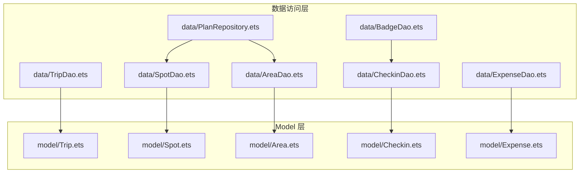

**图表来源**
- [TripDao.ets:1-384](file://entry/src/main/ets/data/TripDao.ets#L1-L384)
- [SpotDao.ets:1-100](file://entry/src/main/ets/data/SpotDao.ets#L1-L100)
- [AreaDao.ets:1-75](file://entry/src/main/ets/data/AreaDao.ets#L1-L75)
- [BadgeDao.ets:1-70](file://entry/src/main/ets/data/BadgeDao.ets#L1-L70)
- [ExpenseDao.ets:1-111](file://entry/src/main/ets/data/ExpenseDao.ets#L1-L111)
- [CheckinDao.ets:1-70](file://entry/src/main/ets/data/CheckinDao.ets#L1-L70)
- [PlanRepository.ets:1-55](file://entry/src/main/ets/data/PlanRepository.ets#L1-L55)
- [Trip.ets:1-137](file://entry/src/main/ets/model/Trip.ets#L1-L137)
- [Spot.ets:1-69](file://entry/src/main/ets/model/Spot.ets#L1-L69)
- [Area.ets:1-51](file://entry/src/main/ets/model/Area.ets#L1-L51)
- [Checkin.ets:1-14](file://entry/src/main/ets/model/Checkin.ets#L1-L14)
- [Expense.ets:1-45](file://entry/src/main/ets/model/Expense.ets#L1-L45)

**章节来源**
- [TripDao.ets:1-384](file://entry/src/main/ets/data/TripDao.ets#L1-L384)
- [PlanRepository.ets:1-55](file://entry/src/main/ets/data/PlanRepository.ets#L1-L55)

## 核心组件
- TripDao：行程聚合根的 DAO，封装 trip、trip_day、activity、meal 四张表的整存整取、列表摘要、今日卡片、分类预算更新、游客数据归户与删除保护。
- SpotDao：内置景点库 DAO，支持批量 upsert 与按城市查询。
- AreaDao：内置住宿区域库 DAO，支持批量 upsert 与按城市排序查询。
- BadgeDao：勋章读侧 DAO，通过 checkin 与 activity、trip 联表推导勋章凭证，不新增表。
- ExpenseDao：费用记账 DAO，提供增删、分页列表、分类汇总、节点汇总与行程合计。
- CheckinDao：节点打卡 DAO，写走单写通道，支持打卡与取消打卡，并提供行程打卡映射。
- PlanRepository：仓储层，路由 mock / 种子库 / MapKit 回退，为页面提供统一加载接口。

**章节来源**
- [TripDao.ets:1-384](file://entry/src/main/ets/data/TripDao.ets#L1-L384)
- [SpotDao.ets:1-100](file://entry/src/main/ets/data/SpotDao.ets#L1-L100)
- [AreaDao.ets:1-75](file://entry/src/main/ets/data/AreaDao.ets#L1-L75)
- [BadgeDao.ets:1-70](file://entry/src/main/ets/data/BadgeDao.ets#L1-L70)
- [ExpenseDao.ets:1-111](file://entry/src/main/ets/data/ExpenseDao.ets#L1-L111)
- [CheckinDao.ets:1-70](file://entry/src/main/ets/data/CheckinDao.ets#L1-L70)
- [PlanRepository.ets:1-55](file://entry/src/main/ets/data/PlanRepository.ets#L1-L55)

## 架构总览
DAO 模式在 ArkTS 中的体现是“每个领域表或一组强相关表对应一个 DAO”，所有数据库连接与事务由 DatabaseHelper 统一管理，DAO 只暴露业务语义方法。PlanRepository 位于 DAO 之上，承担数据来源路由、缓存回退与对外契约稳定。

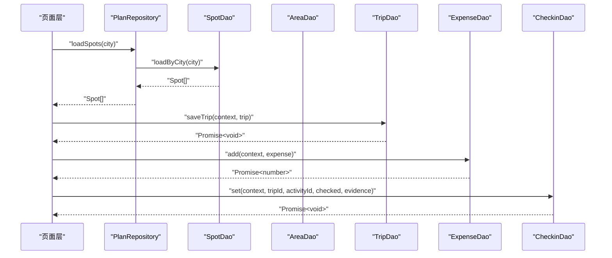

**图表来源**
- [PlanRepository.ets:12-55](file://entry/src/main/ets/data/PlanRepository.ets#L12-L55)
- [SpotDao.ets:22-99](file://entry/src/main/ets/data/SpotDao.ets#L22-L99)
- [TripDao.ets:41-100](file://entry/src/main/ets/data/TripDao.ets#L41-L100)
- [ExpenseDao.ets:16-42](file://entry/src/main/ets/data/ExpenseDao.ets#L16-L42)
- [CheckinDao.ets:29-57](file://entry/src/main/ets/data/CheckinDao.ets#L29-L57)

**章节来源**
- [PlanRepository.ets:1-55](file://entry/src/main/ets/data/PlanRepository.ets#L1-L55)

## 详细组件分析

### TripDao：行程聚合根 DAO
TripDao 是 Model 层中最复杂的 DAO，承担以下职责：
- 整存整取：saveTrip 先删除旧行，再写入 trip、trip_day、activity、meal 多层数据，activity 主键使用 `${tripId}:${activityId}` 前缀避免跨行程冲突。
- 列表摘要：listSummaries 用一条 SQL 聚合 spotCount、bookingCount、legCount、checkinCount，减少页面二次查询。
- 详情加载：loadTrip 分步读取 trip、trip_day、activity、meal，并在内存中组装 Trip 对象。
- 今日卡片：todayPlan 先用日期范围预筛 trip id，命中后再整份加载，降低 N×4 SQL 成本。
- 游客归户：adoptGuestData 在单事务内把 trip、expense、checkin 三张表的 guest uid 迁移到真实 uid，保证登录前后数据一致性。
- 分类预算更新：saveCategoryBudgets 仅更新 trip 一行，避免重建整棵树。
- 删除保护：deleteTrip 通过 deleteRows 校验 user_id，并按需清理 checkin 与 expense，防止孤儿数据。

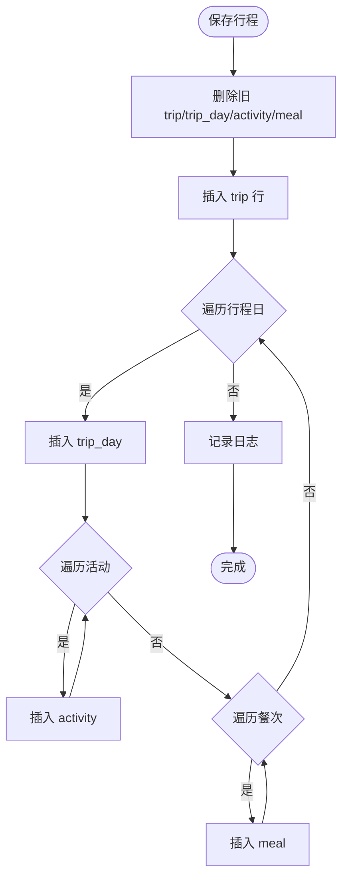

**图表来源**
- [TripDao.ets:41-100](file://entry/src/main/ets/data/TripDao.ets#L41-L100)
- [TripDao.ets:318-384](file://entry/src/main/ets/data/TripDao.ets#L318-L384)

**章节来源**
- [TripDao.ets:41-100](file://entry/src/main/ets/data/TripDao.ets#L41-L100)
- [TripDao.ets:201-260](file://entry/src/main/ets/data/TripDao.ets#L201-L260)
- [TripDao.ets:262-384](file://entry/src/main/ets/data/TripDao.ets#L262-L384)

### SpotDao：内置景点库 DAO
SpotDao 提供两类能力：
- saveSpots：批量 upsert 景点，使用 ON_CONFLICT_REPLACE 保证同 id 幂等覆盖。
- loadByCity：按城市查询，按 popularity 降序返回 Spot 数组，并解析 JSON 字段 tags、nearbySpotIds。

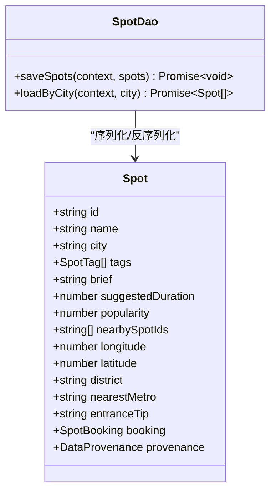

**图表来源**
- [SpotDao.ets:22-99](file://entry/src/main/ets/data/SpotDao.ets#L22-L99)
- [Spot.ets:1-69](file://entry/src/main/ets/model/Spot.ets#L1-L69)

**章节来源**
- [SpotDao.ets:1-100](file://entry/src/main/ets/data/SpotDao.ets#L1-L100)
- [Spot.ets:1-69](file://entry/src/main/ets/model/Spot.ets#L1-L69)

### AreaDao：内置住宿区域库 DAO
AreaDao 与 SpotDao 类似，但关注住宿区域维度：
- saveAreas：批量 upsert area，包含 anchorStations、metroLines、commerceTags、suitableCrowds 等 JSON 字段。
- loadByCity：按 grp、id 排序，确保候选区可复现。

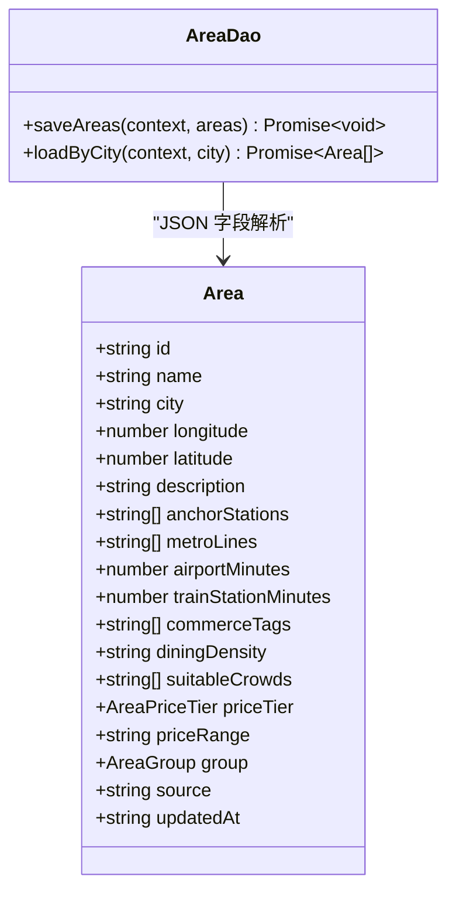

**图表来源**
- [AreaDao.ets:18-74](file://entry/src/main/ets/data/AreaDao.ets#L18-L74)
- [Area.ets:1-51](file://entry/src/main/ets/model/Area.ets#L1-L51)

**章节来源**
- [AreaDao.ets:1-75](file://entry/src/main/ets/data/AreaDao.ets#L1-L75)
- [Area.ets:1-51](file://entry/src/main/ets/model/Area.ets#L1-L51)

### BadgeDao：勋章读侧 DAO
BadgeDao 不维护独立 badge 表，而是基于 checkin 与 activity、trip 联表计算勋章凭证：
- listMine：当前账号全部可作为勋章凭证的打卡。
- listForTrip：指定行程的打卡凭证。
- 内部 query/read：封装 ResultSet 迭代与 BadgeRecord 构造。

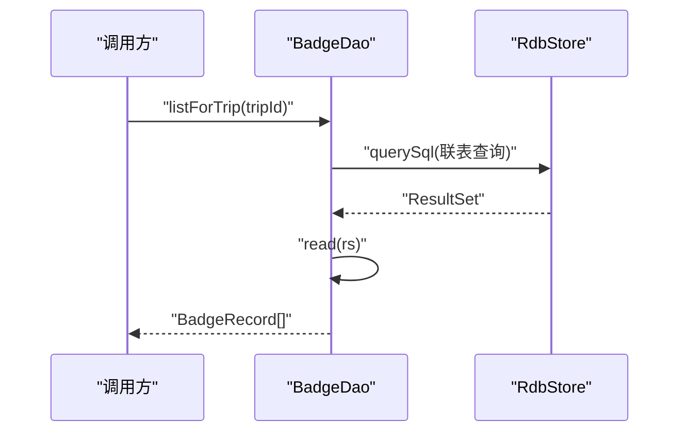

**图表来源**
- [BadgeDao.ets:21-70](file://entry/src/main/ets/data/BadgeDao.ets#L21-L70)

**章节来源**
- [BadgeDao.ets:1-70](file://entry/src/main/ets/data/BadgeDao.ets#L1-L70)

### ExpenseDao：费用记账 DAO
ExpenseDao 提供完整的费用 CRUD 与聚合：
- add：插入 expense，返回自增 id。
- delete：按 id 与 user_id 分区删除。
- listByTrip：最近记账列表，限制条数。
- sumByCategory：分类聚合。
- sumGroupedByActivity：按 activity_id 聚合金额，供行内金额展示。
- totalOfTrip：遍历分类合计得到行程总额。

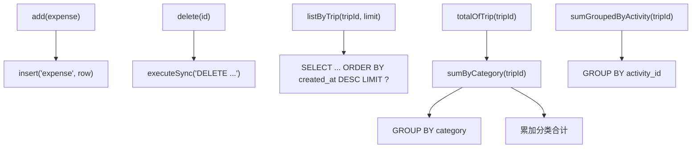

**图表来源**
- [ExpenseDao.ets:16-111](file://entry/src/main/ets/data/ExpenseDao.ets#L16-L111)

**章节来源**
- [ExpenseDao.ets:1-111](file://entry/src/main/ets/data/ExpenseDao.ets#L1-L111)
- [Expense.ets:1-45](file://entry/src/main/ets/model/Expense.ets#L1-L45)

### CheckinDao：节点打卡 DAO
CheckinDao 管理打卡状态与位置证据：
- set：checked=true 时插入或替换一条打卡；checked=false 时按 trip_id、activity_id、user_id 删除。
- listForTrip：返回 tripId → checkedAt 映射，供界面快速判断是否已打卡。

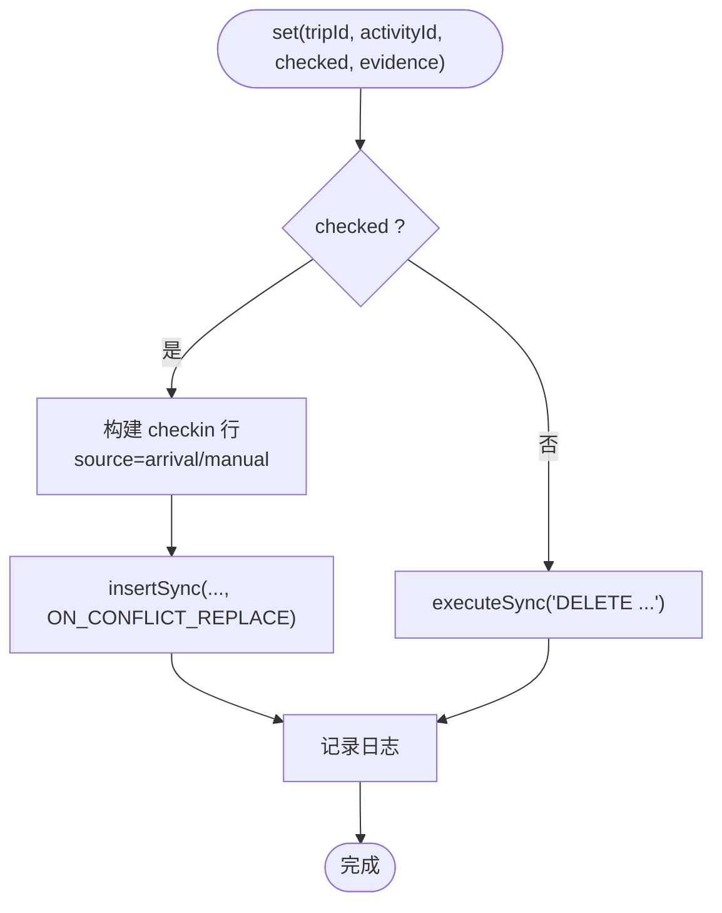

**图表来源**
- [CheckinDao.ets:29-57](file://entry/src/main/ets/data/CheckinDao.ets#L29-L57)

**章节来源**
- [CheckinDao.ets:1-70](file://entry/src/main/ets/data/CheckinDao.ets#L1-L70)
- [Checkin.ets:1-14](file://entry/src/main/ets/model/Checkin.ets#L1-L14)

### PlanRepository：仓储层
PlanRepository 面向页面提供统一数据加载接口，隐藏 DAO 与外部数据源差异：
- loadSpots：优先 mock（京都），否则 SpotDao.loadByCity；若为空且是地图城市则回退 MapKitCityStore。
- loadAreas：优先 mock（京都），否则 AreaDao.loadByCity；若为空且是地图城市则回退 MapKitCityStore。

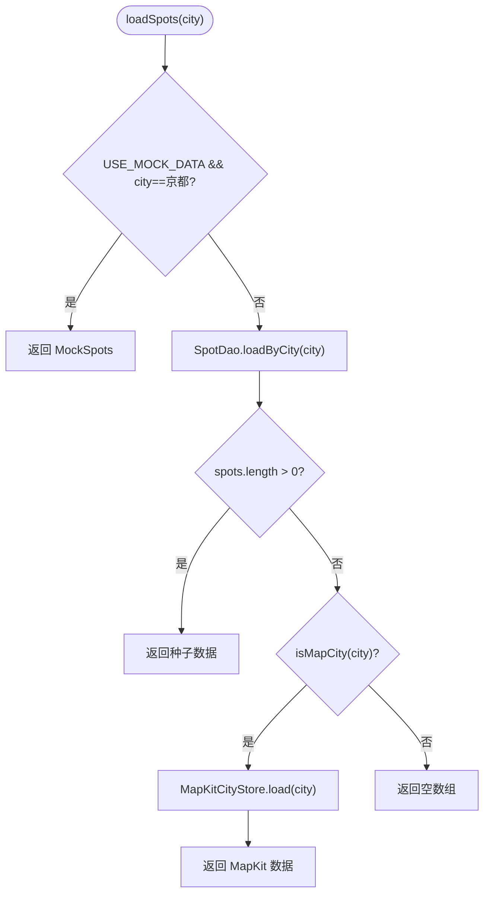

**图表来源**
- [PlanRepository.ets:12-55](file://entry/src/main/ets/data/PlanRepository.ets#L12-L55)
- [SpotDao.ets:63-99](file://entry/src/main/ets/data/SpotDao.ets#L63-L99)
- [AreaDao.ets:40-74](file://entry/src/main/ets/data/AreaDao.ets#L40-L74)

**章节来源**
- [PlanRepository.ets:1-55](file://entry/src/main/ets/data/PlanRepository.ets#L1-L55)

### 数据模型设计
- Trip 与 Activity：Trip 是聚合根，包含 days 与 overview；Activity 表示日程节点，含时间、地点、坐标、预约状态、类别、通勤信息等。
- Spot：内置景点信息，含标签、简介、建议时长、热度、周边 id、地理信息、区名、地铁、入口提示与预约规则。
- Area：住宿区域信息，含锚定站点、地铁线、通勤分钟、商圈标签、餐饮密度、适合人群、价格档位与分组。
- Checkin：打卡标记，tripId、activityId、checkedAt，独立于 Trip 契约以避免 AI 生成契约膨胀。
- Expense：费用记录，含分类、名称、金额、创建时间与可选 activityId；CategoryBudget 与 CategoryTotal 分别用于预算基线与分类合计。

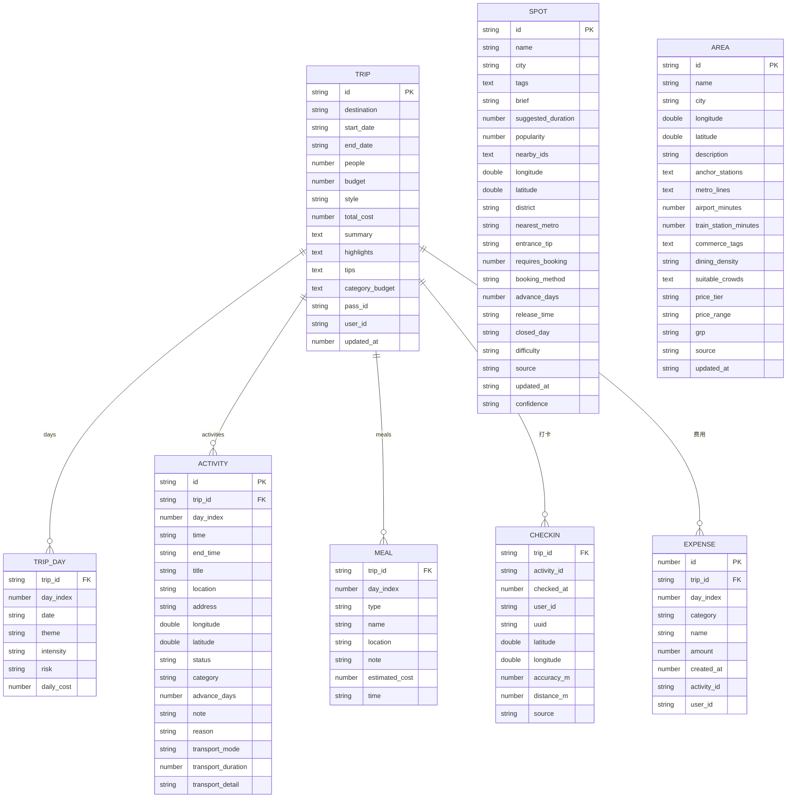

**图表来源**
- [TripDao.ets:41-100](file://entry/src/main/ets/data/TripDao.ets#L41-L100)
- [TripDao.ets:318-384](file://entry/src/main/ets/data/TripDao.ets#L318-L384)
- [ExpenseDao.ets:16-111](file://entry/src/main/ets/data/ExpenseDao.ets#L16-L111)
- [CheckinDao.ets:29-57](file://entry/src/main/ets/data/CheckinDao.ets#L29-L57)
- [SpotDao.ets:22-99](file://entry/src/main/ets/data/SpotDao.ets#L22-L99)
- [AreaDao.ets:18-74](file://entry/src/main/ets/data/AreaDao.ets#L18-L74)
- [Trip.ets:1-137](file://entry/src/main/ets/model/Trip.ets#L1-L137)
- [Spot.ets:1-69](file://entry/src/main/ets/model/Spot.ets#L1-L69)
- [Area.ets:1-51](file://entry/src/main/ets/model/Area.ets#L1-L51)
- [Checkin.ets:1-14](file://entry/src/main/ets/model/Checkin.ets#L1-L14)
- [Expense.ets:1-45](file://entry/src/main/ets/model/Expense.ets#L1-L45)

**章节来源**
- [Trip.ets:1-137](file://entry/src/main/ets/model/Trip.ets#L1-L137)
- [Spot.ets:1-69](file://entry/src/main/ets/model/Spot.ets#L1-L69)
- [Area.ets:1-51](file://entry/src/main/ets/model/Area.ets#L1-L51)
- [Checkin.ets:1-14](file://entry/src/main/ets/model/Checkin.ets#L1-L14)
- [Expense.ets:1-45](file://entry/src/main/ets/model/Expense.ets#L1-L45)

## 依赖关系分析
- DAO 对 model 的依赖单向且稳定：DAO 将 ValuesBucket 序列化为模型，或将 ResultSet 反序列化为模型。
- BadgeDao 依赖 CheckinDao 的数据口径，但不直接调用 CheckinDao，而是复用 checkin 表进行联表查询。
- PlanRepository 依赖 SpotDao 与 AreaDao，并通过 isMapCity 与 MapKitCityStore 决定回退路径。
- TripDao 依赖 AccountStore.uid() 做数据分区，确保多账号隔离。

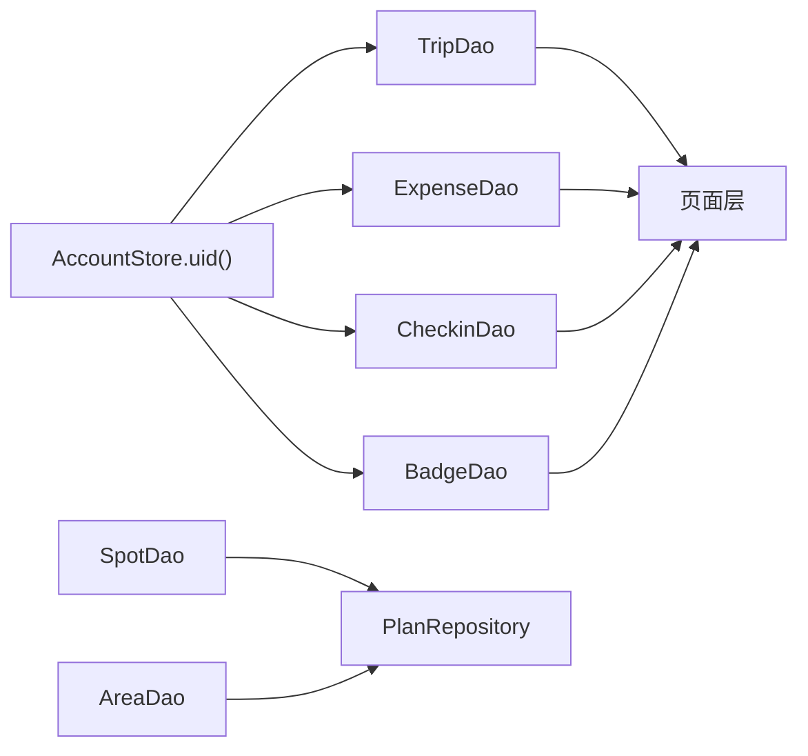

**图表来源**
- [TripDao.ets:1-30](file://entry/src/main/ets/data/TripDao.ets#L1-L30)
- [ExpenseDao.ets:1-20](file://entry/src/main/ets/data/ExpenseDao.ets#L1-L20)
- [CheckinDao.ets:1-28](file://entry/src/main/ets/data/CheckinDao.ets#L1-L28)
- [BadgeDao.ets:1-20](file://entry/src/main/ets/data/BadgeDao.ets#L1-L20)
- [PlanRepository.ets:12-55](file://entry/src/main/ets/data/PlanRepository.ets#L12-L55)

**章节来源**
- [TripDao.ets:1-384](file://entry/src/main/ets/data/TripDao.ets#L1-L384)
- [ExpenseDao.ets:1-111](file://entry/src/main/ets/data/ExpenseDao.ets#L1-L111)
- [CheckinDao.ets:1-70](file://entry/src/main/ets/data/CheckinDao.ets#L1-L70)
- [BadgeDao.ets:1-70](file://entry/src/main/ets/data/BadgeDao.ets#L1-L70)
- [PlanRepository.ets:1-55](file://entry/src/main/ets/data/PlanRepository.ets#L1-L55)

## 性能优化
- 批量 upsert：SpotDao.saveSpots 与 AreaDao.saveAreas 使用 ON_CONFLICT_REPLACE，避免逐条比较与重复写入。
- 查询优化：
  - TripDao.listSummaries 使用子查询一次性计算 spotCount、bookingCount、legCount、checkinCount。
  - TripDao.todayPlan 先用 start_date/end_date 预筛 trip id，再按需整份加载，降低 N×4 SQL。
  - ExpenseDao.sumByCategory 与 sumGroupedByActivity 用 GROUP BY 在数据库侧聚合，避免 UI 循环计算。
- 索引建议（基于现有 WHERE 与 JOIN 条件）：
  - trip(user_id, updated_at)
  - trip_day(trip_id, day_index)
  - activity(trip_id, day_index, time)
  - meal(trip_id, day_index, type)
  - checkin(trip_id, activity_id, user_id)
  - expense(trip_id, user_id, created_at)
  - expense(activity_id)
  - spot(city, popularity)
  - area(city, grp, id)
- 内存管理：
  - ResultSet 使用 try/finally 关闭，避免游标泄漏。
  - JSON 字段仅在必要时解析，失败时降级为空数组或 undefined。
  - 大结果集尽量在 DAO 层映射为轻量 DTO，如 TripSummary、BadgeRecord、CategoryTotal。

**章节来源**
- [SpotDao.ets:22-99](file://entry/src/main/ets/data/SpotDao.ets#L22-L99)
- [AreaDao.ets:18-74](file://entry/src/main/ets/data/AreaDao.ets#L18-L74)
- [TripDao.ets:101-199](file://entry/src/main/ets/data/TripDao.ets#L101-L199)
- [ExpenseDao.ets:44-111](file://entry/src/main/ets/data/ExpenseDao.ets#L44-L111)
- [BadgeDao.ets:21-70](file://entry/src/main/ets/data/BadgeDao.ets#L21-L70)

## 故障排查
- 数据分区问题：
  - 所有写操作与关键查询都带上 user_id，避免同机切换账号后出现误删或误读。
  - 删除 trip 时先校验 owned，再清理子表；purgeChildren=true 才清理 checkin 与 expense。
- 游客归户异常：
  - adoptGuestData 在同一事务内更新 trip、expense、checkin，避免登录前数据丢失。
  - 归户后统计 trip/expense/checkin 数量并记录日志。
- 打卡与勋章不一致：
  - BadgeDao 使用 `a.id = c.trip_id || ':' || c.activity_id` 与 activity 前缀主键匹配；餐次打卡无 activity 行会被自然排除。
  - CheckinDao.set 区分 arrival 与 manual，勋章展示依赖 source 字段。
- 结果集未关闭：
  - 所有 DAO 的 querySql 均使用 try/finally 关闭 ResultSet，避免资源泄漏。
- 日志定位：
  - TripDao、ExpenseDao、CheckinDao 使用 Logger 记录关键步骤，便于定位慢查询与数据异常。

**章节来源**
- [TripDao.ets:262-384](file://entry/src/main/ets/data/TripDao.ets#L262-L384)
- [CheckinDao.ets:29-70](file://entry/src/main/ets/data/CheckinDao.ets#L29-L70)
- [BadgeDao.ets:21-70](file://entry/src/main/ets/data/BadgeDao.ets#L21-L70)
- [ExpenseDao.ets:16-111](file://entry/src/main/ets/data/ExpenseDao.ets#L16-L111)

## 结论
该 Model 层以 DAO 模式清晰拆分了 RDB 访问职责，TripDao 作为复杂聚合根提供整存整取与生命周期管理，SpotDao、AreaDao、ExpenseDao、CheckinDao、BadgeDao 各自专注单一领域。PlanRepository 作为仓储层屏蔽 mock、种子库与 MapKit 回退差异，使页面获得稳定统一的业务接口。数据模型与表结构保持紧密映射，同时在多处采用批量 upsert、SQL 聚合、分区查询与游标安全关闭等优化手段，保障本地数据的一致性与性能。后续可在索引设计与分页策略上继续增强，以应对行程与费用数据规模增长。